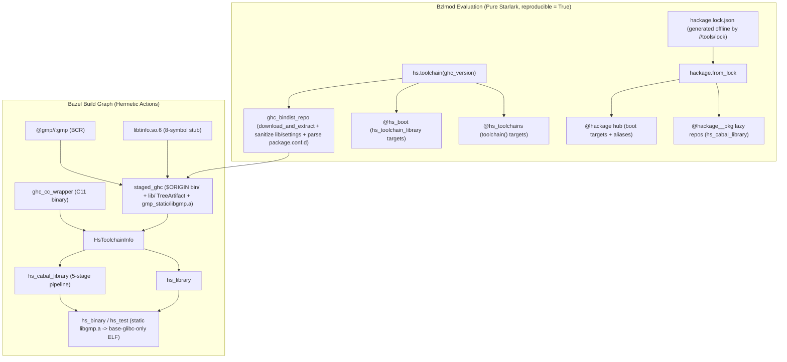
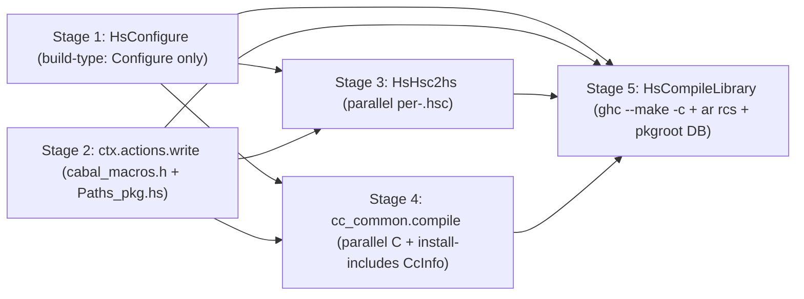

# `rules_hs` Architecture & Design

This document explains why `rules_hs` exists, analyzes the failure modes of prior Haskell-on-Bazel designs, and walks through every subsystem of `rules_hs`: hermetic `$ORIGIN`-staged GHC toolchains, static-GMP user binaries, the native C11 `ghc_cc_wrapper`, the direct-vs-transitive provider model, the two-phase Hackage lockfile architecture, the 5-stage `hs_cabal_library` pipeline, and cross-OS extensibility.

> For the complete evaluation of adopted vs. not-adopted dependencies across `rules_hs` and `examples/size` — including concrete catalysts for reconsidering each choice — see [`docs/dependencies.md`](dependencies.md).

---

## 1. Prior Art Analysis

### 1.1 Limitations of `tweag/rules_haskell`

Inspecting `tweag/rules_haskell` (`master` and BCR `1.0`) reveals six structural bottlenecks that make a clean Bazel 9 rewrite substantially simpler and more maintainable than incremental patching:

1. **Bazel 7 lock-in & heavy non-dev `MODULE.bazel` graph**:
   - `rules_haskell` pins Bazel 7 (`.bazelversion = 7.1.0` on `master`) and leaks a wide set of non-dev `bazel_dep`s to every downstream consumer: `rules_java`, `protobuf`, `abseil-cpp`, `rules_proto`, `rules_nodejs` + `aspect_rules_js` (for legacy Asterius WASM support), `rules_python`, `rules_sh`, and legacy `rules_cc`.
   - On Bazel 8 and 9, stale `rules_sh` (`get_cpu_value`) and `aspect_rules_js` (`npm_import.bzl`) APIs break module evaluation outright, and legacy `WORKSPACE`-oriented assumptions (`ctx.resolve_tools`, leaked `stackage` repos) linger throughout the ruleset.

2. **Non-hermetic Linux bindists forcing `rules_nixpkgs` (breaking RBE & BCR)**:
   - `haskell/ghc_bindist.bzl` unpacks GHC `deb10` bindists and invokes host `./configure --prefix ... && make install` inside a repository rule, requiring host `make`, build tools, and system shared libraries (`rules_haskell`'s BCR `1.0` `presubmit.yml` runs `sudo apt install libtinfo5 libgmp-dev`).
   - Achieving Linux hermeticity therefore pushes users toward `rules_nixpkgs`, which populates `/nix/store` on the host during repository fetch — breaking Remote Build Execution (RBE) and making Bazel Central Registry (BCR) consumption impractical.

3. **Python runtime wrapper (`cc_wrapper.py.tpl`) & env leakage**:
   - Wrapping the C compiler in Python pulls `rules_python` (and a Python interpreter) into every Haskell compile and link action, adding startup latency and platform bugs while still requiring shell-wrapper mitigations (`unset RUNFILES_DIR RUNFILES_MANIFEST_FILE RUNFILES_MANIFEST_ONLY`) to stop Bazel runfiles variables from breaking GHC subprocesses.

4. **Dynamic linking & `$ORIGIN` rpath complexity**:
   - `ghc_bindist.bzl` hardcodes `fully_static_link = False` for bindists, forcing downstream binaries through complex `$ORIGIN`/`@loader_path` rpath rewrites and shared library packaging (`libHS*.so`, `libgmp.so.10`, `libffi.so.8`).

5. **Heavyweight `stack_snapshot` & opaque `cabal_wrapper.py`**:
   - Third-party Hackage builds require an external `stack` binary (or manual snapshot pinning + per-package `setup_deps` overrides) and execute `runghc Setup.hs configure && build && copy && register && clean` inside a single opaque Python action. That action mutates `cwd`, relocates `libHS*.a` to avoid Bazel `TreeArtifact` overlap with `.hi` directories, regex-patches `.conf` files to `${pkgroot}`, and loses fine-grained action parallelism across `hsc2hs`, C compilation, and Haskell compilation.

6. **High UX boilerplate**:
   - Users must manually declare `haskell_toolchain_library` targets for boot libraries (`base`, `text`, `bytestring`, etc.) or route everything through `@stackage`, while package-level wrappers and `gazelle_haskell_modules` add maintenance overhead.

### 1.2 Design Inspiration from Buck2 Haskell & Modern Bzlmod Rulesets

- **Buck2 Haskell (`facebook/buck2/prelude/haskell`)**: Separates **direct** library metadata (`HaskellLibraryProvider`) used for strict module visibility (`-hide-all-packages` + `-package-id`) from **transitive** linking state (`HaskellLinkInfo` + native C++ `MergedLinkInfo`). `rules_hs` adopts this exact split with `HsPackageInfo` vs. `HsLinkInfo` + `CcInfo`.
- **Modern Bzlmod-only rulesets (`rules_zig`, `rules_dotnet`, `rules_rust`, `rules_go`)**:
  - Target `bazel_compatibility = [">=9.0.0"]` with zero `WORKSPACE` files.
  - Keep direct non-dev `MODULE.bazel` dependencies strictly minimal (`platforms`, `bazel_skylib`, `rules_cc`, `gmp`).
  - Mark every extension `reproducible = True` for deterministic `MODULE.bazel.lock` files.
  - Expose boot libraries automatically (`@hs_boot` and `@hackage`) and fetch third-party packages lazily via a hub + per-package repository layout.

### 1.3 Why `deb10` (glibc) Over `alpine3_12` (`musl` static) as Default

Both official GHC 9.10.3 Linux bindist families were audited against `hermetic_cc_toolchain` (`zig cc`) under `env -i PATH=/nonexistent`:

| Property | `deb10` (glibc, default) | `alpine3_12-linux-static-int_native` (musl, future opt-in) |
|---|---|---|
| **Upstream Linux architectures** | `x86_64` **and** `aarch64` (`linux_arm64`) | `x86_64` only (no upstream `aarch64` static bindist) |
| **GHC compiler dynamic deps** | Only `libgmp.so.10` + `libtinfo.so.6` (`libffi.so.8` bundled); `glibc <= 2.28` | 100% static ELF (`PT_INTERP = NONE`) |
| **Template Haskell + C FFI** | Full dynamic GHCi loader (verified PASS) | Internal ELF RTS linker clashes with dual-musl `libc.a` (segfaults on `withCString`/`malloc`) |
| **BCR `cc_library` interop** | Native interop with glibc `cc_toolchain`s (`hermetic_cc_toolchain`, `toolchains_llvm`, GCC) | Forces every `cc_library` onto musl; ABI mismatch with glibc toolchains |
| **Bignum backend** | GMP (`crypton`/`cborg` defaults work out-of-the-box) | Native bignum (requires flipping `crypton`/`cborg` GMP flags) |

Using `deb10` bindists with BCR `gmp` + our minimal `libtinfo.so.6` stub gives full `x86_64` + `arm64` Linux coverage, clean BCR C/C++ interop, GMP performance, and user binaries whose `DT_NEEDED` is still limited exclusively to base glibc. `linux_x86_64_musl` remains cataloged in [`hs/private/ghc_versions.bzl`](../hs/private/ghc_versions.bzl) as a clean opt-in flavor for `FROM scratch` static binaries.

---

## 2. System Overview



---

## 3. Hermetic GHC Toolchain

### 3.1 Pure-Starlark Bindist Extraction (Zero `./configure && make install`)

Official GHC `deb10` tarballs already ship ready-to-run ELF binaries in `bin/` and a pre-built, relocatable `lib/package.conf.d/package.cache` referencing `${pkgroot}/../lib/...`. Running `./configure && make install` in a repository rule is unnecessary and introduces host tool dependencies (`make`, `perl`, `gcc`).

Instead, `ghc_bindist_repo` ([`hs/private/ghc_bindist.bzl`](../hs/private/ghc_bindist.bzl)) performs three deterministic Starlark steps at fetch time:

1. `repository_ctx.download_and_extract(...)` with pinned URL, SHA-256, and `stripPrefix`.
2. **Host-path sanitization of `lib/settings`**: Replaces every baked-in host path (`/usr/bin/gcc`, `/usr/bin/g++`, `/usr/bin/ld.gold`, `/usr/bin/ld`, `/usr/bin/ar`, `/usr/bin/ranlib`) with `/nonexistent/*` and removes `-fuse-ld=gold`. This guarantees GHC can never silently fall back to host compilers or linkers; every real tool path is passed explicitly per action from Bazel's resolved `cc_toolchain`.
3. **Pure-Starlark `package.conf.d/*.conf` parsing**: Parses each boot package's `name`, `version`, `id`, `depends`, and `exposed-modules` directly into `boot_packages_json` on `hs_toolchain`, and resolves the exact `rts-<ver>/include` path for C FFI headers (`Rts.h`, `HsFFI.h`).

> **Layout invariant**: GHC's pre-built `package.cache` resolves boot headers via `${pkgroot}/../lib/...`, so the staged library directory must literally be named `lib`.

### 3.2 `$ORIGIN` Staging & 8-Symbol `libtinfo.so.6` Stub

Auditing every binary and `.so` inside the GHC `9.10.3` `deb10` bindists (`x86_64` and `aarch64`) shows:
- `libffi.so.8` and `libCffi*.a` are **bundled** inside `lib/<arch>-linux-ghc-<ver>/`. There is zero `libnuma` dependency.
- All compiler binaries (`ghc-9.10.3`, `ghc-pkg`, `hsc2hs`, `ghc-iserv-dyn`, `unlit`) carry a baked-in ELF `RUNPATH`:
  ```text
  $ORIGIN/../lib/<arch>-linux-ghc-<ver>:$ORIGIN/../../../lib/<arch>-linux-ghc-<ver>
  ```
- Across the entire compiler, only **two** non-glibc dynamic libraries are required:
  1. **`libgmp.so.10`** (unversioned `__gmpn_*` symbols): Built hermetically in `HsLinkGmpShared` (`hs/private/staged_ghc.bzl`) from BCR `@gmp//:gmp`'s PIC archive via `-shared -Wl,-soname,libgmp.so.10 -Wl,--whole-archive <libgmp.pic.a> -Wl,--no-whole-archive`.
  2. **`libtinfo.so.6`** (exactly 8 symbols versioned `@NCURSES6_TINFO_5.0.19991023`, imported solely by `libHSterminfo` for interactive GHCi/haskeline terminal queries): Compiled directly by `cc_binary(linkshared = True)` from [`hs/private/tinfo_stub.c`](../hs/private/tinfo_stub.c) and linker version script [`hs/private/tinfo_stub.lds`](../hs/private/tinfo_stub.lds). Each function (`setupterm`, `del_curterm`, `set_curterm`, `tigetflag`, `tigetnum`, `tigetstr`, `tparm`, `tputs`) returns the standard terminfo error/NULL sentinel so `terminfo` cleanly falls back to dumb-terminal mode — eliminating any dependency on host `libtinfo` or BCR `ncurses`/`gawk`.

`staged_ghc` ([`hs/private/staged_ghc.bzl`](../hs/private/staged_ghc.bzl)) places the copied compiler drivers under `<prefix>/bin/` and a self-contained `TreeArtifact` under `<prefix>/lib/` with `libgmp.so.10` (+ `libgmp.so`) and `libtinfo.so.6` (+ `libtinfo.so`) inside `<prefix>/lib/<arch_libdir>/`.

Because the ELF dynamic loader resolves `$ORIGIN/../lib/<arch_libdir>` directly from the executable's path:
- **Zero `LD_LIBRARY_PATH`** is ever set (so child `/bin/bash`, `./configure`, and `cc_toolchain` processes are never polluted).
- **Zero `patchelf`** is required.
- The staged toolchain runs cleanly under `env -i PATH=/nonexistent` on any glibc `>= 2.28` Linux host or RBE worker.

### 3.3 Static `libgmp.a` Linking for User Executables

While the GHC compiler itself is dynamically linked against `libgmp.so.10`, user binaries should not inherit a runtime dependency on `libgmp.so.10`. `staged_ghc` creates a dedicated, static-only directory `<prefix>/gmp_static/` containing **strictly** `libgmp.a` (symlinked from `@gmp//:gmp`, with no `.so` file present).

`HsLinkExecutable` (`hs/private/rules.bzl`) passes:
- `-optl-L<gmp_static_dir>`: forces the linker to resolve `ghc-bignum`'s `-lgmp` against static `libgmp.a`.
- `-optl-no-pie`: allows static linking of GHC's non-PIC boot archives cleanly under `lld`/Clang/Zig.

The resulting ELF binary carries `DT_NEEDED` strictly limited to base glibc (`libc.so.6`, `libm.so.6`, `libdl.so.2`, `libpthread.so.0`), enforced by both `//tests/basic:elf_hermeticity_test`, `//tests/rules:bzlmod_hygiene_test`, and `examples/size`'s `//:elf_hermeticity_test`.

---

## 4. Native C11 `ghc_cc_wrapper` & C-Toolchain Agnosticism

`resolve_cc_tools` ([`hs/private/actions.bzl`](../hs/private/actions.bzl)) queries Bazel's active `@bazel_tools//tools/cpp:toolchain_type` via `rules_cc` (`find_cc_toolchain` + `cc_common`) to extract:
- `cc` (`ACTION_NAMES.c_compile`), `ar` (`ACTION_NAMES.cpp_link_static_library`), and `ld` (`cc_toolchain.ld_executable`).
- Any `--sysroot` / `--target` flags from `cc_common.create_compile_variables` and `cc_toolchain.sysroot`, forwarded via `RULES_HS_CC_EXTRA_ARGS`.

All GHC compiler/assembler/linker/preprocessor hooks (`-pgmc`, `-pgmcxx`, `-pgml`, `-pgma`, `-pgmP`, `-pgmCmmP`), `hsc2hs` (`--cc`, `--ld`), and Cabal `./configure` (`CC`, `CXX`) invoke the compiled C11 binary `ghc_cc_wrapper` ([`hs/private/cc_wrapper.c`](../hs/private/cc_wrapper.c)) rather than a Python script:

| Guard / Rewrite in `cc_wrapper.c` | Root Cause & Effect |
|---|---|
| `unsetenv("RUNFILES_DIR")`, `RUNFILES_MANIFEST_FILE`, `RUNFILES_MANIFEST_ONLY` | Prevents Bazel runfiles environment variables from leaking into GHC, `hsc2hs`, or C compiler subprocesses. |
| Intercept `--print-file-name[=]<file>` | Resolves against explicit `-B`/`-L` search dirs or echoes `<file>` and exits `0`. Prevents Clang/Zig from leaking host `/usr/lib/x86_64-linux-gnu/libm.a` linker scripts or crashing on Zig's `.2.xx` glibc triple suffix. |
| Rewrite `-Wl,-h` / `-Wl,-h,<soname>` to `-Wl,-soname,<soname>` (including inside `@rsp` files) | GHC passes `-Wl,-h` when linking shared objects; `zig cc` rejects `-h`. `cc_wrapper.c` parses quoted/escaped `@response_file`s and rewrites them cleanly. |
| Strip `-fuse-ld=gold` | Removes legacy GHC linker flags incompatible with `lld` / `zig cc`. |
| Rewrite `-fno-PIC` to `-fPIC` (when `RULES_HS_FORCE_PIC=1`) | GHC passes `-fno-PIC` to `-pgma`; Zig `gnu.*` targets require PIC. |
| Symlink `.dyn_o` / `.p_o` inputs to temporary `.o` aliases | `zig cc` rejects object files without a `.o` suffix. |
| Inject `-Wno-unused-command-line-argument` (except on `--version` / `-dumpversion` / `-dumpmachine`) | Silences warnings caused by `zig-wrapper`'s implicit `-fno-sanitize=undefined` during `-E`, `-x assembler`, and autoconf `./configure` probes. |
| Inject `-nostdinc++` for non-C++ invocations (`detect_cxx_invocation`) | `hermetic_cc_toolchain` routes C compilation through `zig c++`, placing `libcxx/include` ahead of C headers. That pulls `<features.h>` via `libcxx/include/stddef.h` (included by GHC's `template-hsc.h`) before package headers like `HsNet.h` can `#define _GNU_SOURCE 1`, hiding `struct ucred` and `struct in6_pktinfo`. Dropping C++ include dirs for C/asm/link restores standard C header order. |

Alongside the wrapper, `ghc_tool_flags` ([`hs/private/actions.bzl`](../hs/private/actions.bzl)) explicitly passes:
- `-optP-E -optP-undef -optP-traditional` and `-optCmmP-E` (overriding `-pgmP`/`-pgmCmmP` clears GHC's default preprocessor flags).
- `-optl-Wl,--no-as-needed` (overriding `-pgml` clears GHC's default link flags).
- `-pgmlm <ld> -optlm-r` (overriding `-pgmlm` wipes `Merge objects flags`, which would otherwise break `CApiFFI` object merging).

> **Note on `hermetic_cc_toolchain` glibc selection**: Register `@zig_sdk//toolchain:linux_amd64_gnu.2.32` and `@zig_sdk//toolchain:linux_arm64_gnu.2.32` ahead of `@zig_sdk//toolchain/...`. By default, `@zig_sdk//toolchain/...` selects `gnu.2.17` alphabetically, which lacks glibc 2.27/2.28 symbols (`memfd_create`, `statx`, `fcntl64`) needed by GHC `deb10` bindists and lacks glibc 2.32 `<sys/single_threaded.h>` needed by BCR `gmp`/`m4` under Zig. Binaries targeting `gnu.2.32` remain portable across Debian 12 (2.36), Ubuntu 22.04/24.04 (2.35/2.39), and Rocky Linux 9 (2.34).

---

## 5. Provider Model & Strict Dependency Visibility

Modeled on Buck2 Haskell, [`hs/providers.bzl`](../hs/providers.bzl) enforces a strict separation between direct and transitive information:

- **`HsPackageInfo` (direct package identity)**: `name`, `version`, `unit_id`, `pkg_db`, `exposed_modules`, `is_boot`, `hs_lib`, `hi_dir`.
  - For C-only Cabal packages (such as `zlib-clib`), `unit_id`, `pkg_db`, `hs_lib`, and `hi_dir` are `None`.
- **`HsLinkInfo` (transitive closure)**: `depset`s of `pkg_dbs`, `hs_libs`, `include_dirs`, `headers`, plus merged `CcInfo`.

When compiling any library or executable (`collect_deps` in [`hs/private/actions.bzl`](../hs/private/actions.bzl)):
1. GHC receives `-hide-all-packages`.
2. Every **transitive** `pkg_db` is passed via `-package-db` so GHC can load transitive interface (`.hi`) dependencies and resolve link closures.
3. Only **direct** `deps`' `unit_id`s are exposed via `-package-id`, enforcing Bazel's strict direct-dependency visibility at compile time (verified by `//tests/starlark:strict_direct_dep_visibility_test`).
4. Transitive native C archives from `c_sources`, `cc_deps`, and `extra_cc_deps` are merged via `cc_common.merge_cc_infos` and passed to final executable linking inside `-optl-Wl,--start-group ... -optl-Wl,--end-group`.

---

## 6. Two-Phase Hackage Lockfile & 5-Stage `hs_cabal_library` Pipeline

### 6.1 Phase 1 (Dev-Time): Dogfooded `Cabal-syntax` Lock Generator

Rather than implementing a brittle `.cabal` parser in Starlark or invoking `cabal`/`stack` at build time, `rules_hs` dogfoods GHC's own boot **`Cabal-syntax`** library in [`tools/lock/`](../tools/lock/) (`//tools/lock:lock`):

- Built strictly from `@hs_boot` libraries (`base`, `Cabal-syntax`, `bytestring`, `containers`, `directory`, `filepath`, `process`, `text`) — zero third-party dependencies.
- Reads a Stackage snapshot YAML + `cabal.config` (for a CI-verified, consistent version plane), merges Stackage flag defaults with CLI `--flag` overrides, and runs a BFS over the transitive non-boot dependency closure.
- Evaluates every `.cabal` file with `Distribution.PackageDescription.Configuration.finalizePD` across four target platforms (`linux_x86_64`, `linux_arm64`, `macos_arm64`, `macos_x86_64`), separating common attributes from minimal per-platform `select` deltas (e.g., `crypton` x86_64 AESNI flags vs. `arm64`).
- Computes SHA-256 digests of official Hackage `.tar.gz` tarballs, normalizes doctest-only `build-type: Custom` packages (`xml-conduit`), inspects `build-type: Configure` tarballs (`<pkg>.buildinfo` and `configure.ac`) to capture generated `install-includes` (such as `HsNetworkConfig.h` for `network` and `HsTimeConfig.h` for `old-time`), and emits a deterministic `hackage.lock.json` (`schema_version = 1`).

### 6.2 Phase 2 (Build-Time): Pure-Starlark `hackage` Extension

[`hs/private/hackage.bzl`](../hs/private/hackage.bzl) reads `hackage.lock.json` via `json.decode(module_ctx.read(lock_label))` with zero network calls during extension evaluation and returns `module_ctx.extension_metadata(reproducible = True)`:

- **Hub repo (`@hackage`)**: Emits `hs_toolchain_library` targets for all GHC boot packages plus lightweight `alias()` targets pointing to lazy per-package repos (`@hackage__<sanitized_pkg>`), and exposes internal sublibraries (`@hackage//:attoparsec__attoparsec-internal`).
- **Lazy per-package repo (`@hackage__<pkg>`)**: Downloaded only when referenced in the build graph. Extracts the SHA-256-verified tarball, rewrites non-executable (`0644`) `configure`/`config.guess`/`config.sub`/`install-sh` scripts with `executable = True` in pure Starlark, resolves module-exact `.hs`/`.lhs`/`.hsc`/`.hs-boot` files (automatically skipping Windows `.hsc` files, tests, and `Setup.hs`), retains non-compiled textual `.c` `#include`s (e.g., `crypton`'s `cbits/*_impl.c`) in `hdrs`, emits `config_setting` + `select()` where needed, and generates `hs_cabal_library` targets (sublibraries first, then main library).

### 6.3 The 5-Stage `hs_cabal_library` Pipeline

[`hs/private/cabal_library.bzl`](../hs/private/cabal_library.bzl) decomposes each Cabal library into up to five cacheable, parallelizable Bazel actions — with zero `Setup.hs` or `cabal_wrapper.py`:



1. **Stage 1 — `HsConfigure` (`build-type: Configure` only)**: Stages `configure` and `configure_srcs` into a writable sandbox temp directory, runs `/bin/sh ./configure` with `CC`/`CXX` pointed at `ghc_cc_wrapper` and `AR`/`LD` pointed at Bazel's `cc_toolchain`, and exports declared config headers (`include/HsNetworkConfig.h`, `cbits/config.h`, `include/HsTimeConfig.h`).
2. **Stage 2 — Zero-subprocess codegen (`ctx.actions.write`)**:
   - Generates `cabal_macros.h` (`CURRENT_PACKAGE_*`, `TOOL_VERSION_ghc`, `MIN_TOOL_VERSION_ghc`, and `VERSION_*` / `MIN_VERSION_*` for all direct `HsPackageInfo` dependencies).
   - Optionally generates `Paths_<pkg>.hs` when `generate_paths_module = True`.
3. **Stage 3 — Parallel `HsHsc2hs` (`.hsc` files only)**: Spawns one Bazel action per `.hsc` file invoking staged `hsc2hs` with `--template=template-hsc.h`, `--cc`/`--ld` set to `ghc_cc_wrapper`, Cabal's standard GHC/OS/arch CPP defines (`__GLASGOW_HASKELL__`, `linux_HOST_OS`, `x86_64_HOST_ARCH`, etc.), `-include cabal_macros.h`, and local + configure + transitive `install-includes` dirs.
4. **Stage 4 — Native C compilation via `cc_common.compile` (`rules_cc`)**:
   - Compiles `c_sources` in parallel with GHC RTS headers (`Rts.h`, `HsFFI.h`), `cabal_macros.h`, and `cc_options`.
   - Passes non-header textual includes (such as `crypton`'s `#include`-d `.c` implementation files) via `additional_inputs` while keeping real headers in `private_hdrs`/`public_hdrs`.
   - Propagates `install_includes` headers and static archives transitively through `CcInfo` + `HsLinkInfo` — so e.g. `streaming-commons/cbits/zlib-helper.c` cleanly resolves `#include <zlib.h>` via `zlib -> zlib-clib`.
   - **C-only packages (`zlib-clib`)**: When a target has no Haskell modules, `hs_cabal_library` returns immediately after Stage 4, skipping GHC invocation completely.
5. **Stage 5 — `HsCompileLibrary`**:
   - Invokes a single `ghc --make -c` per library/sublibrary (handling `.hs-boot` cycles in `cborg`/`tls` and `CApiFFI` stubs while amortizing GHC startup across modules), passing explicit `-X<default_language>` (`Haskell98`/`Haskell2010`/`GHC2021` — critical because GHC 9.10+ defaults to `GHC2021`).
   - Archives `.o` files into `libHS<unit_id>.a` with Bazel's hermetic `ar` via an `@objects.rsp` response file.
   - Emits a self-contained, relocatable `<name>.pkgdb` `TreeArtifact` holding `hi/` (`.hi` interface files) and `<unit_id>.conf` referencing `import-dirs: ${pkgroot}/<pkgdb_base>/hi` and `library-dirs: ${pkgroot}` (since `libHS<unit_id>.a` and `<name>.pkgdb` share the same parent output directory, `${pkgroot}` expands to that parent cleanly in every execroot/sandbox), then runs `ghc-pkg recache`.

---

## 7. Cross-OS Extensibility & Roadmap

[`hs/private/ghc_versions.bzl`](../hs/private/ghc_versions.bzl) is structured as a pure metadata table and already catalogs official URLs, SHA-256 checksums, `strip_prefix`, `arch_libdir`, platform constraints, `bignum`, `dynamic_ghc`, and `needs_tinfo_stub` for six targets across GHC `9.10.3` and `9.12.4`:
- **Active today**: `linux_x86_64`, `linux_arm64`.
- **Cataloged for follow-up enablement**: `macos_arm64`, `macos_x86_64`, `windows_x86_64`, and `linux_x86_64_musl`.

What remains to activate each additional target cleanly:

1. **macOS (`macos_arm64`, `macos_x86_64`)**:
   - `tools/lock` and `hs/private/hackage.bzl` already generate `macos_arm64` and `macos_x86_64` `select()` branches.
   - Adapt `staged_ghc.bzl` for Mach-O `@loader_path` staging (no `libtinfo.so.6` stub is required on macOS; `needs_tinfo_stub = False`) and add Mach-O linker flags (`-install_name`, `-Wl,-dead_strip_dylibs`) in `cc_wrapper.c` and `actions.bzl`.
   - Append `macos_arm64` and `macos_x86_64` to `SUPPORTED_PLATFORMS` in `hs/private/ghc_versions.bzl`.

2. **Windows (`windows_x86_64`)**:
   - Handle `.exe` binary extensions in `ghc_bindist.bzl` and `staged_ghc.bzl`.
   - Port `cc_wrapper.c` process spawning (`_spawnv` / `CreateProcess`) and environment clearing (`_putenv_s`), and replace POSIX shell action glue with a small native action runner so Windows builds need no MSYS bash.
   - Add `windows_x86_64` to `tools/lock` and `_PLATFORM_CONFIGS` in `hs/private/hackage.bzl`.

3. **Linux `musl` static (`linux_x86_64_musl`)**:
   - Register `linux_x86_64_musl` with a musl constraint matching `@zig_sdk//libc:musl` for zero-glibc `FROM scratch` binaries (noting upstream's `x86_64`-only availability and the TH + C FFI RTS-linker limitation documented in Section 1.3).

4. **Cross-library Template Haskell splices**:
   - Today, `TemplateHaskellQuotes`, boot-package splices, and same-library cross-module splices work (`//tests/rules/th:th_test`).
   - Supporting cross-library TH splices requires adding an opt-in `-dynamic-too` build path on `hs_library` / `hs_cabal_library` emitting `libHS<unit_id>-ghc<ver>.so` alongside `libHS<unit_id>.a` and populating `dynamic-library-dirs: ${pkgroot}` in the `.pkgdb` `.conf` file.
