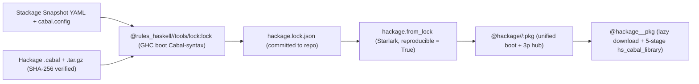

This guide shows you how to pin third-party [Hackage](https://hackage.haskell.org/) packages from a [Stackage](https://www.stackage.org/) snapshot and depend on them in Bazel, without installing host `cabal` or `stack` or running Cabal `Setup.hs` scripts during builds.

If you haven't set up a Bazel 9 Haskell workspace yet, start with [Quickstart](quickstart.md). For every CLI flag and lockfile field, see the [Lock generator CLI reference](../reference/lock-cli.md); for the 5-stage build internals, see [Hackage and Cabal pipeline](../internals/ecosystem-and-hackage.md). If you're new to Hackage, Stackage, or Cabal `Setup.hs`, you can jump ahead to [How Haskell packaging works](#packaging-concepts) and [How Cabal `build-type` and `Setup.hs` work](#setup-hs-and-build-types).

Third-party dependency management uses a two-phase lockfile workflow:

1. **Lock phase (developer workflow):** Run [`@rules_haskell//tools/lock:lock`](../reference/lock-cli.md)—a CLI tool built by `rules_haskell` using only GHC's built-in `Cabal-syntax` library—to resolve your root packages against a Stackage snapshot and write a deterministic `hackage.lock.json` file that you commit to Git.
2. **Build phase ([Bzlmod](https://bazel.build/external/overview) and [Bazel actions](https://bazel.build/extending/rules#actions)):** [`hackage.from_lock`](../reference/extensions-and-providers.md#hackage-from_lock) reads `hackage.lock.json` in [Starlark](https://bazel.build/rules/language) ([`reproducible = True`](https://bazel.build/external/extension#specify-reproducibility-and-use-facts)), exposes a single `@hackage` hub repository, downloads individual `.tar.gz` archives only when a target depends on them, and compiles each library with the 5-stage [`hs_cabal_library`](../reference/rules.md#hs_cabal_library) rule.



## Step 1: Generate `hackage.lock.json`

Run `@rules_haskell//tools/lock:lock` from your repository root via [`bazel run`](https://bazel.build/docs/user-manual#running-executables). Pass a Stackage snapshot (`--snapshot`), your direct root Hackage packages (`--package`), any Cabal flag overrides (`--flag`), and an absolute `--output` path:

```bash
bazel run @rules_haskell//tools/lock:lock -- \
  --snapshot lts-24.67 \
  --package aeson \
  --package async \
  --package http-client \
  --package http-client-tls \
  --package http-types \
  --package xml-conduit \
  --package zlib \
  --flag zlib:bundled-c-zlib=true \
  --flag zlib:pkg-config=false \
  --output "$PWD/hackage.lock.json"
```

> **Important:** Pass `$PWD` to `--output` under `bazel run`. Because `bazel run` starts binaries inside Bazel's [runfiles](https://bazel.build/extending/rules#runfiles) directory rather than your shell's working directory, always pass an absolute path such as `--output "$PWD/hackage.lock.json"` so the lockfile is written to your repository root.

### What `//tools/lock:lock` does step by step

1. Downloads the Stackage snapshot YAML (`lts-24.67` for GHC `9.10.3`) and Stackage `cabal.config`, caching HTTP downloads in `--cache-dir` (`/tmp/rules_haskell_lock_cache` by default).
2. Merges Stackage's package flags with your explicit `--flag <pkg>:<flag>=<bool>` overrides.
3. Walks all transitive non-boot dependencies via breadth-first search, downloading each `.cabal` file and `.tar.gz` archive from `hackage.haskell.org` and recording its SHA-256 digest.
4. Evaluates every `.cabal` file using `Cabal-syntax`'s `finalizePD` function across four target platforms (`linux_x86_64`, `linux_arm64`, `macos_arm64`, `macos_x86_64`), placing shared metadata in common fields and platform-specific differences in compact [`select()`](https://bazel.build/configure/attributes) blocks.
5. Converts `cabal-doctest`-only `build-type: Custom` packages (such as `xml-conduit`) to `"Simple"`, and inspects `build-type: Configure` archives (`network`, `unix-time`, `old-time`) to record autoconf script inputs and generated header paths.
6. Filters upstream `ghc-options` by removing warning flags (`-Werror`, `-Wall`) and link-only executable flags (`-threaded`) so compiler warning changes don't break third-party library builds, while keeping optimization and code-generation flags (`-O2`, `-funbox-strict-fields`).

Commit `hackage.lock.json` to version control. See the [Lock generator CLI reference](../reference/lock-cli.md) for every CLI flag and JSON field.

## Step 2: Load `hackage.lock.json` in `MODULE.bazel`

Register the lockfile in [`MODULE.bazel`](https://bazel.build/external/module) with the [`hackage`](../reference/extensions-and-providers.md#hackage) [module extension](https://bazel.build/external/extension):

```starlark
hs = use_extension("@rules_haskell//haskell:extensions.bzl", "hs")
hs.toolchain(ghc_version = "9.10.3")
use_repo(hs, "hs_toolchains")
register_toolchains("@hs_toolchains//:all")

hackage = use_extension("@rules_haskell//haskell:extensions.bzl", "hackage")
hackage.from_lock(
    name = "hackage",
    lockfile = "//:hackage.lock.json",
)
use_repo(hackage, "hackage")
```

> **Tip:** When you load `@hackage`, you don't need [`use_repo(hs, "hs_boot")`](https://bazel.build/rules/lib/globals/module#use_repo) unless you prefer referencing boot libraries separately. The `@hackage` hub repository exposes [`hs_toolchain_library`](../reference/rules.md#hs_toolchain_library) targets for every GHC boot package (`@hackage//:base`, `@hackage//:bytestring`, `@hackage//:containers`, `@hackage//:text`) alongside aliases for every locked Hackage package (`@hackage//:aeson`, `@hackage//:http-client`). If a locked Hackage package shares a name with a boot package, the locked Hackage version takes precedence in `@hackage`.

## Step 3: Depend on `@hackage//:<pkg>` in `BUILD.bazel`

Reference both boot packages and third-party Hackage packages under `@hackage//:...` in your [`BUILD.bazel`](https://bazel.build/concepts/build-files) `deps`:

```starlark
load("@rules_haskell//haskell:defs.bzl", "hs_binary", "hs_library", "hs_test")

hs_library(
    name = "client",
    srcs = ["src/Client.hs"],
    ghc_opts = ["-Wall", "-Wcompat"],
    hs_source_dirs = ["src"],
    deps = [
        "@hackage//:aeson",
        "@hackage//:async",
        "@hackage//:base",
        "@hackage//:bytestring",
        "@hackage//:http-client",
        "@hackage//:http-client-tls",
        "@hackage//:http-types",
        "@hackage//:text",
    ],
)
```

### Lazy tarball fetching

Even when `hackage.lock.json` lists dozens or hundreds of packages, Bazel only downloads and extracts the `@hackage__<pkg>` source archives reachable from the targets you actually build. Unreferenced entries in the lockfile add no network downloads or compile steps.

## Handle C dependencies and Cabal flags

Hackage packages that call C libraries follow two main patterns. Prefer bundled C sources via Cabal flags when available, and use `hackage.override` when you need an external C library or extra build flags.

### Pattern A: Use bundled C sources via Cabal flags

Many Hackage packages ship vendored C source files behind a Cabal flag so they don't rely on host `pkg-config` or OS `-dev` packages. Pass `--flag` when running `//tools/lock:lock`:

```bash
bazel run @rules_haskell//tools/lock:lock -- \
  --snapshot lts-24.67 \
  --package zlib \
  --flag zlib:bundled-c-zlib=true \
  --flag zlib:pkg-config=false \
  --output "$PWD/hackage.lock.json"
```

With `zlib:bundled-c-zlib=true`, `zlib` depends on the C-only Cabal package `zlib-clib`. Bazel compiles `zlib-clib`'s 11 `.c` files via [`cc_common.compile`](https://bazel.build/rules/lib/toplevel/cc_common) (skipping GHC because `zlib-clib` has no Haskell modules) and forwards `<zlib.h>` and `libzlib_clib_c.a` through [`CcInfo`](https://bazel.build/rules/lib/providers/CcInfo) and [`HsLinkInfo`](../reference/extensions-and-providers.md#hslinkinfo) to `zlib` and downstream packages such as `streaming-commons`.

Here are common Cabal flag overrides for [sandboxed](https://bazel.build/docs/sandboxing) builds:

| Package | Recommended `--flag` overrides | Effect |
|---|---|---|
| `zlib` | `--flag zlib:bundled-c-zlib=true --flag zlib:pkg-config=false` | Compiles bundled `zlib-clib` from C source via Bazel's [`cc_toolchain`](https://bazel.build/reference/be/c-cpp#cc_toolchain) |
| `pandoc` | `--flag pandoc:embed_data_files=true` | Embeds data files into the binary at compile time via `file-embed` Template Haskell |
| `citeproc` | `--flag citeproc:embed_data_files=true` | Embeds locale and citation style files at compile time |
| `hakyll` | `--flag hakyll:checkexternal=false --flag hakyll:watchserver=false --flag hakyll:previewserver=false` | Builds core Hakyll `Rules`/`Compiler`/Pandoc modules while pruning `http-conduit` and `fsnotify` |

### Pattern B: Attach BCR `cc_library` targets with `hackage.override`

When a Hackage package links against an external C library from the [Bazel Central Registry](https://bazel.build/external/registry#bazel-central-registry) (such as `@zlib//:zlib`, `@zstd//:zstd`, or `@sqlite3//:sqlite3`), or needs extra C, C preprocessor, GHC, or `./configure` flags, attach overrides in `MODULE.bazel` with [`hackage.override`](../reference/extensions-and-providers.md#hackage-override):

```starlark
bazel_dep(name = "zlib", version = "1.3.1.bcr.5")

hackage = use_extension("@rules_haskell//haskell:extensions.bzl", "hackage")
hackage.from_lock(
    name = "hackage",
    lockfile = "//:hackage.lock.json",
)
hackage.override(
    hub = "hackage",
    package = "zlib",
    extra_cc_deps = ["@zlib//:zlib"],
    extra_cc_options = ["-DZLIB_CONST"],
    extra_cpp_options = ["-DUSE_BCR_ZLIB=1"],
    extra_ghc_opts = ["-O2"],
)
use_repo(hackage, "hackage")
```

You can configure these attributes on `hackage.override`:

- **`extra_cc_deps`:** Additional [`cc_library`](https://bazel.build/reference/be/c-cpp#cc_library) (`CcInfo`) targets linked into the package's library and propagated to downstream executables.
- **`extra_ghc_opts`, `extra_cpp_options`, and `extra_cc_options`:** Extra flags appended to both the main library and any sublibraries in that package.
- **`configure_args`:** Extra flags passed to `/bin/sh ./configure` for `build-type: Configure` packages (for example, `configure_args = ["--disable-ipv6"]`).

## Add or update packages

When you add a Hackage dependency or move to a newer Stackage snapshot:

1. Re-run `bazel run @rules_haskell//tools/lock:lock -- ... --output "$PWD/hackage.lock.json"` with your `--snapshot`, `--package`, and `--flag` arguments.
2. Review `git diff hackage.lock.json`. Keys and arrays are sorted deterministically with 2-space indentation so diffs stay small and readable.
3. Run [`bazel test //...`](https://bazel.build/docs/user-manual#running-tests) to build and test against the updated lockfile.

> **Note:** If you publish a reusable Bzlmod module that only uses `@hackage` for its own tests or documentation (as `rules_haskell` itself does for `//docs:site`), load the extension with [`dev_dependency = True`](https://bazel.build/rules/lib/globals/module#bazel_dep) so downstream consumers ignore those declarations and don't fetch your dev packages:
>
> ```starlark
> hackage = use_extension("@rules_haskell//haskell:extensions.bzl", "hackage", dev_dependency = True)
> hackage.from_lock(name = "hackage", lockfile = "//docs:hackage.lock.json")
> use_repo(hackage, "hackage")
> ```

## How Haskell packaging works (Hackage, Stackage, and Cabal flags) {#packaging-concepts}

If you're coming from Go, Rust, or Python, five concepts explain how Haskell dependencies fit together (see the [Haskell and GHC primer](../internals/haskell-and-ghc-primer.md#ecosystem-map) for deeper background):

- **Package registry—Hackage (`hackage.haskell.org`):** A public registry hosting versioned source archives and metadata manifests (analogous to Rust's `crates.io`, Python's `PyPI`, or Node's `npm`). Each release ships a `.tar.gz` source archive and a `.cabal` manifest listing open version ranges such as `text >= 2.0 && < 2.2`.
- **Version solver vs. Stackage snapshots (`lts-24.67`):** Because `.cabal` files declare open version ranges, tools like `cabal-install` normally run a backtracking SAT solver to find compatible versions. Stackage solves that up front by publishing curated LTS (Long-Term Support) snapshots—a single YAML list pinning roughly 3,300 Hackage packages to one tested version each plus compatible default flags. Because every version is already fixed in the snapshot, `//tools/lock:lock` walks your dependency graph with a simple breadth-first search instead of running a solver.
- **Root `--package` flags:** Pass `--package <name>` only for the direct third-party libraries your project imports (such as `aeson` or `http-client`). `//tools/lock:lock` automatically follows and locks every transitive dependency they require.
- **Cabal flags (`--flag <pkg>:<flag>=<bool>`):** Compile-time boolean switches declared in a package's `.cabal` file (analogous to Cargo `--features` in Rust). Flags toggle optional dependencies, pure-Haskell vs. C implementations (such as `zlib:bundled-c-zlib=true`), or compile-time data embedding (`pandoc:embed_data_files=true`).
- **`@hackage//:<pkg>` and sublibraries (`@hackage//:<pkg>__<sublib>`):** Loading `hackage.lock.json` creates one `@hackage` repository containing both GHC's 41 boot libraries (`@hackage//:base`, `@hackage//:text`) and your locked third-party packages (`@hackage//:aeson`). When a `.cabal` package also defines internal helper sublibraries or Cabal 3.0 public sublibraries (such as `attoparsec`'s `attoparsec-internal`), they're exposed on the hub as `@hackage//:<pkg>__<sublib>`.

## How Cabal `build-type` and `Setup.hs` work {#setup-hs-and-build-types}

Every Hackage source archive contains a `.cabal` package manifest and a `Setup.hs` file. In Cabal, the `build-type:` field declares whether `Setup.hs` is standard boilerplate or custom build code.

Bazel builds in `rules_haskell` never compile or execute `Setup.hs`. Instead, `@rules_haskell//tools/lock:lock` inspects `build-type:` during lockfile generation and maps Cabal's build types as follows:

| Cabal `build-type` | Share of Hackage | Supported? | How `rules_haskell` handles it |
|---|---|---|---|
| `Simple` | Over 95% | **Yes** | `Setup.hs` only calls `Distribution.Simple.defaultMain`. `rules_haskell` ignores `Setup.hs` and builds the package directly with `hs_cabal_library` (separate Bazel actions for `cabal_macros.h`/`Paths_<pkg>.hs`, `hsc2hs`, C compilation, and `ghc --make -c`). |
| `Configure` | Small set of C/POSIX bindings (`network`, `unix-time`, `old-time`) | **Yes** | `Setup.hs` normally runs `./configure`. `@rules_haskell//tools/lock:lock` extracts the `./configure` script inputs and generated `.h` outputs into `hackage.lock.json`, and Stage 1 of `hs_cabal_library` runs `/bin/sh ./configure` inside an isolated sandbox wired to `ghc_cc_wrapper`. |
| `Custom` (used only for `cabal-doctest`, such as `xml-conduit`) | Common in older libraries | **Yes** (normalized to `Simple`) | Older packages often added a `custom-setup` stanza depending on `cabal-doctest` solely to generate module lists for `doctest` test suites, while the library itself needs only a `Simple` build. When `setup-depends` uses only `base`, `Cabal`, `Cabal-syntax`, `cabal-doctest`, `filepath`, and `directory`, `//tools/lock:lock` automatically records `"build_type": "Simple"`. |
| `Custom` (arbitrary `Setup.hs` codegen) | Under 1% | **No (out of scope)** | `//tools/lock:lock` records `"build_type": "Custom"` in `hackage.lock.json`, and `hs_cabal_library` stops at analysis time with `Unsupported Cabal build-type 'Custom'`. |

### Why arbitrary `Custom` `Setup.hs` scripts aren't supported

Running an arbitrary `Setup.hs` program requires compiling a per-package Haskell executable and running `Setup.hs configure && Setup.hs build` as one opaque build action. That single wrapper hides individual C and `hsc2hs` steps from Bazel's cache and prevents `CcInfo` from propagating C headers and static libraries cleanly to downstream targets.

If a package fails with `Unsupported Cabal build-type 'Custom'`, work around it in three steps:

1. Read the package's `Setup.hs` (usually 30–100 lines) to see what it actually probes or generates.
2. If it only probes C flags or libraries, change that package's `"build_type"` to `"Simple"` in `hackage.lock.json` (because `hs_cabal_library` requires `"Simple"` or `"Configure"`) and supply those settings declaratively with `hackage.override` (`extra_cc_deps`, `extra_cpp_options`, `extra_cc_options`, `extra_ghc_opts`).
3. If it generates `.hs` or `.h` source files, wrap that package with a [`genrule`](https://bazel.build/reference/be/general#genrule) and [`hs_library`](../reference/rules.md#hs_library) target in your workspace. See [Migration and troubleshooting](troubleshooting-and-migration.md) for examples.

## Other Cabal features supported automatically

Beyond `Simple` and `Configure` builds, `hs_cabal_library` supports the Cabal features used across Stackage:

- **Cross-library Template Haskell and `file-embed` (`aeson`, `file-embed`, `skylighting`, `pandoc`):** Libraries compile with `-dynamic-too`, placing shared `.so` objects for GHC's compile-time interpreter inside `<name>.pkgdb/dyn` and staging `data-files` in the compile sandbox, while keeping final [`hs_binary`](../reference/rules.md#hs_binary) and [`hs_test`](../reference/rules.md#hs_test) executables statically linked against `.a` archives.
- **Internal and Cabal 3.0 public sublibraries (such as `attoparsec-internal`):** Compiled in the same `@hackage__<pkg>` repository ahead of the main library and aliased on `@hackage` as `@hackage//:<pkg>__<sublib>`.
- **Generated `cabal_macros.h`, `Paths_<pkg>` modules, and `reexported-modules`:** Generated directly in Starlark without running Cabal `Setup.hs`.
- **`hsc2hs` (`.hsc`) and source-bootstrapped Alex (`.x`) and Happy (`.y`, `.ly`):** `.hsc` templates expand in separate per-file Bazel actions so unchanged files stay cached. Any locked package with `.x`, `.y`, or `.ly` files automatically compiles `alex` or `happy` from source using `@hs_boot` (with no downloads when unused).
- **C++ sources (`cxx-sources` / `cxx-options`), `.hs-boot` mutually recursive modules, and `#include`-d `.c` files:** Supported across packages such as `cborg`, `tls`, `crypton`, and `vector`.

For a stage-by-stage walkthrough of how `hs_cabal_library` compiles these packages, see [Hackage and Cabal pipeline](../internals/ecosystem-and-hackage.md).
