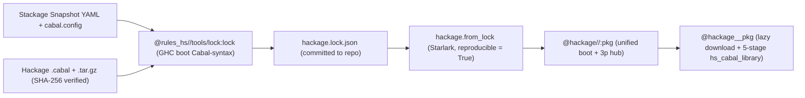

`rules_hs` manages third-party Haskell dependencies with a **two-phase lockfile workflow** that does not require a host `cabal` or `stack` installation and does not run Cabal `Setup.hs` scripts during builds:

1. **Lock phase (developer workflow)**: Run [`//tools/lock:lock`](../reference/lock-cli.md) (`@rules_hs//tools/lock:lock`) — a command-line tool built by `rules_hs` itself using only GHC's built-in `Cabal-syntax` library — to resolve your root packages against a Stackage snapshot and write a deterministic `hackage.lock.json` file that you commit to Git.
2. **Build phase (Bzlmod + Bazel actions)**: [`hackage.from_lock`](../reference/extensions-and-providers.md#hackage-from_lock) reads `hackage.lock.json` in Starlark (`reproducible = True`), exposes a single `@hackage` hub repository, downloads individual `.tar.gz` archives only when a target depends on them, and compiles each library with the 5-stage [`hs_cabal_library`](../reference/rules.md#hs_cabal_library) rule.



## How Haskell Packaging Works (Hackage, Stackage, and Cabal Flags) {#packaging-concepts}

If you are coming from Go, Rust, or Python, five concepts explain how Haskell dependencies work on this page (see [Haskell & GHC Primer](../internals/haskell-and-ghc-primer.md#ecosystem-map) for deeper background):

- **Package registry — Hackage (`hackage.haskell.org`)**: A package registry is a public web server hosting versioned source archives and metadata manifests (analogous to Rust's `crates.io`, Python's `PyPI`, or Node's `npm`). Each release on Hackage ships a `.tar.gz` source archive and a `.cabal` manifest listing open version ranges such as `text >= 2.0 && < 2.2`.
- **Version solver vs. Stackage Snapshots (`lts-24.67`)**: Because raw `.cabal` files declare open version ranges rather than exact versions, tools like `cabal-install` normally run a backtracking dependency version solver (often called a SAT solver) to search for one mutually compatible version of every transitive package. **Stackage** solves that problem up front by publishing curated **LTS (Long-Term Support)** snapshots: a single YAML list (for example, `lts-24.67` for GHC `9.10.3`) that pins roughly 3,300 Hackage packages to one tested version per package plus compatible default flags. Because every package already has a single fixed version in the snapshot, [`//tools/lock:lock`](../reference/lock-cli.md) walks your dependency graph via a simple breadth-first search without needing a version solver.
- **Root `--package` flags**: You pass `--package <name>` only for the direct third-party libraries your project imports (such as `aeson` or `http-client`); `//tools/lock:lock` automatically follows and locks every transitive dependency they require.
- **Cabal flags (`--flag <pkg>:<flag>=<bool>`)**: Compile-time boolean switches declared in a package's `.cabal` file (analogous to Cargo `--features` in Rust). Flags toggle optional dependencies, pure-Haskell vs. C implementations (such as `zlib:bundled-c-zlib=true` to compile vendored C `zlib` sources instead of calling host `pkg-config`), or compile-time data embedding (`pandoc:embed_data_files=true`).
- **`@hackage//:<pkg>` and sublibraries (`@hackage//:<pkg>__<sublib>`)**: Loading `hackage.lock.json` creates one `@hackage` Bazel repository containing both GHC's 41 built-in boot libraries (`@hackage//:base`, `@hackage//:text`) and your locked third-party packages (`@hackage//:aeson`). When a `.cabal` package also defines internal helper sublibraries or Cabal 3.0 public sublibraries inside the same archive (such as `attoparsec`'s `attoparsec-internal`), `rules_hs` compiles them and exposes them on the hub as `@hackage//:<pkg>__<sublib>`.

## How Cabal `build-type` and `Setup.hs` Work in `rules_hs` {#setup-hs-and-build-types}

Every Hackage source archive contains a `.cabal` package manifest and a small `Setup.hs` Haskell file. In Cabal, the `build-type:` field in the `.cabal` file tells build tools whether `Setup.hs` is standard boilerplate or custom build code.

`rules_hs` never compiles or executes `Setup.hs` at build time. Instead, `@rules_hs//tools/lock:lock` inspects `build-type:` during lockfile generation and maps Cabal's build types as follows:

| Cabal `build-type` | Share of Hackage | Supported in `rules_hs`? | How `rules_hs` Handles It |
|---|---|---|---|
| `Simple` | Over 95% | **Yes** | `Setup.hs` only calls `Distribution.Simple.defaultMain`. `rules_hs` ignores `Setup.hs` and builds the package directly with [`hs_cabal_library`](../reference/rules.md#hs_cabal_library) (separate Bazel actions for `cabal_macros.h`/`Paths_<pkg>.hs`, `hsc2hs`, C compilation, and `ghc --make -c`). |
| `Configure` | Small set of C/POSIX bindings (`network`, `unix-time`, `old-time`) | **Yes** | `Setup.hs` normally runs `./configure`. `@rules_hs//tools/lock:lock` extracts the `./configure` script inputs and generated `.h` outputs into `hackage.lock.json`, and Stage 1 of [`hs_cabal_library`](../reference/rules.md#hs_cabal_library) runs `/bin/sh ./configure` inside an isolated sandbox wired to `ghc_cc_wrapper`. |
| `Custom` (used only for `cabal-doctest`, e.g. `xml-conduit`) | Common in older libraries | **Yes** (normalized to `Simple`) | Older packages often added a `custom-setup` stanza depending on `cabal-doctest` solely to generate module lists for `doctest` test suites, while the library itself needs only a `Simple` build. When `setup-depends` uses only `base`, `Cabal`, `Cabal-syntax`, `cabal-doctest`, `filepath`, and `directory`, `//tools/lock:lock` automatically records `"build_type": "Simple"`. |
| `Custom` (arbitrary `Setup.hs` codegen) | Under 1% | **No (out of scope)** | `//tools/lock:lock` records `"build_type": "Custom"` in `hackage.lock.json`, and [`hs_cabal_library`](../reference/rules.md#hs_cabal_library) stops at analysis time with `Unsupported Cabal build-type 'Custom'`. |

### Why Arbitrary `Custom` `Setup.hs` Scripts Are Out of Scope (and How to Work Around Them)

Running an arbitrary `Setup.hs` program requires compiling a per-package Haskell executable and running `Setup.hs configure && Setup.hs build` as one opaque build action. That single wrapper hides individual C and `hsc2hs` steps from Bazel's cache and prevents Bazel's `CcInfo` provider from propagating C headers and static libraries cleanly to downstream targets.

If you encounter a package that fails with `Unsupported Cabal build-type 'Custom'`:
1. Read the package's `Setup.hs` (usually 30–100 lines) to see what it actually generates or probes.
2. If it only probes C flags or libraries, set `"build_type": "Simple"` on that package's entry in `hackage.lock.json` (because [`hs_cabal_library`](../reference/rules.md#hs_cabal_library) requires `build_type` to be `"Simple"` or `"Configure"`) and supply those settings declaratively via [`hackage.override`](../reference/extensions-and-providers.md#hackage-override) (`extra_cc_deps`, `extra_cpp_options`, `extra_cc_options`, `extra_ghc_opts`).
3. If it generates `.hs` or `.h` source files, write a `genrule` + [`hs_library`](../reference/rules.md#hs_library) target in your workspace for that package (see [Migration & Troubleshooting](troubleshooting-and-migration.md)).

## Step 1: Generate `hackage.lock.json`

Invoke `@rules_hs//tools/lock:lock` via `bazel run`, passing a Stackage snapshot (`--snapshot`), one or more root Hackage packages (`--package`), any Cabal flag overrides (`--flag`), and an absolute `--output` path:

```bash
bazel run @rules_hs//tools/lock:lock -- \
  --snapshot lts-24.67 \
  --package aeson \
  --package async \
  --package http-client \
  --package http-client-tls \
  --package http-types \
  --package xml-conduit \
  --package zlib \
  --flag zlib:bundled-c-zlib=true \
  --flag zlib:pkg-config=false \
  --output "$PWD/hackage.lock.json"
```

> **Important — Pass `$PWD` to `--output` under `bazel run`:** `bazel run` starts binaries inside Bazel's runfiles directory rather than the directory where you typed the command. Always pass an absolute path such as `--output "$PWD/hackage.lock.json"` so the lockfile is written into your repository root.

### What `//tools/lock:lock` Does Step by Step

1. Downloads the Stackage snapshot YAML (`lts-24.67` for GHC `9.10.3`) and Stackage `cabal.config` (caching HTTP downloads in `--cache-dir`, `/tmp/rules_hs_lock_cache` by default).
2. Merges Stackage's package flags with your explicit `--flag <pkg>:<flag>=<bool>` overrides.
3. Traverses all transitive non-boot dependencies via breadth-first search, downloading each `.cabal` file and `.tar.gz` archive from `hackage.haskell.org` and recording its SHA-256 digest.
4. Evaluates every `.cabal` file using `Cabal-syntax`'s `finalizePD` function across four target platforms (`linux_x86_64`, `linux_arm64`, `macos_arm64`, `macos_x86_64`), placing shared metadata into common fields and platform-specific differences into compact `select` blocks.
5. Converts `cabal-doctest`-only `build-type: Custom` packages (such as `xml-conduit`) to `"Simple"`, and inspects `build-type: Configure` archives (`network`, `unix-time`, `old-time`) to record autoconf script inputs and generated header paths.
6. Filters upstream `ghc-options`: removes warning flags (`-Werror`, `-Wall`) and link-only executable flags (`-threaded`) so compiler warning changes never break third-party library builds, while keeping optimization and code-generation flags (`-O2`, `-funbox-strict-fields`).

Commit `hackage.lock.json` to version control. See [Lock Generator CLI Reference](../reference/lock-cli.md) for every CLI flag and JSON field.

## Step 2: Load `hackage.lock.json` in `MODULE.bazel`

Register the lockfile with the [`hackage`](../reference/extensions-and-providers.md#hackage) module extension:

```starlark
hs = use_extension("@rules_hs//hs:extensions.bzl", "hs")
hs.toolchain(ghc_version = "9.10.3")
use_repo(hs, "hs_toolchains")
register_toolchains("@hs_toolchains//:all")

hackage = use_extension("@rules_hs//hs:extensions.bzl", "hackage")
hackage.from_lock(
    name = "hackage",
    lockfile = "//:hackage.lock.json",
)
use_repo(hackage, "hackage")
```

> **Tip — Unified `@hackage` namespace:** When you load `@hackage`, you do not need `use_repo(hs, "hs_boot")` unless you prefer referencing boot libraries separately. The `@hackage` hub repository generates [`hs_toolchain_library`](../reference/rules.md#hs_toolchain_library) targets for every GHC boot package (`@hackage//:base`, `@hackage//:bytestring`, `@hackage//:containers`, `@hackage//:text`, etc.) alongside aliases for every locked Hackage package (`@hackage//:aeson`, `@hackage//:http-client`, etc.). If a locked Hackage package has the same name as a boot package, the locked Hackage version takes precedence in `@hackage`.

## Step 3: Depend on `@hackage//:<pkg>` in `BUILD.bazel`

Reference both boot packages and third-party Hackage packages under `@hackage//:...` in `deps`:

```starlark
load("@rules_hs//hs:defs.bzl", "hs_binary", "hs_library", "hs_test")

hs_library(
    name = "client",
    srcs = ["src/Client.hs"],
    ghc_opts = ["-Wall", "-Wcompat"],
    hs_source_dirs = ["src"],
    deps = [
        "@hackage//:aeson",
        "@hackage//:async",
        "@hackage//:base",
        "@hackage//:bytestring",
        "@hackage//:http-client",
        "@hackage//:http-client-tls",
        "@hackage//:http-types",
        "@hackage//:text",
    ],
)
```

### Lazy Tarball Fetching

Even when `hackage.lock.json` lists dozens or hundreds of packages, Bazel **only downloads and extracts** the `@hackage__<pkg>` source archives reachable from the targets you actually build. Unreferenced entries in the lockfile add no network downloads or compile steps.

## Handling C Dependencies and Cabal Flags

Hackage packages that call C libraries fall into two common patterns:

### Pattern A: Bundled C Sources via Cabal Flags (Recommended When Available)

Many Hackage packages include vendored C source files behind a Cabal flag so they do not depend on host `pkg-config` or OS `-dev` packages. Pass `--flag` when running [`//tools/lock:lock`](../reference/lock-cli.md):

```bash
bazel run @rules_hs//tools/lock:lock -- \
  --snapshot lts-24.67 \
  --package zlib \
  --flag zlib:bundled-c-zlib=true \
  --flag zlib:pkg-config=false \
  --output "$PWD/hackage.lock.json"
```

With `zlib:bundled-c-zlib=true`, `zlib` depends on the C-only Cabal package `zlib-clib`. [`hs_cabal_library`](../reference/rules.md#hs_cabal_library) compiles `zlib-clib`'s 11 `.c` files via Bazel's C toolchain (`cc_common.compile`, skipping GHC because `zlib-clib` has no Haskell modules) and forwards `<zlib.h>` and `libzlib_clib_c.a` through `CcInfo` and [`HsLinkInfo`](../reference/extensions-and-providers.md#hslinkinfo) to `zlib` and downstream packages such as `streaming-commons`.

Common Cabal flag overrides for sandboxed builds:

| Package | Recommended `--flag` Overrides | Effect |
|---|---|---|
| `zlib` | `--flag zlib:bundled-c-zlib=true --flag zlib:pkg-config=false` | Compiles bundled `zlib-clib` from C source via Bazel's `cc_toolchain` |
| `pandoc` | `--flag pandoc:embed_data_files=true` | Embeds data files into the binary at compile time via `file-embed` Template Haskell |
| `citeproc` | `--flag citeproc:embed_data_files=true` | Embeds locale and citation style files at compile time |
| `hakyll` | `--flag hakyll:checkexternal=false --flag hakyll:watchserver=false --flag hakyll:previewserver=false` | Builds core Hakyll `Rules`/`Compiler`/Pandoc modules while pruning `http-conduit` and `fsnotify` |

### Pattern B: Attaching BCR `cc_library` Targets with `hackage.override`

When a Hackage package links against an external C library from the Bazel Central Registry (such as `@zlib//:zlib`, `@zstd//:zstd`, or `@sqlite3//:sqlite3`), or needs extra C, C preprocessor, GHC, or `./configure` flags, attach overrides in `MODULE.bazel` with [`hackage.override`](../reference/extensions-and-providers.md#hackage-override):

```starlark
bazel_dep(name = "zlib", version = "1.3.1.bcr.5")

hackage = use_extension("@rules_hs//hs:extensions.bzl", "hackage")
hackage.from_lock(
    name = "hackage",
    lockfile = "//:hackage.lock.json",
)
hackage.override(
    hub = "hackage",
    package = "zlib",
    extra_cc_deps = ["@zlib//:zlib"],
    extra_cc_options = ["-DZLIB_CONST"],
    extra_cpp_options = ["-DUSE_BCR_ZLIB=1"],
    extra_ghc_opts = ["-O2"],
)
use_repo(hackage, "hackage")
```

[`hackage.override`](../reference/extensions-and-providers.md#hackage-override) accepts:
- `extra_cc_deps`: Additional `cc_library` (`CcInfo`) targets linked into the package's library and propagated to downstream executables.
- `extra_ghc_opts`, `extra_cpp_options`, `extra_cc_options`: Extra flags appended to both the main library and any sublibraries in that package.
- `configure_args`: Extra flags passed to `/bin/sh ./configure` for `build-type: Configure` packages (for example, `configure_args = ["--disable-ipv6"]`).

## Other Cabal Package Features Handled Automatically

Beyond `Simple` and `Configure` builds, [`hs_cabal_library`](../reference/rules.md#hs_cabal_library) supports the Cabal package features used across Stackage:

- **Cross-library Template Haskell and `file-embed`** (`aeson`, `file-embed`, `skylighting`, `pandoc`): Libraries compile with `-dynamic-too`, placing shared `.so` objects for GHC's compile-time interpreter inside `<name>.pkgdb/dyn` and staging `data-files` in the compile sandbox, while keeping final [`hs_binary`](../reference/rules.md#hs_binary) and [`hs_test`](../reference/rules.md#hs_test) executables statically linked against `.a` archives.
- **Internal and Cabal 3.0 public sublibraries** (for example, `attoparsec`'s internal `attoparsec-internal`): Compiled in the same `@hackage__<pkg>` repository ahead of the main library and aliased on `@hackage` as `@hackage//:<pkg>__<sublib>`.
- **Generated `cabal_macros.h`, `Paths_<pkg>` modules, and `reexported-modules`**: Generated in Starlark without running Cabal `Setup.hs`.
- **`hsc2hs` (`.hsc`) and source-bootstrapped Alex (`.x`) / Happy (`.y`, `.ly`)**: `.hsc` C-struct/constant templates expand in separate per-file Bazel actions so unchanged files stay cached, and any locked package with `.x` or `.y`/`.ly` parser/lexer files automatically compiles `alex` or `happy` from source using `@hs_boot` (with no downloads when unused).
- **C++ sources (`cxx-sources` / `cxx-options`), `.hs-boot` mutually recursive modules, and `#include`-d `.c` implementation files**: Supported across packages such as `cborg`, `tls`, `crypton`, and `vector`.

For a stage-by-stage walkthrough of how [`hs_cabal_library`](../reference/rules.md#hs_cabal_library) builds packages, see [Hackage & Cabal Pipeline](../internals/ecosystem-and-hackage.md).

## Adding or Updating Packages

When you add a Hackage dependency or move to a newer Stackage snapshot:

1. Re-run `bazel run @rules_hs//tools/lock:lock -- ... --output "$PWD/hackage.lock.json"` with your `--snapshot`, `--package`, and `--flag` arguments.
2. Check `git diff hackage.lock.json` — object keys and arrays are sorted deterministically with 2-space indentation so diffs stay small and readable.
3. Run `bazel test //...` to build and test against the updated lockfile.

> **Note — Dev-only lockfiles in reusable Bzlmod modules:** If you publish a reusable Bzlmod module that only uses `@hackage` for its own tests or documentation (as `rules_hs` itself does for `//docs:site`), load the extension with `dev_dependency = True`:
>
> ```starlark
> hackage = use_extension("@rules_hs//hs:extensions.bzl", "hackage", dev_dependency = True)
> hackage.from_lock(name = "hackage", lockfile = "//docs:hackage.lock.json")
> use_repo(hackage, "hackage")
> ```
>
> Downstream consumers of your module will ignore dev-only `hackage` declarations and will not fetch those packages.
