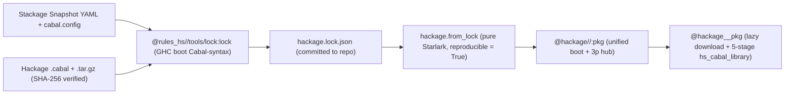

`rules_hs` manages third-party Haskell dependencies with a **two-phase lockfile workflow** that requires zero host `cabal` or `stack` installations and executes zero Cabal `Setup.hs` wrappers during builds:

1. **Lock phase (offline / developer workflow)**: Run [`//tools/lock:lock`](../reference/lock-cli.md) (`@rules_hs//tools/lock:lock`) — a dogfooded Haskell CLI compiled exclusively against GHC's boot `Cabal-syntax` library — to resolve your root packages against a Stackage snapshot and emit a deterministic `hackage.lock.json` committed to Git.
2. **Build phase (Bzlmod + Bazel actions)**: [`hackage.from_lock`](../reference/extensions-and-providers.md#hackage-from_lock) reads `hackage.lock.json` in pure Starlark (`reproducible = True`), exposes a unified `@hackage` hub repository, fetches individual `.tar.gz` tarballs lazily on demand, and compiles each library with the 5-stage [`hs_cabal_library`](../reference/rules.md#hs_cabal_library) rule.



## How Haskell Packaging Works (Hackage, Stackage, and Cabal Flags) {#packaging-concepts}

If you are coming from Go, Rust, or Python, five plain-English concepts explain every flag and label on this page (see [Haskell & GHC Primer](../internals/haskell-and-ghc-primer.md#ecosystem-map) for the full architectural picture):

- **Hackage (`hackage.haskell.org`)**: Haskell's central open-source package registry (analogous to Rust's `crates.io` or Python's `PyPI`). Each package version ships a `.tar.gz` source archive and a `.cabal` manifest declaring open version ranges (e.g., `text >= 2.0 && < 2.2`).
- **Stackage Snapshots (`lts-24.67`)**: Because raw Hackage uses open version bounds that normally require a backtracking SAT solver (`cabal-install`), **Stackage** publishes curated, CI-verified **LTS (Long-Term Support)** snapshots. A snapshot like `lts-24.67` (paired with GHC `9.10.3`) pins ~3,300 Hackage packages to exact compatible versions and sensible default flags — letting [`//tools/lock:lock`](../reference/lock-cli.md) resolve your transitive dependency closure deterministically via simple breadth-first search with zero SAT solver!
- **Root `--package` Flags**: You pass `--package <name>` only for the direct third-party libraries your project imports (such as `aeson` or `http-client`); `//tools/lock:lock` automatically discovers and locks every transitive dependency they need.
- **Cabal Flags (`--flag <pkg>:<flag>=<bool>`)**: Compile-time boolean switches defined inside a package's `.cabal` file (directly analogous to Cargo `--features` in Rust). Flags toggle optional dependencies, pure-Haskell vs. C backends (such as `zlib:bundled-c-zlib=true` to compile vendored C `zlib` sources instead of querying host `pkg-config`), or compile-time asset embedding (`pandoc:embed_data_files=true`).
- **`@hackage//:<pkg>` & Sublibraries (`@hackage//:<pkg>__<sublib>`)**: Loading `hackage.lock.json` creates one unified `@hackage` Bazel repository containing both GHC's 41 built-in boot libraries (`@hackage//:base`, `@hackage//:text`) and your locked third-party packages (`@hackage//:aeson`). When a `.cabal` package also defines helper **sublibraries** inside the same archive (such as `attoparsec`'s internal helper `attoparsec-internal`), `rules_hs` compiles them automatically and exposes them as `@hackage//:<pkg>__<sublib>`.

## Step 1: Generate `hackage.lock.json`

Invoke `@rules_hs//tools/lock:lock` via `bazel run`, passing a Stackage snapshot (`--snapshot`), one or more root Hackage packages (`--package`), any Cabal flag overrides (`--flag`), and an absolute `--output` path:

```bash
bazel run @rules_hs//tools/lock:lock -- \
  --snapshot lts-24.67 \
  --package aeson \
  --package async \
  --package http-client \
  --package http-client-tls \
  --package http-types \
  --package xml-conduit \
  --package zlib \
  --flag zlib:bundled-c-zlib=true \
  --flag zlib:pkg-config=false \
  --output "$PWD/hackage.lock.json"
```

> **Important — Pass `$PWD` to `--output` under `bazel run`:** `bazel run` executes binaries inside Bazel's runfiles working directory rather than your shell's working directory. Always pass an absolute path such as `--output "$PWD/hackage.lock.json"` so the generated lockfile is written directly into your workspace root.

### What `//tools/lock:lock` Does Under the Hood

- Fetches the Stackage snapshot YAML (`lts-24.67` -> GHC `9.10.3`) and Stackage `cabal.config` (caching downloads in `--cache-dir`, `/tmp/rules_hs_lock_cache` by default).
- Merges Stackage's curated package flags with your explicit `--flag <pkg>:<flag>=<bool>` overrides.
- Runs a breadth-first search across all transitive non-boot dependencies, downloading each `.cabal` file and `.tar.gz` tarball from `hackage.haskell.org` and computing its SHA-256 digest.
- Evaluates every `.cabal` file using `Cabal-syntax`'s `finalizePD` across four target platforms (`linux_x86_64`, `linux_arm64`, `macos_arm64`, `macos_x86_64`), factoring shared metadata into common fields and platform-specific differences into compact `select` deltas.
- Normalizes `cabal-doctest` `build-type: Custom` packages (like `xml-conduit`) to `"Simple"`, and inspects `build-type: Configure` tarballs (`network`, `unix-time`, `old-time`) to extract autoconf inputs and generated `install-includes` headers.
- Sanitizes upstream `ghc-options` (stripping `-Werror`, `-Wall`, and `-threaded` so upstream warning drift never breaks downstream builds while preserving semantic codegen and optimization flags like `-O2` and `-funbox-strict-fields`).

Commit the resulting `hackage.lock.json` to version control. See [Lock Generator CLI Reference](../reference/lock-cli.md) for every CLI flag and JSON schema field.

## Step 2: Load `hackage.lock.json` in `MODULE.bazel`

Register the lockfile with the [`hackage`](../reference/extensions-and-providers.md#hackage) module extension:

```starlark
hs = use_extension("@rules_hs//hs:extensions.bzl", "hs")
hs.toolchain(ghc_version = "9.10.3")
use_repo(hs, "hs_toolchains")
register_toolchains("@hs_toolchains//:all")

hackage = use_extension("@rules_hs//hs:extensions.bzl", "hackage")
hackage.from_lock(
    name = "hackage",
    lockfile = "//:hackage.lock.json",
)
use_repo(hackage, "hackage")
```

> **Tip — One Unified `@hackage` Namespace:** When you use `@hackage`, you do not even need `use_repo(hs, "hs_boot")` unless you prefer separating boot deps explicitly. The `@hackage` hub repository automatically generates [`hs_toolchain_library`](../reference/rules.md#hs_toolchain_library) targets for every GHC boot package (`@hackage//:base`, `@hackage//:bytestring`, `@hackage//:containers`, `@hackage//:text`, etc.) alongside aliases for every locked Hackage package (`@hackage//:aeson`, `@hackage//:http-client`, etc.).
>
> If a locked Hackage package overrides a boot package name, the locked Hackage version takes precedence in `@hackage`.

## Step 3: Depend on `@hackage//:<pkg>` in `BUILD.bazel`

Reference both boot packages and third-party Hackage packages uniformly in `deps`:

```starlark
load("@rules_hs//hs:defs.bzl", "hs_binary", "hs_library", "hs_test")

hs_library(
    name = "client",
    srcs = ["src/Client.hs"],
    ghc_opts = ["-Wall", "-Wcompat"],
    hs_source_dirs = ["src"],
    deps = [
        "@hackage//:aeson",
        "@hackage//:async",
        "@hackage//:base",
        "@hackage//:bytestring",
        "@hackage//:http-client",
        "@hackage//:http-client-tls",
        "@hackage//:http-types",
        "@hackage//:text",
    ],
)
```

### Lazy Tarball Fetching

Even if `hackage.lock.json` pins 70+ packages, Bazel **only downloads and extracts** the `@hackage__<pkg>` tarballs actually reachable from the targets you build. Unreferenced packages in the lockfile incur zero network or build cost.

## Handling C Dependencies & Cabal Flags

Third-party Hackage packages that wrap C code fall into two patterns, both supported hermetically:

### Pattern A: Bundled C Sources via Cabal Flags (Recommended When Available)

Many popular Hackage packages ship vendored C sources gated behind a Cabal flag so they need no system `pkg-config` or C `-dev` package. Pass `--flag` when running [`//tools/lock:lock`](../reference/lock-cli.md):

```bash
bazel run @rules_hs//tools/lock:lock -- \
  --snapshot lts-24.67 \
  --package zlib \
  --flag zlib:bundled-c-zlib=true \
  --flag zlib:pkg-config=false \
  --output "$PWD/hackage.lock.json"
```

With `zlib:bundled-c-zlib=true`, `zlib` depends on the C-only Cabal package `zlib-clib`. [`hs_cabal_library`](../reference/rules.md#hs_cabal_library) compiles `zlib-clib`'s 11 `.c` files via `cc_common.compile` (skipping GHC entirely since `zlib-clib` has zero Haskell modules) and propagates `<zlib.h>` and `libzlib_clib_c.a` transitively through `CcInfo` + [`HsLinkInfo`](../reference/extensions-and-providers.md#hslinkinfo) to `zlib` and downstream consumers like `streaming-commons`.

Other useful hermetic Cabal flags for documentation and CLI tools:

| Package | Recommended `--flag` Overrides | Effect |
|---|---|---|
| `zlib` | `--flag zlib:bundled-c-zlib=true --flag zlib:pkg-config=false` | Compiles bundled `zlib-clib` from C source via Bazel's `cc_toolchain` |
| `pandoc` | `--flag pandoc:embed_data_files=true` | Embeds data files into the binary at compile time via `file-embed` TH |
| `citeproc` | `--flag citeproc:embed_data_files=true` | Embeds locale/CSL data files at compile time |
| `hakyll` | `--flag hakyll:checkexternal=false --flag hakyll:watchserver=false --flag hakyll:previewserver=false` | Keeps core Hakyll `Rules`/`Compiler`/Pandoc pipeline without pulling `warp`/`fsnotify` |

### Pattern B: Attaching BCR `cc_library` Targets with `hackage.override`

When a Hackage package links against an external C library from the Bazel Central Registry (such as `@zlib//:zlib`, `@zstd//:zstd`, or `@sqlite3//:sqlite3`), or needs extra C/CPP/GHC/`./configure` flags, attach overrides in `MODULE.bazel` with [`hackage.override`](../reference/extensions-and-providers.md#hackage-override):

```starlark
bazel_dep(name = "zlib", version = "1.3.1.bcr.5")

hackage = use_extension("@rules_hs//hs:extensions.bzl", "hackage")
hackage.from_lock(
    name = "hackage",
    lockfile = "//:hackage.lock.json",
)
hackage.override(
    hub = "hackage",
    package = "zlib",
    extra_cc_deps = ["@zlib//:zlib"],
    extra_cc_options = ["-DZLIB_CONST"],
    extra_cpp_options = ["-DUSE_BCR_ZLIB=1"],
    extra_ghc_opts = ["-O2"],
)
use_repo(hackage, "hackage")
```

[`hackage.override`](../reference/extensions-and-providers.md#hackage-override) supports:
- `extra_cc_deps`: Additional `CcInfo` targets linked into the package's main library and propagated transitively.
- `extra_ghc_opts`, `extra_cpp_options`, `extra_cc_options`: Appended to both the main library and any internal sublibraries in that package.
- `configure_args`: Passed to `/bin/sh ./configure` for `build-type: Configure` packages (e.g., `configure_args = ["--disable-ipv6"]`).

## Internal Sublibraries, `Configure`, `hsc2hs`, Alex/Happy, and TH

`rules_hs` handles advanced Cabal package features automatically without per-package workarounds:

- **Cross-library Template Haskell & `file-embed`** (e.g., `aeson`, `file-embed`, `skylighting`, `pandoc`): Compiled with `-dynamic-too` shared libraries isolated under `<name>.pkgdb/dyn` and `data` files staged in the compile sandbox, while keeping final [`hs_binary`](../reference/rules.md#hs_binary) / [`hs_test`](../reference/rules.md#hs_test) executables statically linked.
- **Internal Cabal sublibraries** (e.g., `attoparsec`'s `attoparsec-internal`): Emitted inside the same `@hackage__attoparsec` repository ahead of the main library and exposed on the hub as `@hackage//:attoparsec__attoparsec-internal` (`<pkg>__<sublib>`).
- **Autoconf `build-type: Configure`** (e.g., `network`, `unix-time`, `old-time`): Runs `/bin/sh ./configure` inside an isolated temporary directory with `CC`/`CXX` wired to `ghc_cc_wrapper` and exports generated headers (`include/HsNetworkConfig.h`, `cbits/config.h`) to `hsc2hs`, C compilation, and GHC.
- **`hsc2hs` `.hsc` & lazy Alex/Happy codegen**: `.hsc` templates compile in parallel per file, and any locked package containing Alex (`.x`) or Happy (`.y` / `.ly`) grammars lazily bootstraps `alex` / `happy` purely from `@hs_boot` with zero host tools (and zero fetches when unused).
- **C++ sources (`cxx-sources` / `cxx-options`), `.hs-boot` mutual recursion, and textual `.c` `#include`s**: Handled seamlessly across `cborg`, `tls`, `crypton`, and `vector`.

For a deep dive into how [`hs_cabal_library`](../reference/rules.md#hs_cabal_library) executes its 5-stage action graph, see [Hackage & Cabal Pipeline](../internals/ecosystem-and-hackage.md).

## Adding or Updating Packages

Whenever you add a new Hackage dependency or upgrade your Stackage snapshot:

1. Re-run `bazel run @rules_hs//tools/lock:lock -- ... --output "$PWD/hackage.lock.json"` with your desired `--snapshot`, `--package`, and `--flag` arguments.
2. Inspect `git diff hackage.lock.json` — keys and arrays are deterministically sorted with 2-space indentation so diffs remain minimal and reviewable.
3. Run `bazel test //...` to verify the updated closure.

> **Note — Dev-Only Lockfiles in Bzlmod Libraries:** If you are publishing a reusable Bzlmod module that only uses `@hackage` for tests or documentation (like `rules_hs` itself does for `//docs:site`), load the extension with `dev_dependency = True`:
>
> ```starlark
> hackage = use_extension("@rules_hs//hs:extensions.bzl", "hackage", dev_dependency = True)
> hackage.from_lock(name = "hackage", lockfile = "//docs:hackage.lock.json")
> use_repo(hackage, "hackage")
> ```
>
> Downstream consumers of your module will never evaluate or fetch your dev-only Hackage closure.
