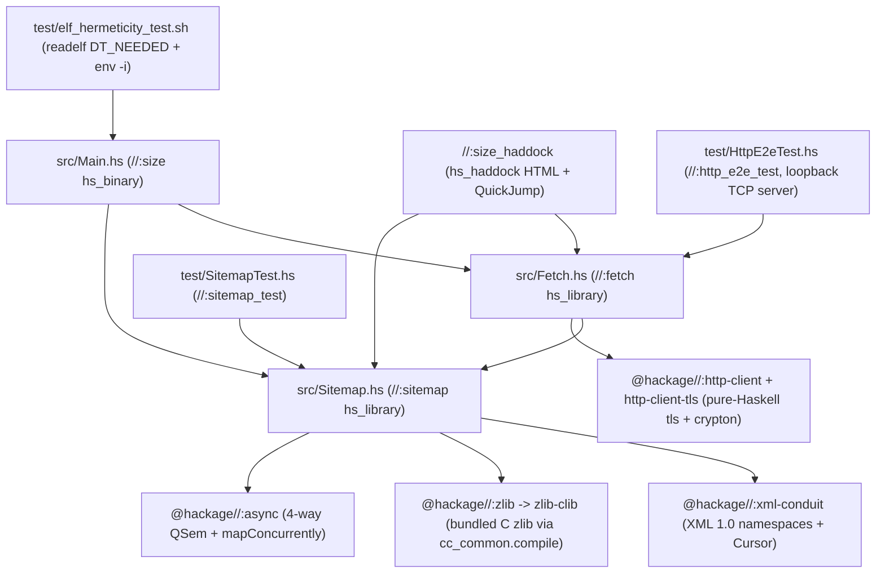

`examples/size` is a standalone Bzlmod Bazel 9 workspace included in the `rules_hs` repository. It builds a concurrent CLI tool (`//:size`) that crawls XML `<urlset>`, recursive `<sitemapindex>`, and gzipped `.xml.gz` documentation sitemaps over HTTP and HTTPS to count unique pages.

More importantly, `examples/size` serves as an end-to-end integration showcase exercising **69 pinned Hackage packages** (plus 41 GHC `9.10.3` boot libraries) with **zero Nix, zero host GHC/Cabal/Stack, zero host OpenSSL, and zero host `zlib`**.

## Architecture at a Glance



### Real-World Ecosystem Features Exercised

Building `examples/size` exercises nearly every edge case encountered in production Haskell codebases:

| Ecosystem Feature | Packages Exercising It in `examples/size` | How `rules_hs` Builds It |
|---|---|---|
| **C-only Cabal package + transitive `install-includes`** | `zlib-clib` -> `zlib` -> `streaming-commons` | Stage 4 `cc_common.compile` compiles 11 `.c` files and exports `<zlib.h>` via `CcInfo` + [`HsLinkInfo`](../reference/extensions-and-providers.md#hslinkinfo) without invoking GHC |
| **Autoconf `build-type: Configure` + `hsc2hs`** | `network`, `unix-time`, `old-time` | Stage 1 runs sandboxed `./configure` via `ghc_cc_wrapper`, feeding `HsNetworkConfig.h` into parallel Stage 3 `hsc2hs` actions |
| **`build-type: Custom` (`cabal-doctest`)** | `xml-conduit` | Normalized automatically to `"Simple"` by [`//tools/lock:lock`](../reference/lock-cli.md) |
| **Platform `select()` + textual `.c` `#include`s** | `crypton` (AESNI/SSE2 on `x86_64` vs. ref C on `arm64`) | [`//tools/lock:lock`](../reference/lock-cli.md) emits per-platform `select` deltas; `hackage.bzl` retains `#include`-d `cbits/*_impl.c` files in `hdrs` |
| **Mutual recursion via `.hs-boot` cycles** | `cborg`, `tls` | Stage 5 `ghc --make -c` resolves `.hs-boot` loops within each library |
| **Internal Cabal sublibraries** | `attoparsec` (`attoparsec-internal`) | Emitted as `:attoparsec-internal` in `@hackage__attoparsec` and aliased on `@hackage` |
| **Pure-Haskell TLS 1.3** | `http-client-tls`, `tls`, `crypton-x509*` | Eliminates runtime OpenSSL (`libssl.so` / `libcrypto.so`) dependencies |

---

## Workspace Configuration (`examples/size/MODULE.bazel`)

`examples/size` is an independent Bazel workspace with its own `MODULE.bazel`:

```starlark
module(
    name = "size_example",
    version = "0.1.0",
    bazel_compatibility = [">=9.0.0"],
)

bazel_dep(name = "rules_hs", version = "0.1.0")
local_path_override(
    module_name = "rules_hs",
    path = "../..",
)

# Hermetic Linux C/C++ toolchain (zig cc) — zero host gcc/ld/libc-dev required.
bazel_dep(name = "hermetic_cc_toolchain", version = "4.3.0")
bazel_dep(name = "rules_shell", version = "0.6.1", dev_dependency = True)

cc_toolchains = use_extension("@hermetic_cc_toolchain//toolchain:ext.bzl", "toolchains")
use_repo(cc_toolchains, "zig_sdk")

register_toolchains(
    "@zig_sdk//toolchain:linux_amd64_gnu.2.32",
    "@zig_sdk//toolchain:linux_arm64_gnu.2.32",
    "@zig_sdk//toolchain/...",
    "@zig_sdk//libc_aware/toolchain/...",
)

# Hermetic GHC toolchain
hs = use_extension("@rules_hs//hs:extensions.bzl", "hs")
hs.toolchain(ghc_version = "9.10.3")
use_repo(hs, "hs_toolchains")
register_toolchains("@hs_toolchains//:all")

# Pinned 3p Hackage packages (69 packages, zero host cabal/stack at build time)
hackage = use_extension("@rules_hs//hs:extensions.bzl", "hackage")
hackage.from_lock(
    name = "hackage",
    lockfile = "//:hackage.lock.json",
)
use_repo(hackage, "hackage")
```

Notice how `examples/size` generated `hackage.lock.json` with `zlib:bundled-c-zlib=true` and `zlib:pkg-config=false`:

```bash
bazel run @rules_hs//tools/lock:lock -- \
  --snapshot lts-24.67 \
  --package async \
  --package http-client \
  --package http-client-tls \
  --package http-types \
  --package network \
  --package xml-conduit \
  --package zlib \
  --flag zlib:bundled-c-zlib=true \
  --flag zlib:pkg-config=false \
  --output "$PWD/hackage.lock.json"
```

---

## Build Graph (`examples/size/BUILD.bazel`)

The application is factored cleanly into a pure domain library (`:sitemap`), an HTTP/TLS adapter library (`:fetch`), a thin CLI entry point (`:size`), a combined [`hs_haddock`](../reference/rules.md#hs_haddock) API documentation target (`:size_haddock`), and three test suites:

```starlark
load("@rules_hs//hs:defs.bzl", "hs_binary", "hs_haddock", "hs_library", "hs_test")
load("@rules_shell//shell:sh_test.bzl", "sh_test")

hs_library(
    name = "sitemap",
    srcs = ["src/Sitemap.hs"],
    ghc_opts = ["-Wall", "-Wcompat"],
    hs_source_dirs = ["src"],
    deps = [
        "@hackage//:async",
        "@hackage//:base",
        "@hackage//:bytestring",
        "@hackage//:containers",
        "@hackage//:text",
        "@hackage//:xml-conduit",
        "@hackage//:zlib",
    ],
)

hs_library(
    name = "fetch",
    srcs = ["src/Fetch.hs"],
    ghc_opts = ["-Wall", "-Wcompat"],
    hs_source_dirs = ["src"],
    deps = [
        ":sitemap",
        "@hackage//:base",
        "@hackage//:bytestring",
        "@hackage//:http-client",
        "@hackage//:http-client-tls",
        "@hackage//:http-types",
        "@hackage//:text",
    ],
)

hs_binary(
    name = "size",
    srcs = ["src/Main.hs"],
    ghc_opts = ["-Wall", "-Wcompat"],
    hs_source_dirs = ["src"],
    visibility = ["//visibility:public"],
    deps = [
        ":fetch",
        ":sitemap",
        "@hackage//:base",
        "@hackage//:text",
    ],
)

hs_haddock(
    name = "size_haddock",
    deps = [
        ":fetch",
        ":sitemap",
    ],
)
```

### Injectable Transport & Deadlock-Free Concurrency (`src/Sitemap.hs`)

`Sitemap.hs` defines an injectable `Fetcher` type alias (`type Fetcher = Text -> IO (Either String ByteString)`) so recursive sitemap crawling, gzip decompression (`0x1f 0x8b` magic header detection via `Codec.Compression.Zlib.Internal`), UTF-8 BOM stripping, XML namespace matching, and cycle/duplicate avoidance can all be tested deterministically offline.

To prevent thread exhaustion or deadlocks on deeply nested `<sitemapindex>` trees, `countPagesWithConcurrency` acquires the `QSem` concurrency semaphore **only around the individual HTTP fetch**, releasing it before recursing via `mapConcurrently`:

```haskell
walk :: MVar (Set Text) -> QSem -> Text -> IO (Either String CrawlSummary)
walk visitedVar sem url = do
  claimed <- claimUrl visitedVar url
  if not claimed
    then pure (Right mempty)
    else do
      -- Release the semaphore before recursing into child sitemaps so deep
      -- sitemap index hierarchies can never deadlock.
      fetched <- bracket_ (waitQSem sem) (signalQSem sem) (fetch url)
      case fetched of
        Left err -> pure (Left err)
        Right rawBytes ->
          case decodePayload rawBytes >>= parse of
            Left err -> pure (Left (T.unpack url <> ": " <> err))
            Right (UrlSet urls) ->
              pure (Right (CrawlSummary (Set.fromList urls) 1))
            Right (SitemapIndex children) -> do
              childResults <- mapConcurrently (walk visitedVar sem) children
              pure $ case sequenceA childResults of
                Left err -> Left err
                Right summaries -> Right (CrawlSummary Set.empty 1 <> mconcat summaries)
```

---

## Running the Test Suite and Live CLI

From `examples/size`, run all three hermetic test targets and build the Haddock API documentation:

```bash
cd examples/size
bazel test //...
bazel build //:size_haddock
```

`//:size_haddock` invokes [`hs_haddock`](../reference/rules.md#hs_haddock) across `:sitemap` and `:fetch`, emitting `bazel-bin/size_haddock/index.html`, `Sitemap.html`, `Fetch.html`, QuickJump `doc-index.json`, and hyperlinked source under `src/`.

What `bazel test //...` verifies:
1. **`//:sitemap_test`** ([`hs_test`](../reference/rules.md#hs_test) with `data = ["//testdata:sitemaps"]`): Tests canonical `<urlset>`, `<sitemapindex>`, `.xml.gz`, invalid HTML root rejection, UTF-8 BOM stripping, cyclic `<sitemapindex>` graphs (asserting each URL is fetched once), case-insensitive tags, and corrupt gzip error handling.
2. **`//:http_e2e_test`** ([`hs_test`](../reference/rules.md#hs_test)): Binds an ephemeral `127.0.0.1:0` TCP socket via `@hackage//:network`, serves XML and `.xml.gz` fixtures, HTTP `302 Found` redirects, and `404 Not Found` errors, and tests `Fetch.httpFetcher` end-to-end inside the Bazel test sandbox with zero external network access.
3. **`//:elf_hermeticity_test`** (`sh_test`): Runs `readelf -d` on `//:size` to assert that `DT_NEEDED` contains **only** base glibc shared libraries — zero `libgmp`, `libtinfo`, `libffi`, `libz`, `libssl`, `libcrypto`, or `libHS*.so` — and executes `//:size` under `env -i PATH=/nonexistent`.

To run `//:size` live over HTTPS against a real documentation site:

```bash
cd examples/size
bazel run //:size -- https://docs.stripe.com/sitemap.xml
```

Sample output:

```text
    5253 pages  (1 sitemap(s))  https://docs.stripe.com/sitemap.xml
```
