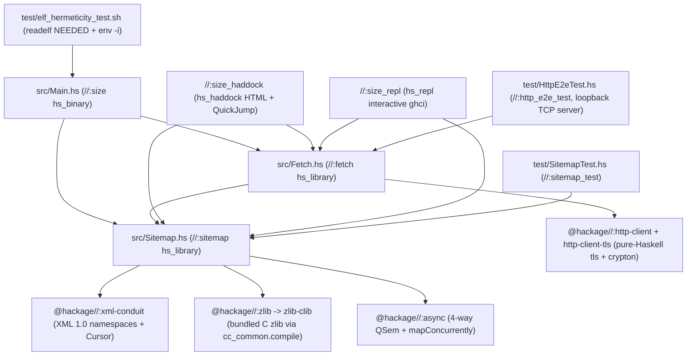

This walkthrough explores `examples/size`, a standalone Bazel 9 workspace in the `rules_haskell` repository that builds a concurrent command-line tool (`//:size`) to crawl XML `<urlset>`, nested `<sitemapindex>`, and gzipped `.xml.gz` documentation sitemaps over HTTP and HTTPS. Use it as an end-to-end reference for compiling **69 pinned Hackage packages** (plus 41 GHC `9.10.3` boot libraries) without Nix or host installations of GHC, Cabal, Stack, OpenSSL, or `zlib`.

If you're looking for a minimal first project instead, start with the [Quickstart](quickstart.md). For background on how lockfiles work, see [Hackage and lockfiles](hackage.md).

## Architecture overview



### Cabal and GHC features exercised

Building `examples/size` exercises several common Hackage packaging patterns in one workspace:

| Ecosystem feature | Packages in `examples/size` | How `rules_haskell` builds it |
|---|---|---|
| **C-only Cabal package and transitive `install-includes`** | `zlib-clib` -> `zlib` -> `streaming-commons` | Stage 4 [`cc_common.compile`](https://bazel.build/rules/lib/toplevel/cc_common) compiles 11 `.c` files and exports `<zlib.h>` through [`CcInfo`](https://bazel.build/rules/lib/providers/CcInfo) and [`HsLinkInfo`](../reference/extensions-and-providers.md#hslinkinfo) without invoking GHC |
| **Autoconf `build-type: Configure` and `hsc2hs`** | `network`, `unix-time`, `old-time` | Stage 1 runs [sandboxed](https://bazel.build/docs/sandboxing) `./configure` through `ghc_cc_wrapper`, feeding `HsNetworkConfig.h` into Stage 3 `hsc2hs` actions |
| **`build-type: Custom` (`cabal-doctest`)** | `xml-conduit` | Converted automatically to `"Simple"` by [`//tools/lock:lock`](../reference/lock-cli.md) |
| **Platform [`select()`](https://bazel.build/configure/attributes) and `#include`-d `.c` files** | `crypton` (AESNI/SSE2 on `x86_64`, portable C on `arm64`) | `//tools/lock:lock` emits per-platform `select()` deltas, and `hackage.bzl` keeps `#include`-d `cbits/*_impl.c` files in `hdrs` |
| **Mutual recursion with `.hs-boot` files** | `cborg`, `tls` | Stage 5 `ghc --make -c` compiles `.hs-boot` cycles within each library |
| **Internal Cabal sublibraries** | `attoparsec` (`attoparsec-internal`) | Compiled as `:attoparsec-internal` in `@hackage__attoparsec` and aliased on `@hackage` |
| **Pure-Haskell TLS 1.2 and 1.3** | `http-client-tls`, `tls`, `crypton-x509*` | Connects over HTTPS without linking C OpenSSL (`libssl.so` or `libcrypto.so`) |

## Workspace configuration (`examples/size/MODULE.bazel`)

The crawler lives in an independent [Bzlmod](https://bazel.build/external/overview) workspace with its own [`MODULE.bazel`](https://bazel.build/external/module) (`examples/size/MODULE.bazel`), which registers a Linux C/C++ toolchain, GHC `9.10.3`, and the pinned Hackage lockfile:

```starlark
module(
    name = "size_example",
    version = "0.1.0",
    bazel_compatibility = [">=9.0.0"],
)

bazel_dep(name = "rules_haskell", version = "0.1.0")
local_path_override(
    module_name = "rules_haskell",
    path = "../..",
)

# Self-contained Linux C/C++ toolchain (zig cc) — no host gcc/ld/libc-dev required.
bazel_dep(name = "hermetic_cc_toolchain", version = "4.3.0")
bazel_dep(name = "rules_shell", version = "0.6.1", dev_dependency = True)

cc_toolchains = use_extension("@hermetic_cc_toolchain//toolchain:ext.bzl", "toolchains")
use_repo(cc_toolchains, "zig_sdk")

register_toolchains(
    "@zig_sdk//toolchain:linux_amd64_gnu.2.32",
    "@zig_sdk//toolchain:linux_arm64_gnu.2.32",
    "@zig_sdk//toolchain/...",
    "@zig_sdk//libc_aware/toolchain/...",
)

# GHC toolchain
hs = use_extension("@rules_haskell//haskell:extensions.bzl", "hs")
hs.toolchain(ghc_version = "9.10.3")
use_repo(hs, "hs_toolchains")
register_toolchains("@hs_toolchains//:all")

# Pinned third-party Hackage packages (69 packages, no host cabal/stack at build time)
hackage = use_extension("@rules_haskell//haskell:extensions.bzl", "hackage")
hackage.from_lock(
    name = "hackage",
    lockfile = "//:hackage.lock.json",
)
use_repo(hackage, "hackage")
```

To compile `zlib`'s vendored C sources through Bazel's [`cc_toolchain`](https://bazel.build/reference/be/c-cpp#cc_toolchain) instead of relying on host libraries, `examples/size/hackage.lock.json` enables `zlib:bundled-c-zlib=true` and disables `zlib:pkg-config=false`:

```bash
bazel run @rules_haskell//tools/lock:lock -- \
  --snapshot lts-24.67 \
  --package async \
  --package http-client \
  --package http-client-tls \
  --package http-types \
  --package network \
  --package xml-conduit \
  --package zlib \
  --flag zlib:bundled-c-zlib=true \
  --flag zlib:pkg-config=false \
  --output "$PWD/hackage.lock.json"
```

## Build graph (`examples/size/BUILD.bazel`)

In [`BUILD.bazel`](https://bazel.build/concepts/build-files), the workspace splits the crawler into a pure XML and sitemap parsing library (`:sitemap`), an HTTP and TLS client library (`:fetch`), a CLI entry point (`:size`), a combined [`hs_haddock`](../reference/rules.md#hs_haddock) API documentation target (`:size_haddock`), an interactive [`hs_repl`](../reference/rules.md#hs_repl) target (`:size_repl`), and four test targets:

```starlark
load("@rules_haskell//haskell:defs.bzl", "hs_binary", "hs_haddock", "hs_library", "hs_repl", "hs_test")
load("@rules_shell//shell:sh_test.bzl", "sh_test")

hs_library(
    name = "sitemap",
    srcs = ["src/Sitemap.hs"],
    ghc_opts = ["-Wall", "-Wcompat"],
    hs_source_dirs = ["src"],
    deps = [
        "@hackage//:async",
        "@hackage//:base",
        "@hackage//:bytestring",
        "@hackage//:containers",
        "@hackage//:text",
        "@hackage//:xml-conduit",
        "@hackage//:zlib",
    ],
)

hs_library(
    name = "fetch",
    srcs = ["src/Fetch.hs"],
    ghc_opts = ["-Wall", "-Wcompat"],
    hs_source_dirs = ["src"],
    deps = [
        ":sitemap",
        "@hackage//:base",
        "@hackage//:bytestring",
        "@hackage//:http-client",
        "@hackage//:http-client-tls",
        "@hackage//:http-types",
        "@hackage//:text",
    ],
)

hs_binary(
    name = "size",
    srcs = ["src/Main.hs"],
    ghc_opts = ["-Wall", "-Wcompat"],
    hs_source_dirs = ["src"],
    visibility = ["//visibility:public"],
    deps = [
        ":fetch",
        ":sitemap",
        "@hackage//:base",
        "@hackage//:text",
    ],
)

hs_haddock(
    name = "size_haddock",
    title = "size — Sitemap Size Tracker API",
    visibility = ["//visibility:public"],
    deps = [
        ":sitemap",
        ":fetch",
    ],
)

hs_repl(
    name = "size_repl",
    visibility = ["//visibility:public"],
    deps = [
        ":sitemap",
        ":fetch",
    ],
)
```

### Direct dependency breakdown {#dependency-breakdown}

Across its library, binary, and test targets (`:sitemap`, `:fetch`, `:size`, `:sitemap_test`, and `:http_e2e_test`), `examples/size/BUILD.bazel` declares **12 direct `@hackage//:*` dependencies**—5 GHC boot packages and 7 third-party Hackage libraries—which resolve to the 69-package transitive closure in `examples/size/hackage.lock.json`. For the rationale behind each library choice, see [Dependency decisions](../internals/dependencies.md#showcase-libraries).

| Dependency target | Source | Go, Rust, or Python analog | Targets and modules | Purpose |
|---|---|---|---|---|
| `@hackage//:base` | GHC boot (`4.20.2.0`) | Rust `std`, Go `builtin`, `os`, `sync` | All 5 Haskell targets (`Main`, `Fetch`, `Sitemap`, `SitemapTest`, `HttpE2eTest`) | Standard library: `IO`, CLI `getArgs`/`exitFailure`, exceptions, `MVar` (thread-safe mutable box) and `QSem` (counting semaphore) concurrency primitives, and `runST` for pure local state. |
| `@hackage//:bytestring` | GHC boot | Rust `&[u8]` / `bytes::Bytes`, Go `[]byte`, Python `bytes` | `:sitemap`, `:fetch`, `:sitemap_test`, `:http_e2e_test` (`Sitemap`, `Fetch`, `SitemapTest`, `HttpE2eTest`) | Packed raw byte buffers (`ByteString`) for HTTP response bodies, gzip two-byte header checks (`0x1f 0x8b`), and loopback TCP socket I/O. |
| `@hackage//:text` | GHC boot | Rust `String` / `&str`, Go `string`, Python `str` | All 5 Haskell targets (`Main`, `Fetch`, `Sitemap`, `SitemapTest`, `HttpE2eTest`) | Packed UTF-8 text (`Text`), UTF-8 decoding (`decodeUtf8'`), UTF-8 byte-order mark (BOM) stripping, and URL and XML element strings. |
| `@hackage//:containers` | GHC boot | Rust `BTreeSet` / `BTreeMap`, C++ `std::set` / `std::map` | `:sitemap` (`Sitemap`), `:sitemap_test` (`SitemapTest`) | `Data.Set` deduplicates discovered page URLs and tracks visited `<sitemapindex>` URLs; `Data.Map.Strict` stores in-memory test fixtures. |
| `@hackage//:filepath` | GHC boot | Rust `std::path`, Go `path/filepath`, Python `pathlib` | `:sitemap_test` (`SitemapTest`), `:http_e2e_test` (`HttpE2eTest`) | Joins [`TEST_SRCDIR`](https://bazel.build/reference/test-encyclopedia#initial-conditions) and `TEST_WORKSPACE` [runfile](https://bazel.build/extending/rules#runfiles) paths (`</>`) when loading `testdata/` XML and `.xml.gz` fixtures. |
| `@hackage//:async` | Hackage (`2.2.6`) | Go `errgroup.Group`, Rust `tokio::task::JoinSet` | `:sitemap` (`Sitemap`), `:http_e2e_test` (`HttpE2eTest`) | Structured concurrency over GHC green threads: `mapConcurrently` crawls child sitemaps concurrently and `withAsync` scopes the loopback test HTTP server. |
| `@hackage//:xml-conduit` | Hackage (`1.10.1.0`) | Rust `quick-xml` / `roxmltree`, Python `lxml` | `:sitemap` (`Sitemap`: `Text.XML`, `Text.XML.Cursor`) | XML 1.0 parser and cursor query combinators (`$/`) handling XML namespaces, `<xhtml:link/>` sibling elements, and `&amp;` entity decoding. |
| `@hackage//:zlib` | Hackage (`0.7.1.1`) | Rust `flate2` (vendored `zlib`), Go `compress/gzip` | `:sitemap` (`Sitemap`: `Codec.Compression.GZip`, `Codec.Compression.Zlib.Internal`) | Streaming `decompressST` decompression of `.xml.gz` sitemaps with structured error values on corrupt archives, statically linked against vendored C `zlib-clib`. |
| `@hackage//:http-client` | Hackage (`0.7.19`) | Go `net/http`, Rust `hyper` / `reqwest` | `:fetch` (`Fetch`: `Network.HTTP.Client`) | Connection-pooled HTTP/1.1 client with 30-second response timeouts, HTTP `302` redirect following, and streaming response buffers. |
| `@hackage//:http-client-tls` | Hackage (`0.3.6.4`) | Rust `reqwest` + `rustls` | `:fetch` (`Fetch`: `Network.HTTP.Client.TLS`) | Connects pure-Haskell TLS 1.2/1.3 (`tls`, `crypton`, `crypton-x509-system`) to `http-client`, avoiding any C OpenSSL (`libssl.so`) runtime dependency. |
| `@hackage//:http-types` | Hackage (`0.12.6`) | Rust `http` crate, Go `net/http` status and headers | `:fetch` (`Fetch`: `Network.HTTP.Types.Header`, `Network.HTTP.Types.Status`) | Standard HTTP header names (`hUserAgent`) and status-code checks (`statusIsSuccessful`, `statusCode`). |
| `@hackage//:network` | Hackage (`3.2.14.0`) | Go `net`, Python `socket` | `:http_e2e_test` (`HttpE2eTest`: `Network.Socket`, `Network.Socket.ByteString`) | Binds an ephemeral `127.0.0.1:0` loopback TCP socket to test HTTP redirects, `.xml.gz` responses, `User-Agent` headers, and `404` handling offline inside Bazel's sandbox. |

### Injectable fetcher and bounded concurrency (`src/Sitemap.hs`)

To keep unit tests fast and offline, `src/Sitemap.hs` abstracts network calls behind a function type alias (`type Fetcher = Text -> IO (Either String ByteString)`), which takes a URL and returns either an error string in `Left` or raw response bytes in `Right`. Unit tests pass an in-memory `Map` lookup as the `Fetcher`, exercising gzip decompression, UTF-8 BOM stripping, XML namespaces, and cycle detection without opening network sockets.

To cap concurrent HTTP downloads at 4 without deadlocking when a `<sitemapindex>` points to nested child `<sitemapindex>` files, `countPagesWithConcurrency` acquires the `QSem` counting semaphore only around the single `fetch url` call and releases it before recursing into children with `mapConcurrently`:

```haskell
walk :: MVar (Set Text) -> QSem -> Text -> IO (Either String CrawlSummary)
walk visitedVar sem url = do
  claimed <- claimUrl visitedVar url
  if not claimed
    then pure (Right mempty)
    else do
      -- Release the semaphore before recursing into child sitemaps so nested
      -- sitemap index trees cannot deadlock waiting for permits.
      fetched <- bracket_ (waitQSem sem) (signalQSem sem) (fetch url)
      case fetched of
        Left err -> pure (Left err)
        Right rawBytes ->
          case decodePayload rawBytes >>= parse of
            Left err -> pure (Left (T.unpack url <> ": " <> err))
            Right (UrlSet urls) ->
              pure (Right (CrawlSummary (Set.fromList urls) 1))
            Right (SitemapIndex children) -> do
              childResults <- mapConcurrently (walk visitedVar sem) children
              pure $ case sequenceA childResults of
                Left err -> Left err
                Right summaries -> Right (CrawlSummary Set.empty 1 <> mconcat summaries)
```

If you're new to Haskell, here's what each piece of `walk` does:

- **`MVar (Set Text)`:** A thread-safe mutable box holding the URLs already claimed by a worker thread, so duplicate or cyclic sitemap links are fetched only once.
- **`bracket_ (waitQSem sem) (signalQSem sem) (fetch url)`:** Acquires one permit from the counting semaphore `sem`, runs `fetch url`, and guarantees `signalQSem sem` runs afterward even if `fetch` throws an exception (like `try ... finally` in Python or Java).
- **`decodePayload rawBytes >>= parse`:** Chains two `Either String` steps—decompressing `.xml.gz` bytes and parsing the XML—short-circuiting on the first `Left err`.
- **`mapConcurrently` and `sequenceA`:** `mapConcurrently` runs `walk` on all child sitemaps across separate green threads. `sequenceA` turns `[Either String CrawlSummary]` into `Either String [CrawlSummary]`, returning the first error if any child fails or combining all `CrawlSummary` sets with `mconcat` if all succeed.

## Run the test suite and CLI

> **Note:** Run the commands in this section from the `examples/size` directory.

Run all four test targets, build the Haddock API documentation, or open an interactive `ghci` session:

```bash
bazel test //...
bazel build //:size_haddock
bazel run //:size_repl
```

Building `//:size_haddock` runs `hs_haddock` across `:sitemap` and `:fetch`, writing `bazel-bin/size_haddock/index.html`, `Sitemap.html`, `Fetch.html`, QuickJump `doc-index.json`, and hyperlinked source files under `src/`. Running `//:size_repl` opens `ghci` with `Sitemap` and `Fetch` loaded from source alongside all 69 compiled Hackage dependencies, including C-only `zlib-clib`.

Here's what [`bazel test //...`](https://bazel.build/docs/user-manual#running-tests) verifies:

1. **`//:sitemap_test`** ([`hs_test`](../reference/rules.md#hs_test) with `data = ["//testdata:sitemaps"]`): Tests `<urlset>`, `<sitemapindex>`, `.xml.gz`, invalid HTML root rejection, UTF-8 BOM stripping, cyclic `<sitemapindex>` graphs (verifying each URL is fetched once), case-insensitive tags, and corrupt gzip error reporting.
2. **`//:http_e2e_test`** (`hs_test`): Binds an ephemeral `127.0.0.1:0` loopback TCP socket using `@hackage//:network`, serves XML and `.xml.gz` fixtures along with HTTP `302 Found` redirects and `404 Not Found` errors, and tests `Fetch.httpFetcher` offline inside Bazel's sandbox.
3. **`//:size_repl_test`** ([`sh_test`](https://bazel.build/reference/be/shell#sh_test)): Evaluates `.xml.gz` decompression and XML parsing inside `//:size_repl` and verifies `@rules_haskell//tools/ghci` from an external consumer workspace.
4. **`//:elf_hermeticity_test`** (`sh_test`): Runs `readelf -d` on `//:size` to verify that ELF `NEEDED` entries list only base `glibc` shared libraries—no `libgmp`, `libtinfo`, `libffi`, `libz`, `libssl`, `libcrypto`, or `libHS*.so`—and runs `//:size` under `env -i PATH=/nonexistent` to confirm [hermeticity](https://bazel.build/basics/hermeticity).

Run `//:size` live over HTTPS against a public documentation site with [`bazel run`](https://bazel.build/docs/user-manual#running-executables):

```bash
bazel run //:size -- https://docs.stripe.com/sitemap.xml
```

Sample output:

```text
    5253 pages  (1 sitemap(s))  https://docs.stripe.com/sitemap.xml
```
