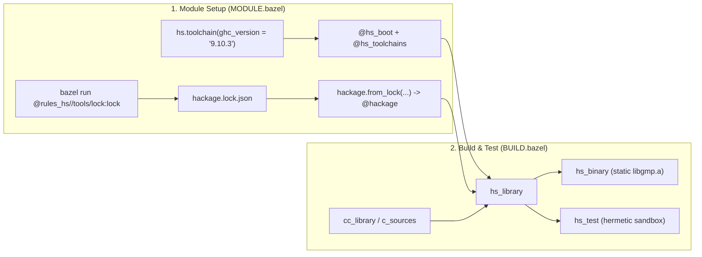

`rules_hs` is a modern, **Bzlmod-only** Bazel 9 ruleset (`bazel_compatibility = [">=9.0.0"]`) for building Haskell libraries, executables, tests, C FFI bindings, and third-party Hackage packages **100% hermetically**.

On Linux, `rules_hs` builds complete Haskell applications with **zero Nix**, **zero `WORKSPACE` files**, **zero Python runtime wrappers**, and **zero host prerequisites** beyond Bazelisk — no host `ghc`, `cabal`, `stack`, `gcc`, `clang`, `libgmp-dev`, `libtinfo-dev`, or `zlib1g-dev`.

::: {.tip title="New to rules_hs?"}
Jump straight to `doc:guide/quickstart` to build and test a hermetic Haskell library, binary, and test suite in under five minutes, or explore `doc:guide/showcase-size` for a walkthrough of a 69-package real-world HTTPS sitemap crawler.
:::

## Key Capabilities

- **Nix-free hermetic Linux GHC (`9.10.3` & `9.12.4`)**: Pure-Starlark extraction of official GHC bindists via `bzl:ext:hs.toolchain` — zero `./configure && make install` at fetch time. Compiler binaries resolve `$ORIGIN`-staged `libgmp.so.10` (built from BCR `@gmp`) and a minimal 8-symbol `libtinfo.so.6` stub without `LD_LIBRARY_PATH` or `patchelf`, making every action RBE-ready.
- **Portable static-GMP user executables**: `bzl:rule:hs_binary` and `bzl:rule:hs_test` link `libgmp.a` statically and restrict ELF `DT_NEEDED` strictly to base glibc (`libc.so.6`, `libm.so.6`, `libdl.so.2`, `libpthread.so.0`). Compiled binaries run cleanly under `env -i PATH=/nonexistent` across Debian 12, Ubuntu 22.04/24.04, and Rocky Linux 9.
- **Zero Python runtime wrapper & C-toolchain agnosticism**: A compiled C11 adapter (`ghc_cc_wrapper`) bridges GHC, `hsc2hs`, and Cabal `./configure` to any Bazel `@bazel_tools//tools/cpp:toolchain_type` (`hermetic_cc_toolchain` / `zig cc`, `toolchains_llvm`, or GCC/Clang).
- **Two-phase Hackage lockfiles & 5-stage Cabal pipeline**: The dogfooded `cli:lock` CLI (`@rules_hs//tools/lock:lock`, built exclusively with GHC boot `Cabal-syntax`) resolves Stackage snapshots into deterministic `hackage.lock.json` files. At build time, `bzl:ext:hackage.from_lock` evaluates the lockfile in pure Starlark (`reproducible = True`) and compiles packages via `bzl:rule:hs_cabal_library` without running `Setup.hs`.
- **Minimal non-dev dependency footprint**: `rules_hs` declares only **four** non-dev `MODULE.bazel` dependencies (`platforms`, `bazel_skylib`, `rules_cc`, and `gmp`), keeping downstream dependency graphs clean and fast.

## End-to-End Workflow

## Comparison with `tweag/rules_haskell`

| Dimension | `rules_hs` | `tweag/rules_haskell` |
|---|---|---|
| **Bazel & module system** | Bazel 9+ (`>=9.0.0`), Bzlmod-only, zero `WORKSPACE` files | Pins Bazel 7; legacy `WORKSPACE` assumptions; broken on Bazel 8/9 |
| **Non-dev `MODULE.bazel` deps** | 4 minimal modules: `platforms`, `bazel_skylib`, `rules_cc`, `gmp` | Pulls `rules_java`, `protobuf`, `abseil-cpp`, `rules_proto`, `rules_nodejs`, `aspect_rules_js`, `rules_python`, `rules_sh` |
| **Hermetic Linux GHC** | Pure-Starlark bindist + `$ORIGIN` staging (`@gmp` + `libtinfo.so.6` stub); RBE-friendly | Bindist runs host `./configure && make install` (requires host `libgmp-dev`/`libtinfo5`); hermeticity requires `rules_nixpkgs` (`/nix/store`) |
| **C compiler adapter** | Compiled C11 binary (`ghc_cc_wrapper`), zero Python | `cc_wrapper.py.tpl`, pulling `rules_python` into every compile/link action |
| **Third-party Hackage builds** | 5-stage `bzl:rule:hs_cabal_library` (`HsConfigure`, codegen, parallel `hsc2hs`, `cc_common.compile`, `ghc --make -c` + `${pkgroot}` DB) | Single opaque Python `cabal_wrapper.py` running `runghc Setup.hs` |
| **Dependency pinning & boot libs** | Dogfooded boot-only `Cabal-syntax` `cli:lock` generator; automatic `@hs_boot` & `@hackage` targets | External `stack` binary / `stack_snapshot` + manual `haskell_toolchain_library` boilerplate |
| **Linux binary runtime deps** | Static `libgmp.a`; `DT_NEEDED` strictly base glibc (`libc`, `libm`, `libdl`, `libpthread`) | Dynamic linking / `$ORIGIN` rpath rewriting (`fully_static_link = False` on bindists) |

## Documentation Map

### User Guide

1. **`doc:guide/quickstart`** — Configure `.bazelversion`, `.bazelrc`, `MODULE.bazel`, and `BUILD.bazel` to compile and test your first library and executable with `bzl:rule:hs_library`, `bzl:rule:hs_binary`, and `bzl:rule:hs_test`.
2. **`doc:guide/hackage`** — Pin Stackage packages with `cli:lock`, wire `bzl:ext:hackage.from_lock` and `bzl:ext:hackage.override`, use internal sublibraries, and understand how `Configure` and C-only Cabal packages build.
3. **`doc:guide/c-interop-and-toolchains`** — Call C code via `ForeignFunctionInterface` and `CApiFFI`, link `cc_library` targets through `cc_deps` or inline `c_sources`, and pair `rules_hs` with `hermetic_cc_toolchain`, `toolchains_llvm`, or system C toolchains.
4. **`doc:guide/language-rts-runfiles-th`** — Configure `GHC2021`/`Haskell2010`/`Haskell98`, `hidden_modules`, `.hs-boot` mutual recursion, threaded vs. single-threaded GHC RTS, Bazel `data` runfiles, and Template Haskell.
5. **`doc:guide/showcase-size`** — End-to-end tour of `examples/size`, a standalone 69-package HTTPS XML/gzip sitemap page counter with offline loopback E2E and ELF hermeticity tests.
6. **`doc:guide/troubleshooting-and-migration`** — Step-by-step migration playbook from `tweag/rules_haskell`, Cabal, and Stack, plus solutions to common build, C header, and lockfile issues.

### API & CLI Reference

- **`doc:reference/rules`** — Complete attribute, output, and provider reference for `bzl:rule:hs_library`, `bzl:rule:hs_binary`, `bzl:rule:hs_test`, `bzl:rule:hs_toolchain_library`, `bzl:rule:hs_cabal_library`, and `hs_toolchain`.
- **`doc:reference/extensions-and-providers`** — Complete reference for Bzlmod extensions (`bzl:ext:hs`, `bzl:ext:hackage`), Starlark providers (`bzl:provider:HsPackageInfo`, `bzl:provider:HsLinkInfo`, `bzl:provider:HsToolchainInfo`), and `@rules_hs//hs:toolchain_type`.
- **`doc:reference/lock-cli`** — Complete CLI flag and `hackage.lock.json` JSON schema reference for `@rules_hs//tools/lock:lock` (`cli:lock`).

### Internals & Architecture

- **`doc:internals/overview`** — Architectural philosophy, `tweag/rules_haskell` post-mortem, Buck2 Haskell & Bzlmod inspirations, and repository layout.
- **`doc:internals/hermeticity`** — Pure-Starlark bindist sanitization, `$ORIGIN` staging, the 8-symbol `libtinfo.so.6` stub, static-GMP linking, and every rewrite inside `ghc_cc_wrapper`.
- **`doc:internals/providers-and-actions`** — Direct vs. transitive provider split, `-hide-all-packages` visibility enforcement, `${pkgroot}` relocatable package DBs, and Template Haskell internals.
- **`doc:internals/ecosystem-and-hackage`** — `Cabal-syntax` multi-platform evaluation, lazy hub/package repositories, and the 5-stage `bzl:rule:hs_cabal_library` action graph.
- **`doc:internals/cross-os-and-platforms`** — Multi-arch Linux support, `deb10` glibc vs. `alpine3_12` musl analysis, and blueprints for macOS and Windows activation.
- **`doc:internals/docs-engine`** — How this documentation site itself is built hermetically with `rules_hs`, Hakyll, Pandoc, and Skylighting.
- **`doc:internals/dependencies`** — Complete dependency decision record covering adopted and non-adopted dependencies with concrete reconsideration catalysts.

## Platform Support Matrix

| Platform Key | GHC `9.10.3` & `9.12.4` Bindist Metadata | Status |
|---|---|---|
| `linux_x86_64` | Wired in `hs/private/ghc_versions.bzl` (`deb10` glibc) | **Supported & CI-tested** (Debian 12, Ubuntu 24.04, Rocky Linux 9) |
| `linux_arm64` | Wired in `hs/private/ghc_versions.bzl` (`deb10` glibc) | **Supported** (active in `SUPPORTED_PLATFORMS`) |
| `macos_arm64` | Official URL + SHA-256 cataloged; lockfile `select()` active | Planned (Mach-O `@loader_path` staging & linker flags) |
| `macos_x86_64` | Official URL + SHA-256 cataloged; lockfile `select()` active | Planned (Mach-O `@loader_path` staging & linker flags) |
| `windows_x86_64` | Official URL + SHA-256 cataloged | Planned (`.exe` layout & Win32 `cc_wrapper`) |
| `linux_x86_64_musl` | `alpine3_12-linux-static-int_native` cataloged | Planned opt-in flavor for zero-glibc `FROM scratch` containers |
