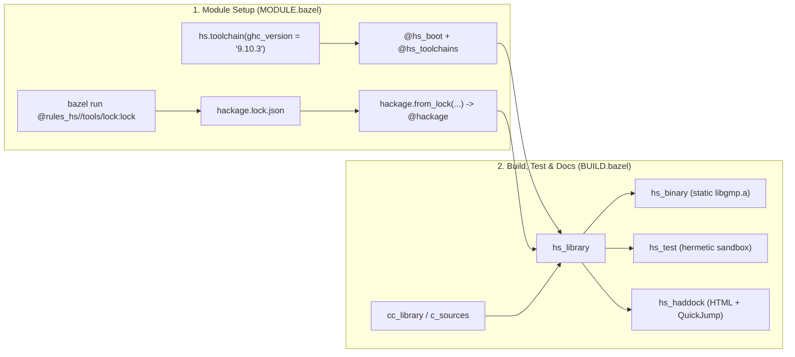

`rules_hs` is a modern, **Bzlmod-only** Bazel 9 ruleset (`bazel_compatibility = [">=9.0.0"]`) for building Haskell libraries, executables, tests, C FFI bindings, and third-party Hackage packages **100% hermetically**.

On Linux, `rules_hs` builds complete Haskell applications with **zero Nix**, **zero `WORKSPACE` files**, **zero Python runtime wrappers**, and **zero host prerequisites** beyond Bazelisk — no host `ghc`, `cabal`, `stack`, `gcc`, `clang`, `libgmp-dev`, `libtinfo-dev`, or `zlib1g-dev`.

> **Tip — New to `rules_hs`?** Jump straight to [Quickstart](guide/quickstart.md) to build and test a hermetic Haskell library, binary, and test suite in under five minutes, or explore [Showcase: `examples/size`](guide/showcase-size.md) for a walkthrough of a 69-package real-world HTTPS sitemap crawler.

## New to Bazel Rulesets or Haskell?

This documentation is written to be approachable with **zero prior Bazel ruleset-authoring experience and zero prior Haskell or GHC experience**. Start with these first-principles primers before diving into the internals:

- **[Bazel Ruleset Primer](internals/bazel-rules-primer.md)** — How Bazel rulesets actually work under the hood: consumer vs. ruleset `MODULE.bazel` (`dev_dependency = True`), Bazel's three phases (Loading, Analysis, Execution), lazy Bzlmod hub-and-spoke repositories, `Provider`s and $O(1)$ `depset`s, `TreeArtifact`s, `cfg = "exec"` vs. target configurations, and `rules_cc` / `CcInfo` interoperability.
- **[Haskell & GHC Primer](internals/haskell-and-ghc-primer.md)** — Everything a build engineer needs to know about Haskell: disambiguating `GHC`, `.cabal`, `Cabal-syntax`, `Hackage`, and `Stackage`, why GHC bundles 41 boot libraries, `.o` archives vs. `.hi` interface files and `${pkgroot}` package DBs, why GHC shells out to a C toolchain and links `gmp` + `libtinfo`, `hsc2hs`/Alex/Happy/`.hs-boot`, Template Haskell (`-dynamic-too`), and Haddock.
- **[Anatomy of `MODULE.bazel` & Dependency Decisions](internals/dependencies.md#module-bazel-anatomy)** — Line-by-line plain-English walkthrough of every dependency in `MODULE.bazel`, `examples/size` (69 Hackage packages), and `//docs` (182 Hackage packages), what Go/Rust/Python library each corresponds to, and what would break without it.

## Key Capabilities

- **Nix-free hermetic Linux GHC (`9.10.3` & `9.12.4`)**: Pure-Starlark extraction of official GHC bindists via [`hs.toolchain`](reference/extensions-and-providers.md#hs-toolchain) — zero `./configure && make install` at fetch time. Compiler binaries resolve `$ORIGIN`-staged `libgmp.so.10` (built from BCR `@gmp`) and a minimal 8-symbol `libtinfo.so.6` stub without `LD_LIBRARY_PATH` or `patchelf`, making every action RBE-ready.
- **Portable static-GMP user executables**: [`hs_binary`](reference/rules.md#hs_binary) and [`hs_test`](reference/rules.md#hs_test) link `libgmp.a` statically and restrict ELF `DT_NEEDED` strictly to base glibc (`libc.so.6`, `libm.so.6`, `libdl.so.2`, `libpthread.so.0`). Compiled binaries run cleanly under `env -i PATH=/nonexistent` across Debian 12, Ubuntu 22.04/24.04, and Rocky Linux 9.
- **Zero Python runtime wrapper & C-toolchain agnosticism**: A compiled C11 adapter (`ghc_cc_wrapper`) bridges GHC, `hsc2hs`, and Cabal `./configure` to any Bazel `@bazel_tools//tools/cpp:toolchain_type` (`hermetic_cc_toolchain` / `zig cc`, `toolchains_llvm`, or GCC/Clang).
- **Two-phase Hackage lockfiles & 5-stage Cabal pipeline**: The dogfooded [`//tools/lock:lock`](reference/lock-cli.md) CLI (`@rules_hs//tools/lock:lock`, built exclusively with GHC boot `Cabal-syntax`) resolves Stackage snapshots into deterministic `hackage.lock.json` files. At build time, [`hackage.from_lock`](reference/extensions-and-providers.md#hackage-from_lock) evaluates the lockfile in pure Starlark (`reproducible = True`) and compiles packages via [`hs_cabal_library`](reference/rules.md#hs_cabal_library) without running `Setup.hs`.
- **Native GHC Haddock API documentation**: [`hs_haddock`](reference/rules.md#hs_haddock) runs GHC's `$ORIGIN`-staged `haddock` hermetically to produce API reference HTML, hyperlinked source code, and QuickJump (`doc-index.json`) search indexes — see the live [Haddock API (`//tools/lock`)](haddock/lock/index.html) mounted directly in this site.
- **Minimal non-dev dependency footprint**: `rules_hs` declares only **four** non-dev `MODULE.bazel` dependencies (`platforms`, `bazel_skylib`, `rules_cc`, and `gmp`), keeping downstream dependency graphs clean and fast.

## End-to-End Workflow

## Comparison with `tweag/rules_haskell`

| Dimension | `rules_hs` | `tweag/rules_haskell` |
|---|---|---|
| **Bazel & module system** | Bazel 9+ (`>=9.0.0`), Bzlmod-only, zero `WORKSPACE` files | Pins Bazel 7; legacy `WORKSPACE` assumptions; broken on Bazel 8/9 |
| **Non-dev `MODULE.bazel` deps** | 4 minimal modules: `platforms`, `bazel_skylib`, `rules_cc`, `gmp` | Pulls `rules_java`, `protobuf`, `abseil-cpp`, `rules_proto`, `rules_nodejs`, `aspect_rules_js`, `rules_python`, `rules_sh` |
| **Hermetic Linux GHC** | Pure-Starlark bindist + `$ORIGIN` staging (`@gmp` + `libtinfo.so.6` stub); RBE-friendly | Bindist runs host `./configure && make install` (requires host `libgmp-dev`/`libtinfo5`); hermeticity requires `rules_nixpkgs` (`/nix/store`) |
| **C compiler adapter** | Compiled C11 binary (`ghc_cc_wrapper`), zero Python | `cc_wrapper.py.tpl`, pulling `rules_python` into every compile/link action |
| **Third-party Hackage builds** | 5-stage [`hs_cabal_library`](reference/rules.md#hs_cabal_library) (`HsConfigure`, codegen, parallel `hsc2hs`, `cc_common.compile`, `ghc --make -c` + `${pkgroot}` DB) | Single opaque Python `cabal_wrapper.py` running `runghc Setup.hs` |
| **Dependency pinning & boot libs** | Dogfooded boot-only `Cabal-syntax` [`//tools/lock:lock`](reference/lock-cli.md) generator; automatic `@hs_boot` & `@hackage` targets | External `stack` binary / `stack_snapshot` + manual `haskell_toolchain_library` boilerplate |
| **Linux binary runtime deps** | Static `libgmp.a`; `DT_NEEDED` strictly base glibc (`libc`, `libm`, `libdl`, `libpthread`) | Dynamic linking / `$ORIGIN` rpath rewriting (`fully_static_link = False` on bindists) |

For a deep implementation-level comparison across `tweag/rules_haskell`, Buck2's Haskell prelude, Please Build, `haskell.nix`, and Cabal/Stack wrappers, see [Comparison with Other Rulesets](internals/rulesets-comparison.md).

## Documentation Map

### User Guide

1. **[Quickstart](guide/quickstart.md)** — Configure `.bazelversion`, `.bazelrc`, `MODULE.bazel`, and `BUILD.bazel` to compile and test your first library and executable with [`hs_library`](reference/rules.md#hs_library), [`hs_binary`](reference/rules.md#hs_binary), and [`hs_test`](reference/rules.md#hs_test).
2. **[Hackage & Lockfiles](guide/hackage.md)** — Pin Stackage packages with [`//tools/lock:lock`](reference/lock-cli.md), wire [`hackage.from_lock`](reference/extensions-and-providers.md#hackage-from_lock) and [`hackage.override`](reference/extensions-and-providers.md#hackage-override), use internal sublibraries, and understand how `Configure` and C-only Cabal packages build.
3. **[C FFI & Toolchains](guide/c-interop-and-toolchains.md)** — Call C code via `ForeignFunctionInterface` and `CApiFFI`, link `cc_library` targets through `cc_deps` or inline `c_sources`, and pair `rules_hs` with `hermetic_cc_toolchain`, `toolchains_llvm`, or system C toolchains.
4. **[Language, RTS, Runfiles & Template Haskell](guide/language-rts-runfiles-th.md)** — Configure `GHC2021`/`Haskell2010`/`Haskell98`, `hidden_modules`, `.hs-boot` mutual recursion, threaded vs. single-threaded GHC RTS, Bazel `data` runfiles, Template Haskell, and [`hs_haddock`](reference/rules.md#hs_haddock) API documentation.
5. **[Showcase: `examples/size`](guide/showcase-size.md)** — End-to-end tour of `examples/size`, a standalone 69-package HTTPS XML/gzip sitemap page counter with offline loopback E2E, Haddock API docs (`//:size_haddock`), and ELF hermeticity tests.
6. **[Migration & Troubleshooting](guide/troubleshooting-and-migration.md)** — Step-by-step migration playbook from `tweag/rules_haskell`, Cabal, and Stack, plus solutions to common build, C header, and lockfile issues.

### API & CLI Reference

- **[Rules Reference](reference/rules.md)** — Complete attribute, output, and provider reference for [`hs_library`](reference/rules.md#hs_library), [`hs_binary`](reference/rules.md#hs_binary), [`hs_test`](reference/rules.md#hs_test), [`hs_haddock`](reference/rules.md#hs_haddock), [`hs_toolchain_library`](reference/rules.md#hs_toolchain_library), [`hs_cabal_library`](reference/rules.md#hs_cabal_library), and [`hs_toolchain`](reference/rules.md#hs_toolchain).
- **[Extensions & Providers](reference/extensions-and-providers.md)** — Complete reference for Bzlmod extensions ([`hs`](reference/extensions-and-providers.md#hs), [`hackage`](reference/extensions-and-providers.md#hackage)), Starlark providers ([`HsPackageInfo`](reference/extensions-and-providers.md#hspackageinfo), [`HsLinkInfo`](reference/extensions-and-providers.md#hslinkinfo), [`HsHaddockInfo`](reference/extensions-and-providers.md#hshaddockinfo), [`HsToolchainInfo`](reference/extensions-and-providers.md#hstoolchaininfo)), and `@rules_hs//hs:toolchain_type`.
- **[Lock Generator CLI](reference/lock-cli.md)** — Complete CLI flag and `hackage.lock.json` JSON schema reference for `@rules_hs//tools/lock:lock`, plus generated [Haddock API (`//tools/lock`)](haddock/lock/index.html) (`//tools/lock:lock_haddock`).

### Internals & Architecture

- **[Bazel Ruleset Primer](internals/bazel-rules-primer.md)** — First-principles guide from Bazel end user to ruleset author: Loading/Analysis/Execution phases, Bzlmod lazy hubs, `Provider`s & `depset`s, `TreeArtifact`s, `cfg = "exec"`, and `CcInfo` interop.
- **[Haskell & GHC Primer](internals/haskell-and-ghc-primer.md)** — Zero-prerequisite guide to GHC, Cabal, Hackage, Stackage, boot libraries, `.hi` interfaces, RTS C linking, `gmp` & `libtinfo`, `hsc2hs`/Alex/Happy, Template Haskell, and Haddock.
- **[Architecture Overview](internals/overview.md)** — Architectural philosophy, `tweag/rules_haskell` post-mortem, Buck2 Haskell & Bzlmod inspirations, and repository layout.
- **[Comparison with Other Rulesets](internals/rulesets-comparison.md)** — Deep architectural comparison against `tweag/rules_haskell`, Buck2's `prelude/haskell` & `buck2-haskell`, Please Build, `haskell.nix`, and Cabal/Stack wrappers.
- **[Hermeticity & Toolchain](internals/hermeticity.md)** — Pure-Starlark bindist sanitization, `$ORIGIN` staging, the 8-symbol `libtinfo.so.6` stub, static-GMP linking, and every rewrite inside `ghc_cc_wrapper`.
- **[Providers & Action Graph](internals/providers-and-actions.md)** — Direct vs. transitive provider split, `-hide-all-packages` visibility enforcement, `${pkgroot}` relocatable package DBs, Template Haskell, and Haddock action internals.
- **[Hackage & Cabal Pipeline](internals/ecosystem-and-hackage.md)** — `Cabal-syntax` multi-platform evaluation, lazy hub/package repositories, and the 5-stage [`hs_cabal_library`](reference/rules.md#hs_cabal_library) action graph.
- **[Cross-OS & Platforms](internals/cross-os-and-platforms.md)** — Multi-arch Linux support, `deb10` glibc vs. `alpine3_12` musl analysis, and blueprints for macOS and Windows activation.
- **[Hakyll & Haddock Docs](internals/docs-engine.md)** — How this documentation site itself is built hermetically with `rules_hs`, vanilla Hakyll, Pandoc, Skylighting, and GHC Haddock.
- **[Dependency Decisions](internals/dependencies.md)** — Complete dependency decision record covering adopted and non-adopted dependencies with concrete reconsideration catalysts.

## Platform Support Matrix

| Platform Key | GHC `9.10.3` & `9.12.4` Bindist Metadata | Status |
|---|---|---|
| `linux_x86_64` | Wired in `hs/private/ghc_versions.bzl` (`deb10` glibc) | **Supported & CI-tested** (Debian 12, Ubuntu 24.04, Rocky Linux 9) |
| `linux_arm64` | Wired in `hs/private/ghc_versions.bzl` (`deb10` glibc) | **Supported** (active in `SUPPORTED_PLATFORMS`) |
| `macos_arm64` | Official URL + SHA-256 cataloged; lockfile `select()` active | Planned (Mach-O `@loader_path` staging & linker flags) |
| `macos_x86_64` | Official URL + SHA-256 cataloged; lockfile `select()` active | Planned (Mach-O `@loader_path` staging & linker flags) |
| `windows_x86_64` | Official URL + SHA-256 cataloged | Planned (`.exe` layout & Win32 `cc_wrapper`) |
| `linux_x86_64_musl` | `alpine3_12-linux-static-int_native` cataloged | Planned opt-in flavor for zero-glibc `FROM scratch` containers |
