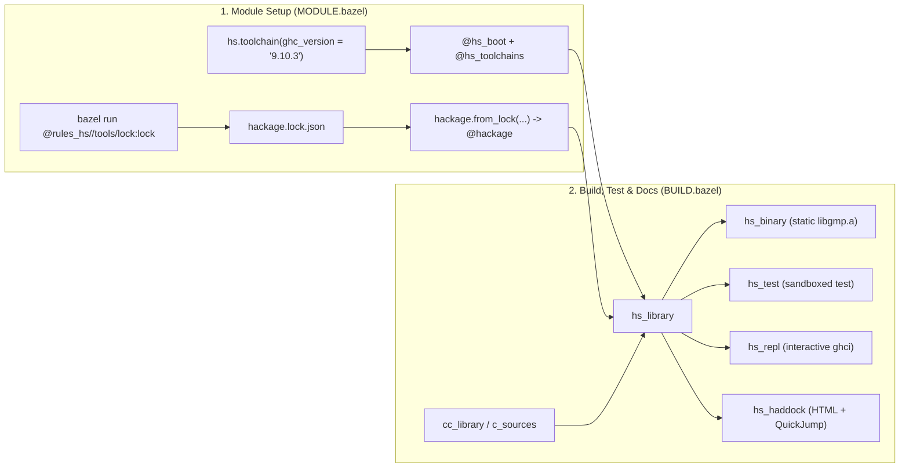

`rules_hs` is a Bazel 9 ruleset for Haskell (`bazel_compatibility = [">=9.0.0"]`) configured through Bzlmod (`MODULE.bazel`). It compiles Haskell libraries, executables, tests, interactive `ghci` REPL targets, C and C++ bindings, Haddock API documentation, and third-party Hackage packages inside isolated Bazel sandboxes.

On Linux (`x86_64` and `arm64`), the only host tool required is [Bazelisk](https://github.com/bazelbuild/bazelisk). `rules_hs` downloads SHA-256-pinned GHC binary distributions into Bazel's cache and does not require Nix, legacy `WORKSPACE` files, Python wrapper scripts, or host installations of `ghc`, `cabal`, `stack`, `gcc`, `clang`, or system C `-dev` libraries.

> **Tip — Getting started:** Follow [Quickstart](guide/quickstart.md) to set up a workspace and build a Haskell library, executable, and test target in a few minutes, or read [Showcase: `examples/size`](guide/showcase-size.md) for a walkthrough of a 69-package HTTPS sitemap crawler built with `rules_hs`.

## What Is Supported, Planned, and Out of Scope {#project-scope}

Before adopting `rules_hs`, use the breakdown below to check what works today, what is planned, and what is intentionally out of scope.

### Supported Today

- **Build, test, REPL, and documentation rules**: [`hs_library`](reference/rules.md#hs_library), [`hs_binary`](reference/rules.md#hs_binary), [`hs_test`](reference/rules.md#hs_test), [`hs_repl`](reference/rules.md#hs_repl), [`hs_haddock`](reference/rules.md#hs_haddock), [`hs_toolchain_library`](reference/rules.md#hs_toolchain_library), and [`hs_cabal_library`](reference/rules.md#hs_cabal_library), plus standalone `@rules_hs//tools/ghci` and `@rules_hs//tools/ghci:runghc` targets.
- **Interactive interpreter execution (`ghci`, `-e`, `runghc`, and `ghc-iserv-dyn`)**: `bazel run` on an [`hs_repl`](reference/rules.md#hs_repl) target opens an interactive `ghci` session preloaded with workspace modules (supporting live `:reload` on edited files, `:break`/`:continue` bytecode debugging, C/C++ FFI, `CApiFFI`, Template Haskell, and `data` runfiles), `-e` expression evaluation, `.ghci` scripts, `-fexternal-interpreter`, and `terminfo` terminal capabilities (`haskeline` arrow-key history, Tab completion, and 256-color output via a self-contained C11 `libtinfo` reader with built-in `xterm-256color`/`vt100`/`dumb` fallbacks).
- **Platforms and GHC versions**: Linux `x86_64` (tested in CI on bare Debian 12, Ubuntu 24.04, and Rocky Linux 9 containers with no host compilers installed) and Linux `arm64`, with official GHC `9.10.3` (default) and `9.12.4` binary distributions.
- **Language and compiler features**:
  - `Haskell98`, `Haskell2010`, `GHC2021` (default), and `GHC2024` language editions (see [Language, RTS, Runfiles & Template Haskell](guide/language-rts-runfiles-th.md) for why `GHC2021` is the default and how to opt into `GHC2024`).
  - Per-target GHC extensions (`default_extensions`) and compiler flags (`ghc_opts`), private library modules (`hidden_modules`), `.hs-boot` files for mutually recursive modules, and `.lhs` literate Haskell sources.
  - Single-threaded and multi-core (`-threaded`) GHC runtime configurations, plus Bazel `data` runfiles accessible at both compile time and runtime.
  - Template Haskell compile-time code generation (`TemplateHaskellQuotes` and `TemplateHaskell`), including splices imported across separate libraries and compile-time file reading such as `file-embed`.
- **C and C++ interoperability**: Standard `foreign import ccall` and header-checked `CApiFFI` bindings, inline `c_sources` (C, C++, and assembly), `cc_deps` (`cc_library` targets from your repository or the Bazel Central Registry), and compatibility with any Bazel `cc_toolchain` (`hermetic_cc_toolchain` `zig cc`, `toolchains_llvm`, GCC, or Clang).
- **Third-party Hackage and Stackage packages**: Lockfile generation via [`@rules_hs//tools/lock:lock`](reference/lock-cli.md) and lazy per-package builds via [`hackage.from_lock`](reference/extensions-and-providers.md#hackage-from_lock) and [`hackage.override`](reference/extensions-and-providers.md#hackage-override), supporting:
  - Cabal `build-type: Simple` packages (over 95% of Hackage, where `Setup.hs` only calls Cabal's standard `defaultMain`).
  - Cabal `build-type: Configure` packages that run autoconf `./configure` scripts to probe C headers and constants (such as `network`, `unix-time`, and `old-time`).
  - Cabal `build-type: Custom` packages whose `Setup.hs` only existed for `cabal-doctest` test setup (automatically converted to `Simple` during lockfile generation, such as `xml-conduit`).
  - C-only Cabal packages (`zlib-clib`, `libyaml-clib`), internal sublibraries and Cabal 3.0 public sublibraries, `reexported-modules`, generated `Paths_<pkg>` modules and compile-time `data-files`, `.hsc` C-binding templates (`hsc2hs`), and automatic source-bootstrapped `.x` (`alex`) lexer and `.y`/`.ly` (`happy`) parser generation.
- **API documentation**: Haddock HTML pages, syntax-highlighted hyperlinked source views, QuickJump search indexes (`doc-index.json`), and cross-target `.haddock` interface linking via [`hs_haddock`](reference/rules.md#hs_haddock).

### Not Supported Today — Planned

- **macOS (`macos_arm64`, `macos_x86_64`) and Windows (`windows_x86_64`) execution**: Official GHC download URLs, SHA-256 digests, and multi-OS lockfile `select()` branches are already generated, but macOS Mach-O shared-library staging and Windows `.exe` wrapper and action support are not wired yet.
- **IDE setup (`haskell-language-server` / `hie.yaml`)**: Automatic `hie.yaml` cradle generation for editor integration is not implemented yet.
- **Static `musl` Linux builds (`linux_x86_64_musl`)**: Opt-in static linking against `musl` libc for zero-glibc `FROM scratch` containers.
- **GHC profiling (`-prof`) and code coverage (`HPC`) build modes**: Building profiling archives (`.p_o`) and Haskell Program Coverage instrumentation.
- **`c2hs` FFI preprocessor and GHC compiler plugins (`-fplugin`)**: Pre-compilation `.chs` hook expansion and loading external GHC compiler plugins.

### Out of Scope (By Design)

- **Arbitrary `build-type: Custom` `Setup.hs` scripts**: Packages (under 1% of Hackage) that execute bespoke Haskell programs inside `Setup.hs` to generate code during library compilation are not run by `rules_hs`. Executing `Setup.hs` collapses a package build into an opaque single-action wrapper that prevents per-file C and `hsc2hs` caching and blocks Bazel `CcInfo` header and archive propagation. Workaround: inspect what the script generates and supply flags or files via [`hackage.override`](reference/extensions-and-providers.md#hackage-override) or custom Bazel targets (see [Hackage & Lockfiles](guide/hackage.md) and [Migration & Troubleshooting](guide/troubleshooting-and-migration.md)).
- **Legacy Bazel `WORKSPACE` files and Bazel `< 9.0.0`**: `rules_hs` uses Bzlmod (`MODULE.bazel`) exclusively.
- **Nix / `rules_nixpkgs` toolchains**: `rules_hs` downloads SHA-256-pinned archives directly into Bazel's cache rather than reading `/nix/store` on the host machine, keeping local sandboxes and remote execution workers consistent.
- **Bundling Python, Node.js, Java, or Protobuf rules inside `rules_hs`**: Keeping `rules_hs` free of foreign language runtimes keeps downstream `MODULE.bazel` graphs small; Protobuf or multi-language code generation belongs in separate companion rulesets.
- **GHCJS and WebAssembly compiler backends**: `rules_hs` targets native Linux (and planned macOS/Windows) compilation rather than JavaScript or WebAssembly backends.

## New to Bazel Rulesets or Haskell?

This documentation does not assume prior Bazel ruleset-authoring experience or prior Haskell and GHC background. If any build or compiler concept is unfamiliar, start with these introductory guides:

- **[Bazel Ruleset Primer](internals/bazel-rules-primer.md)** — How Bazel rulesets work from first principles: consumer vs. ruleset `MODULE.bazel` files (`dev_dependency = True`), Bazel's three execution phases (Loading, Analysis, Execution), lazy Bzlmod package repositories, how rules pass structured metadata (`Provider`s) and transitive sets (`depset`s) between targets, directory outputs, host tool vs. target compilation configurations, and C/C++ library interoperability (`CcInfo`).
- **[Haskell & GHC Primer](internals/haskell-and-ghc-primer.md)** — How Haskell compilation and packaging fit together: the roles of `GHC`, `.cabal` manifests, `Cabal-syntax`, `Hackage`, and `Stackage`; GHC's 41 built-in boot libraries; compiled `.a` archives, `.hi` compiler interface files, and relocatable package databases; why GHC invokes a C compiler and links `gmp` and `libtinfo`; `hsc2hs`, Alex, Happy, and `.hs-boot` files; Template Haskell; and Haddock.
- **[Anatomy of `MODULE.bazel` & Dependency Decisions](internals/dependencies.md#module-bazel-anatomy)** — Line-by-line plain-English walkthrough of every dependency in `MODULE.bazel`, `examples/size` (69 Hackage packages), and `//docs` (182 Hackage packages), with Go, Rust, and Python equivalents and what would fail without each dependency.

## How `rules_hs` Works

- **Pinned Linux GHC toolchains without Nix (`9.10.3` and `9.12.4`)**: [`hs.toolchain`](reference/extensions-and-providers.md#hs-toolchain) extracts official GHC binary distributions in Starlark without running `./configure && make install` on the host. Because GHC's binaries embed relative ELF library search paths (`$ORIGIN`), `rules_hs` places `libgmp.so.10` (built from Bazel Central Registry `@gmp`) and a self-contained C11 `libtinfo.so.6` terminfo library alongside GHC's libraries so compiler and REPL actions need no `LD_LIBRARY_PATH` or `patchelf` binary patching.
- **Portable Linux executables with statically linked GMP**: [`hs_binary`](reference/rules.md#hs_binary) and [`hs_test`](reference/rules.md#hs_test) link `libgmp.a` statically so compiled executables dynamically depend only on standard Linux `glibc` libraries (`libc.so.6`, `libm.so.6`, `libdl.so.2`, `libpthread.so.0`). Binaries run in an empty environment (`env -i PATH=/nonexistent`) across Debian 12, Ubuntu 22.04 and 24.04, and Rocky Linux 9.
- **Compiled C11 compiler wrapper instead of Python**: A small compiled C11 program (`ghc_cc_wrapper`) adapts GHC, `hsc2hs`, and Cabal `./configure` flags for any Bazel C/C++ toolchain (`hermetic_cc_toolchain` `zig cc`, `toolchains_llvm`, GCC, or Clang) without pulling a Python runtime into compile actions.
- **Two-phase Hackage lockfiles and 5-stage Cabal builds**: [`//tools/lock:lock`](reference/lock-cli.md) (`@rules_hs//tools/lock:lock`, built by `rules_hs` itself using only GHC's built-in `Cabal-syntax` library) resolves Stackage snapshots into a deterministic `hackage.lock.json` file. During builds, [`hackage.from_lock`](reference/extensions-and-providers.md#hackage-from_lock) reads that JSON in Starlark and compiles needed packages via [`hs_cabal_library`](reference/rules.md#hs_cabal_library) without executing `Setup.hs`.
- **GHC Haddock API documentation**: [`hs_haddock`](reference/rules.md#hs_haddock) runs GHC's bundled `haddock` binary inside Bazel's sandbox to produce HTML module docs, clickable source code, and QuickJump (`doc-index.json`) search indexes — see the [Haddock API (`//tools/lock`)](haddock/lock/index.html) mounted in this site.
- **Small `MODULE.bazel` dependency graph**: `rules_hs` declares four non-dev `MODULE.bazel` dependencies (`platforms`, `bazel_skylib`, `rules_cc`, and `gmp`), avoiding transitive Java, Python, Node.js, or Protobuf dependencies in downstream workspaces.

## End-to-End Workflow

## Comparison with `tweag/rules_haskell`

| Dimension | `rules_hs` | `tweag/rules_haskell` |
|---|---|---|
| **Bazel and module system** | Bazel 9+ (`>=9.0.0`), Bzlmod (`MODULE.bazel`) only | Targets Bazel 7 with legacy `WORKSPACE` support; incompatible with Bazel 8 and 9 |
| **Non-dev `MODULE.bazel` deps** | 4 modules: `platforms`, `bazel_skylib`, `rules_cc`, `gmp` | Pulls `rules_java`, `protobuf`, `abseil-cpp`, `rules_proto`, `rules_nodejs`, `aspect_rules_js`, `rules_python`, `rules_sh` |
| **Linux GHC provisioning** | Starlark archive extraction + staged `@gmp` and C11 `libtinfo`; works on remote execution workers | Bindist mode runs host `./configure && make install` (needs host `libgmp-dev`/`libtinfo`); sandboxed mode relies on `rules_nixpkgs` (`/nix/store`) |
| **C compiler adapter** | Compiled C11 binary (`ghc_cc_wrapper`), no Python dependency | Python script (`cc_wrapper.py.tpl`), adding `rules_python` to compile and link actions |
| **Third-party Hackage builds** | 5-stage [`hs_cabal_library`](reference/rules.md#hs_cabal_library) (`Simple` and `Configure`; arbitrary `Custom` `Setup.hs` out of scope) | Single Python wrapper (`cabal_wrapper.py`) running `runghc Setup.hs` (supports `Custom` `Setup.hs`, at the cost of per-file caching) |
| **Dependency pinning and boot libs** | [`//tools/lock:lock`](reference/lock-cli.md) (built with GHC boot `Cabal-syntax`) + automatic `@hs_boot` and `@hackage` targets | External `stack` binary via `stack_snapshot` + manual `haskell_toolchain_library` declarations |
| **Linux binary runtime deps** | Links `libgmp.a` statically; dynamic dependencies limited to base `glibc` (`libc`, `libm`, `libdl`, `libpthread`) | Links dynamic libraries with `rpath` entries on bindist toolchains (`fully_static_link = False`) |

For a detailed architectural comparison across `tweag/rules_haskell`, Buck2's Haskell prelude, Please Build, `haskell.nix`, and Cabal/Stack wrappers, see [Comparison with Other Rulesets](internals/rulesets-comparison.md).

## Documentation Map

### User Guide

1. **[Quickstart](guide/quickstart.md)** — Set up `.bazelversion`, `.bazelrc`, `MODULE.bazel`, and `BUILD.bazel` to compile and test a library and executable with [`hs_library`](reference/rules.md#hs_library), [`hs_binary`](reference/rules.md#hs_binary), and [`hs_test`](reference/rules.md#hs_test).
2. **[Hackage & Lockfiles](guide/hackage.md)** — Pin Stackage packages with [`//tools/lock:lock`](reference/lock-cli.md), configure [`hackage.from_lock`](reference/extensions-and-providers.md#hackage-from_lock) and [`hackage.override`](reference/extensions-and-providers.md#hackage-override), use sublibraries, and understand how `Setup.hs` (`Simple`, `Configure`, and `Custom`) is handled.
3. **[C FFI & Toolchains](guide/c-interop-and-toolchains.md)** — Call C code via `ForeignFunctionInterface` and `CApiFFI`, link `cc_library` targets through `cc_deps` or inline `c_sources`, and pair `rules_hs` with `hermetic_cc_toolchain`, `toolchains_llvm`, or system C toolchains.
4. **[Language, RTS, Runfiles & Template Haskell](guide/language-rts-runfiles-th.md)** — Configure `GHC2021` vs. `GHC2024`, interactive `ghci` REPL ([`hs_repl`](reference/rules.md#hs_repl) and `@rules_hs//tools/ghci`), `hidden_modules`, `.hs-boot` mutual recursion, GHC runtime threading, Bazel `data` runfiles, Template Haskell, and [`hs_haddock`](reference/rules.md#hs_haddock) API docs.
5. **[Showcase: `examples/size`](guide/showcase-size.md)** — Walkthrough of `examples/size`, a standalone 69-package HTTPS XML and gzip sitemap page counter with offline loopback HTTP tests, Haddock API docs (`//:size_haddock`), and Linux binary dependency checks.
6. **[Migration & Troubleshooting](guide/troubleshooting-and-migration.md)** — Migration steps from `tweag/rules_haskell`, Cabal, and Stack, plus fixes for common build, `Setup.hs`, C header, and lockfile errors.

### API & CLI Reference

- **[Rules Reference](reference/rules.md)** — Attribute, output, and provider reference for [`hs_library`](reference/rules.md#hs_library), [`hs_binary`](reference/rules.md#hs_binary), [`hs_test`](reference/rules.md#hs_test), [`hs_repl`](reference/rules.md#hs_repl), [`hs_haddock`](reference/rules.md#hs_haddock), [`hs_toolchain_library`](reference/rules.md#hs_toolchain_library), [`hs_cabal_library`](reference/rules.md#hs_cabal_library), and [`hs_toolchain`](reference/rules.md#hs_toolchain).
- **[Extensions & Providers](reference/extensions-and-providers.md)** — Reference for Bzlmod extensions ([`hs`](reference/extensions-and-providers.md#hs), [`hackage`](reference/extensions-and-providers.md#hackage)), Starlark providers ([`HsPackageInfo`](reference/extensions-and-providers.md#hspackageinfo), [`HsLinkInfo`](reference/extensions-and-providers.md#hslinkinfo), [`HsHaddockInfo`](reference/extensions-and-providers.md#hshaddockinfo), [`HsReplInfo`](reference/extensions-and-providers.md#hsreplinfo), [`HsToolchainInfo`](reference/extensions-and-providers.md#hstoolchaininfo)), and `@rules_hs//hs:toolchain_type`.
- **[Lock Generator CLI](reference/lock-cli.md)** — CLI flag and `hackage.lock.json` JSON schema reference for `@rules_hs//tools/lock:lock`, plus generated [Haddock API (`//tools/lock`)](haddock/lock/index.html) (`//tools/lock:lock_haddock`).

### Internals & Architecture

- **[Bazel Ruleset Primer](internals/bazel-rules-primer.md)** — Guide from Bazel user to ruleset author: Loading, Analysis, and Execution phases, Bzlmod lazy hubs, providers and transitive sets, directory outputs, tool configurations, and `CcInfo` interop.
- **[Haskell & GHC Primer](internals/haskell-and-ghc-primer.md)** — Guide to GHC, Cabal, Hackage, Stackage, boot libraries, `.hi` interfaces, RTS C linking, `gmp` and `libtinfo`, `hsc2hs`/Alex/Happy, Template Haskell, and Haddock.
- **[Architecture Overview](internals/overview.md)** — Design goals, lessons from `tweag/rules_haskell` and Buck2's Haskell rules, phase boundaries, and repository layout.
- **[Comparison with Other Rulesets](internals/rulesets-comparison.md)** — Architectural comparison across `tweag/rules_haskell`, Buck2's `prelude/haskell` and `buck2-haskell`, Please Build, `haskell.nix`, and Cabal/Stack wrappers.
- **[Hermeticity & Toolchain](internals/hermeticity.md)** — GHC binary archive sanitization, relative shared-library staging, the self-contained C11 `libtinfo.so.6` / `libtinfo.a` terminfo reader, static GMP linking, and `ghc_cc_wrapper`.
- **[Providers & Action Graph](internals/providers-and-actions.md)** — Direct vs. transitive provider split, `-hide-all-packages` visibility enforcement, relocatable package databases, Template Haskell shared-object isolation, interactive `hs_repl` staging, and Haddock actions.
- **[Hackage & Cabal Pipeline](internals/ecosystem-and-hackage.md)** — `Cabal-syntax` multi-platform evaluation, lazy hub and package repositories, and the 5-stage [`hs_cabal_library`](reference/rules.md#hs_cabal_library) action graph.
- **[Cross-OS & Platforms](internals/cross-os-and-platforms.md)** — Multi-architecture Linux support, `deb10` glibc vs. `alpine3_12` musl trade-offs, and implementation plans for macOS and Windows.
- **[Hakyll & Haddock Docs](internals/docs-engine.md)** — How this documentation site is built by `rules_hs` itself using Hakyll, Pandoc, Skylighting, and GHC Haddock.
- **[Dependency Decisions](internals/dependencies.md)** — Engineering record of adopted and rejected dependencies, along with the conditions that would justify reconsidering each choice.

## Platform Support Matrix

| Platform Key | GHC `9.10.3` & `9.12.4` Bindist Metadata | Status |
|---|---|---|
| `linux_x86_64` | Wired in `hs/private/ghc_versions.bzl` (`deb10` glibc) | **Supported and CI-tested** (Debian 12, Ubuntu 24.04, Rocky Linux 9) |
| `linux_arm64` | Wired in `hs/private/ghc_versions.bzl` (`deb10` glibc) | **Supported** (active in `SUPPORTED_PLATFORMS`) |
| `macos_arm64` | Official URL + SHA-256 cataloged; lockfile `select()` active | Planned (Mach-O `@loader_path` staging and linker flags) |
| `macos_x86_64` | Official URL + SHA-256 cataloged; lockfile `select()` active | Planned (Mach-O `@loader_path` staging and linker flags) |
| `windows_x86_64` | Official URL + SHA-256 cataloged | Planned (`.exe` layout and Win32 `cc_wrapper`) |
| `linux_x86_64_musl` | `alpine3_12-linux-static-int_native` cataloged | Planned opt-in flavor for zero-glibc `FROM scratch` containers |
