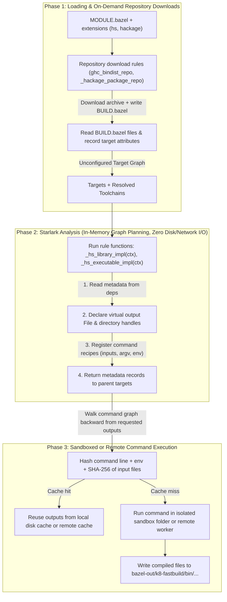
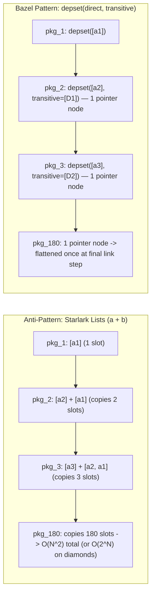
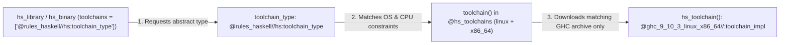

If you have used Bazel on an application team — writing `cc_binary` or `go_library` targets in `BUILD.bazel` and adding `bazel_dep(...)` lines to `MODULE.bazel` — you already know Bazel as an **end user**. Writing and shipping a **language ruleset** such as `rules_haskell` moves you to the other side of that boundary: instead of calling pre-built rules, you write the code that teaches Bazel how to download a compiler, pass dependency information from library to library, run build commands inside isolated sandboxes, connect with C and C++ libraries, and publish a module that other repositories can depend on.

Bazel rules and configuration files are written in **Starlark**, a small, deterministic subset of Python designed specifically for build configuration (no arbitrary file I/O, no network sockets, no mutable global state after a file finishes loading). This primer explains every Bazel ruleset concept used in `rules_haskell` from the ground up. It assumes **no prior experience writing Starlark rules** and **no prior experience with Haskell or GHC**.

> **Tip — Companion Haskell & GHC Primer:** Whenever this guide mentions a Haskell compiler file — such as a compiled `.a` library archive, a `.hi` module summary file, or a `.pkgdb` package metadata folder — you can treat it simply as a file produced by a compiler. For a plain-English guide to Haskell, GHC, Cabal, Hackage, `libgmp`, and Template Haskell, read [Haskell & GHC Primer](haskell-and-ghc-primer.md) next.

---

## Ruleset vs. Consumer Repository {#ruleset-vs-consumer}

### Two Sides of the `load()` Boundary

An **end-user (consumer) repository** — such as `examples/size/` in this repo or an application service repository — wants a short, declarative build file. In `BUILD.bazel`, an application engineer writes a few lines:

```starlark
load("@rules_haskell//hs:defs.bzl", "hs_binary")

hs_binary(
    name = "app",
    srcs = ["Main.hs"],
    deps = ["@hs_boot//:base"],
)
```

Behind that single `hs_binary` call, the **ruleset repository** (`rules_haskell`) is responsible for six distinct layers of build machinery:

| Layer | End User Writes | What `rules_haskell` Does Under the Hood |
|---|---|---|
| **Module dependencies** | `bazel_dep(name = "rules_haskell", version = "0.1.0")` | Declares `MODULE.bazel` and marks `rules_haskell`'s own test and documentation dependencies as development-only (`dev_dependency = True`) so they are not imposed on downstream users. |
| **Downloading compilers & packages** | `hs.toolchain(ghc_version = "9.10.3")` & `hackage.from_lock(...)` | Defines extension hooks (`hs/extensions.bzl`) and on-demand download recipes (`hs/private/ghc_bindist.bzl`, `hs/private/hackage.bzl`) that download the GHC compiler and third-party package archives only when a build target actually uses them. |
| **Matching the build machine's OS & CPU** | `register_toolchains("@hs_toolchains//:all")` | Inspects the machine's operating system and CPU architecture (such as Linux `x86_64` vs. Linux `arm64`), selects the matching GHC download, and prepares its bundled shared libraries inside Bazel's output tree so the compiler runs without relying on packages installed on the host OS. |
| **Passing metadata between targets** | `deps = [":greet", "@hs_boot//:base"]` | Attaches typed Starlark metadata records (`hs/providers.bzl`) to each library target so downstream targets know which libraries are direct dependencies versus indirect (transitive) dependencies without copying large file lists at every step. |
| **Running isolated build commands** | `bazel build //:app` | Registers exact command-line build steps (`hs/private/rules.bzl`, `hs/private/actions.bzl`) listing every input file, output file or output folder, and compiler flag so Bazel can run each step inside a clean temporary directory or reuse a cached result. |
| **Linking with C and C++ code** | `cc_deps = ["//native:fast_crc"]` | Queries Bazel's active C/C++ toolchain for header paths, `.a` static libraries, and compiler binaries, and compiles a small C adapter program (`hs/private/cc_wrapper.c`) so GHC uses Bazel's C compiler instead of `/usr/bin/gcc`. |

Every section in the rest of this primer unpacks one of those six layers in detail.

### Dual-Mode `MODULE.bazel` and `dev_dependency = True` Pruning

Modern Bazel manages external dependencies with **Bzlmod**, configured in a root file named `MODULE.bazel` (the Bazel equivalent of Go's `go.mod` or Rust's `Cargo.toml`).

A Bazel ruleset repository always operates in **two different modes**, controlled by a boolean flag in `MODULE.bazel` called `dev_dependency = True`:

1. **Root-Module Mode (Developing & Testing `rules_haskell` Itself)**: When you clone `rules_haskell` and run `bazel test //...` or `bazel build //docs:site` from the `rules_haskell` directory, `rules_haskell` **is the root module** of the build. Bazel evaluates *every* entry in `MODULE.bazel`, including entries marked `dev_dependency = True`:
   - `hermetic_cc_toolchain@4.3.0` (`@zig_sdk`), which downloads a self-contained `zig cc` C/C++ compiler so `rules_haskell`'s own test suite runs on minimal CI containers that do not have `gcc` or `clang` installed.
   - `rules_shell@0.6.1`, which provides `sh_test` for shell-based verification scripts.
   - `register_toolchains("@hs_toolchains//:all", dev_dependency = True)`, which activates the default GHC compiler for `rules_haskell`'s own tests and documentation generator.
   - `hackage = use_extension("//hs:extensions.bzl", "hackage", dev_dependency = True)` loading `//docs:hackage.lock.json` (the 182 third-party Haskell packages used to build this documentation site).
2. **Consumer Dependency Mode (`bazel_dep` in Downstream Workspaces)**: When an application repository writes `bazel_dep(name = "rules_haskell", version = "0.1.0")` in its own `MODULE.bazel`, that application is the root module and `rules_haskell` is a **non-root dependency**. During dependency resolution, **Bazel ignores and drops every `bazel_dep`, `use_extension`, and `register_toolchains` statement marked `dev_dependency = True` in non-root modules**.

Here is `rules_haskell`'s `MODULE.bazel` showing that split:

```starlark
module(
    name = "rules_haskell",
    version = "0.1.0",
    bazel_compatibility = [">=9.0.0"],
)

# --- ACTIVE FOR ALL DOWNSTREAM CONSUMERS (4 modules) ---
bazel_dep(name = "platforms", version = "1.1.0")
bazel_dep(name = "bazel_skylib", version = "1.9.2")
bazel_dep(name = "rules_cc", version = "0.2.28")
bazel_dep(name = "gmp", version = "6.3.0.bcr.5")

# Non-dev so `bazel run @rules_haskell//tools/lock:lock` can resolve @hs_boot
# in consumer workspaces; root module tags override ghc_version cleanly.
hs = use_extension("//hs:extensions.bzl", "hs")
hs.toolchain(ghc_version = "9.10.3")
use_repo(hs, "hs_boot", "hs_toolchains")

# --- IGNORED AUTOMATICALLY WHEN rules_haskell IS A NON-ROOT bazel_dep ---
bazel_dep(name = "hermetic_cc_toolchain", version = "4.3.0", dev_dependency = True)
bazel_dep(name = "rules_shell", version = "0.6.1", dev_dependency = True)
# ... @zig_sdk toolchains, @hs_toolchains registration, and //docs @hackage ...
```

Omitting `dev_dependency = True` on internal test dependencies is a frequent source of version conflicts in Bazel rulesets: if a ruleset forgets that flag on a test toolchain or documentation dependency, every downstream consumer is forced to resolve those extra modules too. In `rules_haskell`, `//tests/rules:bzlmod_hygiene_test` parses `MODULE.bazel` on every test run and fails the build if any `bazel_dep` outside `platforms`, `bazel_skylib`, `rules_cc`, and `gmp` is missing `dev_dependency = True`.

### Public `hs/` vs. Private `hs/private/` Layout and `bzl_library`

In `BUILD.bazel` files, `visibility = ["//visibility:private"]` restricts who can depend on a compiled target. For Starlark `.bzl` files, standard Bazel ruleset convention (`rules_cc`, `rules_go`, `rules_rust`, `bazel_skylib`) separates public entrypoints from internal implementation files by directory layout:

- **`hs/` (Public API Surface)**: Contains small, stable entrypoint files that downstream users load from:
  - `@rules_haskell//hs:defs.bzl` — re-exports [`hs_library`](../reference/rules.md#hs_library), [`hs_binary`](../reference/rules.md#hs_binary), [`hs_test`](../reference/rules.md#hs_test), [`hs_repl`](../reference/rules.md#hs_repl), [`hs_cabal_library`](../reference/rules.md#hs_cabal_library), [`hs_toolchain_library`](../reference/rules.md#hs_toolchain_library), and [`hs_haddock`](../reference/rules.md#hs_haddock). In Starlark, any top-level variable whose name does **not** start with `_` is automatically exported to callers, so `defs.bzl` imports internal symbols under a leading underscore (`load("//hs/private:rules.bzl", _hs_library = "hs_library")`) and explicitly assigns `hs_library = _hs_library` so internal helpers do not leak into public exports.
  - `@rules_haskell//hs:extensions.bzl` — exposes the [`hs`](../reference/extensions-and-providers.md#hs) and [`hackage`](../reference/extensions-and-providers.md#hackage) Bzlmod extensions.
  - `@rules_haskell//hs:providers.bzl` — exposes [`HsPackageInfo`](../reference/extensions-and-providers.md#hspackageinfo), [`HsLinkInfo`](../reference/extensions-and-providers.md#hslinkinfo), [`HsToolchainInfo`](../reference/extensions-and-providers.md#hstoolchaininfo), [`HsHaddockInfo`](../reference/extensions-and-providers.md#hshaddockinfo), and [`HsReplInfo`](../reference/extensions-and-providers.md#hsreplinfo) for custom Starlark rules.
  - `@rules_haskell//hs:toolchain.bzl` — exposes `TOOLCHAIN_TYPE` and [`hs_toolchain`](../reference/rules.md#hs_toolchain).
- **`hs/private/` (Internal Implementation)**: Holds repository download rules (`ghc_bindist.bzl`, `hackage.bzl`), compiler staging (`staged_ghc.bzl`), shared command builders (`actions.bzl`), rule implementations (`rules.bzl`, `cabal_library.bzl`, `haddock.bzl`, `repl.bzl`), and small C helpers (`cc_wrapper.c`, `tinfo_stub.c`, `rt_shims.c`). Reorganizing helpers inside `hs/private/` does not break downstream `load()` statements.
- **`bzl_library` (`@bazel_skylib//:bzl_library.bzl`)**: In `hs/BUILD.bazel` and `hs/private/BUILD.bazel`, each `.bzl` file has a matching `bzl_library(name = ..., srcs = [...], deps = [...])` target mirroring its `load()` imports. `bzl_library` bundles a `.bzl` file together with every `.bzl` file it transitively loads so Starlark unit tests and linters receive a complete set of `.bzl` files inside their test sandboxes.

---

## Bazel's Three Phases: Loading, Analysis, and Execution {#three-phases}

The central mental model for writing Bazel rules is that `bazel build //:hello` does **not** run a single top-to-bottom build script. Internally, Bazel is driven by an incremental dependency-graph evaluation and in-memory caching engine called **Skyframe** (when you edit one file, Skyframe recomputes only the graph nodes affected by that change and reuses in-memory results for everything else).

Within Skyframe, Bazel processes every build in **three separate phases**, with strict rules about what code is allowed to do in each phase:



### Phase 1 — Loading & On-Demand Repository Downloads

When you run `bazel build //:hello`, Bazel first discovers what modules, external repositories, and `BUILD.bazel` targets exist:

1. **Bzlmod resolution & extension evaluation**: Bazel reads `MODULE.bazel`, resolves `bazel_dep` versions, and runs module extensions (`hs` and `hackage`). Those extensions run in Starlark and declare external repositories by name (`@hs_boot`, `@hs_toolchains`, `@ghc_9_10_3_linux_x86_64`, `@hackage`, `@hackage__aeson`, and so on) without downloading them yet.
2. **On-demand `repository_rule` execution**: Only when Bazel needs to read a label inside an external repository that has not been downloaded yet (for example, `@ghc_9_10_3_linux_x86_64//:toolchain_impl`) does Bazel run that repository's `repository_rule` (`ghc_bindist_repo`). **`repository_ctx` is the only Starlark context in Bazel allowed to use the network** (`repository_ctx.download_and_extract` with a required SHA-256 checksum), inspect extracted directories on disk, and write a generated `BUILD.bazel` file.
3. **`BUILD.bazel` evaluation**: Bazel reads the `BUILD.bazel` files needed for `//:hello` and its `deps`. Calling `hs_library(name = "greet", ...)` inside `BUILD.bazel` does **not** compile anything or even run `_hs_library_impl` yet — it only records a target node holding the raw attribute dictionary (`srcs`, `deps`, `ghc_opts`).

### Phase 2 — Starlark Analysis (`_hs_library_impl(ctx)`)

Once target labels and toolchains are matched, Bazel enters **Analysis**. It calls each rule's Starlark `implementation` function (`_hs_library_impl(ctx)`, `_hs_executable_impl(ctx)`) bottom-up, starting from leaf dependencies and working up to `//:hello`.

> **Important — Why Phase 2 Analysis Cannot Read Source Files or Run Compilers:** Inside `_hs_library_impl(ctx)`, **you cannot open `.hs` source files to read their `import` lines, you cannot check whether files exist on disk, you cannot use the network, and you cannot run `ghc`.**
>
> Why does Bazel enforce such a strict restriction? Suppose a repository has 5,000 targets and 99% of them were already built by CI and stored in a shared build cache. Before running a single compiler, Bazel needs to assemble the **entire graph of build commands** in memory in a few milliseconds so it can compute cache keys, check which outputs already have valid cache hits, and schedule only the remaining uncached commands in parallel across CPU cores or remote machines.
>
> If `_hs_library_impl(ctx)` were allowed to read `.hs` files from disk or spawn `ghc` to inspect imports, Bazel could not finish planning step B until step A had actually finished generating `.hs` files on disk. Cold builds would stall running thousands of discovery subprocesses, and diagnostic commands like `bazel query`, `bazel cquery` (configured target query), and `bazel aquery` (action graph query) could not inspect the build plan quickly in memory.

Because of that rule, an `_impl(ctx)` function performs **four pure in-memory steps**:

1. **Read metadata (`Provider`s) from dependencies and toolchains**: Read structured records returned by already-analyzed targets in `ctx.attr.deps` and by the active Haskell toolchain (`ctx.toolchains[TOOLCHAIN_TYPE].hs`).
2. **Declare virtual output `File` and directory handles**: Call `ctx.actions.declare_file("libHS" + unit_id + ".a")` or `ctx.actions.declare_directory(ctx.label.name + ".pkgdb")`. These return lightweight `File` objects containing path strings (`f.path`, `f.short_path`, `f.basename`); **nothing has been created on disk yet**.
3. **Register `Action` command recipes**: Call `ctx.actions.run_shell(...)`, `ctx.actions.write(...)`, or `ctx.actions.symlink(...)` to record *how* a future shell command or file write will produce each declared output from an explicit set of input `File`s, tool binaries, environment variables, and command-line arguments (`ctx.actions.args()`). Every declared output `File` must be produced by **exactly one** registered action, or Bazel stops Analysis with an error.
4. **Return `Provider` records**: Return structured metadata containing those virtual output `File` handles so parent targets like `//:hello` can list `//:greet`'s outputs among their own action inputs.

Together, all declared `File`s and `Action`s form a **Directed Acyclic Graph (DAG)** — a one-way dependency network with no loops where files point to the commands that read them, and commands point to the output files they write.

### Phase 3 — Sandboxed Action Execution

Only in Phase 3 does Bazel run compilers and write bytes to disk. First, two terms that show up whenever engineers discuss Bazel caching and remote builds:

- **Content digest & Content-Addressable Storage (CAS)**: A *content digest* is the cryptographic SHA-256 hash of a file's exact bytes plus its byte length. *Content-Addressable Storage (CAS)* is a cache directory or server that stores and looks up files by that SHA-256 hash rather than by filename. If two machines have files with identical contents, they share the same CAS entry.
- **Remote Build Execution (RBE)**: Bazel's mechanism for sending individual compile and link actions over the network to a pool of clean Linux worker containers, uploading input blobs to CAS and downloading compiled outputs (or reusing outputs already built by CI or another developer).

Phase 3 executes in three steps:

1. **Demand-driven backward walk**: Bazel starts from the specific output `File`s you asked to build on the command line (for example, the `hello` binary) and walks the Action DAG backward. Any registered action whose output is not needed to build `hello` is **not executed**.
2. **Action cache lookup**: Before running an action (`HsCompileLibrary`, `HsLinkExecutable`, `CppCompile`), Bazel computes a SHA-256 cache key from:
   - the exact command-line `argv` string list,
   - the action's declared environment variables (guarded by `common --incompatible_strict_action_env` in `.bazelrc`, which stops your personal terminal's `$PATH` and `$LD_LIBRARY_PATH` from leaking into action keys), and
   - the SHA-256 content digests of every declared input file and compiler tool.
   If that cache key already exists in your local disk cache or a shared remote cache, Bazel fetches the cached outputs directly without running `ghc`.
3. **Isolated `execroot` symlink forest (`linux-sandbox` or RBE)**: On a cache miss, Bazel runs the command inside an isolated temporary directory called an **`execroot`** (short for *execution root*).

#### What an `execroot` Symlink Forest Looks Like on Disk

Copying gigabytes of source files and compiler binaries into a fresh directory for every single compile command would be slow. Instead, Bazel builds a **symlink forest** — a temporary directory tree populated with symbolic links (`->`) pointing to the real read-only files on disk, containing **only** the specific files declared in that action's `inputs` and `tools`:

```text
/.../sandbox/linux-sandbox/42/execroot/_main/                # Working directory (cwd) of the sandboxed command
├── src/
│   └── Greet.hs -> /home/dev/app/src/Greet.hs               # Symlink to declared src file (undeclared files are absent)
├── external/
│   └── rules_haskell++hs+ghc_9_10_3_linux_x86_64/                # Symlinked GHC compiler files declared in `tools` / `inputs`
└── bazel-out/
    ├── k8-opt-exec-ST-.../bin/.../ghc_cc_wrapper -> ...     # Symlink to compiled C compiler wrapper tool
    └── k8-fastbuild/bin/                                    # Empty writable output folder created for this action
        ├── libHSu__S_S_Cgreet-0.0.0.a                       # Real archive written here by the action
        └── greet.pkgdb/                                     # Real package metadata folder written here by the action
```

Notice what is **missing** from that directory: even if `src/Helper.hs` sits right next to `src/Greet.hs` in your git checkout, if you forgot to list `src/Helper.hs` in `srcs`, Bazel does not create a symlink for it inside the sandbox `execroot`. When `ghc` tries to open `src/Helper.hs`, it fails immediately with `file not found` — catching the missing dependency on your machine before it can break on CI.

#### Why Undeclared Host Reads Break Sandboxes and Corrupt Caches

This Phase 3 execution model explains every toolchain isolation choice in [Hermeticity & Toolchain](hermeticity.md):

- **Missing files on clean containers and RBE workers**: If GHC's configuration file still pointed to `/usr/bin/gcc`, or if a C file wrote `#include <gmp.h>` expecting `/usr/include/gmp.h` from the host OS instead of declaring `@gmp` in `deps`, compilation fails immediately with `No such file or directory` inside a minimal container or remote worker that has no C compiler or `-dev` headers installed.
- **Silent cache corruption when host files leak in**: Worse, if a build runs on a workstation where `/usr` or `/nix/store` is readable inside the sandbox, reading an undeclared host file means **that host file's bytes are not part of Bazel's SHA-256 action cache key**. Two machines with different `/usr/lib/libgmp.so` or `/usr/bin/gcc` versions would compute the *same* Bazel cache key while producing binary-incompatible `.o` object files or executables.

---

## Module Extensions, Repository Rules, and Lazy Hubs {#bzlmod-and-repos}

### Why `bazel_dep` Alone Is Not Enough

In `MODULE.bazel`, `bazel_dep(name = "gmp", version = "6.3.0.bcr.5")` works when an external library is already packaged as a Bazel module on the **Bazel Central Registry (BCR)** — Bazel's public index of modules that already include `MODULE.bazel` and `BUILD.bazel` files.

Official GHC compiler releases (`ghc-9.10.3-x86_64-deb10-linux.tar.xz` on `downloads.haskell.org`) and the 15,000+ Haskell libraries published on Hackage (`aeson-2.2.3.0.tar.gz`) are plain upstream archives that do not contain `BUILD.bazel` files. **Bzlmod module extensions** and **repository rules** bridge that gap: they download raw upstream archives, verify their SHA-256 hashes, and generate `BUILD.bazel` files for them so your targets can depend on them like any normal `@repo//pkg:target` Bazel label.

### `tag_class`, `module_extension`, and `mod.is_root` Precedence

A Bzlmod extension (`hs/extensions.bzl` and `hs/private/hackage.bzl`) has two building blocks:

1. **`tag_class(attrs = {...})`**: Declares the configuration methods users call in `MODULE.bazel` — such as `hs.toolchain(ghc_version = "9.12.4")` or `hackage.from_lock(name = "hackage", lockfile = "//:hackage.lock.json")`.
2. **`module_extension(implementation = ..., tag_classes = {...})`**: Runs **once** across the entire dependency graph, receiving `module_ctx.modules` — the list of every Bazel module in the build that called tags on that extension.

Both `rules_haskell`'s own `MODULE.bazel` (`ghc_version = "9.10.3"`) and a downstream consumer's `MODULE.bazel` (`ghc_version = "9.12.4"`) may call `hs.toolchain(...)`. To make sure the consumer's version wins rather than causing a conflict, `_hs_extension_impl` (`hs/extensions.bzl`) checks `mod.is_root`:

```starlark
def _hs_extension_impl(module_ctx):
    root_tags = []
    other_tags = []
    for mod in module_ctx.modules:
        for tag in mod.tags.toolchain:
            if mod.is_root:
                root_tags.append(tag)   # Consumer's root MODULE.bazel
            else:
                other_tags.append(tag)  # Default in rules_haskell's own MODULE.bazel

    chosen = root_tags[0] if root_tags else (other_tags[0] if other_tags else None)
    selected_version = chosen.ghc_version if chosen else DEFAULT_GHC_VERSION
    # ... declare ghc_bindist_repo, hs_toolchains_repo, hs_boot_repo ...
    return module_ctx.extension_metadata(reproducible = True)
```

When you run tests inside the `rules_haskell` repository itself, `rules_haskell` has `mod.is_root == True` and uses `9.10.3`. When a downstream application depends on `rules_haskell` and writes `hs.toolchain(ghc_version = "9.12.4")`, the application has `mod.is_root == True`, overriding `rules_haskell`'s fallback version across the whole build.

### What `extension_metadata(reproducible = True)` Does for `MODULE.bazel.lock`

By default, Bazel assumes a `module_extension` might inspect host environment variables or query a live web API whose answer could change tomorrow. To guard against drift, Bazel records every repository generated by non-reproducible extensions inside the consumer's `MODULE.bazel.lock` file — often producing thousands of lines of JSON diffs when Bazel versions or operating systems differ across a team.

In `rules_haskell`, neither `hs` nor `hackage` touches the network or host OS during extension evaluation:
- `hs` looks up SHA-256-pinned compiler URLs from a static Starlark dictionary (`GHC_BINDISTS` in `hs/private/ghc_versions.bzl`).
- `hackage` reads the user's committed `hackage.lock.json` file using `json.decode(module_ctx.read(lock_label))` in pure Starlark.

Because their declared repositories are purely determined by files already tracked in git, both extensions return `module_ctx.extension_metadata(reproducible = True)`. That tells Bazel it can re-evaluate the extension in memory in a few milliseconds and **skip writing extension state into downstream `MODULE.bazel.lock` files**.

### The Hub-and-Spoke Lazy Repository Pattern (`@hackage` -> `@hackage__<pkg>`)

Suppose `docs/hackage.lock.json` pins **182 Hackage packages** (`pandoc`, `hakyll`, `aeson`, `text`, `crypton`, and others). If `hackage` created one giant `@hackage` repository rule that downloaded all 182 `.tar.gz` archives up front, running a small test that only needed `aeson` would still wait for all 182 packages to download and unpack.

Instead, `hs/private/hackage.bzl` uses Bazel's **Hub-and-Spoke Lazy Repository Pattern**:


1. **The Hub (`@hackage`, `_hackage_hub_repo`)**: Exposed to `BUILD.bazel` files via `use_repo(hackage, "hackage")`. Its repository rule performs **no network downloads** — it only writes a small `BUILD.bazel` file containing targets for GHC's built-in boot libraries (`@hackage//:base`) and `alias()` pointers (`@hackage//:aeson` -> `@hackage__aeson//:aeson`) for every package in the lockfile.
2. **The Spokes (`@hackage__<pkg>`, `_hackage_package_repo`)**: `_hackage_impl` declares one separate `_hackage_package_repo` per locked package (`@hackage__aeson`, `@hackage__pandoc`, ...), passing that package's JSON metadata string. Declaring a `repository_rule` only registers a recipe in memory — **Bazel runs `_hackage_package_repo_impl` (calling `download_and_extract`) only for the specific spoke repositories reachable from the target you asked to build.**

---

## Rules, Actions, Files, and TreeArtifacts {#rules-and-actions}

### Anatomy of a `rule(...)` Declaration

In `hs/private/rules.bzl`, [`hs_library`](../reference/rules.md#hs_library), [`hs_binary`](../reference/rules.md#hs_binary), and [`hs_test`](../reference/rules.md#hs_test) are defined with Bazel's built-in `rule(...)` constructor:

```starlark
hs_library = rule(
    implementation = _hs_library_impl,
    attrs = {
        "srcs": attr.label_list(
            allow_files = [".hs", ".lhs", ".hs-boot", ".lhs-boot"],
            mandatory = True,
        ),
        "deps": attr.label_list(
            providers = [[HsPackageInfo], [CcInfo]],
            default = [],
        ),
        "ghc_opts": attr.string_list(default = []),
        "data": attr.label_list(allow_files = True, default = []),
        "_rt_shims": attr.label(
            default = Label("//hs/private:rt_shims"),
            providers = [CcInfo],
        ),
    },
    toolchains = [TOOLCHAIN_TYPE] + use_cc_toolchain(),
    fragments = ["cpp"],
    provides = [HsPackageInfo, HsLinkInfo, CcInfo, HsDocSourceInfo],
)
```

Four parts of `rule(...)` validate inputs automatically before `_hs_library_impl(ctx)` runs:

- **Typed `attrs` & provider contracts**: Setting `providers = [[HsPackageInfo], [CcInfo]]` on `deps` tells Bazel to check during Analysis that every target listed in `deps` returns *either* `HsPackageInfo` (a Haskell library) *or* `CcInfo` (a C/C++ `cc_library`). Passing an unrelated target such as a `py_library` fails immediately with a type error.
- **Private implicit attributes (`_`-prefixed)**: Attributes whose names start with `_` (such as `"_rt_shims"`) cannot be set by users in `BUILD.bazel`. Rules use them to attach internal helper targets (`//hs/private:rt_shims`) to every instance of the rule automatically.
- **`executable = True` vs. `test = True`**: Setting `executable = True` (on `hs_binary`) enables `bazel run`. Setting `test = True` (on `hs_test`) enables both `bazel run` and `bazel test`, and automatically adds Bazel's standard `size`, `timeout`, `flaky`, and `shard_count` test attributes.
- **`toolchains` and `fragments`**: Declares which toolchain types (`@rules_haskell//hs:toolchain_type` for Haskell and `@bazel_tools//tools/cpp:toolchain_type` for C/C++) Bazel should resolve for this target.

### Regular `File`s (`declare_file`) vs. `TreeArtifact`s (`declare_directory`)

During Phase 2 Analysis, Bazel builds the action graph **without reading `.hs` source files or running tools**. That raises a practical question: *what if a compiler produces a whole folder of output files whose exact filenames depend on module names inside the `.hs` files?*

Bazel provides two output declaration methods on `ctx.actions`:

| Output Kind | Starlark Call | When to Use | Examples in `rules_haskell` |
|---|---|---|---|
| **Regular `File`** | `ctx.actions.declare_file("libHS" + unit_id + ".a")` | You know the exact output filename during Phase 2 Analysis. | `libHS<unit_id>.a`, executable binary, `cabal_macros.h`, `Paths_<pkg>.hs`, per-file `.hsc` -> `.hs` outputs, `<name>.haddock`. |
| **`TreeArtifact` (directory output)** | `ctx.actions.declare_directory(name + ".pkgdb")` | The action writes an **entire directory tree** whose internal file names are only known after the command runs in Phase 3. | `staged_ghc/lib` (hundreds of compiler files), `<name>.pkgdb` (`hi/*.hi`, `dyn/*.so`, `package.cache`), and `hs_haddock` HTML folders (`index.html`, `<Mod>.html`, `src/*.html`). |

Bazel calls a directory declared via `declare_directory` a **`TreeArtifact`** (`f.is_directory == True`). During Phase 2 Analysis, Bazel tracks the directory as a single graph node; once the Phase 3 command finishes writing into that directory, Bazel scans all files created inside it and hashes each file individually for caching and remote execution.

> **Warning — Bazel's Non-Overlapping Output Path Rule:** Bazel forbids declaring a standalone `File` at a path inside (or overlapping) another action's `TreeArtifact` directory. Doing so aborts Analysis with an artifact-prefix conflict error (a recurring issue in `tweag/rules_haskell`, e.g., issues #2496 and #2499).
>
> `rules_haskell` avoids path overlaps by declaring each library's static archive (`libHS<unit_id>.a`) and package metadata directory (`<name>.pkgdb`) as **side-by-side siblings** in the same parent folder `bazel-out/<cfg>/bin/<pkg>/` (see [Relocatable `${pkgroot}` Package Databases](providers-and-actions.md#relocatable-pkgdb)).

### `DefaultInfo`, `OutputGroupInfo`, and `.runfiles` Symlink Forests

Every rule returns **`DefaultInfo`**, Bazel's built-in record telling the command line which files to build by default and how to run executables:

```starlark
return [
    DefaultInfo(
        executable = out_exe,          # Required when executable = True or test = True
        files = depset([out_exe]),     # Built by default on `bazel build //pkg:app`
        runfiles = runfiles,           # Runtime data files staged for `bazel run` & `bazel test`
    ),
]
```

- **How `OutputGroupInfo` exposes optional extra outputs**: Sometimes a rule produces secondary files that most users do not need on a default build. For example, [`hs_haddock`](../reference/rules.md#hs_haddock) (`hs/private/haddock.bzl`) puts its HTML folder in `DefaultInfo(files = depset([html_dir]))` so `bazel build //:docs` builds the HTML directory, while exposing the binary `.haddock` cross-linking file under `OutputGroupInfo(haddock_interface = depset([interface]))` (which can be requested via `--output_groups=haddock_interface`).
- **What a `.runfiles` symlink forest looks like on disk (and how it differs from `execroot`)**:
  Earlier we saw the **`execroot`** symlink forest, which exists *at build time* for compilers (`ghc`, `gcc`). When your compiled program runs *at runtime* via `bazel run` or `bazel test` and needs to read data files declared in `data = ["testdata/sample.xml"]`, it should not hardcode paths to your local git checkout (which will not exist on a remote test runner).
  Instead, Bazel creates a second symlink forest next to the compiled executable named **`<binary>.runfiles/`**, and sets environment variables (`RUNFILES_DIR`, plus `TEST_SRCDIR` and `TEST_WORKSPACE` during `bazel test`) pointing into it:

```text
bazel-out/k8-fastbuild/bin/tests/
├── app_test                                               # Compiled ELF binary
└── app_test.runfiles/                                     # <- $RUNFILES_DIR (and $TEST_SRCDIR in `bazel test`)
    └── _main/                                             # <- $TEST_WORKSPACE (root module directory)
        ├── tests/
        │   └── app_test -> /.../bin/tests/app_test        # Symlink to compiled binary
        └── testdata/
            └── sample.xml -> /home/dev/app/testdata/sample.xml   # Symlink to declared `data` file
```

If Library A declares `data = ["certs/ca.pem"]`, Library B depends on A, and `app_test` depends on B, merging `runfiles` across `deps` automatically places `certs/ca.pem` inside `app_test.runfiles/_main/certs/ca.pem` at test time.

> **Note — Why `rules_haskell` Clears `RUNFILES_*` Variables During Compilation:** Because `.bazelrc` sets `common --enable_runfiles`, Bazel also populates `RUNFILES_DIR` when invoking build tools during compilation. Subprocesses spawned inside a compile step (such as `ghc`, `hsc2hs`, or `./configure`) can misbehave if they inherit an outer tool's `RUNFILES_*` environment variables. Every compile and link command in `rules_haskell` — as well as `ghc_cc_wrapper` — explicitly unsets `RUNFILES_DIR`, `RUNFILES_MANIFEST_FILE`, and `RUNFILES_MANIFEST_ONLY` so runfiles remain purely a runtime (`bazel run` / `bazel test`) mechanism.

---

## Providers and Depsets {#providers-and-depsets}

### `provider(...)`: How Targets Pass Information to Dependents

In Bazel, targets are encapsulated from one another. When `hs_binary(name = "hello", deps = [":greet"])` is analyzed, `_hs_executable_impl` **cannot** reach into `:greet` to read `:greet`'s `srcs` attribute, internal variables, or registered commands. It can **only** read fields from the `Provider` records (typed, read-only structs) that `_hs_library_impl` returned for `:greet`.

`hs/providers.bzl` defines typed provider schemas using `provider(doc = ..., fields = {...})`:

- **[`HsPackageInfo`](../reference/extensions-and-providers.md#hspackageinfo) (Direct dependency metadata only)**: Describes **one single package** (`name`, `version`, `unit_id`, `pkg_db`, `hs_lib`, `is_boot`). `rules_haskell` reads `HsPackageInfo` *only* from immediate `ctx.attr.deps` so it can pass `-package-id <unit_id>` for direct dependencies only and reject accidental `import` statements of indirect dependencies (`-hide-all-packages`).
- **[`HsLinkInfo`](../reference/extensions-and-providers.md#hslinkinfo) (Transitive dependency closure)**: Carries `depset`s accumulated across **all direct and indirect dependencies** (`pkg_dbs`, `hs_libs`, `include_dirs`, `headers`, plus merged `cc_info`) so GHC can read transitive `.hi` type summaries during compilation and link every upstream `libHS*.a` static archive into a final executable.

### Why `depset` Exists (And Why Starlark Lists Exhaust Memory)

A common question when first reading Starlark rules is: *why does `HsLinkInfo` store `depset[File]` instead of a normal Python/Starlark list `[File]`?*

Consider a 180-package dependency chain (such as the 182 Hackage packages used to build `//docs`):



- **What goes wrong with Starlark lists (`[my_lib] + dep.libs`)**: Starlark lists are flat arrays. Writing `a + b` allocates a brand-new array and copies every element at *every* target along the graph (`1 + 2 + ... + N = O(N^2)` memory and CPU on a linear chain — and **exponential `O(2^N)`** if two branches of a diamond dependency are concatenated without deduplicating at each step). On large repositories, concatenating lists in providers causes Bazel's Java server to run out of heap memory (`OutOfMemoryError`) during Analysis.
- **How `depset` avoids copying (`O(1)` per target)**: A `depset` (internally called a nested set) is an immutable graph of small pointer nodes:
  ```starlark
  HsLinkInfo(
      pkg_dbs = depset([pkg_db], transitive = [dep_info.pkg_dbs]),
      hs_libs = depset([hs_lib], transitive = [dep_info.hs_libs]),
      # ...
  )
  ```
  Creating `depset([hs_lib], transitive = [...])` allocates one tiny node pointing to `hs_lib` and to the existing child `depset` nodes in **constant `O(1)` time and memory**, without iterating over or copying their contents.
- **Delayed flattening & automatic deduplication**: When you pass a `depset` directly to `ctx.actions.run_shell(inputs = depset(...))`, Starlark never converts it into a Python-style list at all — Bazel's native engine walks and deduplicates the graph directly in Phase 3. You only call `.to_list()` at the leaf action when formatting command-line flags (and Bazel deduplicates repeated diamond dependencies automatically during that walk).

### Understanding `depset` Traversal Orders (And Why Linker Order Matters)

When you create a `depset(direct, transitive = [...], order = "...")`, the `order` parameter controls the sequence in which `.to_list()` emits elements. Suppose `app` depends on `left` and `right`, and both `left` and `right` depend on `base`:

- **`order = "postorder"` (dependencies *before* dependents)**: Walks deep children first and parents last, yielding `[base, left, right, app]`. Useful when base metadata or initialization steps must appear before items built on top of them.
- **`order = "preorder"` (dependents *before* dependencies, branch by branch)**: Emits the current node's direct items first, then walks each transitive branch depth-first: `[app, left, base, right]` (notice `base` was already visited under `left`, so it appears *before* `right`).
- **`order = "topological"` (every dependent strictly *before* all of its dependencies)**: Guarantees that if `X` depends on `Y` along *any* path in a diamond, `X` appears before `Y`: `[app, left, right, base]`.
- **`order = "default"` (unspecified deterministic order)**: Uses postorder-style traversal when element order does not matter (such as sandbox `inputs` sets). Note that Bazel forbids merging two `depset`s created with different explicit orders (for instance, you cannot pass a `"topological"` `depset` inside `transitive` of a `"postorder"` `depset`).

**Why order matters for static `.a` libraries at link time:** Traditional Unix linkers (`ld`) scan static `.a` archives in a **single left-to-right pass**. If `app.o` calls a C function `crc32()` defined inside `libcrc.a`, `app.o` must appear **to the left of** `libcrc.a` on the linker command line: seeing `app.o` first records `crc32` as an unresolved symbol, so when the linker reaches `libcrc.a` on the right, it pulls in the `.o` member defining `crc32`. If `libcrc.a` were placed *before* `app.o` (as a `"postorder"` list would do), the linker would inspect `libcrc.a` while no symbols were needed yet, skip `libcrc.a` completely, and then fail with `undefined reference to 'crc32'` upon reaching `app.o`.

That is why static linkers expect dependents before dependencies (`"topological"` order) — and why, when linking multiple C static `.a` archives that may even call functions in *each other*, `rules_haskell` wraps all C `.a` archives inside `-Wl,--start-group ... -Wl,--end-group` *after* GHC's Haskell libraries so the linker rescans those C archives in a loop until every cross-archive symbol reference is satisfied (see [Executable Linking](providers-and-actions.md#executable-linking)).

---

## Toolchains and Exec vs. Target Configurations {#toolchains-and-configs}

### Platform-Based Toolchain Indirection

Why doesn't `hs_library` simply hardcode `_ghc = attr.label(default = "@ghc_9_10_3_linux_x86_64//:ghc")`? Because hardcoding one machine's compiler breaks as soon as an `arm64` Linux developer clones the repository or an `x86_64` laptop sends build actions to an `arm64` remote worker.

Instead, Bazel separates **rules** from **platform-specific compiler binaries** using three cooperating targets (`hs/BUILD.bazel`, `hs/toolchain.bzl`, and `hs/private/ghc_bindist.bzl`):



1. **`toolchain_type` (`hs/BUILD.bazel`)**: Declares `@rules_haskell//hs:toolchain_type`, a plain identifier label with no files attached.
2. **`hs_toolchain` (`hs/toolchain.bzl`)**: Packages the staged GHC installation, `ghc_cc_wrapper`, and boot library metadata inside Bazel's `platform_common.ToolchainInfo(hs = toolchain_info)`. Inside `_hs_library_impl(ctx)`, rules read `ctx.toolchains[TOOLCHAIN_TYPE].hs` without hardcoding any OS or CPU repository name.
3. **`toolchain(...)` (`@hs_toolchains/BUILD.bazel`)**: Connects `exec_compatible_with` (the OS and CPU where the compiler *runs*) and `target_compatible_with` (the OS and CPU the compiler *generates code for*) to a lazy `toolchain = "@ghc_9_10_3_linux_x86_64//:toolchain_impl"` label. Because that label is only followed after constraints match, registering `@hs_toolchains//:all` on `linux_x86_64` **never downloads `@ghc_9_10_3_linux_arm64`** (and vice versa).

### `cfg = "exec"` vs. `cfg = "target"` (Why Two `bazel-out/` Trees Exist)

In Bazel, a **build configuration** (`cfg`) is the bundle of compiler settings — target OS, target CPU, optimization level (`-O0` vs. `-O2`), debug symbols (`-g`), and custom flags — that controls how a target is built. Each distinct configuration writes its outputs into its own subdirectory under `bazel-out/` so builds with different flags never overwrite one another.

If you look inside `bazel-out/` after running `bazel build //:hello`, you will see **two configuration directories**:

```text
bazel-out/
├── k8-opt-exec-ST-.../bin/          # <-- cfg = "exec" (tools that RUN on the build machine during compilation)
│   ├── external/rules_haskell+/hs/private/ghc_cc_wrapper
│   └── external/rules_haskell++hs+ghc_9_10_3_linux_x86_64/
│       └── staged_ghc/{bin/ghc-9.10.3, lib/..., gmp_static/libgmp.a}
└── k8-fastbuild/bin/                # <-- cfg = "target" (your libraries & binaries built FOR deployment)
    ├── libHSu__S_S_Cgreet-0.0.0.a
    ├── greet.pkgdb/
    └── hello
```

In `hs/toolchain.bzl`, `rules_haskell` requests `cfg = "exec"` on build-time compiler tools:

```starlark
"staged_ghc": attr.label(
    mandatory = True,
    providers = [HsToolchainInfo],
    cfg = "exec",
),
"cc_wrapper": attr.label(
    default = Label("//hs/private:ghc_cc_wrapper"),
    executable = True,
    cfg = "exec",
),
```

Putting build-time helper tools (`staged_ghc`, `ghc_cc_wrapper`, and bootstrapped `alex`/`happy` parser generators) in **`cfg = "exec"`** while keeping user libraries and binaries in **`cfg = "target"`** matters for **two separate reasons** — even when you are *not* cross-compiling:

1. **Cross-compilation and remote workers**: Suppose your laptop is `macos_arm64`, your remote build worker runs `linux_x86_64` (the `exec` platform), and you are building a binary to deploy on `linux_arm64` servers (the `target` platform). `ghc_cc_wrapper` must be compiled as a `linux_x86_64` binary (`cfg = "exec"`) so the remote worker can execute it during compilation, whereas `//:hello` (`cfg = "target"`) is compiled for `linux_arm64`.
2. **Faster tools and stable caches on a single Linux workstation (no cross-compilation)**:
   - **Optimized helper tools during unoptimized builds**: By default, `bazel build //:hello` uses `fastbuild` mode (`-O0`, unoptimized) for your application so edits compile quickly. Because `cfg = "exec"` always turns on optimization (`-O2`, reflected in `k8-opt-exec`), compiler helpers like `ghc_cc_wrapper` and code generators like `alex` and `happy` still run at full `-O2` speed during every debug build.
   - **No redundant toolchain rebuilds when you change app flags**: If you switch between `bazel build //:hello` and `bazel test -c dbg --copt=-fsanitize=address //:hello_test`, those debug and sanitizer flags change the `cfg = "target"` configuration — recompiling your application — **without** changing `cfg = "exec"`. Bazel keeps reusing the exact same cached `staged_ghc`, `ghc_cc_wrapper`, `alex`, and `happy` artifacts instead of rebuilding your compiler tools every time you toggle a flag on your binary.

---

## Interoperating with C/C++ via rules_cc and CcInfo {#cc-interop}

Haskell programs frequently call C functions via Haskell's Foreign Function Interface (FFI), run `hsc2hs` to read C struct layouts and `#define` constants from `.h` headers, and use a C compiler and system linker under the hood to produce binaries (see [Why GHC Needs a C Toolchain](haskell-and-ghc-primer.md#c-toolchain-and-rts)). If `rules_haskell` hardcoded `/usr/bin/gcc` inside its shell commands, builds would fail on clean containers using `hermetic_cc_toolchain` (`zig cc`), `toolchains_llvm`, or custom enterprise C/C++ toolchains.

Instead, `rules_haskell` integrates with **`@rules_cc`**, Bazel's standard C/C++ ruleset, through two Starlark APIs: the **`CcInfo`** provider and the **`cc_common`** helper module (`hs/private/actions.bzl`).

### What Is Inside `CcInfo`?

Whenever someone writes a `cc_library` target in Bazel:

```starlark
cc_library(
    name = "fast_crc",
    srcs = ["crc32.c"],
    hdrs = ["include/crc32.h"],
    includes = ["include"],
    defines = ["FAST_CRC_SIMD=1"],
    linkopts = ["-lm"],
)
```

Bazel compiles `crc32.c` into `libfast_crc.a` (and position-independent `libfast_crc.pic.a`) and returns a **`CcInfo`** provider containing two sub-records:

1. **`CcInfo.compilation_context` ("everything needed to `#include` this library's headers")**:
   - **`headers`** (`depset[File]`): All public `.h` files from `fast_crc` and its transitive dependencies (`include/crc32.h`, etc.) that Bazel must symlink into the sandbox so `#include "crc32.h"` can find the file on disk.
   - **`includes` / `quote_includes` / `system_includes`** (`depset[str]`): Header search folder paths passed to the C preprocessor as `-I<dir>`, `-iquote <dir>`, and `-isystem <dir>`.
   - **`defines`** (`depset[str]`): Preprocessor `#define` macros passed as `-DFAST_CRC_SIMD=1`.
2. **`CcInfo.linking_context` ("everything needed to link this library's compiled code")**:
   - **`linker_inputs`** (`depset[LinkerInput]`): Each entry carries `libraries` (`LibraryToLink` records pointing to the compiled `libfast_crc.a` / `libfast_crc.pic.a` static archives and/or `.so` shared libraries) plus `user_link_flags` (extra linker flags such as `-lm` to link the C math library or `-lstdc++` for the C++ standard library).

### How `rules_haskell` Connects to `cc_common` and `CcInfo` in Four Steps

If you have never called `cc_common` in Starlark before, here is how `hs/private/actions.bzl` wires C and Haskell together step by step:

1. **Attach Bazel's active C/C++ toolchain to the rule**:
   ```starlark
   load("@rules_cc//cc:find_cc_toolchain.bzl", "find_cc_toolchain", "use_cc_toolchain")

   # On rule(...):
   toolchains = [TOOLCHAIN_TYPE] + use_cc_toolchain(),
   fragments = ["cpp"],
   ```
   This tells Bazel to resolve whichever C/C++ toolchain the workspace registered (`zig cc`, Clang, or GCC) alongside the GHC toolchain.
2. **Ask `cc_common` for exact tool paths and sysroot flags (`resolve_cc_tools`)**: Inside rule analysis, `find_cc_toolchain(ctx)` and `cc_common.configure_features(...)` look up the active C toolchain. `rules_haskell` calls `cc_common.get_tool_for_action(..., action_name = ACTION_NAMES.c_compile)` to get the C compiler path, `ACTION_NAMES.cpp_link_static_library` to get `ar`, `cc_toolchain.ld_executable` to get `ld`, and `cc_common.create_compile_variables` to extract any `--sysroot` or `--target` flags (which C toolchains like `zig cc` and `toolchains_llvm` require to locate standard C headers like `stdio.h`). Those exact paths and flags are passed to `ghc_cc_wrapper`.
3. **Compile inline `c_sources` via `cc_common.compile`**: When an `hs_library` or `hs_cabal_library` includes `.c` or `.cc` files directly in `c_sources`, `rules_haskell` does not write ad-hoc shell scripts to compile them. Instead, `compile_c_sources` calls `cc_common.compile(...)` and `cc_common.create_linking_context_from_compilation_outputs(..., disallow_dynamic_library = True)`. Bazel spawns parallel per-file `CppCompile` actions with automatic `.h` header dependency tracking and archives the `.o` files into a static `.a` library.
4. **Merge and forward `CcInfo` in both directions (`cc_common.merge_cc_infos`)**:
   - **C -> Haskell**: `collect_deps` merges `CcInfo` from all `deps` and `cc_deps` via `cc_common.merge_cc_infos`, passing `compilation_context` header files and `-I` directories to GHC, `hsc2hs`, and `./configure`, and passing `linking_context` `.a` archives and `user_link_flags` (`-lm`, `-lstdc++`) to the final executable link.
   - **Haskell -> Haskell -> Binary**: Because `hs_library` and `hs_cabal_library` also **return** that merged `CcInfo`, C headers and `.a` archives flow through multi-hop chains (`cc_library -> hs_library -> hs_cabal_library -> hs_binary`) without requiring downstream targets to repeat `cc_deps`.

---

## Testing a Bazel Ruleset {#testing-rulesets}

Testing a Bazel ruleset involves more than checking whether a sample binary prints `Hello World`. Subtle ruleset bugs can hide in Starlark provider fields, accidentally exposed transitive imports, unintended shared-library dependencies in ELF headers, or missing `dev_dependency = True` flags that only show up when an external repository depends on `rules_haskell`.

`rules_haskell` tests every change across **four layers**:

| Layer | Mechanism & Location | Typical Speed | What Bugs It Catches |
|---|---|---|---|
| **1. Starlark Analysis Tests** | `analysistest` (`@bazel_skylib//lib:unittest.bzl`) in `tests/starlark/rules_analysis_test.bzl` | **~10–50 ms** (runs Phase 2 only; never invokes `ghc`) | Provider fields, `depset` propagation, `-hide-all-packages` / `-package-id` strict import visibility, `cabal_macros.h` file content, C-only Cabal short-circuiting, `-optl-L.../gmp_static`, `--start-group` flag order, `HsHaddock` flags. |
| **2. Rule Functional Tests** | `hs_test` targets across `tests/basic/` & `tests/rules/` | Seconds (cached per action) | Multi-library dependency graphs, `.hs-boot` mutual recursion, `Configure` + `hsc2hs`, C & C++ FFI, `Haskell98`/`Haskell2010`/`GHC2021` language editions, threaded vs. single-threaded runtime, 2-hop `.runfiles`, same-library & cross-library Template Haskell, Haddock HTML/QuickJump output. |
| **3. Binary & Bzlmod Hygiene Audits** | `sh_test` scripts (`tests/basic/elf_hermeticity_test.sh`, `tests/rules/bzlmod_hygiene_test.sh`, `docs/test/site_test.sh`) | Sub-second | `readelf -d` shared-library allowlists (rejecting `libgmp.so`, `libtinfo.so`, `libffi.so`, `libHS*.so`), running binaries under `env -i PATH=/nonexistent`, verifying zero `WORKSPACE` files, enforcing the 4-module `MODULE.bazel` allowlist. |
| **4. Consumer Workspace & Clean-Container Matrix** | `examples/size/` + `.github/workflows/ci.yml` (`debian:bookworm-slim`, `ubuntu:24.04`, `rockylinux:9`) | CI matrix | Verifies `rules_haskell` as a **non-root `bazel_dep`** (with all `dev_dependency = True` modules dropped) across 69 Hackage packages inside minimal Linux containers where `ghc`, `cabal`, `stack`, `gcc`, `clang`, `nix`, and `/usr/include/{gmp,zlib,ncurses}.h` are confirmed absent. |

### How Phase-2 `analysistest` Works Without Running Compilers

Layer 1 (`tests/starlark/rules_analysis_test.bzl`) is a fast way to unit-test Starlark rule logic directly. Using `@bazel_skylib//lib:unittest.bzl`, an `analysistest` rule inspects the providers and registered `Action` command lines of a target under test during Phase 2 Analysis:

```starlark
load("@bazel_skylib//lib:unittest.bzl", "analysistest", "asserts")
load("//hs:providers.bzl", "HsPackageInfo")

def _strict_direct_dep_visibility_test_impl(ctx):
    env = analysistest.begin(ctx)
    actions = analysistest.target_actions(env)

    compile_action = [a for a in actions if a.mnemonic == "HsCompileLibrary"][0]
    argv = compile_action.argv

    direct_uid = ctx.attr.direct_dep[HsPackageInfo].unit_id
    transitive_uid = ctx.attr.transitive_dep[HsPackageInfo].unit_id

    # Verify strict visibility on GHC's exact command line without running GHC.
    asserts.true(env, "-hide-all-packages" in argv)
    asserts.true(env, direct_uid in argv)
    asserts.false(env, transitive_uid in argv)
    return analysistest.end(env)

strict_direct_dep_visibility_test = analysistest.make(
    _strict_direct_dep_visibility_test_impl,
    attrs = {
        "direct_dep": attr.label(mandatory = True, providers = [HsPackageInfo]),
        "transitive_dep": attr.label(mandatory = True, providers = [HsPackageInfo]),
    },
)
```

Because `analysistest` runs entirely in memory during Phase 2 Analysis, Bazel does not need to spawn `ghc` to verify command-line flags, provider fields, or generated `cabal_macros.h` text — giving sub-second test feedback while Layers 2–4 verify real compilation, linked ELF binaries, and clean-container execution end to end.

> **Tip — Where to Go Next:** Continue to [Haskell & GHC Primer](haskell-and-ghc-primer.md) (`order: 8`) for a plain-English walkthrough of GHC's built-in boot libraries (`Cabal-syntax`), `.hi` interface summaries, the GHC Runtime System (`libHSrts`), `libgmp` and `libtinfo`, `hsc2hs`/`alex`/`happy`, and Template Haskell — or move on to [Architecture Overview](overview.md), [Hermeticity & Toolchain](hermeticity.md), and [Providers & Action Graph](providers-and-actions.md).
