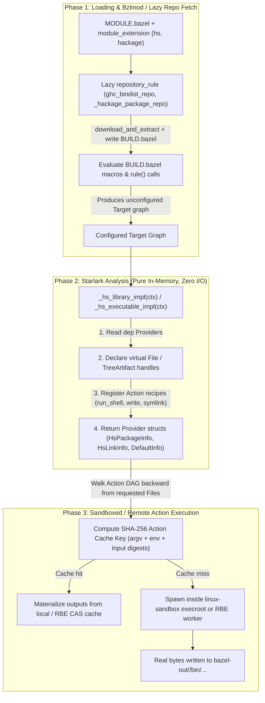
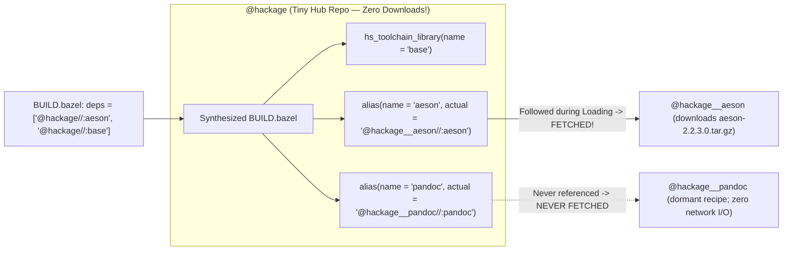
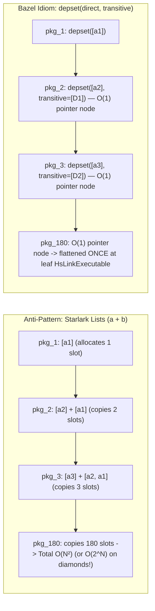
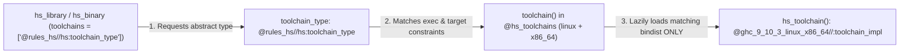

If you have used Bazel on an application team — writing `cc_binary` or `go_library` targets in `BUILD.bazel` and adding `bazel_dep(...)` lines to `MODULE.bazel` — you already know Bazel as an **end user**. Authoring and shipping a **language ruleset** (`rules_hs`) moves you to the opposite side of that abstraction boundary: instead of calling rules, you teach Bazel how to download a compiler hermetically, model transitive dependency graphs in memory, isolate build steps inside sandboxes, interoperate with C/C++ toolchains, and publish a clean Bzlmod module that downstream repositories can depend on without friction.

This primer builds every Bazel ruleset-authoring concept used in `rules_hs` from first principles. It assumes **zero prior experience writing Starlark rules** and **zero prior experience with Haskell or GHC**.

> **Tip — Companion Haskell & GHC Primer:** Whenever this guide mentions a Haskell artifact (such as a `.hi` interface file or a `.pkgdb` package database), treat it simply as a compiler output file. For the companion first-principles guide to Haskell, GHC, Cabal, Hackage, `libgmp`, and Template Haskell, read [Haskell & GHC Primer](haskell-and-ghc-primer.md) next.

---

## Ruleset vs. Consumer Repository {#ruleset-vs-consumer}

### Two Sides of the `load()` Boundary

An **end-user (consumer) repository** — such as `examples/size/` in this repo or your own service monorepo — wants a minimal, declarative interface. In `BUILD.bazel`, an engineer writes ten lines:

```starlark
load("@rules_hs//hs:defs.bzl", "hs_binary")

hs_binary(
    name = "app",
    srcs = ["Main.hs"],
    deps = ["@hs_boot//:base"],
)
```

Behind that single `hs_binary` call, the **ruleset repository** (`rules_hs`) is responsible for orchestrating six distinct machinery layers:

| Layer | End User Writes | What `rules_hs` Implements Under the Hood |
|---|---|---|
| **Module graph** | `bazel_dep(name = "rules_hs", version = "0.1.0")` | `MODULE.bazel` with strict `dev_dependency` isolation so internal test/docs deps never leak downstream. |
| **Toolchain & ecosystem fetch** | `hs.toolchain(ghc_version = "9.10.3")` & `hackage.from_lock(...)` | Bzlmod `module_extension`s (`hs/extensions.bzl`) and lazy `repository_rule`s (`hs/private/ghc_bindist.bzl`, `hs/private/hackage.bzl`). |
| **Platform resolution** | `register_toolchains("@hs_toolchains//:all")` | `@rules_hs//hs:toolchain_type`, [`hs_toolchain`](../reference/rules.md#hs_toolchain), and `$ORIGIN`-staged [`staged_ghc`](hermeticity.md#origin-staging) built in `cfg = "exec"`. |
| **Dependency propagation** | `deps = [":greet", "@hs_boot//:base"]` | Typed Starlark `provider`s ([`HsPackageInfo`](../reference/extensions-and-providers.md#hspackageinfo), [`HsLinkInfo`](../reference/extensions-and-providers.md#hslinkinfo), `CcInfo`) backed by `O(1)` `depset`s. |
| **Sandboxed build actions** | `bazel build //:app` | Pure Starlark rule `_impl(ctx)` functions (`hs/private/rules.bzl`, `hs/private/actions.bzl`) declaring virtual `File`s / `TreeArtifact`s and hermetic shell/C actions. |
| **C/C++ interoperability** | `cc_deps = ["//native:fast_crc"]` | `@rules_cc` `cc_common` integration plus the zero-Python C11 adapter binary (`hs/private/cc_wrapper.c`). |

### Dual-Mode `MODULE.bazel` and `dev_dependency = True` Pruning

A Bazel ruleset repository always operates in **two completely different modes**, governed by a single boolean attribute in `MODULE.bazel` — `dev_dependency = True`:

1. **Root-Module Mode (Developing & Testing `rules_hs` Itself)**: When you `git clone` `rules_hs` and run `bazel test //...` or `bazel build //docs:site` at the repository root, `rules_hs` **is the root module** of the build. Bazel evaluates *every* declaration in `MODULE.bazel`, including `dev_dependency = True` entries:
   - `hermetic_cc_toolchain@4.3.0` (`@zig_sdk`), providing a hermetic `zig cc` C/C++ compiler so `rules_hs`'s own test suite runs on bare CI machines without host `gcc`.
   - `rules_shell@0.6.1`, providing `sh_test` for ELF and Bzlmod hygiene scripts.
   - `register_toolchains("@hs_toolchains//:all", dev_dependency = True)`, activating the default GHC toolchain for `rules_hs`'s own tests and `//docs` site generator.
   - `hackage = use_extension("//hs:extensions.bzl", "hackage", dev_dependency = True)` loading `//docs:hackage.lock.json` (the 182 Hackage packages used to build this Hakyll + Pandoc documentation site).
2. **Consumer Dependency Mode (`bazel_dep` in Downstream Workspaces)**: When an application repository declares `bazel_dep(name = "rules_hs", version = "0.1.0")`, that application is the root module and `rules_hs` is a **non-root dependency**. During Bzlmod resolution, **Bazel completely ignores and prunes every `bazel_dep`, `use_extension`, and `register_toolchains` statement marked `dev_dependency = True` in non-root modules**.

Look at `rules_hs`'s actual `MODULE.bazel` through this lens:

```starlark
module(
    name = "rules_hs",
    version = "0.1.0",
    bazel_compatibility = [">=9.0.0"],
)

# --- ACTIVE FOR ALL DOWNSTREAM CONSUMERS (strictly 4 modules!) ---
bazel_dep(name = "platforms", version = "1.1.0")
bazel_dep(name = "bazel_skylib", version = "1.9.2")
bazel_dep(name = "rules_cc", version = "0.2.28")
bazel_dep(name = "gmp", version = "6.3.0.bcr.5")

# Non-dev so `bazel run @rules_hs//tools/lock:lock` can resolve @hs_boot
# in consumer workspaces; root module tags override ghc_version cleanly.
hs = use_extension("//hs:extensions.bzl", "hs")
hs.toolchain(ghc_version = "9.10.3")
use_repo(hs, "hs_boot", "hs_toolchains")

# --- PRUNED AUTOMATICALLY WHEN rules_hs IS A NON-ROOT bazel_dep ---
bazel_dep(name = "hermetic_cc_toolchain", version = "4.3.0", dev_dependency = True)
bazel_dep(name = "rules_shell", version = "0.6.1", dev_dependency = True)
# ... @zig_sdk toolchains, @hs_toolchains registration, and //docs @hackage ...
```

Forgetting `dev_dependency = True` is one of the most common mistakes in Bazel ruleset engineering: if a ruleset forgets it on a test toolchain or documentation dependency, *every* downstream user inherits those external modules (and any version conflicts or toolchain registrations they bring). In `rules_hs`, `//tests/rules:bzlmod_hygiene_test` parses `MODULE.bazel` on every CI run and fails the build if any dependency outside `platforms`, `bazel_skylib`, `rules_cc`, and `gmp` omits `dev_dependency = True`.

### Public `hs/` vs. Private `hs/private/` Layout and `bzl_library`

Unlike `BUILD.bazel` targets (where `visibility = ["//visibility:private"]` restricts who can depend on a target), Bazel's `load("@repo//pkg:file.bzl", "sym")` statement historically allowed any consumer to load any `.bzl` file if its `BUILD.bazel` package exported it (and since Bazel 6+, `visibility()` inside `.bzl` files or the `private/` path convention signals internal boundaries).

Following standard Bazel ruleset conventions (`rules_cc`, `rules_go`, `rules_rust`, `bazel_skylib`), `rules_hs` splits its Starlark code into two layers:

- **`hs/` (Public API Surface)**: Contains thin, stable entrypoint files that consumers load from:
  - `@rules_hs//hs:defs.bzl` — re-exports [`hs_library`](../reference/rules.md#hs_library), [`hs_binary`](../reference/rules.md#hs_binary), [`hs_test`](../reference/rules.md#hs_test), [`hs_cabal_library`](../reference/rules.md#hs_cabal_library), [`hs_toolchain_library`](../reference/rules.md#hs_toolchain_library), and [`hs_haddock`](../reference/rules.md#hs_haddock) using underscore-prefixed private imports (`load("//hs/private:rules.bzl", _hs_library = "hs_library")` followed by `hs_library = _hs_library`) so internal helpers never leak into autocomplete or public exports.
  - `@rules_hs//hs:extensions.bzl` — exposes the [`hs`](../reference/extensions-and-providers.md#hs) and [`hackage`](../reference/extensions-and-providers.md#hackage) Bzlmod extensions.
  - `@rules_hs//hs:providers.bzl` — exposes [`HsPackageInfo`](../reference/extensions-and-providers.md#hspackageinfo), [`HsLinkInfo`](../reference/extensions-and-providers.md#hslinkinfo), [`HsToolchainInfo`](../reference/extensions-and-providers.md#hstoolchaininfo), and [`HsHaddockInfo`](../reference/extensions-and-providers.md#hshaddockinfo) for custom Starlark rules or aspects.
  - `@rules_hs//hs:toolchain.bzl` — exposes `TOOLCHAIN_TYPE` and [`hs_toolchain`](../reference/rules.md#hs_toolchain).
- **`hs/private/` (Internal Implementation)**: Houses repository rules (`ghc_bindist.bzl`, `hackage.bzl`), staging logic (`staged_ghc.bzl`), shared action builders (`actions.bzl`), rule implementations (`rules.bzl`, `cabal_library.bzl`, `haddock.bzl`), and native C shims (`cc_wrapper.c`, `tinfo_stub.c`, `rt_shims.c`). Refactoring internal helpers inside `hs/private/` never breaks downstream `load()` statements.
- **`bzl_library` (`@bazel_skylib//:bzl_library.bzl`)**: In `hs/BUILD.bazel` and `hs/private/BUILD.bazel`, every `.bzl` file is registered in a `bzl_library(name = ..., srcs = [...], deps = [...])` target mirroring its `load()` graph. `bzl_library` packages Starlark source files and their transitive `.bzl` dependencies as first-class Bazel targets so Starlark test suites, linters, and documentation tools always receive a complete, hermetic transitive closure of `.bzl` files.

---

## Bazel's Three Phases: Loading, Analysis, and Execution {#three-phases}

The single most important mental model for a Bazel rules author is that `bazel build //:hello` does **not** run a single imperative script. Instead, Bazel evaluates your build through **three strictly separated phases** inside its incremental graph engine (**Skyframe**), with hard capability walls between them:



### Phase 1 — Loading & Bzlmod/Repository Fetch

When you run `bazel build //:hello`, Bazel first determines what modules, external repositories, and `BUILD.bazel` targets exist:

1. **Bzlmod resolution & extension evaluation**: Bazel reads `MODULE.bazel`, resolves transitive `bazel_dep` versions, and runs `module_extension`s (`hs` and `hackage`). Extension implementations run in Starlark and declare external repositories (`@hs_boot`, `@hs_toolchains`, `@ghc_9_10_3_linux_x86_64`, `@hackage`, `@hackage__aeson`, ...).
2. **Lazy `repository_rule` execution**: Whenever Bazel needs to read a label inside an external repository that has not been fetched yet (for instance `@ghc_9_10_3_linux_x86_64//:toolchain_impl`), Bazel runs that repository's `repository_rule` (`ghc_bindist_repo`). **`repository_ctx` is the ONLY Starlark context in Bazel permitted to access the network** (`repository_ctx.download_and_extract` with a pinned SHA-256 hash), inspect extracted archive directories (`repository_ctx.path("lib/package.conf.d").readdir()`), and write a synthesized `BUILD.bazel` file to disk.
3. **`BUILD.bazel` evaluation**: Bazel evaluates `BUILD.bazel` files needed for `//:hello` and its transitive `deps`. Calling `hs_library(name = "greet", ...)` inside `BUILD.bazel` does **not** run `_hs_library_impl` yet — it merely records an unconfigured `Target` node storing the raw attribute dictionary (`srcs`, `deps`, `ghc_opts`).

### Phase 2 — Starlark Analysis (`_hs_library_impl(ctx)`)

Once target labels and toolchains are resolved, Bazel enters **Analysis**, calling each rule's Starlark `implementation` function (`_hs_library_impl(ctx)`, `_hs_executable_impl(ctx)`) bottom-up from leaf dependencies up to `//:hello`.

> **Important — The Golden Rule of Phase 2 Analysis:** Inside `_hs_library_impl(ctx)`, **you cannot read the contents of source `.hs` files, you cannot touch the filesystem, you cannot make network calls, and you cannot execute `ghc`!** Everything in Analysis happens purely in memory on abstract graph metadata.

A rule implementation function performs strictly **four pure operations**:

1. **Inspect `Provider`s from dependencies and toolchains**: Read structured metadata returned by already-analyzed children in `ctx.attr.deps` (`dep[HsPackageInfo]`, `dep[HsLinkInfo]`, `dep[CcInfo]`) and `ctx.toolchains[TOOLCHAIN_TYPE].hs` (`HsToolchainInfo`).
2. **Declare virtual output `File` handles**: Call `ctx.actions.declare_file("libHS" + unit_id + ".a")` or `ctx.actions.declare_directory(ctx.label.name + ".pkgdb")`. These return lightweight `File` descriptor objects (`f.path`, `f.short_path`, `f.basename`); **no file or directory exists on disk yet**.
3. **Register `Action` recipes**: Call `ctx.actions.run_shell(...)`, `ctx.actions.write(...)`, or `ctx.actions.symlink(...)` to tell Bazel *how* to produce every declared output `File` from an explicit `depset` of input `File`s, tool executables, environment variables, and command-line arguments (`ctx.actions.args()`). Every declared output `File` must be registered as the output of **exactly one** action, or Bazel aborts Analysis immediately.
4. **Return `Provider` structs**: Return `[DefaultInfo(...), HsPackageInfo(...), HsLinkInfo(...), CcInfo(...)]` so parent targets like `//:hello` can wire `//:greet`'s virtual output `File`s into their own action inputs.

Because Analysis constructs the complete bipartite **File ↔ Action Directed Acyclic Graph (DAG)** purely in memory without spawning compilers, Bazel can answer `bazel query`, `bazel cquery`, and `bazel aquery //:hello` queries in milliseconds — and cache analyzed subgraphs in Skyframe across incremental edits!

### Phase 3 — Sandboxed Action Execution

Only in Phase 3 does Bazel actually run compilers and write bytes to disk:

1. **Demand-driven backward walk**: Bazel starts from the specific output `File`s requested on the command line (`DefaultInfo.files` of `//:hello`) and walks the Action DAG backward. If a rule registered an auxiliary action whose output `File` is not reachable from `//:hello`, Bazel **never executes that action**.
2. **Content-addressed action cache lookup**: Before running an action (`HsCompileLibrary`, `HsLinkExecutable`, `CppCompile`), Bazel hashes:
   - the action's exact command `argv` string list,
   - its declared environment dictionary (protected by `common --incompatible_strict_action_env` in `.bazelrc`, which blocks your interactive shell's `$PATH` and `$LD_LIBRARY_PATH` from leaking into action keys), and
   - the **SHA-256 content digests** of every input and tool `File`.
   If that digest key already exists in your local disk cache or a shared **Remote Build Execution (RBE)** Content-Addressable Storage (CAS) cluster, Bazel downloads/links the cached outputs without running `ghc` at all!
3. **Hermetic `execroot` sandboxing (`linux-sandbox` / RBE)**: On a cache miss, Bazel creates a temporary directory (the **`execroot`**) containing symlinks to **strictly** the `File`s declared in that action's `inputs` and `tools`, mounts it inside an isolated Linux mount/user namespace (`linux-sandbox`, or ships those exact blobs over gRPC to a bare RBE container), executes the command, verifies all declared `outputs` were created, hashes them, and marks downstream actions ready to run in parallel.

#### Why Undeclared Host Reads Break Sandboxes and Poison RBE Caches

Understanding Phase 3 explains every hermeticity engineering choice in [Hermeticity & Toolchain](hermeticity.md):

- **Hard failure inside `linux-sandbox` or clean RBE workers**: If GHC's `lib/settings` still pointed to `/usr/bin/gcc`, or if a C file tried `#include <gmp.h>` expecting `/usr/include/gmp.h` without declaring `@gmp` in `deps`, the file simply does not exist inside a compiler-free container or RBE worker — failing immediately with `No such file or directory`.
- **Silent cache poisoning when host paths leak through**: Even worse, if a workstation build runs without strict mount isolation (or mounts `/usr` or `/nix/store`), reading an undeclared host file means **its bytes are never included in Bazel's SHA-256 action cache key**. Two machines with slightly different `/usr/lib/libgmp.so` or `/usr/bin/gcc` versions would compute the *exact same* Bazel cache key while producing ABI-incompatible `.o` or executable files!

---

## Module Extensions, Repository Rules, and Lazy Hubs {#bzlmod-and-repos}

### Why `bazel_dep` Alone Is Not Enough

In `MODULE.bazel`, `bazel_dep(name = "gmp", version = "6.3.0.bcr.5")` works when a dependency is *already packaged as a Bazel module* on the Bazel Central Registry (BCR) with its own `MODULE.bazel` and `BUILD.bazel`.

Official GHC compiler releases (`ghc-9.10.3-x86_64-deb10-linux.tar.xz` on `downloads.haskell.org`) and the 15,000+ Haskell packages on Hackage (`aeson-2.2.3.0.tar.gz`) are raw upstream tarballs that know nothing about Bazel. **Bzlmod module extensions** and **repository rules** are the bridge that turns raw upstream tarballs into external `@repo//pkg:target` Bazel repositories.

### `tag_class`, `module_extension`, and `mod.is_root` Precedence

A Bzlmod extension (`hs/extensions.bzl` and `hs/private/hackage.bzl`) has two parts:

1. **`tag_class(attrs = {...})`**: Defines the typed configuration tags users call in `MODULE.bazel` — such as `hs.toolchain(ghc_version = "9.12.4")` or `hackage.from_lock(name = "hackage", lockfile = "//:hackage.lock.json")`.
2. **`module_extension(implementation = ..., tag_classes = {...})`**: Runs **once** across the entire resolved module graph, receiving `module_ctx.modules` — a list of every Bazel module in the dependency graph that invoked tags on that extension.

Crucially, **both `rules_hs` itself (`ghc_version = "9.10.3"`) and a downstream consumer (`ghc_version = "9.12.4"`) may call `hs.toolchain(...)`**. How does `rules_hs` ensure the consumer's choice wins instead of colliding? By inspecting `mod.is_root` (`hs/extensions.bzl`):

```starlark
def _hs_extension_impl(module_ctx):
    root_tags = []
    other_tags = []
    for mod in module_ctx.modules:
        for tag in mod.tags.toolchain:
            if mod.is_root:
                root_tags.append(tag)   # Consumer's root MODULE.bazel!
            else:
                other_tags.append(tag)  # Default in rules_hs's own MODULE.bazel

    chosen = root_tags[0] if root_tags else (other_tags[0] if other_tags else None)
    selected_version = chosen.ghc_version if chosen else DEFAULT_GHC_VERSION
    # ... instantiate ghc_bindist_repo, hs_toolchains_repo, hs_boot_repo ...
    return module_ctx.extension_metadata(reproducible = True)
```

When you develop inside `rules_hs`, `rules_hs` has `mod.is_root == True` and gets `9.10.3`. When a consumer repository depends on `rules_hs` and writes `hs.toolchain(ghc_version = "9.12.4")`, the consumer has `mod.is_root == True`, cleanly overriding `rules_hs`'s fallback across the entire build graph!

### What `extension_metadata(reproducible = True)` Does for `MODULE.bazel.lock`

By default, Bazel assumes a `module_extension` might perform non-deterministic work (such as querying an external HTTP API or inspecting host environment variables). To guard against drift, Bazel serializes every repository declaration produced by non-reproducible extensions into the consumer's `MODULE.bazel.lock` file — creating multi-thousand-line JSON diffs whenever Bazel versions or host OSes vary.

In `rules_hs`, neither `hs` nor `hackage` ever touches the network or host OS during extension evaluation:
- `hs` looks up SHA-256-pinned bindist entries from the static `GHC_BINDISTS` Starlark dictionary (`hs/private/ghc_versions.bzl`).
- `hackage` reads the user's committed `hackage.lock.json` via `json.decode(module_ctx.read(lock_label))` in pure Starlark.

Because their output repositories are 100% deterministic functions of tracked workspace files, both extensions return `module_ctx.extension_metadata(reproducible = True)`. That tells Bazel the extension can be re-evaluated deterministically in memory in a few milliseconds and **never needs to bloat downstream `MODULE.bazel.lock` files**.

### The Hub-and-Spoke Lazy Repository Pattern (`@hackage` -> `@hackage__<pkg>`)

Suppose `docs/hackage.lock.json` pins **182 Hackage packages** (`pandoc`, `hakyll`, `aeson`, `text`, `crypton`, ...). If `hackage` created a single `@hackage` repository rule that downloaded all 182 `.tar.gz` archives at once, running a tiny unit test that only needed `aeson` would still wait for all 182 tarballs to download and extract!

Instead, `hs/private/hackage.bzl` implements Bazel's idiomatic **Hub-and-Spoke Lazy Repository Pattern**:



1. **The Hub (`@hackage`, `_hackage_hub_repo`)**: Exposed to the user via `use_repo(hackage, "hackage")`. Its `repository_rule` performs **zero network downloads** — it simply writes a `BUILD.bazel` containing `hs_toolchain_library` targets for GHC boot libraries (`@hackage//:base`) and lightweight `alias()` pointers (`@hackage//:aeson` -> `@hackage__aeson//:aeson`) for every locked package.
2. **The Spokes (`@hackage__<pkg>`, `_hackage_package_repo`)**: `_hackage_impl` declares one `_hackage_package_repo` per locked package (`@hackage__aeson`, `@hackage__pandoc`, ...), passing its JSON metadata string. Declaring a `repository_rule` in an extension costs virtually zero time — **Bazel only executes `_hackage_package_repo_impl` (calling `download_and_extract`) when a target you actually build follows the `alias()` edge into that spoke repository!**

---

## Rules, Actions, Files, and TreeArtifacts {#rules-and-actions}

### Anatomy of a `rule(...)` Declaration

In `hs/private/rules.bzl`, [`hs_library`](../reference/rules.md#hs_library), [`hs_binary`](../reference/rules.md#hs_binary), and [`hs_test`](../reference/rules.md#hs_test) are created with Bazel's built-in `rule(...)` constructor:

```starlark
hs_library = rule(
    implementation = _hs_library_impl,
    attrs = {
        "srcs": attr.label_list(
            allow_files = [".hs", ".lhs", ".hs-boot", ".lhs-boot"],
            mandatory = True,
        ),
        "deps": attr.label_list(
            providers = [[HsPackageInfo], [CcInfo]],
            default = [],
        ),
        "ghc_opts": attr.string_list(default = []),
        "data": attr.label_list(allow_files = True, default = []),
        "_rt_shims": attr.label(
            default = Label("//hs/private:rt_shims"),
            providers = [CcInfo],
        ),
    },
    toolchains = [TOOLCHAIN_TYPE] + use_cc_toolchain(),
    fragments = ["cpp"],
    provides = [HsPackageInfo, HsLinkInfo, CcInfo, HsDocSourceInfo],
)
```

Notice four features of `rule(...)` that enforce invariants automatically before `_hs_library_impl(ctx)` even runs:

- **Typed `attrs` & provider contracts**: Setting `providers = [[HsPackageInfo], [CcInfo]]` on `deps` instructs Bazel to verify during Analysis that every target in `deps` returns *either* `HsPackageInfo` (a Haskell library/boot package) *or* `CcInfo` (a C/C++ `cc_library`). Passing an unrelated target (like a `py_library`) fails with a clear type error automatically.
- **Private implicit attributes (`_`-prefixed)**: Attributes starting with `_` (such as `"_rt_shims"`) cannot be set by users in `BUILD.bazel`, allowing a rule to attach internal runtime helper targets (`//hs/private:rt_shims`) to every instance of the rule.
- **`executable = True` vs. `test = True`**: Setting `executable = True` (on `hs_binary`) enables `bazel run`; setting `test = True` (on `hs_test`) enables both `bazel run` and `bazel test` (injecting Bazel's `size`, `timeout`, `flaky`, and `shard_count` attributes automatically).
- **`toolchains` and `fragments`**: Declares which abstract toolchain types (`@rules_hs//hs:toolchain_type` and `@bazel_tools//tools/cpp:toolchain_type`) Bazel should resolve for this target's platform.

### Regular `File`s (`declare_file`) vs. `TreeArtifact`s (`declare_directory`)

During Phase 2 Analysis, Bazel must construct the action graph **without reading `.hs` source files or running tools**. That creates an immediate question: *what if a compiler produces a directory of output files whose exact filenames depend on the contents of the source files?*

Bazel provides two output primitives on `ctx.actions`:

| Primitive | Starlark Call | When to Use | Examples in `rules_hs` |
|---|---|---|---|
| **Regular `File`** | `ctx.actions.declare_file("libHS" + unit_id + ".a")` | Exact output filename is 100% known during Starlark Analysis. | `libHS<unit_id>.a`, `<exe>`, `cabal_macros.h`, `Paths_<pkg>.hs`, per-file `.hsc` -> `.hs` outputs, `<name>.haddock`. |
| **`TreeArtifact`** | `ctx.actions.declare_directory(name + ".pkgdb")` | Action emits an **entire directory tree** whose internal file list is only determined at Phase 3 Execution time. | `staged_ghc/lib` (hundreds of bindist files), `<name>.pkgdb` (`hi/*.hi`, `dyn/*.so`, `package.cache`), and `hs_haddock` HTML directories (`index.html`, `<Mod>.html`, `src/*.html`). |

A **`TreeArtifact`** (`f.is_directory == True`) is treated as a single opaque node during Analysis, then expanded and content-hashed file-by-file by Bazel's execution engine and RBE CAS cache once the action finishes!

> **Warning — Bazel's Non-Overlapping Output Path Rule:** Bazel strictly forbids one action from declaring a `File` at a path inside (or overlapping) another action's `TreeArtifact` directory — doing so fails Analysis with an action-conflict/artifact-prefix error (a historical pain point in `tweag/rules_haskell` issues #2496 and #2499).
>
> `rules_hs` avoids overlaps cleanly by declaring every library's static archive (`libHS<unit_id>.a`) and package database (`<name>.pkgdb`) as **non-overlapping siblings** inside `bazel-out/<cfg>/bin/<pkg>/` (see [Relocatable `${pkgroot}` Package Databases](providers-and-actions.md#relocatable-pkgdb)).

### `DefaultInfo`, `OutputGroupInfo`, and `.runfiles` Symlink Forests

Every rule implicitly or explicitly returns **`DefaultInfo`**, Bazel's built-in provider telling the CLI what to build and how to run targets:

```starlark
return [
    DefaultInfo(
        executable = out_exe,          # Required when executable = True or test = True
        files = depset([out_exe]),     # Built by `bazel build //pkg:app`
        runfiles = runfiles,           # Staged on disk for `bazel run` & `bazel test`
    ),
]
```

- **How `OutputGroupInfo` exposes optional secondary outputs**: Sometimes a rule produces multiple artifacts, only one of which users want by default. For example, [`hs_haddock`](../reference/rules.md#hs_haddock) (`hs/private/haddock.bzl`) puts `html_dir` in `DefaultInfo(files = depset([html_dir]))` so `bazel build //:docs` outputs the clean HTML directory, while exposing the binary `.haddock` cross-linking file via `OutputGroupInfo(haddock_interface = depset([interface]))` (buildable on demand via `--output_groups=haddock_interface`).
- **What `.runfiles` looks like on disk**: When a target declares `data = ["testdata/sample.xml"]` (or depends on libraries that declare `data`), Bazel does *not* copy those files next to the source tree at runtime. Instead, `bazel run` and `bazel test` materialize a **`.runfiles` symlink forest** next to the compiled executable and set standard environment variables (`RUNFILES_DIR`, plus `TEST_SRCDIR` and `TEST_WORKSPACE` inside `bazel test`):

```text
bazel-out/k8-fastbuild/bin/tests/app_test                  # Compiled ELF binary
bazel-out/k8-fastbuild/bin/tests/app_test.runfiles/        # <- $RUNFILES_DIR / $TEST_SRCDIR
└── _main/                                                 # <- $TEST_WORKSPACE (root module)
    ├── tests/app_test                                     # Symlink to executable
    └── testdata/sample.xml                                # Symlink to declared `data` file
```

> **Note — Why `rules_hs` Scrubs `RUNFILES_*` Inside Compile Actions:** Because `.bazelrc` enables `common --enable_runfiles`, Bazel also sets `RUNFILES_DIR` when executing build tools during compilation. External tools invoked inside a build action (like GHC, `hsc2hs`, or `./configure`) can be confused if they inherit an outer wrapper's `RUNFILES_*` variables. Every compile/link shell command in `rules_hs` — and `ghc_cc_wrapper` itself — explicitly clears `RUNFILES_DIR`, `RUNFILES_MANIFEST_FILE`, and `RUNFILES_MANIFEST_ONLY` so runfiles stay strictly a runtime (`bazel run` / `bazel test`) concern.

---

## Providers and Depsets {#providers-and-depsets}

### `provider(...)`: The Only Communication Channel Across Targets

In Bazel, targets are strictly encapsulated. When `hs_binary(name = "hello", deps = [":greet"])` is analyzed, `_hs_executable_impl` **cannot** inspect `:greet`'s `srcs` attribute, local Starlark variables, or registered actions. It can **only** index into the `Provider` instances that `_hs_library_impl` returned for `:greet`.

`hs/providers.bzl` defines typed schemas using `provider(doc = ..., fields = {...})`:

- **[`HsPackageInfo`](../reference/extensions-and-providers.md#hspackageinfo) (Direct-only)**: Carries metadata about **one specific package** (`name`, `version`, `unit_id`, `pkg_db`, `hs_lib`, `is_boot`). Read *only* from immediate `ctx.attr.deps` so `rules_hs` exposes strictly direct dependencies via `-package-id <unit_id>` and rejects accidental imports of transitive dependencies (`-hide-all-packages`).
- **[`HsLinkInfo`](../reference/extensions-and-providers.md#hslinkinfo) (Transitive closure)**: Carries `depset`s accumulated across the **entire upstream DAG** (`pkg_dbs`, `hs_libs`, `include_dirs`, `headers`, plus merged `cc_info`) so GHC can resolve transitive type signatures (`.hi` files) and link every transitive static archive (`libHS*.a`).

### Why `depset` Exists (And Why Python/Starlark Lists OOM Bazel)

Engineers new to Starlark always ask: *why does `HsLinkInfo` use `depset[File]` instead of an ordinary Starlark list `[File]`?*

Consider a 180-package Hackage dependency graph (such as `//docs`'s 182-package Hakyll + Pandoc closure):



- **What goes wrong with lists (`[my_lib] + dep.libs`)**: Starlark lists are eager arrays. Concatenating `a + b` allocates a brand-new array and copies every element at *every* step of the dependency graph (`1 + 2 + ... + N = O(N²)` memory and CPU on a chain — and **exponential `O(2^N)`** if two branches of a diamond dependency are concatenated without manual deduplication!). On real-world monorepos, list concatenation in providers causes Bazel's JVM heap to hit `OutOfMemoryError` during Phase 2 Analysis.
- **How `depset` solves it in `O(1)`**: A `depset` (nested set) is an immutable DAG of pointer nodes:
  ```starlark
  HsLinkInfo(
      pkg_dbs = depset([pkg_db], transitive = [dep_info.pkg_dbs]),
      hs_libs = depset([hs_lib], transitive = [dep_info.hs_libs]),
      # ...
  )
  ```
  Constructing `depset([hs_lib], transitive = [...])` allocates a tiny wrapper node pointing to existing child `depset`s in **`O(1)` time and `O(1)` memory** without copying or traversing their elements!
- **Delayed flattening & automatic deduplication**: When passed directly to `ctx.actions.run_shell(inputs = depset(...))`, Starlark **never flattens the `depset` into a Starlark list at all** — Bazel's native Java engine traverses and deduplicates the DAG directly in Phase 3. Even when command-line flags require `.to_list()` (such as passing `-package-db` flags), flattening happens cleanly in deterministic postorder with built-in deduplication.

---

## Toolchains and Exec vs. Target Configurations {#toolchains-and-configs}

### Platform-Based Toolchain Indirection

Why doesn't `hs_library` simply declare a default attribute `_ghc = attr.label(default = "@ghc_9_10_3_linux_x86_64//:ghc")`? Because hardcoding a single platform's compiler breaks the moment an `arm64` Linux developer clones the repo or an `x86_64` laptop dispatches actions to a remote cluster!

Instead, Bazel decouples **rules** from **platform-specific compiler binaries** through three cooperating targets (`hs/BUILD.bazel`, `hs/toolchain.bzl`, and `hs/private/ghc_bindist.bzl`):



1. **`toolchain_type` (`hs/BUILD.bazel`)**: Declares `@rules_hs//hs:toolchain_type`, a pure identifier with zero files attached.
2. **`hs_toolchain` (`hs/toolchain.bzl`)**: Wraps `staged_ghc`, `ghc_cc_wrapper`, and decoded boot package metadata inside Bazel's standard `platform_common.ToolchainInfo(hs = toolchain_info)`. Inside `_hs_library_impl(ctx)`, rules read `ctx.toolchains[TOOLCHAIN_TYPE].hs` without ever knowing which platform repo provided it.
3. **`toolchain(...)` (`@hs_toolchains/BUILD.bazel`)**: Pairs `exec_compatible_with` (where the compiler *runs*) and `target_compatible_with` (what OS/CPU the compiler *emits code for*) with a lazy `toolchain = "@ghc_9_10_3_linux_x86_64//:toolchain_impl"` label. Because `toolchain` is resolved lazily, registering `@hs_toolchains//:all` on `linux_x86_64` **never downloads `@ghc_9_10_3_linux_arm64`** (and vice versa).

### `cfg = "exec"` vs. `cfg = "target"` (Why Two `bazel-out/` Trees Exist)

If you inspect `bazel-out/` after building `//:hello`, you will notice Bazel creates **two separate configuration subdirectories** under `bazel-out/`:

```text
bazel-out/
├── k8-opt-exec-ST-.../bin/          # <-- cfg = "exec" (runs ON the build machine!)
│   ├── external/rules_hs+/hs/private/ghc_cc_wrapper
│   └── external/rules_hs++hs+ghc_9_10_3_linux_x86_64/
│       └── staged_ghc/{bin/ghc-9.10.3, lib/..., gmp_static/libgmp.a}
└── k8-fastbuild/bin/                # <-- cfg = "target" (built FOR the deployment target!)
    ├── libHSu__S_S_Cgreet-0.0.0.a
    ├── greet.pkgdb/
    └── hello
```

Look at `hs/toolchain.bzl` to see how `rules_hs` triggers this split:

```starlark
"staged_ghc": attr.label(
    mandatory = True,
    providers = [HsToolchainInfo],
    cfg = "exec",
),
"cc_wrapper": attr.label(
    default = Label("//hs/private:ghc_cc_wrapper"),
    executable = True,
    cfg = "exec",
),
```

Transitioning build-time tools (`staged_ghc`, `ghc_cc_wrapper`, and bootstrapped `alex`/`happy` lexer/parser generators) onto **`cfg = "exec"`** while keeping user libraries and binaries on **`cfg = "target"`** solves two critical problems:

1. **Cross-compilation & remote execution**: Suppose your laptop is `macos_arm64`, your RBE worker pool runs `linux_x86_64` (`exec` platform), and you are building a server binary for `linux_arm64` (`target` platform). `ghc_cc_wrapper` *must* be compiled as a `linux_x86_64` ELF binary (`cfg = "exec"`) so the RBE worker can execute it during compilation, whereas `//:hello` (`cfg = "target"`) is compiled for `linux_arm64`!
2. **Compiler optimization & cache stability**: Bazel automatically builds `cfg = "exec"` targets in optimized mode (`-O2`) and isolates them from target-only debug/coverage flags, so toggling a flag on your application never forces Bazel to re-stage GHC or recompile `ghc_cc_wrapper`, `alex`, or `happy`.

---

## Interoperating with C/C++ via rules_cc and CcInfo {#cc-interop}

Almost every non-trivial language ecosystem links against C libraries and invokes a C compiler, assembler, or system linker under the hood (see [Why GHC Needs a C Toolchain](haskell-and-ghc-primer.md#c-toolchain-and-rts)). If `rules_hs` hardcoded `/usr/bin/gcc` inside shell actions, it would immediately fail on clean containers using `hermetic_cc_toolchain` (`zig cc`), `toolchains_llvm`, or custom enterprise sysroots.

Instead, `rules_hs` plugs directly into **`@rules_cc`** so Haskell and C/C++ share one unified toolchain and dependency graph (`hs/private/actions.bzl` and `hs/private/staged_ghc.bzl`):

1. **Request Bazel's active C/C++ toolchain on the rule**:
   ```starlark
   load("@rules_cc//cc:find_cc_toolchain.bzl", "find_cc_toolchain", "use_cc_toolchain")

   # On rule():
   toolchains = [TOOLCHAIN_TYPE] + use_cc_toolchain(),
   fragments = ["cpp"],
   ```
2. **Query exact compiler/archiver/linker paths and flags (`resolve_cc_tools`)**: Inside rule implementations, `find_cc_toolchain(ctx)` and `cc_common.configure_features(...)` resolve whichever C toolchain the consumer registered — querying `cc_common.get_tool_for_action(..., action_name = ACTION_NAMES.c_compile)` for the C compiler, `ACTION_NAMES.cpp_link_static_library` for `ar`, `cc_toolchain.ld_executable` for `ld -r`, and extracting `--sysroot` / `--target` flags from `cc_common.create_compile_variables` so `ghc_cc_wrapper` stays 100% C-toolchain-agnostic.
3. **Compile inline `c_sources` via `cc_common.compile`**: Rather than writing custom shell commands to compile `.c` or `.cc` files attached to `hs_library` or `hs_cabal_library`, `compile_c_sources` delegates directly to `cc_common.compile(...)` and `cc_common.create_linking_context_from_compilation_outputs(..., disallow_dynamic_library = True)`. Bazel spawns parallel per-file `CppCompile` actions with full `.d` header dependency scanning and `ar` archiving automatically.
4. **Exchange headers and libraries symmetrically via `CcInfo` (`cc_common.merge_cc_infos`)**:
   `CcInfo` is Bazel's universal native-code provider, containing two contexts:
   - **`compilation_context`**: Carries `headers` (`depset[File]`), `includes` / `quote_includes` / `system_includes` (`-I` / `-iquote` / `-isystem` search paths), and `defines`. `collect_deps` (`hs/private/actions.bzl`) folds these directly into Haskell's `-I` and header input `depset`s so `hsc2hs`, `CPP`, `./configure`, and `CApiFFI` see headers from any `cc_library` in `deps` or `cc_deps`.
   - **`linking_context`**: Carries `linker_inputs` (`LibraryToLink` static `.a` / PIC `.pic.a` archives plus `user_link_flags` like `-lm` or `-lstdc++`). Because `hs_library` and `hs_cabal_library` merge upstream `CcInfo`s via `cc_common.merge_cc_infos` and **return `CcInfo` themselves**, C libraries flow seamlessly through arbitrary `cc_library -> hs_library -> hs_cabal_library -> hs_binary` chains!

---

## Testing a Bazel Ruleset {#testing-rulesets}

Shipping a reliable Bazel ruleset requires testing more than "does a sample program print Hello World?" Bugs in a ruleset can manifest in Starlark provider wiring, leaked transitive visibility, non-hermetic ELF dynamic libraries, or missing `dev_dependency = True` flags that only break external consumers.

`rules_hs` validates every change across **four complementary testing layers**:

| Layer | Mechanism & Location | Execution Speed | What Bugs It Catches |
|---|---|---|---|
| **1. Starlark Analysis Tests** | `analysistest` (`@bazel_skylib//lib:unittest.bzl`) in `tests/starlark/rules_analysis_test.bzl` | **~10–50 ms** (Phase 2 only; zero `ghc` runs!) | Provider field schemas, `depset` propagation, `-hide-all-packages` / `-package-id` strict visibility, `cabal_macros.h` `FileWrite` content, C-only Cabal short-circuiting, `-optl-L.../gmp_static`, `--start-group` ordering, `HsHaddock` flags. |
| **2. Rule Functional Tests** | `hs_test` targets across `tests/basic/` & `tests/rules/` | Seconds (cached per action) | Multi-library DAGs, `.hs-boot` mutual recursion, `Configure` + `hsc2hs`, C & C++ FFI, `Haskell98`/`Haskell2010`/`GHC2021`, threaded vs. single-threaded RTS, 2-hop `.runfiles`, intra-lib & cross-lib Template Haskell, Haddock HTML/QuickJump output. |
| **3. Binary & Bzlmod Hygiene Audits** | `sh_test` scripts (`tests/basic/elf_hermeticity_test.sh`, `tests/rules/bzlmod_hygiene_test.sh`, `docs/test/site_test.sh`) | Sub-second | `readelf -d` `DT_NEEDED` allowlists (rejecting `libgmp.so`, `libtinfo.so`, `libffi.so`, `libHS*.so`), `env -i PATH=/nonexistent` execution, zero `WORKSPACE` files, strict 4-module `MODULE.bazel` allowlist. |
| **4. Consumer Workspace & Clean-Container Matrix** | `examples/size/` + `.github/workflows/ci.yml` (`debian:bookworm-slim`, `ubuntu:24.04`, `rockylinux:9`) | CI matrix | Proves `rules_hs` works as a **non-root `bazel_dep`** (with all `dev_dependency = True` modules pruned!) across 69 real Hackage packages inside bare Linux containers where `ghc`, `cabal`, `stack`, `gcc`, `clang`, `nix`, and `/usr/include/{gmp,zlib,ncurses}.h` are verified absent. |

### How Phase-2 `analysistest` Works Without Running Compilers

Layer 1 (`tests/starlark/rules_analysis_test.bzl`) is a classic Bazel ruleset superpower worth seeing in code. Using `@bazel_skylib//lib:unittest.bzl`, an `analysistest` rule inspects `analysistest.target_under_test(env)` and `analysistest.target_actions(env)` directly in Starlark:

```starlark
load("@bazel_skylib//lib:unittest.bzl", "analysistest", "asserts")
load("//hs:providers.bzl", "HsPackageInfo")

def _strict_direct_dep_visibility_test_impl(ctx):
    env = analysistest.begin(ctx)
    actions = analysistest.target_actions(env)

    compile_action = [a for a in actions if a.mnemonic == "HsCompileLibrary"][0]
    argv = compile_action.argv

    direct_uid = ctx.attr.direct_dep[HsPackageInfo].unit_id
    transitive_uid = ctx.attr.transitive_dep[HsPackageInfo].unit_id

    # Assert strict visibility on GHC's exact command line — in milliseconds, without running GHC!
    asserts.true(env, "-hide-all-packages" in argv)
    asserts.true(env, direct_uid in argv)
    asserts.false(env, transitive_uid in argv)
    return analysistest.end(env)

strict_direct_dep_visibility_test = analysistest.make(
    _strict_direct_dep_visibility_test_impl,
    attrs = {
        "direct_dep": attr.label(mandatory = True, providers = [HsPackageInfo]),
        "transitive_dep": attr.label(mandatory = True, providers = [HsPackageInfo]),
    },
)
```

Because `analysistest` evaluates during Phase 2 Analysis, Bazel never needs to invoke `ghc` to verify flag generation, provider shapes, or `FileWrite` contents — giving ruleset authors sub-second unit test feedback while Layers 2–4 verify real compilation, ELF binaries, and compiler-free container portability end to end.

> **Tip — Where to Go Next:** Continue to [Haskell & GHC Primer](haskell-and-ghc-primer.md) (`order: 8`) for a zero-prerequisite walkthrough of GHC's boot libraries (`Cabal-syntax`), `.hi` interface files, the GHC Runtime System (`libHSrts`), `libgmp`/`libtinfo`, `hsc2hs`/`alex`/`happy`, and Template Haskell — or jump directly to [Architecture Overview](overview.md), [Hermeticity & Toolchain](hermeticity.md), and [Providers & Action Graph](providers-and-actions.md).

