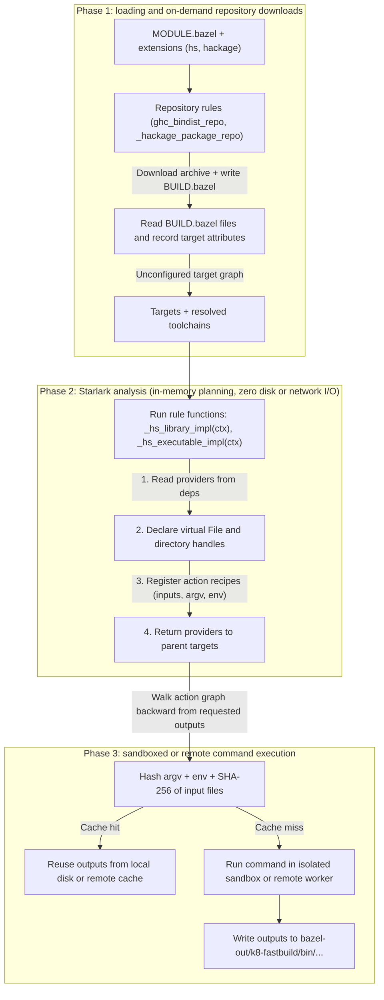
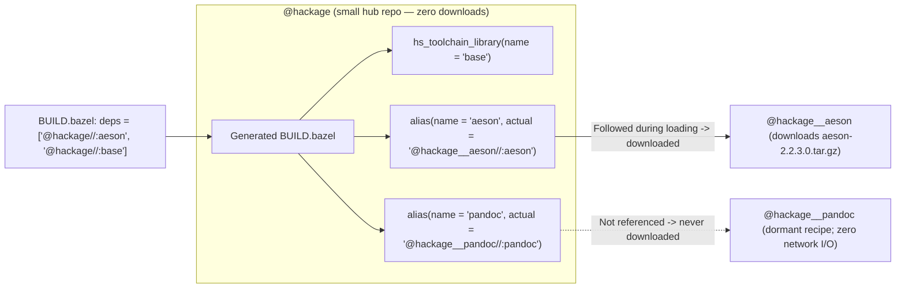
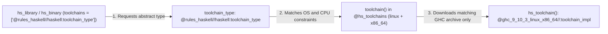

This primer introduces how a Bazel language ruleset like `rules_haskell` works under the hood, written for application engineers and Haskell developers who haven't authored Bazel rules before. If you just want to build a Haskell project with Bazel, start with the [Quickstart](../guide/quickstart.md) instead. For Haskell and GHC compiler concepts (such as `.hi` interfaces, `.pkgdb` databases, `libgmp`, and Template Haskell), read the companion [Haskell and GHC primer](haskell-and-ghc-primer.md).

If you've written [`cc_binary`](https://bazel.build/reference/be/c-cpp#cc_binary) or `go_library` targets in [`BUILD.bazel`](https://bazel.build/concepts/build-files) and added [`bazel_dep(...)`](https://bazel.build/rules/lib/globals/module#bazel_dep) lines to [`MODULE.bazel`](https://bazel.build/external/module), you already know Bazel as an **end user**. Authoring a **language ruleset** puts you on the other side of that boundary: you write code in **[Starlark](https://bazel.build/rules/language)**—a small, deterministic subset of Python with no arbitrary file I/O, network sockets, or mutable global state after loading—that teaches Bazel how to download compilers, pass metadata between targets, run builds in isolated [sandboxes](https://bazel.build/docs/sandboxing), and interoperate with C and C++ libraries.

**The core mental model:** Bazel doesn't run build rules as imperative top-to-bottom scripts. Instead, a ruleset separates *declaring external repositories*, *planning a pure in-memory graph of build commands*, and *executing isolated commands with hash-based caching*. You don't need prior Starlark or Haskell experience to follow this page—treat any unfamiliar Haskell file (like a `.a` archive, `.hi` summary, or `.pkgdb` folder) as a compiler artifact.

## Ruleset vs. consumer repository {#ruleset-vs-consumer}

Every Bazel ruleset sits behind a sharp API boundary so application repositories stay short and declarative while the ruleset absorbs toolchain, platform, and caching complexity.

### Two sides of the `load()` boundary

In a consumer repository—such as `examples/size/` or an application service repo—you declare a target in `BUILD.bazel` in a few lines:

```starlark
load("@rules_haskell//haskell:defs.bzl", "hs_binary")

hs_binary(
    name = "app",
    srcs = ["Main.hs"],
    deps = ["@hs_boot//:base"],
)
```

Behind that single `hs_binary` call, `rules_haskell` implements six distinct layers of build machinery:

| Layer | What you write | What `rules_haskell` does |
|---|---|---|
| **Module dependencies** | `bazel_dep(name = "rules_haskell", version = "0.1.0")` | Declares `MODULE.bazel` and marks its own test and docs dependencies with `dev_dependency = True` so downstream consumers don't inherit them. |
| **Downloading compilers and packages** | `hs.toolchain(ghc_version = "9.10.3")` and `hackage.from_lock(...)` | Defines [module extensions](https://bazel.build/external/extension) and on-demand download recipes that fetch GHC and third-party package archives only when a target uses them. |
| **Matching the host OS and CPU** | [`register_toolchains("@hs_toolchains//:all")`](https://bazel.build/rules/lib/globals/module#register_toolchains) | Matches the machine's OS and CPU (such as Linux `x86_64` vs. `arm64`), selects the right GHC archive, and stages its shared libraries inside Bazel's output tree so builds don't depend on host OS packages. |
| **Passing metadata between targets** | `deps = [":greet", "@hs_boot//:base"]` | Attaches typed Starlark metadata records ([providers](https://bazel.build/extending/rules#providers)) to each library so downstream targets distinguish direct from transitive dependencies without copying large file lists. |
| **Running isolated build commands** | [`bazel build //:app`](https://bazel.build/run/build) | Registers exact build commands listing every input file, output file or directory, and compiler flag so Bazel can run each step in a clean temporary directory or reuse cached results. |
| **Linking with C and C++ code** | `cc_deps = ["//native:fast_crc"]` | Queries Bazel's active C/C++ toolchain for headers, `.a` static archives, and compiler binaries, and compiles a small C adapter (`ghc_cc_wrapper`) so GHC invokes Bazel's C compiler instead of `/usr/bin/gcc`. |

The rest of this primer unpacks each of these six layers.

### Dual-mode `MODULE.bazel` and `dev_dependency = True` pruning

Modern Bazel manages external dependencies with **[Bzlmod](https://bazel.build/external/overview)** through a root `MODULE.bazel` file—the Bazel counterpart to Go's `go.mod` or Rust's `Cargo.toml`. Like `[dev-dependencies]` in `Cargo.toml`, Bazel's `dev_dependency = True` flag makes every ruleset repository operate in two modes:

1. **Root-module mode (developing and testing `rules_haskell` itself):** When you clone `rules_haskell` and run [`bazel test //...`](https://bazel.build/docs/user-manual#running-tests) or `bazel build //docs:site`, `rules_haskell` is the root module. Bazel evaluates *every* entry in `MODULE.bazel`, including `dev_dependency = True` entries:
   - `hermetic_cc_toolchain@4.3.0` (`@zig_sdk`), which provides a self-contained `zig cc` C/C++ compiler so tests pass on minimal CI containers without `gcc` or `clang`.
   - `rules_shell@0.6.1`, which provides [`sh_test`](https://bazel.build/reference/be/shell#sh_test) for shell verification scripts.
   - `register_toolchains("@hs_toolchains//:all", dev_dependency = True)`, which activates the default GHC toolchain for internal tests and docs.
   - A [`use_extension`](https://bazel.build/rules/lib/globals/module#use_extension) call (`hackage = use_extension("//haskell:extensions.bzl", "hackage", dev_dependency = True)`) loading `//docs:hackage.lock.json` (the 182 third-party Haskell packages that build this documentation site).
2. **Consumer dependency mode (`bazel_dep` in downstream workspaces):** When an application repo depends on `rules_haskell`, that application is the root module and `rules_haskell` is a non-root dependency. During resolution, Bazel automatically ignores and drops every `bazel_dep`, `use_extension`, and `register_toolchains` statement marked `dev_dependency = True` in non-root modules.

Here's `rules_haskell`'s `MODULE.bazel` showing that split:

```starlark
module(
    name = "rules_haskell",
    version = "0.1.0",
    bazel_compatibility = [">=9.0.0"],
)

# --- ACTIVE FOR ALL DOWNSTREAM CONSUMERS (4 modules) ---
bazel_dep(name = "platforms", version = "1.1.0")
bazel_dep(name = "bazel_skylib", version = "1.9.2")
bazel_dep(name = "rules_cc", version = "0.2.28")
bazel_dep(name = "gmp", version = "6.3.0.bcr.5")

# Non-dev so `bazel run @rules_haskell//tools/lock:lock` can resolve @hs_boot
# in consumer workspaces; root module tags override ghc_version cleanly.
hs = use_extension("//haskell:extensions.bzl", "hs")
hs.toolchain(ghc_version = "9.10.3")
use_repo(hs, "hs_boot", "hs_toolchains")

# --- IGNORED AUTOMATICALLY WHEN rules_haskell IS A NON-ROOT bazel_dep ---
bazel_dep(name = "hermetic_cc_toolchain", version = "4.3.0", dev_dependency = True)
bazel_dep(name = "rules_shell", version = "0.6.1", dev_dependency = True)
# ... @zig_sdk toolchains, @hs_toolchains registration, and //docs @hackage ...
```

Forgetting `dev_dependency = True` on an internal test or docs dependency is a common source of version conflicts in Bazel rulesets, because it forces every downstream consumer to resolve those extra modules too. To catch mistakes early, `//tests/rules:bzlmod_hygiene_test` parses `MODULE.bazel` on every test run and fails if any `bazel_dep` outside `platforms`, `bazel_skylib`, `rules_cc`, and `gmp` omits `dev_dependency = True`.

### Public `haskell/` vs. private `haskell/private/` layout and `bzl_library`

In `BUILD.bazel`, [`visibility = ["//visibility:private"]`](https://bazel.build/concepts/visibility) restricts which targets can depend on a compiled target. For Starlark `.bzl` files, standard Bazel rulesets (`rules_cc`, `rules_go`, `rules_rust`, `bazel_skylib`) separate public APIs from internal implementation by directory layout:

- **Public API surface (`haskell/`):** Holds small, stable entry points that downstream users import with [`load()`](https://bazel.build/concepts/build-files#load):
  - `@rules_haskell//haskell:defs.bzl` re-exports the build rules ([`hs_library`](../reference/rules.md#hs_library), [`hs_binary`](../reference/rules.md#hs_binary), [`hs_test`](../reference/rules.md#hs_test), [`hs_repl`](../reference/rules.md#hs_repl), [`hs_cabal_library`](../reference/rules.md#hs_cabal_library), [`hs_toolchain_library`](../reference/rules.md#hs_toolchain_library), and [`hs_haddock`](../reference/rules.md#hs_haddock)). Because Starlark automatically exports any top-level symbol that doesn't start with `_`, `defs.bzl` loads internal rules under underscore aliases (`load("//haskell/private:rules.bzl", _hs_library = "hs_library")`) and explicitly re-exports only the public names.
  - `@rules_haskell//haskell:extensions.bzl` exposes the [`hs`](../reference/extensions-and-providers.md#hs) and [`hackage`](../reference/extensions-and-providers.md#hackage) Bzlmod extensions.
  - `@rules_haskell//haskell:providers.bzl` exposes providers such as [`HsPackageInfo`](../reference/extensions-and-providers.md#hspackageinfo) and [`HsLinkInfo`](../reference/extensions-and-providers.md#hslinkinfo) for custom Starlark rules.
  - `@rules_haskell//haskell:toolchain.bzl` exposes `TOOLCHAIN_TYPE` and [`hs_toolchain`](../reference/rules.md#hs_toolchain).
- **Internal implementation (`haskell/private/`):** Holds repository download rules (such as `ghc_bindist.bzl` and `hackage.bzl`), compiler staging (`staged_ghc.bzl`), shared command builders (`actions.bzl`), rule implementations (`rules.bzl`), and small C helpers (`cc_wrapper.c`, `tinfo_stub.c`). Refactoring files inside `haskell/private/` doesn't break downstream `load()` statements.
- **`bzl_library` (`@bazel_skylib//:bzl_library.bzl`):** Each `.bzl` file in `haskell/BUILD.bazel` and `haskell/private/BUILD.bazel` has a matching `bzl_library` target mirroring its `load()` graph. That target bundles a `.bzl` file with all `.bzl` files it transitively loads so Starlark unit tests and linters get a complete set of source files inside their test sandboxes.

## Bazel's three phases: loading, analysis, and execution {#three-phases}

When you run `bazel build //:hello`, Bazel doesn't execute a linear build script. Under the hood, an incremental dependency-graph engine called **[Skyframe](https://bazel.build/reference/skyframe)** caches graph nodes in memory and recomputes only the nodes affected when a file changes.

Skyframe evaluates every build in three strict phases, each with explicit limits on what your Starlark code can do:



### Phase 1: loading and on-demand repository downloads

During loading, Bazel discovers which modules, external repositories, and `BUILD.bazel` targets participate in your build:

1. **Bzlmod resolution and extension evaluation:** Bazel reads `MODULE.bazel`, resolves `bazel_dep` versions, and runs module extensions (`hs` and `hackage`). Extensions declare external repositories by name (`@hs_boot`, `@hs_toolchains`, `@ghc_9_10_3_linux_x86_64`, `@hackage`, `@hackage__aeson`) without downloading them yet.
2. **On-demand [`repository_rule`](https://bazel.build/external/repo) execution:** Only when Bazel needs a [Bazel label](https://bazel.build/concepts/labels) inside an undownloaded repository (such as `@ghc_9_10_3_linux_x86_64//:toolchain_impl`) does it execute that repository's `repository_rule` (`ghc_bindist_repo`). **[`repository_ctx`](https://bazel.build/rules/lib/builtins/repository_ctx)** is the *only* Starlark context in Bazel allowed to access the network (`repository_ctx.download_and_extract` with a required SHA-256 checksum), inspect extracted directories, and generate a `BUILD.bazel` file.
3. **`BUILD.bazel` evaluation:** Bazel reads the `BUILD.bazel` files needed for `//:hello` and its `deps`. Calling `hs_library(name = "greet", ...)` doesn't compile anything or even run `_hs_library_impl` yet—it only records an unconfigured target node holding its raw attributes (`srcs`, `deps`, `ghc_opts`).

### Phase 2: Starlark analysis (`_hs_library_impl(ctx)`)

Once targets and toolchains are resolved, Bazel enters analysis and calls each rule's Starlark `implementation` function bottom-up, starting at leaf dependencies and working up to `//:hello`.

> **Important:** Inside `_hs_library_impl(ctx)`, you can't open `.hs` source files to inspect `import` lines, check whether files exist on disk, access the network, or run `ghc`. Bazel's [evaluation model](https://bazel.build/extending/concepts#evaluation-model) enforces this boundary so it can plan an entire 5,000-target build graph in memory in milliseconds, compute cache keys up front, and skip running compilers for cached targets. It also keeps graph queries—[`bazel query`](https://bazel.build/query/guide), [`bazel cquery`](https://bazel.build/query/cquery), and [`bazel aquery`](https://bazel.build/query/aquery)—fast and purely in memory.

Because of that constraint, every `_impl(ctx)` function performs four pure in-memory steps:

1. **Read providers from dependencies and toolchains:** Read immutable metadata records returned by already-analyzed targets in `ctx.attr.deps` and by the active Haskell toolchain (`ctx.toolchains[TOOLCHAIN_TYPE].hs`).
2. **Declare virtual output [`File`](https://bazel.build/rules/lib/builtins/File) and directory handles:** Call [`ctx.actions.declare_file("libHS" + unit_id + ".a")`](https://bazel.build/rules/lib/builtins/actions#declare_file) or [`ctx.actions.declare_directory(ctx.label.name + ".pkgdb")`](https://bazel.build/rules/lib/builtins/actions#declare_directory). These return lightweight `File` handles holding path strings (`f.path`, `f.short_path`, `f.basename`); nothing is written to disk yet.
3. **Register action recipes:** Call `ctx.actions.run_shell(...)`, `ctx.actions.write(...)`, or `ctx.actions.symlink(...)` to declare *how* a future step produces each output from explicit input `File` objects, tool binaries, environment variables, and command-line arguments ([`ctx.actions.args()`](https://bazel.build/rules/lib/builtins/Args)). Every declared output must be produced by *exactly one* registered action, or analysis fails.
4. **Return providers:** Return structured metadata carrying those virtual `File` handles so parent targets like `//:hello` can wire `//:greet`'s outputs into their own action inputs.

Together, all declared `File` handles and actions form a **directed acyclic graph (DAG)**—the [action graph](https://bazel.build/extending/rules#actions)—with no cycles, where input files point to the actions that read them and actions point to the output files they write.

### Phase 3: sandboxed action execution

Bazel invokes compilers and writes bytes to disk only in Phase 3. Two caching concepts underpin how Phase 3 works:

- **Content digest and [Content-Addressable Storage (CAS)](https://bazel.build/remote/caching):** A *content digest* is the SHA-256 hash of a file's exact bytes plus its byte length. A *CAS* stores and looks up blobs by that digest rather than by filename, so two machines with identical file contents share the same cache entry.
- **[Remote Build Execution (RBE)](https://bazel.build/remote/rbe):** Sends individual compile and link actions over the network to clean Linux worker containers, uploading input blobs to CAS and fetching compiled outputs (or reusing outputs already built by CI or another engineer).

Phase 3 runs in three steps:

1. **Demand-driven backward walk:** Bazel starts from the specific output `File` objects you requested (such as the `hello` binary) and walks the action graph backward. Any registered action not needed for `hello` doesn't run.
2. **Action cache lookup:** Before running an action (`HsCompileLibrary`, `HsLinkExecutable`, `CppCompile`), Bazel computes a SHA-256 [action cache key](https://bazel.build/reference/glossary#action-cache) from three things:
   - the exact command-line `argv` list,
   - the action's declared environment variables (guarded by [`common --incompatible_strict_action_env`](https://bazel.build/reference/command-line-reference#param-no-incompatible-strict-action-env) in [`.bazelrc`](https://bazel.build/run/bazelrc), which stops your shell's `$PATH` and `$LD_LIBRARY_PATH` from leaking into cache keys), and
   - the SHA-256 content digests of every declared input file and compiler tool.
   On a cache hit in local disk cache or remote cache, Bazel reuses the cached outputs without running `ghc`.
3. **Isolated [`execroot`](https://bazel.build/remote/output-directories) symlink forest (`linux-sandbox` or RBE):** On a cache miss, Bazel runs the command inside an isolated temporary directory called an **`execroot`** (execution root).

#### What an `execroot` symlink forest looks like on disk

Copying gigabytes of source files and compiler binaries for every compile command would be slow. Instead, Bazel creates a **symlink forest**—a temporary directory tree of read-only symbolic links (`->`) exposing *only* the files declared in that action's `inputs` and `tools`:

```text
/.../sandbox/linux-sandbox/42/execroot/_main/                # Working directory (cwd) of the sandboxed command
├── src/
│   └── Greet.hs -> /home/dev/app/src/Greet.hs               # Symlink to declared src file (undeclared files are absent)
├── external/
│   └── rules_haskell++hs+ghc_9_10_3_linux_x86_64/           # Symlinked GHC compiler files declared in `tools` / `inputs`
└── bazel-out/
    ├── k8-opt-exec-ST-.../bin/.../ghc_cc_wrapper -> ...     # Symlink to compiled C compiler wrapper tool
    └── k8-fastbuild/bin/                                    # Empty writable output folder created for this action
        ├── libHSu__S_S_Cgreet-0.0.0.a                       # Real archive written here by the action
        └── greet.pkgdb/                                     # Real package metadata folder written here by the action
```

Even if `src/Helper.hs` sits right next to `src/Greet.hs` in your Git checkout, omitting `src/Helper.hs` from `srcs` means Bazel doesn't symlink it into the sandbox. When `ghc` tries to open `src/Helper.hs`, it fails immediately with `file not found`—catching missing dependencies locally before they break CI.

#### Why undeclared host reads break sandboxes and corrupt caches

Phase 3's caching model explains why [hermeticity](https://bazel.build/basics/hermeticity)—building exclusively from declared inputs rather than ambient host files—is central to [Hermeticity and toolchain](hermeticity.md):

- **Hard failures on clean containers and RBE workers:** If GHC's config still pointed at `/usr/bin/gcc`, or a C file included `/usr/include/gmp.h` from the host instead of declaring `@gmp` in `deps`, compilation fails immediately with `No such file or directory` on minimal containers without a host compiler or `-dev` headers.
- **Silent cache corruption when host files leak in:** On a workstation where `/usr` or `/nix/store` is readable inside the sandbox, reading an undeclared host file leaves its bytes *outside* Bazel's action cache key. Two machines with different `/usr/lib/libgmp.so` or `/usr/bin/gcc` versions compute the *same* cache key while producing binary-incompatible outputs.

## Module extensions, repository rules, and lazy hubs {#bzlmod-and-repos}

External dependencies in Bazel fall into two camps: packages that already speak Bazel, and upstream archives that don't.

### Why `bazel_dep` alone isn't enough

`bazel_dep(name = "gmp", version = "6.3.0.bcr.5")` works when a library is already published as a Bazel module on the **[Bazel Central Registry (BCR)](https://bazel.build/external/registry#bazel-central-registry)** with its own `MODULE.bazel` and `BUILD.bazel` files.

Official GHC releases (`ghc-9.10.3-x86_64-deb10-linux.tar.xz` on `downloads.haskell.org`) and the 15,000+ Haskell packages on Hackage (`aeson-2.2.3.0.tar.gz`) are plain upstream archives without `BUILD.bazel` files. Module extensions and repository rules bridge that gap: they verify SHA-256 checksums, unpack upstream archives, and generate `BUILD.bazel` files so your targets depend on them like any `@repo//pkg:target` label.

### `tag_class`, `module_extension`, and `mod.is_root` precedence

A Bzlmod extension (see `haskell/extensions.bzl` and `haskell/private/hackage.bzl`) consists of two pieces:

1. **[`tag_class(attrs = {...})`](https://bazel.build/rules/lib/builtins/tag_class):** Declares the tag methods users call in `MODULE.bazel`, such as `hs.toolchain(ghc_version = "9.12.4")` or `hackage.from_lock(name = "hackage", lockfile = "//:hackage.lock.json")`.
2. **`module_extension(implementation = ..., tag_classes = {...})`:** Runs *once* across the whole dependency graph and receives [`module_ctx.modules`](https://bazel.build/rules/lib/builtins/module_ctx)—every Bazel module in the build that invoked tags on that extension.

Both `rules_haskell`'s own `MODULE.bazel` (`ghc_version = "9.10.3"`) and a consumer's `MODULE.bazel` (`ghc_version = "9.12.4"`) call `hs.toolchain(...)`. To let the consumer's version win without a conflict, `_hs_extension_impl` checks `mod.is_root`:

```starlark
def _hs_extension_impl(module_ctx):
    root_tags = []
    other_tags = []
    for mod in module_ctx.modules:
        for tag in mod.tags.toolchain:
            if mod.is_root:
                root_tags.append(tag)   # Consumer's root MODULE.bazel
            else:
                other_tags.append(tag)  # Default in rules_haskell's own MODULE.bazel

    chosen = root_tags[0] if root_tags else (other_tags[0] if other_tags else None)
    selected_version = chosen.ghc_version if chosen else DEFAULT_GHC_VERSION
    # ... declare ghc_bindist_repo, hs_toolchains_repo, hs_boot_repo ...
    return module_ctx.extension_metadata(reproducible = True)
```

When you run tests inside `rules_haskell`, `rules_haskell` has `mod.is_root == True` and selects `9.10.3`. When a consumer repository calls `hs.toolchain(ghc_version = "9.12.4")`, the consumer has `mod.is_root == True`, overriding `rules_haskell`'s fallback across the entire build.

### What `extension_metadata(reproducible = True)` does for `MODULE.bazel.lock`

By default, Bazel assumes a `module_extension` might read host environment variables or query a live API whose answer could drift over time. To defend against drift, Bazel serializes non-reproducible extension outputs into your [`MODULE.bazel.lock`](https://bazel.build/external/lockfile)—which often creates thousands of lines of noisy JSON diffs across teammates and Bazel versions.

In `rules_haskell`, neither `hs` nor `hackage` touches the network or host OS during extension evaluation:

- **`hs`** looks up SHA-256-pinned compiler URLs from a static Starlark dictionary (`GHC_BINDISTS` in `haskell/private/ghc_versions.bzl`).
- **`hackage`** reads your committed `hackage.lock.json` in pure Starlark via `json.decode(module_ctx.read(lock_label))`.

Because both extensions depend strictly on Git-tracked files, they return [`module_ctx.extension_metadata(reproducible = True)`](https://bazel.build/external/extension#specify-reproducibility-and-use-facts). Bazel can then re-evaluate them in memory in milliseconds and skip writing extension state into downstream `MODULE.bazel.lock` files.

### The hub-and-spoke lazy repository pattern (`@hackage` to `@hackage__<pkg>`)

Suppose `docs/hackage.lock.json` pins 182 Hackage packages (`pandoc`, `hakyll`, `aeson`, `text`, `crypton`, and more). If the `hackage` extension downloaded all 182 tarballs inside one monolithic `@hackage` repository, even a tiny test that only imports `aeson` would wait for all 182 downloads.

Instead, `rules_haskell` uses Bazel's **hub-and-spoke lazy repository pattern** (implemented in `haskell/private/hackage.bzl`):



1. **The hub (`@hackage`, `_hackage_hub_repo`):** Exposed to `BUILD.bazel` via [`use_repo(hackage, "hackage")`](https://bazel.build/rules/lib/globals/module#use_repo). It performs zero network I/O—it only writes a compact `BUILD.bazel` containing GHC's boot libraries (`@hackage//:base`) and [`alias()`](https://bazel.build/reference/be/general#alias) targets (`@hackage//:aeson` -> `@hackage__aeson//:aeson`) for every package in the lockfile.
2. **The spokes (`@hackage__<pkg>`, `_hackage_package_repo`):** The extension declares one spoke `repository_rule` per locked package, passing its JSON metadata string. Declaring a repository rule only registers a recipe in memory—Bazel runs `download_and_extract` strictly for the spoke repositories reachable from the target you build.

## Rules, actions, files, and `TreeArtifact` directories {#rules-and-actions}

Rules are the Starlark functions that translate target attributes in `BUILD.bazel` into Phase 3 compiler commands and output artifacts.

### Anatomy of a `rule(...)` declaration

You define custom build rules such as [`hs_library`](../reference/rules.md#hs_library), [`hs_binary`](../reference/rules.md#hs_binary), and [`hs_test`](../reference/rules.md#hs_test) with Bazel's [`rule(...)`](https://bazel.build/extending/rules) constructor (see `haskell/private/rules.bzl`):

```starlark
hs_library = rule(
    implementation = _hs_library_impl,
    attrs = {
        "srcs": attr.label_list(
            allow_files = [".hs", ".lhs", ".hs-boot", ".lhs-boot"],
            mandatory = True,
        ),
        "deps": attr.label_list(
            providers = [[HsPackageInfo], [CcInfo]],
            default = [],
        ),
        "ghc_opts": attr.string_list(default = []),
        "data": attr.label_list(allow_files = True, default = []),
        "_rt_shims": attr.label(
            default = Label("//haskell/private:rt_shims"),
            providers = [CcInfo],
        ),
    },
    toolchains = [TOOLCHAIN_TYPE] + use_cc_toolchain(),
    fragments = ["cpp"],
    provides = [HsPackageInfo, HsLinkInfo, CcInfo, HsDocSourceInfo],
)
```

Bazel validates four parts of `rule(...)` automatically before `_hs_library_impl(ctx)` runs:

- **Typed attributes and provider contracts:** Setting `providers = [[HsPackageInfo], [CcInfo]]` on `deps` checks during analysis that every dependency returns either `HsPackageInfo` (a Haskell library) or [`CcInfo`](https://bazel.build/rules/lib/providers/CcInfo) (a C/C++ [`cc_library`](https://bazel.build/reference/be/c-cpp#cc_library)). Passing an unrelated target like `py_library` fails immediately with a type error.
- **Private implicit attributes (`_`-prefixed):** Users can't set `_`-prefixed attributes (like `"_rt_shims"`) in `BUILD.bazel`. Rules use them to wire internal helper targets into every target automatically.
- **`executable = True` vs. `test = True`:** Setting `executable = True` (on `hs_binary`) enables [`bazel run`](https://bazel.build/docs/user-manual#running-executables). Setting `test = True` (on `hs_test`) enables both `bazel run` and `bazel test`, and adds Bazel's standard `size`, `timeout`, `flaky`, and `shard_count` [test attributes](https://bazel.build/reference/be/common-definitions#common-attributes-tests).
- **`toolchains` and `fragments`:** Declares which toolchain types (`@rules_haskell//haskell:toolchain_type` and `@bazel_tools//tools/cpp:toolchain_type`) Bazel resolves for the target.

### Regular `File` objects (`declare_file`) vs. `TreeArtifact` directories (`declare_directory`)

Because Phase 2 analysis can't read `.hs` files or run tools, you face a practical question: *what if a compiler produces a whole folder of files whose exact names depend on module declarations inside `.hs` sources?*

Bazel solves this with two output declaration APIs on `ctx.actions`:

| Output kind | Starlark call | When to use | Examples in `rules_haskell` |
|---|---|---|---|
| **Regular `File`** | `ctx.actions.declare_file("libHS" + unit_id + ".a")` | You know the exact filename during Phase 2 analysis. | `libHS<unit_id>.a`, executable binaries, `cabal_macros.h`, `Paths_<pkg>.hs`, `.hsc` -> `.hs` outputs, `<name>.haddock`. |
| **[`TreeArtifact`](https://bazel.build/reference/glossary#tree-artifact) (directory output)** | `ctx.actions.declare_directory(name + ".pkgdb")` | The action writes a directory tree whose internal filenames are only known after Phase 3 executes. | `staged_ghc/lib` (hundreds of compiler files), `<name>.pkgdb` (`hi/*.hi`, `dyn/*.so`, `package.cache`), and `hs_haddock` HTML trees. |

Bazel represents a directory from `declare_directory` as a `TreeArtifact` (`f.is_directory == True`). During Phase 2, Bazel tracks the directory as a single graph node; after Phase 3 populates it, Bazel scans every file inside and hashes each one individually for caching and remote execution.

> **Warning:** Bazel forbids declaring a standalone `File` inside (or overlapping) another action's `TreeArtifact` directory—doing so fails analysis with an artifact-prefix conflict (a recurring failure mode in `tweag/rules_haskell`, for example issues #2496 and #2499). `rules_haskell` avoids path overlaps by placing each library's static archive (`libHS<unit_id>.a`) and package database directory (`<name>.pkgdb`) as side-by-side siblings in `bazel-out/<cfg>/bin/<pkg>/` (see [Relocatable `${pkgroot}` package databases](providers-and-actions.md#relocatable-pkgdb)).

### `DefaultInfo`, `OutputGroupInfo`, and `.runfiles` symlink forests

Every rule returns **[`DefaultInfo`](https://bazel.build/rules/lib/providers/DefaultInfo)**, Bazel's built-in provider declaring which files to build by default and how to launch executables:

```starlark
return [
    DefaultInfo(
        executable = out_exe,          # Required when executable = True or test = True
        files = depset([out_exe]),     # Built by default on `bazel build //pkg:app`
        runfiles = runfiles,           # Runtime data files staged for `bazel run` and `bazel test`
    ),
]
```

Two companion mechanisms handle optional outputs and runtime data files:

- **Optional outputs with [`OutputGroupInfo`](https://bazel.build/rules/lib/providers/OutputGroupInfo):** When a rule produces secondary artifacts that most builds don't need, it exposes them in an output group. For example, [`hs_haddock`](../reference/rules.md#hs_haddock) puts its HTML folder in a [`depset`](https://bazel.build/extending/depsets) under `DefaultInfo(files = depset([html_dir]))` and exposes its binary `.haddock` cross-linking file via `OutputGroupInfo(haddock_interface = depset([interface]))`, which you can request with [`--output_groups=haddock_interface`](https://bazel.build/reference/command-line-reference#param-output-groups).
- **Runtime data with [`.runfiles`](https://bazel.build/extending/rules#runfiles):** Earlier you saw `execroot`, the *build-time* symlink forest for compilers. When your compiled binary runs *at runtime* (`bazel run` or `bazel test`) and reads files declared in `data = ["testdata/sample.xml"]`, it shouldn't hardcode paths into your local Git checkout, which won't exist on a remote test runner. Instead, Bazel builds a second symlink forest next to the binary named `<binary>.runfiles/` and exports `RUNFILES_DIR` (plus [`TEST_SRCDIR`](https://bazel.build/reference/test-encyclopedia#initial-conditions) and `TEST_WORKSPACE` during `bazel test`):

```text
bazel-out/k8-fastbuild/bin/tests/
├── app_test                                               # Compiled ELF binary
└── app_test.runfiles/                                     # <- $RUNFILES_DIR (and $TEST_SRCDIR in `bazel test`)
    └── _main/                                             # <- $TEST_WORKSPACE (root module directory)
        ├── tests/
        │   └── app_test -> /.../bin/tests/app_test        # Symlink to compiled binary
        └── testdata/
            └── sample.xml -> /home/dev/app/testdata/sample.xml   # Symlink to declared `data` file
```

If Library A declares `data = ["certs/ca.pem"]`, Library B depends on A, and `app_test` depends on B, merging `runfiles` across `deps` stages `certs/ca.pem` inside `app_test.runfiles/_main/certs/ca.pem` automatically.

> **Note:** Because `.bazelrc` sets [`common --enable_runfiles`](https://bazel.build/reference/command-line-reference#param-no-enable-runfiles), Bazel also sets `RUNFILES_DIR` when invoking build tools during compilation. Child tools like `ghc`, `hsc2hs`, and `./configure` can misbehave if they inherit an outer tool's `RUNFILES_*` variables, so every compile/link action in `rules_haskell`—and `ghc_cc_wrapper`—explicitly unsets `RUNFILES_DIR`, `RUNFILES_MANIFEST_FILE`, and `RUNFILES_MANIFEST_ONLY`.

## Providers and depsets {#providers-and-depsets}

Targets in Bazel are encapsulated like functions with explicit return types: one rule can't inspect another target's private attributes or registered actions.

### `provider(...)`: how targets pass information to dependents

When `hs_binary(name = "hello", deps = [":greet"])` runs analysis, `_hs_executable_impl` can't read `:greet`'s `srcs` or internal variables. It can only read the immutable, typed provider structs returned by `_hs_library_impl`.

You define custom provider schemas with `provider(doc = ..., fields = {...})`. In `rules_haskell` (`haskell/providers.bzl`), two core providers separate direct metadata from transitive closure:

- **[`HsPackageInfo`](../reference/extensions-and-providers.md#hspackageinfo) (direct dependency metadata):** Describes a single package (`name`, `version`, `unit_id`, `pkg_db`, `hs_lib`, `is_boot`). Rules read `HsPackageInfo` only from immediate `ctx.attr.deps`, passing `-package-id <unit_id>` for direct dependencies while `-hide-all-packages` blocks accidental imports of transitive dependencies.
- **[`HsLinkInfo`](../reference/extensions-and-providers.md#hslinkinfo) (transitive dependency closure):** Carries `depset` collections accumulated across all direct and indirect dependencies (`pkg_dbs`, `hs_libs`, `include_dirs`, `headers`, plus merged `cc_info`). GHC uses this closure to read transitive `.hi` type summaries during compilation and link every upstream `libHS*.a` archive into a final executable.

### Why `depset` exists and why Starlark lists exhaust memory

If you're coming from Python, you might wonder why `HsLinkInfo` stores `depset[File]` instead of ordinary lists `[File]`. Consider a 180-package dependency chain like the 182 Hackage packages behind `//docs`:


- **Why Starlark lists blow up memory (`[my_lib] + dep.libs`):** Starlark lists are flat arrays. Concatenating `a + b` allocates a new array and copies every element at each node—`O(N^2)` on a linear chain, and exponential `O(2^N)` across diamond dependencies if you don't deduplicate at every step. On large graphs, list concatenation causes Bazel's JVM to crash with `OutOfMemoryError` during analysis.
- **How `depset` stays `O(1)` per target:** A `depset` (nested set) is an immutable DAG of tiny pointer nodes, similar to a persistent rope data structure:
  ```starlark
  HsLinkInfo(
      pkg_dbs = depset([pkg_db], transitive = [dep_info.pkg_dbs]),
      hs_libs = depset([hs_lib], transitive = [dep_info.hs_libs]),
      # ...
  )
  ```
  Constructing `depset([hs_lib], transitive = [...])` allocates one small node pointing to `hs_lib` and its child depsets in constant `O(1)` time and memory, without iterating over children.
- **Delayed flattening and automatic deduplication:** When you pass a `depset` directly to `ctx.actions.run_shell(inputs = ...)`, Starlark never materializes a list—Bazel's native engine walks and deduplicates the graph in Phase 3. You call `.to_list()` only at leaf actions when formatting command-line flags.

### `depset` traversal orders and why linker order matters

The `order` parameter on `depset(direct, transitive = [...], order = "...")` controls the sequence `.to_list()` emits. Suppose `app` depends on `left` and `right`, and both depend on `base`:

- **`order = "postorder"` (dependencies before dependents):** Emits `[base, left, right, app]`. Useful when foundational metadata or initialization must appear first.
- **`order = "preorder"` (dependents before dependencies, branch by branch):** Emits `[app, left, base, right]` (notice `base` appears before `right` because it was already visited under `left`).
- **`order = "topological"` (every dependent strictly before all of its dependencies):** Guarantees that if `X` depends on `Y` along *any* path in a diamond, `X` precedes `Y`: `[app, left, right, base]`.
- **`order = "default"` (unspecified deterministic order):** Uses postorder-style traversal when order doesn't matter (such as sandbox `inputs`). Bazel forbids nesting two depsets with incompatible explicit orders—for example, you can't put a `"topological"` depset inside `transitive` of a `"postorder"` depset.

**Why static linkers care about order:** Traditional Unix linkers (`ld`) scan static `.a` archives in a single left-to-right pass. If `app.o` calls `crc32()` in `libcrc.a`, `app.o` must appear *to the left* of `libcrc.a`: seeing `app.o` records `crc32` as unresolved, so reaching `libcrc.a` pulls in the matching `.o` member. Reversing that order (`postorder`) makes the linker skip `libcrc.a` while nothing needs it and then fail with `undefined reference to 'crc32'`.

That's why static linkers need `"topological"` order (dependents before dependencies)—and why `rules_haskell` wraps C static `.a` archives inside `-Wl,--start-group ... -Wl,--end-group` *after* GHC's Haskell libraries so the linker rescans mutually dependent C archives until every symbol resolves (see [Executable linking](providers-and-actions.md#executable-linking)).

## Toolchains and `exec` vs. `target` configurations {#toolchains-and-configs}

A portable ruleset never hardcodes a single host compiler path, and it keeps build-time tools separate from deployed binaries.

### Platform-based toolchain indirection

Hardcoding `_ghc = attr.label(default = "@ghc_9_10_3_linux_x86_64//:ghc")` on `hs_library` breaks as soon as an `arm64` Linux developer clones your repo or an `x86_64` laptop dispatches builds to an `arm64` remote worker.

Instead, Bazel decouples rules from platform-specific binaries with three cooperating targets (`haskell/BUILD.bazel`, `haskell/toolchain.bzl`, and `haskell/private/ghc_bindist.bzl`):



1. **[`toolchain_type`](https://bazel.build/reference/be/platforms-and-toolchains#toolchain_type) (`haskell/BUILD.bazel`):** Declares `@rules_haskell//haskell:toolchain_type`, an abstract label with no attached files.
2. **`hs_toolchain` (`haskell/toolchain.bzl`):** Packages staged GHC, `ghc_cc_wrapper`, and boot library metadata inside [`platform_common.ToolchainInfo(hs = toolchain_info)`](https://bazel.build/rules/lib/providers/ToolchainInfo). Rules read `ctx.toolchains[TOOLCHAIN_TYPE].hs` without naming any OS or CPU repo.
3. **[`toolchain(...)`](https://bazel.build/extending/toolchains) (`@hs_toolchains/BUILD.bazel`):** Maps [`exec_compatible_with`](https://bazel.build/concepts/platforms) (where the compiler *runs*) and `target_compatible_with` (what the compiler *targets*) to a lazy `toolchain = "@ghc_9_10_3_linux_x86_64//:toolchain_impl"` label. Because Bazel follows that label only after constraints match, registering `@hs_toolchains//:all` on `linux_x86_64` never downloads `@ghc_9_10_3_linux_arm64`.

### `cfg = "exec"` vs. `cfg = "target"`: why two `bazel-out/` trees exist

In Bazel, a **[build configuration](https://bazel.build/extending/config)** (`cfg`) is the set of build flags—target OS, CPU, optimization level (`-O0` vs. `-O2`), debug symbols (`-g`), and custom flags—controlling how a target compiles. Each configuration writes into its own subdirectory under `bazel-out/` so builds with different flags never collide.

After running `bazel build //:hello`, you'll see two configuration trees under `bazel-out/`:

```text
bazel-out/
├── k8-opt-exec-ST-.../bin/          # <-- cfg = "exec" (tools that RUN on the build machine during compilation)
│   ├── external/rules_haskell+/haskell/private/ghc_cc_wrapper
│   └── external/rules_haskell++hs+ghc_9_10_3_linux_x86_64/
│       └── staged_ghc/{bin/ghc-9.10.3, lib/..., gmp_static/libgmp.a}
└── k8-fastbuild/bin/                # <-- cfg = "target" (your libraries and binaries built FOR deployment)
    ├── libHSu__S_S_Cgreet-0.0.0.a
    ├── greet.pkgdb/
    └── hello
```

To build compiler helpers in the execution configuration, toolchain rules tag those attributes with [`cfg = "exec"`](https://bazel.build/extending/toolchains#toolchains-and-configurations) (comparable to how Rust's Cargo compiles `build.rs` and proc-macros for the host while compiling your binary for the target; see `haskell/toolchain.bzl`):

```starlark
"staged_ghc": attr.label(
    mandatory = True,
    providers = [HsToolchainInfo],
    cfg = "exec",
),
"cc_wrapper": attr.label(
    default = Label("//haskell/private:ghc_cc_wrapper"),
    executable = True,
    cfg = "exec",
),
```

Separating build-time helpers (`staged_ghc`, `ghc_cc_wrapper`, bootstrapped `alex`/`happy`) into `cfg = "exec"` while keeping your code in `cfg = "target"` pays off in two ways—even without cross-compilation:

- **Cross-compilation and remote workers:** If your laptop is `macos_arm64`, your remote worker is `linux_x86_64` (`exec`), and you're deploying to `linux_arm64` (`target`), `ghc_cc_wrapper` compiles for `linux_x86_64` so the worker can execute it, while `//:hello` compiles for `linux_arm64`.
- **Fast tools and stable caches on one Linux machine:**
  - By default, `bazel build //:hello` uses [`fastbuild`](https://bazel.build/reference/command-line-reference#param-compilation-mode) (`-O0`) so your code compiles quickly, while `cfg = "exec"` stays optimized (`-O2`, visible in `k8-opt-exec`) so helpers like `ghc_cc_wrapper`, `alex`, and `happy` always run at full speed.
  - Switching from `bazel build //:hello` to `bazel test -c dbg --copt=-fsanitize=address //:hello_test` changes only `cfg = "target"`. Bazel reuses the cached `cfg = "exec"` toolchain artifacts instead of rebuilding your compiler tools every time you toggle an app flag.

## Interoperating with C and C++ via `rules_cc` and `CcInfo` {#cc-interop}

Haskell libraries regularly call C functions through the Foreign Function Interface (FFI), inspect C struct layouts with `hsc2hs`, and invoke a C compiler and linker to build binaries (see [Why GHC needs a C toolchain](haskell-and-ghc-primer.md#c-toolchain-and-rts)). Hardcoding `/usr/bin/gcc` would break clean containers running `hermetic_cc_toolchain` (`zig cc`), `toolchains_llvm`, or custom enterprise C/C++ toolchains.

Instead, `rules_haskell` integrates with `@rules_cc`—Bazel's standard C/C++ ruleset—through the `CcInfo` provider and the **[`cc_common`](https://bazel.build/rules/lib/toplevel/cc_common)** Starlark API.

### What's inside `CcInfo`

When you define a `cc_library` target:

```starlark
cc_library(
    name = "fast_crc",
    srcs = ["crc32.c"],
    hdrs = ["include/crc32.h"],
    includes = ["include"],
    defines = ["FAST_CRC_SIMD=1"],
    linkopts = ["-lm"],
)
```

Bazel compiles `crc32.c` into `libfast_crc.a` (and position-independent `libfast_crc.pic.a`) and returns a `CcInfo` provider with two sub-records:

- **`CcInfo.compilation_context` (everything needed to `#include` headers):**
  - `headers` (`depset[File]`): Public `.h` files (such as `include/crc32.h`) from `fast_crc` and its transitive dependencies that Bazel symlinks into the sandbox.
  - `includes`, `quote_includes`, and `system_includes` (`depset[str]`): Header search directories passed as `-I`, `-iquote`, and `-isystem`.
  - `defines` (`depset[str]`): Preprocessor macros passed as `-DFAST_CRC_SIMD=1`.
- **`CcInfo.linking_context` (everything needed to link compiled code):**
  - `linker_inputs` (`depset[LinkerInput]`): Each entry carries `libraries` (`LibraryToLink` records for `.a`, `.pic.a`, and `.so` artifacts) plus `user_link_flags` (such as `-lm` or `-lstdc++`).

### How `rules_haskell` connects to `cc_common` and `CcInfo`

Here's how `rules_haskell` wires C and Haskell together in four steps (see `haskell/private/actions.bzl`):

1. **Attach Bazel's active C/C++ toolchain to the rule:**
   ```starlark
   load("@rules_cc//cc:find_cc_toolchain.bzl", "find_cc_toolchain", "use_cc_toolchain")

   # On rule(...):
   toolchains = [TOOLCHAIN_TYPE] + use_cc_toolchain(),
   fragments = ["cpp"],
   ```
   Bazel resolves whichever C/C++ toolchain the workspace registered (`zig cc`, Clang, or GCC) alongside GHC.
2. **Query exact tool paths and sysroot flags (`resolve_cc_tools`):** During analysis, `find_cc_toolchain(ctx)` and `cc_common.configure_features(...)` resolve the active C toolchain. `rules_haskell` asks `cc_common` for the C compiler, `ar`, `ld`, and any `--sysroot` or `--target` flags (which toolchains like `zig cc` and `toolchains_llvm` need to locate headers such as `stdio.h`), then hands them to `ghc_cc_wrapper`.
3. **Compile inline `c_sources` with `cc_common.compile`:** Rather than writing ad-hoc shell scripts for `.c` or `.cc` files listed in `c_sources`, `compile_c_sources` calls `cc_common.compile(...)` and `cc_common.create_linking_context_from_compilation_outputs(..., disallow_dynamic_library = True)`. Bazel spawns parallel per-file `CppCompile` actions with automatic `.h` dependency tracking and archives the `.o` outputs into a static `.a` library.
4. **Merge and forward `CcInfo` in both directions (`cc_common.merge_cc_infos`):**
   - **C to Haskell:** `collect_deps` merges `CcInfo` from `deps` and `cc_deps`, passing headers and `-I` paths to GHC, `hsc2hs`, and `./configure`, and passing `.a` archives and `user_link_flags` to the final executable link.
   - **Haskell to Haskell to binary:** Because `hs_library` and `hs_cabal_library` return that merged `CcInfo`, C headers and static archives flow through multi-hop chains (`cc_library -> hs_library -> hs_cabal_library -> hs_binary`) without repeating `cc_deps` downstream.

## Testing a Bazel ruleset {#testing-rulesets}

Verifying that a sample binary prints `Hello World` isn't enough for a ruleset. Subtle bugs hide in provider fields, leaked transitive imports, unexpected ELF shared-library entries, or missing `dev_dependency = True` flags that only surface in downstream consumer repos.

`rules_haskell` tests changes across four layers:

| Layer | Mechanism and location | Typical speed | Bugs it catches |
|---|---|---|---|
| **1. Starlark analysis tests** | [`analysistest`](https://bazel.build/rules/testing#testing-rules) (`@bazel_skylib//lib:unittest.bzl`) in `tests/starlark/rules_analysis_test.bzl` | **10–50 ms** (Phase 2 only; never runs `ghc`) | Provider fields, `depset` propagation, `-hide-all-packages` and `-package-id` visibility, `cabal_macros.h` content, C-only Cabal short-circuiting, `-optl-L.../gmp_static`, `--start-group` order, `HsHaddock` flags. |
| **2. Rule functional tests** | `hs_test` targets in `tests/basic/` and `tests/rules/` | Seconds (cached per action) | Multi-library graphs, `.hs-boot` cycles, `Configure` + `hsc2hs`, C/C++ FFI, `Haskell98`/`Haskell2010`/`GHC2021` editions, threaded vs. single-threaded runtime, 2-hop `.runfiles`, same- and cross-library Template Haskell, Haddock output. |
| **3. Binary and Bzlmod hygiene audits** | `sh_test` scripts (`tests/basic/elf_hermeticity_test.sh`, `tests/rules/bzlmod_hygiene_test.sh`, `tests/rules/th/cross_lib_th_elf_test.sh`) | Sub-second | `readelf -d` shared-library allowlists (rejecting `libgmp.so`, `libtinfo.so`, `libffi.so`, `libHS*.so`), running binaries under `env -i PATH=/nonexistent`, zero [`WORKSPACE`](https://bazel.build/external/overview#workspace-system) files, 4-module `MODULE.bazel` allowlist. |
| **4. Consumer workspace and clean-container matrix** | `examples/size/` + `.github/workflows/ci.yml` (`debian:bookworm-slim`, `ubuntu:24.04`, `rockylinux:9`) | CI matrix | `rules_haskell` as a non-root `bazel_dep` (with `dev_dependency = True` modules dropped) across 69 Hackage packages in minimal Linux containers confirmed to have no `ghc`, `cabal`, `stack`, `gcc`, `clang`, `nix`, or `/usr/include/{gmp,zlib,ncurses}.h`. |

### How Phase 2 `analysistest` works without running compilers

Layer 1 (`tests/starlark/rules_analysis_test.bzl`) unit-tests Starlark rule logic like a dry-run AST test: using `@bazel_skylib//lib:unittest.bzl`, an `analysistest` target inspects the providers and registered action command lines of a target under test during Phase 2 analysis:

```starlark
load("@bazel_skylib//lib:unittest.bzl", "analysistest", "asserts")
load("//haskell:providers.bzl", "HsPackageInfo")

def _strict_direct_dep_visibility_test_impl(ctx):
    env = analysistest.begin(ctx)
    actions = analysistest.target_actions(env)

    compile_action = [a for a in actions if a.mnemonic == "HsCompileLibrary"][0]
    argv = compile_action.argv

    direct_uid = ctx.attr.direct_dep[HsPackageInfo].unit_id
    transitive_uid = ctx.attr.transitive_dep[HsPackageInfo].unit_id

    # Verify strict visibility on GHC's exact command line without running GHC.
    asserts.true(env, "-hide-all-packages" in argv)
    asserts.true(env, direct_uid in argv)
    asserts.false(env, transitive_uid in argv)
    return analysistest.end(env)

strict_direct_dep_visibility_test = analysistest.make(
    _strict_direct_dep_visibility_test_impl,
    attrs = {
        "direct_dep": attr.label(mandatory = True, providers = [HsPackageInfo]),
        "transitive_dep": attr.label(mandatory = True, providers = [HsPackageInfo]),
    },
)
```

Because `analysistest` runs entirely in memory during Phase 2, you get sub-second feedback on flags, providers, and generated files like `cabal_macros.h`, while Layers 2–4 verify real compilation, linked ELF binaries, and clean-container execution end to end.

## Next steps

- Read the [Haskell and GHC primer](haskell-and-ghc-primer.md) for a conceptual walkthrough of GHC's boot libraries (`Cabal-syntax`), `.hi` interface summaries, the GHC runtime system (`libHSrts`), `libgmp` and `libtinfo`, `hsc2hs`/`alex`/`happy`, and Template Haskell.
- Move on to the deep-dive internals docs: [Architecture overview](overview.md), [Hermeticity and toolchain](hermeticity.md), and [Providers and action graph](providers-and-actions.md).
