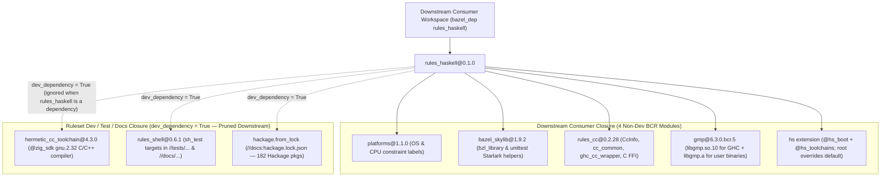

This page documents every adopted, rejected, and deferred dependency across `rules_haskell` ([`MODULE.bazel`](https://bazel.build/external/module)), the standalone showcase app (`examples/size`), and the self-hosted documentation generator (`//docs`, wired through [`BUILD.bazel`](https://bazel.build/concepts/build-files) and `docs/hackage.lock.json`). Read this if you're auditing `rules_haskell`'s transitive dependency graph, reviewing build-tool trade-offs, or checking what would need to change before swapping a dependency.

If you're new to Bazel ruleset authoring or Haskell, start with [Bazel ruleset primer](bazel-rules-primer.md) and [Haskell and GHC primer](haskell-and-ghc-primer.md). For the high-level architecture map or cross-tool trade-offs, see [Architecture overview](overview.md) and [Comparison with other rulesets](rulesets-comparison.md).

Every entry below covers three questions:

- **What it is:** The exact version, artifact, or architectural role evaluated.
- **Why it's adopted (or why it isn't):** Concrete findings from live prototyping and CI verification.
- **Catalysts:** The specific conditions that would trigger reconsidering an adopted choice or promoting a deferred alternative.

## Key ecosystem and systems terms

Seven plain-English definitions unpack the Bazel, Haskell, and Linux ELF terms used across all seven categories below:

- **[Bzlmod](https://bazel.build/external/overview) and [BCR](https://bazel.build/external/registry#bazel-central-registry) (Bazel Central Registry):** Bzlmod is Bazel's built-in module system configured in `MODULE.bazel`. The BCR (`registry.bazel.build`) is Bazel's public index of reusable build modules ([`bazel_dep`](https://bazel.build/rules/lib/globals/module#bazel_dep)), analogous to Rust's crates.io or Go's module proxy.
- **Hackage and Stackage LTS:** Hackage (`hackage.haskell.org`) is Haskell's central open-source package server hosting `.tar.gz` archives and `.cabal` manifests. Stackage LTS (*Long-Term Support*) is a curated snapshot pinning one mutually compatible version of ~3,000 Hackage packages verified to build and pass tests together on one GHC release.
- **Boot libraries (`@hs_boot`):** The 41 core Haskell libraries (`base`, `bytestring`, `text`, `containers`, `filepath`, `Cabal-syntax`, `template-haskell`, `terminfo`, and others) shipped pre-compiled inside the official GHC archive before any third-party Hackage package is fetched.
- **Template Haskell (`TH`) and `ghc-iserv-dyn`:** Template Haskell is GHC's compile-time macro system—Haskell functions marked `$(...)` that GHC runs while compiling your code to generate syntax trees or embed files (similar to Rust procedural macros). When GHC is dynamically linked, a helper process (`ghc-iserv-dyn`) loads compiled `.so` libraries via OS `dlopen` to evaluate those splices.
- **GMP (`libgmp`):** The GNU Multiple Precision Arithmetic Library, written in C and assembly. GHC's `ghc-bignum` boot library uses `libgmp` to back Haskell's unbounded `Integer` type (similar to Python's `int` or Go's `math/big.Int`).
- **Linux ELF linking (`PIC`, `soname`, `DT_NEEDED`, `RUNPATH`, `$ORIGIN`):** Code inside a Linux `.so` library must be compiled as **PIC** (*Position-Independent Code*, `-fPIC`) so the OS can map it at any address. Each `.so` records an ABI name (`soname`, like `libgmp.so.10`), which becomes a `DT_NEEDED` entry in executables linking against it. Before `main()` runs, `ld-linux.so` searches the executable's `RUNPATH`, expanding `$ORIGIN` to the directory containing that executable—letting staged tools find `../lib/.../*.so` without `LD_LIBRARY_PATH` or `patchelf`.
- **Fetch-time execution and IFD (*Import-From-Derivation*):** Compiling and running external programs while still loading the dependency graph to discover build targets. Reading static committed JSON (`hackage.lock.json`) instead keeps [`bazel query`](https://bazel.build/query/guide) and [`bazel mod`](https://bazel.build/external/mod-command) fast, offline-capable, and deterministic.

---

## Executive summary {#executive-summary}

| Category | Adopted | Not adopted (rejected or deferred) | Primary deciding factor |
|---|---|---|---|
| **1. C and C++ toolchains** *(dev and showcase; `rules_haskell` is C-toolchain independent)* | `hermetic_cc_toolchain@4.3.0` (`zig cc`, `gnu.2.32`, dev-only in root) | Pigweed `pw_toolchain/host_clang`, `toolchains_llvm@1.13.0` with Debian sysroot, host GCC/Clang (`rules_cc` default) | BCR-native, single-module multi-arch Linux (`x86_64` and `arm64`) [hermeticity](https://bazel.build/basics/hermeticity) with zero external sysroot hosting; Pigweed isn't on BCR and targets `glibc 2.27`. |
| **2. GHC distribution and version** | Official Haskell.org `deb10` `glibc` bindists, GHC `9.10.3` (`x86_64` and `aarch64`), pure-[Starlark](https://bazel.build/rules/language) extraction and `$ORIGIN` staging | `alpine3_12-linux-static-int_native` (`musl`), `rules_nixpkgs` / Nix, GHC `9.12.4` / `9.14.1` as default | `x86_64` + `arm64` parity, dynamic TH with C FFI, BCR [`CcInfo`](https://bazel.build/rules/lib/providers/CcInfo) interop, [RBE](https://bazel.build/remote/rbe)/BCR portability, and Stackage LTS 24.x stability. |
| **3. Native runtime and compiler libraries** | BCR `gmp@6.3.0.bcr.5` (`libgmp.so.10` + static `libgmp.a`), in-tree C11 `libtinfo.so.6` / `libtinfo.a` terminfo reader, GHC-bundled `libffi.so.8` / `libCffi.a` | Full BCR `ncurses` build, host `libgmp-dev` / `libtinfo5` (`apt install`) | Zero host C `-dev` libraries, base-`glibc`-only user binary `DT_NEEDED`, full `terminfo`/`haskeline` support without `ncurses` or `gawk`. |
| **4. Bazel rule foundations and action wrappers** | `platforms@1.1.0`, `bazel_skylib@1.9.2`, `rules_cc@0.2.28`, dev-only `rules_shell@0.6.1`, native C11 `ghc_cc_wrapper` | `rules_python` with Python `cc_wrapper.py` / `cabal_wrapper.py`, legacy non-dev deps (`rules_java`, `protobuf`, `rules_nodejs`, `aspect_rules_js`, `rules_sh`, non-dev [`stardoc`](https://bazel.build/rules/deploying#documentation)) | Minimal Bazel 9+ non-dev `MODULE.bazel` graph and zero Python runtime in build actions. |
| **5. Third-party Hackage resolution and build pipeline** | Self-hosted boot-only [`//tools/lock:lock`](../reference/lock-cli.md) (`Cabal-syntax`) + Stackage LTS → `hackage.lock.json` → pure-Starlark [`hackage`](../reference/extensions-and-providers.md#hackage) + 5-stage [`hs_cabal_library`](../reference/rules.md#hs_cabal_library) | `stack_snapshot` (Stack CLI + YAML pinning), pure-Starlark `.cabal` parser, opaque `cabal-install` / `runghc Setup.hs` actions | Complete `.cabal` spec evaluation with zero host `cabal`/`stack`/`python`, [`reproducible = True`](https://bazel.build/external/extension#specify-reproducibility-and-use-facts) Bzlmod evaluation, parallel caching, and `CcInfo` propagation. |
| **6. Showcase app third-party Haskell libraries** (`examples/size`, 69 Hackage + 41 boot packages on `lts-24.67`) | `xml-conduit` `1.10.1.0`, `http-client` `0.7.19` + `http-client-tls` `0.3.6.4` + `http-types` `0.12.6`, `zlib` `0.7.1.1` (`bundled-c-zlib=true` / `zlib-clib` `1.3.2`), `async` `2.2.6` | `xml`, `xeno`, `hexml`, `hexpat`, `hxt`, `xmlbf`; `http-conduit`, `req`, `wreq`, `http-client-openssl`; BCR `@zlib` default, system `libz.so.1`; raw `Control.Concurrent`, `ki`, `streamly` | Spec-compliant XML, pure-Haskell TLS (zero OpenSSL), zero host C libraries (`zlib-clib`), structured `async` concurrency, and a compact 69-package closure. |
| **7. Documentation engine and API docs** (`//docs` and [`hs_haddock`](../reference/rules.md#hs_haddock)) | **Minimal Hakyll and bundled GHC Haddock** (`docs/site.hs`, `docs/serve.hs`, `haskell/private/haddock.bzl`) | Bespoke Sphinx-like Pandoc AST DSLs, Emanote / Ema, Slick, raw Shake + Pandoc, Haddock alone, non-Haskell SSGs (Sphinx, MkDocs, `mdBook`, Docusaurus) | Standard Haskell tools (`hakyll-init`-style Markdown site + `wai-app-static`/`warp` preview + GHC Haddock for `.hs` APIs); tests `rules_haskell` and cross-library TH with zero custom Markdown syntax, zero JS, and zero Python/Node/Rust toolchains. |

---

## Anatomy of `MODULE.bazel`: why every direct dependency exists {#module-bazel-anatomy}

When you add `bazel_dep(name = "rules_haskell", version = "0.1.0")` to an application workspace, Bzlmod separates **runtime ruleset dependencies** (inherited by every downstream workspace) from **`dev_dependency = True` dependencies** (used only inside `rules_haskell`'s own tests and docs, and ignored downstream; see [Ruleset vs. consumer repository](bazel-rules-primer.md#ruleset-vs-consumer)).

Here's `rules_haskell`'s complete 58-line root `MODULE.bazel`:

```starlark
module(
    name = "rules_haskell",
    version = "0.1.0",
    bazel_compatibility = [">=9.0.0"],
)

# 1. Runtime ruleset closure (inherited by downstream consumers: ONLY 4 BCR modules)
bazel_dep(name = "platforms", version = "1.1.0")
bazel_dep(name = "bazel_skylib", version = "1.9.2")
bazel_dep(name = "rules_cc", version = "0.2.28")
bazel_dep(name = "gmp", version = "6.3.0.bcr.5")

# 2. Ruleset dev/test/docs closure (completely pruned for downstream consumers)
bazel_dep(name = "hermetic_cc_toolchain", version = "4.3.0", dev_dependency = True)
bazel_dep(name = "rules_shell", version = "0.6.1", dev_dependency = True)

cc_toolchains = use_extension(
    "@hermetic_cc_toolchain//toolchain:ext.bzl",
    "toolchains",
    dev_dependency = True,
)
use_repo(cc_toolchains, "zig_sdk")

register_toolchains(
    "@zig_sdk//toolchain:linux_amd64_gnu.2.32",
    "@zig_sdk//toolchain:linux_arm64_gnu.2.32",
    "@zig_sdk//toolchain/...",
    "@zig_sdk//libc_aware/toolchain/...",
    dev_dependency = True,
)

# Non-dev extension handle so @rules_haskell//tools/lock:lock can resolve @hs_boot
# when run from a downstream workspace; root hs.toolchain(...) overrides 9.10.3.
hs = use_extension("//haskell:extensions.bzl", "hs")
hs.toolchain(ghc_version = "9.10.3")
use_repo(hs, "hs_boot", "hs_toolchains")

register_toolchains(
    "@hs_toolchains//:all",
    dev_dependency = True,
)

# Dev-only 182-package Hackage lockfile for building //docs:site
hackage = use_extension(
    "//haskell:extensions.bzl",
    "hackage",
    dev_dependency = True,
)
hackage.from_lock(
    name = "hackage",
    lockfile = "//docs:hackage.lock.json",
)
use_repo(hackage, "hackage")
```



### Four non-dev runtime dependencies (inherited by consumers)

#### `platforms@1.1.0`: standard OS and CPU constraint vocabulary

- **What it is:** A small, zero-code repository of standard Bazel [`constraint_value`](https://bazel.build/concepts/platforms) targets (`@platforms//os:linux`, `@platforms//os:macos`, `@platforms//os:windows`, `@platforms//cpu:x86_64`, `@platforms//cpu:arm64`). It gives every ruleset one shared vocabulary for hardware and OS constraints so [toolchain resolution](https://bazel.build/extending/toolchains) and [`select()`](https://bazel.build/configure/attributes) expressions agree on the active platform.
- **Where it's used:** `haskell/private/ghc_versions.bzl` and `haskell/extensions.bzl` attach `@platforms//os:*` and `@platforms//cpu:*` constraints to each GHC toolchain declaration in `@hs_toolchains`. `haskell/private/hackage.bzl` uses the same constraints to generate [`config_setting`](https://bazel.build/reference/be/general#config_setting) targets and `select({...})` branches inside each `@hackage__<pkg>/BUILD.bazel` (such as compiling x86 AES-NI/PCLMUL SIMD files in `crypton` on `linux_x86_64` versus portable C on `linux_arm64`).
- **What breaks if removed:** Loading and toolchain resolution fail immediately because `@hs_toolchains` and `@hackage__<pkg>` can't resolve `@platforms//os:*` or `@platforms//cpu:*`.

#### `bazel_skylib@1.9.2`: Starlark standard library and analysis testing

- **What it is:** Bazel's official pure-Starlark helper library, supplying `bzl_library` for packaging `.bzl` files with checked dependencies and `unittest.bzl` ([`analysistest`](https://bazel.build/rules/testing#testing-rules) and `asserts`) for testing rule providers and action flags in memory without running compilers.
- **Where it's used:** `haskell/BUILD.bazel` and `haskell/private/BUILD.bazel` package public and private `.bzl` files with `bzl_library`, and `tests/starlark/rules_analysis_test.bzl` uses `analysistest` to verify [`HsPackageInfo`](../reference/extensions-and-providers.md#hspackageinfo), [`HsLinkInfo`](../reference/extensions-and-providers.md#hslinkinfo), `CcInfo`, and `ghc` flags.
- **What breaks if removed:** Evaluating targets in `@rules_haskell//haskell/...` fails at `load("@bazel_skylib//:bzl_library.bzl", ...)`, and `//tests/starlark/...` can't run.

#### `rules_cc@0.2.28`: C/C++ toolchain discovery, native C compilation, and `CcInfo`

- **What it is:** Bazel's official C and C++ ruleset ([`cc_binary`](https://bazel.build/reference/be/c-cpp#cc_binary), [`cc_library`](https://bazel.build/reference/be/c-cpp#cc_library)) and Starlark C-toolchain API (`CcInfo`, [`cc_common`](https://bazel.build/rules/lib/toplevel/cc_common), `find_cc_toolchain`, `use_cc_toolchain`). Unlike Go's self-contained compiler and linker, GHC delegates C preprocessing (`-pgmP`), assembly (`-pgma`), C/C++ FFI stub compilation (`-pgmc`/`-pgmcxx`), `ar` archiving, and final linking against `libHSrts.a`, `libCffi.a`, `libgmp.a`, and `glibc` to the active C toolchain (see [C toolchain and RTS](haskell-and-ghc-primer.md#c-toolchain-and-rts)).
- **Where it's used:** `haskell/private/BUILD.bazel` compiles `rules_haskell`'s own C11 support targets (`ghc_cc_wrapper`, `libtinfo.so.6`, `tinfo_stub_static`, `rt_shims`). `staged_ghc.bzl`, `actions.bzl`, `rules.bzl`, `cabal_library.bzl`, and `haddock.bzl` query the active [`cc_toolchain`](https://bazel.build/reference/be/c-cpp#cc_toolchain), link `libgmp.so.10`, compile C/C++ files via `cc_common.compile()`, and merge transitive C headers (`install-includes`) and `cc_deps` archives through `CcInfo` (see [Interoperating with C/C++](bazel-rules-primer.md#cc-interop)).
- **What breaks if removed:** Nothing in `rules_haskell` can compile or link: `ghc_cc_wrapper` and `libtinfo.so.6` can't build, GHC can't locate `cc`/`ld`/`ar` or `--sysroot` flags, C-bearing Hackage packages fail, and `cc_deps` disappears.

#### `gmp@6.3.0.bcr.5`: arbitrary-precision arithmetic (`libgmp.so.10` and `libgmp.a`)

- **What it is:** The GNU Multiple Precision Arithmetic Library packaged on the BCR as `@gmp//:gmp`. Haskell's built-in `Integer` type is unbounded, and GHC's `ghc-bignum` backs it with `libgmp`'s `__gmpn_*` C routines. Because `ghc` itself is a Haskell program, both the compiler and every compiled user executable depend on `libgmp` (see [Why GMP and libtinfo show up](haskell-and-ghc-primer.md#gmp-and-tinfo)).
- **Where it's used:** `staged_ghc.bzl` pulls both `libgmp.pic.a` and `libgmp.a` from `@gmp//:gmp[CcInfo]`. It links `libgmp.pic.a` into `libgmp.so.10` (`HsLinkGmpShared`) inside `<libdir>/<arch>-linux-ghc-<ver>/` so GHC tools load it via `$ORIGIN`, and symlinks `libgmp.a` into an isolated `gmp_static/` directory so `HsLinkExecutable` links user binaries statically—keeping `libgmp.so.10` out of user `DT_NEEDED` headers.
- **What breaks if removed:** On any clean Linux machine without `apt install libgmp-dev`, `bin/ghc-9.10.3` fails to start (`libgmp.so.10: cannot open shared object file`) and binary linking fails (`ld: cannot find -lgmp`).

> **Note:** Why is `hs = use_extension("//haskell:extensions.bzl", "hs")` non-dev while [`register_toolchains`](https://bazel.build/rules/lib/globals/module#register_toolchains) is dev-only? Keeping [`use_repo(hs, "hs_boot", "hs_toolchains")`](https://bazel.build/rules/lib/globals/module#use_repo) non-dev lets downstream users run `bazel run @rules_haskell//tools/lock:lock -- ...` so targets inside `@rules_haskell//tools/lock` can resolve `@hs_boot//:Cabal-syntax` and `@hs_boot//:base`. Inside `haskell/extensions.bzl`, `mod.is_root` takes precedence, so your own `hs.toolchain(ghc_version = "9.12.4")` overrides `9.10.3`. Keeping `register_toolchains("@hs_toolchains//:all", dev_dependency = True)` dev-only ensures `rules_haskell` never registers toolchains implicitly unless you opt in.

### Three dev-only dependencies (`dev_dependency = True`)

- **`hermetic_cc_toolchain@4.3.0` (`@zig_sdk`):** Provides a self-contained Zig `0.15.2` Clang/LLD C/C++ cross-compiler (`gnu.2.32`) for running `rules_haskell`'s tests, `//tools/lock:lock`, and `//docs:site` on compiler-free Linux containers. Marking it dev-only avoids forcing Zig onto consumers who already use `toolchains_llvm`, an RBE Clang toolchain, or system GCC. Removing it breaks [`bazel test //...`](https://bazel.build/docs/user-manual#running-tests) inside `rules_haskell` on bare containers.
- **`rules_shell@0.6.1`:** Provides [`sh_test`](https://bazel.build/reference/be/shell#sh_test) (moved out of core Bazel in Bazel 8/9) for integration tests such as `elf_hermeticity_test`, `bzlmod_hygiene_test`, `lock_cli_test`, and `site_test`. Public `rules_haskell` rules invoke [`ctx.actions.run_shell`](https://bazel.build/extending/rules#actions) and `ctx.actions.write` directly, never instantiating `sh_test` in consumer repos.
- **`hackage` extension (`lockfile = "//docs:hackage.lock.json"`):** Exposes the 182 pinned Hackage packages (the transitive closure of `hakyll`) used to build `//docs:site`, `//docs:serve`, and root Hackage/TH tests (`//tests/rules/codegen`, `//tests/rules/th`). Marking it dev-only guarantees downstream workspaces never parse `docs/hackage.lock.json` or collide with `rules_haskell`'s `@hackage` hub (verified by `//tests/rules:bzlmod_hygiene_test`). Removing it breaks [`bazel build //docs:site`](https://bazel.build/run/build) and `bazel test //docs/...`.

### How Bzlmod's Minimal Version Selection (MVS) reconciles versions

Most downstream workspaces also declare `platforms`, `rules_cc`, or `bazel_skylib` in their own `MODULE.bazel`. Unlike `cabal`, Cargo, or `pip`—which run backtracking SAT solvers over version ranges—Bzlmod uses **[Minimal Version Selection (MVS)](https://bazel.build/external/module#version-selection)**, the single-pass deterministic algorithm from Go modules:

- Every `bazel_dep(name = "X", version = "V")` states the **minimum** version of `X` that module requires.
- Across the active transitive graph (after pruning non-root `dev_dependency = True` edges), Bzlmod selects one version per module: the highest minimum version requested anywhere in the graph (`max(all requested versions)`).
- For example, `rules_haskell` requests `platforms@1.1.0` and `rules_cc@0.2.28`. If your `MODULE.bazel` declares `platforms@1.0.0` and `rules_cc@0.2.30`, Bzlmod resolves `platforms@1.1.0` and `rules_cc@0.2.30` in one pass with zero solver backtracking or fetches of unselected intermediate versions.

---

## C and C++ toolchains (dev and showcase hermeticity) {#cc-toolchains}

> **Important:** `rules_haskell` doesn't hardcode any C compiler. Every rule queries `@bazel_tools//tools/cpp:toolchain_type` through `rules_cc` and forwards the resolved `--sysroot` and `--target` flags into `ghc_cc_wrapper` (`haskell/private/cc_wrapper.c`). `hermetic_cc_toolchain` is dev-only in `MODULE.bazel`, so you can register any compliant Linux `cc_toolchain` in your workspace.

### Context: why Haskell cares about C compilers, sysroots, and `zig cc`

Three systems concepts clarify the C-toolchain trade-offs below:

1. **Why GHC shells out to C tools and links `glibc`:** GHC compiles `.hs` modules to native `.o` files, but delegates C preprocessing (`-XCPP`), assembly, C FFI compilation (`cbits/*.c` in `crypton`, `zlib-clib`, `bitvec`, `network`), `./configure` feature probes, `ar`, and final linking to the C toolchain. Every Haskell executable links GHC's C Runtime System (`libHSrts.a`—garbage collector, green-thread scheduler, `epoll` event manager), `libCffi.a`, and `libgmp.a` against `glibc`.
2. **Linux sysroots and `glibc` symbol versioning:** Linking against host `/usr/include` and `/usr/lib/libc.so.6` stamps binaries with that host's `glibc` symbol versions (`statx@GLIBC_2.28`, `arc4random@GLIBC_2.36`), so a binary built on Ubuntu 24.04 (`2.39`) fails to launch on Debian 12 (`2.36`) or Rocky Linux 9 (`2.34`). A **sysroot** freezes C headers and stub libraries at one explicit `glibc` baseline so builds never read host `/usr/include`.
3. **`zig cc` vs. external sysroot tarballs (and CIPD):** Traditional hermetic LLVM toolchains (`toolchains_llvm`, or Pigweed's `pw_toolchain` fetching Fuchsia/Chromium artifacts from Google's CIPD store) pair Clang and `lld` with a separate pre-built ~300–500 MB Linux sysroot tarball per architecture. By contrast, `zig cc` (`hermetic_cc_toolchain`) bundles Clang/LLD plus compact multi-version `glibc` header and stub definitions in one ~50 MB download, synthesizing exact stubs on demand (`gnu.2.28`, `gnu.2.32`) for both `x86_64` and `arm64`.

### Adopted (dev and showcase)

#### `hermetic_cc_toolchain@4.3.0` (`zig cc`, `glibc` `gnu.2.32`)

- **What it is:** BCR-hosted Zig `0.15.2` hermetic C/C++ toolchain, registered as `dev_dependency = True` in `MODULE.bazel` and directly in `examples/size/MODULE.bazel`, with `@zig_sdk//toolchain:linux_amd64_gnu.2.32` and `@zig_sdk//toolchain:linux_arm64_gnu.2.32` registered ahead of `@zig_sdk//toolchain/...`.
- **Why it's adopted:**
  - *Single BCR module with zero sysroot hosting:* Covers hermetic `linux_x86_64` and `linux_arm64` compilation (plus optional `musl`) without host `gcc`/`clang` or manually mirrored Debian sysroots.
  - *Exact `glibc` compatibility window (`gnu.2.32`):* `@zig_sdk//toolchain/...` defaults alphabetically to `gnu.2.17`, which fails to link GHC `deb10`'s `libCffi.a` (`memfd_create` requires `2.27`; `statx`/`fcntl64` require `2.28`). Pinning `gnu.2.32` satisfies both GHC `deb10` (`<= 2.28`) and BCR `gmp@6.3.0.bcr.5`'s `m4` build tool (which includes Zig's `<sys/single_threaded.h>`, requiring `>= 2.32`), while keeping binaries portable across Debian 12 (`2.36`), Ubuntu 22.04/24.04 (`2.35`/`2.39`), and Rocky Linux 9 (`2.34`).
  - *Verified Hackage compatibility:* Specialized Hackage `cc-options` (`bitvec` `-fopenmp-simd`, `crypton` AES-NI/PCLMUL flags, `primitive` `-ftree-vectorize -msse2`, `unix-time` `-fPIC`) compile without errors.
  - *Quirks isolated in one wrapper:* All six verified `zig cc`–GHC mismatches (`-fno-PIC`, `-Wl,-h`, `.dyn_o`/`.p_o`, `--print-file-name`, `-Wno-unused-command-line-argument`, and `zig c++`'s `libcxx/include/stddef.h` ordering fixed via `-nostdinc++`) live in `haskell/private/cc_wrapper.c`.
  - *Ecosystem alignment:* Matches sibling Bazel 9 polyglot repositories such as the reference `size` project.
- **Catalysts to reconsider:**
  - A lightweight BCR Clang/`lld` toolchain ships built-in, SHA-256-pinned multi-arch (`x86_64` and `arm64`) Linux `glibc >= 2.32` sysroots—removing both the [`.bazelrc`](https://bazel.build/run/bazelrc) `/tmp` cache mount (`HERMETIC_CC_TOOLCHAIN_CACHE_PREFIX=/tmp/zig-cc-cache` and [`--sandbox_add_mount_pair=/tmp`](https://bazel.build/reference/command-line-reference#param-sandbox-add-mount-pair)) and the `zig cc` flag rewrites in `cc_wrapper.c`.
  - RBE fleets forbid `--sandbox_add_mount_pair=/tmp`, forcing cold Zig cache rebuilds on remote actions.
  - Upstream Zig or `hermetic_cc_toolchain` regresses versioned `glibc` linking, breaks under future `rules_cc` toolchains, or breaks C++ FFI packages requiring GNU `libstdc++` ABI compatibility instead of Zig's LLVM `libc++`.

### Not adopted

#### Pigweed C/C++ toolchains (`pw_toolchain/host_clang:host_cc_toolchain_linux`)

- **What it is:** Google Pigweed's rule-based host Clang toolchain (Fuchsia Clang 24, `lld`, `llvm-ar`, `compiler-rt`, `libunwind`, and CIPD `fuchsia/third_party/sysroot/bionic` for `x86_64` and `aarch64`).
- **Why it isn't adopted** *(evaluated live against cached Pigweed LLVM and Linux sysroot)*:
  - *What worked:* Real Clang 24 with `lld` and `cc_sysroot` avoided all five core `zig cc` quirks (`-fno-PIC`, `.dyn_o`, `-Wl,-h`, `--print-file-name=libm.a`, and C header ordering) and needed only `-optl-no-pie` (matching Pigweed's own `cgo_link_flags`).
  - *Blocker 1 — Non-BCR and monolithic graph:* Pigweed isn't on the BCR (`404`) and doesn't publish a standalone `pw_toolchain` module. Depending on it pulls in its 892-line `MODULE.bazel`, bringing CIPD plus `rules_android`, `rules_java`, `rules_go`, `rules_rust`, `protobuf`, `pico-sdk`, and `zephyr`.
  - *Blocker 2 — Sysroot `glibc` mismatch:* `fuchsia/third_party/sysroot/bionic` targets `glibc 2.27` (providing `memfd_create@@GLIBC_2.27` but lacking `statx` and `fcntl64@GLIBC_2.28` required by GHC `deb10` on both `x86_64` and `aarch64`; GHC's older `ubuntu18_04` `2.27` bindist is `x86_64`-only).
- **Catalysts to adopt:** Pigweed publishes a standalone, minimal `pw_toolchain` module to the BCR (plain HTTPS fetches, no Android/Java/Go/Rust/Zephyr/pico-sdk deps) **and** upgrades its Linux `cc_sysroot` to `glibc >= 2.28` (or `>= 2.32` if BCR `gmp`/`m4` requires it) across `x86_64` and `aarch64`.

#### `toolchains_llvm@1.13.0` (BCR) with a Debian sysroot

- **What it is:** BCR-native LLVM/Clang and `lld` toolchain (`toolchains_llvm@1.13.0`) paired via `llvm.sysroot(...)` with an external Debian `>= 10` (`glibc >= 2.28`, such as Debian 12 `2.36`) sysroot tarball.
- **Why it isn't adopted as default (supported for consumers):** It offers the same standard Clang/`lld` behavior seen in Pigweed (no `zig cc` quirks, no `/tmp` [sandbox](https://bazel.build/docs/sandboxing) mount, clean RBE support) while staying lightweight and BCR-native. It's deferred as the repository default only because `toolchains_llvm` doesn't bundle Linux `glibc` sysroots—adopting it means building, hosting, hashing, and maintaining external multi-arch Debian sysroot tarballs, and it lacks built-in `musl` targeting.
- **Catalysts to adopt:** `toolchains_llvm` (or a maintained BCR `linux_sysroot` module) publishes SHA-256-pinned multi-arch Debian `>= 10` sysroots directly in the BCR, or RBE policies disallow `--sandbox_add_mount_pair=/tmp` or require standard Clang with `libstdc++`.

#### Auto-detected host GCC or Clang (`rules_cc` default)

- **What it is:** Bazel's default `local_config_cc` auto-detection against `/usr/bin/gcc`, `/usr/bin/clang`, system `ld`, and `/usr/include`.
- **Why it isn't adopted:** It leaks host compiler versions, distro headers, and `glibc` symbol versions into artifacts, fails on compiler-free Linux containers (`debian:bookworm-slim`, `ubuntu:24.04`, `rockylinux:9` tested in `.github/workflows/ci.yml`), and breaks RBE cache sharing across workstations.
- **Catalysts to adopt:** Never as `rules_haskell`'s dev or showcase default. It makes sense only as a consumer-side choice inside locked, immutable build containers or RBE worker images that require host GCC/Clang ABI alignment (for example, dynamically linking internal system C++ libraries). Gating `-nostdinc++` on compiler flavor in `haskell/private/cc_wrapper.c` would further harden host-GCC builds under `-Werror`.

---

## GHC distribution and version {#ghc-distribution}

### Context: bindists, companion tools, `deb10`, and `musl`

Five concepts explain what ships inside a GHC release and how Linux distributions interact with it (see [Boot libraries](haskell-and-ghc-primer.md#boot-libraries)):

- **GHC bindists:** Because GHC is a self-hosting compiler written in Haskell, C, and Cmm (requiring hours of CPU time and an existing bootstrap GHC to build from source), upstream publishes official pre-compiled `.tar.xz` binary distributions ("bindists") containing ready-to-run tools and 41 pre-compiled boot libraries.
- **Companion binaries in `bin/`:** Alongside `ghc` and `haddock`, `staged_ghc.bzl` stages four smaller tools: `ghc-pkg` (compiles `.conf` files into `package.cache`), `hsc2hs` (compiles and runs tiny C probe programs to turn `.hsc` files into `.hs` files), `ghc-iserv-dyn` (out-of-process interpreter loading `.so` libraries for TH splices), and `unlit` (strips prose from `.lhs` literate Haskell files).
- **`ghcup`:** The Haskell community's interactive toolchain manager (analogous to `rustup` or `nvm`), whose `Recommended` tag tracks the consensus production release (`9.10.3`). `rules_haskell` never invokes `ghcup`—Bazel fetches the same `downloads.haskell.org` archives by SHA-256.
- **What `deb10` means:** `deb10` in `ghc-9.10.3-x86_64-deb10-linux.tar.xz` doesn't restrict GHC to Debian; it indicates upstream built the archive on Debian 10 (`glibc 2.28`). Because `glibc` maintains forward compatibility, a `2.28` baseline runs on Debian 10+, Ubuntu 20.04/22.04/24.04 (`2.31`–`2.39`), Fedora, and RHEL/Rocky Linux 8/9 (`2.28`/`2.34`).
- **`glibc` vs. `musl`:** Standard Linux distros use GNU `glibc`, while Alpine uses `musl`. A static `musl` GHC bindist (`alpine3_12-linux-static-int_native`) has ABI mismatches against `glibc` C toolchains and can't use OS `dlopen` for Template Haskell, falling back to GHC's internal static linker, which crashes when C FFI splices call `libc` allocators.

### Adopted

#### Official Haskell.org `deb10` `glibc` bindists (GHC `9.10.3`, `x86_64` and `aarch64`)

- **What it is:** Official `ghc-9.10.3-{x86_64,aarch64}-deb10-linux.tar.xz` bindists pinned by URL and SHA-256 in `haskell/private/ghc_versions.bzl`, extracted via pure-Starlark [`repository_ctx.download_and_extract`](https://bazel.build/rules/lib/builtins/repository_ctx) (zero fetch-time `./configure && make install`), sanitized in `lib/settings`, and `$ORIGIN`-staged by `haskell/private/staged_ghc.bzl`.
- **Why it's adopted:**
  - *Multi-arch Linux parity:* Upstream publishes identical layouts for both `linux_x86_64` and `linux_arm64` (`aarch64`).
  - *Broad distro compatibility:* Caps symbol requirements at `<= GLIBC_2.28` (`memfd_create`/`expf`/`logf`/`powf@GLIBC_2.27`; `fcntl64`/`statx@GLIBC_2.28`), running on Debian 10+, Debian 12, Ubuntu 22.04/24.04, Rocky 8/9, and distroless `cc-debian12`.
  - *Small dynamic surface:* Bundles `libffi.so.8` and `libCffi*.a` with no `libnuma` dependency; only `libgmp.so.10` and `libtinfo.so.6` are external, and both resolve via GHC's baked-in `$ORIGIN/../lib/<arch>-linux-ghc-9.10.3` `RUNPATH` with zero `patchelf` or `LD_LIBRARY_PATH`.
  - *Dynamic Template Haskell with C FFI:* Built with `GHC Dynamic = YES` (`ghc-iserv-dyn`), verified on cross-package TH splices calling `runIO`, `withCString`, `strlen`, `file-embed`, and `CApiFFI`.
  - *Ecosystem stability (`9.10.3`):* Matches `ghcup` `Recommended` (`base-4.20.2.0`) and Stackage LTS 24.x (`lts-24.67`), avoiding Nightly package churn.
  - *Zero fetch-time execution:* Pure-Starlark extraction and `.conf` text parsing replace `tweag/rules_haskell`'s fetch-time `./configure && make install` [repository rule](https://bazel.build/external/repo), removing host `make`, `perl`, and `gcc` requirements.
- **Catalysts to reconsider:**
  - Upstream GHC retires `deb10` bindists for `deb11`/`deb12`, requiring a bindist family update in `ghc_versions.bzl`.
  - Stackage cuts a stable GHC `9.12.x` LTS and `ghcup` moves `Recommended` to `9.12.x`, triggering a one-line bump of `DEFAULT_GHC_VERSION` to `"9.12.4"` (already wired in `ghc_versions.bzl`).
  - Upstream GHC ships official dynamic Linux bindists with `--bignum=native` (or static GMP) and no `libtinfo` dependency, letting `rules_haskell` drop non-dev `@gmp` and in-tree `libtinfo.so.6`.

### Not adopted

#### `alpine3_12-linux-static-int_native` (`musl` static and native bignum)

- **What it is:** Official Haskell.org fully static ELF bindist (`PT_INTERP = NONE`, `DT_NEEDED = NONE`, `--bignum=native`), already cataloged as `linux_x86_64_musl` in `haskell/private/ghc_versions.bzl`.
- **Why it isn't adopted as default** *(tested live with GHC `9.10.3` and `zig cc`)*:
  - *`x86_64`-only:* Upstream GHC publishes no `aarch64` static Alpine archive for GHC `9.10`, `9.12`, or `9.14`.
  - *Template Haskell and C FFI segfaults:* With `GHC Dynamic = NO`, TH falls back to the internal ELF RTS linker, which queries `--print-file-name=libm.a` (leaking host `/usr/lib/x86_64-linux-gnu/libm.a` linker scripts under Zig → `loadArchive: Not an archive`). Even after supplying Zig's `musl` `libc.a` and `libcompiler_rt.a` via `-B`, cross-package TH splices calling `withCString` or `malloc` segfault in both `ghc` and `ghc-iserv` from dual-`musl` `libc.a` clashes.
  - *`glibc` ABI mismatch:* Can't link against `glibc` `cc_toolchain`s (`undefined symbol: posix_spawn_file_actions_addchdir_np` in `libHSprocess.a` on `glibc <= 2.28`, plus struct layout differences), forcing every BCR `cc_library` onto `@zig_sdk//libc:musl`.
  - *Hackage GMP flag friction:* Uses `bignum = native`, forcing lockfile flag overrides on packages like `crypton` (`integer-gmp=false`) and `cborg` (`optimize-gmp=false`) and sacrificing GMP bignum speed.
- **Catalysts to adopt:**
  - *As an opt-in static `musl` flavor* (for `FROM scratch` `x86_64` containers without runtime TH C-allocator splices, such as `examples/size`): Wire a `musl` platform constraint matching `@zig_sdk//libc:musl`, add a `libc = "musl"` selector on [`hs.toolchain`](../reference/extensions-and-providers.md#hs-toolchain), and document the `crypton`/`cborg` flags (see [Linux static `musl` blueprint](cross-os-and-platforms.md#blueprint-linux-musl)).
  - *As the default Linux bindist:* Upstream publishes `aarch64` static `musl` bindists, fixes the static RTS linker / `ghc-iserv` dual-`libc` crash, and BCR `cc_library` targets gain broad `musl` support.

#### `rules_nixpkgs` and Nix-managed GHC

- **What it is:** Provisioning GHC and its C libraries (`gmp`, `ncurses`, `libffi`) via Nix expressions writing to `/nix/store` (the hermetic Linux path in `tweag/rules_haskell`).
- **Why it isn't adopted:** It requires a host Nix installation, mutates `/nix/store` during fetch, breaks standard RBE workers and Nix-free Docker CI containers, blocks BCR downstream use (`tweag/rules_haskell` issue #2451), and forces a second package manager on teams using Bazel to avoid multi-tool orchestration.
- **Catalysts to adopt:** Never as a dependency or default in `rules_haskell`. Suitable only as a consumer-supplied external `hs_toolchain` in organizations already running Nix across their RBE fleet.

#### GHC `9.12.4` or `9.14.1` as the default version

- **What it is:** Newer GHC releases (`9.12.4` with `base-4.21.2.0` tracking Stackage Nightly; `9.14.1` tagged `Latest` in `ghcup`).
- **Why it isn't adopted as default:** `9.12.4` currently tracks Stackage Nightly rather than an LTS series, bringing moving-target churn (+5 packages in `examples/size`, 74 versus 69, plus newer features like `reexported-modules` in `crypton-asn1-encoding`/`crypton-asn1-parse` and `autogen-modules` in `mlkem`), and `9.14.1` is too new for broad Hackage upper-bound support. `rules_haskell` is already forward-compatible with `9.12.4`: all six platform archives, SHA-256 digests, `BOOT_PACKAGE_NAMES` (including `file-io`), and `reexported-modules` support are already implemented.
- **Catalysts to adopt:** Stackage cuts a stable LTS series for GHC `9.12.x` (LTS 25+), `ghcup` promotes `9.12.x` to `Recommended`, and the `rules_haskell`, `examples/size`, and `//docs` CI matrix passes on that LTS (same bar for `9.14.x` later).

---

## Native runtime and compiler libraries {#native-runtime-libs}

### Context: why `gmp`, `tinfo` (`ncurses`), and `libffi` exist in GHC

Each of these three C libraries fills a specific runtime role inside GHC (see [Why GMP and libtinfo show up](haskell-and-ghc-primer.md#gmp-and-tinfo)):

1. **`gmp` (`libgmp`):** Backs Haskell's arbitrary-precision `Integer` type via `ghc-bignum`; `ghc` loads `libgmp.so.10` dynamically and user binaries link `libgmp.a` statically.
2. **`tinfo` (`libtinfo.so.6` / `libtinfo.a` from `ncurses`):** GHC's batch compiler (`ghc`) and interactive REPL (`ghci`, a tiny wrapper passing `--interactive`) are the same ELF executable. Because `ghci` uses `haskeline` and `terminfo` (`libHSterminfo`), `bin/ghc` carries a `DT_NEEDED` entry for `libtinfo.so.6`. Linux resolves every `DT_NEEDED` entry before `main()` starts, so without `libtinfo.so.6` (and `libtinfo.a` when linking binaries pulling `terminfo`), `ghc` can't even start on minimal containers.
3. **`libffi` (`libffi.so.8` and `libCffi*.a`):** Constructs C calling-convention frames at runtime (like Python's `ctypes`). GHC uses `libffi.so.8` for C calls inside TH splices (`ghc-iserv-dyn`) and links `libCffi.a` into executables for `foreign export ccall`.

### Adopted

#### BCR `gmp@6.3.0.bcr.5`

- **What it is:** Non-dev BCR dependency used twice in `staged_ghc.bzl`: linked from `libgmp.pic.a` into `$ORIGIN`-staged `libgmp.so.10` (`HsLinkGmpShared`, `-shared -Wl,-soname,libgmp.so.10 -Wl,--whole-archive`) for GHC's runtime, and symlinked as `libgmp.a` into an isolated `gmp_static/` directory so `HsLinkExecutable` links user binaries statically.
- **Why it's adopted:** Removes host `libgmp-dev`/`libgmp10` while matching GHC `deb10`'s unversioned `__gmpn_*` ABI, and keeps user executable `DT_NEEDED` entries limited to base `glibc`. Known constraint: BCR `gmp@6.3.0.bcr.5` pulls BCR `m4`, which under Zig includes `<sys/single_threaded.h>`, raising the minimum Zig `glibc` baseline from `2.28` to `2.32`.
- **Catalysts to reconsider:**
  - Upstream GHC switches default Linux bindists to `ghc-bignum`'s `native` backend, allowing `rules_haskell` to drop non-dev `@gmp`.
  - Downstream `hermetic_cc_toolchain` users need portability down to `glibc 2.28`–`2.31` (Rocky 8, Ubuntu 20.04, Debian 10), triggering a fix for `m4`'s `2.32` header requirement or pairing with `toolchains_llvm` and a `2.28` sysroot.
  - A commercial consumer's LGPL policy prohibits static linking of `libgmp.a`, motivating an opt-in `link_gmp_static = False` mode staging `libgmp.so.10` beside binaries or switching to `bignum = native`.

#### In-tree C11 `libtinfo.so.6` and `libtinfo.a` (`haskell/private/tinfo_stub.c` and `tinfo_stub.lds`)

- **What it is:** A self-contained POSIX C11 terminfo reader (`-std=c11 -fPIC -O2 -Wall -Wextra`) compiled twice in `haskell/private/BUILD.bazel`: as dynamic `libtinfo.so.6` (using a 13-line ELF version script exporting the 8 `libHSterminfo` symbols under `@NCURSES6_TINFO_5.0.19991023`, `$ORIGIN`-staged for `ghc`, `haddock`, `runghc`, and [`hs_repl`](../reference/rules.md#hs_repl)), and as static `libtinfo.a` (`tinfo_stub_static`) symlinked beside `libgmp.a` so binaries pulling `terminfo`, `haskeline`, or `ghc` carry no `libtinfo.so.6` `DT_NEEDED` entry.
- **Why it's adopted:**
  - *Exact 8-symbol ABI:* Auditing every binary and `.so` in GHC `9.10.3` and `9.12.4` `deb10` (`x86_64` and `aarch64`) with `readelf --dyn-syms` confirms `libtinfo.so.6` is imported only by `libHSterminfo`, binding 8 X/Open Curses functions (`setupterm`, `set_curterm`, `del_curterm`, `tigetflag`, `tigetnum`, `tigetstr`, `tparm`, `tputs`).
  - *Full binary `term(5)` reader with built-in fallbacks:* `setupterm` searches standard terminfo directories (`$TERMINFO`, `$TERMINFO_DIRS`, `$HOME/.terminfo`, `/etc/terminfo`, `/lib/terminfo`, `/usr/share/terminfo`) and parses classic 16-bit (`0432`), extended 32-bit (`01036`), and extended capability sections (`RGB`, `AX`, `XT`, `Smulx`, `Setulc`). In minimal containers lacking `/usr/share/terminfo`, it falls back to built-in profiles (`xterm-256color`/`xterm`/`screen`/`tmux`/`alacritty`/`kitty`, `vt100`/`ansi`/`linux`, and `dumb`, returning `-1` with `*errret = -1` for unrecognized names), queries live dimensions via `ioctl(fildes, TIOCGWINSZ)` and `$LINES`/`$COLUMNS`, and evaluates stack-based `tparm` expressions and `tputs` padding.
  - *Fast and dependency-free:* Compiles in milliseconds, keeps `ncurses`, `gawk`, and autoconf out of downstream `MODULE.bazel` graphs, and powers `haskeline` editing, Tab completion, 256-color output, and `vty`/`brick` apps even without `/usr/share/terminfo`.
  - *Scope boundary:* Covers the 8-function `libtinfo` capability layer only. If a C or FFI library directly calls higher-level `ncurses` windowing APIs (`initscr`, `newwin`, `wrefresh`, `wgetch`), attach a full `ncurses` `cc_library` via `cc_deps`.
- **Catalysts to reconsider:** A future GHC imports extra `libtinfo` symbols or bumps the ncurses version tag (extend `tinfo_stub.c`/`tinfo_stub.lds`, or re-evaluate a BCR library if the surface grows sharply), or upstream GHC drops its `libtinfo.so.6` dependency so `tinfo_stub.c` can be retired.

#### GHC-bundled `libffi.so.8` and `libCffi*.a`

- **What it is:** Pre-built `libffi.so.8` (for GHC's runtime via `$ORIGIN`) and `libCffi*.a` (statically linked into user binaries) included inside official GHC `deb10` bindists.
- **Why it's adopted:** Already SHA-256-pinned inside the GHC archive, ABI-matched to GHC's RTS, adds zero BCR or host dependencies, and leaves no `libffi.so.8` in user binary `DT_NEEDED`.
- **Catalysts to reconsider:** Upstream GHC switches official Linux bindists to `--with-system-libffi`, or a polyglot C/C++ consumer statically links another `libffi` via `cc_deps` and hits duplicate symbol collisions with `libCffi.a` (motivating a shared BCR `@libffi` override).

### Not adopted

#### Full BCR `ncurses` build

- **What it is:** Building full `ncurses` from the BCR for every `rules_haskell` consumer to satisfy GHC's `libtinfo.so.6` import.
- **Why it isn't adopted:** Pulls a heavy C, autoconf, and `gawk` build graph into every downstream non-dev closure, whereas `tinfo_stub.c` implements `libHSterminfo`'s full 8-symbol ABI in zero-dependency C11.
- **Catalysts to adopt:** Future GHC releases import broad `libncurses` windowing APIs beyond `libtinfo`, and a `gawk`-free BCR `ncurses` module exists.

#### Host system `libgmp-dev`, `libtinfo5`, or `libtinfo6` (`apt install`)

- **What it is:** Requiring pre-installed host OS packages (the pattern in `tweag/rules_haskell`'s BCR `1.0` `presubmit.yml`: `sudo apt install libtinfo5 libgmp-dev`).
- **Why it isn't adopted:** Breaks hermeticity, fails on bare containers tested in CI, breaks across distro upgrades (`libtinfo5` was removed in Ubuntu 24.04 and Debian 13), hurts RBE portability, and leaks dynamic `libgmp.so.10` into user binaries.
- **Catalysts to adopt:** Never as default. Only plausible as a consumer escape hatch in locked enterprise environments required to dynamically link centrally patched OS libraries.

---

## Bazel rule foundations and action wrappers {#bazel-foundations}

### Context: action wrappers and `stardoc` in Bazel rulesets

Two ruleset-engineering details frame the choices in this section (see [Rules, actions, files, and TreeArtifacts](bazel-rules-primer.md#rules-and-actions)):

- **Why rulesets wrap the C compiler—and why Python wrappers hurt consumers:** GHC passes older GCC/GNU-ld flags (`-Wl,-h,libfoo.so`, `-fno-PIC`, `.dyn_o` output paths) that modern Clang, `lld`, and `zig cc` reject or misread, and inherits unscrubbed `RUNFILES_*` variables. Writing that adapter in Python (`cc_wrapper.py`, as in `tweag/rules_haskell`) forces `rules_python` and a Python runtime into every downstream workspace and pays ~20–40 ms of interpreter startup per compile or link action. Because every Haskell build already has a `cc_toolchain`, compiling a zero-dependency C11 binary once eliminates Python completely.
- **What `stardoc` is:** Bazel's tool for rendering Starlark `doc = "..."` strings into Markdown reference pages. Rulesets that forget `dev_dependency = True` on `stardoc` leak Java and Protobuf dependencies into every consumer's graph.

### Adopted

#### Minimal BCR non-dev modules and dev-only `rules_shell@0.6.1`

- **What it is:** Core Bazel 9 Bzlmod stack (`platforms@1.1.0`, `bazel_skylib@1.9.2`, `rules_cc@0.2.28`, plus `gmp@6.3.0.bcr.5`), paired with dev-only `rules_shell@0.6.1`—four non-dev `bazel_dep`s total.
- **Why it's adopted:** Matches modern Bazel 9 Bzlmod-only rulesets (`rules_zig`, `rules_dotnet`, `rules_rust`, `rules_go`) with [`bazel_compatibility = [">=9.0.0"]`](https://bazel.build/rules/lib/globals/module#module) and zero [`WORKSPACE`](https://bazel.build/external/overview#workspace-system) files, keeping downstream `bazel mod graph` small. Note a transitive BCR nuance verified via `bazel mod graph`: `rules_cc@0.2.28` itself declares a transitive `protobuf@33.4` dependency (unfetched unless referenced), while `rules_haskell` declares zero `protobuf`, `rules_java`, `rules_python`, `rules_nodejs`, or `rules_nixpkgs`.
- **Catalysts to reconsider:**
  - *Bump `rules_cc`:* Upgrade as soon as a newer `rules_cc` release drops its transitive `protobuf` edge.
  - *Add `bazel_features`:* Justified if Bazel 10 introduces Starlark API changes requiring Bazel 9/10 compatibility checks.
  - *Drop dev-only `rules_shell`:* Possible if all shell integration tests move to [`hs_test`](../reference/rules.md#hs_test) or Starlark analysis tests.

#### Native C11 `ghc_cc_wrapper` (`haskell/private/cc_wrapper.c`)

- **What it is:** Self-contained 552-line POSIX C11 binary compiled once by Bazel's active `cc_toolchain` and invoked by GHC (`-pgmc`, `-pgmcxx`, `-pgml`, `-pgma`, `-pgmP`, `-pgmCmmP`), `hsc2hs` (`--cc`, `--ld`), and Cabal `./configure` (`CC`, `CXX`).
- **Why it's adopted:** Adds zero Python dependency, starts in under a millisecond across hundreds of actions, and centralizes `RUNFILES_*` scrubbing, `--sysroot`/`--target` passthrough (`RULES_HASKELL_CC_EXTRA_ARGS`), and all six `zig cc`/Clang–GHC rewrites (`--print-file-name`, `-Wl,-h` to `-Wl,-soname` including `@response_file`s, `-fuse-ld=gold`, `-fno-PIC` to `-fPIC`, `.dyn_o`/`.p_o` symlinks, `-Wno-unused-command-line-argument`, and `-nostdinc++` on non-C++ calls).
- **Catalysts to reconsider:**
  - *Windows support (`windows_x86_64`):* Requires Win32 `#ifdef _WIN32` branches (`CreateProcessW`, `_putenv_s`, `CreateHardLinkW`; see [Windows blueprint](cross-os-and-platforms.md#blueprint-windows)).
  - *Host GCC under `-Werror`:* Unconditional `-nostdinc++` on C files can trigger warnings under GCC with `-Werror`; gate it behind a compiler check or env toggle (`RULES_HASKELL_NOSTDINCXX=1`).
  - *Wrapper retirement:* If future GHC stops emitting `-Wl,-h`, `-fuse-ld=gold`, `-fno-PIC`, and non-`.o` extensions and consumer C toolchains avoid header-order and `--print-file-name` leaks, `cc_wrapper.c` can shrink to a tiny `RUNFILES_*` cleaner or be retired.

### Not adopted

#### `rules_python` with Python `cc_wrapper.py` and `cabal_wrapper.py`

- **What it is:** `tweag/rules_haskell`'s pattern of running Python wrapper scripts on every GHC compile, link, and Hackage action.
- **Why it isn't adopted:** Leaks `rules_python` (and a Python toolchain or host `python3` assumption) into every consumer workspace and build action, adds interpreter startup latency across hundreds of actions, accumulated platform wrapper bugs (`tweag/rules_haskell` #2492, #2493, #2317), and is unnecessary when `cc_toolchain` can compile C11 directly and 5-stage `hs_cabal_library` replaces `cabal_wrapper.py`.
- **Catalysts to adopt:** Never on the build action hot path. Even for optional dev-only helpers, writing internal tools in Haskell (`//tools/lock:lock`, `//docs:docs_gen`) avoids adding another runtime.

#### Legacy or unrelated non-dev dependencies

- **What it is:** Broad non-dev `bazel_dep`s inherited in `tweag/rules_haskell`'s `MODULE.bazel` (`rules_java`, `protobuf`, `abseil-cpp`, `rules_proto`, `rules_nodejs`, `aspect_rules_js`, `rules_sh`, and non-dev `stardoc`).
- **Why it isn't adopted:** Caused Bazel 8 and 9 loading failures in `tweag/rules_haskell` (`rules_sh@0.4.0` calling removed `get_cpu_value`, `aspect_rules_js@1.34.0` loading removed `npm_import.bzl`, `protobuf` Windows overrides) and bloated every downstream module graph.
- **Catalysts to adopt:**
  - *`stardoc`:* Strictly as `dev_dependency = True` if generating reference Markdown from `.bzl` `doc` strings becomes useful.
  - *JS/WASM rules:* Only inside a separate optional module (`rules_haskell_wasm`) if GHC's `wasm32-wasi` backend needs JS/WASI test runners.
  - *`rules_java`, `protobuf`, `abseil-cpp`, `rules_sh`:* Never as non-dev deps of core `rules_haskell` (`rules_shell` supersedes `rules_sh` as dev-only).

---

## Third-party Hackage resolution and build pipeline {#hackage-pipeline-decisions}

### Context: conditional `.cabal` manifests, `Cabal-syntax`, and `Setup.hs` build types

Three packaging realities explain why `rules_haskell` splits Hackage handling into `//tools/lock:lock` plus `hs_cabal_library` and doesn't run arbitrary `Setup.hs` scripts (see [Ecosystem map](haskell-and-ghc-primer.md#ecosystem-map)):

1. **`.cabal` manifests defeat regexes and hand-rolled Starlark parsers:** A `.cabal` file is an indentation-scoped DSL with `common` blocks, boolean `flag`s, and nested conditionals (`if os(linux) && arch(x86_64)`, `if impl(ghc >= 9.10)`, `if flag(bundled-c-zlib)`) that change modules, C files, flags, and dependencies per platform.
2. **Boot `Cabal-syntax` breaks bootstrap cycles:** Every GHC bindist ships `Cabal-syntax` pre-compiled in `@hs_boot`, letting `//tools/lock:lock` evaluate the official Cabal spec across platforms (`finalizePD`) into static `hackage.lock.json` with zero host `cabal` or `stack`, zero IFD, and zero third-party bootstrap deps.
3. **Cabal's three `build-type` modes:**
   - **`Simple` (~95%+ of Hackage):** `Setup.hs` is a two-line boilerplate stub; all build metadata lives in `.cabal`. `hs_cabal_library` compiles these across up to five Bazel actions without touching `Setup.hs`.
   - **`Configure` (`network`, `unix-time`, `old-time`):** Runs an upstream GNU Autoconf `./configure` script to probe C headers and generate config headers or `<pkg>.buildinfo`, then builds like `Simple`. `//tools/lock:lock` inspects `configure.ac` and `.buildinfo` at lock time, and Stage 1 (`HsConfigure`) runs `./configure` inside a sandbox via `ghc_cc_wrapper`.
   - **`Custom` (doctest-only vs. bespoke scripts):** Many libraries (`xml-conduit`) declare `build-type: Custom` solely for `cabal-doctest`, which is a no-op when building the library itself; `//tools/lock:lock` (`classifyBuildType` in `tools/lock/CabalExtract.hs`) normalizes packages whose `setup-depends` are a subset of `{base, Cabal, Cabal-syntax, cabal-doctest, filepath, directory}` to `"Simple"`. A small fraction (`entropy`, `HsOpenSSL`, `gi-gtk`) run arbitrary Haskell I/O or host CPU probes inside `Setup.hs`; supporting them inside `hs_cabal_library` would require a second `setup-depends` graph, collapse per-file C/`hsc2hs` caching into one opaque action, and break cross-compilation.

### Adopted

#### Self-hosted `//tools/lock`, `hackage.lock.json`, and 5-stage `hs_cabal_library`

- **What it is:** A two-phase pipeline separating dev-time resolution from build-time execution:
  1. *Dev-time lock generator (`//tools/lock:lock` in `tools/lock/BUILD.bazel`):* Built strictly from `@hs_boot` (`Cabal-syntax`, `base`, `bytestring`, `containers`, `directory`, `filepath`, `process`, `text`), reads a Stackage LTS snapshot (`lts-24.67`), evaluates four platforms (`linux_x86_64`, `linux_arm64`, `macos_arm64`, `macos_x86_64`) via `finalizePD`, checks tarball SHA-256s, normalizes doctest-only `Custom` setups, inspects `Configure` outputs, and emits deterministic `hackage.lock.json` (`schema_version = 1`).
  2. *Pure-Starlark Bzlmod extension (`haskell/private/hackage.bzl`):* Decodes `hackage.lock.json` via `json.decode` (`reproducible = True`, zero network calls or IFD), creates one uniform `@hackage` hub (boot [`hs_toolchain_library`](../reference/rules.md#hs_toolchain_library) targets and Hackage aliases), and declares lazy `@hackage__<pkg>` repos fetched only when referenced.
  3. *5-stage builder (`haskell/private/cabal_library.bzl`):* Splits each package into Stage 1 `HsConfigure`, Stage 2 zero-subprocess `cabal_macros.h` and `Paths_*`, Stage 3 parallel per-file `HsHsc2hs`, Stage 4 native `cc_common.compile` (including C-only `zlib-clib` and transitive `install-includes` via `CcInfo`), and Stage 5 `HsCompileLibrary`.
- **Why it's adopted:** Needs zero host `cabal`, `stack`, or `python`; evaluates the full `.cabal` spec via `Cabal-syntax`; avoids maintaining a custom SAT solver by leveraging Stackage LTS; stays fast and deterministic under [`--lockfile_mode=update`](https://bazel.build/reference/command-line-reference#param-lockfile-mode); and caches C and `hsc2hs` steps in parallel while propagating `CcInfo` headers (`zlib-clib` → `zlib` → `streaming-commons/cbits/zlib-helper.c`).
- **Catalysts to reconsider or extend:**
  - *Non-Stackage packages or custom pins:* Extend `//tools/lock:lock` to accept `cabal.project.freeze` or direct Hackage constraints and `extra-deps` while keeping the same `hackage.lock.json` schema.
  - *Extra preprocessors (`c2hs`, `cpphs`, `hsc2hs #def`):* `alex` (`3.5.4.2`) and `happy` (`2.1.7`) already bootstrap lazily from `@hs_boot` (`haskell/private/cabal_codegen.bzl`) with zero fetches when unused; demand from C-binding-heavy codebases (`language-c`, `gtk2hs`) would motivate adding `c2hs`, `cpphs`, or `hsc2hs #def` actions ahead of Stage 5.
  - *Boot `Cabal-syntax` lag:* If newer Hackage packages require a `cabal-version` beyond the active GHC's `Cabal-syntax`, allow building `//tools/lock:lock` against a newer GHC or pinned `Cabal-syntax` at dev time.

### Not adopted

#### `stack_snapshot` (Stack CLI and YAML pinning)

- **What it is:** `tweag/rules_haskell`'s flow calling an external `stack` CLI (or [`bazel run @stackage-unpinned//:pin`](https://bazel.build/docs/user-manual#running-executables) with per-package `setup_deps` overrides).
- **Why it isn't adopted:** Requires an external `stack` binary, introduces manual `setup_deps = ["@Cabal//:Cabal"]` boilerplate (`tweag/rules_haskell` #1871), and ties resolution to Stack's opaque `Setup.hs` driver.
- **Catalysts to adopt:** Never as a build-time tool. Useful only as an optional input format in `//tools/lock:lock` (such as `--stack-yaml stack.yaml`) to import an existing Stack project's resolver, `extra-deps`, and flags into `hackage.lock.json`.

#### Pure-Starlark `.cabal` parser inside the Bzlmod extension

- **What it is:** Parsing `.cabal` files directly inside `haskell/private/hackage.bzl` during [module extension](https://bazel.build/external/extension) evaluation.
- **Why it isn't adopted:** `.cabal` syntax is complex and stateful (indentation stanzas, nested conditionals, `common` blocks, internal sublibraries, `mixins`, `reexported-modules`, version range algebra). Parsing in Starlark would be incomplete, slow down `bazel mod`, and force eager tarball downloads that hurt lazy fetching and [`MODULE.bazel.lock`](https://bazel.build/external/lockfile) reproducibility.
- **Catalysts to adopt:** Never for general `.cabal` files. Narrow Starlark parsing fits only flat metadata inside an already fetched archive (like GHC's `package.conf.d/*.conf`), or if Hackage ever publishes pre-evaluated JSON manifests.

#### Opaque `cabal-install` or `runghc Setup.hs` inside Bazel actions

- **What it is:** Running `runghc Setup.hs configure && build && copy && register` (or `cabal v2-build`) in one Bazel action per package (`tweag/rules_haskell`'s `cabal_wrapper.py`).
- **Why it isn't adopted:** Collapses `./configure`, `hsc2hs`, C compilation, and GHC into one opaque, non-parallel action; mutates the working directory; triggers [`TreeArtifact`](https://bazel.build/reference/glossary#tree-artifact) overlaps requiring archive moves and `.conf` regex patches (`tweag/rules_haskell` #2496, #2499); loses native `CcInfo` header propagation; and pays `Setup.hs` compilation cost on every package even though `Simple`, `Configure`, and `cabal-doctest` packages don't need it.
- **Catalysts to adopt:** Never for `Simple`, `Configure`, or `cabal-doctest` `Custom` packages. If consumers need bespoke `build-type: Custom` packages (`entropy`, `HsOpenSSL`, `postgresql-libpq-configure`, `gi-gtk`), add a separate opt-in `hs_cabal_custom_library` rule that records `setup-depends` in `hackage.lock.json` and runs `Setup.hs` in a sandbox strictly for those packages.

---

## Showcase app third-party Haskell libraries (`examples/size`) {#showcase-libraries}

All package counts and versions below match `examples/size/hackage.lock.json` on Stackage `lts-24.67` and GHC `9.10.3`: **69 Hackage packages plus 41 GHC boot packages**, **zero external Linux C libraries**, and **zero runtime TH splices** (see [Showcase: examples/size](../guide/showcase-size.md)).

### Context: decoding Haskell `deps` for engineers new to Haskell

#### Boot packages and why Haskell has `String`, `Text`, and `ByteString`

Nearly every target in `examples/size/BUILD.bazel` depends on `@hackage//:base`, `@hackage//:bytestring`, and `@hackage//:text`. Knowing why Haskell splits string handling across these three packages makes dependency lists easier to read:

| Boot package | Key Haskell types | Go, Rust, or Python analog | Why it exists and how `examples/size` uses it |
|---|---|---|---|
| **`base`** | `IO`, `String` (`[Char]`), `Maybe`, `Either`, `MVar`, `QSem` | Rust `std`, Go `builtin` + `os` + `sync`, Python `builtins` | Core standard library (`Prelude`, CLI `getArgs`, `stdout`, exceptions, concurrency). For 1990s historical reasons, `String` is a singly linked list of heap-allocated Unicode characters (`[Char]`)—fine for short CLI strings, but ~24–40 bytes per character and slow for I/O payloads. |
| **`bytestring`** | `ByteString` (strict and lazy) | Rust `&[u8]` / `Vec<u8>` / `bytes::Bytes`, Go `[]byte`, Python `bytes` | Contiguous raw byte arrays with `O(1)` pointer/length slicing. Used in `Fetch.hs` and `Sitemap.hs` for raw HTTP bodies, TCP reads, and gzip streams before UTF-8 decoding. |
| **`text`** | `Text` (strict and lazy) | Rust `String` / `&str`, Go `string`, Python `str` | Contiguous packed UTF-8 text buffers. Used in `Sitemap.hs`, `Fetch.hs`, and `Main.hs` for validated XML text, URLs, and namespace matching. |
| **`containers`** | `Set`, `Map` | Rust `BTreeSet` / `BTreeMap`, C++ `std::set` / `std::map` | Immutable balanced binary search trees. Used in `Sitemap.hs` (`Set Text`) to deduplicate URLs and prevent `<sitemapindex>` cycles. |
| **`filepath`** | `FilePath`, `(</>)` | Rust `std::path`, Go `path/filepath`, Python `pathlib` | Cross-platform path joining (`</>`), used in `SitemapTest.hs` and `HttpE2eTest.hs` to locate Bazel [`TEST_SRCDIR`](https://bazel.build/reference/test-encyclopedia#initial-conditions) fixtures. |

#### Green threads and scoped mutable memory (`ST`)

- **Lightweight green threads:** Like Go's goroutines, Haskell threads (`forkIO` / `async`) are user-space green threads (~1–2 KB initial stack) multiplexed by GHC's runtime onto a small pool of OS `pthread`s, letting you run thousands of concurrent network waits cheaply.
- **Scoped mutable memory (`ST`):** Haskell functions are pure by default, but algorithms like gzip decompression need fast in-place byte buffers. GHC's `ST` (*state-thread*) type lets a function mutate local buffers inside one isolated block and freeze the result into an immutable pure value (`decompressST`) without needing `IO`.

#### Why 6 direct libraries expand to a 69-package closure

Like Rust's crate ecosystem, Hackage favors small, focused libraries. Here's what each direct dependency—and key transitive dependency—in `examples/size/hackage.lock.json` does:

| Hackage packages | Role in `examples/size` | Go, Rust, or Python analog | Why it appears and build mechanics exercised |
|---|---|---|---|
| **`xml-conduit`** (`1.10.1.0`) + `conduit`, `resourcet`, `xml-types`, `blaze-html` | Direct (`:sitemap`): streaming and cursor XML 1.0 parser | Rust `quick-xml` / `roxmltree`, Python `lxml` / `ElementTree` | Parses `<urlset>` and `<sitemapindex>` with namespaces and `&amp;` entity decoding over `conduit` streaming pipelines. Exercises `build-type: Custom` (`cabal-doctest` normalized to `Simple`). |
| **`http-client`** (`0.7.19`) + **`http-types`** (`0.12.6`) | Direct (`:fetch`): HTTP/1.1 connection pool, redirects, status/header types | Go `net/http`, Rust `hyper` / `reqwest` + `http`, Python `urllib3` / `httpx` | Runs pooled HTTP/1.1 GET requests with timeouts and redirects while keeping JSON (`aeson`) out of the graph. |
| **`http-client-tls`** (`0.3.6.4`) + **`tls`** (`2.1.8`) + **`crypton`** (`1.0.6`) + `crypton-x509*`, `asn1-*`, `pem`, `memory`, `basement` | Direct (`:fetch`) + ~22 transitive crypto/TLS/X.509 packages | **Rust `rustls` + `ring` / `aws-lc-rs` + `webpki`** | Pure-Haskell TLS 1.2/1.3 state machine (`tls`) backed by C-accelerated primitives (`crypton`: AES-NI, SHA-2, Curve25519, ChaCha20-Poly1305) and OS trust-store verification (`crypton-x509-system`). Enables HTTPS with zero `libssl.so` or `libcrypto.so` dependency. |
| **`zlib`** (`0.7.1.1`) + **`zlib-clib`** (`1.3.2`) | Direct (`:sitemap`): `.xml.gz` gzip decompression | Rust `flate2` + `libz-sys` (vendored), Go `compress/gzip`, Python `gzip` | Decompresses gzipped sitemaps (`0x1f 0x8b`) in local `ST` memory (`decompressST`). With `bundled-c-zlib=true`, `zlib-clib` compiles 11 vendored ANSI C files via `rules_cc` with zero host `libz.so.1`. |
| **`async`** (`2.2.6`) | Direct (`:sitemap`, `:http_e2e_test`): structured concurrency (`mapConcurrently`, `withAsync`) | Go `errgroup.Group`, Rust `tokio::task::JoinSet`, Python `asyncio.TaskGroup` | Spawns concurrent green threads and guarantees automatic sibling cancellation when any branch throws an exception. |
| **`network`** (`3.2.14.0`) + **`streaming-commons`** (`0.2.3.1`) | Direct in `:http_e2e_test`; transitive under `http-client` and `conduit-extra` | Go `net`, Rust `socket2`, Python `socket` | `network` binds POSIX TCP sockets (exercising Stage 1 `./configure` and Stage 3 `hsc2hs`); `streaming-commons` adds buffered streaming and C `<zlib.h>` helpers. |
| **`attoparsec`** (`0.14.4`) | Transitive under `xml-conduit` and `http-client` | Rust `nom`, C++ `Boost.Spirit` | Byte/text parser combinators for HTTP headers and XML tokens; exercises Cabal internal sublibraries (`attoparsec:attoparsec-internal`). |
| **`cborg`** (`0.2.10.0`) + `serialise` (`0.2.6.1`) | Transitive under `tls` | Rust `ciborium` / `serde_cbor` | RFC 8949 CBOR encoding for TLS session tickets; exercises `.hs-boot` cyclic module compilation in both `cborg` and `tls`. |

### XML parsing

#### Adopted: `xml-conduit` (`1.10.1.0`)

- **What it is:** Pure-Haskell XML 1.0 parser and cursor query API (`Text.XML`, `Text.XML.Cursor`) used in `examples/size/src/Sitemap.hs`.
- **Why it's adopted:** Actively maintained, handles XML namespaces (`nameNamespace`, `nameLocalName`), prefixed sibling elements (`<xhtml:link/>`), comments, entity decoding (`&amp;` to `&`), UTF-8, and clear parse errors. Its `Custom` build type is doctest-only (normalized to `Simple`), and its 16-package delta over `xml` (69 versus 54 packages) exercises `attoparsec-internal` sublibraries, `Paths_*` generation, and `bitvec` SIMD C flags.
- **Catalysts to reconsider:** A tight cold-compile or binary-size budget where dropping 16 transitive packages outweighs cursor ergonomics, or multi-hundred-MB sitemaps hitting DOM memory ceilings (switch to `xml-conduit`'s own `Text.XML.Stream.Parse` streaming API with zero new deps).

#### Not adopted

- **`xml` (`Text.XML.Light` `1.3.14`):**
  - *Why it isn't adopted:* Smallest runner-up (zero non-boot deps, trims graph to 54 packages), but largely unmaintained since 2014, its `ByteString` `XmlSource` instance assumes Latin-1 (an easy UTF-8 bug), returns `Maybe Element` with no diagnostics, and silently accepts malformed XML.
  - *Catalysts to adopt:* Minimal dependency-budget tools reading trusted XML where 54 versus 69 packages matters more than strict error reporting.
- **`xeno` and `hexml`:**
  - *Why they aren't adopted:* Disqualified because they don't decode XML entities (`&amp;`) or handle namespaces, failing `testdata/urlset.xml` (`https://docs.example.com/a?x=1&amp;y=2`, `xmlns=...`, `<xhtml:link/>`).
  - *Catalysts to adopt:* Upstream adds spec-compliant namespace and entity decoding, or a multi-GB/s pipeline layers custom handling on top.
- **`hexpat`:**
  - *Why it isn't adopted:* Unmaintained C `libexpat` binding bundling `expat 2.2.1` with known CVEs.
  - *Catalysts to adopt:* Maintained revival wired to a patched BCR `@expat` library alongside streaming SAX needs `xml-conduit` can't meet.
- **`hxt`:**
  - *Why it isn't adopted:* Older arrow-based XML toolbox with a larger footprint and steeper API for `<loc>` extraction.
  - *Catalysts to adopt:* Requirements for XPath, XSLT, or RelaxNG schema validation.
- **`xmlbf`:**
  - *Why it isn't adopted:* Combinator layer without a raw parser (`xmlbf-xeno` and `xmlbf-xmlhtml` aren't in Stackage `lts-24.67`).
  - *Catalysts to adopt:* A spec-compliant `xmlbf-*` backend enters Stackage LTS and your codebase needs bidirectional XML typeclasses.

### HTTP and HTTPS/TLS

#### Adopted: `http-client`, `http-client-tls`, and `http-types`

- **What it is:** `http-client` (`0.7.19`), `http-client-tls` (`0.3.6.4`), and `http-types` (`0.12.6`) in `examples/size/src/Fetch.hs`, backed transitively by pure-Haskell TLS (`tls` `2.1.8`, `crypton` `1.0.6`, `crypton-x509-system` `1.6.8`).
- **Why it's adopted:** Keeps `libssl.so` and `libcrypto.so` out of `DT_NEEDED`; automatically checks `SSL_CERT_FILE`, `SSL_CERT_DIR`, `SYSTEM_CERTIFICATE_PATH`, and standard Linux CA bundle paths (`/etc/pki/ca-trust/extracted/pem/tls-ca-bundle.pem`, `/etc/ssl/certs/`, `/etc/ssl/cert.pem`) while staying overrideable in distroless containers; and implements 30-second timeouts, redirects, custom `User-Agent`, raw `ByteString` responses, and status checks in ~55 lines without pulling `aeson` (+26 packages).
- **Catalysts to reconsider:** Mandatory FIPS-140-3 OpenSSL or BoringSSL compliance (switch to `http-client-openssl` with BCR `@boringssl`/`@openssl`), or high-volume single-host crawling needing HTTP/2 or HTTP/3 (QUIC) multiplexing. For `FROM scratch` containers without `/etc/ssl/certs/`, bundle Mozilla CA roots or pass `SSL_CERT_FILE` / an explicit `CertificateStore`.

#### Not adopted

- **`http-conduit` (`2.3.9.1`, `Network.HTTP.Simple`):**
  - *Why it isn't adopted:* Default `flag(aeson) = true` adds +26 packages (96 total on `lts-24.67`) for unused JSON support. Even with `flag(aeson) = false` (+1 package, 70 total), direct `http-client` + `http-client-tls` is already concise and avoids an extra flag override.
  - *Catalysts to adopt:* Streaming large responses directly via `httpSink` into `xml-conduit`'s `sinkDoc` (`aeson = false`), or calling JSON APIs (`httpJSON` with `aeson = true`).
- **`req` and `wreq`:**
  - *Why they aren't adopted:* Larger REST frameworks pulling 124 (`req`) or 120 (`wreq`) packages on `lts-24.67` (133 / 129 on Nightly)—adding `aeson`, `megaparsec` or `lens`, and `entropy` (bespoke `Custom` setup) for plain GET requests.
  - *Catalysts to adopt:* Typed JSON REST clients already using `aeson` and `lens`/`mtl`, paired with a `Custom` `Setup.hs` fallback if `entropy` remains in the closure.
- **`http-client-openssl`:**
  - *Why it isn't adopted:* Requires external C `libssl`/`libcrypto` via `HsOpenSSL` (which uses a bespoke `Custom` setup), adding linking complexity where pure-Haskell `tls` works hermetically.
  - *Catalysts to adopt:* Mandatory FIPS-140-3/BoringSSL policy or enterprise TLS extensions unsupported by Haskell `tls`, wired to BCR `@boringssl`/`@openssl` via [`hackage.override`](../reference/extensions-and-providers.md#hackage-override).

### Gzip decompression

#### Adopted: `zlib` (`0.7.1.1`) with `zlib-clib` (`1.3.2`)

- **What it is:** Gzip decompression in `examples/size/src/Sitemap.hs` (`Codec.Compression.GZip` and `Codec.Compression.Zlib.Internal.decompressST` for total error handling on corrupt archives), locked with `bundled-c-zlib = true` and `pkg-config = false` so it builds `zlib-clib` (`1.3.2`).
- **Why it's adopted:** Adds zero extra Hackage packages (`http-client` already pulls `streaming-commons` → `zlib`) and requires no host `libz.so.1` or extra `MODULE.bazel` dependencies. `zlib-clib`'s 11 ANSI C files and 11 `install-includes` headers compile natively in Stage 4 (`cc_common.compile`) and verify transitive header propagation (`streaming-commons/cbits/zlib-helper.c` → `<zlib.h>`).
- **Catalysts to reconsider:** Polyglot monorepos already pinning BCR `@zlib//:zlib` across C++/Rust/etc. (deduplicating C builds and centralizing CVE patching), or an urgent `zlib` CVE patched in the BCR before Hackage updates `zlib-clib`.

#### Not adopted

- **BCR `@zlib//:zlib` via `hackage.override` (as `examples/size` default):**
  - *Why it isn't adopted as showcase default:* Fully supported (`--flag zlib:bundled-c-zlib=false --flag zlib:pkg-config=false` plus `hackage.override(package = "zlib", extra_cc_deps = ["@zlib//:zlib"])`), but `bundled-c-zlib = true` avoids an extra `bazel_dep(name = "zlib")` in `examples/size/MODULE.bazel` and continuously tests C-only Cabal packages.
  - *Catalysts to adopt:* Polyglot repos already using BCR `zlib`, centralized CVE patching, or alternative implementations like `zlib-ng`.
- **Host system `libz.so.1` or `pkg-config` (`zlib1g-dev`):**
  - *Why it isn't adopted:* Non-hermetic, fails on bare containers lacking `/usr/include/zlib.h`, and leaks `libz.so.1` into binary `DT_NEEDED`.
  - *Catalysts to adopt:* Never for hermetic Bazel builds; only under an enterprise mandate requiring dynamic linking to centrally patched OS `libz.so.1`.

### Concurrency

#### Adopted: `async` (`2.2.6`) and boot `Control.Concurrent.QSem`

- **What it is:** Bounded 4-way concurrent recursive crawling in `examples/size/src/Sitemap.hs` (`mapConcurrently` plus counting semaphore `QSem` acquired via `bracket_` only around the HTTP fetch, paired with `MVar (Set Text)` for deduplication).
- **Why it's adopted:** Adds zero extra packages (`http-client` already pulls `async`), propagates exceptions and cancels sibling threads safely, and releases `QSem` before recursing so nested `<sitemapindex>` trees can't deadlock.
- **Catalysts to reconsider:** Crawling tens of thousands of child sitemaps per index (where spawning one green thread per child ahead of `QSem` adds memory overhead—switch to a fixed worker pool), or boot-only binaries like `//tools/lock:lock` with no `@hackage` deps.

#### Not adopted

- **Raw `Control.Concurrent` (`forkIO` and manual `MVar`s):**
  - *Why it isn't adopted:* Saves zero packages (`async` is already present) while forcing manual exception masking, cancellation, and thread-leak handling.
  - *Catalysts to adopt:* Boot-only tools with no Hackage lockfile that need simple background threads.
- **`ki` and `streamly`:**
  - *Why they aren't adopted:* Extra packages and API surface unnecessary for a 15-line bounded tree crawl.
  - *Catalysts to adopt:* Long-lived services needing dynamic scoped thread supervision across non-tree lifetimes (`ki`), or high-throughput streaming pipelines needing backpressure and rate limiting (`streamly`).

---

## Documentation engine and API docs (`//docs` and `hs_haddock`, dev-only) {#docs-engine-decisions}

> **Important:** `//docs` (`docs/BUILD.bazel`, `docs/hackage.lock.json`) is loaded in the root `MODULE.bazel` with `dev_dependency = True`. Downstream consumers download **zero** documentation packages (verified by `//tests/rules:bzlmod_hygiene_test`), and [`hs_haddock`](../reference/rules.md#hs_haddock) runs GHC's bundled `$ORIGIN`-staged `haddock` binary with no extra dependencies. For the `docs/site.hs` walkthrough and pipeline diagram, see [Hakyll and Haddock docs](docs-engine.md).

### Context: what every library in `//docs` does

`docs/BUILD.bazel` builds two Haskell binaries (`//docs:docs_gen` and `//docs:serve`) alongside `//tools/lock:lock_haddock`. Locking `hakyll` resolves to **182 Hackage packages**, with ~145 coming from `pandoc`:

- **`hakyll` (`4.16.8.0`):** Haskell's standard static site generator library (like Hugo or Eleventy exposed as a typed Haskell library). In `docs/site.hs`, it's the sole non-boot dependency and handles glob matching (`match`), URL mapping (`route`), Markdown compilation (`pandocCompiler`), templates (`defaultContext`), link rewriting (`withUrls`), and `relativizeUrls`.
- **`pandoc` (`3.7.0.2`) and `pandoc-types` (`1.23.1.2`)** *(transitive under `hakyll`)*: Multi-format document converter powering `pandocCompiler`. Its ~145 transitive packages span markup parsers (`commonmark*`, `djot`, `jira-wiki-markup`, `haddock-library`, `ipynb`, `gridtables`, `texmath` `0.12.10.3`, `typst` `0.8.0.2`), compile-time embedded assets (`citeproc` `0.9.0.1` and `unicode-collation` `0.1.3.7` using `file-embed` `0.0.16.0` TH splices), structured data (`aeson` `2.2.5.1`, `yaml` `0.11.11.2`, C-only `libyaml-clib` `0.2.5`, `alex`/`happy`-built `toml-parser` `2.0.2.0`), image decoding (`JuicyPixels` `3.3.9`), and archive/compression helpers (`zip-archive`, `digest`, `zlib-clib`).
- **`skylighting` (`0.14.7`) and `skylighting-core` (`0.14.7`)** *(transitive under `pandoc`)*: Pure-Haskell syntax highlighter compiling KDE Kate XML grammars for 140+ languages via cross-library Template Haskell.
- **`wai-app-static` (`3.1.9.1`) and `warp` (`3.4.9`)** *(already pulled by `hakyll`)*: Standard Haskell WAI static file server powering `//docs:serve` (`docs/serve.hs`) in ~40 lines.
- **Bundled GHC `haddock` (`hs_haddock`, 0 Hackage packages):** Haskell's official API doc generator (analogous to `rustdoc` or `pkgsite`), already included in `@ghc_9_10_3_*` (`bin/haddock-ghc-9.10.3` and `lib/html/`).

### Adopted

#### Minimal Hakyll, `wai-app-static`/`warp` preview, and bundled GHC Haddock

- **What it is:** Two standard Haskell documentation tools paired cleanly:
  1. *Minimal Hakyll (`docs/site.hs`) and `wai-app-static`/`warp` preview (`docs/serve.hs`):* Pinned on Stackage `lts-24.67` in `docs/hackage.lock.json` and compiled into `//docs:docs_gen` ([`hs_binary`](../reference/rules.md#hs_binary)), `//docs:site`, and `//docs:serve`. Locked with `--flag hakyll:checkexternal=false --flag hakyll:watchserver=false --flag hakyll:previewserver=false` (pruning `http-conduit` and `fsnotify`), `--flag pandoc:embed_data_files=true --flag citeproc:embed_data_files=true` (embedding data files via `file-embed` TH), and `--flag zlib:bundled-c-zlib=true --flag zlib:pkg-config=false`.
  2. *Bundled GHC Haddock (`hs_haddock` in `haskell/private/haddock.bzl`):* Runs GHC's `$ORIGIN`-staged `bin/haddock-ghc-<ver>` and `lib/html/` assets to build `--hyperlinked-source` and `--quickjump` API docs (`//tools/lock:lock_haddock` mounted at `/haddock/lock/`, plus `examples/size//:size_haddock`).
- **Why it's adopted:**
  - *Standard Markdown and Haddock:* Every page in `docs/content/**/*.md` uses standard Markdown and relative `.md` links that render cleanly on GitHub, in editors, and in Pandoc, while Haskell APIs get standard GHC Haddock output.
  - *Real-world integration test:* Building `hakyll`, `pandoc`, `skylighting`, `aeson`, and `warp` exercises cross-library TH (`-dynamic-too` and `file-embed`), `alex`/`happy` bootstrapping, large multi-module libraries, C/C++ FFI, internal sublibraries, and `Configure` packages on every docs build.
  - *Zero foreign runtimes:* Keeps `rules_python` and `rules_nodejs` out of `MODULE.bazel` (enforced by `//tests/rules:bzlmod_hygiene_test`).
- **Catalysts to reconsider:**
  - Cold uncached build latency of ~180 `pandoc` packages becomes a bottleneck in ephemeral environments without Bazel caches (offer a lightweight `commonmark-hs` mode or cached tool artifact while keeping `//docs:site` in CI).
  - Public Starlark API tables risk drifting from `.bzl` `doc = ...` strings (generate plain Markdown snippets via dev-only Bazel `stardoc` and feed them into the same `docs/site.hs` pipeline).

### Not adopted

#### Bespoke Sphinx-like Pandoc AST DSLs

- **What it is:** Custom Pandoc AST preprocessors adding proprietary inline roles, custom fenced-div directives, and custom `.bzl` parsers on top of Hakyll.
- **Why it isn't adopted:** Proprietary inline roles and fenced-div syntax render as raw broken markup on GitHub and in editor previews, while hundreds of lines of custom AST code obscure a clean `docs/site.hs` pipeline when relative `.md#anchor` links and `hs_haddock` already cover prose and Haskell APIs.
- **Catalysts to adopt:** Never for proprietary Markdown roles or custom Haskell API rendering. For automated `.bzl` reference extraction at scale, use dev-only Bazel `stardoc` emitting plain Markdown.

#### Emanote and Ema

- **What it is:** Haskell static site and knowledge-base engine built on `ema`, `commonmark-hs`, Tailwind CSS, and Nix flakes.
- **Why it isn't adopted:** Absent from Stackage `lts-24.67`, coupled to Nix flakes, external Tailwind CLI tooling, and WebSocket hot-reload servers, and tailored to Zettelkasten wiki-links rather than software reference manuals.
- **Catalysts to adopt:** `ema`/`emanote` enters Stackage LTS with a batch-only build flag (no live server or external Tailwind CLI) and wiki-style backlink graphs become a requirement.

#### Slick

- **What it is:** Small Hackage helper combining `shake`, `pandoc`, `aeson`, and Mustache templates.
- **Why it isn't adopted:** Infrequently maintained ~150-line wrapper that pulls in `shake` (duplicating Bazel's build graph) and untyped Mustache contexts while lacking Hakyll's `Identifier`/`Routes`/`Context` model and `relativizeUrls`.
- **Catalysts to adopt:** A tiny standalone micro-site already using `shake` that must share Mustache templates with non-Haskell services.

#### Raw Shake and Pandoc (without Hakyll)

- **What it is:** Writing a custom site builder directly on `Development.Shake` and `Text.Pandoc` without `hakyll`.
- **Why it isn't adopted:** Inside Bazel, Shake's `.shake` database duplicates Bazel's outer build graph, while dropping `hakyll` forces re-implementing templates (`$if()$`, `$for()$`), routes, snapshots, and `relativizeUrls` that `hakyll` (with server flags off) provides for minimal overhead beyond `pandoc`.
- **Catalysts to adopt:** `hakyll` lags behind a major GHC or `pandoc` release in Stackage while `pandoc` compiles cleanly—triggering a ~200-line direct `Text.Pandoc` batch driver orchestrated by Bazel (still omitting `Development.Shake`).

#### Haddock alone (without Hakyll for prose and Starlark docs)

- **What it is:** Using GHC's `haddock` as the sole documentation generator for the whole repository.
- **Why it isn't adopted as sole generator:** `rules_haskell` already uses `hs_haddock` for Haskell library and tool API docs, but its primary user interface is Starlark (`haskell/defs.bzl`, `extensions.bzl`, `providers.bzl`, `toolchain.bzl`) plus multi-page conceptual guides and Mermaid diagrams that Haddock alone can't render into a multi-section site.
- **Catalysts to adopt:** Pure-Haskell downstream libraries whose entire public surface consists of `.hs` modules can use `hs_haddock` directly without Hakyll.

#### Non-Haskell static site generators (Sphinx, MkDocs Material, `mdBook`, Docusaurus)

- **What it is:** Documentation generators in Python (`sphinx`, `mkdocs-material` via `rules_python`), Rust (`mdBook`), or Node.js (`docusaurus` via `rules_nodejs` / `aspect_rules_js`).
- **Why they aren't adopted:** Pulling `rules_python`, `rules_rust`, or `rules_nodejs` (plus PyPI/npm lockfiles) breaks `rules_haskell`'s zero-Python/zero-Node boundary (`//tests/rules:bzlmod_hygiene_test`) and gives up continuous CI coverage of `rules_haskell` compiling a large real-world Haskell stack (`hakyll`, `pandoc`, `skylighting`) mounted alongside `hs_haddock`.
- **Catalysts to adopt:** Ingesting `rules_haskell` docs into a multi-repo corporate portal standardized on MkDocs or Docusaurus—easy to add later because `docs/content/**/*.md` is plain Markdown with YAML frontmatter.
