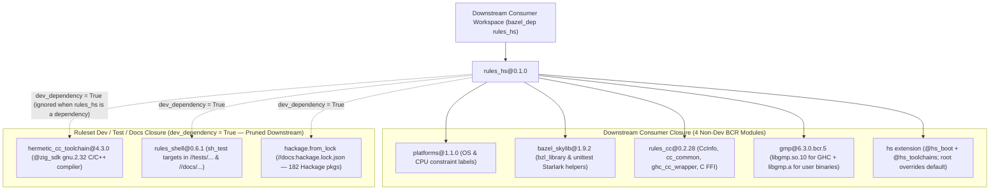

This document records every dependency evaluated across `rules_hs` (`MODULE.bazel`), its standalone showcase `examples/size` (`examples/size/MODULE.bazel`), and its self-hosted documentation engine `//docs` (`docs/BUILD.bazel`, `docs/hackage.lock.json`) — covering both **adopted** dependencies and **not-adopted** (rejected or deferred) alternatives.

For every entry, we state:

- **What & Role**: the exact version, artifact, or architectural role evaluated.
- **Why** (or **Why Not Adopted**): the concrete technical findings from live prototyping and CI verification.
- **Catalysts**: the specific conditions (*"if X, Y, and Z changed..."*) that would trigger reconsidering an adopted dependency or promoting a rejected/deferred alternative to a default or first-class option.

> **Note — New to Bazel Rulesets or Haskell? Companion Chapters:** If you have used Bazel as an end user (`BUILD.bazel` / `MODULE.bazel`) or have no prior Haskell/GHC background, this chapter explains every dependency from first principles without assuming ruleset-authoring or Haskell experience. For foundational primers and subsystem deep dives, see [Bazel Ruleset Primer](bazel-rules-primer.md), [Haskell & GHC Primer](haskell-and-ghc-primer.md), [Architecture Overview](overview.md), [Comparison with Other Rulesets](rulesets-comparison.md), [Hermeticity & Toolchain](hermeticity.md), [Providers & Action Graph](providers-and-actions.md), [Hackage & Cabal Pipeline](ecosystem-and-hackage.md), [Cross-OS & Platforms](cross-os-and-platforms.md), and [Hakyll & Haddock Docs](docs-engine.md).

---

## Executive Summary {#executive-summary}

| Category | Adopted | Not Adopted (Rejected / Deferred) | Primary Deciding Factor |
|---|---|---|---|
| **1. C/C++ Toolchains** *(dev & showcase; `rules_hs` is C-toolchain agnostic)* | `hermetic_cc_toolchain@4.3.0` (`zig cc`, `gnu.2.32`, dev-only in root) | Pigweed `pw_toolchain/host_clang`, `toolchains_llvm@1.13.0` + Debian sysroot, host GCC/Clang (`rules_cc` default) | BCR-native, single-module multi-arch Linux (`x86_64` + `arm64`) hermeticity with zero external sysroot maintenance; Pigweed is non-BCR/monolithic + `glibc 2.27` |
| **2. GHC Distribution & Version** | Official Haskell.org `deb10` glibc bindists, GHC `9.10.3` (`x86_64` + `aarch64`), pure-Starlark extraction + `$ORIGIN` staging | `alpine3_12-linux-static-int_native` (`musl`), `rules_nixpkgs` / Nix, GHC `9.12.4` / `9.14.1` as default | `x86_64` + `arm64` parity, full dynamic TH + C FFI, clean BCR `CcInfo` interop, RBE/BCR friendliness, Stackage LTS 24.x stability |
| **3. Native Runtime & Compiler Libraries** | BCR `gmp@6.3.0.bcr.5` (`libgmp.so.10` + static `libgmp.a`), in-tree 8-symbol `libtinfo.so.6` stub, GHC-bundled `libffi.so.8`/`libCffi.a` | Full BCR `ncurses` build, host `libgmp-dev` / `libtinfo5` (`apt install`) | Zero host C `-dev` libraries, base-glibc-only user binary `DT_NEEDED`, avoids heavy `ncurses`/`gawk` graph for 8 unused batch-compiler symbols |
| **4. Bazel Rule Foundations & Action Wrappers** | `platforms@1.1.0`, `bazel_skylib@1.9.2`, `rules_cc@0.2.28`, dev-only `rules_shell@0.6.1`, native C11 `ghc_cc_wrapper` | `rules_python` + Python `cc_wrapper.py` / `cabal_wrapper.py`, legacy non-dev deps (`rules_java`, `protobuf`, `rules_nodejs`, `aspect_rules_js`, `rules_sh`, non-dev `stardoc`) | Bazel 9+ clean minimal non-dev `MODULE.bazel` graph; zero Python runtime in build actions |
| **5. 3p Hackage Resolution & Build Pipeline** | Dogfooded boot-only [`//tools/lock:lock`](../reference/lock-cli.md) (`Cabal-syntax`) + Stackage LTS -> `hackage.lock.json` -> pure-Starlark [`hackage`](../reference/extensions-and-providers.md#hackage) + 5-stage [`hs_cabal_library`](../reference/rules.md#hs_cabal_library) | `stack_snapshot` (Stack CLI + YAML pinning), pure-Starlark `.cabal` parser, opaque `cabal-install` / `runghc Setup.hs` actions | 100% Cabal spec fidelity with zero host `cabal`/`stack`/`python`, `reproducible = True` Bzlmod eval, fine-grained parallel caching & `CcInfo` propagation |
| **6. Showcase App 3p Haskell Libraries** (`examples/size`, 69 Hackage + 41 boot pkgs on `lts-24.67`) | `xml-conduit` `1.10.1.0`, `http-client` `0.7.19` + `http-client-tls` `0.3.6.4` + `http-types` `0.12.6`, `zlib` `0.7.1.1` (`bundled-c-zlib=true` / `zlib-clib` `1.3.2`), `async` `2.2.6` | `xml`, `xeno`, `hexml`, `hexpat`, `hxt`, `xmlbf`; `http-conduit`, `req`, `wreq`, `http-client-openssl`; BCR `@zlib` default, system `libz.so.1`; raw `Control.Concurrent`, `ki`, `streamly` | Idiomatic spec-compliant XML, pure-Haskell TLS (zero OpenSSL), zero host C libs (`zlib-clib`), zero-cost `async`, minimal 69-pkg closure |
| **7. Documentation Engine & API Docs** (`//docs` & [`hs_haddock`](../reference/rules.md#hs_haddock)) | **Vanilla Hakyll + Pandoc + Skylighting + Bundled GHC Haddock** (`docs/site.hs` + `hs/private/haddock.bzl`) | Bespoke Sphinx-like Pandoc AST DSLs, Emanote / Ema, Slick, raw Shake + Pandoc, standalone Haddock without Hakyll, non-Haskell SSGs (Sphinx, MkDocs, mdBook, Docusaurus) | Canonical vanilla Haskell docs stack: standard GitHub/Pandoc Markdown in Hakyll + GHC Haddock for `.hs` APIs; dogfoods `rules_hs` & cross-library TH (`file-embed`) with zero custom AST hacks and zero Python/Node/Rust toolchains |

---

## Anatomy of MODULE.bazel: Why Every Direct Dependency Exists {#module-bazel-anatomy}

When an application repository declares `bazel_dep(name = "rules_hs", version = "0.1.0")`, Bazel's module system (**Bzlmod**) distinguishes strictly between **runtime ruleset dependencies** (which become part of every downstream consumer's dependency graph) and **`dev_dependency = True` dependencies** (which exist *only* when developing, testing, or building documentation inside the `rules_hs` repository itself and are completely ignored by Bazel in downstream consumer workspaces; see [Bazel Ruleset Primer](bazel-rules-primer.md#ruleset-vs-consumer)).

Here is `rules_hs`'s complete root `MODULE.bazel` (`58` lines):

```starlark
module(
    name = "rules_hs",
    version = "0.1.0",
    bazel_compatibility = [">=9.0.0"],
)

# 1. Runtime ruleset closure (inherited by downstream consumers: ONLY 4 BCR modules)
bazel_dep(name = "platforms", version = "1.1.0")
bazel_dep(name = "bazel_skylib", version = "1.9.2")
bazel_dep(name = "rules_cc", version = "0.2.28")
bazel_dep(name = "gmp", version = "6.3.0.bcr.5")

# 2. Ruleset dev/test/docs closure (completely pruned for downstream consumers)
bazel_dep(name = "hermetic_cc_toolchain", version = "4.3.0", dev_dependency = True)
bazel_dep(name = "rules_shell", version = "0.6.1", dev_dependency = True)

cc_toolchains = use_extension(
    "@hermetic_cc_toolchain//toolchain:ext.bzl",
    "toolchains",
    dev_dependency = True,
)
use_repo(cc_toolchains, "zig_sdk")

register_toolchains(
    "@zig_sdk//toolchain:linux_amd64_gnu.2.32",
    "@zig_sdk//toolchain:linux_arm64_gnu.2.32",
    "@zig_sdk//toolchain/...",
    "@zig_sdk//libc_aware/toolchain/...",
    dev_dependency = True,
)

# Non-dev extension handle so @rules_hs//tools/lock:lock can resolve @hs_boot
# when run from a downstream workspace; root hs.toolchain(...) overrides 9.10.3.
hs = use_extension("//hs:extensions.bzl", "hs")
hs.toolchain(ghc_version = "9.10.3")
use_repo(hs, "hs_boot", "hs_toolchains")

register_toolchains(
    "@hs_toolchains//:all",
    dev_dependency = True,
)

# Dev-only 182-package Hackage lockfile for building //docs:site
hackage = use_extension(
    "//hs:extensions.bzl",
    "hackage",
    dev_dependency = True,
)
hackage.from_lock(
    name = "hackage",
    lockfile = "//docs:hackage.lock.json",
)
use_repo(hackage, "hackage")
```



### The 4 Non-Dev Runtime Dependencies (Inherited by Consumers)

#### 1. `platforms@1.1.0` — Standard OS & CPU Constraint Vocabulary

- **What it actually is**: A tiny, zero-code repository of canonical Bazel `constraint_value` targets (`@platforms//os:linux`, `@platforms//os:macos`, `@platforms//os:windows`, `@platforms//cpu:x86_64`, `@platforms//cpu:arm64`). Think of `platforms` as Bazel's shared dictionary for hardware and operating systems: instead of one ruleset spelling 64-bit ARM as `"aarch64"` and another spelling it `"arm64"`, every ruleset points at `@platforms//cpu:arm64` so Bazel's toolchain resolver and `select()` expressions agree on the active host and target machines.
- **Exactly where `rules_hs` uses it**:
  - `hs/private/ghc_versions.bzl` attaches `exec_constraints` and `target_constraints` (`@platforms//os:*` and `@platforms//cpu:*`) to every GHC bindist entry, which `hs/extensions.bzl` emits into `@hs_toolchains//:BUILD.bazel` (`toolchain(exec_compatible_with = ..., target_compatible_with = ...)`).
  - `hs/private/hackage.bzl` (`_PLATFORM_CONFIGS`) generates `config_setting` targets inside each `@hackage__<pkg>/BUILD.bazel` using `@platforms//os:*` and `@platforms//cpu:*` to drive per-platform `select({...})` attributes (for instance, `crypton` compiling x86 AES-NI/PCLMUL SIMD C files on `linux_x86_64` vs. portable C reference code on `linux_arm64`).
- **What breaks if you remove it**: Bazel fails immediately during Loading and Toolchain Resolution because `@hs_toolchains` and `@hackage__<pkg>` cannot resolve `@platforms//os:*` or `@platforms//cpu:*` labels.

#### 2. `bazel_skylib@1.9.2` — Starlark Standard Library & Analysis Testing

- **What it actually is**: Bazel's official pure-Starlark utility library for ruleset authors. Because Bazel's built-in Starlark dialect intentionally omits domain-specific build-rule packaging and test-assertion frameworks, `bazel_skylib` provides `bzl_library` (a rule for grouping `.bzl` files into dependency-checked Starlark libraries) and `unittest.bzl` (`analysistest` and `asserts` for testing rule providers and action command lines in memory).
- **Exactly where `rules_hs` uses it**:
  - `hs/BUILD.bazel` and `hs/private/BUILD.bazel` load `@bazel_skylib//:bzl_library.bzl` to package `rules_hs`'s public (`providers`, `toolchain`, `defs`, `extensions`) and private (`ghc_versions_bzl`, `ghc_bindist_bzl`, `cabal_codegen_bzl`, `hackage_bzl`, `staged_ghc_bzl`, `actions_bzl`, `rules_bzl`) `.bzl` files with explicit dependency edges.
  - `tests/starlark/rules_analysis_test.bzl` loads `analysistest` and `asserts` from `@bazel_skylib//lib:unittest.bzl` to verify [`HsPackageInfo`](../reference/extensions-and-providers.md#hspackageinfo), [`HsLinkInfo`](../reference/extensions-and-providers.md#hslinkinfo), `CcInfo`, and `ghc` command-line flags in milliseconds without launching GHC.
- **What breaks if you remove it**: Evaluating any target in `@rules_hs//hs/...` or `@rules_hs//hs/private/...` fails at the `load("@bazel_skylib//:bzl_library.bzl", ...)` statement, and Starlark analysis unit tests (`//tests/starlark/...`) cannot run.

#### 3. `rules_cc@0.2.28` — C/C++ Toolchain Discovery, Native C Compilation & `CcInfo`

- **What it actually is**: Bazel's official C and C++ ruleset (`cc_binary`, `cc_library`) and Starlark C-toolchain API (`CcInfo`, `cc_common`, `find_cc_toolchain`, `use_cc_toolchain`, `ACTION_NAMES`). If you come from Go or Java, seeing `rules_cc` inside a Haskell ruleset can look surprising — why does a Haskell compiler need C rules? Unlike Go's self-contained `cmd/compile` + internal linker, **GHC relies directly on a C toolchain at every stage** (see [Haskell & GHC Primer](haskell-and-ghc-primer.md#c-toolchain-and-rts)): GHC invokes the C preprocessor (`-pgmP`) for `{-# LANGUAGE CPP #-}`, the assembler (`-pgma`), the C/C++ compiler (`-pgmc`/`-pgmcxx`) for `CApiFFI` wrapper stubs and inline C files, `ar` to pack static `.a` libraries, and the system C linker (`cc`/`ld`) to link Haskell `.o` files against GHC's C Runtime System (`libHSrts.a`), `libCffi.a`, `libgmp.a`, and `glibc`!
- **Exactly where `rules_hs` uses it**:
  - `hs/private/BUILD.bazel` uses `cc_binary` and `cc_library` to compile `rules_hs`'s own C11 support targets: `//hs/private:ghc_cc_wrapper` (`cc_wrapper.c`), `//hs/private:libtinfo.so.6` and `tinfo_stub_static` (`tinfo_stub.c`), and `//hs/private:rt_shims` (`rt_shims.c`).
  - `hs/private/staged_ghc.bzl` uses `find_cc_toolchain`, `ACTION_NAMES`, and `CcInfo` to link `@gmp//:gmp`'s PIC archive into `libgmp.so.10` and archive `libtinfo.a`.
  - `hs/private/actions.bzl`, `hs/private/rules.bzl`, `hs/private/cabal_library.bzl`, and `hs/private/haddock.bzl` use `use_cc_toolchain()`, `find_cc_toolchain()`, `cc_common.compile()`, `cc_common.create_linking_context_from_compilation_outputs()`, and `cc_common.merge_cc_infos()` (`CcInfo`) to discover the active C compiler/archiver/sysroot, compile C/C++ sources inside [`hs_library`](../reference/rules.md#hs_library) and Stage 4 of [`hs_cabal_library`](../reference/rules.md#hs_cabal_library) (such as `zlib-clib`, `libyaml-clib`, and `crypton`), and propagate C headers (`install-includes`) and `cc_deps` archives into final binary linking and Template Haskell. (See [Bazel Ruleset Primer](bazel-rules-primer.md#cc-interop).)
- **What breaks if you remove it**: Nothing in `rules_hs` can compile or link: `ghc_cc_wrapper` and `libtinfo.so.6` cannot be built, `rules_hs` cannot locate `cc`/`ld`/`ar` or `--sysroot` flags for GHC, C FFI and C-bearing Hackage packages fail to compile, and `cc_deps` interoperability with `cc_library` disappears.

#### 4. `gmp@6.3.0.bcr.5` — Arbitrary-Precision Arithmetic (`libgmp.so.10` & `libgmp.a`)

- **What it actually is**: The GNU Multiple Precision Arithmetic Library (`libgmp`), written in C and assembly and packaged on the Bazel Central Registry as a native `cc_library` (`@gmp//:gmp`). In Haskell, the standard `Integer` type in `base` represents **unbounded arbitrary-precision integers** (computing `2 ^ 10000` never overflows, just like Python's `int` or Go's `math/big.Int`). Under the hood, GHC's `ghc-bignum` boot library implements `Integer` arithmetic by calling `libgmp`'s C routines (`__gmpn_*`). Because `ghc` itself is a Haskell program compiled against `ghc-bignum`, **both** the GHC compiler binary and every compiled user executable depend on `libgmp`! (See [Haskell & GHC Primer](haskell-and-ghc-primer.md#gmp-and-tinfo).)
- **Exactly where `rules_hs` uses it**:
  - `hs/private/ghc_bindist.bzl` wires `gmp = "@gmp//:gmp"` into `staged_ghc` inside each `@ghc_<ver>_<platform>` repository.
  - `hs/private/staged_ghc.bzl` extracts both `libgmp.pic.a` and `libgmp.a` from `@gmp//:gmp[CcInfo]`:
    1. It links `libgmp.pic.a` into a shared library `libgmp.so.10` (`HsLinkGmpShared`) staged inside `<libdir>/<arch>-linux-ghc-<ver>/`, where `ghc`, `ghc-pkg`, `hsc2hs`, `haddock`, and `ghc-iserv-dyn` load it automatically via ELF `$ORIGIN` `RUNPATH` with zero host `libgmp10`.
    2. It symlinks `libgmp.a` into an isolated static-only directory `gmp_static/libgmp.a` (containing no `.so` file).
  - `hs/private/rules.bzl` passes `-optl-L<gmp_static_dir>` and `gmp_static_lib` into `HsLinkExecutable`, forcing the linker to embed `libgmp.a` statically so user `hs_binary` and `hs_test` executables carry **zero** `libgmp.so.10` runtime dependency.
- **What breaks if you remove it**: On any clean Linux machine or container without `apt install libgmp-dev`, `bin/ghc-9.10.3` fails to even launch (`error while loading shared libraries: libgmp.so.10: cannot open shared object file`) and linking any Haskell binary fails (`ld: cannot find -lgmp`).

> **Note — Why `hs = use_extension("//hs:extensions.bzl", "hs")` Is Non-Dev While `register_toolchains` Is Dev-Only:** In `MODULE.bazel`, `use_repo(hs, "hs_boot", "hs_toolchains")` is intentionally non-dev so that when a downstream consumer runs `bazel run @rules_hs//tools/lock:lock -- ...`, targets inside `@rules_hs//tools/lock` can resolve `@hs_boot//:Cabal-syntax` and `@hs_boot//:base`. Inside `hs/extensions.bzl`, `mod.is_root` takes precedence, so a consumer's own `hs.toolchain(ghc_version = "9.12.4")` cleanly overrides `rules_hs`'s `9.10.3` default. Meanwhile, `register_toolchains("@hs_toolchains//:all", dev_dependency = True)` is marked dev-only so `rules_hs` never registers toolchains behind a consumer's back unless the consumer explicitly calls `register_toolchains("@hs_toolchains//:all")`.

### The 3 Dev-Only Dependencies (`dev_dependency = True` — Pruned Downstream)

1. **`hermetic_cc_toolchain@4.3.0` (`@zig_sdk`)**: Downloads a self-contained Zig `0.15.2` Clang/LLD C/C++ cross-compiler (`gnu.2.32`) used to compile `rules_hs`'s own test suite, `//tools/lock:lock`, and `//docs:site` on bare Linux CI containers with zero host `gcc` or `clang`. Marked `dev_dependency = True` so downstream consumers are never forced to download Zig if they already use `toolchains_llvm`, an enterprise RBE Clang toolchain, or system GCC. Removing it breaks `bazel test //...` inside `rules_hs` on clean containers lacking a host C compiler.
2. **`rules_shell@0.6.1`**: Provides the Starlark `sh_test` rule (extracted out of core Bazel in Bazel 8/9) used in `tests/basic/BUILD.bazel`, `tests/rules/**/BUILD.bazel`, `tools/lock/BUILD.bazel`, and `docs/BUILD.bazel` (`elf_hermeticity_test`, `bzlmod_hygiene_test`, `lock_cli_test`, `site_test`). Marked `dev_dependency = True` because `rules_hs`'s public rules (`hs_library`, `hs_binary`, `hs_test`, `hs_haddock`) invoke `ctx.actions.run_shell` directly and never instantiate `sh_test` or `sh_binary` in consumer workspaces. Removing it breaks `load("@rules_shell//shell:sh_test.bzl", "sh_test")` when running `rules_hs`'s own test suite.
3. **`hackage` extension (`lockfile = "//docs:hackage.lock.json"`)**: Exposes the 182 pinned Hackage packages (`hakyll`, `pandoc`, `skylighting`, `tagsoup`, `network`, etc.) needed exclusively to build `//docs:site`, `//docs:serve`, and `//docs:link_check_test`. Marking it `dev_dependency = True` guarantees downstream consumers never parse `docs/hackage.lock.json` or collide with `rules_hs`'s internal `@hackage` hub (verified continuously by `//tests/rules:bzlmod_hygiene_test`). Removing it breaks `bazel build //docs:site` and `bazel test //docs/...`.

### How Bzlmod's Minimal Version Selection (MVS) Reconciles Versions

Most downstream workspaces *also* declare direct dependencies on `platforms`, `rules_cc`, or `bazel_skylib` in their own `MODULE.bazel`. How does Bazel avoid version conflicts?

Unlike npm (which duplicates nested copies of packages) or Cabal/Cargo/pip (which run backtracking SAT solvers over version ranges), Bzlmod uses **Minimal Version Selection (MVS)** — the deterministic algorithm pioneered by Go modules:

- Every `bazel_dep(name = "X", version = "V")` specifies the **minimum** version of `X` that module requires.
- Across the entire transitive module graph (after stripping all non-root `dev_dependency = True` edges), Bzlmod selects **one single version** per module: the **highest** version requested by any active module in the graph (`max(all requested versions)`).
- **Concrete example**: `rules_hs` requests `platforms@1.1.0`, `bazel_skylib@1.9.2`, `rules_cc@0.2.28`, and `gmp@6.3.0.bcr.5`. If your application's `MODULE.bazel` declares `bazel_dep(name = "platforms", version = "1.0.0")` and `bazel_dep(name = "rules_cc", version = "0.2.30")`, Bzlmod deterministically resolves `platforms@1.1.0` (`max(1.1.0, 1.0.0)`) and `rules_cc@0.2.30` (`max(0.2.28, 0.2.30)`) in milliseconds — with zero SAT backtracking, zero network fetches of unselected intermediate versions, and zero `dev_dependency` leakage from `rules_hs`.

---

## 1. C/C++ Toolchains (Dev & Showcase Hermeticity) {#cc-toolchains}

> **Important — Crucial Architectural Boundary (C-Toolchain Agnosticism):** `rules_hs` itself is **100% C-toolchain agnostic**. Every rule queries `@bazel_tools//tools/cpp:toolchain_type` through `rules_cc` (`find_cc_toolchain` + `cc_common`) and forwards any resolved `--sysroot` and `--target` flags into `ghc_cc_wrapper` (`hs/private/cc_wrapper.c`). Neither `hermetic_cc_toolchain` nor any other concrete C toolchain is a non-dev dependency of `rules_hs` (in `MODULE.bazel`, `hermetic_cc_toolchain` is strictly `dev_dependency = True`). Downstream consumers can bring any compliant Linux `cc_toolchain`.

### Context: Why Haskell Cares About C Compilers, Sysroots & `zig cc`

If you have never built a Haskell compiler toolchain before, three pieces of background make the C-toolchain trade-offs below immediately clear (see also [Haskell & GHC Primer](haskell-and-ghc-primer.md#c-toolchain-and-rts)):

1. **Why GHC shells out to C tools and links `glibc`**: GHC compiles Haskell modules into native object code (`.o`), but delegates C preprocessing (`-XCPP`), assembly, C FFI compilation (`c_sources` and Hackage `cbits/*.c` in packages like `crypton`, `zlib-clib`, `bitvec`, and `network`), `./configure` feature probes, `ar` static archiving, and final executable linking to the active C toolchain. Every Haskell binary links GHC's C Runtime System (`libHSrts.a` — garbage collector, M:N green-thread scheduler, `epoll` event manager), `libCffi.a`, and `libgmp.a` against Linux's C standard library (`glibc`: `libc.so.6`, `libm.so.6`, `libpthread.so.0`, `libdl.so.2`).
2. **What a Linux sysroot and `glibc` symbol versioning are**: On Linux, compiling or linking against `/usr/include` and `/usr/lib/libc.so.6` stamps output binaries with the host machine's `glibc` symbol versions (e.g., `statx@GLIBC_2.28` or `arc4random@GLIBC_2.36`). A binary compiled against Ubuntu 24.04's host GCC (`glibc 2.39`) will fail to start on Debian 12 (`2.36`) or Rocky Linux 9 (`2.34`)! A **sysroot** is a self-contained directory of C headers and stub libraries frozen at a target `glibc` baseline so builds never read `/usr/include` and binaries run cleanly on any distro at or newer than that baseline.
3. **What `zig cc` vs. sysroot tarballs (and CIPD) actually are**: Traditional hermetic LLVM toolchains (`toolchains_llvm` or Google Pigweed's `pw_toolchain`, which fetches Fuchsia/Chromium artifacts from Google's **CIPD** — *Chrome Infrastructure Package Deployment* — binary store) pair Clang + `lld` with a separate pre-built Linux sysroot tarball (~300–500 MB per CPU architecture). By contrast, **`zig cc`** (`hermetic_cc_toolchain`) bundles upstream Clang/LLD **plus** compact multi-version `glibc` header and stub-library definitions directly inside a single ~50 MB Zig SDK download — synthesizing exact `glibc` stubs on demand for dozens of target versions (such as `gnu.2.28` or `gnu.2.32`) across both `x86_64` and `arm64` without external sysroot tarballs.

### Adopted (Dev & Showcase)

#### `hermetic_cc_toolchain@4.3.0` (`zig cc`, glibc `gnu.2.32`)

- **What & Role**: BCR-hosted Zig-based hermetic C/C++ toolchain (Zig `0.15.2`), registered as `dev_dependency = True` in `MODULE.bazel` and directly in `examples/size/MODULE.bazel`, with `@zig_sdk//toolchain:linux_amd64_gnu.2.32` and `@zig_sdk//toolchain:linux_arm64_gnu.2.32` registered ahead of `@zig_sdk//toolchain/...`.
- **Why**:
  - **Single BCR module, zero external sysroot maintenance**: Provides hermetic `linux_x86_64` and `linux_arm64` C/C++ compilation and linking (plus optional `musl` targeting) with zero host `gcc`/`clang`/`libc-dev` and zero manually mirrored Debian sysroot tarballs.
  - **Exact glibc compatibility window (`gnu.2.32`)**: By default, `@zig_sdk//toolchain/...` selects `gnu.2.17` alphabetically, which fails to link GHC `deb10`'s `libCffi.a` (`undefined symbol: memfd_create`, glibc `2.27`; `statx`/`fcntl64`, glibc `2.28`). Pinning `gnu.2.32` satisfies both GHC `deb10` bindists (`glibc <= 2.28`) **and** BCR `gmp@6.3.0.bcr.5`'s `m4` dependency (which includes Zig's `<sys/single_threaded.h>`, requiring `glibc >= 2.32`), while produced binaries remain portable across Debian 12 (`2.36`), Ubuntu 22.04 (`2.35`) / 24.04 (`2.39`), and Rocky Linux 9 (`2.34`).
  - **Verified Hackage compatibility**: All specialized Hackage `cc-options` in `examples/size` (`bitvec` `-fopenmp-simd`, `crypton` `-std=gnu99 -DWITH_AESNI -DWITH_PCLMUL -DWITH_TARGET_ATTRIBUTES`, `primitive` `-ftree-vectorize -msse2`, `unix-time` `-fPIC`) compile cleanly.
  - **Quirks cleanly isolated**: All six verified `zig cc` <-> GHC mismatches (`-fno-PIC`, `-Wl,-h`, `.dyn_o`/`.p_o`, `--print-file-name`, `-Wno-unused-command-line-argument`, and `zig c++`'s `libcxx/include/stddef.h` ordering fixed via `-nostdinc++`) are encapsulated once in `hs/private/cc_wrapper.c`.
  - **Ecosystem alignment**: Matches sibling Bazel 9 polyglot projects (such as the reference `size` multi-language repository).
- **Catalysts to reconsider or replace**:
  - If a lightweight BCR Clang/`lld` toolchain ships built-in, SHA-256-pinned multi-arch (`x86_64` + `arm64`) Linux glibc `>= 2.32` sysroots — eliminating both the `.bazelrc` `/tmp` cache mount (`HERMETIC_CC_TOOLCHAIN_CACHE_PREFIX=/tmp/zig-cc-cache` + `--sandbox_add_mount_pair=/tmp`) and the `zig cc` workarounds in `cc_wrapper.c`.
  - If Remote Build Execution (RBE) fleets prohibit `--sandbox_add_mount_pair=/tmp`, causing Zig's compiler cache to rebuild cold on every remote action and degrading build latency.
  - If upstream Zig / `hermetic_cc_toolchain` regresses versioned glibc linking, breaks under future Bazel `rules_cc` rule-based toolchains, or breaks C++ FFI Hackage packages that require `libstdc++` ABI compatibility instead of Zig's bundled `libc++`.

### Not Adopted

#### Pigweed C/C++ Toolchains (`pw_toolchain/host_clang:host_cc_toolchain_linux`)

- **What & Role**: Google Pigweed's rule-based host Clang toolchain — Fuchsia Clang 24 + `lld` + `llvm-ar` + `compiler-rt` + `libunwind` configured with modern `rules_cc` (`cc_toolchain` + `cc_sysroot`) and CIPD `fuchsia/third_party/sysroot/bionic` (`x86_64` and `aarch64`).
- **Why Not Adopted** *(evaluated live against cached Pigweed LLVM + Linux sysroot)*:
  - **What worked remarkably well**: Real Clang 24 + `lld` + `cc_sysroot` avoided **all 5 core `zig cc` quirks** (`-fno-PIC` worked natively, `.dyn_o` and `-Wl,-h` worked, `--print-file-name=libm.a` resolved hermetically inside the sysroot, and C headers never clashed with `libcxx/include`). It only needed `-optl-no-pie` for non-PIC static GHC `.a` archives (the same flag Pigweed uses for `cgo_link_flags`).
  - **Blocker 1 — Non-BCR & monolithic dependency graph**: Pigweed is not published on BCR (`404`) and does not ship a standalone `pw_toolchain` Bzlmod module. Consuming it drags in its monolithic 892-line `MODULE.bazel`, pulling CIPD infrastructure alongside `rules_android`, `rules_java`, `rules_go`, `rules_rust`, `protobuf`, `pico-sdk`, and `zephyr` — completely antithetical to `rules_hs`'s minimal dependency graph.
  - **Blocker 2 — Sysroot glibc version mismatch**: `fuchsia/third_party/sysroot/bionic` targets **glibc `2.27`** (it provides `memfd_create@@GLIBC_2.27`, but **lacks `statx` and `fcntl64@GLIBC_2.28`** referenced by GHC's `deb10` `x86_64` and `aarch64` bindists; GHC's older `ubuntu18_04` glibc `2.27` bindist is `x86_64`-only).
- **Catalysts to adopt**:
  - If Pigweed extracts and publishes a standalone, zero-bloat `pw_toolchain` module to BCR (no Android/Java/Go/Rust/Zephyr/pico-sdk transitive deps, pure HTTPS artifact fetches without mandatory CIPD).
  - **And** Pigweed's Linux `cc_sysroot` upgrades to **glibc `>= 2.28`** (or `>= 2.32` if required by BCR `gmp`/`m4`, e.g., Debian 11/12 multi-arch `x86_64` + `aarch64`).
  - Under those two conditions, `pw_toolchain` would become a top candidate to replace `hermetic_cc_toolchain` as our dev/showcase default, yielding pure Clang + `lld` without `/tmp` cache mounts or Zig flag rewrites.

#### `toolchains_llvm@1.13.0` (BCR) + Debian Sysroot

- **What & Role**: BCR-native LLVM/Clang + `lld` toolchain (`toolchains_llvm@1.13.0`) configured via `llvm.sysroot(...)` against an external Debian `>= 10` (`glibc >= 2.28`, e.g., Debian 12 `2.36`) sysroot tarball.
- **Why Not Adopted (Deferred as Default; Supported for Consumers)**:
  - Gives the exact same Clang + `lld` cleanliness observed with Pigweed (zero `zig cc` quirks, zero `/tmp` sandbox mount, clean RBE story) while remaining lightweight and BCR-native.
  - Deferred as the out-of-the-box dev/showcase default strictly because `toolchains_llvm` does not bundle Linux glibc sysroots itself: adopting it requires provisioning, hosting, hashing, and maintaining external multi-arch (`linux_x86_64` + `linux_arm64`) Debian sysroot tarballs (either built via custom `mmdebstrap`/`debootstrap` CI or relying on third-party Chromium/custom sysroot mirrors). It also lacks built-in `musl` targeting.
- **Catalysts to adopt**:
  - If `toolchains_llvm` (or a well-maintained BCR `linux_sysroot` module) publishes official, SHA-256-pinned, multi-arch (`x86_64` + `arm64`) Debian `>= 10` sysroots directly in BCR with zero consumer tarball hosting.
  - Or if RBE-first requirements forbid `--sandbox_add_mount_pair=/tmp` or demand full Clang + `libstdc++` without Zig's `libc++` defaults — making `toolchains_llvm` + Debian sysroot the immediate first-class recommendation (and dev CI secondary matrix target).

#### Auto-detected Host GCC/Clang (`rules_cc` Default)

- **What & Role**: Bazel's default `local_config_cc` host auto-detection against `/usr/bin/gcc`, `/usr/bin/clang`, system `ld`, and `/usr/include`.
- **Why Not Adopted**:
  - Non-hermetic: leaks host compiler versions, distro headers, and host glibc symbol versions into build artifacts.
  - Fails outright in bare Linux containers (`debian:bookworm-slim`, `ubuntu:24.04`, `rockylinux:9` with zero compilers installed, asserted in `.github/workflows/ci.yml`).
  - Breaks cross-distro binary portability and poisons Remote Build Execution (RBE) cache keys across heterogeneous developer workstations.
- **Catalysts to adopt**:
  - **Never** as `rules_hs`'s dev or showcase default.
  - Attractive **only as a consumer-side opt-in** when an organization already runs locked, immutable Linux build containers or RBE worker images with a pinned distro toolchain and intentionally wants host GCC/Clang ABI alignment (e.g., dynamically linking corporate system C++ libraries). *(Note: `hs/private/cc_wrapper.c` already supports standard `cc_toolchain`s; gating `-nostdinc++` on compiler flavor would further harden host-GCC builds under `-Werror`.)*

---

## 2. GHC Distribution & Version {#ghc-distribution}

### Context: Bindists, `ghcup`, `deb10` glibc, and `musl`

For engineers new to the Haskell toolchain ecosystem, four terms explain how GHC is distributed on Linux (see also [Haskell & GHC Primer](haskell-and-ghc-primer.md#boot-libraries)):

- **What a GHC "bindist" is**: GHC is a large, self-hosting compiler written in Haskell, C, and Cmm. Building GHC from source takes hours of CPU time and requires an existing bootstrap GHC compiler plus Python/Hadrian build scripts. Instead, the GHC team publishes official pre-compiled `.tar.xz` **binary distributions ("bindists")** containing ready-to-run compiler binaries (`ghc`, `ghc-pkg`, `hsc2hs`, `haddock`, `ghc-iserv`) and 41 pre-compiled boot libraries.
- **What `ghcup` is**: `ghcup` is the Haskell community's standard interactive toolchain installer for developer laptops (directly analogous to Rust's `rustup` or Node's `nvm`). Its `Recommended` tag signals the community's consensus production compiler release (`9.10.3`). `rules_hs` never runs or requires `ghcup` — instead, Bazel downloads the exact same upstream `downloads.haskell.org` bindist tarballs directly by SHA-256.
- **Why `deb10` is in the filename (`ghc-9.10.3-x86_64-deb10-linux.tar.xz`)**: `deb10` does *not* restrict the compiler to Debian! It simply indicates that upstream built the tarball inside a **Debian 10 ("Buster")** container (`glibc 2.28`). Because Linux's `glibc` maintains strict forward symbol compatibility, compiling on an older `glibc 2.28` baseline guarantees the `ghc` binary runs unmodified on Debian 10+, Ubuntu 20.04/22.04/24.04 (`2.31`–`2.39`), Fedora, and RHEL/Rocky Linux 8/9 (`2.28`/`2.34`).
- **Why `glibc` vs. `musl` matters**: Standard Linux distributions (Debian, Ubuntu, RHEL/Rocky) use GNU `glibc`, whereas Alpine Linux containers use `musl` libc. A `musl`-linked static GHC bindist (`alpine3_12-linux-static-int_native`) has incompatible C header layouts/symbols against `glibc` C toolchains and cannot use OS `dlopen` to load `.so` shared libraries for Template Haskell — falling back to GHC's internal static object loader, which crashes when C FFI splices touch `libc` memory allocators.

### Adopted

#### Official Haskell.org `deb10` glibc Bindists — GHC `9.10.3` (`x86_64` + `aarch64`)

- **What & Role**: Official `ghc-9.10.3-{x86_64,aarch64}-deb10-linux.tar.xz` bindists pinned by URL and SHA-256 in `hs/private/ghc_versions.bzl`, extracted via pure-Starlark `repository_ctx.download_and_extract` (zero `./configure && make install`), sanitized in `lib/settings`, and `$ORIGIN`-staged by `hs/private/staged_ghc.bzl`.
- **Why**:
  - **Multi-arch Linux parity**: Official upstream bindists exist with identical directory and linking structure for both `linux_x86_64` and `linux_arm64` (`aarch64`).
  - **Broad Linux distro compatibility**: Ceiling is `<= GLIBC_2.28` (`memfd_create`/`expf`/`logf`/`powf@GLIBC_2.27`; `fcntl64`/`statx@GLIBC_2.28`), running natively on Debian 10+, Debian 12 (`2.36`), Ubuntu 22.04/24.04 (`2.35`/`2.39`), Rocky 8+/9 (`2.28`/`2.34`), and distroless `cc-debian12`.
  - **Minimal dynamic surface & zero `LD_LIBRARY_PATH`**: Ships bundled `libffi.so.8` + `libCffi*.a` with zero `libnuma` dependency; only `libgmp.so.10` and `libtinfo.so.6` are external, and both resolve cleanly via GHC's baked-in `$ORIGIN/../lib/<arch>-linux-ghc-9.10.3` `RUNPATH` with zero `patchelf` and zero `LD_LIBRARY_PATH`.
  - **Full Template Haskell + C FFI**: Built with `GHC Dynamic = YES` (`ghc-iserv-dyn`), verified live on cross-package TH splices invoking `runIO`, `withCString`, `strlen`, `file-embed`, and `CApiFFI`.
  - **Ecosystem sweet spot (`9.10.3`)**: Matches `ghcup` `Recommended` (`base-4.20.2.0`) and Stackage **LTS 24.x** (`lts-24.67`), delivering stable, CI-vetted Hackage closures without Nightly churn.
  - **Zero host build tools at fetch time**: Pure-Starlark extraction + `package.conf.d/*.conf` parsing replaces `rules_haskell`'s `./configure && make install` repo rule (eliminating host `make`/`perl`/`gcc` requirements and 30-minute fetch timeouts).
- **Catalysts to reconsider or replace**:
  - If upstream GHC retires `deb10` bindists in favor of `deb11`/`deb12` (raising the minimum glibc floor above Rocky 8 / older LTS images) — triggering a bindist family update in `hs/private/ghc_versions.bzl`.
  - If Stackage promotes a stable GHC `9.12.x` LTS release and `ghcup` advances `Recommended` to `9.12.x` — triggering a one-line bump of `DEFAULT_GHC_VERSION` to `"9.12.4"` (already pre-wired in `hs/private/ghc_versions.bzl`).
  - If upstream GHC begins publishing official dynamic Linux bindists with native bignum (`--bignum=native`) or statically-linked GMP and no `libtinfo` dependency — letting us simplify `staged_ghc.bzl` and drop non-dev `@gmp` and the `libtinfo.so.6` stub.

### Not Adopted

#### `alpine3_12-linux-static-int_native` (`musl` Static + Native Bignum)

- **What & Role**: Official Haskell.org 100% static ELF bindist (`PT_INTERP = NONE`, `DT_NEEDED = NONE`, `--bignum=native`), already cataloged as `linux_x86_64_musl` in `hs/private/ghc_versions.bzl`.
- **Why Not Adopted as Default** *(audited live against GHC `9.10.3` + `zig cc`)*:
  1. **`x86_64`-only**: Upstream GHC publishes no `aarch64` (`linux_arm64`) static Alpine bindist for GHC `9.10`, `9.12`, or `9.14`.
  2. **Template Haskell + C FFI segfaults**: Because `ghc` is statically linked (`GHC Dynamic = NO`), TH falls back to the internal ELF RTS linker, which calls `--print-file-name=libm.a` (leaking host `/usr/lib/x86_64-linux-gnu/libm.a` linker scripts under Zig -> `loadArchive: Not an archive`), and even after supplying Zig's musl `libc.a` + `libcompiler_rt.a` via `-B`, cross-package TH splices calling `withCString`/`malloc` **segfault** in both `ghc` and `ghc-iserv` due to dual-musl `libc.a` clashes.
  3. **glibc ABI mismatch**: Cannot link against glibc `cc_toolchain`s (`undefined symbol: posix_spawn_file_actions_addchdir_np` in `libHSprocess.a` on glibc `<= 2.28`, plus musl/glibc struct layout mismatches), forcing every BCR `cc_library` dependency (`@zlib`, etc.) onto `@zig_sdk//libc:musl`.
  4. **Hackage GMP flag friction**: Uses `bignum = native`, requiring consumers to override default GMP flags on packages like `crypton` (`integer-gmp=false`) and `cborg` (`optimize-gmp=false`) and forfeiting GMP arbitrary-precision performance.
- **Catalysts to adopt**:
  - **As a first-class opt-in flavor** (for `FROM scratch` zero-glibc static `x86_64` binaries without runtime TH + C FFI splices — note `examples/size`'s 69-pkg graph has 0 runtime TH splices!): Wire a musl platform constraint matching `@zig_sdk//libc:musl`, expose a `libc = "musl"` / flavor selector on [`hs.toolchain`](../reference/extensions-and-providers.md#hs-toolchain), and document the `crypton`/`cborg` lockfile flags.
  - **As the default Linux bindist**: Would require (a) upstream GHC publishing official `aarch64` static musl bindists alongside `x86_64`, (b) upstream fixing the static RTS linker / `ghc-iserv` dual-libc crash on TH + C FFI, and (c) broad BCR `cc_library` support for musl builds.

#### `rules_nixpkgs` / Nix-Managed GHC

- **What & Role**: Provisioning GHC and its C runtime libraries (`gmp`, `ncurses`, `libffi`) via Nix expressions populating `/nix/store` (the hermetic Linux path used by `tweag/rules_haskell`).
- **Why Not Adopted**:
  - Requires a host Nix installation and mutates `/nix/store` during repository fetch, breaking Remote Build Execution (RBE), clean Docker/CI containers without a Nix daemon, and Bazel Central Registry (BCR) downstream consumption (`rules_haskell` issue #2451).
  - Imposes a heavyweight secondary build/package ecosystem on teams that chose Bazel specifically to avoid multi-tool orchestration.
- **Catalysts to adopt**:
  - **Never** as a dependency or default in `rules_hs`.
  - Attractive **only as an external consumer-provided `hs_toolchain`** when an organization already standardizes on Nix across its entire RBE worker fleet and needs custom-patched GHC builds or niche system C libraries unavailable in BCR.

#### GHC `9.12.4` / `9.14.1` as Default Version

- **What & Role**: Newer GHC release series (`9.12.4` with `base-4.21.2.0` tracking Stackage Nightly; `9.14.1` tagged `Latest` in `ghcup`).
- **Why Not Adopted as Default**:
  - `9.12.4` currently tracks **Stackage Nightly** rather than an LTS series, bringing moving-target package churn (+5 packages in `examples/size`: 74 vs. 69, plus newer Cabal features like `reexported-modules` in `crypton-asn1-encoding`/`crypton-asn1-parse` and `autogen-modules` in `mlkem`).
  - `9.14.1` is too recent for broad Hackage upper-bound compatibility.
  - *(Note: `rules_hs` is already forward-compatible with `9.12.4`: all six platform URLs, SHA-256 checksums, and `BOOT_PACKAGE_NAMES` including `file-io` are pre-wired in `hs/private/ghc_versions.bzl`, and `reexported-modules` is already implemented in [`hs_cabal_library`](../reference/rules.md#hs_cabal_library) and [`//tools/lock:lock`](../reference/lock-cli.md).)*
- **Catalysts to adopt as default**:
  - Stackage cuts a stable **LTS series** for GHC `9.12.x` (e.g., LTS 25+), `ghcup` promotes `9.12.x` to `Recommended`, and the full `rules_hs` + `examples/size` + `//docs` CI matrix passes cleanly on that LTS. (Same criteria apply to `9.14.x` in a subsequent release cycle.)

---

## 3. Native Runtime & Compiler Libraries {#native-runtime-libs}

### Context: Why `gmp`, `tinfo` (`ncurses`), and `libffi` Exist in GHC's World

At first glance, it is surprising that a pure functional language compiler depends on C math, terminal, and foreign-call libraries. Each of the three solves a concrete architectural need inside GHC (see [Haskell & GHC Primer](haskell-and-ghc-primer.md#gmp-and-tinfo)):

1. **`gmp` (`libgmp` — GNU Multiple Precision)**: Haskell's built-in `Integer` type in `base` provides arbitrary-precision integers out of the box (`factorial 1000` never overflows 64 bits). GHC's `ghc-bignum` boot library backs `Integer` with C's `libgmp` routines (`__gmpn_*`), so `ghc` itself dynamically loads `libgmp.so.10` when running, and user binaries link `libgmp.a` statically.
2. **`tinfo` (`libtinfo.so.6` / `libtinfo.a` from `ncurses`)**: In GHC, the batch compiler (`ghc -c Foo.hs`) and the interactive REPL (`ghci`, which is literally `ghc --interactive`) are the **same ELF binary**. Interactive `GHCi` links the `haskeline` and `terminfo` boot libraries, which import 8 C functions from `ncurses`'s `libtinfo.so.6` (`setupterm`, `tigetstr`, `tputs`, etc.) to read terminal escape sequences. Even though batch Bazel builds never open an interactive terminal, Linux's dynamic loader (`ld-linux.so`) resolves all `DT_NEEDED` shared libraries before `main()` starts — so without `libtinfo.so.6` (and static `libtinfo.a` in `gmp_static/` when statically linking tools that transitively pull `terminfo`), `ghc` fails to start on minimal containers lacking `ncurses`!
3. **`libffi` (`libffi.so.8` & `libCffi*.a` — Foreign Function Interface)**: The portable C Foreign Function Interface library (the same library behind Python's `ctypes` and Ruby's `fiddle`) constructs C calling-convention stack and register frames dynamically. GHC's Runtime System uses `libffi.so.8` when executing C calls inside compile-time Template Haskell splices (`ghc-iserv-dyn`) and links `libCffi.a` into executables so Haskell functions can be exported as callable C function pointers (`foreign export ccall`).

### Adopted

#### BCR `gmp@6.3.0.bcr.5`

- **What & Role**: Non-dev BCR dependency in `MODULE.bazel` serving two distinct roles in `hs/private/staged_ghc.bzl`:
  1. **Compiler runtime (`libgmp.so.10`)**: Built hermetically from `@gmp//:gmp`'s PIC archive via `HsLinkGmpShared` (`-shared -Wl,-soname,libgmp.so.10 -Wl,--whole-archive`) and `$ORIGIN`-staged inside `<prefix>/lib/<arch_libdir>/` for GHC's own dynamic binaries.
  2. **User binaries (`libgmp.a`)**: Symlinked into a dedicated static-only directory `<prefix>/gmp_static/libgmp.a` (with zero `.so` present) and passed via `-optl-L` during `HsLinkExecutable`, statically linking `ghc-bignum` so produced user binaries carry **zero `libgmp.so.10`** in `DT_NEEDED`.
- **Why**:
  - Eliminates host `libgmp-dev` / `libgmp10` completely while matching GHC `deb10`'s unversioned `__gmpn_*` ABI.
  - Produces portable, self-contained user executables whose `DT_NEEDED` is strictly base glibc (`libc.so.6`, `libm.so.6`, `libdl.so.2`, `libpthread.so.0`).
  - **Known constraint**: BCR `gmp@6.3.0.bcr.5` pulls BCR `m4` as a build tool; under Zig (`hermetic_cc_toolchain`), compiling `m4` includes `<sys/single_threaded.h>`, which requires glibc `>= 2.32` (forcing `gnu.2.32` rather than `gnu.2.28` in `.bazelrc`/`MODULE.bazel`).
- **Catalysts to reconsider or replace**:
  - If upstream GHC switches its default Linux bindists away from GMP to `ghc-bignum`'s `native` backend — letting `rules_hs` drop `gmp` from its non-dev `MODULE.bazel` dependencies completely.
  - If downstream `hermetic_cc_toolchain` users need binary portability down to glibc `2.28`–`2.31` (e.g., Rocky Linux 8, Ubuntu 20.04, Debian 10) — catalyst to patch/eliminate `gmp`'s `m4` `<sys/single_threaded.h>` glibc `>= 2.32` requirement or pair with `toolchains_llvm` + a glibc `2.28` sysroot.
  - If a commercial consumer's LGPL compliance policy disallows static linking of `libgmp.a` into proprietary executables — catalyst to add a toolchain/rule option (`link_gmp_static = False`) staging `libgmp.so.10` alongside the binary or opting into `bignum = native`.

#### In-Tree `libtinfo.so.6` Stub (`hs/private/tinfo_stub.c` + `hs/private/tinfo_stub.lds`)

- **What & Role**: Minimal in-tree C11 shared library (`hs/private/tinfo_stub.c`, 56 lines incl. comments) linked with a 13-line linker version script (`hs/private/tinfo_stub.lds`) exporting the exact 8 symbols versioned `@NCURSES6_TINFO_5.0.19991023` (`setupterm`, `del_curterm`, `set_curterm`, `tigetflag`, `tigetnum`, `tigetstr`, `tparm`, `tputs`), `$ORIGIN`-staged into `<prefix>/lib/<arch_libdir>/`.
- **Why**:
  - Auditing every binary and `.so` inside GHC `9.10.3` `deb10` (`x86_64` and `aarch64`) proved that `libtinfo.so.6` is imported **exclusively** by `libHSterminfo` for interactive GHCi/haskeline terminal capability queries.
  - Returning the standard terminfo error/NULL sentinels causes `terminfo` to fall back cleanly to dumb-terminal mode in batch Bazel build actions — compiling in milliseconds with **zero external dependencies** (no host `libtinfo5`/`libtinfo6`, no BCR `ncurses`/`gawk`).
- **Catalysts to reconsider or replace**:
  - If a future GHC release imports additional `libtinfo` symbols or changes the ncurses symbol version tag beyond `NCURSES6_TINFO_5.0.19991023` (trivial update if small; signal to reconsider real `ncurses` if the surface grows large).
  - If `rules_hs` introduces a first-class interactive REPL rule (`hs_repl` / `bazel run` GHCi with rich `haskeline` line-editing and ANSI colors) or a user target links `@hs_boot//:terminfo` expecting live terminal capabilities — catalyst to add an opt-in real `ncurses` `libtinfo` provider for interactive targets while retaining the zero-dep stub for batch compilation.
  - If upstream GHC removes the `libtinfo` dynamic import from non-interactive compiler binaries — allowing us to delete the stub outright.

#### GHC-Bundled `libffi.so.8` & `libCffi*.a`

- **What & Role**: Pre-built `libffi.so.8` (for GHC's own dynamic runtime via `$ORIGIN`) and `libCffi*.a` (statically linked into user executables) shipped directly inside official GHC `deb10` bindists under `lib/<arch>-linux-ghc-<ver>/`.
- **Why**:
  - Already hermetically bundled, ABI-matched to GHC's `rts`, requires zero extra BCR dependency (`libffi`) or host `libffi-dev`, and leaves zero `libffi.so.8` entry in user binary `DT_NEEDED`.
- **Catalysts to reconsider or replace**:
  - If upstream GHC switches official Linux bindists to `--with-system-libffi` (dropping bundled `libffi.so.8` / `libCffi.a`) — catalyst to adopt a BCR `libffi` module and stage/static-link it identically to `gmp`.
  - If a polyglot C/C++ consumer statically links a separate `libffi` version via `cc_deps`, causing duplicate symbol collisions with GHC's `libCffi.a` — catalyst to expose a toolchain override substituting a shared BCR `@libffi` target.

### Not Adopted

#### Full BCR `ncurses` Build

- **What & Role**: Building full `ncurses` (and its `libtinfo.so.6`) from BCR to satisfy GHC's `libtinfo.so.6` import.
- **Why Not Adopted**:
  - Pulls a heavy transitive build graph (`ncurses`, `gawk`, terminfo database compilation, autoconf scripts) into every consumer's non-dev module graph solely to satisfy 8 unused interactive terminal query symbols in batch compilation actions — adding cold-build overhead and supply-chain surface for zero functional benefit.
- **Catalysts to adopt**:
  - If a lean, zero-`gawk` BCR `tinfo`-only target becomes available **and** `rules_hs` adds a first-class interactive GHCi/REPL target requiring full `haskeline`/terminfo behavior (still scoped as opt-in or dev/REPL-only rather than required for batch compilation).
  - Or if future GHC releases depend on a broad set of `ncurses`/`tinfo` behaviors during batch compilation where dumb-terminal error sentinels fail.

#### Host System `libgmp-dev` / `libtinfo5` / `libtinfo6` (`apt install`)

- **What & Role**: Requiring pre-installed OS packages on the host or CI image (the pattern used in `tweag/rules_haskell`'s BCR `1.0` `presubmit.yml`: `sudo apt install libtinfo5 libgmp-dev`).
- **Why Not Adopted**:
  - Directly violates hermeticity and fails on clean containers (`debian:bookworm-slim`, `ubuntu:24.04`, `rockylinux:9` verified with zero C `-dev` headers in `.github/workflows/ci.yml`).
  - Fragile across distros (`libtinfo5` was dropped in Ubuntu 24.04 and Debian 13 in favor of `libtinfo6`), breaks RBE portability, and leaks dynamic `libgmp.so.10` runtime dependencies into user binaries.
- **Catalysts to adopt**:
  - **Never** as default in `rules_hs`.
  - Only plausible as a consumer-configured escape hatch in tightly controlled enterprise environments mandated to dynamically link centrally patched OS shared libraries across all deployed binaries.

---

## 4. Bazel Rule Foundations & Action Wrappers {#bazel-foundations}

### Context: Action Wrappers and `stardoc` in Bazel Rulesets

If you have only used Bazel rulesets rather than authoring one, two ruleset-engineering concepts explain the decisions in this section (see [Bazel Ruleset Primer](bazel-rules-primer.md#rules-and-actions)):

- **Why rulesets wrap the C compiler — and why Python wrappers hurt consumers**: When GHC invokes a C compiler or linker (`-pgmc`, `-pgml`), it passes legacy GCC/GNU-ld flags (`-Wl,-h,libfoo.so`, `-fno-PIC`, `.dyn_o` output paths) that modern Clang/`lld`/`zig cc` toolchains either reject or misinterpret, and it inherits `RUNFILES_*` environment variables if unscrubbed. Early Bazel rulesets (like `tweag/rules_haskell`) wrote this adapter as a Python script (`cc_wrapper.py`), inadvertently forcing every downstream user to add `rules_python` and provision a Python interpreter toolchain just to compile Haskell! Because every `rules_hs` workspace already registers a C compiler (`cc_toolchain`), compiling a zero-dependency C11 adapter binary (`ghc_cc_wrapper`) once per build eliminates Python completely and removes ~20–40 ms of interpreter startup overhead from every compile and link action.
- **What `stardoc` is**: `stardoc` is Bazel's official documentation tool that parses Starlark `.bzl` files and renders `doc = "..."` attribute strings into Markdown reference pages. Historically, rulesets that declared `stardoc` as a regular `bazel_dep` (forgetting `dev_dependency = True`) leaked `stardoc`'s transitive Java and Protobuf dependencies into every downstream user's `MODULE.bazel` graph.

### Adopted

#### Minimal BCR Non-Dev Modules (`platforms@1.1.0`, `bazel_skylib@1.9.2`, `rules_cc@0.2.28`) + Dev-Only `rules_shell@0.6.1`

- **What & Role**: Core Bazel 9 Bzlmod foundation in `MODULE.bazel`: OS/CPU constraint values (`platforms`), standard Starlark helpers (`bazel_skylib`), `cc_toolchain` / `cc_common` / `CcInfo` integration (`rules_cc`), plus shell test rules (`rules_shell`, strictly `dev_dependency = True`). Together with `gmp@6.3.0.bcr.5`, `rules_hs` has only **4 direct non-dev `bazel_dep`s**.
- **Why**:
  - Matches modern Bazel 9 Bzlmod-only rulesets (`rules_zig`, `rules_dotnet`, `rules_rust`, `rules_go`) with explicit `bazel_compatibility = [">=9.0.0"]` and zero `WORKSPACE` files.
  - Keeps downstream `bazel mod graph` lean and ensures test-only and docs-only dependencies (`rules_shell`, `hermetic_cc_toolchain`, `//docs` Hackage closure) never leak to consumers.
  - **Transitive BCR nuance (verified via `bazel mod graph`)**: `rules_cc@0.2.28` itself declares a transitive BCR dependency on `protobuf@33.4` (which remains unfetched unless referenced), while `rules_hs` declares zero `protobuf`, `rules_java`, `rules_python`, `rules_nodejs`, or `rules_nixpkgs`.
- **Catalysts to reconsider or replace**:
  - **Upgrade `rules_cc`**: As soon as a newer `rules_cc` release removes its transitive `protobuf` BCR dependency, bump `rules_cc` to make the entire resolved module graph even cleaner.
  - **Add `bazel_features`**: If Bazel 10 introduces Starlark API changes requiring conditional feature detection across Bazel 9 and 10, adding the tiny pure-Starlark `bazel_features` BCR module is justified.
  - **Drop dev-only `rules_shell`**: If all ELF/hygiene integration tests are rewritten in pure Haskell ([`hs_test`](../reference/rules.md#hs_test)) or Starlark analysis tests, even dev-only `rules_shell` can be removed.

#### Native C11 `ghc_cc_wrapper` (`hs/private/cc_wrapper.c`)

- **What & Role**: Self-contained 552-line POSIX C11 binary compiled once by Bazel's active `cc_toolchain`, invoked by GHC (`-pgmc`, `-pgmcxx`, `-pgml`, `-pgma`, `-pgmP`, `-pgmCmmP`), `hsc2hs` (`--cc`, `--ld`), and Cabal `./configure` (`CC`, `CXX`).
- **Why**:
  - Zero Python interpreter or `rules_python` dependency anywhere in the build graph; sub-millisecond startup overhead across hundreds of compile/link/configure actions.
  - Centralizes Bazel `RUNFILES_*` environment scrubbing, generic `cc_toolchain` `--sysroot`/`--target` passthrough (`RULES_HS_CC_EXTRA_ARGS`), and all six `zig cc`/Clang <-> GHC compatibility rewrites (`--print-file-name`, `-Wl,-h` -> `-Wl,-soname` including `@response_file`s, `-fuse-ld=gold`, `-fno-PIC` -> `-fPIC`, `.dyn_o`/`.p_o` temp symlinks, `-Wno-unused-command-line-argument`, and `-nostdinc++` on non-C++ invocations).
- **Catalysts to reconsider or replace**:
  - **Windows support (`windows_x86_64`)**: `cc_wrapper.c` currently relies on POSIX APIs (`unistd.h`, `symlink`, `execv`, `unsetenv`); enabling Windows requires porting spawn/env/file-aliasing to Win32 (`_spawnv`/`CreateProcessW`, `_putenv_s`, `CreateHardLinkW`) or pairing with a cross-platform native runner.
  - **Host GCC under `-Werror`**: Unconditionally injecting `-nostdinc++` on C files works cleanly on `zig c++` and Clang, but GCC can warn on `-nostdinc++` for C inputs when `-Werror` is set — catalyst to gate `-nostdinc++` behind a compiler check or env toggle (`RULES_HS_NOSTDINCXX=1`).
  - **Wrapper elimination**: If future GHC stops emitting `-Wl,-h`, `-fuse-ld=gold`, `-fno-PIC`, and non-`.o` object extensions **and** consumer C toolchains stop triggering `zig c++` header ordering or `--print-file-name` host leaks, `cc_wrapper.c` could shrink to a minimal `RUNFILES_*` cleaner or be retired.

### Not Adopted

#### `rules_python` + Python `cc_wrapper.py` / `cabal_wrapper.py` (`rules_haskell` Pattern)

- **What & Role**: Python action wrappers executed on every GHC compile, link, and Hackage build action.
- **Why Not Adopted**:
  - Leaks `rules_python` (and a Python runtime toolchain or host `python3` assumption) into every downstream consumer's non-dev `MODULE.bazel` graph and every Haskell build action's inputs.
  - Adds noticeable interpreter startup latency across hundreds of actions and historically accumulated platform-specific wrapper bugs (`rules_haskell` #2492/#2493, #2317).
  - Completely redundant when Bazel already requires a `cc_toolchain` capable of compiling a 552-line C11 wrapper natively, and our 5-stage [`hs_cabal_library`](../reference/rules.md#hs_cabal_library) pipeline eliminates `cabal_wrapper.py` altogether.
- **Catalysts to adopt**:
  - **Never** on the build action hot path (`cc_wrapper` or `hs_cabal_library`).
  - Only conceivable for an isolated optional dev-only helper tool if third-party Python libraries were uniquely required — and even then, dogfooding Haskell ([`//tools/lock:lock`](../reference/lock-cli.md) and `//docs:docs_gen`) avoids adding an extra language runtime.

#### Legacy / Unrelated Non-Dev Deps (`rules_java`, `protobuf`, `abseil-cpp`, `rules_proto`, `rules_nodejs`, `aspect_rules_js`, `rules_sh`, Non-Dev `stardoc`)

- **What & Role**: Broad non-dev `bazel_dep`s inherited by `tweag/rules_haskell`'s `MODULE.bazel` (Java/Protobuf tooling, legacy Asterius WASM JS/Node deps, deprecated `rules_sh`, doc generators).
- **Why Not Adopted**:
  - Directly caused Bazel 8 and 9 evaluation failures in `rules_haskell` (`rules_sh@0.4.0` calling removed `get_cpu_value`, `aspect_rules_js@1.34.0` loading removed `npm_import.bzl`, `protobuf` Windows overrides) and polluted every downstream consumer with unrelated Java/Node/Protobuf module graphs.
- **Catalysts to adopt**:
  - **`stardoc`**: Attractive strictly as **`dev_dependency = True`** (or in an isolated submodule) if automated `.bzl` Markdown generation from Starlark `doc` strings is desired alongside hand-curated reference pages — never as a non-dev dependency.
  - **JS/WASM rules**: Only inside a separate optional module (e.g., `rules_hs_wasm`) if GHC's modern `wasm32-wasi` backend is supported and needs JS/WASI test runners — never in core `rules_hs`.
  - **`rules_java` / `protobuf` / `abseil-cpp` / `rules_sh`**: Never as non-dev deps of core `rules_hs` (`rules_shell` supersedes `rules_sh` as dev-only).

---

## 5. 3p Hackage Resolution & Build Pipeline {#hackage-pipeline-decisions}

### Context: Conditional `.cabal` Manifests, `Cabal-syntax`, and `Setup.hs`

To understand why `rules_hs` splits third-party dependency handling into [`//tools/lock:lock`](../reference/lock-cli.md) + [`hs_cabal_library`](../reference/rules.md#hs_cabal_library), three pieces of Haskell packaging context are essential (see [Haskell & GHC Primer](haskell-and-ghc-primer.md#ecosystem-map)):

- **Why `.cabal` files defeat regexes and hand-rolled Starlark parsers**: Unlike flat `package.json` manifests, a `.cabal` file is a domain-specific configuration language with indentation-scoped stanzas, shared `common` blocks, user-togglable boolean `flag`s, and nested boolean conditionals (`if os(linux) && arch(x86_64)`, `if impl(ghc >= 9.10)`, `if flag(bundled-c-zlib) && !flag(pkg-config)`) that dynamically alter `exposed-modules`, `c-sources`, `cc-options`, and `build-depends`. Naive regex or Starlark parsers mis-evaluate real Hackage packages.
- **Why `Cabal-syntax` inside `@hs_boot` is a bootstrap superpower**: Every official GHC bindist ships the `Cabal-syntax` library pre-compiled in its boot package database! That means `rules_hs` compiles [`//tools/lock:lock`](../reference/lock-cli.md) directly against `@hs_boot//:Cabal-syntax` — evaluating 100% of the official Cabal specification across target OS/CPU platforms (`finalizePD`) into static JSON (`hackage.lock.json`) with **zero** host `cabal`/`stack` tools and **zero** bootstrap Hackage dependencies.
- **What `runghc Setup.hs` was doing in older tools**: Traditionally, Cabal packages include a small `Setup.hs` driver script (`Distribution.Simple.defaultMain`) that orchestrates `./configure`, `hsc2hs`, C compilation, and GHC compilation sequentially inside one mutable build directory. Older Bazel rulesets (`cabal_wrapper.py`) invoked `runghc Setup.hs` inside a single giant Bazel action per package — hiding individual C/preprocessor steps from Bazel's cache, serializing compilation, and preventing native `CcInfo` C header propagation between packages.

### Adopted

#### Dogfooded Boot-Only `//tools/lock` (`Cabal-syntax`) + Stackage LTS -> `hackage.lock.json` -> Pure-Starlark `hackage` Extension + 5-Stage `hs_cabal_library`

- **What & Role**: Two-phase dependency pipeline split cleanly between dev time and build time:
  1. **Dev-time lock generator ([`//tools/lock:lock`](../reference/lock-cli.md) in `tools/lock/BUILD.bazel`)**: A Haskell binary compiled strictly from `@hs_boot` (`Cabal-syntax`, `base`, `bytestring`, `containers`, `directory`, `filepath`, `process`, `text`) — zero third-party deps — that reads a Stackage LTS snapshot (`lts-24.67`), evaluates `.cabal` conditionals across four platforms (`linux_x86_64`, `linux_arm64`, `macos_arm64`, `macos_x86_64`) via `Distribution.PackageDescription.Configuration.finalizePD`, verifies Hackage tarball SHA-256s, normalizes doctest-only `build-type: Custom` (`xml-conduit`), inspects `build-type: Configure` outputs (`network`, `unix-time`, `old-time`), and writes deterministic `hackage.lock.json` (`schema_version = 1`).
  2. **Build-time pure-Starlark extension (`hs/private/hackage.bzl`)**: Reads `hackage.lock.json` via `json.decode` (`reproducible = True`, zero network calls during extension eval), emits one uniform `@hackage` hub repo (boot [`hs_toolchain_library`](../reference/rules.md#hs_toolchain_library) targets + Hackage aliases) and lazy per-package `@hackage__<pkg>` repos downloaded only when referenced.
  3. **Fine-grained 5-stage builder (`hs/private/cabal_library.bzl`)**: Compiles each package through up to five cacheable, parallelizable Bazel actions — Stage 1 `HsConfigure`, Stage 2 zero-subprocess `cabal_macros.h` + `Paths_*`, Stage 3 parallel per-file `HsHsc2hs`, Stage 4 native `cc_common.compile` (including C-only packages like `zlib-clib` and transitive `install-includes` via `CcInfo`), and Stage 5 `HsCompileLibrary` (`ghc --make -c` + `ar` + relocatable `${pkgroot}` `ghc-pkg` DB).
- **Why**:
  - **Zero host `cabal`, `stack`, or `python`** at both lock generation time and build time.
  - **100% Cabal spec fidelity** by reusing GHC's own `Cabal-syntax` library rather than re-implementing `.cabal` evaluation in Starlark.
  - **CI-vetted version resolution** from Stackage LTS without writing a custom SAT/backtracking solver.
  - **Fast, reproducible Bzlmod evaluation** (`reproducible = True` confirmed via `--lockfile_mode=update`) with lazy per-package fetches and uniform `@hackage//:<pkg>` target names across boot and non-boot packages.
  - **Granular Bazel caching & native C interop**: `hsc2hs` and C files compile in parallel; `CcInfo` propagates transitive headers cleanly (`zlib-clib` -> `zlib` -> `streaming-commons/cbits/zlib-helper.c`).
- **Catalysts to reconsider or extend**:
  - **Non-Stackage packages / custom version overrides**: Users needing Hackage packages outside Stackage LTS, Hackage revisions, or git checkouts — catalyst to extend [`//tools/lock:lock`](../reference/lock-cli.md) to ingest `cabal.project.freeze` (or direct Hackage constraints/extra-deps) while keeping the exact same `hackage.lock.json` schema and build pipeline.
  - **Additional build-tool preprocessors (`c2hs`, `cpphs`, `hsc2hs #def`)**: `alex` (`3.5.4.2`) and `happy` (`2.1.7`) are already lazily bootstrapped purely from `@hs_boot` via `hs/private/cabal_codegen.bzl` whenever a locked package contains `.x`/`.y`/`.ly` grammars (incurring zero fetches on closures like `examples/size` that have 0 grammar packages); demand from C-binding-heavy consumers (`language-c`, `gtk2hs`) is the catalyst to add optional `c2hs` / `cpphs` / `hsc2hs #def` object-emitting actions ahead of Stage 5.
  - **Boot `Cabal-syntax` lag**: If newer Hackage packages adopt a `cabal-version` unsupported by the active GHC's bundled `Cabal-syntax`, catalyst to allow building [`//tools/lock:lock`](../reference/lock-cli.md) against a newer GHC or an optional pinned `Cabal-syntax` package at dev time.

### Not Adopted

#### `stack_snapshot` (Stack CLI + YAML Pinning)

- **What & Role**: `rules_haskell`'s Hackage resolution flow invoking the external `stack` CLI (or `stack_snapshot_json` + `bazel run @stackage-unpinned//:pin` + per-package `setup_deps` overrides).
- **Why Not Adopted**:
  - Requires an external `stack` binary and ecosystem assumptions outside Bazel, imposes noisy `setup_deps = ["@Cabal//:Cabal"]` boilerplate (`rules_haskell` #1871), and couples resolution to Stack's opaque build driver rather than Bazel-native actions.
- **Catalysts to adopt**:
  - **Never** as a build-time dependency or runtime tool in `rules_hs`.
  - Attractive **only as an optional input format** in [`//tools/lock:lock`](../reference/lock-cli.md) (e.g., `--stack-yaml stack.yaml` to import an existing Stack project's resolver, `extra-deps`, and flags directly into `hackage.lock.json`).

#### Pure-Starlark `.cabal` Parser Inside the Bzlmod Extension

- **What & Role**: Parsing `.cabal` files directly inside `hs/private/hackage.bzl` during Bzlmod module extension evaluation.
- **Why Not Adopted**:
  - `.cabal` syntax is complex and stateful (indentation-sensitive stanzas, nested `if/elif/else` over `os()`, `arch()`, `impl(ghc >= ...)`, `flag()`, `common` stanzas, internal sublibraries, `mixins`, `reexported-modules`, version range algebra). A Starlark reimplementation would be perpetually incomplete, slow down `bazel mod` evaluation, and force eager downloads of every `.cabal` file at extension eval time (hurting lazy fetching and `MODULE.bazel.lock` reproducibility).
- **Catalysts to adopt**:
  - **Never** for general `.cabal` parsing.
  - Only narrow Starlark parsing is appropriate for flat, single-format metadata already inside a fetched repository (such as GHC's `package.conf.d/*.conf` in `hs/private/ghc_bindist.bzl`), or if Hackage/Stackage ever published official pre-evaluated machine-readable JSON package manifests alongside `.cabal` files.

#### Opaque `cabal-install` / `runghc Setup.hs` Inside Bazel Build Actions

- **What & Role**: Executing `runghc Setup.hs configure && build && copy && register && clean` (or `cabal v2-build`) inside a single Bazel action per package (`rules_haskell`'s `cabal_wrapper.py` architecture).
- **Why Not Adopted**:
  - Collapses configure, `hsc2hs`, C compilation, and GHC compilation into one opaque, non-parallelizable action; mutates `cwd`; requires relocating `libHS*.a` to dodge TreeArtifact overlaps with `.hi` directories and regex-patching `.conf` files (`rules_haskell` #2496/#2499); drops transitive `data-files` and native `CcInfo` C header propagation; and pays `Setup.hs` compilation overhead on every package.
  - **Doctest-only `Custom` distinction**: Across all 69 Hackage packages in `examples/size`, the sole `build-type: Custom` package (`xml-conduit`) uses `Setup.hs = defaultMainWithDoctests "doctest"` (`cabal-doctest`), which is a **complete no-op for library builds** — cleanly normalized to `Simple` by [`//tools/lock:lock`](../reference/lock-cli.md) with zero `Setup.hs` execution.
- **Catalysts to adopt**:
  - **Not for `Simple`, `Configure`, or doctest-only `Custom` packages** (which remain on the 5-stage [`hs_cabal_library`](../reference/rules.md#hs_cabal_library) pipeline).
  - **Real non-trivial `build-type: Custom` packages** (such as `entropy`, `HsOpenSSL`, `gi-gtk`, or packages whose `Setup.hs` runs arbitrary build-time codegen, custom C probes beyond autoconf, or dynamic `HookedBuildInfo` hooks): If consumer dependency graphs require such packages and static lockfile metadata cannot represent them, that is the concrete catalyst to add a **scoped, opt-in fallback `hs_cabal_custom_library` rule** that compiles and executes `Setup.hs` (with pinned `setup-depends`) inside a hermetic sandboxed Bazel action strictly for those packages.

---

## 6. Showcase App 3p Haskell Libraries (`examples/size`) {#showcase-libraries}

All package counts and versions below are verified directly against `examples/size/hackage.lock.json` on Stackage `lts-24.67` / GHC `9.10.3` (**69 Hackage packages + 41 GHC boot packages**, **0 external Linux C libraries**, **0 runtime TH splices**; see [Showcase: examples/size](../guide/showcase-size.md)).

### Context: Decoding Haskell `deps` for Engineers New to Haskell

If you have never read a Haskell `BUILD.bazel` file or lockfile before, two pieces of ecosystem context immediately explain every dependency in `examples/size`:

#### 1. Boot Packages & Why Haskell Has `String`, `Text`, and `ByteString`

When you inspect `examples/size/BUILD.bazel`, nearly every target depends on `@hackage//:base`, `@hackage//:bytestring`, and `@hackage//:text`. Understanding why Haskell separates these three types clears up half of a newcomer's confusion when reading Haskell dependency lists:

| Boot Package | Key Haskell Types | Go / Rust / Python Analog | Why It Exists & What `examples/size` Uses It For |
|---|---|---|---|
| **`base`** | `IO`, `String` (`[Char]`), `Maybe`, `Either`, `MVar`, `QSem` | Rust `std`, Go `builtin` + `os` + `sync`, Python `builtins` | Haskell's core standard library (`Prelude`, CLI `getArgs`, `stdout`, exceptions, green-thread primitives). For historical 1990s reasons, `base`'s built-in `String` is literally a **singly-linked list of boxed Unicode characters (`[Char]`)** — convenient for small CLI arguments and error strings, but ~24–40 bytes per character and unsuitable for network/file payloads. |
| **`bytestring`** | `ByteString` (strict & lazy) | Rust `&[u8]` / `Vec<u8>` / `bytes::Bytes`, Go `[]byte`, Python `bytes` | Pinned/unpinned contiguous raw byte buffers with $O(1)$ slicing. Used in `Fetch.hs` and `Sitemap.hs` for raw HTTP response bodies, TCP socket reads, and gzip byte streams before UTF-8 validation. |
| **`text`** | `Text` (strict & lazy) | Rust `String` / `&str`, Go `string`, Python `str` | Contiguous packed **UTF-8** text arrays. Used throughout `Sitemap.hs`, `Fetch.hs`, and `Main.hs` for validated XML text, URLs, and XML tag/namespace matching. |
| **`containers`** | `Set`, `Map` | Rust `BTreeSet` / `BTreeMap`, C++ `std::set` / `std::map` | Immutable balanced binary search trees. Used in `Sitemap.hs` (`Set Text`) to deduplicate discovered page URLs and track visited `<sitemapindex>` URLs without cycles. |
| **`filepath`** | `FilePath`, `(</>)` | Rust `std::path`, Go `path/filepath`, Python `pathlib` | Cross-platform path joining (`</>`), used in `SitemapTest.hs` and `HttpE2eTest.hs` to locate Bazel `TEST_SRCDIR` fixture files. |

#### 2. Why 6 Direct Libraries Expand to a 69-Package Closure (Go / Rust / Python Map)

Haskell's package culture favors small, single-purpose libraries (much like Rust crates). Here is what every direct Hackage dependency — and each notable transitive staple in `examples/size/hackage.lock.json` — actually does:

| Hackage Package(s) | Role in `examples/size` | Go / Rust / Python Analog | Why It Appears & Build Mechanics Exercised |
|---|---|---|---|
| **`xml-conduit`** (`1.10.1.0`) + `conduit`, `resourcet`, `xml-types`, `blaze-html` | Direct (`:sitemap`): streaming & cursor XML 1.0 parser | Rust `quick-xml` / `roxmltree`, Python `lxml` / `ElementTree` | Parses `<urlset>` and `<sitemapindex>` with full XML namespaces and `&amp;` entity decoding; built atop `conduit` (deterministic streaming pipelines with resource cleanup via `resourcet`). Exercises `build-type: Custom` (`cabal-doctest` normalized to `Simple`). |
| **`http-client`** (`0.7.19`) + **`http-types`** (`0.12.6`) | Direct (`:fetch`): HTTP/1.1 connection pool, redirect handling, status/header types | Go `net/http`, Rust `hyper` / `reqwest` + `http`, Python `urllib3` / `httpx` | Performs pooled HTTP/1.1 GET requests with timeouts and redirect following, keeping JSON parsers (`aeson`) completely out of the dependency graph. |
| **`http-client-tls`** (`0.3.6.4`) + **`tls`** (`2.1.8`) + **`crypton`** (`1.0.6`) + `crypton-x509*`, `asn1-*`, `pem`, `memory`, `basement` | Direct (`:fetch`) + ~22 transitive crypto/TLS/X.509 packages | **Rust `rustls` + `ring` / `aws-lc-rs` + `webpki`** | **100% pure-Haskell TLS 1.2/1.3 protocol state machine** (`tls`) backed by C-accelerated symmetric/asymmetric primitives (`crypton`: AES-NI, SHA-2, Curve25519, ChaCha20-Poly1305) and X.509 system trust-store verification (`crypton-x509-system`). This stack is why `//:size` makes live HTTPS requests with **zero C `libssl.so` or `libcrypto.so` OpenSSL dependency**! |
| **`zlib`** (`0.7.1.1`) + **`zlib-clib`** (`1.3.2`) | Direct (`:sitemap`): `.xml.gz` gzip stream decompression | Rust `flate2` + `libz-sys` (vendored), Go `compress/gzip`, Python `gzip` | Decompresses gzipped sitemaps (`0x1f 0x8b` magic bytes) in pure `ST` memory (`decompressST`). With `zlib:bundled-c-zlib=true`, `zlib-clib` compiles 11 vendored ANSI C `zlib` files natively via `rules_cc` — requiring zero host `libz.so.1`. |
| **`async`** (`2.2.6`) | Direct (`:sitemap`, `:http_e2e_test`): structured concurrency (`mapConcurrently`, `withAsync`) | Go `errgroup.Group`, Rust `tokio::task::JoinSet`, Python `asyncio.TaskGroup` | Simon Marlow's structured concurrency wrapper over GHC's lightweight M:N green threads: spawns concurrent child tasks and guarantees automatic sibling cancellation if any branch throws an exception. |
| **`network`** (`3.2.14.0`) + **`streaming-commons`** (`0.2.3.1`) | Direct in `:http_e2e_test`; transitive under `http-client` & `conduit-extra` | Go `net`, Rust `socket2`, Python `socket` | `network` binds low-level BSD/POSIX TCP sockets (exercising Stage 1 `./configure` autoconf header generation + Stage 3 `hsc2hs` C struct offset probing); `streaming-commons` layers buffered socket streaming and C `<zlib.h>` helper wrappers on top. |
| **`attoparsec`** (`0.14.4`) | Transitive under `xml-conduit` & `http-client` | Rust `nom`, C++ `Boost.Spirit` | High-speed byte/text parser combinator library for HTTP headers and XML tokens; exercises **Cabal internal sublibraries** (`attoparsec:attoparsec-internal`). |
| **`cborg`** (`0.2.10.0`) + `serialise` (`0.2.6.1`) | Transitive under `tls` | Rust `ciborium` / `serde_cbor` | RFC 8949 CBOR binary serialization used by `tls` for session/ticket encoding; exercises **`.hs-boot` cyclic module compilation** inside both `cborg` and `tls`. |

### 6.1 XML Parsing

#### Adopted: `xml-conduit` (`1.10.1.0`)

- **What & Role**: Pure-Haskell XML 1.0 parser and cursor query API (`Text.XML`, `Text.XML.Cursor`) used in `examples/size/src/Sitemap.hs`.
- **Why**:
  - Most idiomatic, actively maintained pure-Haskell XML 1.0 library; natively handles XML namespaces (`nameNamespace` / `nameLocalName`), prefixed sibling elements (`<xhtml:link/>`), XML comments, entity decoding (`&amp;` -> `&`), strict UTF-8, and informative parse errors.
  - Its `build-type: Custom` is strictly `cabal-doctest` (normalized to `Simple`), and its 16-package delta over minimal `xml` (69 vs. 54 packages) doubles as a realistic stress test for `rules_hs` (`attoparsec:attoparsec-internal` sublibrary, `Paths_*`, `bitvec` C SIMD flags).
- **Catalysts to reconsider or replace**:
  - If an application has a strict cold-compile-time or binary-size ceiling where dropping 16 transitive packages (`conduit`, `blaze-html`, `blaze-markup`, `attoparsec`, `vector-algorithms`, etc.) outweighs idiomatic XML 1.0 ergonomics.
  - If parsing multi-hundred-MB sitemaps hits DOM memory ceilings — catalyst to switch from `Text.XML.parseText` to `xml-conduit`'s own streaming `Text.XML.Stream.Parse` API (zero new dependencies) or a streaming SAX parser.

#### Not Adopted

- **`xml` (`Text.XML.Light` `1.3.14`)**:
  - *Why Not Adopted*: Minimal runner-up (zero non-boot deps, `build-type: Simple`, trims graph to 54 packages, handles namespaces and `&amp;`), but effectively unmaintained since 2014 (Hackage revisions only), its `ByteString` `XmlSource` instance assumes Latin-1 (easy UTF-8 bug), it returns `Maybe Element` with zero parse error diagnostics, and it leniently accepts malformed XML.
  - *Catalysts to adopt*: Ultra-minimal dependency-budget tools or small demos that only need basic extraction from trusted XML and prioritize the smallest possible Hackage closure (54 vs. 69 packages) over strict diagnostics and active maintenance.
- **`xeno` & `hexml`**:
  - *Why Not Adopted*: High-throughput low-level parsers, **disqualified** because they explicitly do *not* decode XML entities (`&amp;`) or handle XML namespaces — failing `testdata/urlset.xml` (`https://docs.example.com/a?x=1&amp;y=2`, `xmlns=...`, `<xhtml:link/>`).
  - *Catalysts to adopt*: Only if `xeno`/`hexml` added spec-compliant namespace + entity decoding, or in a specialized multi-GB/s throughput pipeline willing to layer custom namespace/entity decoding on top.
- **`hexpat`**:
  - *Why Not Adopted*: Unmaintained C `libexpat` binding whose bundled `expat 2.2.1` carries known CVEs.
  - *Catalysts to adopt*: A maintained upstream revival wiring to a patched BCR `@expat` library, combined with streaming SAX requirements that `xml-conduit` cannot satisfy.
- **`hxt`**:
  - *Why Not Adopted*: Legacy arrow-based XML toolbox with a heavy dependency footprint and steep ergonomics for simple `<loc>` extraction.
  - *Catalysts to adopt*: Needing full XPath, XSLT, or RelaxNG schema validation pipelines unavailable in `xml-conduit`.
- **`xmlbf`**:
  - *Why Not Adopted*: Combinator layer with no built-in raw XML parser (`xmlbf-xeno` / `xmlbf-xmlhtml` are absent from Stackage `lts-24.67`).
  - *Catalysts to adopt*: Inclusion of a spec-compliant `xmlbf-*` backend in Stackage LTS alongside a codebase wanting bidirectional XML serialization typeclasses.

### 6.2 HTTP + HTTPS/TLS

#### Adopted: `http-client` (`0.7.19`) + `http-client-tls` (`0.3.6.4`) + `http-types` (`0.12.6`)

- **What & Role**: Core HTTP/HTTPS transport in `examples/size/src/Fetch.hs`, backed transitively by pure-Haskell TLS (`tls` `2.1.8`, `crypton` `1.0.6`, `crypton-x509-system` `1.6.8`).
- **Why**:
  - **Zero OpenSSL C dependency**: Pure-Haskell TLS + C crypto primitives inside `crypton` (compiled natively by `rules_hs`) keep `libssl.so` and `libcrypto.so` completely out of `DT_NEEDED`.
  - **Clean Linux CA discovery**: `crypton-x509-system` checks `SSL_CERT_FILE` -> `SSL_CERT_DIR` -> `SYSTEM_CERTIFICATE_PATH` -> standard Linux CA paths (`/etc/pki/ca-trust/extracted/pem/tls-ca-bundle.pem`, `/etc/ssl/certs/`, `/etc/ssl/cert.pem`), working out-of-the-box on standard hosts and containers and remaining overrideable in distroless containers.
  - **Exact ergonomics without JSON bloat**: Gives 30-second timeouts, redirect following, custom `User-Agent`, raw `ByteString` responses, and non-2xx status checking in ~55 lines without dragging in `aeson` (+26 packages).
- **Catalysts to reconsider or replace**:
  - If security/compliance policy mandates **FIPS-140-3 validated OpenSSL or BoringSSL** instead of Haskell `tls`/`crypton` — catalyst to swap to `http-client-openssl` wired to BCR `@boringssl`/`@openssl`.
  - If high-volume crawling against a single host needs **HTTP/2 or HTTP/3 (QUIC)** multiplexing — catalyst to evaluate `http2`/`http3` clients.
  - *(Operational note, not a replacement)*: Running in `FROM scratch` containers without `/etc/ssl/certs/` is a catalyst to bundle Mozilla CA roots or inject `SSL_CERT_FILE` / an explicit `CertificateStore` into `http-client-tls`.

#### Not Adopted

- **`http-conduit` (`2.3.9.1`, `Network.HTTP.Simple`)**:
  - *Why Not Adopted*: With its default `flag(aeson) = true`, it adds **+26 packages** (96 total on `lts-24.67`) for JSON support `examples/size` does not use. Even with `flag(aeson) = false` (only +1 package -> 70 total, since `xml-conduit` already pulls `conduit`/`resourcet`/`attoparsec`), direct `http-client` + `http-client-tls` is already concise and avoids an extra lockfile flag override.
  - *Catalysts to adopt*: Adopting `http-conduit` (`aeson = false`) if we stream huge sitemaps directly via `httpSink` into `xml-conduit`'s `sinkDoc`, or with `aeson = true` if the app expands to call JSON APIs (`httpJSON`).
- **`req` & `wreq`**:
  - *Why Not Adopted*: Heavy REST client frameworks pulling **124** (`req`) or **120** (`wreq`) Hackage packages on `lts-24.67` (133 / 129 on Nightly) — dragging in `aeson`, `megaparsec` or `lens`, and `entropy` (real `build-type: Custom` setup) for plain GET requests.
  - *Catalysts to adopt*: Building a full-featured typed JSON REST client that already depends on `aeson` + `lens`/`mtl` and benefits from typed URL/query/auth DSLs (paired with a `Custom` `Setup.hs` fallback if `entropy` remains in the closure).
- **`http-client-openssl`**:
  - *Why Not Adopted*: Requires external C `libssl`/`libcrypto` via `HsOpenSSL` (which also uses a non-trivial `Custom` setup), adding OpenSSL build/version/linking complexity where pure-Haskell `tls` works hermetically out of the box.
  - *Catalysts to adopt*: Mandatory FIPS-140-3 / BoringSSL compliance or enterprise TLS extensions/ciphers unsupported by Haskell `tls`, backed by BCR `@boringssl` or `@openssl` via [`hackage.override`](../reference/extensions-and-providers.md#hackage-override).

### 6.3 Gzip Decompression

#### Adopted: `zlib` (`0.7.1.1`) with `bundled-c-zlib = true`, `pkg-config = false` (`zlib-clib` `1.3.2`)

- **What & Role**: Gzip stream decompression in `examples/size/src/Sitemap.hs` (`Codec.Compression.GZip` + `Codec.Compression.Zlib.Internal.decompressST` for total error handling on corrupt archives), backed by `zlib`'s vendored C-only Hackage package `zlib-clib` (`1.3.2`).
- **Why**:
  - **Zero extra Hackage packages**: `http-client` already pulls `streaming-commons` -> `zlib`.
  - **Zero system C libraries & zero consumer `MODULE.bazel` boilerplate**: `zlib-clib` ships 11 ANSI C files + 11 `install-includes` headers (zero Haskell modules), compiled hermetically by [`hs_cabal_library`](../reference/rules.md#hs_cabal_library) Stage 4 (`cc_common.compile`) and statically linked into `//:size` — keeping `libz.so.1` completely out of `DT_NEEDED` while also exercising `rules_hs`'s C-only package support and transitive `install-includes` propagation (`streaming-commons/cbits/zlib-helper.c` -> `<zlib.h>`).
- **Catalysts to reconsider or replace**:
  - In a polyglot Bazel monorepo (such as the multi-language `size` repo) that already depends on BCR `zlib` across C++/Rust/etc., switching to BCR `@zlib//:zlib` deduplicates C builds and shares one C security patch plane.
  - If an urgent C `zlib` CVE lands in BCR before Hackage publishes a new `zlib-clib` release — immediate catalyst to override `zlib` to patched BCR `@zlib//:zlib`.

#### Not Adopted

- **BCR `@zlib//:zlib` via `hackage.override` (as `examples/size` default)**:
  - *Why Not Adopted as Showcase Default*: `rules_hs` already supports this cleanly (`--flag zlib:bundled-c-zlib=false --flag zlib:pkg-config=false` plus `hackage.override(package = "zlib", extra_cc_deps = ["@zlib//:zlib"])`), but leaving `bundled-c-zlib = true` as the showcase default eliminates an extra `bazel_dep(name = "zlib")` from `examples/size/MODULE.bazel` and directly verifies C-only Cabal packages + transitive `install-includes`.
  - *Catalysts to adopt*: Immediately attractive for polyglot Bazel repositories that already pin BCR `zlib` across C++/Rust/etc., or want centralized BCR CVE management / alternative C implementations like `zlib-ng`.
- **Host System `libz.so.1` / `pkg-config` (`zlib1g-dev`)**:
  - *Why Not Adopted*: Non-hermetic, fails on clean containers lacking `/usr/include/zlib.h` (asserted absent in CI), and leaks `libz.so.1` into binary `DT_NEEDED`.
  - *Catalysts to adopt*: Never for hermetic Bazel builds; only conceivable under a strict enterprise mandate requiring dynamic linking to a centrally patched OS `libz.so.1`.

### 6.4 Concurrency

#### Adopted: `async` (`2.2.6`) + Boot `Control.Concurrent.QSem`

- **What & Role**: Bounded 4-way concurrent recursive crawling in `examples/size/src/Sitemap.hs` (`Control.Concurrent.Async.mapConcurrently` + `QSem` acquired via `bracket_` only around the fetch call, paired with `MVar (Set Text)` cycle/duplicate tracking).
- **Why**:
  - **Zero extra Hackage packages**: `async` is already a transitive dependency of `http-client`.
  - **Safe structured concurrency**: `mapConcurrently` cleanly propagates exceptions and cancels sibling threads without leaks, while releasing `QSem` prior to recursive descent guarantees arbitrary `<sitemapindex>` nesting depth can never deadlock.
- **Catalysts to reconsider or replace**:
  - If crawling scales to tens of thousands of child sitemaps per index where spawning one green thread per child ahead of `QSem` adds excessive scheduling/memory pressure — catalyst to replace `mapConcurrently` + `QSem` with a fixed-size worker pool or bounded streaming queue.
  - If a pure boot-only executable has zero Hackage dependencies ([`//tools/lock:lock`](../reference/lock-cli.md)) and cannot pull `async`.

#### Not Adopted

- **Raw `Control.Concurrent` (`forkIO` + manual `MVar`s)**:
  - *Why Not Adopted*: Zero dependency savings (since `async` is already free via `http-client`), while introducing boilerplate for async-exception masking, sibling cancellation, and thread-leak prevention.
  - *Catalysts to adopt*: Boot-only executables (zero `@hackage` deps) needing trivial one-off background threads where adding a Hackage lockfile would be disproportionate.
- **`ki` / `streamly`**:
  - *Why Not Adopted*: Heavier structured-concurrency (`ki`) or fused concurrent-streaming (`streamly`) libraries that add extra packages and API surface unnecessary for a 15-line bounded tree crawl.
  - *Catalysts to adopt*: Long-lived server/crawler services requiring dynamic scoped thread supervision across non-tree lifetimes (`ki`), or high-throughput streaming ETL/crawlers needing backpressure, adaptive rate limiting, and streaming XML fusion (`streamly`).

---

## 7. Documentation Engine & API Docs (`//docs` & `hs_haddock`, Dev-Only) {#docs-engine-decisions}

> **Important — Strict Dev-Only Isolation:** `//docs` (`docs/BUILD.bazel`, `docs/hackage.lock.json`) is wired in root `MODULE.bazel` via `use_extension("//hs:extensions.bzl", "hackage", dev_dependency = True)`. Downstream consumers of `rules_hs` download **zero** documentation packages (enforced by `//tests/rules:bzlmod_hygiene_test`), while [`hs_haddock`](../reference/rules.md#hs_haddock) uses GHC's already-bundled `$ORIGIN`-staged `haddock` binary with zero extra dependencies. For the internal design of `docs/site.hs` and Haddock integration, see [Hakyll & Haddock Docs](docs-engine.md).

### Context: What Every Library in `//docs` Actually Is (182 Hackage Packages + Bundled Haddock)

For readers with zero prior Haskell experience, `docs/BUILD.bazel` builds three small Haskell targets (`//docs:docs_gen`, `//docs:serve`, and `//docs:link_check_test`) alongside `//tools/lock:lock_haddock`. Here is what each library in that stack is in plain English — and why `docs/hackage.lock.json` resolves to **182 Hackage packages**:

- **`hakyll` (`4.16.8.0`) — Declarative Static Site DSL**: Haskell's flagship static site generator library (analogous to Hugo, Jekyll, or Eleventy exposed as a strongly typed library rather than a fixed CLI). In `docs/site.hs`, `hakyll` provides file glob matching (`match`), output URL mapping (`route`), dependency-tracked compilation (`Compiler`), HTML template splicing (`$for(sections)$`, `$if(toc)$`), and automatic relative URL rewriting (`relativizeUrls`).
- **`pandoc` (`3.7.0.2`) + `pandoc-types` (`1.23.1.2`) — Universal Document AST & Compiler**: John MacFarlane's industry-standard universal document converter. `pandoc-types` defines the typed abstract syntax tree (`Pandoc`, `Block`, `Inline`) that `docs/site.hs` walks to rewrite `.md` links to `.html`, while `pandoc` parses GitHub-flavored Markdown + YAML frontmatter and emits HTML5 + native Tables of Contents. **Why are there 182 packages in `docs/hackage.lock.json`?** `pandoc` alone accounts for **~145 of the 182 packages** because a single `pandoc` library supports dozens of publishing formats out of the box, pulling:
  - *Markup & typesetting parsers*: `commonmark`, `commonmark-extensions`, `commonmark-pandoc`, `djot`, `jira-wiki-markup`, `haddock-library`, `ipynb`, `gridtables`, `texmath` (`0.12.10.3` LaTeX/MathML math), and `typst` (`0.8.0.2`).
  - *Bibliography & compile-time embedded assets*: `citeproc` (`0.9.0.1` Citation Style Language processor) and `unicode-collation` (`0.1.3.7`), which use **`file-embed`** (`0.0.16.0` Template Haskell `$(embedFile ...)`) to bake locale/template files directly into the binary at compile time.
  - *Structured data & C/grammar parsers*: `aeson` (`2.2.5.1`, Haskell's `serde_json`), `yaml` (`0.11.11.2`) + `libyaml` + **`libyaml-clib`** (`0.2.5`, C-only vendored `libyaml` compiled via `rules_cc` for Markdown YAML frontmatter), `toml-parser` (`2.0.2.0`, built via bootstrapped `alex`/`happy` lexer/parser generators), `JuicyPixels` (`3.3.9`, pure-Haskell PNG/JPEG/GIF/TIFF image decoder), and `zip-archive` + `digest` + `zlib-clib`.
- **`skylighting` (`0.14.7`) + `skylighting-core` (`0.14.7`) — Pure-Haskell Syntax Highlighter**: Syntax-highlights fenced code blocks across 140+ languages (`haskell`, `python`/`starlark`, `c`, `bash`, `json`, `yaml`, `ini`) and generates `static/syntax.css` (`kate` light + `breezeDark` dark themes). Analogous to Rust's `syntect` or Python's `Pygments`, it compiles KDE Kate XML syntax grammars into native Haskell state machines using cross-library Template Haskell.
- **`tagsoup` (`0.14.8`) — Fast Streaming HTML/XML Token Parser**: Lightweight, permissive HTML tokenizer (`parseTags`, analogous to Python's `html.parser` / `BeautifulSoup` or Go's `x/net/html` tokenizer) used by `docs/test/LinkCheckTest.hs` (`//docs:link_check_test`) to scan every `<a href="...">` and `id="..."` attribute across all Hakyll and Haddock HTML files in milliseconds.
- **`network` (`3.2.14.0`) — POSIX/BSD TCP Sockets**: Low-level OS socket library (`Network.Socket`, analogous to Go's `net` package) used by `docs/app/ServeMain.hs` (`//docs:serve`) to serve `bazel-bin/docs/site/` over HTTP/1.1 on `127.0.0.1:8000` in ~270 lines of pure Haskell — avoiding heavy web-server frameworks in `//docs:serve`.
- **Bundled GHC `haddock` (`hs_haddock` — 0 Hackage Packages)**: Haskell's official API documentation generator (analogous to Rust's `rustdoc` or Go's `pkgsite`), already included inside the official GHC `9.10.3` bindist (`bin/haddock-ghc-9.10.3` + `lib/html/` assets). `hs_haddock` runs it directly out of `@ghc_9_10_3_*` without adding a single third-party Hackage package!

### Adopted

#### Vanilla Hakyll + Pandoc + Skylighting (`docs/site.hs`) + Bundled GHC Haddock (`hs_haddock`)

- **What & Role**: A canonical two-part Haskell documentation stack using each ecosystem standard for its intended role:
  1. **Vanilla Hakyll + Pandoc + Skylighting (`docs/site.hs`)**: Pinned in `docs/hackage.lock.json` via [`//tools/lock:lock`](../reference/lock-cli.md) on Stackage `lts-24.67` and compiled hermetically by `rules_hs` into `//docs:docs_gen` ([`hs_binary`](../reference/rules.md#hs_binary)), `//docs:site`, and the pure-Haskell preview server `//docs:serve` — rendering 100% standard GitHub/Pandoc Markdown (`docs/content/**/*.md`) for conceptual guides, architecture chapters, and Starlark `.bzl` references. Locked with:
     - `--flag hakyll:checkexternal=false --flag hakyll:watchserver=false --flag hakyll:previewserver=false` (retaining Hakyll's standard `Rules`, `Compiler`, `Pandoc`, `Context`, `loadAndApplyTemplate`, and `relativizeUrls` engine while pruning `http-conduit` and `fsnotify`).
     - `--flag pandoc:embed_data_files=true --flag citeproc:embed_data_files=true` (embedding Pandoc/Citeproc data templates at compile time via `file-embed` cross-library Template Haskell rather than runtime `Paths_*` filesystem lookups).
     - `--flag zlib:bundled-c-zlib=true --flag zlib:pkg-config=false` (building `zlib` hermetically from C sources via `zlib-clib`).
  2. **Bundled GHC Haddock ([`hs_haddock`](../reference/rules.md#hs_haddock) in `hs/private/haddock.bzl`)**: Uses GHC's official `bin/haddock-ghc-<ver>` binary and `lib/html/` theme assets already `$ORIGIN`-staged by `staged_ghc` to generate standard Haskell API documentation, hyperlinked sources, and QuickJump `doc-index.json` indices for Haskell libraries (`//tools/lock:lock_haddock` mounted into `//docs:site` at `/haddock/lock/`, plus `examples/size//:size_haddock`).
- **Why**:
  - **Idiomatic vanilla Markdown & canonical Haskell API docs over bespoke AST DSLs**: Rather than inventing a custom Sphinx-like dialect on top of Pandoc (proprietary cross-reference code spans, custom fenced-div directives, or bespoke Starlark AST autodoc modules), every Markdown page in `docs/content/**/*.md` uses standard relative `.md` links, standard Markdown blockquotes/tables/code fences, and standard Hakyll compilation (`docs/site.hs`). Pages remain readable directly on GitHub, in any IDE previewer, or in vanilla Pandoc without custom AST preprocessors — while Haskell library APIs (`//tools/lock:lock_lib`, `examples/size`) get authentic GHC Haddock output (`--hyperlinked-source`, `--quickjump`, cross-package `--read-interface`).
  - **Real-world dogfooding stress test for `rules_hs`**: Compiling `pandoc` + `hakyll` + `skylighting` + `aeson` exercises cross-library Template Haskell (`-dynamic-too` shared libraries + `file-embed`), `alex`/`happy` grammar bootstrapping, massive multi-module packages, C/C++ FFI libraries, internal sublibraries, and `Configure` packages — while still producing a `//docs:docs_gen` ELF executable whose `DT_NEEDED` is strictly base `glibc` (`//docs:site_test`).
  - **Zero Python, Node.js, or Rust runtimes**: Preserves `rules_hs`'s strict zero-Python / zero-Node repository invariant (`//tests/rules:bzlmod_hygiene_test` bans `rules_python` and `rules_nodejs` in `MODULE.bazel`), implementing even `bazel run //docs:serve` in pure Haskell (`network`).
- **Catalysts to reconsider or replace**:
  - If cold uncached build latency of `pandoc` + `skylighting` (~180 Hackage packages) becomes problematic on ephemeral environments lacking Bazel repository/action caches — catalyst to offer a fast-path `commonmark-hs` compiler mode or publish a cached release tool artifact while keeping full `//docs:site` CI verification.
  - If `rules_hs`'s public Starlark API grows large enough that hand-curated `reference/*.md` tables risk drifting from `.bzl` `doc = ...` strings — catalyst to generate standard Markdown reference snippets via Bazel `stardoc` (`dev_dependency = True`) and feed those plain `.md` files directly into the unchanged vanilla Hakyll `docs/site.hs` pipeline.

### Not Adopted

#### Bespoke Sphinx-Like Pandoc AST DSLs (Custom Role Code Spans, Custom Directives & Custom `.bzl` Parsers)

- **What & Role**: Layering multi-module custom Pandoc AST preprocessors onto Hakyll to emulate Sphinx inline roles, custom admonition fenced divs, and bespoke `.bzl` autodoc directives inside Markdown prose.
- **Why Not Adopted**:
  - **Breaks standard Markdown portability**: Proprietary inline code-span conventions and custom Pandoc fenced-div blocks render as raw, unlinked syntax in GitHub's web viewer, editor previews, and standard Markdown tools.
  - **Unnecessary maintenance & conceptual surface**: Maintaining hundreds of lines of custom AST rewrite passes and recursive-descent `.bzl` parsers obscures what should be a straightforward, ~150–200-line canonical `docs/site.hs` Hakyll program — while standard relative `.md#anchor` links (verified at build time on rendered HTML) and native GHC [`hs_haddock`](../reference/rules.md#hs_haddock) cover prose cross-references and Haskell API docs idiomatically.
- **Catalysts to adopt**:
  - **Never** for proprietary inline Markdown roles or custom Haskell API doc rendering (which belongs in GHC Haddock).
  - If automated Starlark `.bzl` reference extraction is ever needed at scale, use standard Bazel `stardoc` (`dev_dependency = True`) emitting plain GitHub Markdown rather than custom Pandoc AST directives.

#### Emanote / Ema

- **What & Role**: Modern Haskell static site and personal knowledge-base engine built on `ema`, `commonmark-hs`, Tailwind CSS, and Nix flakes.
- **Why Not Adopted**:
  - Not packaged in standard Stackage LTS (`lts-24.67`), tightly coupled to Nix flake provisioning, external Tailwind CLI asset pipelines, and live WebSocket hot-reload servers (`ema`), and designed around Zettelkasten wiki-links rather than versioned software reference manuals.
- **Catalysts to adopt**:
  - Inclusion of `ema` / `emanote` in Stackage LTS with a batch-only build flag profile (zero live server or external Tailwind CLI runtime dependencies) alongside a requirement for wiki-style backlink graph exploration.

#### Slick

- **What & Role**: Minimalist Haskell static site helper library on Hackage combining `shake`, `pandoc`, `aeson`, and Mustache templates.
- **Why Not Adopted**:
  - Thin ~150-line wrapper with sparse upstream maintenance that pulls in `shake` (duplicating Bazel's own build graph) and untyped JSON/Mustache contexts while lacking Hakyll's battle-tested `Identifier` / `Routes` / snapshot `Context` system and `relativizeUrls` HTML link rewriter.
- **Catalysts to adopt**:
  - Only for a tiny standalone micro-site that already depends on `shake` and explicitly requires Mustache template sharing with non-Haskell consumers.

#### Raw Shake + Pandoc (Without Hakyll)

- **What & Role**: Writing a custom build driver directly on `Development.Shake` and `Text.Pandoc` without `hakyll`.
- **Why Not Adopted**:
  - Inside Bazel, `Development.Shake`'s `.shake` database is redundant orchestration overhead, while dropping `hakyll` forces re-implementing HTML template composition (`$if()$`, `$for()$`), route mapping, item snapshots, and relative URL rewriting (`relativizeUrls`) that `hakyll` (configured leanly with `watchserver=false`, `previewserver=false`, `checkexternal=false`) provides cleanly for minimal extra package weight over `pandoc`.
- **Catalysts to adopt**:
  - If `hakyll` ever lagged behind a newly released GHC/`pandoc` major version in Stackage while `pandoc` itself compiled cleanly — catalyst to replace the `Hakyll` outer driver with a ~200-line direct `Text.Pandoc` batch compiler orchestrated directly by Bazel (`Development.Shake` would still be omitted).

#### Haddock Alone (Without Hakyll for Prose & Starlark Docs)

- **What & Role**: Using GHC's bundled `haddock` binary as the sole documentation generator for the entire repository, without Hakyll + Pandoc.
- **Why Not Adopted (as Sole Site Generator)**:
  - While `rules_hs` **does** adopt bundled GHC Haddock via [`hs_haddock`](../reference/rules.md#hs_haddock) for Haskell library and tool API docs (`//tools/lock:lock_haddock`, `examples/size//:size_haddock`), `rules_hs`'s primary user interface is **Starlark** (`hs/defs.bzl`, `hs/extensions.bzl`, `hs/providers.bzl`, `hs/toolchain.bzl`) plus multi-page conceptual guides, architecture comparisons, and Mermaid diagrams — none of which Haddock alone can render into a multi-section documentation site.
- **Catalysts to adopt**:
  - Only for pure-Haskell downstream libraries whose entire public surface consists of `.hs` modules (which can use [`hs_haddock`](../reference/rules.md#hs_haddock) directly without needing a Hakyll prose site).

#### Non-Haskell SSGs (Sphinx, MkDocs Material, `mdBook`, Docusaurus)

- **What & Role**: Industry-standard documentation generators in Python (`sphinx`, `mkdocs-material` via `rules_python`), Rust (`mdBook`), and Node.js (`docusaurus` via `rules_nodejs` / `aspect_rules_js`).
- **Why Not Adopted**:
  - **Violates repository hygiene**: Sphinx/MkDocs and Docusaurus require `rules_python` (+ PyPI wheel lockfiles) or `rules_nodejs` / `aspect_rules_js` (+ `npm` lockfiles), directly violating `rules_hs`'s zero-Python / zero-Node architecture (`//tests/rules:bzlmod_hygiene_test`).
  - **Lacks native dogfooding**: Building the `rules_hs` documentation site in Python, JS, or Rust misses the opportunity to continuously test `rules_hs` itself on a flagship Haskell application (`hakyll` + `pandoc` + `skylighting`) mounted alongside native [`hs_haddock`](../reference/rules.md#hs_haddock) output.
- **Catalysts to adopt**:
  - Only if `rules_hs` docs must be ingested into a multi-repo organization-wide documentation portal standardized on MkDocs or Docusaurus — which is straightforward if ever needed because `docs/content/**/*.md` is already authored in 100% standard Markdown with YAML frontmatter.
