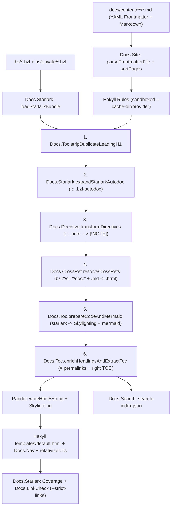

`rules_hs` builds its own documentation site (`//docs:site`) and local preview server (`//docs:serve`) **100% hermetically in Haskell** on top of **Hakyll + Pandoc + Skylighting**, compiled by `rules_hs` itself under Bazel 9 with zero Python, zero Node.js, and zero Nix dependencies.

::: {.important title="Zero Downstream Bzlmod Footprint"}
In `MODULE.bazel`, the `@hackage` hub backing `//docs/...` is loaded with `dev_dependency = True` (enforced by `//tests/rules:bzlmod_hygiene_test`). Downstream consumers of `rules_hs` never download or evaluate `docs/hackage.lock.json` and retain `rules_hs`'s minimal 4-module non-dev dependency graph (`platforms`, `bazel_skylib`, `rules_cc`, `gmp`).
:::

## Why Dogfood a Haskell Documentation Engine?

A build ruleset's documentation site can either pull in an external language ecosystem (`rules_python` + Sphinx/MkDocs, or `aspect_rules_js` + Docusaurus/VitePress) or dogfood the ruleset itself. Building `//docs:site` with `bzl:rule:hs_library`, `bzl:rule:hs_binary`, `bzl:rule:hs_test`, and `bzl:rule:hs_cabal_library` serves two simultaneous goals:

1. **Zero foreign language runtimes in CI and contributor workflows**: Anyone who can run `bazel build //...` on `rules_hs` already has everything needed to compile, link-check, test, and serve the documentation site — even inside bare Linux containers with zero host compilers, Python, or Node.js installed.
2. **Production-scale Hackage stress test**: Whereas `examples/size` exercises a 69-package networking and XML closure, `docs/hackage.lock.json` compiles **182 Hackage packages + 41 GHC boot packages** (`pandoc-3.7.0.2`, `hakyll-4.16.8.0`, `skylighting-0.14.7`, `citeproc-0.9.0.1`, `typst-0.7`, `aeson-2.2.5.1`, `yaml-0.11.11.2`, `libyaml-clib`, `zlib-clib`, `digest`), continuously exercising every advanced capability of `rules_hs`:
   - **Cross-library Template Haskell (`-dynamic-too`)**: `aeson`, `th-lift`, `file-embed`, `wai-app-static`, `unicode-collation`, `citeproc`, and `pandoc` evaluate cross-package TH splices during compilation via relocatable `<name>.pkgdb/dyn/libHS<unit_id>-ghc9.10.3.so` shared libraries while keeping `//docs:docs_gen` statically linked (`DT_NEEDED` strictly base glibc).
   - **Compile-time data embedding in Bazel sandboxes**: `pandoc` (`--flag pandoc:embed_data_files=true`, including hidden OOXML `.rels` files), `citeproc` (`locales/`), and `unicode-collation` (`data/UnicodeData.txt`) embed data files at compile time via sandbox-staged package working directories (`pkg_cwd`).
   - **Source-bootstrapped `alex` & `happy` preprocessors**: `pretty-show` (`.y`) and `toml-parser` (`.x` + `.y`) compile grammar files using `alex-3.5.4.2` and `happy-2.1.7` bootstrapped lazily from `@hs_boot` with zero host tools.
   - **Mixed C / C++11 / `hsc2hs` / `Configure` packages**: `libyaml-clib` (ANSI C), `zlib-clib` (ANSI C), `digest` (C++11 CRC32C + `hsc2hs` Adler32), `unix-compat` (boot `HsUnixConfig.h` headers), and `network` (`./configure`) all build natively via `rules_cc`.

---

## Haskell & Polyglot SSG Ecosystem Comparison

Before adopting **Hakyll + Pandoc + Skylighting**, six documentation engine architectures were evaluated against `rules_hs`'s hermeticity, Stackage LTS availability, and technical documentation UX requirements (see `doc:internals/dependencies` for full catalyst records):

| Engine | Ecosystem & Core | Stackage `lts-24.67` | Technical Docs Fit & Tradeoffs | Decision |
|---|---|---|---|---|
| **Hakyll + Pandoc + Skylighting** | Haskell (`hakyll` `4.16.8.0`, `pandoc` `3.7.0.2`, `skylighting` `0.14.7`) | **In Stackage LTS** (all 182 transitive deps) | Mature `Rules`/`Compiler` DSL, native `Pandoc` AST transforms for Sphinx-like directives/roles/autodoc, 140+ language Skylighting grammars, `relativizeUrls`, clean flag-trimmed hermetic build | **Adopted** |
| **Emanote / Ema** | Haskell (Nix-first reactive SSG, `ema` + `emanote`) | **Absent** (pinned via Nix flakes & Git overrides) | Rich live-reload Zettelkasten UX, but tightly coupled to Nix flakes, `tailwind`/external asset tooling, and non-Stackage dependency pins incompatible with Nix-free Bazel Bzlmod | Not Adopted |
| **Slick** | Haskell (Shake + Pandoc + Mustache) | Partial / unmaintained bounds | Tiny ~100-line wrapper over Shake, which pulls Shake's build-database runtime (`js-dgtable`, `js-flot`, `js-jquery`) while still leaving routing, URL relativization, and link checking to custom code | Not Adopted |
| **Raw Shake + Pandoc** | Haskell (`shake` + `pandoc`) | In Stackage LTS | Duplicates Bazel's outer build graph with a second nested build system (`shake`) without providing Hakyll's `Identifier` routing, `Context` templates, or `relativizeUrls` | Not Adopted |
| **Haddock** | GHC bundled tool | Bundled in GHC bindist | Purpose-built for `.hs` module API docs, not multi-section prose guides, Starlark `.bzl` rule references, Mermaid diagrams, or instant search | Not Adopted (for site) |
| **Sphinx / MkDocs / mdBook / Docusaurus** | Python / Rust / Node.js | N/A (external ecosystems) | Polished out-of-the-box themes, but require pulling `rules_python`, `rules_rust`, or `aspect_rules_js`/`rules_nodejs` into `MODULE.bazel` and forfeit Haskell dogfooding | Not Adopted |

::: {.tip title="Trimming Hakyll's Dependency Closure with Cabal Flags"}
By passing `--flag hakyll:checkexternal=false --flag hakyll:watchserver=false --flag hakyll:previewserver=false` and `--flag pandoc:embed_data_files=true` to `cli:lock`, `//docs:docs_gen` eliminates `http-conduit` and `fsnotify` and bakes Pandoc's templates directly into the binary — making `//docs:docs_gen` a single portable static-GMP executable with zero runtime `Paths_*` data-directory lookups.
:::

---

## Engine Architecture & Compilation Pipeline

The documentation engine lives under `docs/app/` (`//docs:docs_engine_lib`, `//docs:docs_gen`, and `//docs:serve`), compiled with `-Wall -Wcompat`.

### Module Responsibilities

| Module (`docs/app/`) | Responsibility |
|---|---|
| `Docs.Types` | Canonical `SectionId` ranking (`overview`, `guide`, `reference`, `internals`), `PageMeta`, `SiteConfig`, `TocEntry`, and `SearchDoc` types. |
| `Docs.Site` | Stages inputs into `--cache-dir/provider`, configures `Hakyll` (`hakyllWithExitCodeAndArgs`), runs the 6-pass pure Pandoc pipeline (`compileMarkdownPagePure`), emits `static/syntax.css` and `search-index.json`, and orchestrates post-build checks. |
| `Docs.Nav` | Deterministic `(sectionRank, order, route)` sorting, active-highlighted left sidebar navigation, breadcrumbs, and sequential Previous / Next footer cards. |
| `Docs.Directive` | Pandoc AST transform turning both fenced divs (`::: {.note title="..."}`) and GitHub blockquote alerts (`> [!NOTE]`, `> [!TIP]`, `> [!IMPORTANT]`, `> [!WARNING]`, `> [!CAUTION]`) into semantic `<aside class="admonition ...">` elements while keeping inner blocks in the Pandoc AST for downstream passes. |
| `Docs.CrossRef` | Rewrites relative `.md` / `.md#anchor` links to `.html` and resolves Sphinx-like inline roles (`bzl:rule:*`, `bzl:ext:*`, `bzl:provider:*`, `cli:lock`, `doc:*`) against the site's `PageMeta` map. |
| `Docs.Starlark` | Balanced recursive-descent Starlark parser extracting `rule(...)`, `_EXECUTABLE_ATTRS`, `provider(...)`, `tag_class(...)`, `module_extension(...)`, and `hs/defs.bzl` exports; powers `::: {.bzl-autodoc}` blocks and reference symbol-coverage checks. |
| `Docs.Toc` | Strips duplicate leading H1s, maps `starlark`/`bzl` code fences to Skylighting's Python grammar, emits `<pre class="mermaid">`, injects `#` heading permalinks, extracts right-sidebar TOC HTML, and generates dual light/dark Skylighting CSS (`kate` + `breezeDark`). |
| `Docs.Search` | Extracts normalized plain text from prose and code blocks in the Pandoc AST and serializes deterministic `search-index.json` entries consumed by `docs/static/docs.js`. |
| `Docs.LinkCheck` | Parses every generated `.html` file via `tagsoup` and verifies that every internal `<a href="...">` file path and `#id` fragment exists across `out-dir`. |
| `Main.hs` / `ServeMain.hs` | CLI entrypoints for `//docs:docs_gen` and `//docs:serve` (loopback HTTP/1.1 server built directly on `network` sockets with runfiles auto-discovery and path-traversal guards). |

---

## Hermetic Bazel Action Design (`hs_docs_site`)

Hakyll's default `Configuration` writes `_cache/` and `_site/` into the current working directory (`providerDirectory = "."`). Inside a Bazel sandbox (`HsDocsSite` in `docs/app/site.bzl`), mutating source directories or leaving state in `/tmp` would violate action hermeticity.

`//docs:docs_gen` solves this cleanly:
1. `hs_docs_site` creates an isolated scratch tree `CACHE_WORK` with `trap 'rm -rf "$CACHE_WORK"' EXIT` and sets `TMPDIR="$CACHE_WORK/tmp"`.
2. `Docs.Site` stages `docs/content`, `docs/templates`, and `docs/static` into `$CACHE_WORK/hakyll/provider`, sets `storeDirectory = "$CACHE_WORK/hakyll/store"` (`inMemoryCache = True`), and writes compiled outputs directly into Bazel's declared `TreeArtifact` directory (`--out-dir bazel-out/.../bin/docs/site`).
3. Every internal URL is authored root-relative (`/guide/quickstart.html`, `/static/style.css`) during AST compilation and then transformed per-page by Hakyll's `relativizeUrls` compiler step — ensuring the static site works identically on `http://127.0.0.1:8000/`, under a reverse-proxy subpath `/docs/rules_hs/`, or opened directly from disk.
4. When `docs/content/index.md` is present, `--strict-links` and `Docs.Starlark.verifyStarlarkReferenceCoverage` activate automatically, turning broken internal links, missing `#anchor` IDs, or undocumented public Starlark symbols into immediate Bazel build failures.

---

## Live Starlark `bzl-autodoc` Showcase

Below is live output rendered directly at build time by `Docs.Starlark.expandStarlarkAutodoc` introspecting `hs/providers.bzl` (`bzl:provider:HsPackageInfo`, `bzl:provider:HsLinkInfo`, and `bzl:provider:HsToolchainInfo`):

::: {.bzl-autodoc source="hs/providers.bzl"}
:::
