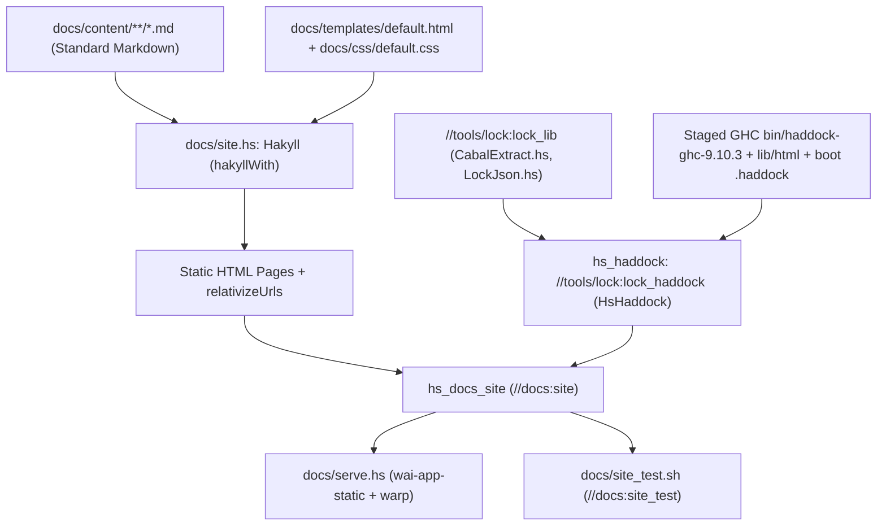

`rules_haskell` builds its own documentation site (`//docs:site`), Haskell API reference ([`//tools/lock` Haddock API](../haddock/lock/index.html)), and local preview server (`//docs:serve`) in Haskell under Bazel 9 — using minimal **Hakyll** (`docs/site.hs`) for Markdown prose and **GHC Haddock** ([`hs_haddock`](../reference/rules.md#hs_haddock)) for Haskell library APIs, with zero Python, zero Node.js, zero Nix, zero JavaScript, and zero custom Markdown syntax extensions.

> **Important — Zero Downstream Bzlmod Footprint:** In `MODULE.bazel`, the `@hackage` hub backing `//docs/...` is loaded with `dev_dependency = True` (enforced by `//tests/rules:bzlmod_hygiene_test`). Downstream consumers of `rules_haskell` never fetch or evaluate `docs/hackage.lock.json` and inherit only `rules_haskell`'s 4 non-dev dependencies (`platforms`, `bazel_skylib`, `rules_cc`, `gmp`). If you are new to Bazel ruleset authoring or Haskell, see [Bazel Ruleset Primer](bazel-rules-primer.md) and [Haskell & GHC Primer](haskell-and-ghc-primer.md).

## Why Minimal Hakyll + GHC Haddock?

Rather than adding a separate language runtime (`rules_python` + Sphinx/MkDocs or `aspect_rules_js` + Docusaurus) or maintaining a heavy custom static site engine, `rules_haskell` pairs the two standard documentation tools in the Haskell ecosystem in their simplest form:

1. **Minimal Hakyll (`docs/site.hs`)** follows the canonical `hakyll-init` pattern (`pandocCompiler`, `defaultContext`, `templates/default.html`, `css/default.css`, `relativizeUrls`) to compile standard Markdown guides, Starlark references, and architecture pages. Authors write ordinary relative `.md` links (`[Quickstart](../guide/quickstart.md)`), readable directly on GitHub or in any editor.
2. **Bundled GHC Haddock (`hs/private/haddock.bzl`)** extracts module headers, type signatures, QuickJump `doc-index.json` search indices, and syntax-highlighted hyperlinked source (`src/*.html`) directly from `-- |` Haddock comments in Haskell libraries such as `//tools/lock:lock_lib` and `examples/size//:size_haddock`.
3. **End-to-end integration test for `rules_haskell` itself**: Building `//docs:docs_gen` and `//docs:serve` compiles **182 Hackage packages + 41 GHC boot packages** (`hakyll-4.16.8.0`, `pandoc-3.7.0.2`, `skylighting-0.14.7`, `citeproc-0.9.0.1`, `typst-0.8.0.2`, `aeson-2.2.5.1`, `yaml-0.11.11.2`, `libyaml-clib-0.2.5`, `zlib-clib-1.3.2`, `digest-0.0.2.1`, `wai-app-static-3.1.9.1`, `warp-3.4.9`), exercising cross-library Template Haskell (`-dynamic-too` + `file-embed`), source-bootstrapped `alex`/`happy` grammars, and mixed C / C++11 / `hsc2hs` / `./configure` packages.

> **Tip — Trimming Hakyll's Dependency Closure with Cabal Flags:** Passing `--flag hakyll:checkexternal=false --flag hakyll:watchserver=false --flag hakyll:previewserver=false` and `--flag pandoc:embed_data_files=true` to [`//tools/lock:lock`](../reference/lock-cli.md) drops `http-conduit` and `fsnotify` from the dependency graph and embeds Pandoc's data files directly into `//docs:docs_gen`, producing a self-contained executable with zero runtime `Paths_*` data-directory lookups.

---

## SSG & API Documentation Ecosystem Evaluation

Six documentation architectures were evaluated against `rules_haskell`'s hermeticity requirements, Stackage `lts-24.67` availability, and standard Markdown compatibility (see [Dependency Decisions](dependencies.md) for full records):

| Tool | Role & Ecosystem | Stackage `lts-24.67` | Fit & Tradeoffs | Decision |
|---|---|---|---|---|
| **Minimal Hakyll (`hakyll`)** | Static site generator (`pandocCompiler`, `defaultContext`, `relativizeUrls`) | **In Stackage LTS** (182 transitive deps) | Canonical Haskell SSG; minimal ~45-line `site.hs` with only 3 direct deps (`base`, `filepath`, `hakyll`), zero custom Markdown syntax, zero JS | **Adopted (Prose & Starlark Docs)** |
| **GHC Bundled Haddock (`hs_haddock`)** | Haskell API documentation (`bin/haddock-ghc-<ver>`) | **Bundled in GHC bindist** (zero extra downloads) | Native GHC typechecker integration, `--hyperlinked-source`, `--quickjump` (`doc-index.json`), cross-package `--read-interface` links | **Adopted (Haskell Library APIs)** |
| **Emanote / Ema** | Reactive Nix-oriented Haskell SSG | **Absent** (Nix flake pins) | Coupled to Nix flakes and external Tailwind tooling incompatible with Nix-free Bazel Bzlmod | Not Adopted |
| **Slick / Raw Shake + Pandoc** | Shake-based SSG wrappers | Partial / LTS | Duplicates Bazel's outer build graph with a second nested build database (`shake`) while lacking Hakyll's `Identifier` routing and `relativizeUrls` | Not Adopted |
| **Custom Sphinx-like AST DSL on Pandoc** | Bespoke role code spans, fenced-div directives, and Starlark parsers | N/A (custom code) | Breaks standard GitHub Markdown previews, adds hundreds of lines of custom AST rewrite code, and duplicates Haddock | Not Adopted |
| **Sphinx / MkDocs / mdBook / Docusaurus** | Python / Rust / Node.js SSGs | External ecosystems | Require pulling `rules_python`, `rules_rust`, or `aspect_rules_js` into `MODULE.bazel` and lose Haskell integration test coverage | Not Adopted |

---

## Architecture & Build Pipeline

The documentation infrastructure consists of four small files under `docs/`: `docs/site.hs` (`//docs:docs_gen`), `docs/serve.hs` (`//docs:serve`), `docs/site.bzl` (`hs_docs_site`), and `docs/site_test.sh` (`//docs:site_test`), paired with `hs/private/haddock.bzl` (`hs_haddock`).



### 1. Hermetic `hs_haddock` Action (`hs/private/haddock.bzl`)

As detailed in [Hermeticity & Toolchain](hermeticity.md) and [Providers & Actions](providers-and-actions.md), `staged_ghc.bzl` stages `bin/haddock-ghc-<ver>` alongside `bin/ghc-<ver>` under the same `$ORIGIN/../lib/<arch_libdir>` layout, retains `lib/html/**` (the `Linuwial` theme, `quick-jump.min.js`, `haddock-bundle.min.js`, and hyperlinked-source assets), and indexes bundled boot `.haddock` files on [`HsToolchainInfo`](../reference/extensions-and-providers.md#hstoolchaininfo).

When `hs_haddock` executes (`HsHaddock` mnemonic):
- It invokes `hs_tc.haddock` with `-B <libdir> -l <libdir>`, `--html`, `--use-unicode`, `--quickjump` (`doc-index.json`), `--hyperlinked-source` (`src/<Module>.html`), and `--dump-interface=<name>.haddock`.
- It forwards hermetic compiler and C-toolchain flags (`-hide-all-packages`, transitive `-package-db`s, direct `-package-id`s, and `ghc_cc_wrapper` `-pgm*` flags) via `--optghc=` so `{-# LANGUAGE CPP #-}`, `CApiFFI`, and cross-library Template Haskell work identically under `env -i` in `linux-sandbox`.
- It wires `--read-interface` against GHC's bundled boot `.haddock` interfaces (linking types like `Text`, `Map`, and `GenericPackageDescription` to Hackage) as well as any upstream `haddock_deps` targets.

### 2. Minimal Hakyll Compilation (`docs/site.hs` & `docs/site.bzl`)

`docs/site.hs` uses Hakyll's standard building blocks directly with only three dependencies (`base`, `filepath`, `hakyll`):
- `match "templates/*" $ compile templateBodyCompiler` and `match "css/*" $ route idRoute >> compile copyFileCompiler`.
- `match "content/**.md"` routed with `gsubRoute "content/" (const "")` + `setExtension "html"`, compiled with `pandocCompiler`, wrapped in `templates/default.html` via `defaultContext`, rewritten from relative `.md` links to `.html` via `withUrls`, and relativized via `relativizeUrls`.
- Inside `HsDocsSite` (`docs/site.bzl`), declared `srcs` are staged into a sandbox-local scratch directory (`DOCS_PROVIDER_DIR`, `DOCS_CACHE_DIR`) so Hakyll never mutates source directories or leaks state into `/tmp`, and `haddocks = {"//tools/lock:lock_haddock": "haddock/lock"}` mounts the generated Haddock bundle at [`/haddock/lock/index.html`](../haddock/lock/index.html).

### 3. Local Preview Server & Smoke Test (`docs/serve.hs` & `docs/site_test.sh`)

- **`//docs:serve`** (`docs/serve.hs`): a ~40-line static HTTP server built on `wai-app-static` (`defaultFileServerSettings`, `staticApp`) and `warp` (`runSettings`) — the same libraries Hakyll itself uses internally for preview serving — serving `bazel-bin/docs/site/` on `http://127.0.0.1:8000/` by default.
- **`//docs:site_test`** (`docs/site_test.sh`): verifies core site and mounted Haddock outputs (`index.html`, `css/default.css`, `haddock/lock/index.html`) and confirms `//docs:docs_gen --help` and `//docs:serve --help` execute cleanly under `env -i PATH=/nonexistent`.

---

## Walking Through `docs/site.hs` (For Readers New to Haskell) {#site-hs-walkthrough}

Unlike configuration-file static site generators (such as Hugo's `hugo.toml` or MkDocs's `mkdocs.yml`), **Hakyll is a library in Haskell**: your site configuration is a small Haskell program (`docs/site.hs`, compiled into `//docs:docs_gen`).

### Quick Haskell Syntax Decoder

| Haskell Syntax | Everyday Meaning | Equivalent in Python / TypeScript / Go |
|---|---|---|
| `name :: Type` | **"`name` has type `Type`"** (`()` is Haskell's empty unit type, like `void` or `None`) | `function name(): Type` in TypeScript |
| `A -> B` | **Function type arrow**: takes an argument of type `A` and returns a `B` | `(a: A) => B` |
| `f x y` | **Function call**: spaces apply a function to its arguments without parentheses or commas | `f(x, y)` |
| `f $ g x` | **Avoid extra parentheses**: `$` evaluates everything on its right first and passes the result to `f` | `f(g(x))` |
| `do` and `x <- step` | **Run steps in order**: runs steps top-to-bottom; `x <- step` binds an action's result, `let y = expr` binds a local value | `const x = await step(); const y = expr;` |
| `step1 >>= step2` | **Monadic pipe**: runs `step1` and feeds its output into `step2` while tracking Hakyll dependencies | `step2(await step1())` |
| `` a `fn` b `` | **Infix call**: wraps a two-argument function between its two arguments | `a.fn(b)` |

### The Complete `docs/site.hs` Pipeline

```haskell
{-# LANGUAGE OverloadedStrings #-}

main :: IO ()
main = do
  setLocaleEncoding utf8
  providerDir <- fromMaybe "docs" <$> lookupEnv "DOCS_PROVIDER_DIR"
  outDir      <- fromMaybe "_site" <$> lookupEnv "DOCS_OUT_DIR"
  cacheDir    <- fromMaybe "_cache" <$> lookupEnv "DOCS_CACHE_DIR"

  let conf = defaultConfiguration
        { providerDirectory    = providerDir
        , destinationDirectory = outDir
        , storeDirectory       = cacheDir </> "store"
        , tmpDirectory         = cacheDir </> "tmp"
        }

  hakyllWith conf $ do
    match "templates/*" $ compile templateBodyCompiler

    match "css/*" $ do
      route idRoute
      compile copyFileCompiler

    match "content/**.md" $ do
      route $ gsubRoute "content/" (const "") `composeRoutes` setExtension "html"
      compile $
        pandocCompiler
          >>= loadAndApplyTemplate "templates/default.html" defaultContext
          >>= pure . fmap (withUrls rewriteMdUrl)
          >>= relativizeUrls
```

Step by step:
1. **`lookupEnv` + `defaultConfiguration`**: Reads the sandbox paths passed by `docs/site.bzl` (`DOCS_PROVIDER_DIR`, `DOCS_OUT_DIR`, `DOCS_CACHE_DIR`) and substitutes them into Hakyll's `defaultConfiguration`.
2. **`match "templates/*"` and `match "css/*"`**: Compiles `templates/default.html` in memory (no `route`, so it is not copied to the output directory) and copies `css/default.css` verbatim (`idRoute` + `copyFileCompiler`).
3. **`match "content/**.md"`**:
   - `route` strips `"content/"` and swaps `.md` for `.html` (e.g., `content/guide/quickstart.md` → `guide/quickstart.html`).
   - `pandocCompiler` parses each Markdown file and its YAML frontmatter into HTML.
   - `loadAndApplyTemplate "templates/default.html" defaultContext` fills `$title$` and `$body$` from frontmatter and the rendered Markdown body.
   - `withUrls rewriteMdUrl` uses Hakyll's HTML URL mapper to rewrite relative `.md` and `.md#anchor` links to `.html` and `.html#anchor` without touching external URLs.
   - `relativizeUrls` converts root-relative template paths (such as `/css/default.css`, `/index.html`, and `/haddock/lock/index.html`) into page-relative paths so the built site works identically at `/`, under a GitHub Pages subpath (`/rules_haskell/`), or opened directly from disk.

---

## Anatomy of the 182-Package `docs/hackage.lock.json` Closure {#docs-closure-breakdown}

While `examples/size/hackage.lock.json` locks **69** Hackage packages, `docs/hackage.lock.json` locks **182** Hackage packages (plus GHC `9.10.3`'s 41 boot packages). Every one of those 182 packages is pulled transitively by `hakyll` alone — nearly all of the delta comes from `hakyll`'s default **`pandoc`** dependency:

| Functional Sub-Tree | Direct Target(s) in `docs/BUILD.bazel` | Representative Packages in `docs/hackage.lock.json` | Approximate Share & `rules_haskell` Features Exercised |
|---|---|---|---|
| **1. Pandoc Document AST, Readers & Writers** | Transitive under `hakyll` (`//docs:docs_gen`) | `pandoc` (`3.7.0.2`), `pandoc-types` (`1.23.1.2`), `commonmark*`, `djot`, `jira-wiki-markup`, `haddock-library`, `ipynb`, `gridtables`, `texmath`, `typst` (`0.8.0.2`), `typst-symbols`, `doctemplates`, `doclayout`, `JuicyPixels`, `zip-archive`, `emojis` | ~90 packages — large multi-module libraries, cross-library TH (`embed_data_files=true`), `alex`/`happy` grammar codegen (`pretty-show`, `toml-parser`). |
| **2. Citations, Unicode Collation & Compile-Time Data** | Transitive under `pandoc` | `citeproc` (`0.9.0.1`), `unicode-collation` (`0.1.3.7`), `unicode-data`, `unicode-transforms`, `file-embed` (`0.0.16.0`), `xml-conduit`, `conduit` | ~20 packages — compile-time `file-embed` TH splices reading binary collation and CSL files from sandboxed package `data` directories via `<name>.pkgdb/dyn/libHS*.so`. |
| **3. Skylighting Syntax Highlighting** | Transitive under `pandoc` | `skylighting` (`0.14.7`), `skylighting-core` (`0.14.7`), `skylighting-format-*`, `regex-tdfa` | ~10 packages — TH-compiled KDE Kate XML syntax grammars for 140+ languages. |
| **4. YAML / JSON / Crypto / HTTP / C Archive Plumbing** | Transitive under `hakyll` & `pandoc` | `aeson` (`2.2.5.1`), `yaml` (`0.11.11.2`), `libyaml`, `libyaml-clib` (`0.2.5`), `zlib`, `zlib-clib` (`1.3.2`), `digest` (`0.0.2.1`), `http-client`, `http-client-tls`, `tls`, `crypton*`, `cborg` | ~45 packages — C-only Cabal libraries (`libyaml-clib`, `zlib-clib`), C FFI (`digest`, `crypton`), `.hs-boot` mutual recursion (`cborg`, `tls`), internal sublibraries (`attoparsec-internal`). |
| **5. Hakyll Engine & Static HTTP Server** | `//docs:docs_gen` (`hakyll`), `//docs:serve` (`wai-app-static`, `warp`) | `hakyll` (`4.16.8.0`), `blaze-html`, `blaze-markup`, `lrucache`, `optparse-applicative`, `tagsoup`, `wai-app-static` (`3.1.9.1`), `warp` (`3.4.9`), `network` (`3.2.14.0`) | ~17 packages — `Rules`/`Compiler`/`Context`, HTML templating, `relativizeUrls`, and static HTTP serving via `warp`. |
| **6. Bundled GHC Haddock (`hs_haddock`)** | `//tools/lock:lock_haddock` | *Zero Hackage packages* (`bin/haddock-ghc-9.10.3` + `lib/html/` from `@ghc_9_10_3_*`) | **0 Hackage packages** — executes directly from the `$ORIGIN`-staged GHC bindist. |
