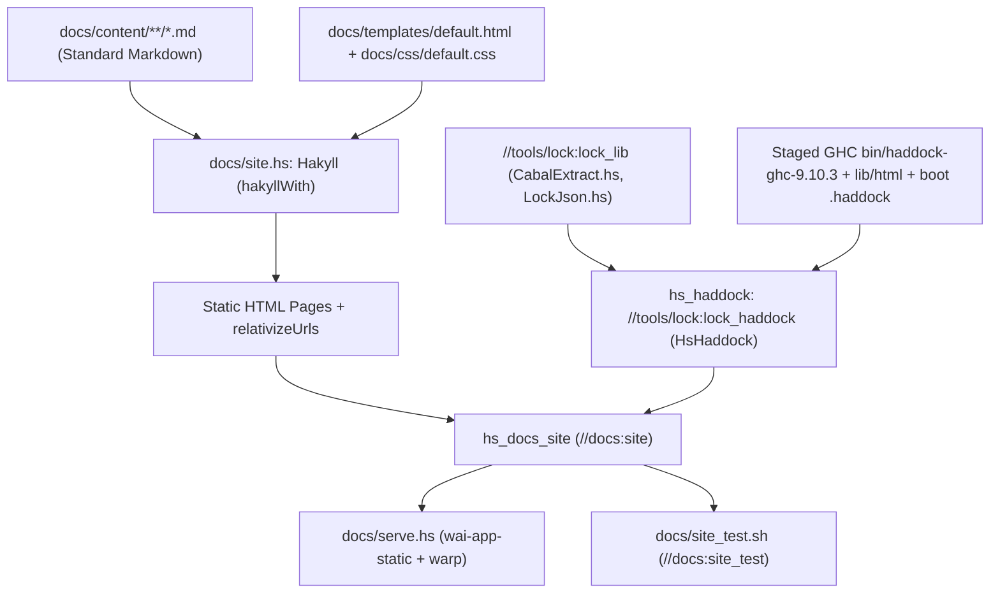

This page explains how `rules_haskell` builds its documentation site (`//docs:site`), Haskell API reference ([`//tools/lock` Haddock API](../haddock/lock/index.html)), and local preview server (`//docs:serve`) in Haskell under Bazel 9—using minimal **Hakyll** for Markdown prose and bundled **GHC Haddock** ([`hs_haddock`](../reference/rules.md#hs_haddock)) for Haskell library APIs, with zero Python, Node.js, Nix, JavaScript, or custom Markdown extensions. Read this if you're maintaining the docs pipeline or want a concrete walkthrough of a real 182-package Hakyll and Pandoc Bazel build.

For the full rationale behind adopted and rejected documentation tools, see [Dependency decisions](dependencies.md#docs-engine-decisions). If you're new to Bazel ruleset authoring or Haskell, start with [Bazel ruleset primer](bazel-rules-primer.md) and [Haskell and GHC primer](haskell-and-ghc-primer.md).

> **Important:** Downstream consumers of `rules_haskell` pay zero [Bzlmod](https://bazel.build/external/overview) overhead for this documentation stack. In [`MODULE.bazel`](https://bazel.build/external/module), the `@hackage` hub backing `//docs/...` is declared with [`dev_dependency = True`](https://bazel.build/rules/lib/globals/module#bazel_dep) (enforced by `//tests/rules:bzlmod_hygiene_test`), so consumers never fetch or parse `docs/hackage.lock.json` and inherit only `rules_haskell`'s 4 non-dev dependencies (`platforms`, `bazel_skylib`, `rules_cc`, `gmp`).

## Why minimal Hakyll and GHC Haddock

Instead of pulling another language runtime into `MODULE.bazel` (such as `rules_python` with Sphinx/MkDocs or `aspect_rules_js` with Docusaurus) or maintaining a custom static site engine, `rules_haskell` pairs the two standard Haskell documentation tools in their simplest form:

- **Minimal Hakyll (`docs/site.hs`):** Follows the canonical `hakyll-init` pattern (`pandocCompiler`, `defaultContext`, `templates/default.html`, `css/default.css`, `relativizeUrls`) to compile standard Markdown guides, [Starlark](https://bazel.build/rules/language) references, and architecture docs. You write ordinary relative `.md` links (`[Quickstart](../guide/quickstart.md)`) that work directly on GitHub and in any editor.
- **Bundled GHC Haddock (`haskell/private/haddock.bzl`):** Extracts module headers, type signatures, QuickJump `doc-index.json` search indices, and syntax-highlighted source pages (`src/*.html`) directly from `-- |` Haddock comments in libraries like `//tools/lock:lock_lib` and `examples/size//:size_haddock`.
- **End-to-end integration test for `rules_haskell`:** Building `//docs:docs_gen` and `//docs:serve` compiles **182 Hackage packages plus 41 GHC boot packages**—including `hakyll`, `pandoc`, `skylighting`, `aeson`, `yaml`, `wai-app-static`, `warp`, and C-only `libyaml-clib` and `zlib-clib`. Every docs build continuously tests cross-library Template Haskell (`-dynamic-too` with `file-embed`), source-bootstrapped `alex`/`happy` grammars, and mixed C, C++11, `hsc2hs`, and `./configure` packages.

> **Tip:** Passing `--flag hakyll:checkexternal=false --flag hakyll:watchserver=false --flag hakyll:previewserver=false` and `--flag pandoc:embed_data_files=true` to [`//tools/lock:lock`](../reference/lock-cli.md) drops `http-conduit` and `fsnotify` from the graph and embeds Pandoc's data files directly into `//docs:docs_gen`. That produces a self-contained binary with zero runtime `Paths_*` data-directory lookups.

---

## Static site generator and API documentation evaluation

Six documentation architectures were evaluated against `rules_haskell`'s [hermeticity](https://bazel.build/basics/hermeticity) requirements, Stackage `lts-24.67` availability, and standard Markdown compatibility:

| Tool | Role and ecosystem | Stackage `lts-24.67` | Fit and trade-offs | Decision |
|---|---|---|---|---|
| **Minimal Hakyll (`hakyll`)** | Static site generator (`pandocCompiler`, `defaultContext`, `relativizeUrls`) | **In Stackage LTS** (182 transitive deps) | Standard Haskell SSG; ~45-line `site.hs` with only 3 direct deps (`base`, `filepath`, `hakyll`), zero custom Markdown syntax, and zero JS. | **Adopted (prose and Starlark docs)** |
| **GHC bundled Haddock (`hs_haddock`)** | Haskell API documentation (`bin/haddock-ghc-<ver>`) | **Bundled in GHC bindist** (zero extra downloads) | Direct GHC typechecker integration, `--hyperlinked-source`, `--quickjump` (`doc-index.json`), and cross-package `--read-interface` links. | **Adopted (Haskell library APIs)** |
| **Emanote / Ema** | Reactive Nix-oriented Haskell SSG | **Absent** (Nix flake pins) | Coupled to Nix flakes and external Tailwind tooling incompatible with Nix-free Bazel Bzlmod. | Not adopted |
| **Slick / raw Shake + Pandoc** | Shake-based SSG wrappers | Partial / LTS | Duplicates Bazel's outer build graph with a second nested build database (`shake`) while lacking Hakyll's `Identifier` routing and `relativizeUrls`. | Not adopted |
| **Custom Sphinx-like AST DSL on Pandoc** | Bespoke role code spans, fenced-div directives, and Starlark parsers | N/A (custom code) | Breaks standard GitHub Markdown previews, adds hundreds of lines of custom AST rewrite code, and duplicates Haddock. | Not adopted |
| **Sphinx / MkDocs / `mdBook` / Docusaurus** | Python, Rust, or Node.js SSGs | External ecosystems | Requires adding `rules_python`, `rules_rust`, or `aspect_rules_js` to `MODULE.bazel` and loses self-hosted Haskell integration coverage. | Not adopted |

---

## Architecture and build pipeline

Four small files under `docs/` (`docs/site.hs`, `docs/serve.hs`, `docs/site.bzl`, and `docs/site_test.sh`) work alongside `haskell/private/haddock.bzl` (`hs_haddock`) to assemble, serve, and verify the site.



### Hermetic `hs_haddock` action (`haskell/private/haddock.bzl`)

You can generate cross-linked API docs for any Haskell library without extra downloads because `staged_ghc.bzl` already stages `bin/haddock-ghc-<ver>` beside `bin/ghc-<ver>` under the same `$ORIGIN/../lib/<arch_libdir>` layout, retains `lib/html/**` (the `Linuwial` theme, `quick-jump.min.js`, `haddock-bundle.min.js`, and hyperlinked-source assets), and indexes bundled boot `.haddock` files on [`HsToolchainInfo`](../reference/extensions-and-providers.md#hstoolchaininfo) (see [Hermeticity and toolchain](hermeticity.md) and [Providers and action graph](providers-and-actions.md)).

When an `HsHaddock` action runs, it handles three things:

- **HTML and QuickJump generation:** Runs `hs_tc.haddock` with `-B <libdir> -l <libdir>`, `--html`, `--use-unicode`, `--quickjump` (`doc-index.json`), `--hyperlinked-source` (`src/<Module>.html`), and `--dump-interface=<name>.haddock`.
- **Hermetic compiler forwarding:** Passes `-hide-all-packages`, transitive `-package-db`s, direct `-package-id`s, and `ghc_cc_wrapper` `-pgm*` flags via `--optghc=` so `{-# LANGUAGE CPP #-}`, `CApiFFI`, and cross-library Template Haskell behave identically under `env -i` in [`linux-sandbox`](https://bazel.build/docs/sandboxing).
- **Cross-package linking:** Wires `--read-interface` to GHC's bundled boot `.haddock` interfaces (linking types like `Text`, `Map`, and `GenericPackageDescription` to Hackage) and to any upstream `haddock_deps` targets.

### Minimal Hakyll build (`docs/site.hs` and `docs/site.bzl`)

Prose pages build with Hakyll's standard primitives and only three direct dependencies (`base`, `filepath`, `hakyll`):

- **Templates and CSS:** Compiles `templates/*` in memory with `templateBodyCompiler` and copies `css/*` verbatim with `idRoute` and `copyFileCompiler`.
- **Markdown routing and URL rewriting:** Strips `"content/"` and swaps `.md` to `.html` on `content/**.md`, runs `pandocCompiler`, wraps pages in `templates/default.html` via `defaultContext`, rewrites relative `.md` links to `.html` with `withUrls`, and makes paths relative with `relativizeUrls`.
- **Sandboxed execution and Haddock mounting:** Inside `HsDocsSite` (`docs/site.bzl`), Bazel stages declared `srcs` into a sandbox-local scratch directory (`DOCS_PROVIDER_DIR`, `DOCS_CACHE_DIR`) so Hakyll never touches source directories or `/tmp`, then mounts `haddocks = {"//tools/lock:lock_haddock": "haddock/lock"}` at [`/haddock/lock/index.html`](../haddock/lock/index.html).

### Local preview server and smoke test (`docs/serve.hs` and `docs/site_test.sh`)

- **Local preview (`//docs:serve`):** A ~40-line static HTTP server (`docs/serve.hs`) built on `wai-app-static` (`defaultFileServerSettings`, `staticApp`) and `warp` (`runSettings`)—the same libraries Hakyll uses internally—serving [`bazel-bin/docs/site/`](https://bazel.build/remote/output-directories) at `http://127.0.0.1:8000/`.
- **Smoke test (`//docs:site_test`):** Checks core rendered outputs (`index.html`, `css/default.css`, `haddock/lock/index.html`) and confirms `//docs:docs_gen --help` and `//docs:serve --help` run under `env -i PATH=/nonexistent`.

---

## Walking through `docs/site.hs` {#site-hs-walkthrough}

Unlike configuration-file site generators (such as Hugo's `hugo.toml` or MkDocs's `mkdocs.yml`), **Hakyll is a Haskell library**: your site configuration is a small Haskell program (`docs/site.hs`, compiled into `//docs:docs_gen`). If you're new to Haskell syntax, use this quick translation table before reading the pipeline below.

### Quick Haskell syntax decoder

| Haskell syntax | Everyday meaning | Equivalent in Python, TypeScript, or Go |
|---|---|---|
| `name :: Type` | **`name` has type `Type`** (`()` is Haskell's empty unit type, like `void` or `None`) | `function name(): Type` in TypeScript |
| `A -> B` | **Function type arrow:** takes an argument of type `A` and returns a `B` | `(a: A) => B` |
| `f x y` | **Function call:** spaces apply a function to its arguments without parentheses or commas | `f(x, y)` |
| `f $ g x` | **Avoid extra parentheses:** `$` evaluates everything on its right first and passes the result to `f` | `f(g(x))` |
| `do` and `x <- step` | **Run steps in order:** executes top-to-bottom; `x <- step` binds an action's result, `let y = expr` binds a local value | `const x = await step(); const y = expr;` |
| `step1 >>= step2` | **Monadic pipe:** runs `step1` and feeds its output into `step2` while tracking Hakyll dependencies | `step2(await step1())` |
| `` a `fn` b `` | **Infix call:** places a two-argument function between its two arguments | `a.fn(b)` |

### Complete `docs/site.hs` pipeline

```haskell
{-# LANGUAGE OverloadedStrings #-}

main :: IO ()
main = do
  setLocaleEncoding utf8
  providerDir <- fromMaybe "docs" <$> lookupEnv "DOCS_PROVIDER_DIR"
  outDir      <- fromMaybe "_site" <$> lookupEnv "DOCS_OUT_DIR"
  cacheDir    <- fromMaybe "_cache" <$> lookupEnv "DOCS_CACHE_DIR"

  let conf = defaultConfiguration
        { providerDirectory    = providerDir
        , destinationDirectory = outDir
        , storeDirectory       = cacheDir </> "store"
        , tmpDirectory         = cacheDir </> "tmp"
        }

  hakyllWith conf $ do
    match "templates/*" $ compile templateBodyCompiler

    match "css/*" $ do
      route idRoute
      compile copyFileCompiler

    match "content/**.md" $ do
      route $ gsubRoute "content/" (const "") `composeRoutes` setExtension "html"
      compile $
        pandocCompiler
          >>= loadAndApplyTemplate "templates/default.html" defaultContext
          >>= pure . fmap (withUrls rewriteMdUrl)
          >>= relativizeUrls
```

Here's what each block does:

1. **Read sandbox paths (`lookupEnv` and `defaultConfiguration`):** Reads `DOCS_PROVIDER_DIR`, `DOCS_OUT_DIR`, and `DOCS_CACHE_DIR` from `docs/site.bzl` and plugs them into Hakyll's configuration record.
2. **Load templates and copy CSS (`match "templates/*"` and `match "css/*"`):** Compiles `templates/default.html` in memory (no `route`, so it isn't emitted to the output directory) and copies `css/default.css` verbatim.
3. **Compile Markdown pages (`match "content/**.md"`):**
   - `route` strips `"content/"` and replaces `.md` with `.html` (turning `content/guide/quickstart.md` into `guide/quickstart.html`).
   - `pandocCompiler` parses each Markdown file and its YAML frontmatter into HTML.
   - `loadAndApplyTemplate "templates/default.html" defaultContext` fills `$title$` and `$body$` from frontmatter and rendered Markdown.
   - `withUrls rewriteMdUrl` rewrites relative `.md` and `.md#anchor` links to `.html` and `.html#anchor` without altering external URLs.
   - `relativizeUrls` converts root-relative template paths (`/css/default.css`, `/index.html`, `/haddock/lock/index.html`) into page-relative paths so the site works at `/`, under a GitHub Pages subpath (`/rules_haskell/`), or directly from disk.

---

## Anatomy of the 182-package `docs/hackage.lock.json` closure {#docs-closure-breakdown}

While `examples/size/hackage.lock.json` locks **69** Hackage packages, `docs/hackage.lock.json` locks **182** Hackage packages (plus GHC `9.10.3`'s 41 boot packages). Every one of those 182 packages comes transitively from `hakyll`, and almost all of the delta comes from `hakyll`'s default **`pandoc`** dependency:

| Functional subtree | Direct targets in `docs/BUILD.bazel` | Representative packages in `docs/hackage.lock.json` | Approximate share and `rules_haskell` features exercised |
|---|---|---|---|
| **1. Pandoc document AST, readers, and writers** | Transitive under `hakyll` (`//docs:docs_gen`) | `pandoc` (`3.7.0.2`), `pandoc-types` (`1.23.1.2`), `commonmark*`, `djot`, `jira-wiki-markup`, `haddock-library`, `ipynb`, `gridtables`, `texmath`, `typst` (`0.8.0.2`), `typst-symbols`, `doctemplates`, `doclayout`, `JuicyPixels`, `zip-archive`, `emojis` | ~90 packages—large multi-module libraries, cross-library TH (`embed_data_files=true`), `alex`/`happy` grammar codegen (`pretty-show`, `toml-parser`). |
| **2. Citations, Unicode collation, and compile-time data** | Transitive under `pandoc` | `citeproc` (`0.9.0.1`), `unicode-collation` (`0.1.3.7`), `unicode-data`, `unicode-transforms`, `file-embed` (`0.0.16.0`), `xml-conduit`, `conduit` | ~20 packages—compile-time `file-embed` TH splices reading binary collation and CSL files from sandboxed package `data` directories via `<name>.pkgdb/dyn/libHS*.so`. |
| **3. Skylighting syntax highlighting** | Transitive under `pandoc` | `skylighting` (`0.14.7`), `skylighting-core` (`0.14.7`), `skylighting-format-*`, `regex-tdfa` | ~10 packages—TH-compiled KDE Kate XML syntax grammars for 140+ languages. |
| **4. YAML, JSON, crypto, HTTP, and C archive plumbing** | Transitive under `hakyll` and `pandoc` | `aeson` (`2.2.5.1`), `yaml` (`0.11.11.2`), `libyaml`, `libyaml-clib` (`0.2.5`), `zlib`, `zlib-clib` (`1.3.2`), `digest` (`0.0.2.1`), `http-client`, `http-client-tls`, `tls`, `crypton*`, `cborg` | ~45 packages—C-only Cabal libraries (`libyaml-clib`, `zlib-clib`), C FFI (`digest`, `crypton`), `.hs-boot` mutual recursion (`cborg`, `tls`), internal sublibraries (`attoparsec-internal`). |
| **5. Hakyll engine and static HTTP server** | `//docs:docs_gen` (`hakyll`), `//docs:serve` (`wai-app-static`, `warp`) | `hakyll` (`4.16.8.0`), `blaze-html`, `blaze-markup`, `lrucache`, `optparse-applicative`, `tagsoup`, `wai-app-static` (`3.1.9.1`), `warp` (`3.4.9`), `network` (`3.2.14.0`) | ~17 packages—`Rules`/`Compiler`/`Context`, HTML templating, `relativizeUrls`, and static HTTP serving via `warp`. |
| **6. Bundled GHC Haddock (`hs_haddock`)** | `//tools/lock:lock_haddock` | *Zero Hackage packages* (`bin/haddock-ghc-9.10.3` + `lib/html/` from `@ghc_9_10_3_*`) | **0 Hackage packages**—runs directly from the `$ORIGIN`-staged GHC bindist. |
