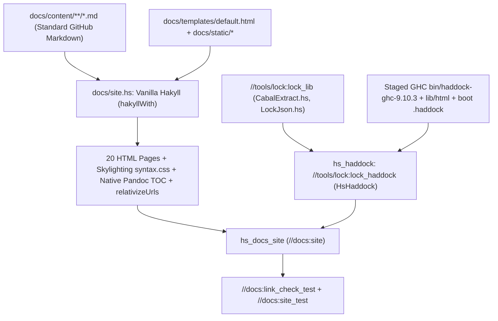

`rules_hs` builds its own documentation site (`//docs:site`), Haskell API reference ([`//tools/lock` Haddock API](../haddock/lock/index.html)), and local preview server (`//docs:serve`) **100% hermetically in Haskell** under Bazel 9 — using the canonical Haskell documentation stack of **vanilla Hakyll + Pandoc + Skylighting** for prose and **GHC Haddock** ([`hs_haddock`](../reference/rules.md)) for Haskell libraries, with zero Python, zero Node.js, zero Nix, and zero custom Markdown DSLs.

> **Important — Zero Downstream Bzlmod Footprint:** In `MODULE.bazel`, the `@hackage` hub backing `//docs/...` is loaded with `dev_dependency = True` (enforced by `//tests/rules:bzlmod_hygiene_test`). Downstream consumers of `rules_hs` never fetch or evaluate `docs/hackage.lock.json` and retain `rules_hs`'s minimal 4-module non-dev dependency graph (`platforms`, `bazel_skylib`, `rules_cc`, `gmp`). If you are new to Bazel ruleset authoring or Haskell, see [Bazel Ruleset Primer](bazel-rules-primer.md) and [Haskell & GHC Primer](haskell-and-ghc-primer.md).

## Why Canonical Vanilla Hakyll + GHC Haddock?

Rather than pulling in a foreign language runtime (`rules_python` + Sphinx/MkDocs or `aspect_rules_js` + Docusaurus) or inventing bespoke Sphinx-like custom roles and fenced-div directives on top of Pandoc, `rules_hs` pairs the two standard tools of the Haskell ecosystem for the exact jobs each was designed to solve:

1. **Vanilla Hakyll + Pandoc + Skylighting (`docs/site.hs`)** compiles standard GitHub-flavored Markdown guides, Starlark rule/provider tables, and architecture internals. Authors write ordinary Markdown links (`[Quickstart](../guide/quickstart.md)`), standard `>` blockquotes, and fenced code blocks — readable directly in any Git forge or editor with zero proprietary syntax.
2. **Bundled GHC Haddock (`hs/private/haddock.bzl`)** extracts module headers, type signatures, QuickJump `doc-index.json` indices, and syntax-highlighted hyperlinked source (`src/*.html`) directly from `-- |` Haddock comments in Haskell libraries such as `//tools/lock:lock_lib` and `examples/size//:size_haddock`.
3. **Production-scale `rules_hs` dogfooding**: Building `//docs:docs_gen` with [`hs_binary`](../reference/rules.md#hs_binary) and [`hs_cabal_library`](../reference/rules.md#hs_cabal_library) compiles **182 Hackage packages + 41 GHC boot packages** (`hakyll-4.16.8.0`, `pandoc-3.7.0.2`, `skylighting-0.14.7`, `citeproc-0.9.0.1`, `typst-0.8.0.2`, `aeson-2.2.5.1`, `yaml-0.11.11.2`, `libyaml-clib-0.2.5`, `zlib-clib-1.3.2`, `digest-0.0.2.1`), continuously exercising:
   - **Cross-library Template Haskell (`-dynamic-too`)**: `aeson`, `th-lift`, `file-embed`, `unicode-collation`, `citeproc`, and `pandoc` evaluate cross-package TH splices via relocatable `<name>.pkgdb/dyn/libHS*.so` shared libraries while keeping `//docs:docs_gen` statically linked (`DT_NEEDED` strictly base glibc).
   - **Compile-time data embedding in Bazel sandboxes**: `pandoc` (`--flag pandoc:embed_data_files=true`), `citeproc`, and `unicode-collation` embed data files via `file-embed` TH inside sandbox-staged package working directories.
   - **Source-bootstrapped `alex` & `happy` preprocessors** (`pretty-show`, `toml-parser`) and **mixed C / C++11 / `hsc2hs` / `./configure` packages** (`libyaml-clib`, `zlib-clib`, `digest`, `network`).

> **Tip — Trimming Hakyll's Dependency Closure with Cabal Flags:** Passing `--flag hakyll:checkexternal=false --flag hakyll:watchserver=false --flag hakyll:previewserver=false` and `--flag pandoc:embed_data_files=true` to [`//tools/lock:lock`](../reference/lock-cli.md) eliminates `http-conduit`, `warp`, and `fsnotify` and bakes Pandoc's templates directly into `//docs:docs_gen`, yielding a single portable executable with zero runtime `Paths_*` data-directory lookups.

---

## SSG & API Documentation Ecosystem Evaluation

Six documentation architectures were evaluated against `rules_hs`'s hermeticity, Stackage `lts-24.67` availability, and canonical Haskell ergonomics (see [Dependency Decisions](dependencies.md) for full catalyst records):

| Tool | Role & Ecosystem | Stackage `lts-24.67` | Fit & Tradeoffs | Decision |
|---|---|---|---|---|
| **Vanilla Hakyll + Pandoc + Skylighting** | Static site generator (`hakyll`, `pandoc`, `skylighting`) | **In Stackage LTS** (all 182 transitive deps) | Idiomatic `Rules`/`Compiler`/`Context` DSL, Pandoc native TOC (`writerTableOfContents = True`), 140+ Skylighting grammars, `relativizeUrls`, zero custom Markdown syntax | **Adopted (Prose & Starlark Docs)** |
| **GHC Bundled Haddock (`hs_haddock`)** | Haskell API documentation (`bin/haddock-ghc-<ver>`) | **Bundled in GHC bindist** (zero extra downloads) | Native GHC typechecker integration, `--hyperlinked-source`, `--quickjump` (`doc-index.json`), cross-package `--read-interface` links | **Adopted (Haskell Library APIs)** |
| **Emanote / Ema** | Reactive Nix-first Haskell SSG | **Absent** (Nix flake pins) | Tightly coupled to Nix flakes and external Tailwind tooling incompatible with Nix-free Bazel Bzlmod | Not Adopted |
| **Slick / Raw Shake + Pandoc** | Shake-based SSG wrappers | Partial / LTS | Duplicates Bazel's outer build graph with a second nested build database (`shake`) while lacking Hakyll's `Identifier` routing, `listField` contexts, and `relativizeUrls` | Not Adopted |
| **Custom Sphinx-like AST DSL on Pandoc** | Bespoke role code spans, fenced-div directives, and Starlark parsers | N/A (bespoke code) | Breaks standard GitHub Markdown previews, adds hundreds of lines of non-idiomatic AST machinery, and duplicates Haddock | Not Adopted |
| **Sphinx / MkDocs / mdBook / Docusaurus** | Python / Rust / Node.js SSGs | External ecosystems | Require pulling `rules_python`, `rules_rust`, or `aspect_rules_js` into `MODULE.bazel` and forfeit `rules_hs` dogfooding | Not Adopted |

---

## Architecture & Build Pipeline

The entire site generator is a single warning-clean file (`docs/site.hs`, compiled as `//docs:docs_gen` with `-Wall -Wcompat`), paired with `hs/private/haddock.bzl` (`hs_haddock`) and `docs/app/site.bzl` (`hs_docs_site`).



### 1. Hermetic `hs_haddock` Action (`hs/private/haddock.bzl`)

As detailed in [Hermeticity & Toolchain](hermeticity.md) and [Providers & Actions](providers-and-actions.md), `staged_ghc.bzl` stages `bin/haddock-ghc-<ver>` alongside `bin/ghc-<ver>` under the same `$ORIGIN/../lib/<arch_libdir>` layout, retains `lib/html/**` (the `Linuwial` theme, `quick-jump.min.js`, `haddock-bundle.min.js`, and hyperlinked-source assets), and indexes bundled boot `.haddock` files on [`HsToolchainInfo`](../reference/extensions-and-providers.md#hstoolchaininfo).

When `hs_haddock` executes (`HsHaddock` mnemonic):
- It invokes `hs_tc.haddock` with `-B <libdir> -l <libdir>`, `--html`, `--use-unicode`, `--quickjump` (`doc-index.json`), `--hyperlinked-source` (`src/<Module>.html`), and `--dump-interface=<name>.haddock`.
- It forwards hermetic compiler and C-toolchain flags (`-hide-all-packages`, transitive `-package-db`s, direct `-package-id`s, and `ghc_cc_wrapper` `-pgm*` flags) via `--optghc=` so `{-# LANGUAGE CPP #-}`, `CApiFFI`, and cross-library Template Haskell work identically under `env -i` in `linux-sandbox`.
- It wires `--read-interface` against GHC's bundled boot `.haddock` interfaces (linking types like `Text`, `Map`, and `GenericPackageDescription` to Hackage) as well as any upstream `haddock_deps` targets.

### 2. Vanilla Hakyll Site Compilation (`docs/site.hs` & `docs/app/site.bzl`)

`docs/site.hs` uses standard Hakyll primitives end-to-end:
- `match "templates/*" $ compile templateBodyCompiler` and `match "static/**" $ route idRoute >> compile copyFileCompiler`.
- `create ["static/syntax.css"]` emitting dual light/dark CSS directly from `Skylighting.styleToCss` (`kate` + `breezeDark`).
- `version "nav"` and `version "toc"` snapshots powering Hakyll `listField` / `listFieldWith` section navigation (`overview`, `guide`, `reference`, `internals` ordered by YAML frontmatter `section` and `order`), sequential Previous / Next links, and Pandoc's native `writerTableOfContents = True` right-hand table of contents.
- `pandocCompilerWithTransform` performing **only** relative `.md` -> `.html` link target rewriting (so links work both in raw Markdown on GitHub and in the built site), `starlark`/`bzl` Skylighting language mapping, and `<pre class="mermaid">` emission, followed by `loadAndApplyTemplate "templates/default.html"` and `relativizeUrls`.
- Inside `HsDocsSite` (`docs/app/site.bzl`), inputs are staged into a sandbox-local scratch directory (`DOCS_PROVIDER_DIR`, `DOCS_CACHE_DIR`) so Hakyll never mutates source directories or leaks state into `/tmp`, and `haddocks = {"//tools/lock:lock_haddock": "haddock/lock"}` mounts the generated Haddock bundle at [`/haddock/lock/index.html`](../haddock/lock/index.html).

### 3. Verification (`//docs:link_check_test` & `//docs:site_test`)

Every `bazel test //docs/...` run executes two complementary hermetic checks:
- **`//docs:link_check_test`** (`docs/test/LinkCheckTest.hs`): parses every generated `.html` file across both Hakyll and `haddock/lock/` using `tagsoup` and verifies that every internal `<a href="...">` file target and `#id` anchor exists.
- **`//docs:site_test`** (`docs/test/site_test.sh`): verifies all 20 Hakyll pages + mounted `haddock/lock/` QuickJump & hyperlinked-source artifacts, checks via `readelf -d` that `//docs:docs_gen` and `//docs:serve` dynamically link strictly base glibc, and tests `//docs:serve` over loopback HTTP/1.1 for both Hakyll pages and `/haddock/lock/index.html`.

---

## Walking Through `docs/site.hs` (For Readers New to Haskell) {#site-hs-walkthrough}

Unlike configuration-driven static site generators (Hugo's `hugo.toml` or MkDocs's `mkdocs.yml`), **Hakyll is an embedded domain-specific language (DSL) in Haskell**: your site configuration *is* a small Haskell executable (`docs/site.hs` -> `//docs:docs_gen`). Even if you have never written a line of Haskell before, six concise idioms let you read `docs/site.hs` from top to bottom with complete confidence:

### 1. Language Pragmas & `main :: IO ()` (`do`-Notation and `<$>`)

At the very top of `docs/site.hs`, you see:

```haskell
{-# LANGUAGE OverloadedStrings #-}

main :: IO ()
main = do
  setLocaleEncoding utf8
  providerDir <- fromMaybe "docs" <$> lookupEnv "DOCS_PROVIDER_DIR"
  outDir      <- fromMaybe "_site" <$> lookupEnv "DOCS_OUT_DIR"
  cacheDir    <- fromMaybe "_cache" <$> lookupEnv "DOCS_CACHE_DIR"
  let conf = defaultConfiguration
        { providerDirectory = providerDir
        , destinationDirectory = outDir
        , storeDirectory = cacheDir </> "store"
        , tmpDirectory = cacheDir </> "tmp"
        , inMemoryCache = True
        , ...
        }
  hakyllWith conf siteRules
```

- **`{-# LANGUAGE OverloadedStrings #-}`**: By default in Haskell, `"..."` string literals have type `String` (`[Char]`). Enabling `OverloadedStrings` allows string literals to polymorphically represent packed UTF-8 `Text`, Hakyll glob `Pattern`s (`"templates/*"`), or file `Identifier`s without noisy `T.pack` or `fromGlob` calls everywhere.
- **`IO ()` and `do`-notation**: Haskell separates pure functions from side-effecting OS operations (`IO`). Inside a `do` block, `var <- action` runs an effectful step and binds its result (analogous to `const val = await action()` in JavaScript/Rust), whereas `let conf = ...` binds a pure value with zero I/O.
- **`<$>` (infix `fmap`) and record updates**: `lookupEnv "DOCS_OUT_DIR"` has type `IO (Maybe String)`. Writing `fromMaybe "_site" <$> lookupEnv ...` applies `fromMaybe "_site"` directly to the `Maybe String` produced inside `IO`, defaulting `Nothing` to `"_site"`. Then `defaultConfiguration { destinationDirectory = outDir, ... }` returns a modified copy of Hakyll's immutable configuration struct (like `{ ...defaultConfiguration, destinationDirectory: outDir }` in TypeScript).

### 2. The `Rules` Monad: `match`, `create`, `version`, `route`, and `compile`

Just like a Bazel `BUILD.bazel` file declares targets and actions without running compilers immediately during Loading/Analysis, `siteRules :: Rules ()` **registers declarative build rules** in Hakyll's `Rules` monad:

```haskell
siteRules :: Rules ()
siteRules = do
  match "templates/*" $ compile templateBodyCompiler

  match "static/**" $ do
    route idRoute
    compile copyFileCompiler

  create ["static/syntax.css"] $ do
    route idRoute
    compile $ makeItem skylightingCss
```

- **`$` (low-precedence function application)**: In Haskell, `f x` calls `f(x)`, and `$` simply avoids wrapping multi-word arguments in parentheses: `compile $ makeItem skylightingCss` means `compile (makeItem skylightingCss)`.
- **`match <pattern>` vs. `create <paths>`**: `match` selects existing input files under `DOCS_PROVIDER_DIR` (`templates/*`, `static/**`, `content/**.md`), whereas `create ["static/syntax.css"]` synthesizes a virtual output file directly from memory (`Skylighting.styleToCss` for `kate` + `breezeDark`) with no corresponding source file on disk.
- **`route` vs. `compile`**:
  - `route` decides **where** an item is written under `_site/` (`idRoute` keeps `static/style.css` at `static/style.css`; `gsubRoute "content/" (const "") \`composeRoutes\` setExtension "html"` maps `content/internals/docs-engine.md` -> `internals/docs-engine.html`). Omitting `route` (as on `"templates/*"`) compiles the item in memory so other rules can load it, without writing it to `_site/`.
  - `compile` defines **how** to produce the item's content inside Hakyll's `Compiler` monad.
- **Why `version "nav"` and `version "toc"` exist**: Every rendered HTML page embeds a left sidebar listing all 20 pages in the site. If page A's HTML compiler tried to load the full compiled HTML of all 20 pages (including page A itself!), Hakyll would hit an infinite dependency cycle (`A -> A`). Registering `version "nav"` (a lightweight metadata-only handle with no `route`) and `version "toc"` (a standalone Pandoc `$toc$` HTML fragment) lets every page read all 20 pages' YAML frontmatter (`section`, `order`, `nav_title`) and its own Table of Contents cleanly without cycles.

### 3. The `Compiler` Monad and `>>=` Pipeline Composition

Look at the core Markdown-to-HTML compilation rule in `docs/site.hs`:

```haskell
  match (fromGlob "content/**.md" .&&. hasNoVersion) $ do
    route $ gsubRoute "content/" (const "") `composeRoutes` setExtension "html"
    compile $ do
      ident    <- getUnderlying
      navItems <- loadSortedNavItems
      tocHtml  <- loadBody (setVersion (Just "toc") ident)
      pageCtx  <- buildPageContext ident navItems tocHtml
      pandocCompilerWithTransform docsReaderOptions docsWriterOptions transformMarkdownAst
        >>= loadAndApplyTemplate (fromFilePath "templates/default.html") pageCtx
        >>= relativizeUrls
```

Think of **`>>=`** (pronounced *"bind"*) as a **typed, dependency-tracked Unix pipe (`|`)**:

1. `pandocCompilerWithTransform ...` reads the raw Markdown file, runs our pure AST function `transformMarkdownAst`, and renders an HTML body wrapped in `Item String`.
2. `>>= loadAndApplyTemplate "templates/default.html" pageCtx` pipes that `Item String` into `templates/default.html`, substituting `$body$`, `$title$`, `$toc$`, sidebar `$sections$`, and Previous/Next links from `pageCtx` — while automatically recording `templates/default.html` in Hakyll's dependency graph.
3. `>>= relativizeUrls` pipes the complete HTML document through Hakyll's URL relativizer, rewriting root-style links like `/guide/quickstart.html` into `../guide/quickstart.html` (from `internals/docs-engine.html`) or `guide/quickstart.html` (from `index.html`). That single stage is why the built site works identically at `http://127.0.0.1:8000/`, on GitHub Pages under `/hs/`, or opened from disk via `file://`!

### 4. Pure Pandoc AST Rewriting (`transformMarkdownAst` & `walk`)

```haskell
transformMarkdownAst :: Pandoc -> Pandoc
transformMarkdownAst = walk rewriteInline . walk rewriteBlock . stripLeadingH1
```

- **`.` (function composition)**: Just like mathematical $f \circ g$, `(f . g . h) doc` runs right-to-left: first `stripLeadingH1` drops any duplicate top-level `# Heading` (since `templates/default.html` already renders YAML `title:` as the page `<h1>`), then `walk rewriteBlock` maps `starlark`/`bzl`/`bazel` code fences to `python` for Skylighting and wraps `mermaid` blocks in `<pre class="mermaid">`, and finally `walk rewriteInline` pattern-matches `Link attr inls (url, title)` nodes to rewrite relative `.md` / `.md#anchor` links into `.html` / `.html#anchor`.
- **`Text.Pandoc.Walk.walk`**: A generic tree traversal helper from `pandoc-types` that visits every node of a chosen type (`Inline` or `Block`) at any nesting depth (inside tables, blockquotes, lists, or paragraphs) in 3 lines of code instead of 50 lines of manual recursion.

### 5. `Context String` and Monoid Combination (`<>` & `mconcat`)

In Hakyll, a `Context String` is a typed template dictionary mapping `$field$` names in `templates/default.html` to string, boolean (`$if(is_index)$`), or list (`$for(sections)$`) values:

- **`<>` (`Semigroup` append) and `mconcat` (`Monoid` fold)**: Combining two `Context`s with `ctxA <> ctxB` (or a list of them with `mconcat [...]`) forms a **left-biased lookup chain** — if `templates/default.html` asks for `$nav_title$`, Hakyll checks the first `Context` in the list and falls through to `defaultContext` (which supplies `$body$`, `$url$`, and raw YAML frontmatter keys like `$title$` and `$description$`) if earlier layers do not define it.
- **`listField` and `listFieldWith`**: Power nested loops in `templates/default.html` (`$for(sections)$ ... $for(pages)$ ... $endfor$ $endfor$`), binding a child `Context` (`section_title`, `is_active`, `nav_label`, `url`) to each sidebar item.

---

## Anatomy of the 182-Package `docs/hackage.lock.json` Closure {#docs-closure-breakdown}

While `examples/size/hackage.lock.json` locks **69** Hackage packages, `docs/hackage.lock.json` locks **182** Hackage packages (plus GHC `9.10.3`'s 41 boot packages). Nearly the entire difference comes from **`pandoc`**, which is a universal document compiler supporting dozens of markup, math, citation, and archive formats in a single library:

| Functional Sub-Tree | Root Target(s) in `docs/BUILD.bazel` | Representative Packages in `docs/hackage.lock.json` | Approximate Share & `rules_hs` Features Exercised |
|---|---|---|---|
| **1. Pandoc Universal Document AST, Readers & Writers** | `//docs:docs_gen` (`site.hs`) | `pandoc` (`3.7.0.2`), `pandoc-types` (`1.23.1.2`), `commonmark*`, `djot`, `jira-wiki-markup`, `haddock-library`, `ipynb`, `gridtables`, `texmath`, `typst` (`0.8.0.2`), `typst-symbols`, `doctemplates`, `doclayout`, `JuicyPixels`, `zip-archive`, `emojis` | ~90 packages — massive multi-module libraries, cross-library TH (`embed_data_files=true`), `alex`/`happy` grammar codegen (`pretty-show`, `toml-parser`). |
| **2. Citations, Unicode Collation & Compile-Time Data** | Transitive under `pandoc` | `citeproc` (`0.9.0.1`), `unicode-collation` (`0.1.3.7`), `unicode-data`, `unicode-transforms`, `file-embed` (`0.0.16.0`), `xml-conduit`, `conduit` | ~20 packages — heavy compile-time `file-embed` TH splices reading binary collation/CSL files from sandboxed package `data` directories via `<name>.pkgdb/dyn/libHS*.so`. |
| **3. Skylighting Syntax Highlighting** | `//docs:docs_gen` & `pandoc` | `skylighting` (`0.14.7`), `skylighting-core` (`0.14.7`), `skylighting-format-blaze-html`, `skylighting-format-ansi`, `skylighting-format-latex`, `skylighting-format-typst`, `regex-tdfa` | ~10 packages — TH-compiled KDE Kate XML syntax grammars for 140+ languages + dual light/dark CSS generation. |
| **4. YAML / JSON / Crypto / HTTP / C Archive Plumbing** | `hakyll` & `pandoc` | `aeson` (`2.2.5.1`), `yaml` (`0.11.11.2`), `libyaml`, `libyaml-clib` (`0.2.5`), `zlib`, `zlib-clib` (`1.3.2`), `digest` (`0.0.2.1`), `http-client`, `http-client-tls`, `tls`, `crypton*`, `cborg` | ~45 packages — C-only Cabal libraries (`libyaml-clib`, `zlib-clib`), C FFI (`digest`, `crypton`), `.hs-boot` mutual recursion (`cborg`, `tls`), internal sublibraries (`attoparsec-internal`). |
| **5. Hakyll Static Site Engine** | `//docs:docs_gen` | `hakyll` (`4.16.8.0`), `blaze-html`, `blaze-markup`, `lrucache`, `optparse-applicative`, `Glob`, `time-locale-compat`, `wai-app-static`, `warp` | ~15 packages — `Rules` / `Compiler` / `Context` DSL, HTML templating, and `relativizeUrls`. |
| **6. HTML Link Checker & Local HTTP Server** | `//docs:link_check_test`, `//docs:serve` | `tagsoup` (`0.14.8`), `network` (`3.2.14.0`) + GHC boot `base`, `bytestring`, `containers`, `directory`, `filepath`, `text` | 2 direct Hackage packages (already shared with `hakyll`/`pandoc`) — because `@hackage` fetches lazily, running `bazel build //docs:serve` builds **only** `network` + boot packages in seconds without compiling `pandoc` or `hakyll`! |
| **7. Bundled GHC Haddock (`hs_haddock`)** | `//tools/lock:lock_haddock` | *Zero Hackage packages* (`bin/haddock-ghc-9.10.3` + `lib/html/` from `@hs_ghc_9_10_3_*`) | **0 Hackage packages** — executes directly from the `$ORIGIN`-staged GHC bindist. |
