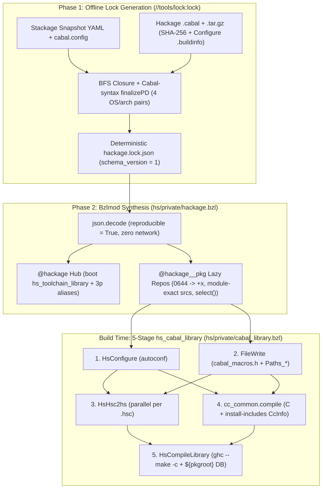
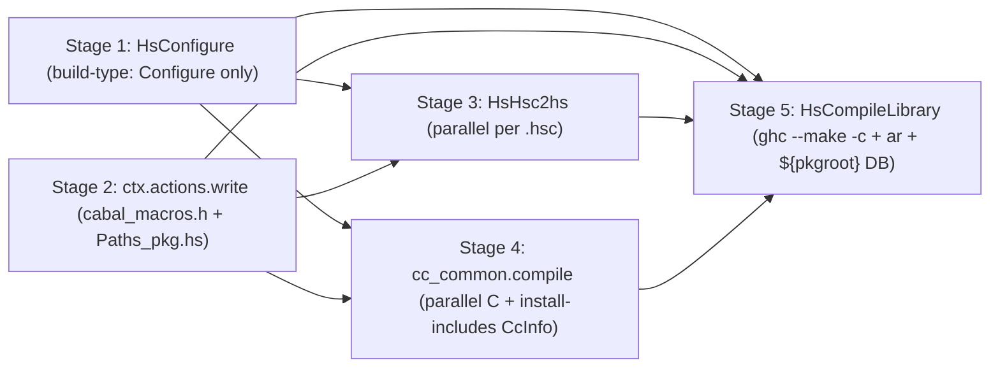

Supporting the real-world Haskell package ecosystem inside Bazel is notoriously tricky: `.cabal` files use indentation-sensitive conditional stanzas (`if os(...)`, `if arch(...)`, `if impl(ghc >= ...)`, `if flag(...)`), internal sublibraries, `hsc2hs` FFI preprocessors, autoconf `./configure` header generators, C-only helper packages (`zlib-clib`), textual `#include`d `.c` files (`crypton`), `Paths_<pkg>` autogen modules, and doctest-only `Custom` setups (`xml-conduit`).

Rather than re-implementing a partial `.cabal` parser in Starlark or shelling out to an opaque `runghc Setup.hs` wrapper at build time, `rules_hs` splits Hackage support into **two clean phases** backed by a **5-stage Bazel build rule** (`bzl:rule:hs_cabal_library`):

---

## Phase 1: Dogfooded `Cabal-syntax` Lock Generator (`//tools/lock`) {#phase-1-lock-generator}

`cli:lock` (`tools/lock/BUILD.bazel`, `Main.hs`, `CabalExtract.hs`, `LockJson.hs`) is a ~1,400-line Haskell tool built **exclusively from GHC's boot libraries** (`base`, `Cabal-syntax`, `bytestring`, `containers`, `directory`, `filepath`, `process`, `text`) — zero third-party Hackage dependencies, zero YAML/JSON external packages, and zero host `cabal` or `stack` binaries. Because it uses GHC's own official `Cabal-syntax` parser and evaluator, `.cabal` specification fidelity is 100%.

### 1. Stackage Snapshot & Boot Plane Resolution (`Main.hs`, `CabalExtract.hs`)

1. **Snapshot YAML parsing (`parseStackageYaml`)**: Downloads `https://raw.githubusercontent.com/commercialhaskell/stackage-snapshots/master/lts/<maj>/<min>.yaml` (default `lts-24.67`, or reads `--snapshot-yaml`) and parses `resolver.compiler`, per-package `flags:`, and `- hackage: <pkg>-<ver>@sha256:<hex>,<size>` entries with an indentation-aware pure `Text` parser.
2. **Boot package plane (`builtinBootPackages` + `parseCabalConfigBootPkgs`)**: Combines exact boot package versions for the target GHC release (`9.10.*` -> 41 boot packages; `9.12.*` -> 42 boot packages adding `file-io`) with `<pkg> installed` constraints parsed from Stackage's `cabal.config` (plus implicit `rts` and any CLI `--boot-pkg <pkg>=<ver>` overrides).
3. **Flag precedence**: Merges Stackage snapshot flags with repeatable CLI `--flag <pkg>:<flag>=<true|false>` overrides (`optFlags` wins over `sdFlags`).

### 2. BFS Closure & Tarball Verification (`resolveQueue`)

Starting from the user's root `--package` flags, `resolveQueue` performs a breadth-first search over non-boot dependencies (`collectComponentDeps` automatically excludes boot packages, self-references, and Windows-only `Win32`):

- Downloads `<pkg>.cabal` and `<pkg>-<ver>.tar.gz` from `https://hackage.haskell.org/package/...` into `--cache-dir` (default `/tmp/rules_hs_lock_cache`).
- Computes the exact tarball SHA-256 via `computeSha256` (`sha256sum` with `shasum -a 256` fallback on macOS).
- Parses the raw `.cabal` bytes with `Distribution.PackageDescription.Parsec.parseGenericPackageDescription` (`parseCabalBytes`) and extracts `x-revision` (`extractRevision`).

### 3. Two-Pass Multi-Platform `finalizePD` (`finalizeForPlatform`)

Every `GenericPackageDescription` is evaluated across all four Unix target platforms (`allPlatforms` in `tools/lock/CabalExtract.hs`):

| Lockfile Key | `Cabal-syntax` `Platform` |
|---|---|
| `linux_x86_64` | `Platform X86_64 Linux` |
| `linux_arm64` | `Platform AArch64 Linux` |
| `macos_arm64` | `Platform AArch64 OSX` |
| `macos_x86_64` | `Platform X86_64 OSX` |

`finalizeForPlatform` invokes `Distribution.PackageDescription.Configuration.finalizePD` with `CompilerId GHC <ghcVer>` in two passes:

- **Pass 1 (`strictCheck`)**: Checks `withinRange v vr` against every package version in `availVersions` (snapshot + boot). This accurately steers Cabal conditionals that branch on dependency version bounds.
- **Pass 2 (`relaxedCheck`, fallback)**: Stackage snapshots occasionally ship packages whose `.cabal` upper bounds lag behind a newer boot library (`allow-newer` in Stackage builds). If Pass 1 fails, Pass 2 accepts any package present in `availVersions` *except* `bytestring` (which keeps `withinRange` so legacy `flag(bytestring-lt-0_10)` fallback stanzas never accidentally trigger!).

### 4. Common vs. Per-Platform `select` Factoring (`mergeRawComps`)

Rather than duplicating full metadata 4 times per package in `hackage.lock.json`, `mergeRawComps` computes `splitField` across all 14 list attributes (`exposed_modules`, `other_modules`, `reexported_modules`, `hs_source_dirs`, `default_extensions`, `ghc_opts`, `c_sources`, `include_dirs`, `install_includes`, `cpp_options`, `cc_options`, `extra_libraries`, `deps`, `sublib_deps`):

- **`base` (common)**: The set intersection across all evaluated platforms, preserving the deterministic element order of the first platform.
- **`select` (`PlatformDelta`)**: Only elements not in `commonSet` are emitted per platform. If `all isDeltaEmpty` across all four platforms (true for ~85% of pure-Haskell Hackage packages), the `"select"` JSON key is omitted completely, keeping lockfiles compact and human-reviewable.

### 5. Flag Sanitization, `Custom` Normalization & `Configure` Inspection

`CabalExtract.hs` and `Main.hs` normalize three pervasive Hackage quirks during extraction:

1. **Third-party `ghc-options` sanitization (`sanitizeGhcOpts`)**: Strips upstream warning and executable-only flags (`-Werror`, `-Werror=*`, `-W*`, `-fwarn-*`, `-fno-warn-*`, `-w`, `-threaded`, `-rtsopts`, `-with-rtsopts=*`, `-fllvm`, `-ferror-spans`) so newer GHC warnings never break pinned third-party libraries, while preserving codegen and optimization flags (`-O2`, `-funbox-strict-fields`, `-fno-cse`, `-optc-O3`).
2. **Doctest-only `build-type: Custom` normalization (`classifyBuildType`)**: Inspects `custom-setup` `setup-depends`. Whenever `setup-depends` is non-empty and restricted exclusively to `["base", "Cabal", "Cabal-syntax", "cabal-doctest", "filepath", "directory"]` (e.g., `xml-conduit`), `Setup.hs` only wires `Build_doctests` for test suites and is a complete no-op for the library component — so `classifyBuildType` normalizes `build_type` to `"Simple"`.
3. **Autoconf `build-type: Configure` tarball discovery (`classifyBuildType` + `discoverConfigureInstallIncludes`)**:
   - Lists tarball members via `tar -tzf` (`listTarballFiles`).
   - Infers `configure_outputs` from `.h` files in Cabal's `extra-tmp-files` (or `*.h.in` stripped of `.in`).
   - Collects `configure_srcs` (`configure`, `config.guess`, `config.sub`, `install-sh`, `aclocal.m4`, `configure.ac`, `*.h.in`, `*.buildinfo`, `include/*.h`, `cbits/*.h`, and `cbits/conv.c` referenced by `AC_CONFIG_SRCDIR` in `unix-time`).
   - Reads `<pkg>.buildinfo` and `configure.ac` out of the tarball via `tar -xOzf` (`discoverConfigureInstallIncludes`) to capture generated headers dynamically appended to `install-includes:` by `./configure` — such as `HsNetworkConfig.h` in `network` and `HsTimeConfig.h` in `old-time`!

### 6. Internal Sublibraries, C++/Legacy Extensions, `Paths_*` & Canonical JSON (`LockJson.hs`)

- **Internal sublibraries (`extractDeps` + `expandSublibs`)**: Handles both Cabal 3 qualified `pkg:sublib` syntax (`LSubLibName`) and Cabal 2.0 unqualified internal sublibrary names (`attoparsec-internal`), transitively expanding only sublibraries reachable from the main library.
- **C++, assembly & legacy Cabal 1.x extensions**: `CabalExtract.hs` extracts Cabal `cxx-sources` and `asm-sources` alongside `c-sources` (`cSources bi ++ cxxSources bi ++ asmSources bi`), `cxx-options` alongside `cc-options`, and legacy Cabal 1.x `extensions:` (`oldExtensions`) in addition to `default-extensions:`.
- **`Paths_<pkg>` detection**: Detects `Paths_<pkg_ident>` in `other-modules` or `autogen-modules`, sets `generate_paths_module = True`, and removes `Paths_<pkg_ident>` from static `other_modules` so Stage 2 generates it cleanly.
- **Deterministic JSON (`LockJson.encodePretty`)**: Serializes `LockFile` (`schema_version = 1`) with 2-space indentation, sorted `Map.toAscList` keys, compact `[]`/`{}` empty containers, and trailing newline — tested offline by `//tools/lock:lock_test` (`tools/lock/LockTest.hs`).

---

## Phase 2: Pure-Starlark `@hackage` Synthesis (`hs/private/hackage.bzl`) {#phase-2-starlark-extension}

During Bzlmod evaluation, `_hackage_impl` (`hs/private/hackage.bzl`) reads `hackage.lock.json` via `json.decode(module_ctx.read(lock_label))`, merges any `bzl:ext:hackage.override` tags (`_merge_override`), and returns `module_ctx.extension_metadata(reproducible = True)`. Zero network requests or subprocesses run during extension evaluation.

### 1. Unified `@hackage` Hub Repository (`_hackage_hub_repo`)

`_hackage_hub_repo` generates a single `BUILD.bazel` giving users one uniform `@hackage//:<name>` namespace:

- **Boot libraries**: Emits `hs_toolchain_library(name = "<pkg>", package_name = "<pkg>")` for every entry in `boot_packages` (automatically skipping any boot package name overridden in `packages`).
- **Locked Hackage libraries**: Emits `alias(name = "<pkg>", actual = "@hackage__<sanitized_pkg>//:<pkg>")`.
- **Internal sublibraries**: Emits `alias(name = "<pkg>__<sublib>", actual = "@hackage__<sanitized_pkg>//:<sublib>")` (for example, `@hackage//:attoparsec__attoparsec-internal`).

### 2. Lazy Per-Package Repositories (`_hackage_package_repo`)

Bazel only fetches `@hackage__<sanitized_pkg>` when a build target actually depends on it. When fetched, `_hackage_package_repo_impl` performs four key steps in pure Starlark:

1. **Executable bit restoration on `0644` autoconf scripts**: Several upstream Hackage tarballs (`network`, `old-time`) archive `configure`, `config.guess`, `config.sub`, or `install-sh` with mode `0644`. When `build_type == "Configure"`, `_hackage_package_repo_impl` rewrites those files via `repository_ctx.file(helper_script, content = repository_ctx.read(helper_script), executable = True)`.
2. **Module-exact source resolution (`_find_module_files`)**: Rather than globbing `**/*.hs` (which accidentally pulls in `Setup.hs`, `test/`, `bench/`, or Windows-only `System/Posix/Windows.hsc` files sitting in the same directory!), `_find_module_files` maps each active module name `A.B.C` in `exposed_modules + other_modules` to `<hs_source_dir>/A/B/C.{hsc,hs,lhs}` plus any companion `.hs-boot` / `.lhs-boot` file. Per-platform `select` modules are resolved identically into `srcs` / `hsc_srcs` `select({...})` branches.
3. **Textual-include-preserving `hdrs` globs**: Some C-backed Hackage packages `#include` `.c` files or extensionless macro snippets directly from other `.c`/`.hs` files (e.g., `crypton` `#include`s `cbits/*_impl.c`, and `vector` `#include`s `internal/unbox-tuple-instances`). `_emit_component_rule` globs `_HDR_GLOB_PATTERNS` (`**/*.h`, `**/*.hpp`, `**/*.inc`, `cbits/**/*.c`, `cbits-extra/**/*.c`, `cbits-unix/**/*.c`, `cbits-apple/**/*.c`, `include/**/*.c`, `src/cbits/**/*.c`, plus `<include_dir>/**` for every declared `include_dirs`) while **excluding `all_c_sources`** so compiled `.c` translation units are compiled once in `c_sources` and textual `#include` helpers stay tracked in `hdrs`!
4. **Lazy Boot-Only `alex` & `happy` Grammar Bootstrapping (`hs/private/cabal_codegen.bzl`)**: Whenever a locked Hackage package contains `.x` (Alex lexer) or `.y`/`.ly` (Happy parser) grammar sources (e.g., inside the `pandoc` / `skylighting` closure), `hackage.bzl` and `hs/private/cabal_codegen.bzl` lazily bootstrap `alex-3.5.4.2` and `happy-2.1.7` purely from `@hs_boot` and preprocess `.x`/`.y`/`.ly` files into `.hs` ahead of Stage 5 — requiring zero host `alex`/`happy` installations and incurring zero downloads when unused!
5. **Sublibrary-first rule emission**: Emits `_PLATFORM_CONFIGS` `config_setting` targets (only when `_component_uses_select` is true), emits internal sublibrary `bzl:rule:hs_cabal_library` targets first (`build_type = "Simple"`), and finally emits the main library `bzl:rule:hs_cabal_library` target referencing `:sublib` labels.

---

## The 5-Stage `hs_cabal_library` Build Pipeline {#five-stage-pipeline}

`hs/private/cabal_library.bzl` compiles every Cabal component without `Setup.hs` or `cabal_wrapper.py` by decomposing the build into five fine-grained Bazel stages:

### Stage 1: Sandboxed Autoconf (`HsConfigure`)

Executed **only** when `build_type == "Configure"`. `run_configure_action` (`hs/private/actions.bzl`):

- Creates an ephemeral writable directory `WORK="$(mktemp -d "${TMPDIR:-/tmp}/hs_cfg.XXXXXX")"` (`trap 'rm -rf "$WORK"' EXIT`) and copies `configure_script` + `configure_srcs` into `$WORK` preserving package-relative paths, so `./configure` never mutates the Bazel execroot or leaves untracked `config.log` / `config.status` files behind.
- Anchors any relative `--sysroot` entries in `RULES_HS_CC_EXTRA_ARGS` to `$EXECROOT/` before changing directory into `$WORK`.
- Exports `CC` and `CXX` pointing to `ghc_cc_wrapper`, `AR` and `LD` from `cc_tools`, `CFLAGS="-fPIC -I<rts_include_dir> <dep_include_dirs>"`, `LDFLAGS="-Wno-unused-command-line-argument"`, and `CONFIG_SHELL="/bin/sh"`.
- Executes `(cd "$WORK" && /bin/sh "./<configure_script>" <configure_args>)` and copies declared `configure_outputs` out to `bazel-out/.../<name>_configure/<rel_out>`, registering both output parent directories and `<configure_root>/<inc_dir>` in `-I` search paths (handling both `#include "HsNetworkConfig.h"` and `#include "include/HsNetworkConfig.h"`).

### Stage 2: Zero-Subprocess Codegen (`cabal_macros.h` & `Paths_<pkg>.hs`)

Executed entirely in Bazel's analysis/file-write engine via `ctx.actions.write` (zero shell or compiler subprocesses):

- **`write_cabal_macros_h`**: Generates `<name>_autogen/cabal_macros.h` defining `CURRENT_PACKAGE_VERSION`, `CURRENT_PACKAGE_KEY`, `CURRENT_COMPONENT_ID`, `TOOL_VERSION_ghc`, `MIN_TOOL_VERSION_ghc(maj1,maj2,min)`, and `VERSION_<ident>` / `MIN_VERSION_<ident>(maj1,maj2,min)` for every direct `HsPackageInfo` dependency (plus the package itself).
- **`write_paths_module`**: When `generate_paths_module = True`, writes `<name>_autogen/Paths_<pkg_ident>.hs` exporting `version`, `getBinDir`, `getLibDir`, `getDynLibDir`, `getDataDir`, `getLibexecDir`, `getSysconfDir`, and `getDataFileName` (`{-# OPTIONS_GHC -w #-}`, `NoRebindableSyntax`).

### Stage 3: Parallel Per-File `hsc2hs` (`HsHsc2hs`)

When `hsc_srcs` is non-empty, `run_hsc2hs_actions` spawns **one independent `HsHsc2hs` action per `.hsc` file**, allowing a package with 12 `.hsc` modules (such as `network` or `unix`) to preprocess all 12 concurrently across local cores or RBE workers:

- Strips the longest matching `hs_source_dirs` prefix so `<name>_hsc/Network/Socket/Internal.hs` preserves exact module hierarchy for Stage 5's `-i<hsc_root>`.
- Passes `--template=<template-hsc.h>`, `--cc=<ghc_cc_wrapper>`, `--ld=<ghc_cc_wrapper>`, `-I.`, `-I<rts_include_dir>`, local + Stage 1 + transitive `include_dirs`, `--cflag=-include --cflag=<cabal_macros.h>`, `--cflag=-fPIC`, `cpp_options`, `cc_options`, and Cabal's standard target CPP macros (`_hsc2hs_ghc_defines`: `-D__GLASGOW_HASKELL__=910`, `-D__GLASGOW_HASKELL_PATCHLEVEL1__=3`, `-Dlinux_BUILD_OS=1`, `-Dlinux_HOST_OS=1`, `-Dx86_64_BUILD_ARCH=1`, `-Dx86_64_HOST_ARCH=1`).

### Stage 4: Native C/C++ Compilation & C-Only Short-Circuit (`cc_common.compile`)

`compile_c_sources` (`hs/private/actions.bzl`) delegates C and C++ compilation directly to `rules_cc`'s `cc_common.compile` + `cc_common.create_linking_context_from_compilation_outputs(..., disallow_dynamic_library = True)`:

- Compiles every file in `c_sources` (including `cxx-sources` and `asm-sources`) in parallel with `-fPIC -Wno-unused-command-line-argument -I<rts_include_dir> -include <cabal_macros.h>` plus `_hsc2hs_ghc_defines` (`-D__GLASGOW_HASKELL__`, `-D<os>_HOST_OS=1`, `-D<cpu>_HOST_ARCH=1` — relied upon by packages like `digest`), splitting C-only `-std=*` flags (`conly_flags`) from `-std=c++*` / `-std=gnu++*` / `-stdlib=*` (`cxx_flags`) so mixed C/C++ targets never reject language-specific standard flags, and exposing GHC boot-package C headers (`HsUnixConfig.h`, `HsTimeConfig.h`, `fpstring.h`, etc.) to C, `hsc2hs`, and `./configure` actions.
- Splits `hdrs + configure_outputs` cleanly: files matching `_HEADER_EXTENSIONS` (`.h`, `.hh`, `.hpp`, `.hxx`, `.inc`, `.inl`) go into `private_hdrs` (plus GHC's `rts_headers`), while all files (including `#include`d `.c` implementation snippets and extensionless macro files) go into `additional_inputs` so `rules_cc` never rejects non-`.h` extensions in `private_hdrs`!
- Resolves Cabal `install_includes` via `_resolve_install_includes` into `public_hdrs` and exposes package/configure `include_dirs` (but *not* GHC's internal `rts_include_dir`) in `includes` on the returned `CcInfo`.
- **C-only package short-circuit**: When `has_haskell` is `False` (no `srcs`, no `hsc_srcs`, no `generate_paths_module`, no `reexported_modules`), `_hs_cabal_library_impl` returns `[DefaultInfo, HsPackageInfo(unit_id = None, ...), HsLinkInfo, merged_cc_info]` immediately after Stage 4 — skipping GHC and `ghc-pkg` completely (verified by `//tests/starlark:hs_cabal_c_only_test` and `//tests/basic:cabal_c_only`).

### Stage 5: Haskell Library Compilation (`HsCompileLibrary`)

Runs in parallel with Stage 4's C object compilation! `compile_hs_library_action` invokes `ghc --make -c` with `-optP-include <cabal_macros.h>` and `-optc-include <cabal_macros.h>` (for `CApiFFI` stubs), archives `libHS<unit_id>.a` via `@objects.rsp`, writes `${pkgroot}` `<unit_id>.conf`, and runs `ghc-pkg recache`.

::: {.tip title="Stage 4 and Stage 5 Run in Parallel"}
Notice in the pipeline graph above that Stage 5 (`HsCompileLibrary`) depends on Stage 1 (`configure_outputs` headers), Stage 2 (`cabal_macros.h` + `Paths_*`), and Stage 3 (`hsc2hs` `.hs` outputs), **not** on Stage 4's compiled `.o`/`.a` C outputs! For C-heavy packages like `crypton` (39+ `.c` files and 100+ `.hs` modules), Bazel compiles all 39 C files via `cc_common.compile` concurrently while GHC compiles the Haskell modules.
:::

---

## Real-World Hackage Case Studies {#case-studies}

Every stage and edge-case handler above exists to support concrete packages in `examples/size/hackage.lock.json` and `docs/hackage.lock.json`:

### 1. `zlib` (`0.7.1.1`), `zlib-clib` (`1.3.2`), & `streaming-commons` (`0.2.3.1`)

- Locked with `--flag zlib:bundled-c-zlib=true --flag zlib:pkg-config=false`.
- `zlib-clib` has **zero Haskell modules**, 11 ANSI C files (`cbits/adler32.c`, `deflate.c`, `inflate.c`, ...), and 11 `install-includes` headers (`zlib.h`, `zconf.h`, ...). `bzl:rule:hs_cabal_library` short-circuits after Stage 4, producing a pure `CcInfo` static library + public header context.
- `zlib` depends on `@hackage//:zlib-clib`, compiles `cbits-extra/hs-zlib.c` (`-DNON_BLOCKING_FFI`) and its `.hsc`/`.hs` modules, and re-propagates `zlib-clib`'s `CcInfo` transitively.
- Two hops downstream, `streaming-commons` declares `deps = [..., "@hackage//:zlib"]` (*without* depending directly on `zlib-clib`), and its `cbits/zlib-helper.c` executes `#include <zlib.h>` — resolved seamlessly through transitive `CcInfo` propagation!
- Alternatively, polyglot repos that already pin BCR `zlib` can lock with `--flag zlib:bundled-c-zlib=false --flag zlib:pkg-config=false` and declare `hackage.override(package = "zlib", extra_cc_deps = ["@zlib//:zlib"])` in `MODULE.bazel`.

### 2. `network` (`3.2.14.0`), `unix-time` (`0.4.17`), & `old-time` (`1.1.1.0`)

- All three use `build-type: Configure`.
- `//tools/lock` inspects `network.buildinfo` and `old-time.buildinfo` inside their tarballs to add generated `HsNetworkConfig.h` and `HsTimeConfig.h` to `install_includes`, and includes `cbits/conv.c` in `unix-time`'s `configure_srcs` (required by its `AC_CONFIG_SRCDIR` check).
- `_hackage_package_repo` restores `+x` permissions on `0644` `configure` / `config.sub` / `config.guess` / `install-sh` scripts.
- Stage 1 runs `./configure` in a disposable `$WORK` temp dir via `ghc_cc_wrapper`, Stage 3 runs `hsc2hs` in parallel across all socket `.hsc` files (relying on `cc_wrapper.c`'s `-nostdinc++` guard so `_GNU_SOURCE` in `HsNet.h` exposes `struct ucred` and `struct in6_pktinfo`), and Stage 4 exports `HsNet.h` + `HsNetworkConfig.h` downstream.

### 3. `crypton` (`1.0.6`)

- Combines 39 cross-platform C files (`cbits/argon2/argon2.c`, `cbits/ed25519/*.c`, `cbits/decaf/...`) with architecture-specific `select()` branches generated by `mergeRawComps`:
  - `linux_x86_64` & `macos_x86_64`: adds `Crypto.Random.Entropy.RDRand`, `cbits/aes/x86ni.c`, `cbits/blake2/sse/*.c`, `-DARCH_X86_64`, `-DSUPPORT_RDRAND`, `-DSUPPORT_SSE`, `-DWITH_AESNI`, `-DWITH_PCLMUL`.
  - `linux_arm64` & `macos_arm64`: selects portable `cbits/blake2/ref/*-ref.c` and `include_dirs = ["cbits/blake2/ref"]`.
- Several `crypton` `.c` files textually `#include` sibling `.c` implementation files inside `cbits/`. Because `_emit_component_rule` includes `cbits/**/*.c` in `hdrs` (excluding compiled `c_sources`) and `compile_c_sources` passes non-`.h` files via `additional_inputs`, every included `.c` file is hermetically sandboxed without triggering `rules_cc` header-extension errors.

### 4. `attoparsec` (`0.14.4`), `cborg` (`0.2.10.0`), `tls` (`2.1.8`), & `xml-conduit` (`1.10.1.0`)

- **`attoparsec`**: Exercises Cabal 2.0 internal sublibraries (`attoparsec-internal` in `hs-source-dirs: internal`, built ahead of main `attoparsec` and aliased at `@hackage//:attoparsec__attoparsec-internal`).
- **`cborg` & `tls`**: Contain intra-package `.hs-boot` mutual recursion cycles (`_find_module_files` pairs `.hs-boot` files automatically and Stage 5's `ghc --make -c` compiles the cycle cleanly).
- **`xml-conduit`**: Declares `build-type: Custom` solely for `cabal-doctest`; `classifyBuildType` normalizes it to `"Simple"` with zero `Setup.hs` overhead.

### 5. Dogfooding the Documentation Engine (`hakyll`, `pandoc`, `skylighting`)

- `docs/hackage.lock.json` locks `hakyll`, `pandoc`, `pandoc-types`, `skylighting`, `citeproc`, and `aeson` on `lts-24.67` using:
  - `--flag hakyll:checkexternal=false --flag hakyll:watchserver=false --flag hakyll:previewserver=false` (keeping Hakyll's full `Rules` / `Compiler` / `Pandoc` / `Context` / `RelativizeUrls` engine while pruning `warp`/`wai`/`http-conduit`/`fsnotify`).
  - `--flag pandoc:embed_data_files=true --flag citeproc:embed_data_files=true` (compiling Pandoc and Citeproc data files directly into the binary via cross-library `file-embed` Template Haskell splices so `//docs:docs_gen` needs zero runtime `Paths_pandoc` data lookups in Bazel sandboxes).
  - `--flag zlib:bundled-c-zlib=true --flag zlib:pkg-config=false` (compiling `zlib-clib` from C source).
- For full details on the documentation compiler itself, see `doc:internals/docs-engine`.
