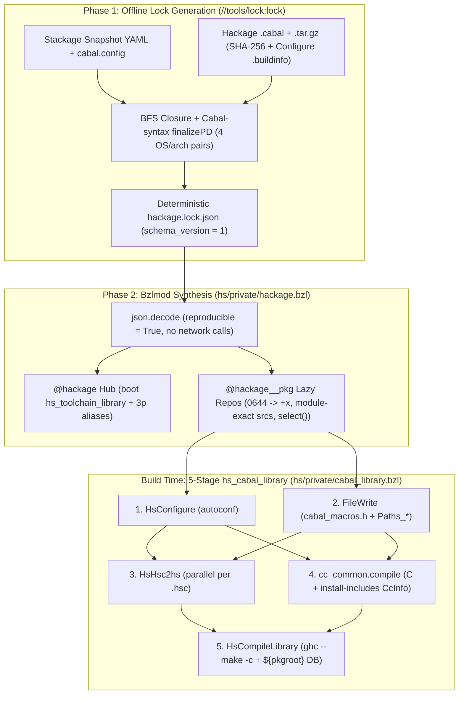
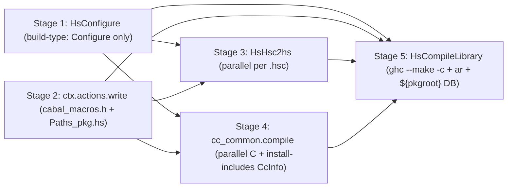

> **New to Cabal, Hackage, Stackage, or Bzlmod?** Read the [Haskell & GHC Primer](haskell-and-ghc-primer.md) (especially [Ecosystem Map](haskell-and-ghc-primer.md#ecosystem-map), [Boot Libraries](haskell-and-ghc-primer.md#boot-libraries), and [Haskell Build Mechanisms](haskell-and-ghc-primer.md#build-mechanisms)) and the [Bazel Ruleset Primer](bazel-rules-primer.md) ([Bzlmod & Lazy Repositories](bazel-rules-primer.md#bzlmod-and-repos) and [Rules & Actions](bazel-rules-primer.md#rules-and-actions)) first for background context.

Building third-party Hackage packages inside Bazel involves several moving parts: `.cabal` files use indentation-sensitive conditionals (`if os(...)`, `if arch(...)`, `if impl(ghc >= ...)`, `if flag(...)`), internal and public sublibraries, `hsc2hs` C-binding preprocessors, `alex` and `happy` grammar generators, autoconf `./configure` scripts, C-only helper packages (`zlib-clib`), C files textually `#include`d into other C files (`crypton`), generated `Paths_<pkg>` modules, and legacy `cabal-doctest` `Custom` setups (`xml-conduit`).

Rather than writing a partial `.cabal` parser in Starlark or running an opaque `Setup.hs` build script inside a single Bazel action, `rules_hs` divides Hackage integration into **an offline lockfile step** and **a Starlark repository step**, backed by a **5-stage Bazel build rule** ([`hs_cabal_library`](../reference/rules.md#hs_cabal_library)):



---

## Phase 1: Self-Hosted `Cabal-syntax` Lock Generator (`//tools/lock`) {#phase-1-lock-generator}

[`//tools/lock:lock`](../reference/lock-cli.md) (`tools/lock/BUILD.bazel`, `Main.hs`, `CabalExtract.hs`, `LockJson.hs` — also exposed as library `//tools/lock:lock_lib` with Haddock API docs at `//tools/lock:lock_haddock`) is an ~1,400-line Haskell command-line tool compiled by `rules_hs` itself using **only GHC's bundled boot libraries** (`base`, `Cabal-syntax`, `bytestring`, `containers`, `directory`, `filepath`, `process`, `text`). It requires no external Hackage libraries and no `cabal` or `stack` installation on the host. Because it calls GHC's own `Cabal-syntax` library directly, it parses the full `.cabal` file specification.

### 1. Loading the Stackage Snapshot and Boot Package Versions (`Main.hs`, `CabalExtract.hs`)

1. **Snapshot YAML parsing (`parseStackageYaml`)**: Downloads `https://raw.githubusercontent.com/commercialhaskell/stackage-snapshots/master/lts/<maj>/<min>.yaml` (default `lts-24.67`, or reads a local file via `--snapshot-yaml`) and parses `resolver.compiler`, per-package `flags:`, and `- hackage: <pkg>-<ver>@sha256:<hex>,<size>` entries. Because Stackage snapshot YAML files follow a fixed indentation layout, a small `Text` parser in `CabalExtract.hs` reads them directly without an external YAML package.
2. **Boot package versions (`builtinBootPackages` + `parseCabalConfigBootPkgs`)**: Combines the built-in boot package table for the target GHC release (`9.10.*` -> 41 boot packages plus `system-cxx-std-lib`; `9.12.*` -> 42 boot packages adding `file-io`) with `<pkg> installed` entries from Stackage's `cabal.config` (plus `rts` and any `--boot-pkg <pkg>=<ver>` CLI overrides).
3. **Flag precedence**: Merges Stackage's per-package Cabal flags with repeatable `--flag <pkg>:<flag>=<true|false>` CLI overrides (CLI flags take precedence over snapshot defaults).

### 2. Breadth-First Dependency Walk and Checksum Verification (`resolveQueue`)

Starting from the root `--package` arguments passed on the command line, `resolveQueue` walks all non-boot dependencies using breadth-first search (`collectComponentDeps` skips GHC boot packages, self-references, and the Windows-only `Win32` package):

- Downloads `<pkg>.cabal` and `<pkg>-<ver>.tar.gz` from `https://hackage.haskell.org/package/...` into `--cache-dir` (default `/tmp/rules_hs_lock_cache`). When the Stackage snapshot pins a `.cabal` SHA-256 digest (`spCabalSha256`), `fetchVerifiedCabal` checks the downloaded `.cabal` file against that SHA-256 (caching it under `<pkg>-<ver>-<sha256>.cabal`). If Hackage's mutable `<pkg>.cabal` endpoint has moved on to a newer metadata `x-revision`, `fetchVerifiedCabal` steps backwards through `revision/<r>.cabal` until the digest matches.
- Computes the `.tar.gz` SHA-256 digest via `computeSha256` (`sha256sum`, falling back to `shasum -a 256` on macOS).
- Parses the `.cabal` file with `Distribution.PackageDescription.Parsec.parseGenericPackageDescription` (`parseCabalBytes`) and reads the `x-revision` integer (`extractRevision`).

### 3. Evaluating Cabal Conditionals Across Four Platforms (`finalizeForPlatform`)

In `Cabal-syntax`, a parsed `.cabal` file (`GenericPackageDescription`) still contains unevaluated `if os(...)`, `if arch(...)`, `if impl(ghc >= ...)`, and `if flag(...)` trees. Calling `Distribution.PackageDescription.Configuration.finalizePD` evaluates those conditionals for a specific OS, CPU, GHC version, and flag map to produce a flat `PackageDescription`.

`CabalExtract.hs` runs `finalizeForPlatform` four times for every package (`allPlatforms`):

| Lockfile Key | `Cabal-syntax` `Platform` |
|---|---|
| `linux_x86_64` | `Platform X86_64 Linux` |
| `linux_arm64` | `Platform AArch64 Linux` |
| `macos_arm64` | `Platform AArch64 OSX` |
| `macos_x86_64` | `Platform X86_64 OSX` |

Each platform evaluation runs in up to two passes:

- **Pass 1 (`strictCheck`)**: Checks `withinRange v vr` against every package version available in the snapshot and boot table. Checking exact version bounds matters because some `.cabal` files use `if flag(...)` branches to choose between newer and older dependency APIs based on version constraints.
- **Pass 2 (`relaxedCheck`, fallback)**: Stackage snapshots occasionally include packages whose `.cabal` upper version bounds have not yet been updated for a newer GHC boot library (`allow-newer` in Stackage builds). If Pass 1 fails to satisfy a version range, Pass 2 accepts any package present in the snapshot or boot set, *except* `bytestring` (which keeps strict `withinRange` checking so legacy `flag(bytestring-lt-0_10)` branches never activate by mistake).

### 4. Factoring Common Fields vs. Per-Platform `select` Deltas (`mergeRawComps`)

Rather than repeating the entire module and dependency list four times per package in `hackage.lock.json`, `mergeRawComps` splits all 14 list fields into shared base values and per-platform differences:

- For unordered set-like fields (`exposed_modules`, `other_modules`, `reexported_modules`, `hs_source_dirs`, `default_extensions`, `c_sources`, `include_dirs`, `install_includes`, `extra_libraries`, `deps`, `sublib_deps`), `splitField` takes the set intersection across all four platforms (preserving the element order of the first platform) as `base`, and places platform-only items into `select`.
- For order-sensitive compiler flag lists (`ghc_opts`, `cpp_options`, `cc_options`), `splitOrderedFlags` extracts the shared leading prefix across platforms (taking care never to split a two-token flag pair such as `-include foo.h` across `base` and `select`).
- If all four platform deltas are empty (which is true for roughly 85% of Hackage packages), the `"select"` JSON field is omitted completely so `hackage.lock.json` stays compact and easy to read in code review.

### 5. Flag Sanitization, `Custom` Normalization, and `Configure` Inspection

`CabalExtract.hs` and `Main.hs` normalize three common Hackage patterns during lock generation:

1. **Sanitizing third-party `ghc-options` (`sanitizeGhcOpts`)**: Strips upstream warning flags and executable-only flags (`-Werror`, `-Werror=*`, `-W*`, `-fwarn-*`, `-fno-warn-*`, `-w`, `-threaded`, `-rtsopts`, `-with-rtsopts=*`, `-fllvm`, `-ferror-spans`) so new compiler warnings in newer GHC releases do not fail third-party library builds, while keeping optimization and code-generation flags (`-O2`, `-funbox-strict-fields`, `-fno-cse`, `-optc-O3`).
2. **Normalizing `cabal-doctest` `build-type: Custom` packages (`classifyBuildType`)**: Dozens of pure Haskell libraries on Hackage (including `xml-conduit`, `lens`, and `bifunctors`) declare `build-type: Custom` even though compiling the library itself uses no custom build steps. Around 2017, before `cabal-install` added package environment files, running `doctest` (a tool that tests `-- >>>` code examples inside Haddock comments) required a 4-line `Setup.hs` wrapper calling `cabal-doctest`'s `defaultMainWithDoctests`. That helper only generated a `Build_doctests.hs` module for the package's `test-suite` component and delegated the `library` build unchanged to `Simple` `defaultMain`. `classifyBuildType` inspects the `custom-setup` `setup-depends` list: when `setup-depends` is non-empty and contains only packages from `["base", "Cabal", "Cabal-syntax", "cabal-doctest", "filepath", "directory"]`, `classifyBuildType` records `"build_type": "Simple"`. For bespoke `Custom` packages outside that allowlist, `classifyBuildType` leaves `"build_type": "Custom"`, and `hs_cabal_library` rejects `"Custom"` with a clear analysis error rather than executing arbitrary `Setup.hs` code during a Bazel build.
3. **Inspecting `build-type: Configure` tarballs (`classifyBuildType` + `discoverConfigureInstallIncludes`)**:
   - Lists files inside the `.tar.gz` archive via `tar -tzf` (`listTarballFiles`).
   - Infers `configure_outputs` from `.h` files listed in Cabal's `extra-tmp-files` (or `*.h.in` templates stripped of `.in`).
   - Collects `configure_srcs` (`configure`, `config.guess`, `config.sub`, `install-sh`, `aclocal.m4`, `configure.ac`, `*.h.in`, `*.buildinfo`, `include/*.h`, `cbits/*.h`, and `cbits/conv.c` checked by `AC_CONFIG_SRCDIR` in `unix-time`).
   - Reads `<pkg>.buildinfo` and `configure.ac` from the tarball (`discoverConfigureInstallIncludes`) to find generated headers appended to `install-includes:` by `./configure` — such as `HsNetworkConfig.h` in `network` and `HsTimeConfig.h` in `old-time`.

### 6. Sublibraries, C++/Assembly Sources, `Paths_*`, and Deterministic JSON (`LockJson.hs`)

- **Internal and Cabal 3.0 public sublibraries (`extractDeps` + `expandSublibs`)**: Supports Cabal 3.0 qualified `pkg:sublib` dependencies (`LSubLibName`) for both internal sublibraries and public sublibraries in other packages (emitting `pkg__sublib` hub labels), as well as Cabal 2.0 unqualified internal sublibrary names (`attoparsec-internal`), expanding all sublibraries transitively reachable from the main library or public sublibraries.
- **C++, assembly, and legacy Cabal 1.x fields**: `CabalExtract.hs` collects `cxx-sources` and `asm-sources` alongside `c-sources`, `cxx-options` alongside `cc-options`, and legacy Cabal 1.x `extensions:` alongside `default-extensions:`.
- **`Paths_<pkg>` detection**: Detects `Paths_<pkg_ident>` in `other-modules` or `autogen-modules`, sets `generate_paths_module = True`, and removes `Paths_<pkg_ident>` from `other_modules` so Stage 2 generates it once.
- **Deterministic JSON output (`LockJson.encodePretty`)**: Writes `LockFile` (`schema_version = 1`) with 2-space indentation, alphabetically sorted keys (`Map.toAscList`), compact `[]` and `{}` empty values, and a trailing newline — tested by `//tools/lock:lock_test` (`tools/lock/LockTest.hs`).

---

## Phase 2: Starlark `@hackage` Repository Synthesis (`hs/private/hackage.bzl`) {#phase-2-starlark-extension}

During Bazel's Bzlmod phase, `_hackage_impl` (`hs/private/hackage.bzl`) reads `hackage.lock.json` with `json.decode(module_ctx.read(lock_label))`, merges any [`hackage.override`](../reference/extensions-and-providers.md#hackage-override) tags (`_merge_override`), and returns `module_ctx.extension_metadata(reproducible = True)`. No network requests or subprocesses run while evaluating the module extension.

### 1. Unified `@hackage` Hub Repository (`_hackage_hub_repo`)

`_hackage_hub_repo` writes a single `BUILD.bazel` file that exposes all dependencies under `@hackage//:<name>`:

- **GHC boot libraries**: Emits `hs_toolchain_library(name = "<pkg>", package_name = "<pkg>")` for every entry in `boot_packages` (skipping any boot package name explicitly overridden in `packages`).
- **Locked Hackage packages**: Emits `alias(name = "<pkg>", actual = "@hackage__<sanitized_pkg>//:<pkg>")`.
- **Sublibraries**: Emits `alias(name = "<pkg>__<sublib>", actual = "@hackage__<sanitized_pkg>//:<sublib>")` (for example, `@hackage//:attoparsec__attoparsec-internal`).

### 2. Lazy Per-Package Repositories (`_hackage_package_repo`)

Bazel downloads `@hackage__<sanitized_pkg>` only when a target in the current build actually depends on that package. When fetched, `_hackage_package_repo_impl` runs five steps in Starlark:

1. **Restoring executable permissions on `0644` autoconf scripts**: Several Hackage tarballs (`network`, `old-time`) store `configure`, `config.guess`, `config.sub`, or `install-sh` without `+x` permissions (`0644`). When `build_type == "Configure"`, `_hackage_package_repo_impl` rewrites those scripts with `executable = True`.
2. **Matching exact module source files (`_find_module_files`)**: Globbing `**/*.hs` in a Hackage tarball would pull in `Setup.hs`, test suites, benchmarks, or unused OS-specific files (such as `System/Posix/Windows.hsc` on Linux). Instead, `_find_module_files` maps each active module name `A.B.C` in `exposed_modules + other_modules` to `<hs_source_dir>/A/B/C.{hsc,hs,lhs,x,y,ly}` plus any companion `.hs-boot` or `.lhs-boot` file, emitting matching `select({...})` branches for platform-specific modules.
3. **Tracking `#include`d C implementation snippets in `hdrs`**: A few C-heavy Hackage packages textually `#include` `.c` files or extensionless macro files from other `.c` or `.hs` files (for example, `crypton` `#include`s `cbits/*_impl.c`, and `vector` `#include`s `internal/unbox-tuple-instances`). `_emit_component_rule` globs `_HDR_GLOB_PATTERNS` (`**/*.h`, `**/*.hpp`, `**/*.inc`, `cbits/**/*.c`, `include/**/*.c`, plus `<include_dir>/**`) while **excluding `all_c_sources`**, so compiled `.c` files are compiled once in `c_sources` while `#include`d helper files remain mounted in the Bazel sandbox via `hdrs`.
4. **On-demand `alex` and `happy` grammar compilation (`hs/private/cabal_codegen.bzl`)**: When `_find_module_files` encounters `.x` (`alex`) or `.y` / `.ly` (`happy`) grammar files (for example, inside `pandoc`'s dependency graph), `hackage.bzl` wires `genrule` / action steps backed by `@hackage__bootstrap_alex` (`alex-3.5.4.2`) and `@hackage__bootstrap_happy` (`happy-2.1.7`), which compile purely from `@hs_boot` libraries. Workspaces whose packages contain no `.x` or `.y` files never download or compile `alex` or `happy`.
5. **Emitting sublibraries before the main library**: Emits `_PLATFORM_CONFIGS` `config_setting` targets when `select` is used, emits internal sublibrary [`hs_cabal_library`](../reference/rules.md#hs_cabal_library) targets first (`build_type = "Simple"`), and then emits the main [`hs_cabal_library`](../reference/rules.md#hs_cabal_library) target referencing `:sublib` targets.

---

## The 5-Stage `hs_cabal_library` Build Pipeline {#five-stage-pipeline}

`hs/private/cabal_library.bzl` builds each Cabal library without `Setup.hs` by splitting compilation into five explicit Bazel stages:



### Stage 1: Sandboxed Autoconf (`HsConfigure`)

Runs **only** when `build_type == "Configure"`. `run_configure_action` (`hs/private/actions.bzl`):

- Creates a temporary writable directory `WORK="$(mktemp -d "${TMPDIR:-/tmp}/hs_cfg.XXXXXX")"` (`trap 'rm -rf "$WORK"' EXIT`) and copies `configure_script` and `configure_srcs` into `$WORK` at their package-relative paths, so `./configure` never modifies the Bazel execroot or leaves untracked `config.log` files behind.
- Converts relative `--sysroot` paths in `RULES_HS_CC_EXTRA_ARGS` into absolute paths under `$EXECROOT/` before `cd "$WORK"`.
- Sets `CC` and `CXX` to `ghc_cc_wrapper`, `AR` and `LD` from `cc_tools`, `CFLAGS="-fPIC -I<rts_include_dir> <dep_include_dirs>"`, `LDFLAGS="-Wno-unused-command-line-argument"`, and `CONFIG_SHELL="/bin/sh"`.
- Runs `(cd "$WORK" && /bin/sh "./<configure_script>" <configure_args>)` and copies declared `configure_outputs` to `bazel-out/.../<name>_configure/<rel_out>`, adding both output parent directories and `<configure_root>/<inc_dir>` to C include paths.

### Stage 2: In-Process File Generation (`cabal_macros.h` and `Paths_<pkg>.hs`)

Runs inside Bazel's analysis phase via `ctx.actions.write` without spawning any shell or compiler process:

- **`write_cabal_macros_h`**: Writes `<name>_autogen/cabal_macros.h` defining `CURRENT_PACKAGE_VERSION`, `CURRENT_PACKAGE_KEY`, `CURRENT_COMPONENT_ID`, `TOOL_VERSION_ghc`, `MIN_TOOL_VERSION_ghc(maj1,maj2,min)`, and `VERSION_<ident>` / `MIN_VERSION_<ident>(maj1,maj2,min)` for every direct `HsPackageInfo` dependency.
- **`write_paths_module`**: When `generate_paths_module = True`, writes `<name>_autogen/Paths_<pkg_ident>.hs` exporting `version`, `getBinDir`, `getLibDir`, `getDynLibDir`, `getDataDir`, `getLibexecDir`, `getSysconfDir`, and `getDataFileName`.

### Stage 3: Parallel Per-File `hsc2hs` (`HsHsc2hs`)

When `hsc_srcs` is non-empty, `run_hsc2hs_actions` registers **one independent `HsHsc2hs` action per `.hsc` file**, so a package with a dozen `.hsc` files (such as `network` or `unix`) preprocesses all of them concurrently across local CPU cores or remote workers:

- Strips the longest matching `hs_source_dirs` prefix so `<name>_hsc/Network/Socket/Internal.hs` keeps its module directory path for Stage 5's `-i<hsc_root>` flag.
- Passes `--template=<template-hsc.h>`, `--cc=<ghc_cc_wrapper>`, `--ld=<ghc_cc_wrapper>`, `-I.`, GHC's RTS and boot header directories, local + Stage 1 + transitive `include_dirs`, `--cflag=-include --cflag=<cabal_macros.h>`, `--cflag=-fPIC`, `cpp_options`, `cc_options`, and Cabal's target preprocessor defines (`_hsc2hs_ghc_defines`: `-D__GLASGOW_HASKELL__=910`, `-D__GLASGOW_HASKELL_PATCHLEVEL1__=3`, `-Dlinux_BUILD_OS=1`, `-Dlinux_HOST_OS=1`, `-Dx86_64_BUILD_ARCH=1`, `-Dx86_64_HOST_ARCH=1`).

### Stage 4: C/C++ Compilation and C-Only Short-Circuit (`cc_common.compile`)

`compile_c_sources` (`hs/private/actions.bzl`) delegates C, C++, and assembly compilation directly to `rules_cc`'s `cc_common.compile` and `cc_common.create_linking_context_from_compilation_outputs(..., disallow_dynamic_library = True)`:

- Compiles every file in `c_sources` in parallel with `-fPIC -Wno-unused-command-line-argument -I<rts_include_dir> -include <cabal_macros.h>` plus `_hsc2hs_ghc_defines` (`-D__GLASGOW_HASKELL__`, `-D<os>_HOST_OS=1`, `-D<cpu>_HOST_ARCH=1`, used by C files in packages such as `digest`). C-specific `-std=*` flags go to `conly_flags` while `-std=c++*` / `-std=gnu++*` / `-stdlib=*` go to `cxx_flags` so mixed C and C++ targets do not pass incompatible language-standard flags.
- Separates `hdrs + configure_outputs` by file extension: standard headers (`.h`, `.hh`, `.hpp`, `.hxx`, `.inc`, `.inl`) go into `private_hdrs` alongside GHC's `rts_headers`, while `#include`d `.c` snippets and extensionless macro files go into `additional_inputs` so `rules_cc` does not reject non-header extensions in `private_hdrs`.
- Publishes Cabal `install_includes` in `public_hdrs` and package/configure `include_dirs` in `includes` on the returned `CcInfo` provider so downstream C and Haskell targets can `#include` them.
- **C-only package short-circuit**: When `has_haskell` is `False` (no Haskell modules, `Paths_*`, or `reexported_modules`), `_hs_cabal_library_impl` returns `[DefaultInfo, HsPackageInfo(unit_id = None, ...), HsLinkInfo, merged_cc_info, HsDocSourceInfo]` right after Stage 4, skipping GHC and `ghc-pkg` completely (tested by `//tests/starlark:hs_cabal_c_only_test` and `//tests/basic:cabal_c_only`).

### Stage 5: Haskell Library Compilation (`HsCompileLibrary`)

`compile_hs_library_action` invokes `ghc --make -c` with `-dynamic-too`, `-optP-include <cabal_macros.h>`, and `-optc-include <cabal_macros.h>` (for `CApiFFI` wrappers), packs static objects into `libHS<unit_id>.a`, links `<name>.pkgdb/dyn/libHS<unit_id>-ghc<ver>.so`, writes the `${pkgroot}` `<unit_id>.conf` file, and runs `ghc-pkg recache`.

> **Tip — Stage 4 and Stage 5 Compile in Parallel:** Stage 5 (`HsCompileLibrary`) only needs C *header* outputs from Stage 1 (`configure_outputs`), Stage 2 (`cabal_macros.h` and `Paths_*`), and Stage 3 (`hsc2hs` `.hs` files) during compilation; it links Stage 4's C static archive only at the end when creating the `.so` shared object for Template Haskell, while downstream executables link C archives at final binary link time. For C-heavy packages like `crypton` (39+ `.c` files and 100+ `.hs` modules), Bazel compiles all C files in parallel via `cc_common.compile` while GHC compiles the Haskell modules.

---

## Anatomy of a Hackage Package Build: From `.cabal` to Static Archive {#end-to-end-trace}

To see how Phase 1, Phase 2, and the 5-stage [`hs_cabal_library`](../reference/rules.md#hs_cabal_library) pipeline connect in practice, trace a small example package `acme-net-0.2.0` that uses autoconf `./configure`, an OS-conditional C file (`epoll.c` on Linux vs. `kqueue.c` on macOS), an `hsc2hs` binding (`src/Acme/Net/Consts.hsc`), `Paths_acme_net`, and an exported C header (`include/AcmeNet.h`):

### 1. Upstream `acme-net.cabal` (Inside `acme-net-0.2.0.tar.gz`)

```text
cabal-version:   2.4
name:            acme-net
version:         0.2.0
x-revision:      1
build-type:      Configure
extra-tmp-files: include/AcmeConfig.h

flag debug-poll
  default: False

library
  hs-source-dirs:   src
  exposed-modules:  Acme.Net
  other-modules:    Acme.Net.Consts, Paths_acme_net
  autogen-modules:  Paths_acme_net
  default-language: Haskell2010
  ghc-options:      -Wall -Werror -O2
  include-dirs:     include
  install-includes: AcmeNet.h, AcmeConfig.h
  build-depends:    base >= 4.16 && < 5, bytestring >= 0.11

  if os(linux)
    c-sources: cbits/epoll.c
  if os(osx)
    c-sources: cbits/kqueue.c
  if flag(debug-poll)
    cpp-options: -DACME_DEBUG=1
```

### 2. Offline Evaluation by `//tools/lock:lock` -> `hackage.lock.json`

When [`//tools/lock:lock`](../reference/lock-cli.md) processes `acme-net`:

1. **`fetchVerifiedCabal`** verifies `acme-net.cabal` (`x-revision: 1`) against Stackage's pinned `.cabal` SHA-256 and computes the `.tar.gz` SHA-256.
2. **`finalizeForPlatform`** runs `Cabal-syntax`'s `finalizePD` across `linux_x86_64`, `linux_arm64`, `macos_arm64`, and `macos_x86_64` with `CompilerId GHC 9.10.3` and `debug-poll = False`:
   - `sanitizeGhcOpts` removes `-Wall` and `-Werror` while keeping `-O2`.
   - `Paths_acme_net` is converted into `"generate_paths_module": true`.
   - `classifyBuildType` inspects the tarball and maps `include/AcmeConfig.h.in` -> `configure_outputs = ["include/AcmeConfig.h"]`.
3. **`mergeRawComps`** factors shared fields vs. OS-specific fields: `Acme.Net`, `Acme.Net.Consts`, `base`, and `bytestring` match across all four platforms (`base` fields), while `c_sources` differs between Linux (`cbits/epoll.c`) and macOS (`cbits/kqueue.c`) and is placed under `"select"`:

```json
"acme-net": {
  "version": "0.2.0",
  "url": "https://hackage.haskell.org/package/acme-net-0.2.0/acme-net-0.2.0.tar.gz",
  "sha256": "e3b0c44298fc1c149afbf4c8996fb92427ae41e4649b934ca495991b7852b855",
  "strip_prefix": "acme-net-0.2.0",
  "cabal_revision": 1,
  "build_type": "Configure",
  "configure_script": "configure",
  "configure_srcs": ["configure", "include/AcmeConfig.h.in", "include/AcmeNet.h"],
  "configure_outputs": ["include/AcmeConfig.h"],
  "library": {
    "exposed_modules": ["Acme.Net"],
    "other_modules": ["Acme.Net.Consts"],
    "hs_source_dirs": ["src"],
    "default_language": "Haskell2010",
    "ghc_opts": ["-O2"],
    "include_dirs": ["include"],
    "install_includes": ["AcmeConfig.h", "AcmeNet.h"],
    "generate_paths_module": true,
    "deps": ["base", "bytestring"],
    "select": {
      "linux_arm64": { "c_sources": ["cbits/epoll.c"] },
      "linux_x86_64": { "c_sources": ["cbits/epoll.c"] },
      "macos_arm64": { "c_sources": ["cbits/kqueue.c"] },
      "macos_x86_64": { "c_sources": ["cbits/kqueue.c"] }
    }
  }
}
```

### 3. Lazy Repository Synthesis (`@hackage__acme_net/BUILD.bazel`)

When a Bazel target depends on `@hackage//:acme-net`, `_hackage_package_repo_impl` (`hs/private/hackage.bzl`) extracts the tarball, marks `configure` executable, and runs `_find_module_files` — finding `src/Acme/Net.hs` (`srcs`) and `src/Acme/Net/Consts.hsc` (`hsc_srcs`):

```starlark
load("@rules_hs//hs:defs.bzl", "hs_cabal_library")

package(default_visibility = ["//visibility:public"])

config_setting(name = "_linux_x86_64", constraint_values = ["@platforms//os:linux", "@platforms//cpu:x86_64"])
config_setting(name = "_linux_arm64",  constraint_values = ["@platforms//os:linux", "@platforms//cpu:arm64"])
config_setting(name = "_macos_arm64",  constraint_values = ["@platforms//os:macos", "@platforms//cpu:arm64"])
config_setting(name = "_macos_x86_64", constraint_values = ["@platforms//os:macos", "@platforms//cpu:x86_64"])

hs_cabal_library(
    name = "acme-net",
    package_name = "acme-net",
    version = "0.2.0",
    srcs = ["src/Acme/Net.hs"],
    hsc_srcs = ["src/Acme/Net/Consts.hsc"],
    c_sources = select({
        ":_linux_x86_64": ["cbits/epoll.c"],
        ":_linux_arm64":  ["cbits/epoll.c"],
        ":_macos_arm64":  ["cbits/kqueue.c"],
        ":_macos_x86_64": ["cbits/kqueue.c"],
        "//conditions:default": [],
    }),
    hdrs = glob(["include/**", "**/*.h", ...], exclude = ["cbits/epoll.c", "cbits/kqueue.c", "src/Acme/Net.hs", ...]),
    install_includes = ["AcmeConfig.h", "AcmeNet.h"],
    include_dirs = ["include"],
    hs_source_dirs = ["src"],
    exposed_modules = ["Acme.Net"],
    other_modules = ["Acme.Net.Consts"],
    default_language = "Haskell2010",
    ghc_opts = ["-O2"],
    build_type = "Configure",
    configure_script = "configure",
    configure_srcs = ["configure", "include/AcmeConfig.h.in", "include/AcmeNet.h"],
    configure_outputs = ["include/AcmeConfig.h"],
    generate_paths_module = True,
    deps = ["@hackage//:base", "@hackage//:bytestring"],
)
```

### 4. Execution Across the 5 `hs_cabal_library` Stages (on `linux_x86_64`)

| Stage | Bazel Action Mnemonic | Inputs Consumed | Outputs Produced Under `bazel-out/.../external/rules_hs++hackage+hackage__acme_net/` |
|---|---|---|---|
| **Stage 1** | `HsConfigure` | `configure`, `include/AcmeConfig.h.in`, `ghc_cc_wrapper` | `acme-net_configure/include/AcmeConfig.h` |
| **Stage 2** | `FileWrite` (in-process) | Direct `HsPackageInfo` (`base-4.20.2.0`, `bytestring-0.12.2.0`) | `acme-net_autogen/cabal_macros.h`, `acme-net_autogen/Paths_acme_net.hs` |
| **Stage 3** | `HsHsc2hs` | `src/Acme/Net/Consts.hsc`, `AcmeConfig.h`, `AcmeNet.h`, `cabal_macros.h` | `acme-net_hsc/Acme/Net/Consts.hs` |
| **Stage 4** *(parallel with 5)* | `CppCompile` + `CppArchive` (`cc_common`) | `cbits/epoll.c`, `AcmeConfig.h`, `AcmeNet.h`, `Rts.h`, `cabal_macros.h` | `libacme-net_c.a` + `CcInfo` (`public_hdrs = [AcmeConfig.h, AcmeNet.h]`) |
| **Stage 5** *(parallel with 4)* | `HsCompileLibrary` | `src/Acme/Net.hs`, `Consts.hs`, `Paths_acme_net.hs`, `cabal_macros.h` | `libHSacme-net-0.2.0.a` + `acme-net.pkgdb/` (`hi/*.hi`, `dyn/libHSacme-net-0.2.0-ghc9.10.3.so`, `acme-net-0.2.0.conf`, `package.cache`) |

---

## Real-World Hackage Case Studies {#case-studies}

Each stage and edge-case rule above handles concrete packages locked in `examples/size/hackage.lock.json` and `docs/hackage.lock.json`:

### 1. `zlib` (`0.7.1.1`), `zlib-clib` (`1.3.2`), and `streaming-commons` (`0.2.3.1`)

- Locked with `--flag zlib:bundled-c-zlib=true --flag zlib:pkg-config=false`.
- `zlib-clib` contains **zero Haskell modules**, 11 C source files (`cbits/adler32.c`, `deflate.c`, `inflate.c`, ...), and 11 `install-includes` headers (`zlib.h`, `zconf.h`, ...). [`hs_cabal_library`](../reference/rules.md#hs_cabal_library) short-circuits after Stage 4, returning a `CcInfo` static library and public header provider.
- `zlib` depends on `@hackage//:zlib-clib`, compiles `cbits-extra/hs-zlib.c` (`-DNON_BLOCKING_FFI`) and its `.hsc`/`.hs` modules, and forwards `zlib-clib`'s `CcInfo` downstream.
- Two hops downstream, `streaming-commons` lists `@hackage//:zlib` in `deps` (without listing `zlib-clib` directly), and its `cbits/zlib-helper.c` compiles `#include <zlib.h>` via transitive `CcInfo` propagation.
- Alternatively, repositories that already build BCR `zlib` can lock with `--flag zlib:bundled-c-zlib=false --flag zlib:pkg-config=false` and attach `hackage.override(package = "zlib", extra_cc_deps = ["@zlib//:zlib"])` in `MODULE.bazel`.

### 2. `network` (`3.2.14.0`), `unix-time` (`0.4.17`), and `old-time` (`1.1.1.0`)

- All three declare `build-type: Configure`.
- `//tools/lock` reads `network.buildinfo` and `old-time.buildinfo` inside their tarballs to add generated `HsNetworkConfig.h` and `HsTimeConfig.h` to `install_includes`, and includes `cbits/conv.c` in `unix-time`'s `configure_srcs` (checked by its `AC_CONFIG_SRCDIR` macro).
- `_hackage_package_repo` restores `+x` permissions on `0644` `configure`, `config.sub`, `config.guess`, and `install-sh` scripts.
- Stage 1 runs `./configure` inside an isolated `$WORK` temp directory via `ghc_cc_wrapper`, Stage 3 runs `hsc2hs` in parallel across socket `.hsc` files (relying on `cc_wrapper.c`'s `-nostdinc++` flag so `_GNU_SOURCE` in `HsNet.h` exposes `struct ucred` and `struct in6_pktinfo`), and Stage 4 exports `HsNet.h` and `HsNetworkConfig.h` downstream.

### 3. `crypton` (`1.0.6`)

- Combines 39 shared C files (`cbits/argon2/argon2.c`, `cbits/ed25519/*.c`, `cbits/decaf/...`) with CPU-specific `select()` branches computed by `mergeRawComps`:
  - `linux_x86_64` and `macos_x86_64`: adds `Crypto.Random.Entropy.RDRand`, `cbits/aes/x86ni.c`, `cbits/blake2/sse/*.c`, `-DARCH_X86_64`, `-DSUPPORT_RDRAND`, `-DSUPPORT_SSE`, `-DWITH_AESNI`, `-DWITH_PCLMUL`.
  - `linux_arm64` and `macos_arm64`: selects portable `cbits/blake2/ref/*-ref.c` and `include_dirs = ["cbits/blake2/ref"]`.
- Several `crypton` `.c` files textually `#include` sibling `.c` implementation files inside `cbits/`. Because `_emit_component_rule` includes `cbits/**/*.c` in `hdrs` (excluding compiled `c_sources`) and `compile_c_sources` passes non-`.h` files via `additional_inputs`, those `#include`d `.c` files are available in the sandbox without triggering `rules_cc` header-extension checks.

### 4. `attoparsec` (`0.14.4`), `cborg` (`0.2.10.0`), `tls` (`2.1.8`), and `xml-conduit` (`1.10.1.0`)

- **`attoparsec`**: Uses a Cabal 2.0 internal sublibrary (`attoparsec-internal` in `hs-source-dirs: internal`, built ahead of main `attoparsec` and aliased at `@hackage//:attoparsec__attoparsec-internal`).
- **`cborg` and `tls`**: Contain intra-package `.hs-boot` mutual module cycles (`_find_module_files` includes `.hs-boot` files automatically and Stage 5's `ghc --make -c` compiles the cycle in order).
- **`xml-conduit`**: Sets `build-type: Custom` only for `cabal-doctest`; `classifyBuildType` normalizes it to `"Simple"` so it builds without `Setup.hs`.

### 5. Building the Documentation Site (`hakyll`, `pandoc`, `skylighting`)

- `docs/hackage.lock.json` locks `hakyll`, `pandoc`, `pandoc-types`, `skylighting`, `citeproc`, and `aeson` (182 Hackage packages total) on `lts-24.67` using:
  - `--flag hakyll:checkexternal=false --flag hakyll:watchserver=false --flag hakyll:previewserver=false` (retaining Hakyll's static-site `Rules`, `Compiler`, `Pandoc`, `Context`, and `RelativizeUrls` modules while omitting its local HTTP preview server and filesystem watcher).
  - `--flag pandoc:embed_data_files=true --flag citeproc:embed_data_files=true` (embedding Pandoc and Citeproc data files into the binary at compile time via cross-library `file-embed` Template Haskell splices so `//docs:docs_gen` needs no runtime `Paths_pandoc` data-directory lookups inside Bazel sandboxes).
  - `--flag zlib:bundled-c-zlib=true --flag zlib:pkg-config=false` (building `zlib-clib` from C source).
- For details on how `//docs:site` combines Hakyll and Haddock outputs, see [Hakyll & Haddock Docs](docs-engine.md).
