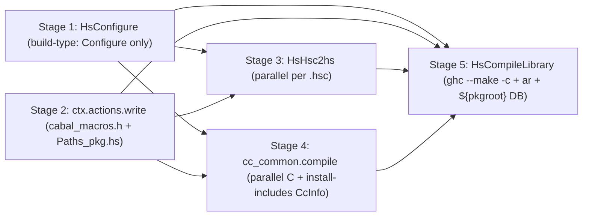

Building third-party Hackage packages in Bazel means handling `.cabal` conditionals (`if os(...)`, `arch(...)`, `impl(ghc >= ...)`, `flag(...)`), internal and public sublibraries, `hsc2hs` preprocessors, `alex` and `happy` grammars, autoconf `./configure` scripts, C-only packages (`zlib-clib`), `#include`d `.c` snippets (`crypton`), generated `Paths_<pkg>` modules, and legacy `cabal-doctest` `Custom` setups (`xml-conduit`). Instead of writing a partial `.cabal` parser in [Starlark](https://bazel.build/rules/language) or running an opaque `Setup.hs` script inside a single [Bazel action](https://bazel.build/extending/rules#actions), `rules_haskell` divides Hackage integration into an offline lockfile step, a pure-Starlark [Bzlmod](https://bazel.build/external/overview) repository step, and a 5-stage Bazel build rule ([`hs_cabal_library`](../reference/rules.md#hs_cabal_library)).

This page explains how those three layers fit together and traces a concrete package from `.cabal` file to compiled `.a` archive. If you need CLI flags to generate or update `hackage.lock.json`, see the [Lock CLI reference](../reference/lock-cli.md); for `hackage.from_lock` and `hackage.override` usage, see [Extensions and providers](../reference/extensions-and-providers.md#hackage). If Cabal, Hackage, Stackage, or Bzlmod are new to you, read the [Haskell and GHC primer](haskell-and-ghc-primer.md#ecosystem-map) and [Bazel ruleset primer](bazel-rules-primer.md#bzlmod-and-repos) first.


---

## Phase 1: Self-hosted `Cabal-syntax` lock generator (`//tools/lock`) {#phase-1-lock-generator}

Evaluating `.cabal` files offline with GHC's own `Cabal-syntax` boot library gives you full `.cabal` specification compliance with no `cabal`, `stack`, or external Hackage packages installed on your machine. [`//tools/lock:lock`](../reference/lock-cli.md) (`tools/lock/BUILD.bazel`, `Main.hs`, `CabalExtract.hs`, `LockJson.hs`—also exposed as `//tools/lock:lock_lib` with Haddock API docs at `//tools/lock:lock_haddock`) is an ~1,400-line Haskell CLI compiled by `rules_haskell` itself using only GHC's bundled boot libraries (`base`, `Cabal-syntax`, `bytestring`, `containers`, `directory`, `filepath`, `process`, `text`).

### 1. Loading the Stackage snapshot and boot package versions

Before traversing dependencies, `//tools/lock:lock` (`Main.hs`, `CabalExtract.hs`) loads three version and flag inputs:

- **Stackage snapshot YAML (`parseStackageYaml`):** Downloads `https://raw.githubusercontent.com/commercialhaskell/stackage-snapshots/master/lts/<maj>/<min>.yaml` (default `lts-24.67`, or a local file via `--snapshot-yaml`) and extracts `resolver.compiler`, per-package `flags:`, and `- hackage: <pkg>-<ver>@sha256:<hex>,<size>` entries. Because Stackage snapshot YAML follows a fixed indentation layout, a small `Text` parser reads it directly with no external YAML library.
- **Boot package versions (`builtinBootPackages` and `parseCabalConfigBootPkgs`):** Combines the built-in boot table for the target GHC release (`9.10.*` has 41 boot packages plus `system-cxx-std-lib`; `9.12.*` has 42 boot packages, adding `file-io`) with `<pkg> installed` entries from Stackage's `cabal.config`, plus `rts` and any `--boot-pkg <pkg>=<ver>` CLI overrides.
- **Flag precedence:** Merges Stackage's per-package Cabal flags with repeatable `--flag <pkg>:<flag>=<true|false>` CLI overrides, where CLI flags take precedence.

### 2. Breadth-first dependency walk and checksum verification

Starting from the root `--package` arguments, `resolveQueue` walks all non-boot dependencies in breadth-first order (`collectComponentDeps` skips GHC boot packages, self-references, and the Windows-only `Win32` package):

- **Verified `.cabal` and `.tar.gz` downloads:** Downloads `<pkg>.cabal` and `<pkg>-<ver>.tar.gz` from `https://hackage.haskell.org/package/...` into `--cache-dir` (default `/tmp/rules_haskell_lock_cache`). When Stackage pins a `.cabal` SHA-256 (`spCabalSha256`), `fetchVerifiedCabal` verifies the downloaded file (caching it as `<pkg>-<ver>-<sha256>.cabal`). If Hackage's mutable `<pkg>.cabal` endpoint has moved ahead to a newer `x-revision`, `fetchVerifiedCabal` steps backwards through `revision/<r>.cabal` until the digest matches.
- **Tarball hashing and parsing:** Computes the `.tar.gz` SHA-256 via `computeSha256` (`sha256sum`, falling back to `shasum -a 256` on macOS), parses the `.cabal` file with `Distribution.PackageDescription.Parsec.parseGenericPackageDescription` (`parseCabalBytes`), and extracts the `x-revision` integer (`extractRevision`).

### 3. Evaluating Cabal conditionals across four platforms

In `Cabal-syntax`, a parsed `.cabal` file (`GenericPackageDescription`) still contains unevaluated `if os(...)`, `if arch(...)`, `if impl(ghc >= ...)`, and `if flag(...)` trees. Calling `Distribution.PackageDescription.Configuration.finalizePD` evaluates those branches for a specific OS, CPU, GHC version, and flag map to yield a flat `PackageDescription`.

To keep lockfiles portable across developer machines and CI runners, `finalizeForPlatform` (`CabalExtract.hs`) evaluates every package four times (`allPlatforms`):

| Lockfile key | `Cabal-syntax` `Platform` |
|---|---|
| `linux_x86_64` | `Platform X86_64 Linux` |
| `linux_arm64` | `Platform AArch64 Linux` |
| `macos_arm64` | `Platform AArch64 OSX` |
| `macos_x86_64` | `Platform X86_64 OSX` |

Each platform evaluation runs in up to two passes:

- **Pass 1 (`strictCheck`):** Checks `withinRange v vr` against every package version in the snapshot and boot table. Exact range checking matters because many `.cabal` files select between newer and older API branches via `if flag(...)` constraints.
- **Pass 2 (`relaxedCheck`, fallback):** Stackage snapshots occasionally include packages whose `.cabal` upper bounds haven't caught up to a newer GHC boot library (`allow-newer` in Stackage). If Pass 1 fails a version range, Pass 2 accepts any package in the snapshot or boot set *except* `bytestring`—which stays strict so legacy `flag(bytestring-lt-0_10)` branches never activate by mistake.

### 4. Factoring common fields vs. per-platform `select` deltas

Repeating every module and dependency four times per package would bloat `hackage.lock.json` and make diffs unreadable. Instead, `mergeRawComps` factors all 14 list fields into shared base values plus per-platform `select` deltas:

| Field category | Factoring rule | Fields |
|---|---|---|
| **Unordered set-like fields** (11 fields) | Computes the set intersection across all four platforms (preserving first-platform order) as `base`, and puts platform-only entries into `select` (`splitField`). | `exposed_modules`, `other_modules`, `reexported_modules`, `hs_source_dirs`, `default_extensions`, `c_sources`, `include_dirs`, `install_includes`, `extra_libraries`, `deps`, `sublib_deps` |
| **Order-sensitive flag lists** (3 fields) | Extracts the shared leading prefix across platforms without splitting two-token flag pairs such as `-include foo.h` across `base` and `select` (`splitOrderedFlags`). | `ghc_opts`, `cpp_options`, `cc_options` |

When all four platform deltas are empty—true for roughly 85% of Hackage packages—the `"select"` field is omitted completely.

### 5. Flag sanitization, `Custom` normalization, and `Configure` inspection

Three common Hackage patterns are normalized at lock time (`CabalExtract.hs` and `Main.hs`) so builds stay predictable without running `Setup.hs`:

1. **Sanitizing upstream `ghc-options` (`sanitizeGhcOpts`):** Strips warning flags and executable-only flags (`-Werror`, `-Werror=*`, `-W*`, `-fwarn-*`, `-fno-warn-*`, `-w`, `-threaded`, `-rtsopts`, `-with-rtsopts=*`, `-fllvm`, `-ferror-spans`) so newer GHC warnings don't break third-party libraries, while keeping optimization and code-generation flags (`-O2`, `-funbox-strict-fields`, `-fno-cse`, `-optc-O3`).
2. **Normalizing `cabal-doctest` `build-type: Custom` packages (`classifyBuildType`):** Dozens of pure Haskell libraries on Hackage (including `xml-conduit`, `lens`, and `bifunctors`) declare `build-type: Custom` only because of a legacy 4-line `Setup.hs` wrapper calling `cabal-doctest`'s `defaultMainWithDoctests`, which generated `Build_doctests.hs` for tests while delegating library builds unchanged to `Simple` `defaultMain`. When `custom-setup`'s `setup-depends` is non-empty and contains only packages from `["base", "Cabal", "Cabal-syntax", "cabal-doctest", "filepath", "directory"]`, `classifyBuildType` records `"build_type": "Simple"`. For bespoke `Custom` packages outside that allowlist, it keeps `"build_type": "Custom"`, and `hs_cabal_library` rejects them at analysis time rather than running arbitrary `Setup.hs` code during a build.
3. **Inspecting `build-type: Configure` tarballs (`classifyBuildType` and `discoverConfigureInstallIncludes`):** Lists tarball files with `tar -tzf` (`listTarballFiles`), infers `configure_outputs` from `.h` entries in `extra-tmp-files` (or `*.h.in` stripped of `.in`), collects `configure_srcs` (`configure`, `config.guess`, `config.sub`, `install-sh`, `aclocal.m4`, `configure.ac`, `*.h.in`, `*.buildinfo`, `include/*.h`, `cbits/*.h`, and `cbits/conv.c` checked by `AC_CONFIG_SRCDIR` in `unix-time`), and reads `<pkg>.buildinfo` and `configure.ac` to capture generated headers added to `install-includes:` by `./configure` (such as `HsNetworkConfig.h` in `network` and `HsTimeConfig.h` in `old-time`).

### 6. Sublibraries, C++ and assembly sources, `Paths_*` modules, and deterministic JSON

- **Internal and Cabal 3.0 public sublibraries (`extractDeps` and `expandSublibs`):** Handles both Cabal 3.0 qualified `pkg:sublib` dependencies (`LSubLibName`, emitted as `pkg__sublib` hub labels) and Cabal 2.0 unqualified internal sublibraries (`attoparsec-internal`), expanding all sublibraries transitively reachable from the main library or public sublibraries.
- **C++, assembly, and Cabal 1.x fields:** Collects `cxx-sources` and `asm-sources` alongside `c-sources`, `cxx-options` alongside `cc-options`, and legacy Cabal 1.x `extensions:` alongside `default-extensions:`.
- **`Paths_<pkg>` detection:** Detects `Paths_<pkg_ident>` in `other-modules` or `autogen-modules`, sets `generate_paths_module = True`, and removes it from `other_modules` so Stage 2 generates it once.
- **Deterministic JSON (`LockJson.encodePretty`):** Writes `LockFile` (`schema_version = 1`) with 2-space indentation, alphabetically sorted keys (`Map.toAscList`), compact `[]` and `{}` empty values, and a trailing newline (verified by `//tools/lock:lock_test` in `tools/lock/LockTest.hs`).

---

## Phase 2: Starlark `@hackage` repository synthesis (`haskell/private/hackage.bzl`) {#phase-2-starlark-extension}

During Bzlmod evaluation, the `hackage` [module extension](https://bazel.build/external/extension) makes zero network calls and runs zero subprocesses. `_hackage_impl` (`haskell/private/hackage.bzl`) decodes `hackage.lock.json` via `json.decode(module_ctx.read(lock_label))`, merges any [`hackage.override`](../reference/extensions-and-providers.md#hackage-override) tags (`_merge_override`), and returns [`module_ctx.extension_metadata(reproducible = True)`](https://bazel.build/external/extension#specify-reproducibility-and-use-facts).

### 1. Unified `@hackage` hub repository

So you can reference both boot libraries and locked Hackage packages through one consistent repository prefix (`@hackage//:<name>`), `_hackage_hub_repo` writes a single [`BUILD.bazel`](https://bazel.build/concepts/build-files) file containing:

- **GHC boot libraries:** `hs_toolchain_library(name = "<pkg>", package_name = "<pkg>")` for every entry in `boot_packages` (unless overridden in `packages`).
- **Locked Hackage packages:** `alias(name = "<pkg>", actual = "@hackage__<sanitized_pkg>//:<pkg>")`.
- **Sublibraries:** `alias(name = "<pkg>__<sublib>", actual = "@hackage__<sanitized_pkg>//:<sublib>")`, such as `@hackage//:attoparsec__attoparsec-internal`.

### 2. Lazy per-package repositories

Bazel downloads `@hackage__<sanitized_pkg>` only when a target you build actually reaches that package. When fetched, `_hackage_package_repo_impl` prepares the package in five pure-Starlark steps:

1. **Restoring `+x` on `0644` autoconf scripts:** Tarballs like `network` and `old-time` ship `configure`, `config.guess`, `config.sub`, or `install-sh` without execute permissions. For `build_type == "Configure"`, the repo rule rewrites them with `executable = True`.
2. **Matching exact module source files (`_find_module_files`):** Globbing `**/*.hs` would drag in `Setup.hs`, test suites, benchmarks, or unused OS-specific files (like `System/Posix/Windows.hsc` on Linux). Instead, `_find_module_files` maps each active module `A.B.C` in `exposed_modules + other_modules` to `<hs_source_dir>/A/B/C.{hsc,hs,lhs,x,y,ly}` plus any companion `.hs-boot` or `.lhs-boot`, emitting [`select({...})`](https://bazel.build/configure/attributes) branches for platform-specific modules.
3. **Keeping `#include`d C snippets in `hdrs`:** Packages such as `crypton` (`#include`ing `cbits/*_impl.c`) and `vector` (`#include`ing extensionless `internal/unbox-tuple-instances`) textually include non-header files. `_emit_component_rule` globs `_HDR_GLOB_PATTERNS` (`**/*.h`, `**/*.hpp`, `**/*.inc`, `cbits/**/*.c`, `include/**/*.c`, and `<include_dir>/**`) while **excluding `all_c_sources`**, so compiled `.c` files build once in `c_sources` while `#include`d helpers stay mounted in the [sandbox](https://bazel.build/docs/sandboxing) via `hdrs`.
4. **On-demand `alex` and `happy` grammar compilation (`haskell/private/cabal_codegen.bzl`):** When `_find_module_files` finds `.x` (`alex`) or `.y`/`.ly` (`happy`) files (for example, in `pandoc`'s dependency graph), `hackage.bzl` wires [`genrule`](https://bazel.build/reference/be/general#genrule) / codegen actions backed by `@hackage__bootstrap_alex` (`alex-3.5.4.2`) and `@hackage__bootstrap_happy` (`happy-2.1.7`), compiled purely from `@hs_boot`. Workspaces without grammar files never download or build `alex` or `happy`.
5. **Emitting sublibraries before the main library:** Writes `_PLATFORM_CONFIGS` [`config_setting`](https://bazel.build/reference/be/general#config_setting) targets when `select` is needed, writes internal sublibrary `hs_cabal_library` targets first (`build_type = "Simple"`), and writes the main `hs_cabal_library` target referencing `:sublib` targets.

---

## The 5-stage `hs_cabal_library` build pipeline {#five-stage-pipeline}

Splitting a Cabal library build into five explicit Bazel stages (`haskell/private/cabal_library.bzl`) eliminates `Setup.hs`, parallelizes `hsc2hs` and C compilation across cores or remote workers, and exposes C artifacts natively via [`CcInfo`](https://bazel.build/rules/lib/providers/CcInfo):



### Stage 1: Sandboxed autoconf (`HsConfigure`)

Runs **only** when `build_type == "Configure"`. To keep `./configure` from mutating Bazel's [`execroot`](https://bazel.build/remote/output-directories) or leaving stray `config.log` files behind, `run_configure_action` (`haskell/private/actions.bzl`):

- Creates a temporary directory `WORK="$(mktemp -d "${TMPDIR:-/tmp}/hs_cfg.XXXXXX")"` (`trap 'rm -rf "$WORK"' EXIT`) and copies `configure_script` and `configure_srcs` into `$WORK` at their package-relative paths.
- Anchors any relative `--sysroot` paths in `RULES_HASKELL_CC_EXTRA_ARGS` to `$EXECROOT/` before `cd "$WORK"`.
- Exports `CC` and `CXX` as `ghc_cc_wrapper`, `AR` and `LD` from `cc_tools`, `CFLAGS="-fPIC -I<rts_include_dir> <dep_include_dirs>"`, `LDFLAGS="-Wno-unused-command-line-argument"`, and `CONFIG_SHELL="/bin/sh"`.
- Runs `(cd "$WORK" && /bin/sh "./<configure_script>" <configure_args>)`, copies declared `configure_outputs` to `bazel-out/.../<name>_configure/<rel_out>`, and adds both output parent directories and `<configure_root>/<inc_dir>` to C include paths.

### Stage 2: In-process file generation (`cabal_macros.h` and `Paths_<pkg>.hs`)

Runs inside [Bazel's analysis phase](https://bazel.build/extending/concepts#evaluation-model) via `ctx.actions.write` with zero subprocesses:

- **`cabal_macros.h` (`write_cabal_macros_h`):** Writes `<name>_autogen/cabal_macros.h` defining `CURRENT_PACKAGE_VERSION`, `CURRENT_PACKAGE_KEY`, `CURRENT_COMPONENT_ID`, `TOOL_VERSION_ghc`, `MIN_TOOL_VERSION_ghc(maj1,maj2,min)`, and `VERSION_<ident>` / `MIN_VERSION_<ident>(maj1,maj2,min)` for every direct `HsPackageInfo` dependency.
- **`Paths_<pkg>.hs` (`write_paths_module`):** When `generate_paths_module = True`, writes `<name>_autogen/Paths_<pkg_ident>.hs` exporting `version`, `getBinDir`, `getLibDir`, `getDynLibDir`, `getDataDir`, `getLibexecDir`, `getSysconfDir`, and `getDataFileName`.

### Stage 3: Parallel per-file `hsc2hs` (`HsHsc2hs`)

When `hsc_srcs` is non-empty, `run_hsc2hs_actions` registers **one independent `HsHsc2hs` action per `.hsc` file**, letting packages with many `.hsc` bindings (such as `network` or `unix`) preprocess them in parallel across local cores or remote workers.

Each action strips the longest matching `hs_source_dirs` prefix so `<name>_hsc/Network/Socket/Internal.hs` preserves its module path for Stage 5's `-i<hsc_root>`, and passes `--template=<template-hsc.h>`, `--cc=<ghc_cc_wrapper>`, `--ld=<ghc_cc_wrapper>`, `-I.`, RTS/boot and transitive include directories, `--cflag=-include --cflag=<cabal_macros.h>`, `--cflag=-fPIC`, `cpp_options`, `cc_options`, and Cabal's target defines (`_hsc2hs_ghc_defines`: `-D__GLASGOW_HASKELL__=910`, `-D__GLASGOW_HASKELL_PATCHLEVEL1__=3`, `-Dlinux_BUILD_OS=1`, `-Dlinux_HOST_OS=1`, `-Dx86_64_BUILD_ARCH=1`, `-Dx86_64_HOST_ARCH=1`).

### Stage 4: C/C++ compilation and C-only short-circuit (`cc_common.compile`)

Rather than compiling C code through GHC sequentially, `compile_c_sources` (`haskell/private/actions.bzl`) delegates C, C++, and assembly compilation to `rules_cc`'s [`cc_common.compile`](https://bazel.build/rules/lib/toplevel/cc_common) and `cc_common.create_linking_context_from_compilation_outputs(..., disallow_dynamic_library = True)`:

- **Parallel compilation with language-scoped flags:** Compiles every file in `c_sources` in parallel with `-fPIC -Wno-unused-command-line-argument -I<rts_include_dir> -include <cabal_macros.h>` plus `_hsc2hs_ghc_defines` (used by C files in packages like `digest`). C-only `-std=*` flags route to `conly_flags` while `-std=c++*`, `-std=gnu++*`, and `-stdlib=*` route to `cxx_flags` so mixed C/C++ targets don't clash.
- **Header vs. snippet separation:** Standard headers (`.h`, `.hh`, `.hpp`, `.hxx`, `.inc`, `.inl`) plus GHC's `rts_headers` go into `private_hdrs`, while `#include`d `.c` snippets and extensionless macro files go into `additional_inputs` so `rules_cc` doesn't reject non-header extensions.
- **Public header forwarding:** Publishes Cabal `install_includes` in `public_hdrs` and package/configure `include_dirs` in `includes` on the returned `CcInfo` so downstream C and Haskell targets can `#include` them directly.
- **C-only package short-circuit:** When `has_haskell` is `False` (no Haskell modules, `Paths_*`, or `reexported_modules`), `_hs_cabal_library_impl` returns immediately after Stage 4 with `HsPackageInfo(unit_id = None, ...)` and `merged_cc_info`, skipping GHC and `ghc-pkg` entirely (tested by `//tests/starlark:hs_cabal_c_only_test` and `//tests/basic:cabal_c_only`).

### Stage 5: Haskell library compilation (`HsCompileLibrary`)

`compile_hs_library_action` runs `ghc --make -c` with `-dynamic-too`, `-optP-include <cabal_macros.h>`, and `-optc-include <cabal_macros.h>` (for `CApiFFI` wrappers), archives static objects into `libHS<unit_id>.a`, links `<name>.pkgdb/dyn/libHS<unit_id>-ghc<ver>.so`, writes the `${pkgroot}` `<unit_id>.conf` file, and runs `ghc-pkg recache`.

> **Tip:** Stage 4 and Stage 5 compile in parallel. Stage 5 only waits for C *headers* from Stage 1 (`configure_outputs`), Stage 2 (`cabal_macros.h` and `Paths_*`), and Stage 3 (`hsc2hs` outputs); it consumes Stage 4's C archive only at the very end when linking the Template Haskell `.so` library, while executables link C archives at binary link time. On C-heavy packages like `crypton` (39+ `.c` files and 100+ `.hs` modules), Bazel compiles all C files concurrently via `cc_common.compile` while GHC compiles the Haskell modules.

---

## Anatomy of a Hackage package build: From `.cabal` to static archive {#end-to-end-trace}

To see all three phases working together, trace a small illustrative package `acme-net-0.2.0` that combines autoconf `./configure`, an OS-conditional C file (`epoll.c` on Linux vs. `kqueue.c` on macOS), an `hsc2hs` binding (`src/Acme/Net/Consts.hsc`), `Paths_acme_net`, and an exported C header (`include/AcmeNet.h`).

### 1. Upstream `acme-net.cabal` (inside `acme-net-0.2.0.tar.gz`)

```text
cabal-version:   2.4
name:            acme-net
version:         0.2.0
x-revision:      1
build-type:      Configure
extra-tmp-files: include/AcmeConfig.h

flag debug-poll
  default: False

library
  hs-source-dirs:   src
  exposed-modules:  Acme.Net
  other-modules:    Acme.Net.Consts, Paths_acme_net
  autogen-modules:  Paths_acme_net
  default-language: Haskell2010
  ghc-options:      -Wall -Werror -O2
  include-dirs:     include
  install-includes: AcmeNet.h, AcmeConfig.h
  build-depends:    base >= 4.16 && < 5, bytestring >= 0.11

  if os(linux)
    c-sources: cbits/epoll.c
  if os(osx)
    c-sources: cbits/kqueue.c
  if flag(debug-poll)
    cpp-options: -DACME_DEBUG=1
```

### 2. Offline evaluation by `//tools/lock:lock` into `hackage.lock.json`

When [`//tools/lock:lock`](../reference/lock-cli.md) processes `acme-net`:

1. `fetchVerifiedCabal` verifies `acme-net.cabal` (`x-revision: 1`) against Stackage's pinned SHA-256 and hashes the `.tar.gz` archive.
2. `finalizeForPlatform` runs `Cabal-syntax`'s `finalizePD` across all four platforms with `CompilerId GHC 9.10.3` and `debug-poll = False`, stripping `-Wall`/`-Werror` (keeping `-O2`), setting `"generate_paths_module": true`, and mapping `include/AcmeConfig.h.in` -> `configure_outputs = ["include/AcmeConfig.h"]`.
3. `mergeRawComps` lifts shared fields (`Acme.Net`, `Acme.Net.Consts`, `base`, `bytestring`) into the base object and places the OS-specific `c_sources` under `"select"`:

```json
"acme-net": {
  "version": "0.2.0",
  "url": "https://hackage.haskell.org/package/acme-net-0.2.0/acme-net-0.2.0.tar.gz",
  "sha256": "e3b0c44298fc1c149afbf4c8996fb92427ae41e4649b934ca495991b7852b855",
  "strip_prefix": "acme-net-0.2.0",
  "cabal_revision": 1,
  "build_type": "Configure",
  "configure_script": "configure",
  "configure_srcs": ["configure", "include/AcmeConfig.h.in", "include/AcmeNet.h"],
  "configure_outputs": ["include/AcmeConfig.h"],
  "library": {
    "exposed_modules": ["Acme.Net"],
    "other_modules": ["Acme.Net.Consts"],
    "hs_source_dirs": ["src"],
    "default_language": "Haskell2010",
    "ghc_opts": ["-O2"],
    "include_dirs": ["include"],
    "install_includes": ["AcmeConfig.h", "AcmeNet.h"],
    "generate_paths_module": true,
    "deps": ["base", "bytestring"],
    "select": {
      "linux_arm64": { "c_sources": ["cbits/epoll.c"] },
      "linux_x86_64": { "c_sources": ["cbits/epoll.c"] },
      "macos_arm64": { "c_sources": ["cbits/kqueue.c"] },
      "macos_x86_64": { "c_sources": ["cbits/kqueue.c"] }
    }
  }
}
```

### 3. Lazy repository synthesis (`@hackage__acme_net/BUILD.bazel`)

When a target depends on `@hackage//:acme-net`, `_hackage_package_repo_impl` (`haskell/private/hackage.bzl`) extracts the tarball, marks `configure` executable, matches `src/Acme/Net.hs` (`srcs`) and `src/Acme/Net/Consts.hsc` (`hsc_srcs`), and writes `BUILD.bazel`:

```starlark
load("@rules_haskell//haskell:defs.bzl", "hs_cabal_library")

package(default_visibility = ["//visibility:public"])

config_setting(name = "_linux_x86_64", constraint_values = ["@platforms//os:linux", "@platforms//cpu:x86_64"])
config_setting(name = "_linux_arm64",  constraint_values = ["@platforms//os:linux", "@platforms//cpu:arm64"])
config_setting(name = "_macos_arm64",  constraint_values = ["@platforms//os:macos", "@platforms//cpu:arm64"])
config_setting(name = "_macos_x86_64", constraint_values = ["@platforms//os:macos", "@platforms//cpu:x86_64"])

hs_cabal_library(
    name = "acme-net",
    package_name = "acme-net",
    version = "0.2.0",
    srcs = ["src/Acme/Net.hs"],
    hsc_srcs = ["src/Acme/Net/Consts.hsc"],
    c_sources = select({
        ":_linux_x86_64": ["cbits/epoll.c"],
        ":_linux_arm64":  ["cbits/epoll.c"],
        ":_macos_arm64":  ["cbits/kqueue.c"],
        ":_macos_x86_64": ["cbits/kqueue.c"],
        "//conditions:default": [],
    }),
    hdrs = glob(["include/**", "**/*.h", ...], exclude = ["cbits/epoll.c", "cbits/kqueue.c", "src/Acme/Net.hs", ...]),
    install_includes = ["AcmeConfig.h", "AcmeNet.h"],
    include_dirs = ["include"],
    hs_source_dirs = ["src"],
    exposed_modules = ["Acme.Net"],
    other_modules = ["Acme.Net.Consts"],
    default_language = "Haskell2010",
    ghc_opts = ["-O2"],
    build_type = "Configure",
    configure_script = "configure",
    configure_srcs = ["configure", "include/AcmeConfig.h.in", "include/AcmeNet.h"],
    configure_outputs = ["include/AcmeConfig.h"],
    generate_paths_module = True,
    deps = ["@hackage//:base", "@hackage//:bytestring"],
)
```

### 4. Execution across the 5 `hs_cabal_library` stages (on `linux_x86_64`)

| Stage | Bazel [action mnemonic](https://bazel.build/reference/glossary#mnemonic) | Inputs consumed | Outputs produced under `bazel-out/.../external/rules_haskell++hackage+hackage__acme_net/` |
|---|---|---|---|
| **Stage 1** | `HsConfigure` | `configure`, `include/AcmeConfig.h.in`, `ghc_cc_wrapper` | `acme-net_configure/include/AcmeConfig.h` |
| **Stage 2** | `FileWrite` (in-process) | Direct `HsPackageInfo` (`base-4.20.2.0`, `bytestring-0.12.2.0`) | `acme-net_autogen/cabal_macros.h`, `acme-net_autogen/Paths_acme_net.hs` |
| **Stage 3** | `HsHsc2hs` | `src/Acme/Net/Consts.hsc`, `AcmeConfig.h`, `AcmeNet.h`, `cabal_macros.h` | `acme-net_hsc/Acme/Net/Consts.hs` |
| **Stage 4** *(parallel with 5)* | `CppCompile` and `CppArchive` (`cc_common`) | `cbits/epoll.c`, `AcmeConfig.h`, `AcmeNet.h`, `Rts.h`, `cabal_macros.h` | `libacme-net_c.a` and `CcInfo` (`public_hdrs = [AcmeConfig.h, AcmeNet.h]`) |
| **Stage 5** *(parallel with 4)* | `HsCompileLibrary` | `src/Acme/Net.hs`, `Consts.hs`, `Paths_acme_net.hs`, `cabal_macros.h` | `libHSacme-net-0.2.0.a` and `acme-net.pkgdb/` (`hi/*.hi`, `dyn/libHSacme-net-0.2.0-ghc9.10.3.so`, `acme-net-0.2.0.conf`, `package.cache`) |

---

## Real-world Hackage case studies {#case-studies}

Every stage and edge-case rule above is exercised by concrete packages locked in `examples/size/hackage.lock.json` and `docs/hackage.lock.json`.

### 1. C-only packages and transitive headers: `zlib` (`0.7.1.1`), `zlib-clib` (`1.3.2`), and `streaming-commons` (`0.2.3.1`)

Locked with `--flag zlib:bundled-c-zlib=true --flag zlib:pkg-config=false`, this three-package chain tests C-only short-circuiting and transitive `CcInfo` forwarding:

- `zlib-clib` contains zero Haskell modules, 11 C source files (`cbits/adler32.c`, `deflate.c`, `inflate.c`, ...), and 11 `install-includes` headers (`zlib.h`, `zconf.h`, ...). `hs_cabal_library` short-circuits after Stage 4 and returns a `CcInfo` static library and public header provider.
- `zlib` depends on `@hackage//:zlib-clib`, compiles `cbits-extra/hs-zlib.c` (`-DNON_BLOCKING_FFI`) alongside its `.hsc`/`.hs` modules, and forwards `zlib-clib`'s `CcInfo`.
- Two hops downstream, `streaming-commons` lists only `@hackage//:zlib` in `deps`, yet its `cbits/zlib-helper.c` compiles `#include <zlib.h>` via transitive `CcInfo` propagation.
- If your workspace already builds [BCR](https://bazel.build/external/registry#bazel-central-registry) `zlib`, you can instead lock with `--flag zlib:bundled-c-zlib=false --flag zlib:pkg-config=false` and attach `hackage.override(package = "zlib", extra_cc_deps = ["@zlib//:zlib"])` in [`MODULE.bazel`](https://bazel.build/external/module).

### 2. Sandboxed autoconf: `network` (`3.2.14.0`), `unix-time` (`0.4.17`), and `old-time` (`1.1.1.0`)

All three declare `build-type: Configure` and require every configure-time safeguard working together:

- `//tools/lock` inspects `network.buildinfo` and `old-time.buildinfo` inside the tarballs to add generated `HsNetworkConfig.h` and `HsTimeConfig.h` to `install_includes`, and includes `cbits/conv.c` in `unix-time`'s `configure_srcs` (checked by `AC_CONFIG_SRCDIR`).
- `_hackage_package_repo` restores `+x` on `0644` `configure`, `config.sub`, `config.guess`, and `install-sh` scripts.
- Stage 1 runs `./configure` inside an isolated `$WORK` directory through `ghc_cc_wrapper`, Stage 3 runs `hsc2hs` in parallel across socket `.hsc` files (relying on `cc_wrapper.c`'s `-nostdinc++` flag so `_GNU_SOURCE` in `HsNet.h` exposes `struct ucred` and `struct in6_pktinfo`), and Stage 4 exports `HsNet.h` and `HsNetworkConfig.h` downstream.

### 3. Per-CPU C sources and `#include`d `.c` files: `crypton` (`1.0.6`)

`crypton` combines 39 shared C files (`cbits/argon2/argon2.c`, `cbits/ed25519/*.c`, `cbits/decaf/...`) with CPU-specific `select()` branches computed by `mergeRawComps`:

- **`linux_x86_64` and `macos_x86_64`:** Adds `Crypto.Random.Entropy.RDRand`, `cbits/aes/x86ni.c`, `cbits/blake2/sse/*.c`, `-DARCH_X86_64`, `-DSUPPORT_RDRAND`, `-DSUPPORT_SSE`, `-DWITH_AESNI`, and `-DWITH_PCLMUL`.
- **`linux_arm64` and `macos_arm64`:** Selects portable `cbits/blake2/ref/*-ref.c` and `include_dirs = ["cbits/blake2/ref"]`.

Several `crypton` `.c` files textually `#include` sibling `.c` files inside `cbits/`. Because `_emit_component_rule` includes `cbits/**/*.c` in `hdrs` (excluding compiled `c_sources`) and Stage 4 routes non-`.h` files through `additional_inputs`, those `#include`d `.c` files are mounted in the sandbox without failing `rules_cc` header-extension checks.

### 4. Sublibraries, `.hs-boot` cycles, and `cabal-doctest`: `attoparsec` (`0.14.4`), `cborg` (`0.2.10.0`), `tls` (`2.1.8`), and `xml-conduit` (`1.10.1.0`)

- **`attoparsec`:** Uses a Cabal 2.0 internal sublibrary (`attoparsec-internal` in `hs-source-dirs: internal`), emitted ahead of main `attoparsec` and aliased at `@hackage//:attoparsec__attoparsec-internal`.
- **`cborg` and `tls`:** Contain intra-package `.hs-boot` mutual module cycles; `_find_module_files` includes `.hs-boot` files automatically and Stage 5's `ghc --make -c` compiles the cycle in order.
- **`xml-conduit`:** Declares `build-type: Custom` solely for `cabal-doctest`; `classifyBuildType` normalizes it to `"Simple"` so it builds without `Setup.hs`.

### 5. Building the documentation site: `hakyll`, `pandoc`, and `skylighting`

`docs/hackage.lock.json` locks `hakyll`, `pandoc`, `pandoc-types`, `skylighting`, `citeproc`, and `aeson` (182 Hackage packages total) on `lts-24.67` with three flag groups:

- `--flag hakyll:checkexternal=false --flag hakyll:watchserver=false --flag hakyll:previewserver=false`: Keeps Hakyll's static-site `Rules`, `Compiler`, `Pandoc`, `Context`, and `RelativizeUrls` modules while dropping its HTTP preview server and filesystem watcher.
- `--flag pandoc:embed_data_files=true --flag citeproc:embed_data_files=true`: Embeds Pandoc and Citeproc data files at compile time via cross-library `file-embed` Template Haskell splices so `//docs:docs_gen` needs no runtime `Paths_pandoc` lookups inside sandboxes.
- `--flag zlib:bundled-c-zlib=true --flag zlib:pkg-config=false`: Builds `zlib-clib` from C source.

For details on how `//docs:site` combines Hakyll and Haddock outputs, see [Hakyll and Haddock docs](docs-engine.md).
