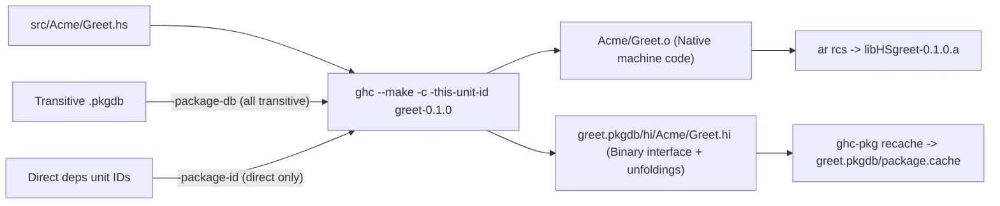

This chapter introduces Haskell's compiler architecture, runtime system, and package ecosystem from first principles for experienced software engineers with **zero prior Haskell experience**. Paired with the [Bazel Ruleset Primer](bazel-rules-primer.md), it gives you the exact mental model needed to read every `.bzl`, `.c`, and `.hs` file in `rules_hs` without ever guessing at domain jargon.

If you have worked with Rust (`rustc`/`Cargo`), Go (`go build`), C++ (`clang++`/`CMake`), or Python (`pip`/`uv`), almost every piece of the Haskell toolchain has a direct counterpart — hidden behind 1990s–2000s terminology and a few genuinely distinctive compiler features (such as binary `.hi` cross-module optimizer interfaces, unbounded `Integer` arithmetic backed by C's `libgmp`, and compile-time Template Haskell execution).

---

## Ecosystem Map: GHC, Cabal, Hackage, and Stackage {#ecosystem-map}

Newcomers to Haskell almost always trip over six overloaded nouns first — especially because the word **"Cabal"** refers to three different things (a declarative file format, a pure parser library, and a build-execution library) plus a fourth standalone CLI tool (`cabal-install`). Here is how the Haskell ecosystem maps onto languages you already know:

| Role | Haskell | Rust | Go | C++ | Python |
|---|---|---|---|---|---|
| **Language edition** | `Haskell98`, `Haskell2010`, `GHC2021` | `edition = "2021"` / `"2024"` | `go 1.23` | `-std=c++20` | Python `3.12` |
| **Compiler & REPL** | **GHC** (`ghc`, `ghci`, `ghc-pkg`) | `rustc` | `go tool compile` | `clang++` / `g++` | `cpython` |
| **Package manifest** | **`<pkg>.cabal`** file | `Cargo.toml` | `go.mod` | `CMakeLists.txt` | `pyproject.toml` |
| **Standalone CLI & solver** | **`cabal-install`** (`cabal` CLI) | `cargo` | `go` CLI | `conan` / `vcpkg` | `pip` / `uv` |
| **Central package registry** | **Hackage** (`hackage.haskell.org`) | `crates.io` | `proxy.golang.org` | Conan Center | `PyPI` |
| **Curated version matrix** | **Stackage LTS** (`lts-24.67`) | Curated workspace `Cargo.lock` | Coordinated release BOM | vcpkg baseline | `constraints.txt` |
| **Bundled API doc tool** | **Haddock** (`haddock`) | `rustdoc` (`cargo doc`) | `pkgsite` / `go doc` | Doxygen | Sphinx / `pdoc` |

### 1. Haskell Language Standards & Language Extensions

Haskell is a statically typed, purely functional, lazily evaluated programming language compiled ahead-of-time to native machine code:

- **Language editions (`default_language`)**: Just as Rust has `2018`, `2021`, and `2024` editions, GHC supports formal language standards (**`Haskell98`** and **`Haskell2010`**) alongside modern GHC editions (**`GHC2021`** and **`GHC2024`**), selected via `-XHaskell2010` or `-XGHC2021`.
- **Language extensions (`-X<Ext>`)**: GHC evolves Haskell through granular opt-in compiler flags enabled either per file via a top-of-file pragma (`{-# LANGUAGE OverloadedStrings #-}`) or per target via `default_extensions = ["OverloadedStrings"]` (`-XOverloadedStrings`). An edition like `GHC2021` is simply a curated default bundle of battle-tested extensions (`BangPatterns`, `TupleSections`, `PolyKinds`, etc.). Because legacy `.cabal` manifests omit `default-language:` when targeting `Haskell98`, [`hs_cabal_library`](../reference/rules.md#hs_cabal_library) defaults to `"Haskell98"` while user-facing [`hs_library`](../reference/rules.md#hs_library) and [`hs_binary`](../reference/rules.md#hs_binary) default to `"GHC2021"`.
- **Strings in Haskell (`String` vs. `ByteString` vs. `Text`)**: Classic `Haskell98` defined `type String = [Char]` — a boxed singly linked list of Unicode code points (convenient for toy recursion, high-overhead in production). Real Haskell code uses **`ByteString`** (from the `bytestring` boot library: contiguous raw bytes, like Rust `&[u8]` or Go `[]byte`) and **`Text`** (from the `text` boot library: contiguous UTF-8 text, like Rust `String`/`&str`). Enabling `{-# LANGUAGE OverloadedStrings #-}` lets double-quoted string literals (`"hello"`) construct `Text` or `ByteString` values directly.

### 2. GHC (Glasgow Haskell Compiler)

**GHC** is Haskell's universal production compiler — there is no fragmented GCC-vs.-Clang-vs.-MSVC split in day-to-day Haskell engineering. An official GHC binary distribution (`bindist`) ships a coordinated suite of tools under `bin/`:

- **`ghc`**: Ahead-of-time native-code compiler *and* linker driver.
- **`ghci`** (`ghc --interactive`): Interactive REPL and bytecode/shared-library interpreter.
- **`ghc-pkg`**: Inspector and cache builder for compiled GHC package databases (`package.conf.d`).
- **`hsc2hs`**: Preprocessor that translates C-struct/constant bindings (`.hsc`) into pure `.hs` files.
- **`haddock`**: Official API documentation and hyperlinked-source generator.
- **`ghc-iserv-dyn`** & **`unlit`**: Out-of-process Template Haskell interpreter server and literate Haskell (`.lhs`) code extractor.

### 3. `.cabal` Files, `Cabal-syntax`, and the `Cabal` Library

"Cabal" (*Common Architecture for Building Applications and Libraries*) is **not** a package server and **not** a SAT solver. It comprises three distinct pieces:

1. **The `<pkg>.cabal` manifest file**: A declarative text file at the root of every Haskell package (analogous to `Cargo.toml`) listing `exposed-modules`, `other-modules` (private modules), `build-depends` with version ranges (`text >= 2.0 && < 2.2`), C sources/headers, boolean `flag`s, and `if os(...)` / `if arch(...)` conditionals.
2. **`Cabal-syntax` (pure parser library)**: A zero-side-effect Haskell library (`Distribution.PackageDescription.Parsec`) that parses `.cabal` bytes into an AST (`GenericPackageDescription`) and evaluates OS/arch/flag conditionals (`finalizePD`).
3. **`Cabal` (`Distribution.Simple`, build-execution library)**: Traditional Haskell builds compile a tiny `Setup.hs` program at the root of each package against the `Cabal` library and run `./Setup configure && ./Setup build`. Every `.cabal` file declares a `build-type`:
   - **`Simple`**: Declarative manifest only (`Setup.hs` is a boilerplate 2-line `defaultMain` stub).
   - **`Configure`**: Runs an autoconf `./configure` script before compilation to probe C headers/types and emit generated headers (`HsNetworkConfig.h`) or `<pkg>.buildinfo` flags.
   - **`Custom`**: Compiles and executes arbitrary Haskell build hooks inside `Setup.hs` (declared under a `custom-setup` stanza with `setup-depends`).

`rules_hs` **never compiles or executes `Setup.hs`**. Instead, it evaluates `.cabal` files offline with `Cabal-syntax` and executes builds via fine-grained Bazel actions in [`hs_cabal_library`](../reference/rules.md#hs_cabal_library).

### 4. `cabal-install` (the `cabal` CLI)

**`cabal-install`** is the standalone end-user command-line tool (`cabal update`, `cabal build`, analogous to `cargo` or `pip`). It downloads Hackage's package index, runs a backtracking SAT solver over open version ranges, and orchestrates `Cabal` builds in `~/.cabal`. Because Bazel owns dependency fetching, sandboxing, caching, and action execution ([Bazel Ruleset Primer](bazel-rules-primer.md#three-phases)), `rules_hs` **never needs or invokes `cabal-install`**.

### 5. Hackage and Metadata Revisions (`x-revision`)

**Hackage** (`https://hackage.haskell.org`) is the Haskell community's central open-source archive of source tarballs (`<pkg>-<ver>.tar.gz`, like `crates.io` or `PyPI`). Hackage has one crucial operational quirk every build engineer must know: **Hackage metadata revisions**:

- Once `<pkg>-<ver>.tar.gz` is uploaded to Hackage, the source `.tar.gz` bytes are **permanently immutable**.
- However, when a new GHC or `base` version ships months later, Hackage trustees can edit `<pkg>`'s standalone `.cabal` file on the server — loosening or tightening version bounds and incrementing an `x-revision: 1`, `2`, ... header **without changing the `.tar.gz` archive**!
- Consequently, `https://hackage.haskell.org/package/<pkg>-<ver>/<pkg>.cabal` is a **mutable** endpoint serving the *latest* revision, while immutable historical revisions live at `.../revision/0.cabal`, `.../revision/1.cabal`, and so on.
- To guarantee 100% reproducibility, [`//tools/lock:lock`](../reference/lock-cli.md) (`fetchVerifiedCabal` in `tools/lock/Main.hs`) verifies the downloaded `.cabal` file against the exact SHA-256 digest pinned in Stackage, walking backwards through `revision/<r>.cabal` whenever Hackage's mutable endpoint has advanced to a newer revision.

### 6. Stackage LTS and `stack`

Because raw Hackage packages declare open version intervals (`aeson >= 2.0 && < 2.3`), picking mutually compatible versions across 200 transitive dependencies ordinarily requires a complex constraint solver. **Stackage** (`stackage.org`) solves that problem centrally for the entire ecosystem:

- A **Stackage LTS (Long-Term Support)** snapshot (such as **`lts-24.67`**, paired with GHC `9.10.3`) is a curated, CI-tested release matrix of ~3,300 Hackage packages where every package is pinned to **exact one version**, an exact `.cabal` revision SHA-256, and tested Cabal `flags:` defaults — all proven to compile and pass tests together. (`stack` is the standalone CLI tool built around Stackage snapshots.)
- Because a Stackage snapshot is already a conflict-free version function `package_name -> (version, cabal_sha256, flags)`, `rules_hs`'s lockfile generator (`//tools/lock:lock`) needs **zero SAT solver**: starting from your root `--package` flags, it resolves the complete transitive dependency graph via a deterministic breadth-first search (BFS) in milliseconds ([Hackage & Cabal Pipeline](ecosystem-and-hackage.md#phase-1-lock-generator)).

---

## Boot Libraries: Why GHC Ships 41 Packages Inside the Compiler {#boot-libraries}

Unlike `clang` (written in C++) or `go` (bootstrapped separately from third-party libraries), **GHC itself — along with `ghc-pkg`, `hsc2hs`, and `haddock` — is written in Haskell** on top of a C runtime system. Consequently, an official GHC binary tarball (`bindist`) cannot ship just an isolated executable: it comes pre-installed with its own global package database (`lib/package.conf.d/`) containing **41 pre-compiled Haskell boot libraries** in GHC `9.10.3` (42 in GHC `9.12.4`, which adds `file-io`), plus 1 virtual C++ marker entry (`42` / `43` `.conf` files total in `hs/private/ghc_versions.bzl`):

| Category | Pre-Compiled GHC Boot Packages (`@hs_boot//:<pkg>`) | What They Provide |
|---|---|---|
| **Runtime & Primitives** | `rts`, `ghc-prim`, `ghc-bignum`, `integer-gmp`, `ghc-internal` | Garbage collector/scheduler (`libHSrts`), unboxed CPU primitives (`Int#`, `ByteArray#`), and arbitrary-precision integers |
| **Standard Library** | `base`, `array`, `deepseq` | Haskell's standard library (including the auto-imported `Prelude`), immutable/mutable arrays, and strict deep evaluation (`NFData`) |
| **Bytes, Text & Containers** | `bytestring`, `text`, `containers`, `binary` | Packed byte buffers (`ByteString`), UTF-8 strings (`Text`), persistent `Map`/`Set`/`Seq`, and binary codecs |
| **OS, Files & Concurrency** | `filepath`, `directory`, `process`, `unix`, `os-string`, `time`, `stm`, `semaphore-compat` | Cross-platform paths, filesystem I/O, subprocesses, POSIX syscalls, clocks, and Software Transactional Memory |
| **Effects & Parsing** | `exceptions`, `transformers`, `mtl`, `parsec`, `pretty`, `xhtml` | Monad transformers (`ReaderT`, `StateT`), combinator parsing, pretty-printing, and XHTML |
| **REPL, Coverage & Docs** | `terminfo`, `haskeline`, `hpc`, `ghci` | Terminal escape-code bindings, interactive line editing, code coverage, and GHCi evaluation |
| **Compiler, TH & Cabal** | `ghc`, `ghc-boot`, `ghc-boot-th`, `ghc-heap`, `ghc-compact`, `ghc-experimental`, `ghc-platform`, `ghc-toolchain`, `template-haskell`, `Cabal`, **`Cabal-syntax`** | GHC-as-a-library API, Template Haskell AST (`Q Exp`), Cabal build library, and pure `.cabal` parser |
| **Virtual C++ Marker** | `system-cxx-std-lib` | Headerless `.conf` entry recording the C++ standard library (`stdc++` / `c++`) for C++ FFI dependencies |

> **Tip — `Cabal-syntax` Is `rules_hs`'s Bootstrap Superpower:** Notice **`Cabal-syntax`** in the boot table above! Most Bazel rulesets face a chicken-and-egg bootstrap dilemma when parsing ecosystem manifests: either write a fragile partial parser in Starlark/Python, or require users to install an external host CLI (`cargo`, `pip`, `stack`). Because GHC ships `Cabal-syntax`, `bytestring`, `text`, `containers`, `directory`, `filepath`, and `process` *already compiled inside the compiler tarball*, `rules_hs` exposes them immediately via `@hs_boot//:*` and compiles [`//tools/lock:lock`](../reference/lock-cli.md) directly from source with **zero third-party bootstrap dependencies**!

---

## How GHC Compiles Code: Object Files, .hi Interfaces, and Package DBs {#compilation-model}

In Haskell, every source file declares a dotted module name (`module Acme.Greet (greet) where`) that mirrors its directory path under `hs_source_dirs` (`src/Acme/Greet.hs`, just like Java packages or Python modules):

```haskell
-- src/Acme/Greet.hs
module Acme.Greet (greet) where   -- Explicit export list (anything omitted is module-private)

import Data.Text (Text)

{-# INLINE greet #-}
greet :: Text -> Text
greet name = "Hello, " <> name <> "!"
```

In C and C++, downstream callers learn a library's types by textually `#include`-ing hand-written `.h` source files. **Haskell has no `.h` header files.** Instead, compiling a Haskell module produces **two** artifacts simultaneously — analogous to C++20 binary module interfaces (`.bmi`) or Rust `.rmeta` metadata:



### 1. Native `.o` Objects vs. Binary `.hi` Interface Files

When GHC compiles `src/Acme/Greet.hs`:

1. **`Acme/Greet.o` -> `libHS<unit_id>.a` (for the final linker)**: Standard ELF/Mach-O/COFF native machine code, bundled by `ar` into a static library archive. Upstream `.a` archives are **not** needed to compile downstream `.hs` libraries (unless Template Haskell runs code at compile time); they are linked once when producing the final [`hs_binary`](../reference/rules.md#hs_binary) or [`hs_test`](../reference/rules.md#hs_test).
2. **`Acme/Greet.hi` (for downstream `ghc` compilations)**: A compact binary file read by GHC whenever a downstream module writes `import Acme.Greet`. Beyond exported type signatures, type constructors, and typeclass instances, `.hi` files store **cross-module Core unfoldings** (serialized intermediate-representation ASTs of small or `{-# INLINE #-}` functions like `greet` above) and **`{-# RULES #-}` rewrite pragmas**. That allows GHC to inline, specialize generic typeclasses, and fuse stream pipelines (`text`, `bytestring`, `vector`) *across separate Bazel library targets* just like C++ templates in headers!

### 2. Unit IDs, `.conf` Registration Files, and `${pkgroot}` Package Databases

GHC does not search loose `.a` and `.hi` directories by filename alone; it resolves libraries through **GHC Package Databases** (directories ending in `package.conf.d` or `.pkgdb`):

- **`unit-id` (`-this-unit-id`)**: Every compiled Haskell library has a globally unique identifier string baked into all linker symbol names it exports (preventing symbol collisions across versions). Boot libraries use `<name>-<ver>-<hash>` (`base-4.20.2.0-9331`), Hackage targets in `rules_hs` use `<pkg>-<ver>[-<sublib>]` (`attoparsec-0.14.4`), and user [`hs_library`](../reference/rules.md#hs_library) targets derive an injective ID from their full Bazel label (`u__S_Sapp_Ctypes-0.0.0`).
- **`<unit_id>.conf` & `package.cache`**: Each `.pkgdb` directory contains one key-value `<unit_id>.conf` registration file plus a binary **`package.cache`** index generated by **`ghc-pkg recache`** (which GHC memory-maps at startup in microseconds):

```text
name: greet
version: 0.1.0
id: greet-0.1.0
key: greet-0.1.0
exposed: True
import-dirs: ${pkgroot}/greet.pkgdb/hi
library-dirs: ${pkgroot}
library-dirs-static: ${pkgroot}
dynamic-library-dirs: ${pkgroot}/greet.pkgdb/dyn
hs-libraries: HSgreet-0.1.0
exposed-modules: Acme.Greet
depends: base-4.20.2.0-9331 text-2.1.3-4a1b
```

- **Relocatable `${pkgroot}` expansion**: Bazel runs actions inside ephemeral sandboxes and remote workers whose absolute paths change constantly. Fortunately, `ghc-pkg` supports a built-in `${pkgroot}` variable inside `.conf` files that expands at runtime to **the parent directory of the `.pkgdb` directory** (`dirname($PKG_DB)`). By declaring `libHSgreet-0.1.0.a` and `greet.pkgdb` side by side in the same Bazel output directory, `rules_hs` resolves `.a`, `.hi`, and `.so` artifacts with **zero** hardcoded sandbox paths ([Providers & Action Graph](providers-and-actions.md#relocatable-pkgdb)).

### 3. How `-hide-all-packages`, `-package-db`, and `-package-id` Enforce Visibility

Suppose `App` depends on `LibB`, and `LibB` depends on `LibA` (`App -> LibB -> LibA`), where an exported function in `LibB` returns a type defined in `LibA`:

- GHC needs **transitive** access to `LibA.pkgdb` (`-package-db`) while compiling `App` so the typechecker can inspect `LibA`'s type definitions and inline unfoldings referenced inside `LibB.hi`.
- Yet `App.hs` itself should **not** be allowed to write `import LibA` directly unless `App`'s `BUILD.bazel` explicitly lists `LibA` in `deps`!
- `rules_hs` enforces this cleanly on every compile action ([Bazel Ruleset Primer](bazel-rules-primer.md#providers-and-depsets)):
  1. **`-hide-all-packages`**: Hides every boot and external package by default (even `base`!).
  2. **`-package-db <db>`** (for all *transitive* `HsLinkInfo.pkg_dbs`): Makes every transitive `.hi` interface resolvable by GHC's typechecker.
  3. **`-package-id <unit_id>`** (for *direct* `HsPackageInfo` deps only): Unhides strictly direct `deps` for source `import` statements.

---

## Why GHC Needs a C Toolchain and the GHC Runtime System (RTS) {#c-toolchain-and-rts}

Engineers coming from Go (which ships an internal assembler and linker) are often surprised that a Haskell ruleset depends on `rules_cc` and a C compiler toolchain. Two architectural facts explain why: **GHC delegates assembly, preprocessing, archiving, and linking to system C tools**, and **every Haskell executable embeds GHC's C Runtime System (`libHSrts`)**.

### 1. GHC's Compilation Pipeline & `-pgm*` External Tool Hooks

Inside a single `ghc` invocation, Haskell source passes through four progressively lower-level intermediate languages before shelling out to C toolchain binaries:


1. **Haskell AST -> Core**: After parsing and typechecking, GHC desugars full Haskell syntax into **Core** (a tiny, explicitly typed System FC calculus). Almost all high-level optimizations — cross-module inlining, strictness/demand analysis, typeclass specialization, and stream fusion — happen on Core.
2. **Core -> STG (Spineless Tagless G-machine)**: Lowers functional expressions into explicit heap closures (thunks for lazy values, function entry code pointers).
3. **STG -> Cmm (`C--`)**: Lowers closures into a portable register-transfer / explicit-stack language (`Cmm`, inspired by `C--`) with explicit GC heap-check and stack-check fast paths.
4. **Cmm -> Native Code Generator (NCG) -> `.s` Assembly**: GHC's built-in x86_64 / AArch64 Native Code Generator emits standard GNU-syntax `.s` assembly files — and from that point onward, **GHC invokes external C toolchain drivers** controlled by `-pgm*` flags:

| GHC Flag | Role in Compilation / Linking | What `rules_hs` Wires It To (`hs/private/actions.bzl`) |
|---|---|---|
| `-pgma` | Assembles NCG `.s` output into `.o` object files | `ghc_cc_wrapper` -> Bazel `cc_toolchain` compiler driver |
| `-pgmc` / `-pgmcxx` | Compiles C / C++ FFI sources and `CApiFFI` C stubs | `ghc_cc_wrapper` -> Bazel `cc_toolchain` compiler driver |
| `-pgmP` / `-pgmCmmP` | Runs C preprocessor on `-XCPP` `.hs` files and `.cmm` files | `ghc_cc_wrapper` (`-E -undef -traditional` for Haskell) |
| `-pgmlm` | Merges Haskell `.o` + `CApiFFI` stub `.o` via relocatable `ld -r` | `cc_tools.ld` (`-optlm-r`) |
| `-pgmar` | Packs `.o` files into static `libHS*.a` archives | `cc_tools.ar` |
| `-pgml` | Links `.so` shared libraries and final executables (`crt1.o`, `libc`) | `ghc_cc_wrapper` -> Bazel `cc_toolchain` linker driver |

Because upstream GHC bindists record the release builder's `/usr/bin/gcc` and `-fuse-ld=gold` inside `lib/settings`, `rules_hs` poisons `lib/settings` to `/nonexistent/*` at fetch time and routes every `-pgm*` hook through a zero-dependency C11 adapter binary (`ghc_cc_wrapper`, detailed in [Hermeticity & Toolchain](hermeticity.md#ghc-cc-wrapper)).

### 2. What `libHSrts` (the GHC Runtime System) Does

Every compiled [`hs_binary`](../reference/rules.md#hs_binary) or [`hs_test`](../reference/rules.md#hs_test) links in **`libHSrts`**, a ~70,000-line C and `Cmm` runtime shipped in the GHC bindist (very similar in spirit to Go's `runtime` package):

- **Parallel Generational Garbage Collector**: Fast bump-pointer nursery allocation per CPU core, generational copying/compacting collection, and pinned memory regions (`ByteString` buffers safe to pass directly to C without copying).
- **M:N Green-Thread Scheduler**: `Control.Concurrent.forkIO` spawns lightweight green threads costing a few hundred bytes of heap, multiplexed across OS `pthread` worker "capabilities" (just like Go goroutines).
- **Non-Blocking Event I/O Manager**: Integrates Linux `epoll`, macOS `kqueue`, and timers so blocking socket/file reads in Haskell suspend only the green thread while the OS worker thread keeps running other green threads.
- **Software Transactional Memory (`STM`)**: Composable, lock-free optimistic memory transactions (`atomically`, `TVar`, `retry`).
- **C FFI & RTS Headers (`HsFFI.h`, `Rts.h`)**: `HsFFI.h` defines portable C typedefs (`HsInt`, `HsWord64`, `HsPtr`, `hs_init`) required by inline C FFI files, while `Rts.h` exposes GHC's internal closure/scheduler APIs. `staged_ghc` exposes these headers directly to `rules_cc` ([Bazel Ruleset Primer](bazel-rules-primer.md#cc-interop)).

GHC ships two variants of `libHSrts`:
- **Single-threaded RTS** (`threaded = False`): Runs all Haskell green threads on a single OS thread. Any synchronous C FFI call blocks all other Haskell threads until C returns.
- **Multi-threaded RTS (`-threaded`, default `threaded = True` on `hs_binary` / `hs_test`)**: Links `libHSrts_thr`, enabling multi-core execution (`+RTS -N`) and dispatching `safe` C FFI calls (such as DNS lookups or TLS reads) onto dedicated OS worker threads so green threads never stall.

---

## Why GMP and libtinfo Show Up as C Dependencies {#gmp-and-tinfo}

When reading `MODULE.bazel` or `hs/private/staged_ghc.bzl`, two C library names immediately jump out: **`gmp`** (`bazel_dep(name = "gmp", ...)` -> `libgmp`) and **`libtinfo`** (`hs/private/tinfo_stub.c` -> `libtinfo.so.6` / `libtinfo.a`). Neither is an arbitrary `rules_hs` quirk — both come directly from how GHC and Haskell's standard library are built.

### 1. Why `gmp` (`libgmp`): Built-In Arbitrary-Precision `Integer`

In C++, Rust, or Go, built-in integer types (`int64_t`, `i64`) have fixed 64-bit width and overflow at $2^{63}-1$. Haskell's `Prelude` (`base`) provides *both* machine-word `Int` (64-bit) **and** **`Integer`** — a first-class, unbounded arbitrary-precision integer type used pervasive across numeric literals, cryptography, ASN.1/TLS parsing, and compiler constant folding (`2 ^ 256 :: Integer` computes an exact 78-digit value out of the box).

Under the hood, `base` implements `Integer` via the `ghc-bignum` boot package. On Linux (`deb10`), macOS, and Windows official GHC bindists, `ghc-bignum` is compiled with `bignum = "gmp"`, calling hand-tuned assembly routines inside C's **GNU Multiple Precision Arithmetic Library (`libgmp`)**. Consequently, GMP appears at **two distinct boundaries** that `rules_hs` handles separately:

1. **Running the `ghc` compiler binary itself (`libgmp.so.10`)**: Because GHC is a Haskell program compiled dynamically on Linux (`deb10`), `bin/ghc-9.10.3` carries an ELF `DT_NEEDED` dynamic import of `libgmp.so.10`. `staged_ghc` links a hermetic `libgmp.so.10` from BCR `@gmp//:gmp` (`gmp@6.3.0.bcr.5`) and stages it into GHC's `$ORIGIN` library directory so `ghc` runs in bare containers without host `libgmp10`.
2. **Linking user executables (`gmp_static/libgmp.a`)**: Because user binaries link `base` -> `ghc-bignum` (`extra-libraries: gmp`), GHC passes `-lgmp` to the C linker. `rules_hs` points `-L` at an isolated directory containing *only* static `libgmp.a` (zero `.so` files), baking GMP statically into your executable so deployed user binaries have **zero** runtime `libgmp.so.10` dependency ([Hermeticity & Toolchain](hermeticity.md#static-gmp-executables)).

### 2. Why `libtinfo.so.6` (`ncurses`): `ghc` and Interactive `GHCi` Share One Binary

Why would a batch compiler action (`ghc -c Foo.hs`) care about `ncurses` terminal cursor-movement capabilities?

- In GHC's architecture, **the batch compiler `ghc` and the interactive REPL `ghci` (`ghc --interactive`) are the exact same ELF executable** (`bin/ghc-9.10.3`, with `bin/ghci` being a tiny `ghc --interactive` wrapper).
- To render `GHCi`'s interactive prompt with arrow-key history and tab completion, `ghc` links the `ghci` -> `haskeline` -> **`terminfo`** boot libraries, and `libHSterminfo` dynamically links **`libtinfo.so.6`** (importing exactly 8 C functions — `setupterm`, `tigetstr`, `tputs`, etc. — to query terminal escape sequences).
- On Linux, the kernel's dynamic linker (`ld-linux.so`) resolves **every** `DT_NEEDED` shared library *before `main()` executes a single instruction*. On a minimal Docker or RBE container lacking `libtinfo6`, running `ghc -c Foo.hs` immediately dies at process startup (`libtinfo.so.6: cannot open shared object file`) even though batch compilation never calls a single `terminfo` function!
- `rules_hs` eliminates any `ncurses` dependency via a 56-line hermetic C11 stub (`hs/private/tinfo_stub.c` + `tinfo_stub.lds`) compiled into both `libtinfo.so.6` (for `ghc`'s `$ORIGIN` startup) and static `gmp_static/libtinfo.a` (so user tools that link `terminfo`, `haskeline`, or the `ghc` API library link 100% statically too).

---

## Haskell Build Mechanisms: FFI, hsc2hs, Alex/Happy, CPP, and .hs-boot {#build-mechanisms}

Real-world Haskell libraries on Hackage combine pure `.hs` modules with six specialized build mechanisms. Here is what each one looks like and why [`hs_cabal_library`](../reference/rules.md#hs_cabal_library) and [`hs_library`](../reference/rules.md#hs_library) support all six natively:

### 1. C FFI (`foreign import ccall` and `CApiFFI`)

Haskell has zero-marshaling-overhead native C interoperability built into the language standard (`Foreign.C`):

```haskell
{-# LANGUAGE CApiFFI #-}
module Compression where
import Foreign.C.String (CString)
import Foreign.C.Types  (CInt(..))

-- Direct ABI symbol call: links straight against symbol `zlibVersion` in libz.a
foreign import ccall unsafe "zlibVersion" c_zlibVersion :: IO CString

-- CApiFFI header wrapper: needed when `deflateInit` is a C `#define` macro or `static inline`!
foreign import capi unsafe "zlib.h deflateInit" c_deflateInit :: CInt -> IO CInt
```

- **`ccall`** emits a direct machine-level C ABI `call` instruction to an exported linker symbol (`unsafe` tells GHC the C call returns quickly and never calls back into Haskell, skipping scheduler state saves so the call compiles down to a few instructions).
- **`capi` (`{-# LANGUAGE CApiFFI #-}`)** solves C APIs exposed only as `#define` preprocessor macros or `static inline` functions in `.h` headers (which have no symbol in `.a`!). GHC synthesizes a temporary `.c` stub file (`#include "zlib.h"` + a real C wrapper function), compiles it via `-pgmc`, and merges it with the Haskell `.o` via `ld -r` (`-pgmlm`).

### 2. `.hsc` Files and `hsc2hs`

When binding OS structs like POSIX `struct sockaddr_in` or `<fcntl.h>` flags, hardcoding byte offsets or `#define` integers in Haskell would break across Linux vs. macOS or `x86_64` vs. `arm64`. A **`.hsc`** file embeds C-inspection directives (`#include`, `#const`, `#size`, `#peek`, `#poke`) directly inside Haskell syntax:

```haskell
#include <sys/socket.h>
module SocketConsts where
import Foreign.C.Types (CInt)
import Foreign.Storable (peekByteOff)

afInet :: CInt
afInet = (#const AF_INET)

peekFamily ptr = (#peek struct sockaddr, sa_family) ptr
```

During Stage 3 of [`hs_cabal_library`](../reference/rules.md#hs_cabal_library), **`hsc2hs`** translates each `.hsc` file into a small C probe program (`template-hsc.h` + `offsetof`/`sizeof`), compiles and links it via `ghc_cc_wrapper`, runs it once inside the sandbox, and emits a pure `.hs` file (`afInet = 2`, `peekByteOff ptr 0`) for GHC to compile.

### 3. `.x` (`alex`) and `.y` / `.ly` (`happy`) Grammar Generators

Just as C projects use `flex` (`.l`) and `bison` (`.y`), Haskell parsers such as `toml-parser` and `pretty-show` ship **`.x` (`alex` DFA lexer)** and **`.y` / `.ly` (`happy` LALR parser, where `.ly` is literate Happy)** grammar sources in their Hackage tarballs instead of checked-in `.hs` files:

```text
-- Lexer.x (Alex lexer -> generates Lexer.hs)
tokens :-
  $white+       ;
  [0-9]+        { \s -> TokInt (read s) }

-- Parser.y (Happy parser -> generates Parser.hs)
%name parseExpr
%tokentype { Token }
%%
Expr : int '+' int   { $1 + $3 }
```

Because `alex` (`3.5.4.2`) and `happy` (`2.1.7`) include pre-bootstrapped `.hs` sources inside their own Hackage release tarballs and depend *exclusively* on `@hs_boot` boot libraries (`array`, `base`, `containers`, `directory`, `mtl`, `transformers`), `hs/private/cabal_codegen.bzl` lazily compiles `alex` and `happy` from source only when a build target actually contains `.x` or `.y`/`.ly` files — requiring zero host tools!

### 4. `-XCPP`, `cabal_macros.h`, and `Paths_<pkg>.hs`

```haskell
{-# LANGUAGE CPP #-}
module VersionInfo where
import Paths_my_http_pkg (version, getDataFileName) -- '-' in pkg name becomes '_'

#if MIN_VERSION_base(4,20,0)
banner :: String
banner = "Built on modern base (" ++ show version ++ ")"
#endif
```

- **`{-# LANGUAGE CPP #-}` (`-XCPP`)**: Runs the C preprocessor (`-pgmP` with `-traditional` mode so valid Haskell prime identifiers like `x'` are not misparsed as unterminated C character literals!) over `.hs` files before Haskell parsing.
- **`cabal_macros.h`**: Cabal automatically pre-includes (`-optP-include cabal_macros.h`) generated C macros (`VERSION_<pkg>` and `MIN_VERSION_<pkg>(maj1,maj2,min)`) for every direct dependency so libraries can support multiple GHC/`base` versions cleanly.
- **`Paths_<pkg>.hs`**: When listed in a `.cabal` file's `autogen-modules` or `other-modules`, Cabal synthesizes a module exporting `version :: Version` and `getDataFileName :: FilePath -> IO FilePath`. `rules_hs` generates both `cabal_macros.h` and `Paths_<pkg>.hs` in Starlark via `ctx.actions.write` with zero subprocesses (`hs/private/actions.bzl`).

### 5. `.hs-boot` Files (Breaking Mutual Module Cycles)

Unlike Go or Java (which compile all files in a package simultaneously), GHC compiles modules one by one in topological `import` order: if `BootB` imports `BootA`, `BootA.hi` must exist before `BootB.hs` compiles. When two modules genuinely need mutual recursion (as in `cborg` and `tls`), Haskell breaks the cycle with a hand-written **`BootA.hs-boot`** forward-declaration file paired with `{-# SOURCE #-}`:

```haskell
-- BootA.hs-boot (forward signature only; compiles first -> BootA.hi-boot)
module BootA where
data Expr = Lit Int | Nested Node

-- BootB.hs (imports BootA via {-# SOURCE #-} without waiting for BootA.hs!)
module BootB where
import {-# SOURCE #-} BootA (Expr)
data Node = Wrapper Expr

-- BootA.hs (imports full BootB.hi and verifies against BootA.hs-boot)
module BootA where
import BootB (Node)
data Expr = Lit Int | Nested Node
```

Because `rules_hs` compiles each library with a single `ghc --make -c` invocation, GHC automatically schedules `BootA.hs-boot -> BootB.hs -> BootA.hs` with zero manual Bazel target splitting.

### 6. Cabal Sublibraries and `reexported-modules`

```text
-- Inside attoparsec.cabal (Cabal 2.0+ internal sublibrary)
library attoparsec-internal
  hs-source-dirs:  internal
  exposed-modules: Data.Attoparsec.ByteString.FastSet

library
  build-depends:      base, attoparsec-internal
  exposed-modules:    Data.Attoparsec
  reexported-modules: Data.Attoparsec.ByteString.FastSet as Data.Attoparsec.FastSet
```

- **Internal & Public Sublibraries**: Modern `.cabal` files can define helper libraries (`library attoparsec-internal`) alongside the main `library` inside a single tarball (private to the package by default, or publicly addressable as `pkg:sublib` with `visibility: public` in Cabal 3.0). `rules_hs` synthesizes a distinct `hs_cabal_library` target per sublibrary (`@hackage//:attoparsec__attoparsec-internal`).
- **`reexported-modules`**: Allows a package's `.conf` registration file to re-export a module compiled in an upstream or internal dependency (`exposed-modules: Data.Attoparsec.FastSet from attoparsec-0.14.4-attoparsec-internal:Data.Attoparsec.ByteString.FastSet`) with zero wrapper recompilation.

---

## Template Haskell: Compile-Time Execution and Shared Libraries {#template-haskell}

**Template Haskell (`{-# LANGUAGE TemplateHaskell #-}`)** is GHC's built-in compile-time metaprogramming and code-generation system — directly comparable to **Rust procedural macros** or **Zig `comptime`**, except splices run ordinary compiled Haskell functions (including `runIO` file reads!) right inside the compilation pipeline:

```haskell
{-# LANGUAGE TemplateHaskell #-}
module Config where
import Data.Aeson.TH   (defaultOptions, deriveJSON)
import Data.ByteString (ByteString)
import Data.FileEmbed  (embedFile)

data AppConfig = AppConfig { port :: Int, host :: String }

-- 1. AST generation splice: inspects `AppConfig`'s fields at compile time and
--    synthesizes ToJSON / FromJSON serializer instances before typechecking finishes!
$(deriveJSON defaultOptions ''AppConfig)

-- 2. Compile-time file I/O splice: reads "static/schema.json" from the Bazel
--    compile sandbox and bakes its raw bytes into the binary as a constant literal!
embeddedSchema :: ByteString
embeddedSchema = $(embedFile "static/schema.json")
```

*(Note: A lighter companion extension, `{-# LANGUAGE TemplateHaskellQuotes #-}`, constructs AST quotes like `''AppConfig` or `[| 1 + 1 |]` as ordinary runtime data values without running any compile-time splice interpreter.)*

### Why Cross-Library Template Haskell Needs `.so` Shared Objects (Yet Keeps Binaries Static!)

Suppose library `A` (`aeson` or `file-embed`) defines a helper function `deriveJSON`, and downstream library `B` invokes `$(deriveJSON ...)` at compile time:

1. **Why dynamic GHC must load `.so` files at compile time**: On Linux (`deb10`) and macOS, the official `ghc` compiler binary itself is dynamically linked (`GHC Dynamic = YES` — its own `base` and `rts` live in `libHS*-ghc9.10.3.so`). When `ghc` (or its `ghc-iserv-dyn` worker) pauses typechecking `B.hs` to execute `A.deriveJSON`, the OS dynamic loader (`dlopen`) can only load `A` into the running dynamic process if `A` was *also* compiled as a position-independent dynamic shared library (`libHSA-ghc9.10.3.so`)!
2. **How `rules_hs` gets both fast TH *and* static user binaries**:
   - During `HsCompileLibrary`, `rules_hs` passes **`-dynamic-too`** to `ghc --make -c`, emitting **both** static objects (`.o`/`.hi`) and dynamic objects (`.dyn_o`/`.dyn_hi`) in a single compiler pass.
   - Static `.o` files are archived into `${pkgroot}/libHS<unit_id>.a` (`library-dirs-static`), while dynamic `.dyn_o` files (plus any C FFI archives) are linked into **`<name>.pkgdb/dyn/libHS<unit_id>-ghc<ver>.so`** (`dynamic-library-dirs`).
   - When compiling downstream library `B`, GHC `dlopen`s `A`'s `.so` from `<A>.pkgdb/dyn/` to evaluate `$(...)` splices. When linking the final [`hs_binary`](../reference/rules.md#hs_binary), `${pkgroot}` contains **zero `.so` files**, so the system linker links strictly static `.a` archives — producing a self-contained static executable with zero `libHS*.so` runtime dependencies ([Providers & Action Graph](providers-and-actions.md#template-haskell)).

---

## Haddock: Haskell's Bundled API Documentation Tool {#haddock}

**Haddock** (`bin/haddock-ghc-<ver>`, invoked by [`hs_haddock`](../reference/rules.md#hs_haddock)) is GHC's official documentation generator — analogous to Rust's `rustdoc`. Unlike naive regex doc-extractors, Haddock links directly against the **`ghc` compiler library**: it runs GHC's full preprocessor (`-XCPP`), parser, renamer, Template Haskell splice evaluator, and typechecker (`--optghc=...`) so inferred types, re-exported modules, and TH-generated declarations are documented with 100% compiler accuracy.

### Haddock Comment & Markup Conventions

```haskell
-- | Parse raw @.cabal@ bytes into a 'GenericPackageDescription'.
--
-- Returns @Left err@ when syntax fails (escaping angle brackets like @\<pkg\>.cabal@
-- because bare @<https://...>@ is Haddock's URL syntax!).
parseCabalBytes
  :: ByteString                          -- ^ Raw UTF-8 @.cabal@ file contents
  -> Either String GenericPackageDescription -- ^ Error message or parsed AST
```

- **`-- |` (prefix docstring)** documents the module, type, class, or function immediately following it; **`-- ^` (postfix docstring)** documents the preceding record field, data constructor, or function parameter.
- **`@...@`** renders inline monospace code; single quotes (`'parseCabalBytes` for values/functions, `t'GenericPackageDescription` for types) create typechecked hyperlinks; bare `<...>` denotes a URL (so literal placeholders like `\<pkg\>` inside comments are backslash-escaped).

### Key Haddock Artifacts Produced by `hs_haddock`

1. **HTML reference & `Linuwial` theme (`--html`)**: Generates `index.html` and per-module `Module-Name.html` pages styled with assets staged directly from the GHC bindist's `lib/html/` directory.
2. **Hyperlinked source (`--hyperlinked-source`)**: Emits `src/<Module>.html` where every function, type, and local variable token is clickable and jumps straight to its definition.
3. **QuickJump search index (`--quickjump`)**: Emits `doc-index.json`, powering instant client-side fuzzy symbol search (`S` shortcut) across the site.
4. **Cross-package `.haddock` interfaces (`--dump-interface` / `--read-interface`)**: Serializes a binary symbol-to-URL table (`<name>.haddock` in [`HsHaddockInfo`](../reference/extensions-and-providers.md#hshaddockinfo)) so downstream `hs_haddock` targets link types from GHC boot libraries (`Text`, `Map`, `GenericPackageDescription`) directly to Hackage and sibling Bazel libraries ([Hakyll & Haddock Docs](docs-engine.md)).
