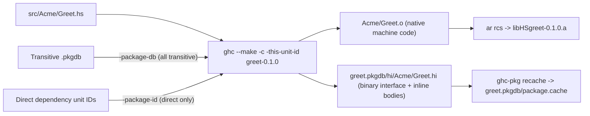

This primer introduces Haskell, its compiler ([GHC](https://www.haskell.org/ghc/)), its runtime system, and its package ecosystem for build and Bazel engineers who haven't written Haskell before. Paired with the [Bazel ruleset primer](bazel-rules-primer.md), it gives you the background to read every `.bzl`, `.c`, and `.hs` file in `rules_haskell` without guessing at compiler terminology. If you're looking to build a Haskell project right away, start with the [Quickstart](../guide/quickstart.md) instead.

**The core mental model:** If you've used Rust (`rustc` and `Cargo`), Go (`go build`), C++ (`clang++` and `CMake`), or Python (`pip` and `uv`), most pieces of the Haskell toolchain have direct counterparts. The surprises come from 1990s–2000s naming conventions (especially the word "Cabal") and five language and compiler design choices that directly shape how a build system invokes GHC and the linker.

## Core concepts before you start {#core-concepts}

Five Haskell and GHC design choices shape almost every rule, [provider](https://bazel.build/extending/rules#providers), and C helper in `rules_haskell`. Learning them up front makes the rest of the toolchain architecture predictable.

### Lazy evaluation, boxed values, and unboxed CPU values (`Int` vs. `Int#`)

In C, Go, or Rust, a 64-bit integer (`int64_t` or `i64`) lives directly as 8 bytes in a CPU register or on the stack, and `int64_t x = expensive(42);` runs `expensive(42)` immediately. That execution model is called **strict** (or **eager**) evaluation.

Haskell uses **lazy evaluation** by default: writing `let x = expensive 42` defers computation until another part of the program actually needs `x` (for example, to print it or branch on an `if`). Because any ordinary variable might hold an unfinished calculation, a standard Haskell `Int` is **boxed**:

- At runtime, an `Int` variable is a pointer to a small object on the garbage-collected heap (the "box").
- Before `x` is needed, that heap box points to the code and arguments needed to compute it later—a deferred calculation called a **thunk**.
- The first time `x` is evaluated, the runtime runs the thunk and overwrites the heap box in place with the finished 64-bit integer so later reads reuse the value without recomputing it.

An **unboxed** value strips away the heap pointer, allocation, and lazy thunk wrapper, leaving raw bits in a CPU register or contiguous memory buffer like C's `int64_t`. In GHC's internal libraries, unboxed types and raw CPU instructions end with `#` (enabled by the `MagicHash` extension), such as `Int#` or `ByteArray#`.

Everyday Haskell code uses boxed types like `Int`—and GHC's optimizer automatically unboxes them inside loops whenever it can prove laziness isn't needed—while GHC's lowest-level boot library (`ghc-prim`) defines the unboxed `#` types and primitive instructions underneath.

### Fixed-width `Int` vs. unbounded `Integer` and why C's `gmp` appears everywhere

Haskell's standard library ships two built-in integer types:

- **`Int`:** A fixed-width signed integer matching the CPU word size (64 bits on 64-bit platforms, from `-2^63` to `2^63 - 1`). Like C's `int64_t`, arithmetic maps directly to hardware instructions and wraps on overflow.
- **`Integer`:** An unbounded signed integer that allocates as many machine words as needed and never overflows. Writing `2 ^ 256 :: Integer` computes the exact 78-digit value.

For fast multi-word `Integer` math, GHC delegates to **[GMP](https://gmplib.org/) (`libgmp`, the GNU Multiple Precision Arithmetic Library)**, a C and assembly bignum library. Because `Integer` is part of the standard library, `gmp` shows up in `rules_haskell`'s [`MODULE.bazel`](https://bazel.build/external/module) dependencies and linker flags even when your Haskell code never calls C directly.

### Compile-time code generation with Template Haskell

**Template Haskell** is GHC's built-in compile-time macro and code-generation system, similar to Rust procedural macros. A library author writes an ordinary Haskell function that constructs a syntax tree—for example, inspecting the fields of a `Config` record type to generate a JSON parser and serializer.

When GHC compiles a file that invokes that macro, it pauses typechecking, executes the compiled generator function during the build (including reading schema or data files declared as build inputs), and splices the generated code into the module. Because GHC runs compiled library code at compile time, Template Haskell dictates both GHC's helper processes and why `rules_haskell` builds shared libraries alongside static archives.

### Why compiling one `.hs` file produces both `.o` and `.hi` files

Unlike C and C++, Haskell doesn't use hand-written `.h` header files. Compiling `Greet.hs` produces two outputs: `Greet.o` (native machine code for the linker) and `Greet.hi` (a binary "Haskell interface" summary). Whenever a downstream module writes `import Greet`, GHC reads `Greet.hi` to check exported types and inline small optimized functions across library boundaries.

### Why GHC calls a C compiler, assembler, archiver, and linker

Unlike Go—which embeds its own assembler and linker in the `go` binary—GHC compiles Haskell to `.s` assembly and invokes external C toolchain binaries (preprocessor, C compiler, assembler, `ar`, and linker). GHC also needs a C compiler to build C files used through Haskell's **Foreign Function Interface (FFI)**, and every Haskell executable links in GHC's C **runtime system (`libHSrts`)** for garbage collection, lightweight thread scheduling, and non-blocking I/O.

## Ecosystem map: GHC, Cabal, Hackage, and Stackage {#ecosystem-map}

Haskell terminology trips up newcomers mainly because **"Cabal"** refers to three separate things (a manifest format, a pure parser library, and a legacy build-runner library), alongside a fourth CLI tool (`cabal-install`). Here's how Haskell's ecosystem maps to other languages:

| Role | Haskell | Rust | Go | C++ | Python |
|---|---|---|---|---|---|
| **Language edition** | `Haskell98`, `Haskell2010`, `GHC2021`, `GHC2024` | `edition = "2021"` / `"2024"` | `go 1.23` | `-std=c++20` | Python `3.12` |
| **Compiler and interactive prompt** | **GHC** (`ghc`, `ghci`, `ghc-pkg`) | `rustc` | `go tool compile` | `clang++` / `g++` | `cpython` |
| **Package manifest** | **`<pkg>.cabal`** file | `Cargo.toml` | `go.mod` | `CMakeLists.txt` | `pyproject.toml` |
| **Standalone CLI and version solver** | **`cabal-install`** (`cabal` CLI) | `cargo` | `go` CLI | `conan` / `vcpkg` | `pip` / `uv` |
| **Central package server** | **[Hackage](https://hackage.haskell.org/)** | crates.io | Go module proxy | Conan Center | PyPI |
| **Curated compatible package set** | **[Stackage](https://www.stackage.org/) LTS** (`lts-24.67`) | Curated workspace `Cargo.lock` | Pinned `go.sum` release set | vcpkg baseline | `constraints.txt` |
| **Bundled API doc generator** | **[Haddock](https://haskell-haddock.readthedocs.io/)** (`haddock`) | `rustdoc` (`cargo doc`) | `pkgsite` / `go doc` | Doxygen | Sphinx / `pdoc` |

### Haskell language editions (`default_language`) and why `GHC2021` is the default

Haskell is statically typed, purely functional, lazily evaluated, and compiled ahead of time to native machine code. Three language conventions come up often in build files:

- **Language extensions (`-X<Ext>`):** GHC evolves Haskell through opt-in compiler features called *language extensions*. You can enable one per file with a top-of-file pragma (`{-# LANGUAGE OverloadedStrings #-}`) or across an entire Bazel target with `default_extensions = ["OverloadedStrings"]` (passing `-XOverloadedStrings` to `ghc`).
- **Language editions (`default_language`):** Like Rust's `2018`, `2021`, and `2024` editions, GHC bundles baseline syntax and extensions into named editions—the formal standards `Haskell98` and `Haskell2010`, and the newer `GHC2021` and `GHC2024`—selected via `-XHaskell98`, `-XHaskell2010`, `-XGHC2021`, or `-XGHC2024`.
- **Strings (`String` vs. `ByteString` vs. `Text`):** `Haskell98` defined `type String = [Char]`, a singly linked list where every Unicode character is a separate boxed heap node. Production Haskell uses **`ByteString`** (contiguous bytes, like Rust `&[u8]` or Go `[]byte`) for binary data and **`Text`** (contiguous UTF-8, like Rust `String` or `&str`) for human-readable text. Enabling `{-# LANGUAGE OverloadedStrings #-}` lets double-quoted literals (`"hello"`) construct `Text` or `ByteString` directly.

**Why `hs_library`, `hs_binary`, and `hs_test` default to `"GHC2021"` instead of `"GHC2024"`:** GHC `9.10` introduced `GHC2024`, and you can opt into `default_language = "GHC2024"` on any target. However, upstream GHC `9.10` and `9.12` still default to `GHC2021` because `GHC2024` turns on `MonoLocalBinds`, which restricts local `let`/`where` helpers that reference outer variables to a single concrete type unless you add an explicit type signature—breaking some `GHC2021` code.

[`hs_library`](../reference/rules.md#hs_library), [`hs_binary`](../reference/rules.md#hs_binary), and [`hs_test`](../reference/rules.md#hs_test) match GHC's own `"GHC2021"` default so targets behave identically to running `ghc` directly. By contrast, [`hs_cabal_library`](../reference/rules.md#hs_cabal_library) defaults to `"Haskell98"` because the `.cabal` specification requires packages that omit `default-language:` to compile as `Haskell98`.

### GHC and its bundled tools

An official precompiled GHC release archive—a **binary distribution**, or `bindist`—ships several tools under `bin/`:

- **`ghc`:** The ahead-of-time native compiler and linker driver. It compiles `.hs` modules into `.o` object files and `.hi` interface files, and calls the C linker to build libraries and executables.
- **`ghci` (`ghc --interactive`) and `runghc`:** `ghci` is GHC's interactive REPL (similar to running `python` or `node`), where you load `.hs` files into bytecode, inspect types (`:type`, `:info`), set breakpoints (`:break`), and reload edits (`:reload`). `runghc` runs standalone `.hs` or `.lhs` scripts without writing a binary to disk.
  - In `rules_haskell`, [`hs_repl`](../reference/rules.md#hs_repl) ([`bazel run //:my_repl`](https://bazel.build/docs/user-manual#running-executables)) launches staged `ghc` in interactive or `-e` expression mode with workspace modules loaded in `*Module` bytecode scope, precompiled `@hs_boot` and `@hackage` databases, C/C++ FFI shared stubs, Template Haskell, `data` [runfiles](https://bazel.build/extending/rules#runfiles), and `haskeline` history and Tab completion. You can also invoke `@rules_haskell//tools/ghci` and `@rules_haskell//tools/ghci:runghc` directly. (`haskell-language-server` `hie.yaml` generation isn't implemented yet.)
- **`ghc-pkg`:** GHC doesn't discover Haskell libraries by scanning directories for `lib*.a` files. Every compiled library has a `.conf` registration file—an index card listing its name, version, unit ID, exported modules, dependencies, and paths to its `.hi` and `.a` files—inside a **GHC package database** (`package.conf.d` or `<target>.pkgdb`). `ghc-pkg recache` validates those `.conf` files and compiles them into a fast binary lookup file (`package.cache`).
- **`hsc2hs`:** Haskell can't `#include` C `.h` headers directly, yet FFI bindings need platform-dependent `#define` constants (like `O_RDONLY`) and struct offsets (like `struct stat`'s `st_size`). You write a `.hsc` file mixing Haskell with placeholders such as `(#const O_RDONLY)` or `(#peek struct stat, st_size)`; `hsc2hs` uses the C compiler and target headers to resolve the exact integers for your platform and emits a plain `.hs` file for `ghc`.
- **`haddock`:** GHC's bundled API documentation generator (like Rust's `rustdoc`), which parses doc comments, runs GHC's typechecker to resolve types, and outputs HTML pages and symbol indexes.
- **`ghc-iserv-dyn`:** GHC's dynamically linked external interpreter server (`-fexternal-interpreter`). When running Template Haskell code, GHC can spawn `ghc-iserv-dyn` as a child process, send paths to `.so` libraries or bytecode over a pipe, and read back the generated AST—isolating compiler crashes and enabling a clean boundary for cross-compilation.
- **`unlit`:** Preprocesses optional "literate Haskell" (`.lhs`) files, where plain prose is ignored and only `> `-prefixed lines or `\begin{code} ... \end{code}` blocks compile as code. Because older Hackage packages still ship `.lhs` modules, `ghc` runs `unlit` automatically before compiling them.

### Package servers, SAT dependency solvers, Cabal, and `Setup.hs`

Before unpacking "Cabal", separate two general package-management concepts:

- **Package server (registry):** A central server hosting downloadable source archives by name and version—like npm, PyPI, or crates.io. In Haskell, that server is Hackage.
- **Dependency version solver (SAT solver):** Libraries usually declare dependency version ranges (`text >= 2.0 && < 2.2`). A version solver searches published versions to find one assignment (`text-2.1.1`) that satisfies all constraints simultaneously—or proves a conflict—typically using a **SAT solver** (Boolean satisfiability solver).

**[Cabal](https://www.haskell.org/cabal/)** (*Common Architecture for Building Applications and Libraries*) is neither a package server nor a SAT solver. It refers to three distinct pieces inside Haskell packages and GHC:

1. **The `<pkg>.cabal` manifest:** A declarative package file (like `Cargo.toml` or `pyproject.toml`) declaring package metadata, `exposed-modules`, `other-modules`, `build-depends` ranges, C sources and headers, boolean `flag` options, and `if os(...)` / `if arch(...)` blocks.
2. **`Cabal-syntax` (pure parser library):** A Haskell library bundled in GHC (`Distribution.PackageDescription.Parsec`) that parses `.cabal` files into a `GenericPackageDescription` syntax tree and evaluates platform/flag conditionals (`finalizePD`) with zero file I/O, network access, or compilation.
3. **`Cabal` (`Distribution.Simple`) and `Setup.hs`:** In Cabal's original 2000s build protocol, tools compiled each package's `Setup.hs` against the `Cabal` library and ran `./Setup configure && ./Setup build`. Almost every Hackage tarball still includes a `Setup.hs` for backward compatibility, and its behavior depends on the `.cabal` file's `build-type:` field:
   - **`build-type: Simple` (95%+ of Hackage):** `Setup.hs` is two lines of boilerplate (`import Distribution.Simple; main = defaultMain`). The `.cabal` file holds all build instructions. Supported in `rules_haskell`.
   - **`build-type: Configure` (for example, `network`, `unix-time`, `old-time`):** Runs a POSIX `./configure` script to probe C headers and generate headers (such as `HsNetworkConfig.h`) or `<pkg>.buildinfo` flags, then builds like `Simple`. Supported in `rules_haskell`.
   - **`build-type: Custom`:** Compiles and runs arbitrary Haskell code inside `Setup.hs` at build time. Historically, most `Custom` packages (such as `xml-conduit`, `lens`, and `bifunctors`) used `cabal-doctest` solely for doc-comment tests while building the library identically to `Simple`. `//tools/lock` detects `cabal-doctest`-only `Custom` packages and converts them to `Simple` automatically.

> **Note:** `rules_haskell` intentionally doesn't compile or run bespoke `Custom` `Setup.hs` programs (fewer than 1% of Hackage packages), because opaque build-time scripts break caching and [hermeticity](https://bazel.build/basics/hermeticity). `hs_cabal_library` rejects remaining `Custom` packages with a clear analysis error; handle special cases with [`hackage.override`](../reference/extensions-and-providers.md#hackage-override) or explicit Bazel rules.

`rules_haskell` never compiles or executes `Setup.hs`. Instead, it evaluates `.cabal` files offline with `Cabal-syntax` and runs explicit [Bazel actions](https://bazel.build/extending/rules#actions) in `hs_cabal_library`.

### `cabal-install` (the `cabal` CLI)

**`cabal-install`** is the standalone non-Bazel package manager (`cabal update`, `cabal build`—analogous to `cargo` or `pip`). It fetches Hackage's index, runs a SAT solver over version ranges, and builds packages into `~/.cabal`. Because Bazel handles downloading, [sandboxing](https://bazel.build/docs/sandboxing), caching, and execution ([Bazel ruleset primer](bazel-rules-primer.md#three-phases)), `rules_haskell` never installs or invokes `cabal-install`.

### Hackage and metadata revisions (`x-revision`)

Hackage hosts `.tar.gz` source archives of open-source Haskell packages, with one operational quirk build tools must handle: **metadata revisions (`x-revision`)**.

- Once `<pkg>-<ver>.tar.gz` is uploaded, its archive bytes are permanently immutable.
- Later, maintainers can edit `<pkg>`'s standalone `.cabal` file on Hackage—adjusting version bounds and bumping an `x-revision: 1`, `2`, ... header—without uploading a new tarball.
- Consequently, `https://hackage.haskell.org/package/<pkg>-<ver>/<pkg>.cabal` is a *mutable* URL serving the latest revision, while immutable snapshots live at `.../revision/0.cabal`, `.../revision/1.cabal`, and so on.

To keep lockfile generation reproducible, [`//tools/lock:lock`](../reference/lock-cli.md) (`fetchVerifiedCabal` in `tools/lock/Main.hs`) verifies the downloaded `.cabal` file against the Stackage snapshot's exact SHA-256 digest, stepping backward through `revision/<r>.cabal` whenever Hackage's mutable URL has moved ahead.

### Stackage LTS and `stack`

Choosing compatible versions across hundreds of Hackage packages with open version bounds normally requires a SAT solver. **Stackage** moves that version selection upstream:

- A **Stackage LTS (Long-Term Support)** snapshot (such as `lts-24.67` for GHC `9.10.3`) is a curated, CI-tested set of roughly 3,300 Hackage packages pinned to one exact version, one exact `.cabal` revision SHA-256 digest, and tested Cabal `flags:` defaults that compile and pass tests together. (`stack` is the standalone non-Bazel CLI originally built around Stackage.)
- Because a snapshot already maps every package to one fixed `(version, cabal_sha256, flags)` entry, `//tools/lock:lock` doesn't need a SAT solver: starting from your root `--package` flags, it computes the transitive closure with a deterministic breadth-first search (BFS) in milliseconds ([Hackage and Cabal pipeline](ecosystem-and-hackage.md#phase-1-lock-generator)).

## Boot libraries: why GHC ships 41 packages inside the compiler {#boot-libraries}

Unlike `clang` (C++) or `go`, GHC—along with `ghc-pkg`, `hsc2hs`, and `haddock`—is written in Haskell on top of its C runtime system. As a result, a GHC release tarball ships a built-in package database (`lib/package.conf.d/`) containing **41 precompiled boot libraries** in GHC `9.10.3` (42 in `9.12.4`, which adds `file-io`), plus 1 metadata-only C++ linker entry (`42` or `43` `.conf` files total in `haskell/private/ghc_versions.bzl`):

| Category | Precompiled GHC boot packages (`@hs_boot//:<pkg>`) | What they provide |
|---|---|---|
| **Runtime and CPU primitives** | `rts`, `ghc-prim`, `ghc-bignum`, `integer-gmp`, `ghc-internal` | C garbage collector and thread scheduler (`libHSrts`), raw unboxed CPU types (`Int#`, `ByteArray#`), unbounded `Integer` math via `libgmp`, and shared internal definitions |
| **Standard library and arrays** | `base`, `array`, `deepseq` | Core standard library (including auto-imported `Prelude`), mutable and immutable arrays, and helpers that force nested lazy values to finish evaluating (`deepseq`) |
| **Bytes, text, and data structures** | `bytestring`, `text`, `containers`, `binary` | Contiguous byte buffers (`ByteString`), UTF-8 strings (`Text`), immutable maps/sets/deques (`Map`, `Set`, `Seq`), and binary serialization |
| **OS, files, and concurrency** | `filepath`, `directory`, `process`, `unix`, `os-string`, `time`, `stm`, `semaphore-compat` | File paths, filesystem APIs, child processes, POSIX syscalls, raw OS path strings, clocks/dates, atomic shared-memory transactions (`stm`), and OS semaphores |
| **State pipelines, parsing, and formatting** | `exceptions`, `transformers`, `mtl`, `parsec`, `pretty`, `xhtml` | Exception handling, context-threading wrappers (`transformers`, `mtl`), parser combinators (`parsec`), indented text layout (`pretty`), and XHTML output |
| **Interactive prompt, coverage, and terminal** | `terminfo`, `haskeline`, `hpc`, `ghci` | Terminal capability lookups (`terminfo`), interactive line editing with history and Tab completion (`haskeline`), code coverage (`hpc`), and `ghci` runtime |
| **Compiler API, macros, and Cabal** | `ghc`, `ghc-boot`, `ghc-boot-th`, `ghc-heap`, `ghc-compact`, `ghc-experimental`, `ghc-platform`, `ghc-toolchain`, `template-haskell`, `Cabal`, **`Cabal-syntax`** | GHC as a library, heap inspection and compact non-GC memory regions, Template Haskell AST types, the Cabal build library, and the pure `.cabal` parser (`Cabal-syntax`) |
| **C++ standard library marker** | `system-cxx-std-lib` | Metadata-only `.conf` entry (no Haskell code or `.a` archive) recording which C++ runtime library (`stdc++` or `c++`) to link when a package compiles C++ files |

Six boot entries appear frequently when reading [`BUILD.bazel`](https://bazel.build/concepts/build-files) files, lockfiles, or `.conf` registrations:

- **`base` and `Prelude`:** `base` is Haskell's standard library (core types, I/O, lists, numbers, concurrency, and C FFI), so almost every target depends on `@hs_boot//:base` (or `@hackage//:base`). `Prelude` is imported into every `.hs` file automatically unless disabled with `{-# LANGUAGE NoImplicitPrelude #-}`.
- **`ghc-prim`, `ghc-bignum`, and `rts`:** Sit directly underneath `base`. `ghc-prim` defines unboxed `#` types and primitives, `ghc-bignum` (plus the legacy `integer-gmp` shim) implements unbounded `Integer` math via `libgmp`, and `rts` registers `libHSrts` along with `Rts.h` and `HsFFI.h`.
- **`stm` (software transactional memory):** Avoids manual mutex ordering and deadlocks by modifying shared transactional variables (`TVar`) inside an `atomically` block. Threads record reads and writes in an isolated log, committing atomically if nothing conflicted or rolling back and retrying automatically if another thread modified a `TVar`.
- **`transformers` and `mtl`:** Because Haskell functions don't mutate hidden global state by default, programs thread read-only config, state, or typed errors with wrapper types (`ReaderT`, `StateT`, `ExceptT`) instead of passing extra parameters manually to every call.
- **`Cabal-syntax` (bootstrapping `//tools/lock:lock` with no host tools):** Most Bazel rulesets either maintain a partial manifest parser in [Starlark](https://bazel.build/rules/language)/Python or require a host package manager (`cargo`, `pip`, `cabal`, `stack`). Because GHC already bundles precompiled boot libraries such as `Cabal-syntax`, `bytestring`, and `text`, `rules_haskell` exposes them through `@hs_boot//*` and compiles `//tools/lock:lock` directly with GHC—requiring no host `cabal`, `stack`, or Python.
- **`system-cxx-std-lib`:** Since GHC 9.4, Cabal packages with `cxx-sources:` declare `depends: system-cxx-std-lib-1.0` instead of hardcoding `-lstdc++` (Linux GCC) vs. `-lc++` (macOS/Clang). GHC's metadata-only `system-cxx-std-lib-1.0.conf` contains zero `.hs` modules or `.a` archives—just `extra-libraries: stdc++` (or `c++`)—so the linker picks the platform's C++ runtime.

## How GHC compiles code: object files, `.hi` interfaces, and package databases {#compilation-model}

Every Haskell source file declares a dotted module name matching its path under `hs_source_dirs` (such as `src/Acme/Greet.hs`, similar to Java packages or Python modules):

```haskell
-- src/Acme/Greet.hs
module Acme.Greet (greet) where   -- Explicit export list (anything omitted stays private to this file)

import Data.Text (Text)

{-# INLINE greet #-}
greet :: Text -> Text
greet name = "Hello, " <> name
```

Instead of hand-written C `.h` headers, GHC emits both native machine code (`.o`) and a binary interface summary (`.hi`), comparable to C++20 module interfaces (`.bmi`) or Rust `.rmeta` metadata:



### Native `.o` objects vs. binary `.hi` interface files

Compiling `src/Acme/Greet.hs` produces two artifacts with distinct consumers:

1. **`Acme/Greet.o` -> `libHS<unit_id>.a` (for the final linker):** Standard ELF, Mach-O, or COFF machine code packed by `ar` into a static archive. Upstream `.a` archives aren't needed to compile downstream `.hs` libraries (unless Template Haskell executes upstream code at compile time); they're linked once when building the final `hs_binary` or `hs_test`.
2. **`Acme/Greet.hi` (for downstream `ghc` compilations):** A compact binary interface read whenever a downstream module writes `import Acme.Greet`. Beyond exported types, `.hi` files store **cross-module unfoldings**—copies of GHC's optimized intermediate code (*Core*) for small or `{-# INLINE #-}` functions—plus rewrite rules (`{-# RULES #-}`). Those unfoldings let GHC inline functions, specialize generic code (like C++ templates or Rust monomorphization), and fuse chained `Text` or `ByteString` operations across separate Bazel library targets.

### Unit IDs, `.conf` registration files, and `${pkgroot}` package databases

GHC locates compiled libraries through **package databases** (`.pkgdb` or `package.conf.d` directories):

- **`unit-id` (`-this-unit-id`):** A globally unique identifier that GHC mangles into every exported linker symbol so two packages with identical module or function names don't collide. Boot libraries use `<name>-<ver>-<hash>` (`base-4.20.2.0-9331`), Hackage targets use `<pkg>-<ver>[-<sublib>]` (`attoparsec-0.14.4`), and user `hs_library` targets derive a collision-free ID from their full [Bazel label](https://bazel.build/concepts/labels) (`u__S_Sapp_Ctypes-0.0.0`).
- **`<unit_id>.conf` and `package.cache`:** Each `.pkgdb` directory holds a `<unit_id>.conf` key-value file plus the binary `package.cache` lookup table built by `ghc-pkg recache`:

```text
name: greet
version: 0.1.0
id: greet-0.1.0
key: greet-0.1.0
exposed: True
import-dirs: ${pkgroot}/greet.pkgdb/hi
library-dirs: ${pkgroot}
library-dirs-static: ${pkgroot}
dynamic-library-dirs: ${pkgroot}/greet.pkgdb/dyn
hs-libraries: HSgreet-0.1.0
exposed-modules: Acme.Greet
depends: base-4.20.2.0-9331 text-2.1.3-4a1b
```

- **Relocatable `${pkgroot}` expansion:** Because Bazel runs actions inside temporary sandboxes and [remote execution](https://bazel.build/remote/rbe) workers whose absolute paths change across machines, hardcoded paths would break caching. `ghc-pkg` expands `${pkgroot}` at runtime to the *parent directory* of the `.pkgdb` directory (`dirname($PKG_DB)`). Placing `libHSgreet-0.1.0.a` and `greet.pkgdb` side by side in the same output directory keeps `.conf` and `package.cache` completely relocatable ([Providers and action graph](providers-and-actions.md#relocatable-pkgdb)).

### How `-hide-all-packages`, `-package-db`, and `-package-id` enforce direct dependencies

Suppose `App` depends on `LibB`, and `LibB` depends on `LibA` (`App -> LibB -> LibA`), where an exported function in `LibB` returns a type defined in `LibA`:

- GHC needs *transitive* access to `LibA.pkgdb` so the typechecker can inspect `LibA`'s type definitions and unfoldings referenced inside `LibB.hi`.
- Yet `App.hs` shouldn't be allowed to write `import LibA` directly unless `App` explicitly lists `LibA` in `deps`.

`rules_haskell` enforces that strict boundary on every compile action ([Bazel ruleset primer](bazel-rules-primer.md#providers-and-depsets)):

1. **`-hide-all-packages`:** Hides every boot and external package from `import` statements by default (including `base`).
2. **`-package-db <db>` (all transitive `HsLinkInfo.pkg_dbs`):** Lets GHC resolve types and inline bodies from any transitive `.hi` file.
3. **`-package-id <unit_id>` (direct `HsPackageInfo` entries in `deps` only):** Exposes only direct dependencies to source `import` statements.

## Why GHC needs a C toolchain and the GHC runtime system (RTS) {#c-toolchain-and-rts}

If you're used to Go's self-contained assembler and linker, seeing a Haskell ruleset depend on `rules_cc` can look surprising. Two facts explain why: GHC hands off preprocessing, assembly, archiving, and linking to C toolchain binaries, and every Haskell executable links in GHC's C runtime system (`libHSrts`).

### GHC's compilation pipeline and `-pgm*` external tool hooks

Inside one `ghc` compile action, Haskell source passes through four internal compiler stages before GHC calls external C toolchain programs:

```mermaid
flowchart LR
    HS["Haskell (.hs)"] --> CORE["Core (simplified typed IR)"]
    CORE --> STG["STG (explicit heap thunks)"]
    STG --> CMM["Cmm (portable low-level C--)"]
    CMM --> NCG["Native codegen (.s assembly)"]
    NCG -->|"-pgma (ghc_cc_wrapper)"| OBJ["Object (.o)"]
    OBJ -->|"-pgmar (ar)"| LIB["libHS*.a"]
    LIB -->|"-pgml (ghc_cc_wrapper) + libHSrts.a + libgmp.a"| BIN["Executable"]
```



1. **Haskell source to Core:** After parsing and typechecking, GHC desugars surface syntax into **Core**, a tiny explicitly typed intermediate representation (`let`, `case`, functions, calls). Almost all high-level optimizations—inlining, specialization, dead-code elimination, and strictness analysis (proving when a value can live in an unboxed register instead of a heap thunk)—run on Core.
2. **Core to STG ("Spineless Tagless G-machine"):** Lowers Core into an explicit heap-allocation model where remaining lazy expressions become concrete heap thunks with entry-code pointers.
3. **STG to Cmm (`C--`):** Lowers heap closures into a portable low-level register and stack language modeled on C, inserting explicit stack arithmetic and fast-path heap checks that invoke the garbage collector when an allocation block fills up.
4. **Cmm to native code generator (NCG) to `.s` assembly:** GHC's built-in `x86_64` and `AArch64` code generator emits GNU-syntax `.s` assembly, then invokes external C toolchain programs through `-pgm*` flags:

| GHC flag | Role in compilation and linking | What `rules_haskell` wires it to (`haskell/private/actions.bzl`) |
|---|---|---|
| `-pgma` | Assembles NCG `.s` assembly files into `.o` object files | `ghc_cc_wrapper` -> Bazel [`cc_toolchain`](https://bazel.build/reference/be/c-cpp#cc_toolchain) compiler driver |
| `-pgmc` / `-pgmcxx` | Compiles C / C++ FFI sources and generated C wrapper stubs | `ghc_cc_wrapper` -> Bazel `cc_toolchain` compiler driver |
| `-pgmP` / `-pgmCmmP` | Preprocesses `-XCPP` `.hs` files and `.cmm` files | `ghc_cc_wrapper` (`-E -undef -traditional` for Haskell) |
| `-pgmlm` | Merges a Haskell `.o` and a generated C wrapper `.o` via `ld -r` | `cc_tools.ld` (`-optlm-r`) |
| `-pgmar` | Packs `.o` files into static `libHS*.a` archives | `cc_tools.ar` |
| `-pgml` | Links `.so` shared libraries and executables (`crt1.o`, `libc`) | `ghc_cc_wrapper` -> Bazel `cc_toolchain` linker driver |

Because upstream GHC tarballs hardcode the release machine's `/usr/bin/gcc` and `-fuse-ld=gold` inside `lib/settings`, `rules_haskell` rewrites those paths to `/nonexistent/*` during extraction and routes every `-pgm*` hook through a small C11 adapter (`ghc_cc_wrapper`; see [Hermeticity and toolchain](hermeticity.md#ghc-cc-wrapper)).

### What `libHSrts` (the GHC runtime system) does

Every compiled `hs_binary` or `hs_test` links in **`libHSrts`**, an ~70,000-line C and `Cmm` runtime library comparable to Go's `runtime` package:

- **Parallel generational garbage collector:** Per-core bump-pointer allocation in a young nursery, multi-generation copying and compacting collection, and pinned buffers (`ByteString`) that the GC never moves so pointers pass directly to C without copying.
- **M:N green-thread scheduler:** `Control.Concurrent.forkIO` spawns lightweight Haskell threads costing a few hundred bytes of heap, multiplexed across OS `pthread` worker threads like Go goroutines.
- **Non-blocking event I/O manager:** Uses Linux `epoll`, macOS `kqueue`, and timers so socket or pipe reads park only the waiting green thread while OS workers keep running other threads.
- **Software transactional memory (`STM`):** Runtime support for atomic `TVar` transactions (`atomically`, `retry`).
- **C interop headers (`HsFFI.h`, `Rts.h`):** Defines portable FFI types (`HsInt`, `HsWord64`, `HsPtr`, `hs_init`) and internal runtime APIs, exposed to `rules_cc` as Bazel-tracked files ([Bazel ruleset primer](bazel-rules-primer.md#cc-interop)).

GHC ships two variants of `libHSrts`:

- **Single-threaded RTS (`threaded = False`):** Runs all Haskell threads on one OS thread; any blocking C call stalls every Haskell thread until C returns.
- **Multi-threaded RTS (`-threaded`, default `threaded = True` on `hs_binary` and `hs_test`):** Links `libHSrts_thr`, enabling multi-core execution (`+RTS -N`) and offloading `safe` C calls (such as DNS lookups or blocking syscalls) to separate OS worker threads so other Haskell threads keep running.

## Why GMP and `libtinfo` show up as C dependencies {#gmp-and-tinfo}

Two C libraries stand out in `MODULE.bazel` and `haskell/private/staged_ghc.bzl`: **`gmp`** ([`bazel_dep(name = "gmp", ...)`](https://bazel.build/rules/lib/globals/module#bazel_dep) -> `libgmp`) and **`libtinfo`** (`haskell/private/tinfo_stub.c` -> `libtinfo.so.6` and `libtinfo.a`). Both trace directly to upstream GHC and `base`.

### Why `gmp` (`libgmp`): built-in unbounded `Integer` arithmetic

As noted in [Core concepts](#core-concepts), `base` implements unbounded `Integer` via `ghc-bignum` on top of C's `libgmp`. On Linux (`deb10`), GMP crosses two boundaries that `rules_haskell` handles differently:

1. **Running the `ghc` compiler binary (`libgmp.so.10`):** Upstream Linux GHC (`deb10`) is dynamically linked, so `bin/ghc-9.10.3` has an ELF `DT_NEEDED` dependency (a shared library the OS dynamic loader requires at startup) on `libgmp.so.10`. `staged_ghc` builds `libgmp.so.10` from [BCR](https://bazel.build/external/registry#bazel-central-registry) `@gmp//:gmp` (`gmp@6.3.0.bcr.5`) and places it in GHC's relative library directory (`$ORIGIN/../lib/...`, where `$ORIGIN` expands to the directory containing the executable) so `ghc` starts in minimal containers without `libgmp10`.
2. **Linking user executables (`gmp_static/libgmp.a`):** Because user binaries link `base` -> `ghc-bignum` (`extra-libraries: gmp`), GHC passes `-lgmp` to the linker. `rules_haskell` points `-L` at an isolated `gmp_static/` directory containing *only* static `libgmp.a` (no `.so` files), linking GMP statically so deployed executables have no runtime `libgmp.so.10` dependency ([Hermeticity and toolchain](hermeticity.md#static-gmp-executables)).

### Why `libtinfo.so.6` and `libtinfo.a` exist

Seeing an in-tree C11 source file (`haskell/private/tinfo_stub.c`) providing `libtinfo.so.6` and `libtinfo.a` looks unusual at first. Tracing why `ghc` asks for `libtinfo` and how small its actual symbol surface is clarifies the trade-off.

#### Why both batch `ghc` and interactive `ghci` reference `libtinfo`

`libtinfo` is the low-level terminal capability library from `ncurses`. At runtime, it reads compiled `term(5)` files from `/usr/share/terminfo` (keyed by `$TERM`, such as `xterm-256color`) to look up escape sequences for cursor movement, line clearing, and colors.

In upstream GHC, the batch compiler `ghc` and the interactive REPL `ghci` live in the *same* binary (`bin/ghc-9.10.3`), which links `libHSghci` -> `libHShaskeline` -> `libHSterminfo` -> `libtinfo.so.6`. Because Linux's dynamic linker (`ld-linux.so`) resolves every `DT_NEEDED` library *before `main()` runs*, invoking `ghc -c Foo.hs` or `bazel run //:my_repl` on a minimal container without `libtinfo6` fails immediately at startup unless `rules_haskell` stages `libtinfo.so.6`.

#### How the exact symbol surface was verified

Auditing every bundled executable (such as `ghc`, `ghc-pkg`, and `haddock`) and every `libHS*.so` library across GHC `9.10.3` and `9.12.4` on Linux (`x86_64` and `aarch64`) with `readelf -Ws` confirms two facts:

1. `libHSterminfo` is the *only* library in GHC that imports symbols from `libtinfo.so.6`.
2. It imports strictly 8 C functions—all tagged with the Debian/Ubuntu ELF symbol version `NCURSES6_TINFO_5.0.19991023`: `setupterm`, `set_curterm`, `del_curterm`, `tigetflag`, `tigetnum`, `tigetstr`, `tparm`, and `tputs`.

#### How `tinfo_stub.c` implements those 8 functions in C11

Rather than pulling an external `ncurses` autoconf + `gawk` build into every consumer's `MODULE.bazel` graph, `rules_haskell` implements those 8 X/Open Curses functions in a single self-contained C11 file (`haskell/private/tinfo_stub.c`):

- **Binary `term(5)` parser:** Searches `$TERMINFO`, `$TERMINFO_DIRS`, `$HOME/.terminfo`, `/etc/terminfo`, `/lib/terminfo`, and `/usr/share/terminfo` (checking both Linux `<first-char>/<term>` and macOS/BSD `<two-digit-hex>/<term>` layouts) and parses classic 16-bit (`0432`), extended 32-bit (`01036`), and user-defined extended capability sections (`AX`, `XT`, `RGB`, `Smulx`, `Setulc`).
- **Built-in terminal fallback profiles:** Inside minimal containers or sandboxes without `/usr/share/terminfo`, `setupterm` falls back to built-in tables for common `$TERM` families (`xterm-256color`/`xterm`/`screen`/`tmux`/`rxvt`/`alacritty`/`kitty`, `vt100`/`ansi`/`linux`, and `dumb`). Passing `NULL`, `""`, or an unknown terminal with no database entry sets `*errret = -1` and returns `-1` (`ERR`), which `System.Console.Terminfo.Base.setupTerm` turns into `SetupTermError`.
- **Live window size and parameterized formatting:** `setupterm` queries live terminal dimensions (`lines`, `cols`) via `ioctl(fildes, TIOCGWINSZ, ...)` (plus `$LINES` and `$COLUMNS` overrides). `tparm` evaluates stack-based format strings (`%p1..%p9`, `%d`/`%s`/`%c`, `%i`, arithmetic/bitwise operators, `%?`/`%t`/`%e`/`%;` conditionals, and `%P`/`%g` variables), and `tputs` emits capability strings while stripping `$<delay>` padding markers.

#### Why `tinfo_stub.lds` is required

On Debian and Ubuntu, `ld-linux.so` checks that `libtinfo.so.6` exports not just `setupterm`, but `setupterm@NCURSES6_TINFO_5.0.19991023`—the exact ELF symbol version recorded in `libHSterminfo` when GHC was built on Debian 10. Without a version script, `ld-linux.so` rejects the library at startup. The 13-line linker script `haskell/private/tinfo_stub.lds` attaches `NCURSES6_TINFO_5.0.19991023` to all 8 exported symbols ([Hermeticity and toolchain](hermeticity.md#origin-staging)).

#### Why self-contained C11 was chosen over building full `ncurses`

Building full `ncurses` inside Bazel requires autoconf `./configure` probes, host `gawk` and shell scripts to generate capability tables, and another external dependency in every consumer's `MODULE.bazel`. Compiling `tinfo_stub.c` with Bazel's `cc_toolchain` takes milliseconds, keeps `MODULE.bazel` at 4 non-dev modules, and supports `haskeline` arrow-key history, Tab completion, and 256-color output in `hs_repl` and `terminfo`-linked binaries (`gmp_static/libtinfo.a`).

**Trade-off:** `tinfo_stub.c` implements only `libHSterminfo`'s 8-symbol `tinfo` surface. If a C library you bind calls higher-level `ncurses` windowing APIs (`initscr`, `newwin`, `wgetch`), link a full `ncurses` [`cc_library`](https://bazel.build/reference/be/c-cpp#cc_library) through `cc_deps`.

## Haskell build mechanisms: FFI, `hsc2hs`, `alex` and `happy`, CPP, and `.hs-boot` {#build-mechanisms}

Many Hackage packages combine `.hs` modules with up to six additional build mechanisms. Both `hs_cabal_library` and `hs_library` run these directly as Bazel actions.

### C foreign function interface (`foreign import ccall` and `CApiFFI`)

Haskell's built-in FFI (`Foreign.C`) calls C functions directly and passes pointers or primitive values across the language boundary:

```haskell
{-# LANGUAGE CApiFFI #-}
module Compression where
import Foreign.C.String (CString)
import Foreign.C.Types  (CInt(..))

-- Direct ABI symbol call: links directly against symbol `zlibVersion` in libz.a
foreign import ccall unsafe "zlibVersion" c_zlibVersion :: IO CString

-- CApiFFI header wrapper: used when `deflateInit` is a C `#define` macro or `static inline`
foreign import capi unsafe "zlib.h deflateInit" c_deflateInit :: CInt -> IO CInt
```

- **`ccall`** compiles to a direct C ABI machine `call` against an exported linker symbol. Marking it `unsafe` promises the C function returns quickly without calling back into Haskell, skipping scheduler overhead; `safe` (the default) lets the multi-threaded RTS run the call on a dedicated OS worker thread so other green threads aren't blocked.
- **`capi` (`{-# LANGUAGE CApiFFI #-}`)** wraps C APIs defined as `#define` macros or `static inline` functions in `.h` headers (which have no symbol in `.a` archives). GHC generates a temporary `.c` wrapper that `#include`s `"zlib.h"`, compiles it with `-pgmc`, and merges it into the Haskell `.o` file via `ld -r` (`-pgmlm`).

### `.hsc` files and `hsc2hs`

Hardcoding OS struct layouts (like POSIX `struct sockaddr`) or `<sys/socket.h>` constants breaks across Linux, macOS, `x86_64`, and `arm64`. A **`.hsc`** file embeds C lookup directives (`#include`, `#const`, `#size`, `#peek`, `#poke`) inside Haskell source:

```haskell
#include <sys/socket.h>
module SocketConsts where
import Foreign.C.Types (CInt)
import Foreign.Storable (peekByteOff)

afInet :: CInt
afInet = (#const AF_INET)

peekFamily ptr = (#peek struct sockaddr, sa_family) ptr
```

During Stage 3 of `hs_cabal_library`, `hsc2hs` turns each `.hsc` file into a tiny C probe program (`template-hsc.h` plus `offsetof`/`sizeof` checks), compiles and runs it inside the sandbox via `ghc_cc_wrapper`, and writes a plain `.hs` file (`afInet = 2`, `peekByteOff ptr 0`) for GHC.

### `.x` (`alex`) and `.y` / `.ly` (`happy`) grammar generators

Just as C projects use `flex` (lexer) and `bison` (parser), Haskell packages such as `toml-parser` and `pretty-show` ship `.x` files for **`alex`** (lexer generator) and `.y`/`.ly` files for **`happy`** (parser generator, with `.ly` for literate format) instead of checking generated `.hs` files into Hackage tarballs:

```text
-- Lexer.x (Alex lexer specification -> generates Lexer.hs)
tokens :-
  $white+       ;
  [0-9]+        { \s -> TokInt (read s) }

-- Parser.y (Happy parser grammar -> generates Parser.hs)
%name parseExpr
%tokentype { Token }
%%
Expr : int '+' int   { $1 + $3 }
```

Because the official Hackage tarballs for `alex` (`3.5.4.2`) and `happy` (`2.1.7`) include pre-generated bootstrap `.hs` sources and depend solely on `@hs_boot` packages (`array`, `base`, `containers`, `directory`, `mtl`, `transformers`), `rules_haskell` compiles them lazily from source (in `haskell/private/cabal_codegen.bzl`) only when a target contains `.x`, `.y`, or `.ly` files—requiring no host `alex` or `happy`.

### `-XCPP`, `cabal_macros.h`, and `Paths_<pkg>.hs`

```haskell
{-# LANGUAGE CPP #-}
module VersionInfo where
import Paths_my_http_pkg (version, getDataFileName) -- '-' in pkg name becomes '_'

#if MIN_VERSION_base(4,20,0)
banner :: String
banner = "Built on base " ++ show version
#endif
```

- **`{-# LANGUAGE CPP #-}` (`-XCPP`):** Runs the C preprocessor before Haskell parsing. GHC passes `-traditional` to `-pgmP` so prime characters in valid Haskell identifiers (like `x'`) aren't rejected as unterminated C character literals.
- **`cabal_macros.h`:** Pre-included with `-optP-include cabal_macros.h`, defining `VERSION_<pkg>` and `MIN_VERSION_<pkg>(maj1,maj2,min)` macros for every direct dependency so packages compile across multiple GHC or library versions.
- **`Paths_<pkg>.hs`:** When listed in `autogen-modules` or `other-modules`, Cabal generates this module exporting `version :: Version` and `getDataFileName :: FilePath -> IO FilePath`. `rules_haskell` generates both files directly during Bazel analysis with `ctx.actions.write` without spawning a subprocess (`haskell/private/actions.bzl`).

### `.hs-boot` files for breaking mutual module cycles

Unlike Go or Java (which compile every file in a package together), GHC compiles modules one by one in dependency order: `BootA.hi` must exist before `BootB.hs` can typecheck. When two modules inside one library genuinely need mutual imports (as in Hackage's `cborg` and `tls`), Haskell breaks the cycle with a hand-written **`BootA.hs-boot`** forward declaration paired with `import {-# SOURCE #-}`:

```haskell
-- BootA.hs-boot (forward declaration only; compiles first -> BootA.hi-boot)
module BootA where
data Expr = Lit Int | Nested Node

-- BootB.hs (imports BootA via {-# SOURCE #-} before full BootA.hs is compiled)
module BootB where
import {-# SOURCE #-} BootA (Expr)
data Node = Wrapper Expr

-- BootA.hs (imports full BootB.hi and checks that it matches BootA.hs-boot)
module BootA where
import BootB (Node)
data Expr = Lit Int | Nested Node
```

Because `rules_haskell` compiles each library with `ghc --make -c`, GHC sequences `BootA.hs-boot -> BootB.hs -> BootA.hs` automatically without separate per-file Bazel targets.

### Cabal sublibraries and `reexported-modules`

```text
-- Inside attoparsec.cabal (Cabal 2.0+ internal sublibrary)
library attoparsec-internal
  hs-source-dirs:  internal
  exposed-modules: Data.Attoparsec.ByteString.FastSet

library
  build-depends:      base, attoparsec-internal
  exposed-modules:    Data.Attoparsec
  reexported-modules: Data.Attoparsec.ByteString.FastSet as Data.Attoparsec.FastSet
```

- **Internal and public sublibraries:** A `.cabal` file can define helper libraries (`library attoparsec-internal`) alongside the main `library` in one tarball—private by default, or externally visible as `pkg:sublib` with `visibility: public` (Cabal 3.0+). `rules_haskell` generates a separate `hs_cabal_library` target per sublibrary (`@hackage//:attoparsec__attoparsec-internal`).
- **`reexported-modules`:** Lets a package's `.conf` file re-expose a module compiled in an upstream dependency or sublibrary (`exposed-modules: Data.Attoparsec.FastSet from attoparsec-0.14.4-attoparsec-internal:Data.Attoparsec.ByteString.FastSet`) without writing a wrapper `.hs` file.

## Template Haskell: compile-time execution and shared libraries {#template-haskell}

With `{-# LANGUAGE TemplateHaskell #-}`, an expression wrapped in `$(...)` is a **splice**: GHC evaluates that Haskell expression at compile time and inserts the resulting **abstract syntax tree (AST)** into the module before finishing typechecking:

```haskell
{-# LANGUAGE TemplateHaskell #-}
module Config where
import Data.Aeson.TH   (defaultOptions, deriveJSON)
import Data.ByteString (ByteString)
import Data.FileEmbed  (embedFile)

data AppConfig = AppConfig { port :: Int, host :: String }

-- 1. Declaration splice: inspects `AppConfig`'s fields at compile time and
--    generates ToJSON and FromJSON serializer instances for the typechecker.
$(deriveJSON defaultOptions ''AppConfig)

-- 2. Compile-time file I/O splice: reads "static/schema.json" from the Bazel
--    compile sandbox (declared in `data`) and embeds its bytes as a constant.
embeddedSchema :: ByteString
embeddedSchema = $(embedFile "static/schema.json")
```

> **Note:** A smaller companion extension, `{-# LANGUAGE TemplateHaskellQuotes #-}`, lets you construct AST values at runtime with quotes like `''AppConfig` or `[| 1 + 1 |]` without running any compile-time splices.

### Why cross-library Template Haskell needs `.so` shared objects while binaries stay static

Suppose library `A` (`aeson` or `file-embed`) defines `deriveJSON`, and downstream library `B` calls `$(deriveJSON ...)` while compiling `B.hs`:

1. **Dynamically linked `ghc` requires `.so` libraries to load macros at compile time:** On Linux (`deb10`) and macOS, upstream `ghc` itself is dynamically linked (`GHC Dynamic = YES`, using `libHS*-ghc9.10.3.so`). When `ghc` (or `ghc-iserv-dyn`) pauses typechecking `B.hs` to call `A.deriveJSON`, `dlopen` can load `A` into that running dynamic process only if `A` was compiled as a position-independent shared object (`libHSA-ghc9.10.3.so`).
2. **How `rules_haskell` keeps final user binaries static:**
   - During `HsCompileLibrary`, `rules_haskell` passes `-dynamic-too` to `ghc --make -c` so GHC emits both static (`.o`, `.hi`) and dynamic (`.dyn_o`, `.dyn_hi`) outputs in one pass.
   - Static `.o` objects go into `${pkgroot}/libHS<unit_id>.a` (`library-dirs-static`), while dynamic `.dyn_o` objects (plus any C static archives in that target) link into `<name>.pkgdb/dyn/libHS<unit_id>-ghc<ver>.so` (`dynamic-library-dirs`).
   - While compiling `B`, GHC loads `A`'s `.so` from `<A>.pkgdb/dyn/` via `dlopen` to run `$(...)` splices. When linking the final `hs_binary`, `${pkgroot}` holds no `.so` files, so the C linker links strictly against static `.a` archives—producing a standalone executable with zero `libHS*.so` runtime dependencies ([Providers and action graph](providers-and-actions.md#template-haskell)).

## Haddock: Haskell's bundled API documentation tool {#haddock}

**Haddock** (`bin/haddock-ghc-<ver>`, invoked by [`hs_haddock`](../reference/rules.md#hs_haddock)) is GHC's bundled API documentation generator, analogous to Rust's `rustdoc`. Rather than parsing source files with regular expressions, Haddock links directly against the `ghc` library: it runs `-XCPP`, parsing, renaming, Template Haskell splices, and typechecking (`--optghc=...`), so inferred types, re-exported modules, and macro-generated declarations reflect the compiler's exact types.

### Haddock comment and markup conventions

```haskell
-- | Parse raw @.cabal@ bytes into a 'GenericPackageDescription'.
--
-- Returns @Left err@ when syntax fails (escaping angle brackets like @\<pkg\>.cabal@
-- because bare @<https://...>@ is Haddock's URL syntax).
parseCabalBytes
  :: ByteString                              -- ^ Raw UTF-8 @.cabal@ file contents
  -> Either String GenericPackageDescription -- ^ Error message or parsed syntax tree
```

- **`-- |` (prefix doc comment)** documents the module, type, typeclass, or function below it; **`-- ^` (postfix doc comment)** documents the preceding record field, constructor, or function argument.
- **`@...@`** renders inline monospace code; single quotes (`'parseCabalBytes` for values/functions, `t'GenericPackageDescription` for types) create typechecked links; bare `<...>` denotes a URL (so escape literal angle brackets as `\<pkg\>`).

### Key Haddock outputs produced by `hs_haddock`

1. **HTML reference pages (`--html`):** Builds `index.html` and per-module `Module-Name.html` pages using GHC's bundled `Linuwial` theme (`lib/html/`).
2. **Hyperlinked source (`--hyperlinked-source`):** Generates `src/<Module>.html`, letting readers click any symbol to jump to its definition.
3. **QuickJump symbol index (`--quickjump`):** Generates `doc-index.json` for instant client-side symbol search (`S` shortcut) in the browser.
4. **Cross-package `.haddock` interfaces (`--dump-interface` and `--read-interface`):** Emits a binary symbol-to-URL map (`<name>.haddock` in [`HsHaddockInfo`](../reference/extensions-and-providers.md#hshaddockinfo)) so downstream `hs_haddock` targets link boot types (`Text`, `Map`, `GenericPackageDescription`) and sibling Bazel targets directly to their docs ([Hakyll and Haddock docs](docs-engine.md)).

## Next steps

- Pair this guide with the [Bazel ruleset primer](bazel-rules-primer.md) if you haven't read it yet.
- Explore how `rules_haskell` implements these concepts end to end in [Architecture overview](overview.md), [Hermeticity and toolchain](hermeticity.md), [Providers and action graph](providers-and-actions.md), and [Hackage and Cabal pipeline](ecosystem-and-hackage.md).
