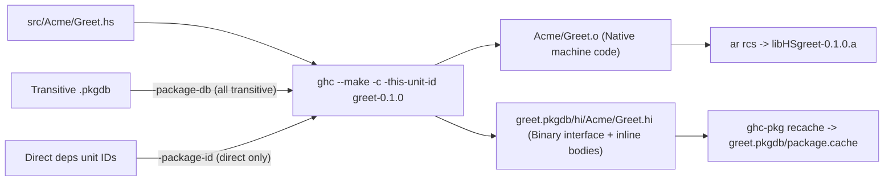

This chapter introduces Haskell, its compiler (GHC), its runtime library, and its package ecosystem for software engineers who have never written Haskell before. Paired with the [Bazel Ruleset Primer](bazel-rules-primer.md), it provides the background needed to read every `.bzl`, `.c`, and `.hs` file in `rules_haskell` without guessing at Haskell or compiler terminology.

If you have worked with Rust (`rustc` and `Cargo`), Go (`go build`), C++ (`clang++` and `CMake`), or Python (`pip` and `uv`), most parts of the Haskell toolchain have direct counterparts. The main differences come from older 1990s–2000s naming conventions and a small number of language design choices that directly affect how a build system invokes the compiler and linker.

---

## Core Concepts Before We Start {#core-concepts}

Five Haskell and GHC design choices shape almost every rule, provider, and C helper in `rules_haskell`. Understanding them in plain terms first prevents forward references in the sections that follow.

### 1. Lazy Evaluation, "Boxed" Values, and "Unboxed" Raw CPU Values (`Int` vs. `Int#`)

In C, Go, or Rust, a 64-bit integer variable (`int64_t` or `i64`) directly holds 8 bytes of bits in a CPU register or on the call stack, and writing `int64_t x = expensive(42);` runs `expensive(42)` immediately. That execution model is called *strict* (or *eager*) evaluation.

Haskell is **lazily evaluated** by default: writing `let x = expensive 42` does not run `expensive 42` right away. Instead, computation is deferred until another part of the program actually needs the value of `x` (for example, to print it to the terminal or branch on an `if` condition).

Because any ordinary variable might hold an unfinished calculation, a standard Haskell `Int` is **boxed**:

- At runtime, a variable of type `Int` is a pointer to a small object on the garbage-collected heap (the "box").
- Before `x` is needed, that heap box points to the code and arguments required to compute `x` later. A deferred computation waiting on the heap is called a **thunk**.
- The first time `x` is needed, the runtime executes the thunk and overwrites the heap box in place with the finished 64-bit number so subsequent reads reuse the computed value without running `expensive 42` again.

An **unboxed** value strips away the heap pointer, the heap allocation, and the lazy thunk wrapper: it is just the raw bits in a CPU register or contiguous memory buffer, like C's `int64_t`. In GHC's internal libraries, unboxed types and raw CPU instructions end with a `#` character (a syntax extension called `MagicHash`), such as `Int#` (a raw 64-bit signed integer) or `ByteArray#` (a raw block of memory). Normal Haskell application code uses boxed types like `Int` (and GHC's optimizer automatically unboxes them in loops when it can prove laziness is not needed), while GHC's lowest-level internal library (`ghc-prim`) defines the unboxed `#` types and primitive instructions underneath them.

### 2. Fixed-Width `Int` vs. Unbounded `Integer` (and Why C's `gmp` Library Appears Everywhere)

Haskell's standard library provides two built-in integer types:

- **`Int`**: A fixed-width signed integer matching the CPU's word size (64 bits on 64-bit platforms, from $-2^{63}$ to $2^{63}-1$). Like C's `int64_t`, arithmetic on `Int` maps to hardware instructions and wraps around on overflow.
- **`Integer`**: An unbounded signed integer that dynamically allocates as many machine words as needed and never overflows. Writing `2 ^ 256 :: Integer` in Haskell computes the exact 78-digit number.

To perform fast arithmetic on large `Integer` values, GHC delegates multi-word math to **GMP (`libgmp`, the GNU Multiple Precision Arithmetic Library)**, a widely used C and assembly bignum library. Because `Integer` is built into Haskell's standard library, `gmp` appears in `rules_haskell`'s `MODULE.bazel` dependencies and linker flags even when your own Haskell source code never calls C directly.

### 3. Compile-Time Code Generation (Template Haskell)

**Template Haskell** is GHC's built-in macro and compile-time code-generation system (comparable to Rust procedural macros). A library author writes an ordinary Haskell function that builds a data structure representing Haskell code — for example, inspecting the fields of a `Config` record type and generating a JSON parser and serializer for it. When GHC compiles a file that calls that macro, the compiler pauses typechecking, executes the compiled Haskell generator function right during the build (including reading schema or data files declared as build inputs), and inserts the generated code into the module being compiled. Because the compiler runs compiled library code during compilation, Template Haskell influences both GHC's helper executables and how `rules_haskell` builds shared libraries alongside static archives.

### 4. Why Compiling One `.hs` File Produces Two Files (`.o` Machine Code and `.hi` Summary)

Unlike C and C++, Haskell has no separate `.h` header files maintained by hand. When GHC compiles `Greet.hs`, it emits two files: `Greet.o` (compiled native machine code consumed later by the linker) and `Greet.hi` (a binary "Haskell interface" file). Whenever a downstream module writes `import Greet`, GHC reads `Greet.hi` to check exported function types and optionally copy small optimized function bodies across library boundaries for inlining.

### 5. Why GHC Calls a C Compiler, Assembler, Archiver, and Linker

Unlike Go (which bundles its own assembler and linker inside the `go` binary), GHC translates Haskell down to standard assembly code (`.s` files) and then invokes external C toolchain programs — preprocessor, C compiler, assembler, `ar` archiver, and linker — to compile C files called through Haskell's **Foreign Function Interface (FFI)** (the built-in syntax for calling C functions directly from Haskell) and to produce static libraries, shared libraries, and executables. Every Haskell executable also links in a C library shipped with GHC called the **Runtime System (`libHSrts`)**, which provides garbage collection, lightweight thread scheduling, and non-blocking file and network I/O.

---

## Ecosystem Map: GHC, Cabal, Hackage, and Stackage {#ecosystem-map}

Engineers new to Haskell often run into confusing terminology early on because the word **"Cabal"** is used for three separate things (a package manifest file format, a pure parser library, and a legacy build-runner library), alongside a fourth command-line package manager (`cabal-install`). Here is how the Haskell ecosystem corresponds to tools in other languages:

| Role | Haskell | Rust | Go | C++ | Python |
|---|---|---|---|---|---|
| **Language edition** | `Haskell98`, `Haskell2010`, `GHC2021`, `GHC2024` | `edition = "2021"` / `"2024"` | `go 1.23` | `-std=c++20` | Python `3.12` |
| **Compiler & interactive prompt** | **GHC** (`ghc`, `ghci`, `ghc-pkg`) | `rustc` | `go tool compile` | `clang++` / `g++` | `cpython` |
| **Package manifest** | **`<pkg>.cabal`** file | `Cargo.toml` | `go.mod` | `CMakeLists.txt` | `pyproject.toml` |
| **Standalone CLI & version solver** | **`cabal-install`** (`cabal` CLI) | `cargo` | `go` CLI | `conan` / `vcpkg` | `pip` / `uv` |
| **Central package server** | **Hackage** (`hackage.haskell.org`) | `crates.io` | `proxy.golang.org` | Conan Center | `PyPI` |
| **Curated compatible package set** | **Stackage LTS** (`lts-24.67`) | Curated workspace `Cargo.lock` | Pinned `go.sum` release set | vcpkg baseline | `constraints.txt` |
| **Bundled API doc generator** | **Haddock** (`haddock`) | `rustdoc` (`cargo doc`) | `pkgsite` / `go doc` | Doxygen | Sphinx / `pdoc` |

### 1. Haskell Language Editions (`default_language`) and Why `GHC2021` Is the Default

Haskell is a statically typed, purely functional, lazily evaluated language compiled ahead-of-time to native machine code:

- **Language extensions (`-X<Ext>`)**: GHC evolves Haskell through opt-in compiler features called *language extensions*. You can enable an extension for a single file with a comment pragma on line 1 (`{-# LANGUAGE OverloadedStrings #-}`) or across an entire Bazel target via `default_extensions = ["OverloadedStrings"]` (which passes `-XOverloadedStrings` to `ghc`).
- **Language editions (`default_language`)**: Just as Rust has `2018`, `2021`, and `2024` editions, GHC groups baseline syntax rules and extensions into named editions: the older formal standards **`Haskell98`** and **`Haskell2010`**, and the newer GHC editions **`GHC2021`** and **`GHC2024`**, selected via `-XHaskell98`, `-XHaskell2010`, `-XGHC2021`, or `-XGHC2024`.
- **Why `hs_library`, `hs_binary`, and `hs_test` default to `"GHC2021"` instead of `"GHC2024"`**:
  - GHC `9.10` introduced the **`GHC2024`** edition, and `rules_haskell` supports `default_language = "GHC2024"` today whenever you set that attribute on a target.
  - However, **GHC `9.10` and `9.12` themselves still default to `GHC2021`** when invoked without a language flag. Upstream GHC kept `GHC2021` as the compiler's default because `GHC2024` enables an extension called `MonoLocalBinds`, which changes how type inference works for local helper functions defined inside `let` and `where` blocks. Under `Haskell2010` and `GHC2021`, GHC automatically infers polymorphic (generic) types for local helpers; under `MonoLocalBinds`, local helpers that reference variables from an enclosing scope are restricted to a single concrete type unless you write an explicit type signature, which causes some code written for `GHC2021` to fail typechecking.
  - `rules_haskell` matches GHC's own compiler default (`"GHC2021"`) on [`hs_library`](../reference/rules.md#hs_library), [`hs_binary`](../reference/rules.md#hs_binary), and [`hs_test`](../reference/rules.md#hs_test) so targets behave identically to running `ghc` directly, while letting any target set `default_language = "GHC2024"`, `"Haskell2010"`, or `"Haskell98"`.
  - By contrast, [`hs_cabal_library`](../reference/rules.md#hs_cabal_library) (used to build third-party Hackage packages) defaults to `"Haskell98"`, because the `.cabal` file specification requires packages that omit the `default-language:` field to be compiled as `Haskell98`.
- **Strings in Haskell (`String` vs. `ByteString` vs. `Text`)**: `Haskell98` defined `type String = [Char]` — a singly linked list of boxed Unicode characters, where every character is a separate heap object. Production Haskell code uses **`ByteString`** (from the `bytestring` boot library: a contiguous byte array, like Rust `&[u8]` or Go `[]byte`) for raw binary data and **`Text`** (from the `text` boot library: contiguous UTF-8 text, like Rust `String` / `&str`) for human-readable strings. Enabling `{-# LANGUAGE OverloadedStrings #-}` allows double-quoted string literals (`"hello"`) to construct `Text` or `ByteString` values directly without conversion calls.

### 2. GHC (Glasgow Haskell Compiler) and Its Bundled Tools

**GHC** is the standard production compiler used across the Haskell ecosystem. An official GHC pre-compiled release archive (called a **binary distribution**, or `bindist`) ships several tools together under `bin/`:

- **`ghc`**: The non-interactive ahead-of-time native-code compiler and linker driver. It compiles `.hs` modules into `.o` object files and `.hi` interface files, and calls the system C linker to produce libraries and executables.
- **`ghci` (`ghc --interactive`) and `runghc`**:
  - `ghci` is GHC's interactive read-eval-print loop (similar to typing `python` or `node` in a terminal), where developers load `.hs` source files into bytecode, inspect inferred types (`:type`, `:info`), set breakpoints (`:break`), and reload edited workspace modules (`:reload`). `runghc` executes standalone `.hs` / `.lhs` scripts in interpreter mode without writing a compiled binary to disk.
  - **Interactive REPL support in `rules_haskell`**: [`hs_repl`](../reference/rules.md#hs_repl) (`bazel run //:my_repl`) launches staged `ghc` in interactive mode (or `-e` expression mode) with workspace modules loaded into `*Module` bytecode scope, precompiled `@hs_boot` and `@hackage` package databases, C/C++ FFI shared stubs, Template Haskell, `data` runfiles, and `haskeline` arrow-key history and Tab completion. `rules_haskell` also provides standalone `@rules_haskell//tools/ghci` and `@rules_haskell//tools/ghci:runghc` targets. (`haskell-language-server` `hie.yaml` editor configuration generation remains planned future work.)
- **`ghc-pkg`**:
  - GHC does not search directories for `lib*.a` files by filename alone. Instead, every compiled Haskell library has a small `.conf` text registration file — an index card recording the library's package name, version, unique identifier, exported module names, dependencies, and the directory paths of its `.hi` and `.a` files. A directory holding `.conf` files is called a **GHC package database** (commonly named `package.conf.d` or `<target>.pkgdb`).
  - `ghc-pkg` is the utility that validates those `.conf` files and compiles all `.conf` files in a package database directory into a single binary lookup file named `package.cache` (`ghc-pkg recache`) so `ghc` can look up libraries quickly at startup without re-parsing text files.
- **`hsc2hs`**:
  - Suppose a Haskell library needs to call POSIX `open()` with `O_RDONLY` or read the `st_size` field out of C's `struct stat`. In C, `<fcntl.h>` and `<sys/stat.h>` define `O_RDONLY` as a `#define` preprocessor macro and lay out `struct stat` with OS- and CPU-dependent field offsets that differ between Linux and macOS or between `x86_64` and `arm64`.
  - Haskell cannot `#include` C `.h` files directly. Instead, a developer writes a `.hsc` file: normal Haskell code containing C lookup placeholders such as `(#const O_RDONLY)` or `(#peek struct stat, st_size)`. `hsc2hs` reads that `.hsc` file, uses the C compiler and target C headers to compute the exact numeric constants and byte offsets for the target platform, and outputs an ordinary `.hs` source file with those integers filled in for `ghc` to compile.
- **`haddock`**:
  - GHC's bundled API documentation generator (analogous to Rust's `rustdoc`). It parses structured doc comments in `.hs` files, runs GHC's typechecker to resolve types accurately, and outputs HTML documentation and symbol search indexes.
- **`ghc-iserv-dyn`**:
  - When GHC executes compile-time code generation (*Template Haskell*, introduced in [Core Concepts](#core-concepts)), it can either run that generator code inside the `ghc` compiler process itself or start `ghc-iserv-dyn` ("GHC external interpreter server, dynamically linked") as a separate helper child process (`-fexternal-interpreter`). In external-interpreter mode, `ghc` sends paths to compiled `.so` shared libraries or bytecode over a pipe to `ghc-iserv-dyn` and reads back the generated syntax tree. Running compile-time code in a child process isolates the compiler if user code crashes and provides the process boundary needed for cross-compilation.
- **`unlit`**:
  - Haskell supports an optional "literate programming" file format with the `.lhs` extension. Unlike normal `.hs` files, plain text in a `.lhs` file is treated as documentation prose by default, and only lines starting with `> ` or placed inside `\begin{code} ... \end{code}` blocks are compiled as Haskell code. Because older packages on Hackage still contain `.lhs` modules, `ghc` automatically runs `unlit` first on `.lhs` inputs to strip out the prose lines and leave standard `.hs` source code.

### 3. Package Servers, Dependency Solvers (SAT Solvers), Cabal, and `Setup.hs`

Before looking at how Haskell packages are described and built, it helps to separate two general package-management concepts from the libraries named "Cabal":

- **Package server (package registry)**: A central web server hosting downloadable source archives of open-source libraries by name and version — like `npmjs.com` for JavaScript, `pypi.org` for Python, or `crates.io` for Rust. In Haskell, the central package server is **Hackage** (`hackage.haskell.org`).
- **Dependency version solver (SAT solver)**: Open-source libraries usually declare version ranges for their dependencies rather than single fixed versions. For example, if your application depends on Library A (requiring `text >= 2.0 && < 2.2`) and Library B (requiring `text >= 2.1 && < 2.3`), a **dependency version solver** searches all published versions on the package server to find a single set of versions (`text-2.1.1`) where every package's constraints hold simultaneously — or proves that the constraints conflict. Package managers typically implement this search with a **SAT solver** (*Boolean satisfiability solver*), an algorithm that solves large systems of logical rules ("if `A-1.0` is selected, then `text-2.0` or `text-2.1` must be selected").

The word **"Cabal"** (*Common Architecture for Building Applications and Libraries*) is neither a package server nor a dependency version solver. Instead, "Cabal" refers to three specific things inside each Haskell package and inside GHC:

1. **The `<pkg>.cabal` package manifest file**: A declarative text file at the root of a Haskell package (like `Cargo.toml` or `pyproject.toml`). It declares the package's name and version, public modules (`exposed-modules`), private modules (`other-modules`), dependency version ranges (`build-depends`), C source files and header directories, boolean configuration `flag`s, and `if os(...)` / `if arch(...)` conditional blocks.
2. **`Cabal-syntax` (pure `.cabal` parser library)**: A Haskell library shipped inside GHC (`Distribution.PackageDescription.Parsec`) that parses `.cabal` files into an in-memory syntax tree (`GenericPackageDescription`) and evaluates `if os(...)`, `if arch(...)`, and `if flag(...)` conditionals (`finalizePD`). It performs no file I/O, network calls, or compilation.
3. **`Cabal` (`Distribution.Simple`, legacy build-execution library) and `Setup.hs`**: In Cabal's original 2000s build protocol, every Haskell package included a small `Setup.hs` source file at its root; build tools compiled `Setup.hs` against the `Cabal` library into a `./Setup` executable and ran `./Setup configure && ./Setup build`. For backwards compatibility, almost every Hackage tarball still ships a `Setup.hs` file at its root. What `Setup.hs` actually contains depends on the `build-type:` field in the `.cabal` file:
   - **`build-type: Simple`** (~95%+ of Hackage): `Setup.hs` contains only two boilerplate lines (`import Distribution.Simple; main = defaultMain`) and zero custom logic. The `.cabal` file alone contains all build instructions. **Supported in `rules_haskell`.**
   - **`build-type: Configure`** (used by C-binding packages such as `network`, `unix-time`, and `old-time`): Runs a POSIX `./configure` shell script first to probe C headers and platform types and generate headers (such as `HsNetworkConfig.h`) or `<pkg>.buildinfo` flags, then builds the library like `Simple`. **Supported in `rules_haskell`.**
   - **`build-type: Custom`**: Compiles and executes arbitrary custom Haskell code written inside `Setup.hs` (using dependencies listed in a `custom-setup` block) during the build. Historically, the most common reason packages set `build-type: Custom` was an older test helper called `cabal-doctest` (used by packages such as `xml-conduit`, `lens`, and `bifunctors`), which only generated metadata for running doc-comment tests and built the library component identically to `Simple`. `rules_haskell`'s lockfile generator (`//tools/lock`) detects `cabal-doctest`-only `Custom` packages and **automatically converts them to `Simple`** so they build cleanly. What `rules_haskell` intentionally **does not support** is executing bespoke `Custom` `Setup.hs` programs that perform arbitrary custom code generation at build time (fewer than 1% of Hackage packages): `hs_cabal_library` rejects remaining `Custom` packages with a clear analysis error rather than running an uncacheable opaque script, and special cases are handled through [`hackage.override`](../reference/extensions-and-providers.md#hackage-override) or explicit Bazel build rules.

`rules_haskell` **never compiles or runs `Setup.hs`**. It evaluates `.cabal` files offline using `Cabal-syntax` and runs compilation via explicit Bazel actions in [`hs_cabal_library`](../reference/rules.md#hs_cabal_library).

### 4. `cabal-install` (the `cabal` CLI)

**`cabal-install`** is the standalone command-line package manager (`cabal update`, `cabal build`, analogous to `cargo` or `pip`) used in non-Bazel Haskell workflows. It downloads Hackage's package index, runs a SAT-based dependency version solver over open version ranges, and builds packages into `~/.cabal`. Because Bazel manages downloading, sandboxing, caching, and action execution ([Bazel Ruleset Primer](bazel-rules-primer.md#three-phases)), `rules_haskell` **never installs or invokes `cabal-install`**.

### 5. Hackage and Metadata Revisions (`x-revision`)

**Hackage** (`https://hackage.haskell.org`) is the central package server hosting `.tar.gz` source archives of open-source Haskell packages. Hackage has one operational detail that build tools must handle carefully: **metadata revisions (`x-revision`)**.

- Once `<pkg>-<ver>.tar.gz` is uploaded to Hackage, the `.tar.gz` archive bytes are **permanently immutable**.
- However, when a newer GHC or standard library release comes out later, Hackage maintainers can edit `<pkg>`'s standalone `.cabal` file on the server — widening or tightening dependency version bounds and incrementing an `x-revision: 1`, `2`, ... header — without uploading a new `.tar.gz` archive.
- As a result, `https://hackage.haskell.org/package/<pkg>-<ver>/<pkg>.cabal` is a **mutable** URL that always serves the *newest* revision, whereas immutable historical revisions live at `.../revision/0.cabal`, `.../revision/1.cabal`, and so on.
- To keep lockfile generation reproducible, [`//tools/lock:lock`](../reference/lock-cli.md) (`fetchVerifiedCabal` in `tools/lock/Main.hs`) checks the downloaded `.cabal` file against the exact SHA-256 digest recorded in the Stackage snapshot, walking backwards through `revision/<r>.cabal` whenever Hackage's mutable URL has moved on to a newer revision.

### 6. Stackage LTS and `stack`

Because Hackage packages declare open version ranges (`aeson >= 2.0 && < 2.3`), choosing compatible versions across hundreds of transitive dependencies normally requires running a SAT version solver. **Stackage** (`stackage.org`) solves that version-selection step centrally:

- A **Stackage LTS (Long-Term Support)** snapshot (such as **`lts-24.67`**, paired with GHC `9.10.3`) is a curated, CI-tested collection of roughly 3,300 Hackage packages in which every package is pinned to **one exact version**, one exact `.cabal` revision SHA-256 digest, and tested Cabal `flags:` defaults that all compile and pass tests together. (`stack` is the standalone non-Bazel CLI tool originally created around Stackage snapshots.)
- Because a Stackage snapshot already maps each package name to one fixed `(version, cabal_sha256, flags)` entry, `rules_haskell`'s lockfile generator (`//tools/lock:lock`) needs **no SAT solver**: starting from your root `--package` flags, it finds all transitive dependencies with a deterministic breadth-first search (BFS) in milliseconds ([Hackage & Cabal Pipeline](ecosystem-and-hackage.md#phase-1-lock-generator)).

---

## Boot Libraries: Why GHC Ships 41 Packages Inside the Compiler {#boot-libraries}

Unlike `clang` (written in C++) or `go`, **GHC itself — along with `ghc-pkg`, `hsc2hs`, and `haddock` — is written in Haskell** on top of its C runtime system. Consequently, an official GHC download does not contain just a standalone compiler binary: it includes a built-in package database (`lib/package.conf.d/`) containing **41 pre-compiled Haskell boot libraries** in GHC `9.10.3` (42 in GHC `9.12.4`, which adds `file-io`), plus 1 metadata-only C++ linker entry (`42` / `43` `.conf` files total in `hs/private/ghc_versions.bzl`):

| Category | Pre-Compiled GHC Boot Packages (`@hs_boot//:<pkg>`) | What They Provide in Plain Terms |
|---|---|---|
| **Runtime & CPU Primitives** | `rts`, `ghc-prim`, `ghc-bignum`, `integer-gmp`, `ghc-internal` | The C garbage collector and thread scheduler (`libHSrts`), raw unboxed CPU types (`Int#`, `ByteArray#`), unbounded `Integer` math via `libgmp`, and shared internal definitions |
| **Standard Library & Arrays** | `base`, `array`, `deepseq` | Haskell's standard library (including the auto-imported `Prelude`), fixed-size mutable and immutable arrays, and helpers that force nested lazy values to finish evaluating completely (`deepseq`) |
| **Bytes, Text & Data Structures** | `bytestring`, `text`, `containers`, `binary` | Contiguous byte buffers (`ByteString`), UTF-8 strings (`Text`), immutable balanced maps, sets, and double-ended queues (`Map`, `Set`, `Seq`), and binary encoders/decoders |
| **OS, Files & Concurrency** | `filepath`, `directory`, `process`, `unix`, `os-string`, `time`, `stm`, `semaphore-compat` | Cross-platform file paths, filesystem operations, spawning child processes, POSIX system calls, raw OS path strings, clocks/dates, atomic shared-memory transactions (`stm`), and OS semaphores |
| **State Pipelines, Parsing & Text Formatting** | `exceptions`, `transformers`, `mtl`, `parsec`, `pretty`, `xhtml` | Exception handling/cleanup, helpers for threading config, state, or errors through pure functions (`transformers`, `mtl`), grammar-rule text parsing (`parsec`), indented document formatting (`pretty`), and XHTML output |
| **Interactive Prompt, Coverage & Terminal** | `terminfo`, `haskeline`, `hpc`, `ghci` | Terminal capability lookups (`terminfo`), interactive command-line input with history and tab completion (`haskeline`), line/expression code coverage (`hpc`), and interactive `ghci` execution |
| **Compiler API, Macros & Cabal** | `ghc`, `ghc-boot`, `ghc-boot-th`, `ghc-heap`, `ghc-compact`, `ghc-experimental`, `ghc-platform`, `ghc-toolchain`, `template-haskell`, `Cabal`, **`Cabal-syntax`** | GHC exposed as a callable library, heap inspection and compact non-GC memory regions, Template Haskell syntax-tree types, the Cabal build library, and the pure `.cabal` file parser (`Cabal-syntax`) |
| **C++ Standard Library Marker** | `system-cxx-std-lib` | Metadata-only `.conf` file (no Haskell code or `.a` archive) recording which C++ runtime library (`stdc++` or `c++`) to link when a package compiles C++ files |

Several entries in this table come up frequently when reading `BUILD.bazel` files, lockfiles, or `.conf` registrations:

- **`base` and `Prelude`**: `base` is Haskell's core standard library (basic types, I/O, lists, numbers, concurrency, and C FFI types), so almost every Haskell target lists `@hs_boot//:base` (or `@hackage//:base`) in `deps`. Inside `base`, the `Prelude` module is automatically imported into every `.hs` file unless disabled with `{-# LANGUAGE NoImplicitPrelude #-}`.
- **`ghc-prim`, `ghc-bignum`, and `rts`**: These three sit directly beneath `base`. `ghc-prim` defines the unboxed `#` types and CPU primitives described in [Core Concepts](#core-concepts); `ghc-bignum` (along with `integer-gmp`, a thin compatibility shim for older packages) implements unbounded `Integer` math using C's `libgmp`; and `rts` registers `libHSrts` and its C headers (`Rts.h`, `HsFFI.h`).
- **`stm` (Software Transactional Memory)**: Updating multiple shared variables across threads with traditional mutex locks requires careful lock ordering to avoid deadlocks. `stm` provides transactional variables (`TVar`) modified inside an `atomically` block: threads read and write `TVar`s in an isolated log, commit all updates atomically if no other thread changed those variables concurrently, or automatically roll back and retry the block when a conflict occurs.
- **`transformers` and `mtl`**: Because Haskell functions do not mutate hidden global state by default, code often threads read-only configuration, mutable state, or typed error values from caller to callee. `transformers` and `mtl` provide standard wrapper types (`ReaderT` for read-only config, `StateT` for state, `ExceptT` for typed errors) that pass that context along without adding manual boilerplate parameters to every function call.
- **`Cabal-syntax` (and how `rules_haskell` builds `//tools/lock:lock` without host tools)**: Many Bazel rulesets face a bootstrap problem when parsing third-party package manifests: either maintain a partial parser in Starlark/Python, or require developers to pre-install a package manager (`cargo`, `pip`, `cabal`, `stack`) on their host machine. Because the GHC tarball already includes pre-compiled `Cabal-syntax`, `bytestring`, `text`, `containers`, `directory`, `filepath`, and `process`, `rules_haskell` exposes them via `@hs_boot//*` and compiles [`//tools/lock:lock`](../reference/lock-cli.md) directly with GHC — requiring no `cabal`, `stack`, or Python installation on the host.
- **`system-cxx-std-lib`**: Starting in GHC 9.4, when a `.cabal` package compiles C++ source files (`cxx-sources:`), Cabal avoids hardcoding `-lstdc++` (Linux GCC) versus `-lc++` (macOS and Clang `libc++`) inside the package's metadata. Instead, Cabal writes `depends: system-cxx-std-lib-1.0`. To satisfy that dependency, GHC ships a small metadata-only `system-cxx-std-lib-1.0.conf` file inside `lib/package.conf.d/` containing zero `.hs` modules and zero `.a` archives — only `extra-libraries: stdc++` (or `c++`) — so the linker knows which C++ standard library to link.

---

## How GHC Compiles Code: Object Files, .hi Interfaces, and Package DBs {#compilation-model}

In Haskell, every source file declares a dotted module name (`module Acme.Greet (greet) where`) matching its directory path under `hs_source_dirs` (`src/Acme/Greet.hs`, similar to Java packages or Python modules):

```haskell
-- src/Acme/Greet.hs
module Acme.Greet (greet) where   -- Explicit export list (anything omitted stays private to this file)

import Data.Text (Text)

{-# INLINE greet #-}
greet :: Text -> Text
greet name = "Hello, " <> name
```

In C and C++, downstream callers learn a library's types by textually `#include`-ing hand-written `.h` files. Haskell has no `.h` header files; instead, compiling a Haskell module emits both native machine code (`.o`) and a binary interface summary (`.hi`), comparable to C++20 module interfaces (`.bmi`) or Rust `.rmeta` metadata:



### 1. Native `.o` Objects vs. Binary `.hi` Interface Files

When GHC compiles `src/Acme/Greet.hs`:

1. **`Acme/Greet.o` -> `libHS<unit_id>.a` (for the final linker)**: Standard ELF, Mach-O, or COFF native machine code, packed by `ar` into a static library archive. Upstream `.a` archives are **not** needed to compile downstream `.hs` libraries (unless Template Haskell runs upstream functions at compile time); they are linked once when producing the final [`hs_binary`](../reference/rules.md#hs_binary) or [`hs_test`](../reference/rules.md#hs_test).
2. **`Acme/Greet.hi` (for downstream `ghc` compilations)**: A compact binary file read by GHC whenever a downstream module writes `import Acme.Greet`. Alongside exported type signatures and data definitions, `.hi` files store **cross-module unfoldings**: copies of the compiler's optimized intermediate code (*Core*, described in the next section) for small functions or functions marked `{-# INLINE #-}` (such as `greet` above), plus any library-defined rewrite rules (`{-# RULES #-}`). Storing those small function bodies inside `.hi` files lets GHC inline functions, specialize generic code to concrete types (similar to C++ template instantiation or Rust monomorphization), and fuse chained `Text` or `ByteString` operations across separate Bazel library targets.

### 2. Unit IDs, `.conf` Registration Files, and `${pkgroot}` Package Databases

As introduced under `ghc-pkg` above, GHC resolves libraries through **GHC package databases** (directories ending in `package.conf.d` or `.pkgdb`):

- **`unit-id` (`-this-unit-id`)**: Every compiled Haskell library is assigned a globally unique identifier string that GHC mangles into every linker symbol the library exports, preventing symbol collisions if two packages define modules or functions with similar names. Boot libraries use `<name>-<ver>-<hash>` (`base-4.20.2.0-9331`), Hackage targets in `rules_haskell` use `<pkg>-<ver>[-<sublib>]` (`attoparsec-0.14.4`), and user [`hs_library`](../reference/rules.md#hs_library) targets derive a collision-free ID from their full Bazel label (`u__S_Sapp_Ctypes-0.0.0`).
- **`<unit_id>.conf` and `package.cache`**: Each `.pkgdb` directory contains one `<unit_id>.conf` key-value file plus the binary **`package.cache`** lookup table generated by **`ghc-pkg recache`**:

```text
name: greet
version: 0.1.0
id: greet-0.1.0
key: greet-0.1.0
exposed: True
import-dirs: ${pkgroot}/greet.pkgdb/hi
library-dirs: ${pkgroot}
library-dirs-static: ${pkgroot}
dynamic-library-dirs: ${pkgroot}/greet.pkgdb/dyn
hs-libraries: HSgreet-0.1.0
exposed-modules: Acme.Greet
depends: base-4.20.2.0-9331 text-2.1.3-4a1b
```

- **Relocatable `${pkgroot}` expansion**: Bazel executes build actions inside temporary sandboxes and remote execution workers whose absolute directory paths change between machines. `ghc-pkg` supports a built-in `${pkgroot}` variable inside `.conf` files that expands at runtime to **the parent directory of the `.pkgdb` directory** (`dirname($PKG_DB)`). By placing `libHSgreet-0.1.0.a` and `greet.pkgdb` side by side in the same Bazel output directory, `rules_haskell` keeps `.conf` and `package.cache` files free of hardcoded sandbox paths ([Providers & Action Graph](providers-and-actions.md#relocatable-pkgdb)).

### 3. How `-hide-all-packages`, `-package-db`, and `-package-id` Enforce Direct Dependencies

Suppose `App` depends on `LibB`, and `LibB` depends on `LibA` (`App -> LibB -> LibA`), where an exported function in `LibB` returns a type defined in `LibA`:

- While compiling `App`, GHC needs **transitive** access to `LibA.pkgdb` (`-package-db`) so the typechecker can look up `LibA`'s type definitions and inline function bodies referenced inside `LibB.hi`.
- At the same time, `App.hs` should **not** be allowed to write `import LibA` directly unless `App`'s `BUILD.bazel` explicitly lists `LibA` in `deps`.
- `rules_haskell` enforces this separation on every compile action ([Bazel Ruleset Primer](bazel-rules-primer.md#providers-and-depsets)):
  1. **`-hide-all-packages`**: Hides every boot and external package from `import` statements by default (including `base`).
  2. **`-package-db <db>`** (passed for all *transitive* `HsLinkInfo.pkg_dbs`): Lets GHC's typechecker resolve types and inline bodies from any transitive `.hi` file.
  3. **`-package-id <unit_id>`** (passed only for *direct* `HsPackageInfo` entries in `deps`): Makes only direct `deps` visible to source `import` statements.

---

## Why GHC Needs a C Toolchain and the GHC Runtime System (RTS) {#c-toolchain-and-rts}

Engineers coming from Go (which embeds an internal assembler and linker) are sometimes surprised that a Haskell ruleset depends on `rules_cc` and a C compiler toolchain. As noted in [Core Concepts](#core-concepts), two architectural facts explain why: **GHC delegates preprocessing, assembly, archiving, and linking to C toolchain binaries**, and **every Haskell executable links in GHC's C Runtime System (`libHSrts`)**.

### 1. GHC's Compilation Pipeline and `-pgm*` External Tool Hooks

Inside a single `ghc` compile action, Haskell source code passes through four internal stages before GHC invokes external C toolchain binaries:

```mermaid
flowchart LR
    HS["Haskell (.hs)"] --> CORE["Core (Simplified typed IR)"]
    CORE --> STG["STG (Explicit heap thunks)"]
    STG --> CMM["Cmm (Portable low-level C--)"]
    CMM --> NCG["Native Codegen (.s assembly)"]
    NCG -->|"-pgma (ghc_cc_wrapper)"| OBJ["Object (.o)"]
    OBJ -->|"-pgmar (ar)"| LIB["libHS*.a"]
    LIB -->|"-pgml (ghc_cc_wrapper) + libHSrts.a + libgmp.a"| BIN["Executable"]
```



1. **Haskell source -> Core**: After parsing and typechecking, GHC simplifies Haskell's full surface syntax (pattern matching, list comprehensions, syntactic sugar) into **Core**, a small, explicitly typed intermediate representation consisting of variables, functions, function calls, `let` bindings, and `case` branches. Nearly all high-level optimizations — cross-module inlining, specialization, dead-code removal, and strictness analysis (proving when a value is always needed immediately so GHC can use unboxed registers instead of heap thunks) — take place on Core.
2. **Core -> STG (Spineless Tagless G-machine)**: Lowers optimized Core into an execution representation where heap memory is explicit: remaining lazy expressions become concrete heap thunk structures, and functions receive explicit entry-code pointers. ("Spineless Tagless G-machine" is the 1992 name of GHC's abstract machine model for representing lazy heap objects.)
3. **STG -> Cmm**: Lowers heap closures into **Cmm** (short for `C--`, a portable low-level register and stack language modeled on C), turning implicit runtime behavior into explicit stack pointer arithmetic, CPU register assignments, and fast-path checks that call into the garbage collector when the current heap allocation block is full.
4. **Cmm -> Native Code Generator (NCG) -> `.s` Assembly**: GHC's built-in `x86_64` / `AArch64` Native Code Generator emits GNU-syntax `.s` assembly files. From that point onward, **GHC calls external C toolchain programs** configured via `-pgm*` flags:

| GHC Flag | Role in Compilation / Linking | What `rules_haskell` Wires It To (`hs/private/actions.bzl`) |
|---|---|---|
| `-pgma` | Assembles NCG `.s` assembly files into `.o` object files | `ghc_cc_wrapper` -> Bazel `cc_toolchain` compiler driver |
| `-pgmc` / `-pgmcxx` | Compiles C / C++ FFI sources and generated C wrapper stubs | `ghc_cc_wrapper` -> Bazel `cc_toolchain` compiler driver |
| `-pgmP` / `-pgmCmmP` | Runs the C preprocessor on `-XCPP` `.hs` files and `.cmm` files | `ghc_cc_wrapper` (`-E -undef -traditional` for Haskell) |
| `-pgmlm` | Merges a Haskell `.o` and a generated C wrapper `.o` via `ld -r` | `cc_tools.ld` (`-optlm-r`) |
| `-pgmar` | Packs `.o` files into static `libHS*.a` archives | `cc_tools.ar` |
| `-pgml` | Links `.so` shared libraries and final executables (`crt1.o`, `libc`) | `ghc_cc_wrapper` -> Bazel `cc_toolchain` linker driver |

Because upstream GHC binary distributions record the release machine's `/usr/bin/gcc` and `-fuse-ld=gold` inside `lib/settings`, `rules_haskell` rewrites those paths in `lib/settings` to `/nonexistent/*` when extracting the archive and routes every `-pgm*` hook through a small C11 adapter binary (`ghc_cc_wrapper`, documented in [Hermeticity & Toolchain](hermeticity.md#ghc-cc-wrapper)).

### 2. What `libHSrts` (the GHC Runtime System) Does

Every compiled [`hs_binary`](../reference/rules.md#hs_binary) or [`hs_test`](../reference/rules.md#hs_test) links in **`libHSrts`**, an ~70,000-line C and `Cmm` runtime library shipped inside GHC (comparable to Go's `runtime` package):

- **Parallel Generational Garbage Collector**: Per-core bump-pointer allocation in a young generation ("nursery"), multi-generation copying and compacting collection, and pinned memory blocks (`ByteString` buffers that the collector never moves, so their pointers can be passed directly to C functions without copying).
- **M:N Green-Thread Scheduler**: `Control.Concurrent.forkIO` creates lightweight Haskell threads costing a few hundred bytes of heap memory, scheduled across a pool of OS `pthread` worker threads (similar to Go goroutines).
- **Non-Blocking Event I/O Manager**: Uses Linux `epoll`, macOS `kqueue`, and timers so that a socket or pipe read in Haskell parks only that lightweight Haskell thread while the underlying OS worker thread continues running other Haskell threads.
- **Software Transactional Memory (`STM`)**: Runtime support for atomic `TVar` memory transactions (`atomically`, `retry`).
- **C Interop & Runtime Headers (`HsFFI.h`, `Rts.h`)**: `HsFFI.h` defines portable C types (`HsInt`, `HsWord64`, `HsPtr`, `hs_init`) used when calling between Haskell and C, while `Rts.h` exposes internal runtime APIs. `staged_ghc` exposes these headers as Bazel-tracked files to `rules_cc` ([Bazel Ruleset Primer](bazel-rules-primer.md#cc-interop)).

GHC ships two variants of `libHSrts`:

- **Single-threaded RTS** (`threaded = False`): Runs all Haskell lightweight threads on one OS thread. Any synchronous C call blocks all other Haskell threads until C returns.
- **Multi-threaded RTS (`-threaded`, default `threaded = True` on `hs_binary` and `hs_test`)**: Links `libHSrts_thr`, enabling multi-core execution (`+RTS -N`) and running `safe` C calls (such as DNS resolution or blocking system calls) on separate OS worker threads so other Haskell threads keep running.

---

## Why GMP and libtinfo Show Up as C Dependencies {#gmp-and-tinfo}

When reading `MODULE.bazel` or `hs/private/staged_ghc.bzl`, two C library names stand out: **`gmp`** (`bazel_dep(name = "gmp", ...)` -> `libgmp`) and **`libtinfo`** (`hs/private/tinfo_stub.c` -> `libtinfo.so.6` and `libtinfo.a`). Both trace directly to how upstream GHC and Haskell's standard library are built.

### 1. Why `gmp` (`libgmp`): Built-In Unbounded `Integer` Arithmetic

As explained in [Core Concepts](#core-concepts), Haskell's standard library (`base`) provides both fixed-width 64-bit `Int` and unbounded **`Integer`**, which `base` implements via the `ghc-bignum` boot package on top of C's **GNU Multiple Precision Arithmetic Library (`libgmp`)**. On Linux (`deb10`), GMP crosses **two separate boundaries** that `rules_haskell` handles differently:

1. **Running the `ghc` compiler binary itself (`libgmp.so.10`)**: Because upstream Linux GHC (`deb10`) is dynamically linked, `bin/ghc-9.10.3` carries a Linux ELF `DT_NEEDED` entry (the list of shared libraries the OS loads at startup) for `libgmp.so.10`. `staged_ghc` links a `libgmp.so.10` shared library from BCR `@gmp//:gmp` (`gmp@6.3.0.bcr.5`) and places it in GHC's relative library directory (`$ORIGIN/../lib/...`, where `$ORIGIN` expands to the directory containing the `ghc` binary) so `ghc` starts in minimal containers that do not have `libgmp10` installed.
2. **Linking user executables (`gmp_static/libgmp.a`)**: Because user binaries link `base` -> `ghc-bignum` (`extra-libraries: gmp`), GHC passes `-lgmp` to the C linker. `rules_haskell` points `-L` at an isolated directory (`gmp_static/`) containing *only* static `libgmp.a` and no `.so` files, linking GMP statically into the output binary so deployed executables do not depend on `libgmp.so.10` at runtime ([Hermeticity & Toolchain](hermeticity.md#static-gmp-executables)).

### 2. Why `libtinfo.so.6` and `libtinfo.a` Exist — and How the Self-Contained C11 Reader Works

At first glance, seeing an in-tree C11 source file (`hs/private/tinfo_stub.c`) providing `libtinfo.so.6` and `libtinfo.a` looks unusual. Understanding why `ghc` asks for `libtinfo`, what those 8 functions do, and how `tinfo_stub.c` serves both batch sandboxes and live interactive `ghci` terminals makes the design straightforward to evaluate.

#### Why Both Batch `ghc` and Interactive `ghci` Reference `libtinfo`

`libtinfo` is the low-level terminal capability library from `ncurses`. At runtime, it reads compiled `term(5)` files from `/usr/share/terminfo` (indexed by the `$TERM` environment variable, such as `xterm-256color`) to look up terminal escape sequences for moving the cursor, clearing lines, and changing colors.

In GHC's upstream architecture, **the batch compiler `ghc` and the interactive REPL `ghci` (`ghc --interactive`) are compiled into the same executable** (`bin/ghc-9.10.3`). To support `ghci`'s interactive prompt, `bin/ghc-9.10.3` links `libHSghci` -> `libHShaskeline` -> `libHSterminfo` -> **`libtinfo.so.6`**.

On Linux, the kernel's dynamic linker (`ld-linux.so`) loads every `DT_NEEDED` shared library **before `main()` runs**. On a minimal Docker or remote-execution container without `libtinfo6` installed, running `ghc -c Foo.hs` or `bazel run //:my_repl` would fail immediately at process startup (`libtinfo.so.6: cannot open shared object file`) unless `rules_haskell` stages `libtinfo.so.6` itself.

#### How the Exact Symbol Surface Was Verified

Auditing every executable (`ghc`, `runghc`, `ghc-pkg`, `hsc2hs`, `haddock`, `ghc-iserv-dyn`, `unlit`) and every `libHS*.so` shared library across the GHC `9.10.3` and `9.12.4` Linux (`x86_64` and `aarch64`) binary distributions with `readelf -Ws` confirms two facts:

1. `libHSterminfo` is the **only** library in the entire GHC distribution that imports symbols from `libtinfo.so.6`.
2. It imports **strictly 8 C functions**, each carrying the Debian/Ubuntu ELF symbol version label `NCURSES6_TINFO_5.0.19991023`: `setupterm`, `set_curterm`, `del_curterm`, `tigetflag`, `tigetnum`, `tigetstr`, `tparm`, and `tputs`.

#### How `hs/private/tinfo_stub.c` Implements Those 8 Functions in Pure C11

Rather than pulling an external `ncurses` autoconf + `gawk` build into every consumer's `MODULE.bazel` graph, `hs/private/tinfo_stub.c` implements those 8 X/Open Curses functions directly in self-contained C11:

- **Binary `term(5)` parser**: Searches `$TERMINFO`, `$TERMINFO_DIRS`, `$HOME/.terminfo`, `/etc/terminfo`, `/lib/terminfo`, and `/usr/share/terminfo` (checking both `<first-char>/<term>` on Linux and `<two-digit-hex>/<term>` on macOS/BSD layouts) and parses compiled binary terminfo files directly — supporting classic 16-bit (`0432`), ncurses extended 32-bit (`01036`), and extended user-defined capability sections (`AX`, `XT`, `RGB`, `Smulx`, `Setulc`).
- **Built-in terminal fallback profiles**: When running inside a minimal container or Bazel sandbox that has no `/usr/share/terminfo` directory on disk, `setupterm` falls back to built-in capability tables for common `$TERM` families (`xterm-256color`/`xterm`/`screen`/`tmux`/`rxvt`/`alacritty`/`kitty`, `vt100`/`ansi`/`linux`, and `dumb`). Passing `NULL`, `""`, or an unknown terminal name with no matching database file sets `*errret = -1` and returns `-1` (`ERR`), which `System.Console.Terminfo.Base.setupTerm` converts into `SetupTermError`.
- **Live window dimensions and parameterized formatting**: `setupterm` queries live terminal dimensions (`lines` and `cols`) via `ioctl(fildes, TIOCGWINSZ, ...)` (and `$LINES`/`$COLUMNS` overrides), `tparm` evaluates stack-based terminfo format strings (`%p1..%p9`, `%d`/`%s`/`%c`, `%i`, arithmetic/bitwise operators, `%?`/`%t`/`%e`/`%;` conditionals, and `%P`/`%g` variables), and `tputs` emits capability strings while stripping `$<delay>` padding markers.

#### Why `hs/private/tinfo_stub.lds` Is Required

On Debian and Ubuntu, `ld-linux.so` verifies not only that `libtinfo.so.6` exports a function named `setupterm`, but also that the symbol carries the version label `NCURSES6_TINFO_5.0.19991023` recorded in `libHSterminfo` when GHC was built on Debian 10. Compiling `tinfo_stub.c` without a version script would export unversioned symbols and `ld-linux.so` would reject the library at startup. The 13-line linker script `hs/private/tinfo_stub.lds` attaches `NCURSES6_TINFO_5.0.19991023` to those 8 exported symbols (see [Hermeticity & Toolchain](hermeticity.md#origin-staging) for the exact ELF mechanics).

#### Why Self-Contained C11 Was Chosen Over Building Full `ncurses`

Building `ncurses` from source inside Bazel requires running autoconf `./configure` probes, invoking host `gawk` and shell scripts to generate capability tables, and adding an external dependency to every consumer's `MODULE.bazel`. Compiling `tinfo_stub.c` directly with Bazel's `cc_toolchain` takes milliseconds, keeps `MODULE.bazel` at 4 non-dev modules, supports `haskeline` arrow-key history, Tab completion, and 256-color output in [`hs_repl`](../reference/rules.md#hs_repl) and `terminfo`-linked [`hs_binary`](../reference/rules.md#hs_binary) targets (`gmp_static/libtinfo.a`), and still allows C applications that call higher-level `ncurses` windowing APIs (`initscr`, `newwin`, `wgetch`, which live outside `libHSterminfo`'s 8-symbol `tinfo` surface) to link a full `ncurses` `cc_library` via `cc_deps`.

---

## Haskell Build Mechanisms: FFI, hsc2hs, Alex/Happy, CPP, and .hs-boot {#build-mechanisms}

Many Haskell libraries on Hackage combine `.hs` modules with up to six additional build mechanisms. Both [`hs_cabal_library`](../reference/rules.md#hs_cabal_library) and [`hs_library`](../reference/rules.md#hs_library) handle these mechanisms directly through Bazel actions:

### 1. C Foreign Function Interface (`foreign import ccall` and `CApiFFI`)

Haskell includes a built-in **Foreign Function Interface (FFI)** (`Foreign.C`) for calling C functions from Haskell and passing pointers or primitive values across the language boundary:

```haskell
{-# LANGUAGE CApiFFI #-}
module Compression where
import Foreign.C.String (CString)
import Foreign.C.Types  (CInt(..))

-- Direct ABI symbol call: links directly against symbol `zlibVersion` in libz.a
foreign import ccall unsafe "zlibVersion" c_zlibVersion :: IO CString

-- CApiFFI header wrapper: used when `deflateInit` is a C `#define` macro or `static inline`
foreign import capi unsafe "zlib.h deflateInit" c_deflateInit :: CInt -> IO CInt
```

- **`ccall`** compiles to a direct C ABI machine `call` instruction targeting an exported linker symbol. Marking an import `unsafe` tells GHC the C function returns quickly and will not call back into Haskell, skipping thread-scheduler bookkeeping around the call; marking it `safe` (the default when omitted) tells GHC's multi-threaded runtime to run the C call on a dedicated OS thread if needed so other Haskell lightweight threads keep running.
- **`capi` (`{-# LANGUAGE CApiFFI #-}`)** handles C APIs that exist only as `#define` preprocessor macros or `static inline` functions in `.h` headers (which have no compiled symbol in a `.a` library). GHC generates a temporary `.c` wrapper file that `#include`s `"zlib.h"` and calls `deflateInit`, compiles that `.c` file via `-pgmc`, and merges it with the Haskell `.o` file via `ld -r` (`-pgmlm`).

### 2. `.hsc` Files and `hsc2hs`

As described in the tool overview above, binding OS structs like POSIX `struct sockaddr` or `<sys/socket.h>` constants by hardcoding numbers in Haskell would break between Linux and macOS or between `x86_64` and `arm64`. A **`.hsc`** file writes C lookup directives (`#include`, `#const`, `#size`, `#peek`, `#poke`) inline inside Haskell code:

```haskell
#include <sys/socket.h>
module SocketConsts where
import Foreign.C.Types (CInt)
import Foreign.Storable (peekByteOff)

afInet :: CInt
afInet = (#const AF_INET)

peekFamily ptr = (#peek struct sockaddr, sa_family) ptr
```

During Stage 3 of [`hs_cabal_library`](../reference/rules.md#hs_cabal_library), **`hsc2hs`** turns each `.hsc` file into a small C probe program (`template-hsc.h` plus `offsetof` and `sizeof` expressions), compiles and links it via `ghc_cc_wrapper`, runs it inside the build sandbox, and writes out a plain `.hs` file (`afInet = 2`, `peekByteOff ptr 0`) for GHC to compile.

### 3. `.x` (`alex`) and `.y` / `.ly` (`happy`) Grammar Generators

Just as C projects use `flex` (tokenizer/lexer generator) and `bison` (parser generator) to turn grammar definitions into C source code, Haskell projects such as `toml-parser` and `pretty-show` ship **`.x`** files for **`alex`** (Haskell's lexer generator) and **`.y`** or **`.ly`** files for **`happy`** (Haskell's parser generator, where `.ly` is the literate format) instead of checking generated `.hs` files into their Hackage tarballs:

```text
-- Lexer.x (Alex lexer specification -> generates Lexer.hs)
tokens :-
  $white+       ;
  [0-9]+        { \s -> TokInt (read s) }

-- Parser.y (Happy parser grammar -> generates Parser.hs)
%name parseExpr
%tokentype { Token }
%%
Expr : int '+' int   { $1 + $3 }
```

Because the official Hackage tarballs for `alex` (`3.5.4.2`) and `happy` (`2.1.7`) include pre-generated `.hs` bootstrap sources and depend exclusively on `@hs_boot` boot libraries (`array`, `base`, `containers`, `directory`, `mtl`, `transformers`), `hs/private/cabal_codegen.bzl` compiles `alex` and `happy` from source lazily — only when a build target actually contains `.x` or `.y`/`.ly` files — without requiring `alex` or `happy` on the host machine.

### 4. `-XCPP`, `cabal_macros.h`, and `Paths_<pkg>.hs`

```haskell
{-# LANGUAGE CPP #-}
module VersionInfo where
import Paths_my_http_pkg (version, getDataFileName) -- '-' in pkg name becomes '_'

#if MIN_VERSION_base(4,20,0)
banner :: String
banner = "Built on base " ++ show version
#endif
```

- **`{-# LANGUAGE CPP #-}` (`-XCPP`)**: Runs the C preprocessor over a `.hs` file before Haskell parsing. GHC invokes `-pgmP` with `-traditional` mode so that valid single-quote characters in Haskell variable names (such as `x'`) are not rejected by the C preprocessor as unterminated character literals.
- **`cabal_macros.h`**: Cabal pre-includes (`-optP-include cabal_macros.h`) a generated header defining `VERSION_<pkg>` and `MIN_VERSION_<pkg>(maj1,maj2,min)` C macros for every direct dependency so libraries can conditionally compile across multiple GHC or dependency versions.
- **`Paths_<pkg>.hs`**: When listed in a `.cabal` file's `autogen-modules` or `other-modules`, Cabal generates a helper module exporting `version :: Version` and `getDataFileName :: FilePath -> IO FilePath`. `rules_haskell` writes both `cabal_macros.h` and `Paths_<pkg>.hs` directly during Bazel analysis via `ctx.actions.write` without spawning a subprocess (`hs/private/actions.bzl`).

### 5. `.hs-boot` Files (Breaking Mutual Module Cycles)

Unlike Go or Java (which compile all files in a package together), GHC compiles modules one by one in dependency order: if `BootB` imports `BootA`, `BootA.hi` must exist before `BootB.hs` can be typechecked. When two modules inside the same library genuinely need to import each other (as in Hackage's `cborg` and `tls` packages), Haskell breaks the cycle with a hand-written **`BootA.hs-boot`** forward-declaration file paired with an `import {-# SOURCE #-}` pragma:

```haskell
-- BootA.hs-boot (forward declaration only; compiles first -> BootA.hi-boot)
module BootA where
data Expr = Lit Int | Nested Node

-- BootB.hs (imports BootA via {-# SOURCE #-} before full BootA.hs is compiled)
module BootB where
import {-# SOURCE #-} BootA (Expr)
data Node = Wrapper Expr

-- BootA.hs (imports full BootB.hi and checks that it matches BootA.hs-boot)
module BootA where
import BootB (Node)
data Expr = Lit Int | Nested Node
```

Because `rules_haskell` compiles each library with `ghc --make -c`, GHC orders `BootA.hs-boot -> BootB.hs -> BootA.hs` automatically without requiring separate Bazel targets per file.

### 6. Cabal Sublibraries and `reexported-modules`

```text
-- Inside attoparsec.cabal (Cabal 2.0+ internal sublibrary)
library attoparsec-internal
  hs-source-dirs:  internal
  exposed-modules: Data.Attoparsec.ByteString.FastSet

library
  build-depends:      base, attoparsec-internal
  exposed-modules:    Data.Attoparsec
  reexported-modules: Data.Attoparsec.ByteString.FastSet as Data.Attoparsec.FastSet
```

- **Internal and Public Sublibraries**: `.cabal` files can define helper libraries (`library attoparsec-internal`) alongside the main `library` inside a single tarball (private to that package by default, or usable by external packages as `pkg:sublib` when marked `visibility: public` in Cabal 3.0+). `rules_haskell` generates a separate `hs_cabal_library` target for each sublibrary (`@hackage//:attoparsec__attoparsec-internal`).
- **`reexported-modules`**: Lets a package's `.conf` registration file re-expose a module that was compiled in an upstream dependency or internal sublibrary (`exposed-modules: Data.Attoparsec.FastSet from attoparsec-0.14.4-attoparsec-internal:Data.Attoparsec.ByteString.FastSet`) without writing or compiling a wrapper `.hs` file.

---

## Template Haskell: Compile-Time Execution and Shared Libraries {#template-haskell}

As introduced in [Core Concepts](#core-concepts), **Template Haskell (`{-# LANGUAGE TemplateHaskell #-}`)** is GHC's compile-time code-generation facility. In a source file with `TemplateHaskell` enabled, an expression wrapped in `$(...)` is called a **splice**: GHC evaluates that Haskell expression at compile time and inserts the resulting **abstract syntax tree (AST)** (structured Haskell declarations or expressions) into the module before finishing typechecking:

```haskell
{-# LANGUAGE TemplateHaskell #-}
module Config where
import Data.Aeson.TH   (defaultOptions, deriveJSON)
import Data.ByteString (ByteString)
import Data.FileEmbed  (embedFile)

data AppConfig = AppConfig { port :: Int, host :: String }

-- 1. Declaration splice: inspects `AppConfig`'s fields at compile time and
--    generates ToJSON and FromJSON serializer instances for the typechecker.
$(deriveJSON defaultOptions ''AppConfig)

-- 2. Compile-time file I/O splice: reads "static/schema.json" from the Bazel
--    compile sandbox (declared in `data`) and embeds its bytes as a constant.
embeddedSchema :: ByteString
embeddedSchema = $(embedFile "static/schema.json")
```

*(Note: A smaller companion extension, `{-# LANGUAGE TemplateHaskellQuotes #-}`, allows syntax quotes such as `''AppConfig` or `[| 1 + 1 |]` to construct AST data values at runtime without running any compile-time splice evaluation.)*

### Why Cross-Library Template Haskell Needs `.so` Shared Objects While User Binaries Stay Static

Suppose library `A` (`aeson` or `file-embed`) defines `deriveJSON`, and downstream library `B` calls `$(deriveJSON ...)` while `B.hs` is being compiled:

1. **Why dynamically linked `ghc` loads `.so` files at compile time**: On Linux (`deb10`) and macOS, the upstream `ghc` compiler binary itself is dynamically linked (`GHC Dynamic = YES` — its own `base` and `rts` libraries live in `libHS*-ghc9.10.3.so`). When `ghc` (or its `ghc-iserv-dyn` child process) pauses typechecking `B.hs` to run `A.deriveJSON`, the OS dynamic loader (`dlopen`) can load library `A` into that running dynamic process only if `A` was also compiled as a position-independent shared library (`libHSA-ghc9.10.3.so`).
2. **How `rules_haskell` supports compile-time `.so` loading while linking static user binaries**:
   - During `HsCompileLibrary`, `rules_haskell` passes **`-dynamic-too`** to `ghc --make -c`, causing GHC to emit **both** static outputs (`.o` and `.hi`) and dynamic outputs (`.dyn_o` and `.dyn_hi`) in a single compilation pass.
   - Static `.o` files are packed into `${pkgroot}/libHS<unit_id>.a` (`library-dirs-static`), while dynamic `.dyn_o` files (plus any C static archives in that target) are linked into **`<name>.pkgdb/dyn/libHS<unit_id>-ghc<ver>.so`** (`dynamic-library-dirs`).
   - When compiling downstream library `B`, GHC loads `A`'s `.so` from `<A>.pkgdb/dyn/` via `dlopen` to run `$(...)` splices. When linking the final [`hs_binary`](../reference/rules.md#hs_binary), `${pkgroot}` contains no `.so` files, so the C linker links strictly against the static `.a` archives — producing a standalone executable with no `libHS*.so` runtime dependencies ([Providers & Action Graph](providers-and-actions.md#template-haskell)).

---

## Haddock: Haskell's Bundled API Documentation Tool {#haddock}

**Haddock** (`bin/haddock-ghc-<ver>`, invoked by [`hs_haddock`](../reference/rules.md#hs_haddock)) is GHC's bundled API documentation generator, analogous to Rust's `rustdoc`. Rather than scanning source files with regular expressions, Haddock links directly against the **`ghc` compiler library**: it runs GHC's C preprocessor (`-XCPP`), parser, module renamer, Template Haskell splice evaluator, and typechecker (`--optghc=...`), so inferred types, re-exported modules, and declarations generated by Template Haskell are documented using the exact types resolved by the compiler.

### Haddock Comment and Markup Conventions

```haskell
-- | Parse raw @.cabal@ bytes into a 'GenericPackageDescription'.
--
-- Returns @Left err@ when syntax fails (escaping angle brackets like @\<pkg\>.cabal@
-- because bare @<https://...>@ is Haddock's URL syntax).
parseCabalBytes
  :: ByteString                          -- ^ Raw UTF-8 @.cabal@ file contents
  -> Either String GenericPackageDescription -- ^ Error message or parsed syntax tree
```

- **`-- |` (prefix doc comment)** documents the module, type, typeclass, or function immediately following it; **`-- ^` (postfix doc comment)** documents the preceding record field, data constructor, or function argument.
- **`@...@`** formats inline monospace code; single quotes (`'parseCabalBytes` for functions/values, `t'GenericPackageDescription` for types) generate typechecked links to definitions; bare `<...>` marks a URL (so literal angle brackets like `\<pkg\>` inside doc comments are escaped with backslashes).

### Key Haddock Outputs Produced by `hs_haddock`

1. **HTML reference pages (`--html`)**: Generates `index.html` and per-module `Module-Name.html` pages using the `Linuwial` stylesheet and scripts bundled in GHC's `lib/html/` directory.
2. **Hyperlinked source view (`--hyperlinked-source`)**: Generates `src/<Module>.html`, where clicking any function, type, or local variable jumps to its definition.
3. **QuickJump symbol index (`--quickjump`)**: Generates `doc-index.json` for client-side symbol search (`S` keyboard shortcut) in the browser.
4. **Cross-package `.haddock` interface files (`--dump-interface` and `--read-interface`)**: Writes a binary symbol-to-URL lookup file (`<name>.haddock` in [`HsHaddockInfo`](../reference/extensions-and-providers.md#hshaddockinfo)) so downstream `hs_haddock` targets link types from GHC boot libraries (`Text`, `Map`, `GenericPackageDescription`) and sibling Bazel targets directly to their documentation pages ([Hakyll & Haddock Docs](docs-engine.md)).
