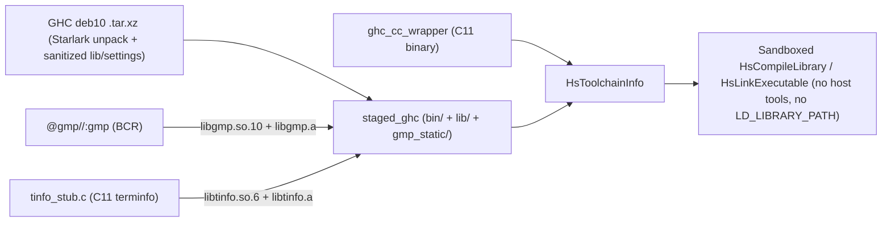

A build is [hermetic](https://bazel.build/basics/hermeticity) when every compiler binary, header, and library comes from pinned, SHA-256-verified Bazel inputs instead of whatever packages happen to be installed on your laptop or CI runner. This page explains how `rules_haskell` runs GHC hermetically on Linux without Nix, closing host-dependency leaks from archive download through executable linking.

Read this page if you want to understand how GHC runs inside minimal Linux containers and [RBE](https://bazel.build/remote/rbe) workers, or if you're integrating a custom C/C++ toolchain. If [Bazel toolchains](https://bazel.build/extending/toolchains) or GHC's C runtime are new to you, read the [Bazel ruleset primer](bazel-rules-primer.md#toolchains-and-configs) and the [Haskell and GHC primer](haskell-and-ghc-primer.md#c-toolchain-and-rts) first; for macOS, Windows, and static musl plans, see [Cross-OS and platforms](cross-os-and-platforms.md).

A naive GHC setup on Linux leaks host dependencies in six places:

1. **Fetch-time install scripts:** Running `./configure && make install` when downloading a GHC archive invokes host `make`, `perl`, `/bin/sh` probes, and host C compilers or libraries (`libgmp-dev`, `libtinfo-dev`).
2. **Hardcoded tool paths in `lib/settings`:** Official GHC binary archives ship a `lib/settings` file containing paths from the upstream release builder, such as `/usr/bin/gcc`, `/usr/bin/ld.gold`, `/usr/bin/ar`, and `-fuse-ld=gold`.
3. **Compiler shared-library dependencies:** GHC's Linux compiler executables (`ghc`, `ghc-pkg`, `hsc2hs`, `haddock`, `ghc-iserv-dyn`) dynamically load `libgmp.so.10` and `libtinfo.so.6` at startup. Supplying them through `LD_LIBRARY_PATH` leaks search paths into child `/bin/sh`, `./configure`, and C compiler processes.
4. **Dynamic GMP dependencies in user binaries:** Linking executables against a shared `libgmp.so.10` produces binaries that fail to start in minimal containers where `libgmp10` isn't installed.
5. **Bazel `RUNFILES_*` environment variables:** When Bazel runs tools with [`--enable_runfiles`](https://bazel.build/reference/command-line-reference#param-no-enable-runfiles), inherited [`RUNFILES_DIR`](https://bazel.build/extending/rules#runfiles) and `RUNFILES_MANIFEST_FILE` variables can confuse nested C compiler wrappers and child processes.
6. **C compiler flag differences:** Hermetic C/C++ toolchains (such as `hermetic_cc_toolchain`'s `zig cc`, `toolchains_llvm`, or custom-sysroot Clang) disagree with GCC on several flags GHC emits (`-Wl,-h`, `-fuse-ld=gold`, `-fno-PIC`, `.dyn_o` and `.p_o` suffixes, `--print-file-name`, and C++ header include order).

`rules_haskell` closes all six paths by combining [Starlark](https://bazel.build/rules/language) archive extraction, Linux ELF `$ORIGIN` library staging, static-only `libgmp.a` linking for user binaries, and a small C11 compiler adapter (`ghc_cc_wrapper`):



---

## Unpacking GHC archives in Starlark {#ghc-bindist-repo}

Official Haskell.org Debian 10 (`deb10`) Linux archives (`ghc-9.10.3-{x86_64,aarch64}-deb10-linux.tar.xz` and `ghc-9.12.4-...`, called *binary distributions* or *bindists*) already contain compiled executables under `bin/` (`ghc-<ver>`, `ghc-pkg-<ver>`, `hsc2hs-ghc-<ver>`, `haddock-ghc-<ver>`, `unlit-ghc-<ver>`, `ghc-iserv-dyn-ghc-<ver>`). They also ship a relocatable boot package database at `lib/package.conf.d/package.cache` whose paths use `${pkgroot}/../lib/...` (where `${pkgroot}` is GHC's placeholder for the directory holding `package.conf.d`; see [How GHC compiles code](haskell-and-ghc-primer.md#compilation-model)).

Because those files are already compiled and path-relative, you don't need `./configure && make install` at download time. When Bazel fetches a GHC repository, `ghc_bindist_repo` (`haskell/private/ghc_bindist.bzl`) runs three deterministic steps in pure Starlark.

### 1. SHA-256-verified extraction

[`repository_ctx.download_and_extract`](https://bazel.build/rules/lib/builtins/repository_ctx) downloads the `.tar.xz` archive, checks its SHA-256 digest from `haskell/private/ghc_versions.bzl`, and strips the top-level directory prefix (`ghc-9.10.3-x86_64-unknown-linux`).

### 2. Sanitizing host paths in `lib/settings`

To ensure GHC can never fall back silently to host `/usr/bin/*` compilers, assemblers, archivers, or linkers, `_sanitize_settings` rewrites every external tool path in `lib/settings` to `/nonexistent/*`:

| `lib/settings` key | Rewritten value | Per-action replacement flag |
|---|---|---|
| `"C compiler command"` | `"/nonexistent/cc"` | `-pgmc <ghc_cc_wrapper>` |
| `"C++ compiler command"` | `"/nonexistent/cxx"` | `-pgmcxx <ghc_cc_wrapper>` |
| `"CPP command"` | `"/nonexistent/cpp"` | `-pgmP <ghc_cc_wrapper>` |
| `"Haskell CPP command"` | `"/nonexistent/hs-cpp"` | `-pgmP <ghc_cc_wrapper> -optP-E -optP-undef -optP-traditional` |
| `"JavaScript CPP command"` | `"/nonexistent/js-cpp"` | Unused on native targets (prevents host calls) |
| `"C-- CPP command"` | `"/nonexistent/cmm-cpp"` | `-pgmCmmP <ghc_cc_wrapper> -optCmmP-E` |
| `"Merge objects command"` | `"/nonexistent/ld"` | `-pgmlm <cc_tools.ld> -optlm-r` |
| `"ar command"` | `"/nonexistent/ar"` | `-pgmar <cc_tools.ar>` |
| `"ranlib command"` | `"/nonexistent/ranlib"` | Unused (`ar s` writes archive symbol tables directly) |
| `"LLVM llc command"` | `"/nonexistent/llc"` | Unused (prevents host LLVM calls) |
| `"LLVM opt command"` | `"/nonexistent/opt"` | Unused (prevents host LLVM calls) |
| `"LLVM llvm-as command"` | `"/nonexistent/llvm-as"` | Unused (prevents host LLVM calls) |

`_sanitize_settings` also removes legacy `-fuse-ld=gold` flags from `"C compiler link flags"`, since modern Clang, `lld`, and `zig cc` toolchains don't ship GNU `ld.gold`. If any Bazel rule ever omits a required `-pgm*` flag, GHC fails immediately trying to run `/nonexistent/*` instead of silently picking up a host binary from `/usr/bin`.

### 3. Parsing `package.conf.d/*.conf` in Starlark

You can't spawn `ghc-pkg dump` during [`bazel fetch`](https://bazel.build/external/overview#fetch-repository) on a bare Linux container because `libgmp.so.10` and `libtinfo.so.6` haven't been compiled and staged yet. Instead, `_parse_pkg_conf` (`haskell/private/ghc_bindist.bzl`) parses each `lib/package.conf.d/*.conf` text file directly in Starlark:

- **Continuation lines:** Joins indented lines (`" "` or `"\t"`) onto the preceding key.
- **Boot package metadata:** Extracts each boot package's `name`, `version`, `id` (`unit_id`), `depends`, and `exposed_modules` (stripping `from <pkg>:<OrigMod>` suffixes on re-exports).
- **RTS headers:** Reads the `rts` package version (for example, `1.0.2`) to compute `rts_include_rel = "lib/<arch_libdir>/rts-<rts_version>/include"`, exposing `Rts.h`, `HsFFI.h`, and `ghcversion.h` as Bazel-tracked header files (`:rts_headers`).
- **Toolchain registration:** Stores the parsed metadata as `boot_packages_json` on [`hs_toolchain`](../reference/rules.md#hs_toolchain) (`:toolchain_impl`), keeps `lib/html/**` (Haddock stylesheets and scripts) and `doc/html/libraries/**/*.haddock` (boot `.haddock` interfaces on `HsToolchainInfo.boot_haddocks`), and omits `lib/latex/**` from `:lib_files`.

> **Important:** The staged directory output ([`TreeArtifact`](https://bazel.build/reference/glossary#tree-artifact)) declared by `staged_ghc` must literally be named `lib` (`<prefix>/lib`) next to `<prefix>/bin`. GHC's boot `.conf` files resolve `.hi` files, `.a` archives, and RTS headers through `${pkgroot}/../lib/...`, where `${pkgroot}` expands to the parent directory of `lib/package.conf.d` (namely `lib`). Renaming `<prefix>/lib` breaks `${pkgroot}/../lib` resolution.

---

## Staging shared libraries with `$ORIGIN` {#origin-staging}

### How ELF `DT_NEEDED`, `RUNPATH`, and `$ORIGIN` work on Linux

When Linux launches a dynamically linked ELF executable such as `bin/ghc-9.10.3`, the kernel loads the dynamic linker (`ld-linux-x86-64.so.2` or `ld-linux-aarch64.so.1`) **before `main()` runs**. The dynamic linker inspects two entries in the executable's `.dynamic` header (visible with `readelf -d`):

- **`DT_NEEDED`:** Required shared-library filenames (`SONAME` values such as `libgmp.so.10`, `libtinfo.so.6`, and `libc.so.6`). If any `DT_NEEDED` library can't be opened, the process aborts before executing any application code.
- **`DT_RUNPATH` (`RUNPATH`) and `$ORIGIN`:** A colon-separated list of search directories stored inside the ELF header. Inside `RUNPATH`, `ld-linux.so` expands **`$ORIGIN`** at runtime to **the directory containing the executable file itself**—even when Bazel mounts that binary at a different [sandbox](https://bazel.build/docs/sandboxing) or remote-worker path on every action. Unlike `LD_LIBRARY_PATH` (an environment variable inherited by child `/bin/sh` and C compiler processes) or `patchelf` (which mutates compiled binaries), `$ORIGIN` needs no environment overrides and no binary patching.

Inspecting every executable and shared library in the GHC `9.10.3` and `9.12.4` `deb10` archives (`x86_64` and `aarch64`) with `readelf -d` and `readelf -Ws` establishes three facts:

1. **Bundled `libffi`, no `libnuma`:** `libffi.so.8` and static `libCffi*.a` already ship inside `lib/<arch>-linux-ghc-<ver>/`, and `libHSrts` is compiled without `libnuma`.
2. **Existing `$ORIGIN` `RUNPATH`:** Every executable in `bin/` (`ghc`, `ghc-pkg`, `hsc2hs`, `haddock`, `ghc-iserv-dyn`, `unlit`) already has an ELF `RUNPATH` pointing into `../lib`:
   ```text
   $ORIGIN/../lib/<arch>-linux-ghc-<ver>:$ORIGIN/../../../lib/<arch>-linux-ghc-<ver>
   ```
3. **Only two external shared libraries outside `glibc`:** Across all compiler binaries and `libHS*.so` libraries, the only external dependencies outside base `glibc` are `libgmp.so.10` and `libtinfo.so.6` ([Why GMP and `libtinfo` show up](haskell-and-ghc-primer.md#gmp-and-tinfo)).

`staged_ghc` (`haskell/private/staged_ghc.bzl`) builds both libraries using Bazel's [`cc_toolchain`](https://bazel.build/reference/be/c-cpp#cc_toolchain) and stages them into `<prefix>/lib/<arch_libdir>/`.

### 1. Building `libgmp.so.10` from BCR (`HsLinkGmpShared`)

To supply GHC's dynamic `libgmp.so.10` without relying on host packages, `staged_ghc` inspects `@gmp//:gmp` (from [BCR](https://bazel.build/external/registry#bazel-central-registry) `gmp@6.3.0.bcr.5`) via [`CcInfo`](https://bazel.build/rules/lib/providers/CcInfo) (`_find_static_archives`) to locate both its position-independent archive (`libgmp.pic.a`) and plain static archive (`libgmp.a`). When `is_dynamic_ghc = True`, the `HsLinkGmpShared` action links `libgmp.so.10` from the PIC archive:

```bash
"$CC" -shared -fPIC -Wno-unused-command-line-argument \
    -Wl,-soname,libgmp.so.10 \
    -Wl,--whole-archive "$GMP_PIC_A" -Wl,--no-whole-archive \
    -o "$OUT_GMP_SO"
```

Because GHC `deb10` imports unversioned `__gmpn_*` and `__gmpz_*` symbols, `--whole-archive` exports the full GMP symbol table under `SONAME` `libgmp.so.10`.

### 2. Building self-contained C11 `libtinfo.so.6` and `libtinfo.a`

#### Why GHC and GHCi depend on `libtinfo`

`libtinfo` is the low-level terminal capability library from `ncurses`. It reads compiled `term(5)` entries from `/usr/share/terminfo` using `$TERM` to look up escape sequences for cursor movement, key bindings, and colors.

Because upstream GHC builds the batch compiler (`ghc`) and interactive prompt (`ghci`) into a single binary (`bin/ghc-9.10.3`), `ghc` links `libHSghci` -> `libHShaskeline` -> `libHSterminfo` -> `libtinfo.so.6`. `ld-linux.so` requires `libtinfo.so.6` with matching ELF symbol versions before starting `ghc` even during batch builds, and interactive [`hs_repl`](../reference/rules.md#hs_repl) sessions call those functions directly for `haskeline` line editing, arrow-key history, Tab completion, and colored prompts.

#### Exact symbol surface

Running `readelf -Ws` across every executable and `libHS*.so` object in GHC `9.10.3` and `9.12.4` `deb10` distributions (`x86_64` and `aarch64`) shows that `libHSterminfo` is the **only** consumer of `libtinfo.so.6`. It imports strictly **8 C functions** tagged with ELF version `NCURSES6_TINFO_5.0.19991023`: `setupterm`, `set_curterm`, `del_curterm`, `tigetflag`, `tigetnum`, `tigetstr`, `tparm`, and `tputs`.

#### Inside `haskell/private/tinfo_stub.c`

Instead of pulling in all of `ncurses`, `//haskell/private:libtinfo.so.6` and `//haskell/private:tinfo_stub_static` (`haskell/private/BUILD.bazel`) compile a self-contained C11 terminfo reader (`haskell/private/tinfo_stub.c`, `-std=c11 -fPIC -O2 -Wall -Wextra`) exporting those 8 X/Open Curses functions with zero external dependencies:

| Exported symbol (`@NCURSES6_TINFO_5.0.19991023`) | Signature | Behavior and interaction with `libHSterminfo` / `haskeline` |
|---|---|---|
| `setupterm` | `int setupterm(const char *term, int fildes, int *errret)` | Resolves `term` (or `$TERM` when `term == NULL`), loads binary `term(5)` (`0432` 16-bit, `01036` 32-bit, and ncurses extended capabilities) from `$TERMINFO`, `$TERMINFO_DIRS`, `$HOME/.terminfo`, `/etc/terminfo`, `/lib/terminfo`, or `/usr/share/terminfo`, falls back to built-in `xterm-256color` / `vt100` / `dumb` profiles when no database exists on disk, updates `lines` / `cols` from `ioctl(fildes, TIOCGWINSZ)` and `$LINES` / `$COLUMNS`, and sets `*errret = -1` returning `-1` (`ERR`) on empty or unknown terminal names. |
| `set_curterm` | `void *set_curterm(void *nterm)` | Swaps the thread-local active `TERMINAL *` handle and returns the previous handle (used by `System.Console.Terminfo.Base.setupTerm` via `old = set_curterm(NULL); setupterm(...); term = set_curterm(old);`). |
| `del_curterm` | `int del_curterm(void *oterm)` | Frees all capability tables owned by `oterm`, clears `cur_term` if `cur_term == oterm`, and returns `0` (`OK`). |
| `tigetflag` | `int tigetflag(const char *capname)` | Looks up standard X/Open boolean capabilities (`am`, `bce`, `xenl`, `km`, ...) and extended booleans (`AX`, `XT`, `RGB`), returning `1`/`0` when known or `-1` when unrecognized. |
| `tigetnum` | `int tigetnum(const char *capname)` | Looks up standard and extended numeric capabilities (`colors`, `cols`, `lines`, `it`, `pairs`, `U8`), returning the non-negative value, `-1` when absent/cancelled, or `-2` when unrecognized. |
| `tigetstr` | `char *tigetstr(const char *capname)` | Looks up standard and extended string capabilities (`cup`, `setaf`, `setab`, `sgr0`, `bold`, `el`, `ed`, `cub1`, `kcuu1`, `kcud1`, `kcub1`, `kcuf1`, `smkx`, ...), returning the NUL-terminated escape sequence, `NULL` when absent/cancelled, or `(char *)-1` when unrecognized. |
| `tparm` | `char *tparm(const char *str, ...)` | Evaluates stack-based parameterized terminfo strings (`%p1..%p9`, `%d`/`%o`/`%x`/`%X`/`%s`/`%c`, `%i` 1-based cursor increment, `'x'`/`{nn}` constants, arithmetic/bitwise/comparison operators, `%? ... %t ... %e ... %;` conditionals, and `%P`/`%g` variables) into a thread-local ring buffer. |
| `tputs` | `int tputs(const char *str, int affcnt, int (*putc_fn)(int))` | Streams characters of `str` through `putc_fn` while stripping terminfo `$<delay>` millisecond padding annotations, returning `0` (`OK`) or `-1` (`ERR`) on `NULL` input. |

#### Why `tinfo_stub.lds` is required for ELF symbol versioning

On Linux, libraries like `glibc` and `ncurses` maintain binary compatibility across releases by attaching a version tag to every exported symbol (`setupterm@@NCURSES6_TINFO_5.0.19991023`). When `libHSterminfo` was linked on Debian 10 against `ncurses6`, the linker recorded both `setupterm` and the version tag `NCURSES6_TINFO_5.0.19991023` in `libHSterminfo`'s `.gnu.version_r` ("version needed") table.

Without a linker version script, `tinfo_stub.c` would export unversioned symbols and `ld-linux.so` would fail at startup with `version 'NCURSES6_TINFO_5.0.19991023' not found`. Passing `-Wl,--version-script=tinfo_stub.lds` (`haskell/private/tinfo_stub.lds`) attaches the exact version node `ld-linux.so` expects:

```text
NCURSES6_TINFO_5.0.19991023 {
  global:
    setupterm;
    del_curterm;
    set_curterm;
    tigetflag;
    tigetnum;
    tigetstr;
    tparm;
    tputs;
  local:
    *;
};
```

#### Static `libtinfo.a` for standalone Haskell executables

Alongside `libtinfo.so.6` (loaded by `ghc` via `$ORIGIN`), `//haskell/private:tinfo_stub_static` compiles the same `tinfo_stub.c` into `gmp_static/libtinfo.a`. Any [`hs_binary`](../reference/rules.md#hs_binary) or [`hs_test`](../reference/rules.md#hs_test) that links `@hs_boot//:terminfo`, `@hs_boot//:haskeline`, `@hs_boot//:ghc`, or TUI libraries such as `vty` and `brick` resolves `-ltinfo` statically from `gmp_static/libtinfo.a`. The resulting binary reads real `/usr/share/terminfo` files when present, falls back to built-in `xterm-256color`/`vt100`/`dumb` profiles on minimal containers, and adds no `libtinfo.so.6` entry to `DT_NEEDED` (verified by `//tests/rules/repl:terminfo_test` and `//tests/rules/repl:repl_modes_test`).

### 3. Staged `$ORIGIN` directory layout (`HsStageGhc`)

To build a portable toolchain tree that works both inside sandboxes and inside [`bazel run`](https://bazel.build/docs/user-manual#running-executables) runfiles, `HsStageGhc` (`haskell/private/staged_ghc.bzl`) copies `<prefix>/lib/` with `cp -R -L`—dereferencing ephemeral build-sandbox symlinks that would otherwise dangle at runtime—and regenerates `lib/package.conf.d/package.cache` via `ghc-pkg recache`:

```text
staged_ghc/
├── bin/
│   ├── ghc-9.10.3              # RUNPATH -> $ORIGIN/../lib/x86_64-linux-ghc-9.10.3
│   ├── ghc-pkg-9.10.3
│   ├── hsc2hs-ghc-9.10.3
│   ├── haddock-ghc-9.10.3      # Bundled GHC Haddock (for hs_haddock)
│   ├── runghc-9.10.3           # Standalone script interpreter (for //tools/ghci:runghc)
│   ├── ghc-iserv-dyn-ghc-9.10.3
│   ├── ghc-iserv-dyn           # Copy at $topdir/../bin/ghc-iserv-dyn for -fexternal-interpreter
│   └── unlit                   # Copied from bin/unlit-ghc-9.10.3 (GHC expects 'unlit')
├── lib/                        # Declared TreeArtifact (cp -R -L + ghc-pkg recache)
│   ├── settings                # Sanitized (/nonexistent/* tools, no -fuse-ld=gold)
│   ├── template-hsc.h
│   ├── html/                   # Bundled Haddock themes, CSS, and QuickJump JS assets
│   ├── package.conf.d/         # Relocatable ${pkgroot}/../lib/... boot package DB
│   └── x86_64-linux-ghc-9.10.3/
│       ├── libffi.so.8         # Bundled in official archive
│       ├── libCffi.a           # Static libffi linked into user binaries
│       ├── libgmp.so.10        # Built by HsLinkGmpShared (+ symlink libgmp.so)
│       ├── libtinfo.so.6       # Self-contained C11 terminfo reader (+ symlink libtinfo.so)
│       ├── libHS*.a / libHS*.so
│       └── rts-1.0.2/include/  # Rts.h, HsFFI.h, ghcversion.h
└── gmp_static/
    ├── libgmp.a                # Static archives only (no .so files in this directory)
    └── libtinfo.a              # Static C11 terminfo archive (zero DT_NEEDED libtinfo.so.6)
```

When `ld-linux.so` starts `staged_ghc/bin/ghc-9.10.3`, it expands `$ORIGIN` to `.../staged_ghc/bin` and opens `libgmp.so.10`, `libtinfo.so.6`, `libffi.so.8`, and `libHS*.so` directly from `staged_ghc/lib/x86_64-linux-ghc-9.10.3/`:

- **No `LD_LIBRARY_PATH`:** No [Bazel action](https://bazel.build/extending/rules#actions) sets `LD_LIBRARY_PATH`, so child `/bin/sh`, `./configure`, and `cc_toolchain` processes never inherit altered library paths.
- **No `patchelf`:** Executable headers stay untouched, avoiding host `patchelf` dependencies.
- **Empty-environment execution:** Every staged compiler binary runs cleanly under `env -i PATH=/nonexistent`.

---

## Static-GMP user executables and PIC vs. `-no-pie` {#static-gmp-executables}

GHC's `ghc-bignum` boot package declares `extra-libraries: gmp`, which makes GHC pass `-lgmp` to the C linker when linking user executables ([`hs_binary`](../reference/rules.md#hs_binary) or [`hs_test`](../reference/rules.md#hs_test)). Whenever GNU `ld` or `lld` finds both `libgmp.so` and `libgmp.a` in a `-L` search directory (without global `-static`), it prefers `libgmp.so`, silently adding a runtime `DT_NEEDED: libgmp.so.10` dependency to your binary.

`rules_haskell` prevents dynamic GMP leakage by keeping the compiler's shared libraries out of the linker's static search path:

1. **Separate static archive directory:** `staged_ghc` keeps `libgmp.so.10` and `libtinfo.so.6` inside `staged_ghc/lib/<arch_libdir>/` (used only by `ghc` via `$ORIGIN`) and puts **only** static archive symlinks (`libgmp.a` and `libtinfo.a`, with no `.so` files) inside `staged_ghc/gmp_static/`.
2. **Explicit static-directory and `-no-pie` flags:** `HsLinkExecutable` (`haskell/private/rules.bzl`) passes `-optl-L<gmp_static_dir>` (so the linker resolves `-lgmp` and `-ltinfo` to static `.a` archives and embeds only referenced `.o` members) alongside `-optl-no-pie` (linking a fixed-address `ET_EXEC` binary instead of a Position-Independent Executable).

> **Note:** Modern Linux C compilers default to linking Position-Independent Executables (PIE / `ET_DYN`) so the kernel's Address Space Layout Randomization (ASLR) can map the binary at a randomized virtual address. Linking a PIE requires every input `.o` file to be compiled as Position-Independent Code (`-fPIC`), using instruction-pointer-relative addressing instead of fixed 32-bit addresses.
>
> Upstream GHC `deb10` builds its static boot `.a` archives (`libHSbase-*.a`, `libHSrts-*.a`, `libCffi.a`) *without* `-fPIC`, emitting fixed 32-bit relocations (`R_X86_64_32S` on `x86_64` and `R_AARCH64_ADR_PREL_PG_HI21` on `arm64`). Passing `-optl-no-pie` trades away executable PIE ASLR so those upstream static boot archives link under `lld`, Clang, and `zig cc`. All libraries compiled by `rules_haskell` itself use `-fPIC`, so they work in both static executables and `.so` Template Haskell libraries.

Every resulting ELF executable dynamically links only base `glibc` (`libc.so.6`, `libm.so.6`, `libdl.so.2`, `libpthread.so.0`). `//tests/basic:elf_hermeticity_test`, `//tests/rules:bzlmod_hygiene_test`, `examples/size//:elf_hermeticity_test`, and `//docs:site_test` verify this automatically.

---

## Native C11 `ghc_cc_wrapper` and C-toolchain compatibility {#ghc-cc-wrapper}

`rules_haskell` doesn't hardcode a C compiler; it uses whichever C/C++ toolchain you register in Bazel (`hermetic_cc_toolchain`, `toolchains_llvm`, Pigweed, or host GCC/Clang). To bridge Bazel's `cc_toolchain` to GHC, `resolve_cc_tools` (`haskell/private/actions.bzl`) queries `@bazel_tools//tools/cpp:toolchain_type` through `rules_cc` (`find_cc_toolchain` and [`cc_common`](https://bazel.build/rules/lib/toplevel/cc_common); see [C/C++ interop](bazel-rules-primer.md#cc-interop)):

- **Tool executables:** Resolves `cc` (`ACTION_NAMES.c_compile`), `ar` (`ACTION_NAMES.cpp_link_static_library`), and `ld` (`cc_toolchain.ld_executable`, ignoring placeholder `/false` paths such as macOS Zig).
- **Sysroot and target flags:** Queries `cc_common.create_compile_variables` and `cc_common.get_memory_inefficient_command_line` (falling back to `cc_toolchain.sysroot`) to capture `--sysroot`, `--target`, or `-target` flags from toolchains like `toolchains_llvm` or Pigweed.
- **Wrapper environment (`ghc_base_env`):** Passes three environment variables to `ghc_cc_wrapper`:
  - `RULES_HASKELL_REAL_CC`: Path to the underlying C compiler driver (`cc_tools.cc`).
  - `RULES_HASKELL_FORCE_PIC=1`: Instructs the wrapper to rewrite `-fno-PIC` to `-fPIC`.
  - `RULES_HASKELL_CC_EXTRA_ARGS`: Newline-separated `--sysroot` and `--target` flags (in `HsConfigure`, relative `--sysroot` paths are anchored to `$EXECROOT/` inside Bazel's [`execroot`](https://bazel.build/remote/output-directories) before `cd "$WORK"`).

### How `cc_wrapper.c` translates compiler calls

`//haskell/private:ghc_cc_wrapper` (`haskell/private/cc_wrapper.c`) is a 552-line POSIX C11 executable (`-std=c11 -O2 -Wall -Wextra`) invoked for every GHC external tool hook (`-pgmc`, `-pgmcxx`, `-pgml`, `-pgma`, `-pgmP`, `-pgmCmmP`), `hsc2hs` (`--cc`, `--ld`), and Cabal `./configure` (`CC`, `CXX`). On every call, it translates GCC-specific flags emitted by GHC before calling `execv(real_cc, ...)` (or `fork`/`waitpid` when temporary symlinks need cleanup):

| Step | Mechanism | Problem solved and exact behavior |
|---|---|---|
| **1. Clear Bazel runfiles env** | `unsetenv` on `RUNFILES_DIR`, `RUNFILES_MANIFEST_FILE`, `RUNFILES_MANIFEST_ONLY` | Stops Bazel runfiles variables from leaking into `zig cc`, Clang wrapper scripts, `hsc2hs` probe binaries, or `./configure` subshells. |
| **2. Handle `--print-file-name`** | `handle_print_file_name(argc, argv)` | GHC runs `--print-file-name=libm.a` / `.so` during linking and Template Haskell loading. Unwrapped Clang or GCC returns host `/usr/lib/.../libm.a` (a GNU `ld` text script; see below), while `zig cc` errors on `.2.32` target suffixes. This handler searches explicit `-B` and `-L` directories via `access(..., F_OK)` and prints the match, or prints `<file>` unchanged and exits `0`. |
| **3. Parse and rewrite `@rsp` files** | `parse_rsp`, `write_rsp`, recursive `rewrite_tokens` | GHC passes long linker flag lists in `@response_file` files. The wrapper parses single quotes, double quotes, and `\` escapes, applies flag and object rewrites recursively, and writes the updated arguments to `rsp_path` (or `$TMPDIR/hs_ccw.XXXXXX/hs_rsp_<n>.rsp` if read-only, removed on exit). |
| **4. Rewrite `-Wl,-h` soname flags** | `rewrite_tokens` (`-Wl,-h` + `-Wl,<soname>` and `-Wl,-h,<soname>`) | When linking dynamic `.so` libraries (`-dynamic-too` for Template Haskell), GHC emits `-Wl,-h,<soname>`. `zig cc` rejects `-h`, so both 1-token and 2-token forms become `-Wl,-soname,<soname>`. |
| **5. Strip `-fuse-ld=gold`** | `rewrite_tokens` | Removes any remaining `-fuse-ld=gold` flag rejected by `lld` and `zig cc`. |
| **6. Rewrite `-fno-PIC` to `-fPIC`** | `rewrite_tokens` (when `RULES_HASKELL_FORCE_PIC != "0"`) | GHC's native code generator passes `-fno-PIC` to `-pgma` on some assembly calls; `zig cc` `gnu.*` targets require PIC and reject `-fno-PIC`. |
| **7. Symlink `.dyn_o` and `.p_o` inputs** | `ensure_dot_o_alias` (`-o <out>` preserved) | During dynamic (`-dynamic-too`) or profiled builds, GHC passes `.dyn_o` or `.p_o` object files to the linker. `zig cc` classifies inputs by extension and rejects non-`.o` objects. Output paths after `-o` stay untouched while `.dyn_o` and `.p_o` inputs are symlinked via `realpath(path)` to `$TMPDIR/hs_ccw.XXXXXX/hs_obj_<counter>.o`. |
| **8. Suppress unused-arg warnings** | `main` (skipped on `--version`, `-dumpversion`, `-dumpmachine`) | `hermetic_cc_toolchain`'s `zig-wrapper` adds `-fno-sanitize=undefined`, which triggers Clang warnings during `-E` preprocessing, `-x assembler`, and `./configure` feature probes unless `-Wno-unused-command-line-argument` is present. |
| **9. Keep C headers ahead of C++ (`-nostdinc++`)** | `detect_cxx_invocation` and `-nostdinc++` | Prevents `zig c++`'s `libc++` headers from including `<features.h>` before `_GNU_SOURCE` is defined (explained below). |

#### Why `/usr/lib/.../libm.a` on Debian and Ubuntu is a text linker script

On Debian and Ubuntu (`glibc >= 2.34`), `/usr/lib/x86_64-linux-gnu/libm.a` isn't a binary `!<arch>` static archive—it's a ~100-byte ASCII GNU `ld` linker script:

```text
OUTPUT_FORMAT(elf64-x86-64)
GROUP ( /usr/lib/x86_64-linux-gnu/libm-2.39.a /usr/lib/x86_64-linux-gnu/libmvec.a )
```

Linux distributions use this script so passing `-lm` to GNU `ld` or `lld` pulls in both scalar math (`libm-2.39.a`) and SIMD vector math (`libmvec.a`). However, when GHC's internal archive loader (`loadArchive` in `rts/Linker.c`) queries `-pgmc --print-file-name=libm.a` and opens the file directly, it checks for the 8-byte `!<arch>\n` `ar` magic header and aborts with `loadArchive "/usr/lib/.../libm.a": failed (Not an archive)`. Intercepting `--print-file-name` in `cc_wrapper.c` keeps host `/usr/lib` linker scripts away from GHC.

#### Why `<features.h>`, `_GNU_SOURCE`, and `-nostdinc++` matter under `zig c++`

> **Warning:** In GNU `glibc`, feature-test macros such as `#define _GNU_SOURCE 1` take effect **only if defined before the very first standard C header is included**. Every `glibc` header includes `<features.h>`, whose `#ifndef _FEATURES_H` guard snapshots `_GNU_SOURCE` into internal `__USE_GNU` macros once per translation unit; any `#define _GNU_SOURCE` placed *after* `<features.h>` is ignored.

`hermetic_cc_toolchain` routes C compilation (`ACTION_NAMES.c_compile`) through a `zig c++` wrapper that puts LLVM's C++ header directory (`libcxx/include`) **ahead** of Clang's freestanding C headers. When `hsc2hs` compiles `network`'s `.hsc` files, GHC's `template-hsc.h` includes `<stddef.h>` on line 1—before the `.hsc` file includes `HsNet.h` (`#define _GNU_SOURCE 1`). Under standard C header order, Clang's freestanding `<stddef.h>` defines `size_t` without touching `<features.h>`. With `libcxx/include/stddef.h` first on the include path, `<__config>` transitively pulls in `<features.h>` **before `_GNU_SOURCE` is defined**, hiding Linux socket structs (`struct ucred`, `struct in6_pktinfo`) when `HsNet.h` later includes `<sys/socket.h>` and `<netinet/in.h>`.

To prevent that without breaking C++, `detect_cxx_invocation` checks `argv` and `@rsp` files for explicit C++ flags or file extensions (`-xc++*`, `-x c++*`, `-std=c++*`, `-std=gnu++*`, `-stdlib=*`, or `.cc`/`.cpp`/`.cxx`/`.C`/`.hh`/`.hpp`/`.hxx` inputs) and adds `-nostdinc++` on all C, assembler, preprocessor, and linker calls.

### Explicit GHC tool flags (`ghc_tool_flags`)

Overriding GHC's `-pgmP`, `-pgmCmmP`, `-pgml`, or `-pgmlm` command clears the companion flags stored in `lib/settings`. Because of that, `ghc_tool_flags` (`haskell/private/actions.bzl`) passes every required `-opt*` flag explicitly on each compile and link action:

```starlark
[
    "-pgmc", w,
    "-pgmcxx", w,
    "-pgml", w,
    "-pgma", w,
    "-pgmP", w,
    "-optP-E", "-optP-undef", "-optP-traditional",
    "-pgmCmmP", w,
    "-optCmmP-E",
    "-pgmar", cc_tools.ar,
    "-optl-Wl,--no-as-needed",
    # Plus when cc_tools.ld is non-empty:
    "-pgmlm", cc_tools.ld, "-optlm-r",
]
```

Passing `-pgmlm <ld> -optlm-r` is essential for `CApiFFI`: when a Haskell module uses `foreign import capi`, GHC compiles a generated C wrapper `.o` alongside the Haskell `.o` and merges them into one relocatable object file using `ld -r`. Omitting `-optlm-r` after overriding `-pgmlm` drops relocatable merging and breaks `CApiFFI` builds.

### Compiler-RT `__cpu_model` shim and `R_X86_64_PC32` relocations

C code in SIMD-enabled Hackage packages such as `bitvec` calls Clang/GCC's `__builtin_cpu_supports(...)` intrinsic on `x86_64`, emitting **`R_X86_64_PC32`** relocations against the compiler runtime struct `__cpu_model`:

- **What `R_X86_64_PC32` means:** On `x86_64`, `R_X86_64_PC32` is a signed 32-bit instruction-pointer-relative offset (`[rip + disp32]`) that reads a variable directly instead of going through a 64-bit Global Offset Table (`GOT`) pointer. When linking a `.so` shared library (such as `-dynamic-too` outputs for Template Haskell), ELF linkers reject `R_X86_64_PC32` against undefined or externally overridable symbols because another `.so` could load more than ±2 GiB away in 64-bit virtual memory.
- **Why `zig cc` needs a shim:** GCC (`libgcc`) and upstream LLVM (`libclang_rt.builtins`) bundle a hidden `__cpu_model` symbol in their runtime archives, whereas `hermetic_cc_toolchain` (`zig cc`) omits `cpu_model.c` from `libcompiler_rt.a`, leaving `__cpu_model` undefined.

Whenever a target links C static archives, `rules_haskell` appends `//haskell/private:rt_shims` (`haskell/private/rt_shims.c`), a 26-line C11 archive defining a zero-initialized `__cpu_model` struct marked `__attribute__((weak, visibility("hidden")))` on `x86_64` ELF targets (and an empty translation unit on other architectures). `visibility("hidden")` places `__cpu_model` inside the same `.so` or binary (within ±2 GiB for `R_X86_64_PC32`), while `weak` lets GCC and LLVM override it with their real runtime CPU-detection symbol. The trade-off under `zig cc` is that zeroed feature bits cause `__builtin_cpu_supports` to select baseline `x86_64` SSE2 code paths rather than runtime AVX2 dispatch.

---

## The `glibc` compatibility window and clean-container CI {#glibc-window-and-ci}

### How `glibc` symbol versioning controls Linux binary portability

On Linux, `libc.so.6` (`glibc`) is **forward-compatible** (a binary linked against `glibc 2.32` runs on newer distributions shipping `glibc 2.34` through `2.39`), but **not backward-compatible**:

- When `glibc` adds a function or changes an ABI (such as `memfd_create@GLIBC_2.27`, `statx@GLIBC_2.28`, or `__isoc23_strtol@GLIBC_2.38`), linking against a newer host `glibc` records that `@GLIBC_2.xx` requirement in the binary's `.gnu.version_r` table.
- A binary linked against Ubuntu 24.04's host `glibc 2.39` therefore fails to start (`GLIBC_2.38 not found`) on Debian 12 (`glibc 2.36`) or Rocky Linux 9 (`glibc 2.34`).
- `hermetic_cc_toolchain` (`zig cc`) avoids host `glibc` coupling by bundling versioned `glibc` headers and stub libraries (`-target x86_64-linux-gnu.2.32`), letting [`MODULE.bazel`](https://bazel.build/external/module) pin the target `glibc` baseline regardless of the build host's distribution.

### Selecting `gnu.2.32` on `hermetic_cc_toolchain`

In `MODULE.bazel`, `rules_haskell` calls [`register_toolchains`](https://bazel.build/rules/lib/globals/module#register_toolchains) with the `gnu.2.32` toolchains ahead of the `@zig_sdk//toolchain/...` wildcard:

```starlark
register_toolchains(
    "@zig_sdk//toolchain:linux_amd64_gnu.2.32",
    "@zig_sdk//toolchain:linux_arm64_gnu.2.32",
    "@zig_sdk//toolchain/...",
    "@zig_sdk//libc_aware/toolchain/...",
    dev_dependency = True,
)
```

Three constraints fix `gnu.2.32` as the baseline:

1. **The wildcard default (`gnu.2.17`) is too old:** Registering `@zig_sdk//toolchain/...` alone makes Bazel pick `linux_amd64_gnu.2.17` first alphabetically. Linking GHC `deb10` boot archives against `glibc 2.17` fails with undefined references to `memfd_create` (`GLIBC_2.27` in `libCffi.a`) and `statx` / `fcntl64` (`GLIBC_2.28`).
2. **BCR `gmp` requires `glibc 2.32` via `m4`:** GHC `deb10` itself needs only `glibc <= 2.28`, but building BCR `gmp@6.3.0.bcr.5` compiles BCR `m4` as a build tool. Under Zig's bundled headers, `m4`'s gnulib includes `<sys/single_threaded.h>`, which debuted in **`glibc 2.32`**.
3. **Broad distribution compatibility:** Pinning `gnu.2.32` satisfies both GHC `deb10` and BCR `gmp`/`m4` while capping `@GLIBC_*` symbol requirements at `2.32`, so compiled binaries run on:
   - Debian 12 Bookworm (`glibc 2.36`) and distroless `gcr.io/distroless/cc-debian12`
   - Ubuntu 22.04 Jammy (`glibc 2.35`) and Ubuntu 24.04 Noble (`glibc 2.39`)
   - Rocky Linux 9, RHEL 9, and AlmaLinux 9 (`glibc 2.34`)

### Multi-distro clean-container CI verification

`.github/workflows/ci.yml` verifies these hermeticity guarantees across two CI job groups:

1. **`native-ubuntu` (`ubuntu-24.04`):** Enables unprivileged user namespaces for Bazel's `linux-sandbox`, audits [`bazel mod graph`](https://bazel.build/external/mod-command), runs [`bazel test //...`](https://bazel.build/docs/user-manual#running-tests) across the root workspace and `examples/size` (69 Hackage packages), runs `bazel run //tools/lock:lock -- --help`, and exercises a live HTTPS crawl (`bazel run //:size -- https://docs.stripe.com/sitemap.xml`).
2. **`hermetic-containers` matrix (`debian:bookworm-slim`, `ubuntu:24.04`, `rockylinux:9`):**
   - Installs only minimal POSIX, archive, and TLS bootstrap utilities (`binutils`, `ca-certificates`, `curl`, `diffutils`, `findutils`, `gawk`, `git`, `grep`, `gzip`, `sed`, `tar`, `zstd`).
   - **Asserts that host compilers and C `-dev` headers are absent** before running Bazel: fails if `command -v` finds any of `ghc`, `cabal`, `stack`, `gcc`, `cc`, `clang`, `g++`, `c++`, `ghcup`, or `nix`, or if any of `/usr/include/gmp.h`, `/usr/include/zlib.h`, `/usr/include/ncurses.h`, `/usr/include/curses.h`, or `/usr/include/openssl/ssl.h` exist on disk.
   - Runs the full root test suite and the 69-package `examples/size` test suite inside each container with [`--spawn_strategy=processwrapper-sandbox`](https://bazel.build/reference/command-line-reference#param-spawn-strategy) and [`--incompatible_strict_action_env`](https://bazel.build/reference/command-line-reference#param-no-incompatible-strict-action-env).
