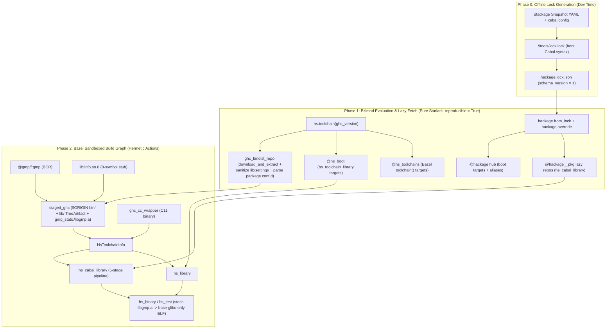

`rules_hs` is a clean-slate, Bzlmod-only Bazel 9 ruleset for Haskell (`bazel_compatibility = [">=9.0.0"]`). It compiles Haskell libraries, executables, tests, and third-party Hackage packages hermetically without Nix, without `WORKSPACE`, without a Python runtime wrapper, and without requiring host `ghc`, `cabal`, `stack`, `gcc`, `clang`, or system C `-dev` libraries.

This page introduces the architectural philosophy of `rules_hs`, examines the structural bottlenecks in prior Haskell-on-Bazel designs, defines the strict boundary between Bzlmod evaluation and Bazel build execution, and maps every module in the repository. Subsequent chapters in this section examine each subsystem in full implementation detail:

- `doc:internals/hermeticity` — pure-Starlark bindist sanitization, `$ORIGIN` staging, the 8-symbol `libtinfo.so.6` stub, static-GMP user binaries, and the native C11 `ghc_cc_wrapper`.
- `doc:internals/providers-and-actions` — direct vs. transitive providers, strict dependency visibility, `${pkgroot}` package databases, C archive linking, runfiles, and Template Haskell execution.
- `doc:internals/ecosystem-and-hackage` — the dogfooded `Cabal-syntax` lock generator (`cli:lock`), `@hackage` repository synthesis, and the 5-stage `bzl:rule:hs_cabal_library` build pipeline.
- `doc:internals/cross-os-and-platforms` — `hs/private/ghc_versions.bzl` metadata, `deb10` glibc vs. `alpine3_12` musl, and activation blueprints for macOS, Windows, and static musl.
- `doc:internals/docs-engine` — how `rules_hs` dogfoods itself to build this documentation site hermetically with Hakyll, Pandoc, and Skylighting.
- `doc:internals/dependencies` — the complete evaluation of every adopted and non-adopted dependency across `rules_hs`, `examples/size`, and `//docs`, along with concrete catalysts for change.

---

## Core Design Principles {#design-principles}

Six invariants govern every rule, repository extension, and C/Haskell helper in `rules_hs`:

1. **Bazel 9+ & Bzlmod-only (`>=9.0.0`)**: Zero `WORKSPACE`, `WORKSPACE.bazel`, or `WORKSPACE.bzlmod` files exist anywhere in the repository, and legacy Starlark APIs removed in Bazel 8 and 9 are never referenced.
2. **Minimal downstream dependency footprint**: `MODULE.bazel` declares exactly **four** direct non-dev dependencies — `platforms`, `bazel_skylib`, `rules_cc`, and `gmp`. Test and documentation dependencies (`hermetic_cc_toolchain`, `rules_shell`, and the `//docs` Hackage closure) are strictly isolated behind `dev_dependency = True`.
3. **Nix-free Linux hermeticity**: Official GHC binary distributions are unpacked in pure Starlark with zero `./configure && make install`, sanitized so host `/usr/bin/*` tools can never execute, and staged using ELF `$ORIGIN` `RUNPATH`s with zero `LD_LIBRARY_PATH` and zero `patchelf` — making every action portable across clean containers and Remote Build Execution (RBE) workers.
4. **Portable static-GMP user binaries**: While GHC's own compiler binaries link dynamically against staged `libgmp.so.10`, user `bzl:rule:hs_binary` and `bzl:rule:hs_test` executables link statically against `libgmp.a`, yielding ELF binaries whose `DT_NEEDED` entries are restricted exclusively to base `glibc` (`libc.so.6`, `libm.so.6`, `libdl.so.2`, `libpthread.so.0`).
5. **Zero Python on the build hot path**: A self-contained 460-line C11 binary (`ghc_cc_wrapper` in `hs/private/cc_wrapper.c`) bridges GHC, `hsc2hs`, and Cabal `./configure` to whatever `@bazel_tools//tools/cpp:toolchain_type` the consumer registers.
6. **Two-phase Hackage resolution & fine-grained Cabal actions**: Third-party Cabal resolution happens offline via GHC's own boot `Cabal-syntax` library (`cli:lock` -> `hackage.lock.json`), Bzlmod extension evaluation reads JSON in pure Starlark (`reproducible = True`), and `bzl:rule:hs_cabal_library` decomposes builds into five cacheable, parallelizable stages with zero `Setup.hs` execution.

---

## Prior-Art Post-Mortem: Why Not Patch `tweag/rules_haskell`? {#prior-art-rules-haskell}

Auditing `tweag/rules_haskell` (both `master` and BCR `1.0`) reveals **six structural bottlenecks** that are deeply intertwined across its repository rules, toolchain wrappers, and Cabal build driver. Addressing them cleanly on Bazel 9 favors a focused ground-up design over incremental workarounds:

### 1. Bazel 7 Lock-In & Heavy Non-Dev `MODULE.bazel` Graph

- `rules_haskell` pins Bazel 7 (`.bazelversion = 7.1.0` on `master`) and leaks a broad graph of unrelated non-dev `bazel_dep`s to every downstream consumer: `rules_java`, `protobuf`, `abseil-cpp`, `rules_proto`, `rules_nodejs` + `aspect_rules_js` (retained for legacy Asterius WASM support), `rules_python`, `rules_sh`, and legacy `rules_cc`.
- Evaluating `rules_haskell` on Bazel 8 or Bazel 9 fails immediately during module graph loading because stale dependencies invoke removed builtins and files (`rules_sh@0.4.0` calling removed `get_cpu_value`, `aspect_rules_js@1.34.0` loading removed `npm_import.bzl`, `protobuf` Windows overrides), while `WORKSPACE`-era patterns (`ctx.resolve_tools`, leaked `stackage` repo assumptions) persist across core `.bzl` files.

### 2. Non-Hermetic Linux Bindists Forcing `rules_nixpkgs`

- `rules_haskell`'s `haskell/ghc_bindist.bzl` unpacks GHC `deb10` bindists and executes host `./configure --prefix ... && make install` inside a repository rule. That requires host `make`, `perl`, a C compiler, and system shared libraries on the machine running `bazel fetch` — reflected in `rules_haskell`'s own BCR `1.0` `presubmit.yml`, which runs `sudo apt install libtinfo5 libgmp-dev` before Bazel starts.
- To achieve Linux hermeticity, `rules_haskell` directs users to `rules_nixpkgs`, which invokes a host Nix daemon to populate `/nix/store` during repository fetch. Host `/nix/store` paths break Remote Build Execution (RBE) digest portability, fail in bare container environments without Nix, and make Bazel Central Registry (BCR) consumption impractical (`rules_haskell` issue #2451).

### 3. Python Runtime Wrapper (`cc_wrapper.py.tpl`) & Environment Leakage

- Wrapping the C compiler in a templated Python script (`cc_wrapper.py.tpl`) pulls `rules_python` and a Python runtime interpreter into the input closure of every single Haskell compile, preprocess, and link action.
- Beyond adding Python startup latency across hundreds of actions, this layer accumulated cross-platform path and quoting bugs (`rules_haskell` issues #2317, #2492, #2493) while still needing shell-wrapper workarounds (`unset RUNFILES_DIR RUNFILES_MANIFEST_FILE RUNFILES_MANIFEST_ONLY`) so Bazel runfiles environment variables do not corrupt nested tool invocations.

### 4. Dynamic Linking & `$ORIGIN` Rpath Complexity on User Binaries

- `ghc_bindist.bzl` hardcodes `fully_static_link = False` for bindist toolchains, forcing downstream executables through complex `$ORIGIN` / `@loader_path` rpath rewrites and runtime shared-library packaging (`libHS*.so`, `libgmp.so.10`, `libffi.so.8`) even when consumers simply want a self-contained CLI or service binary.

### 5. Heavyweight `stack_snapshot` & Opaque `cabal_wrapper.py`

- Resolving Hackage packages through `stack_snapshot` requires an external `stack` CLI binary (or manual `stack_snapshot_json` pinning plus `setup_deps = ["@Cabal//:Cabal"]` overrides; `rules_haskell` issue #1871).
- At build time, each Hackage package executes `runghc Setup.hs configure && build && copy && register && clean` inside a single opaque Python action (`cabal_wrapper.py`). That monolithic action mutates `cwd`, compiles `Setup.hs` repeatedly, relocates `libHS*.a` archives to dodge Bazel `TreeArtifact` path overlaps with `.hi` directories (`rules_haskell` issues #2496, #2499), regex-patches `.conf` files to `${pkgroot}`, sacrifices per-file `hsc2hs` and C compilation parallelism, and fails to propagate transitive `install-includes` natively via `CcInfo`.

### 6. High End-User Boilerplate

- Users must manually declare `haskell_toolchain_library` targets for boot libraries (`base`, `text`, `bytestring`, `containers`, etc.) unless everything is routed through `@stackage`, while package-level wrapper macros and external generators (`gazelle_haskell_modules`) add configuration surface.

### Architectural Comparison Summary

| Dimension | `rules_hs` | `tweag/rules_haskell` |
|---|---|---|
| **Bazel & module system** | Bazel 9+ (`>=9.0.0`), Bzlmod-only, zero `WORKSPACE` files | Pins Bazel 7; legacy `WORKSPACE` roots; fails loading on Bazel 8/9 |
| **Direct non-dev `MODULE.bazel` deps** | 4 minimal modules: `platforms`, `bazel_skylib`, `rules_cc`, `gmp` | Leaks `rules_java`, `protobuf`, `abseil-cpp`, `rules_proto`, `rules_nodejs`, `aspect_rules_js`, `rules_python`, `rules_sh` |
| **Hermetic Linux GHC** | Pure-Starlark bindist + `$ORIGIN` staging (`@gmp` + `libtinfo.so.6` stub); RBE-native | Bindist runs host `./configure && make install` (`apt install libgmp-dev libtinfo5`); hermeticity requires `rules_nixpkgs` (`/nix/store`) |
| **C compiler adapter** | Compiled C11 binary (`ghc_cc_wrapper`), zero Python | `cc_wrapper.py.tpl`, pulling `rules_python` into every compile/link action |
| **3p Hackage builds** | 5-stage `bzl:rule:hs_cabal_library` (`HsConfigure`, zero-proc codegen, parallel `HsHsc2hs`, `cc_common.compile`, `ghc --make -c` + `${pkgroot}` DB) | Single opaque Python `cabal_wrapper.py` invoking `runghc Setup.hs` |
| **Dependency pinning & boot libs** | Dogfooded boot-only `Cabal-syntax` lock tool (`cli:lock`); automatic `@hs_boot` & `@hackage` boot targets | External `stack` / `stack_snapshot` pinning + manual `haskell_toolchain_library` declarations |
| **Linux user binary `DT_NEEDED`** | Static `libgmp.a`; strictly base glibc (`libc`, `libm`, `libdl`, `libpthread`) | Dynamic shared-object linking / `$ORIGIN` rpath rewriting |

---

## Architectural Inspirations {#inspirations}

`rules_hs` synthesizes proven ideas from two ecosystems:

### Buck2 Haskell (`facebook/buck2/prelude/haskell`)

Buck2's Haskell prelude cleanly decouples **direct** package metadata (`HaskellLibraryProvider`) from **transitive** link/interface closures (`HaskellLinkInfo` + C++ `MergedLinkInfo`). `rules_hs` implements this exact split in `hs/providers.bzl` (`bzl:provider:HsPackageInfo` vs. `bzl:provider:HsLinkInfo` + `CcInfo`):

- Direct dependencies supply unit IDs passed via `-package-id <unit_id>` alongside `-hide-all-packages`, enforcing Bazel's strict direct-dependency visibility at compile time.
- Transitive closures propagate via `depset`s (`pkg_dbs`, `hs_libs`, `include_dirs`, `headers`) and `cc_common.merge_cc_infos`, avoiding quadratic Starlark list copying while giving GHC transitive `.hi` interface visibility and full native C archive closures.

### Modern Bzlmod-Only Rulesets (`rules_zig`, `rules_dotnet`, `rules_rust`, `rules_go`)

Following modern Bazel 9 ruleset conventions:

- Every module extension (`bzl:ext:hs` and `bzl:ext:hackage` in `hs/extensions.bzl` and `hs/private/hackage.bzl`) performs zero network calls during extension evaluation and returns `module_ctx.extension_metadata(reproducible = True)` so consumer `MODULE.bazel.lock` files stay deterministic.
- Boot libraries are synthesized automatically in `@hs_boot` (and re-exposed uniformly in `@hackage`), while third-party packages live in lazy per-package repositories (`@hackage__<pkg>`) that Bazel downloads only when reachable from requested build targets.

---

## System Architecture & Phase Boundaries {#phase-boundaries}

`rules_hs` separates dependency resolution, repository declaration, toolchain staging, and target compilation across three crisp phases:

### Phase Invariants

| Phase | Executes When | Allowed Operations | Forbidden Operations |
|---|---|---|---|
| **0. Offline Lock Generation** (`cli:lock`) | Developer updates Hackage dependencies (`bazel run @rules_hs//tools/lock:lock -- ...`) | Fetch Stackage YAML + Hackage `.cabal`/`.tar.gz`, evaluate `finalizePD` via boot `Cabal-syntax`, verify SHA-256s, write `hackage.lock.json` | Requires zero host `cabal`, `stack`, or Python; never runs during `bazel build` / `bazel test` |
| **1a. Bzlmod Extension Evaluation** (`hs/extensions.bzl`, `hs/private/hackage.bzl`) | `bazel mod` / analysis startup | Pure Starlark `module_ctx.read` + `json.decode` of `hackage.lock.json`; declare `ghc_bindist_repo`, `@hs_boot`, `@hs_toolchains`, `@hackage`, and `@hackage__<pkg>` (`reproducible = True`) | Zero `module_ctx.download`, zero `module_ctx.execute`, zero host tool lookups |
| **1b. Repository Rule Fetch** (`ghc_bindist_repo`, `_hackage_package_repo`) | Lazily when a target in that repo is needed | SHA-256-verified `repository_ctx.download_and_extract`, pure-Starlark file sanitization/parsing, `BUILD.bazel` synthesis | Zero `./configure`, zero `make`, zero `ghc-pkg` subprocesses during repo fetch |
| **2. Sandboxed Build Execution** (`staged_ghc`, `hs_*` rules) | `bazel build` / `bazel test` under `--incompatible_strict_action_env` | Hermetic actions inside Bazel sandbox/execroot using staged GHC, `ghc_cc_wrapper`, and resolved `cc_toolchain` | Zero network access, zero `LD_LIBRARY_PATH`, zero `/usr/bin/*` fallback, zero `RUNFILES_*` leakage into compilers |

::: {.important title="Why Root MODULE.bazel Calls hs.toolchain Without dev_dependency = True"}
In `rules_hs`'s own `MODULE.bazel`, `hs = use_extension("//hs:extensions.bzl", "hs")` and `use_repo(hs, "hs_boot", "hs_toolchains")` are intentionally **non-dev**, whereas `register_toolchains("@hs_toolchains//:all", dev_dependency = True)` is **dev-only**.

This split ensures that when a downstream consumer runs `bazel run @rules_hs//tools/lock:lock`, `@rules_hs//tools/lock` can always resolve `@hs_boot//:Cabal-syntax` and its sibling boot libraries — while `_hs_extension_impl` (`hs/extensions.bzl`) gives precedence to `mod.is_root` tags so any consumer `hs.toolchain(ghc_version = ...)` cleanly overrides the GHC version across the entire build graph without forcing toolchain registration before the consumer chooses it.
:::

---

## Repository Module & File Map {#repository-map}

Every source file in `rules_hs` has a single, bounded responsibility:

| Path | Role & Key Symbols |
|---|---|
| `MODULE.bazel` | Module declaration (`rules_hs`, `bazel_compatibility = [">=9.0.0"]`), 4 non-dev BCR deps (`platforms`, `bazel_skylib`, `rules_cc`, `gmp`), dev-only `hermetic_cc_toolchain` (`gnu.2.32`) + `rules_shell` + `@hackage` (`//docs:hackage.lock.json`). |
| `.bazelrc` | Strict action environment (`--incompatible_strict_action_env`), runfiles (`--enable_runfiles`), platform config (`--enable_platform_specific_config`), and dev Zig cache sandbox mount (`/tmp/zig-cc-cache`). |
| `hs/defs.bzl` | Public rule entrypoint re-exporting `bzl:rule:hs_library`, `bzl:rule:hs_binary`, `bzl:rule:hs_test`, `bzl:rule:hs_toolchain_library`, and `bzl:rule:hs_cabal_library`. |
| `hs/providers.bzl` | Public provider schemas: `bzl:provider:HsPackageInfo`, `bzl:provider:HsLinkInfo`, and `bzl:provider:HsToolchainInfo`. |
| `hs/toolchain.bzl` | Declares `TOOLCHAIN_TYPE = "@rules_hs//hs:toolchain_type"` and the `hs_toolchain` rule combining `staged_ghc`, `ghc_cc_wrapper`, and decoded `boot_packages_json`. |
| `hs/extensions.bzl` | Public Bzlmod extensions: `bzl:ext:hs` (`bzl:ext:hs.toolchain`) and re-exported `bzl:ext:hackage` (`bzl:ext:hackage.from_lock`, `bzl:ext:hackage.override`). |
| `hs/private/ghc_versions.bzl` | Declarative bindist table (`GHC_BINDISTS`, `BOOT_PACKAGE_NAMES`, `SUPPORTED_PLATFORMS`, `DEFAULT_GHC_VERSION = "9.10.3"`) covering GHC `9.10.3` and `9.12.4` across 6 platform keys. |
| `hs/private/ghc_bindist.bzl` | Repository rules `ghc_bindist_repo` (`_sanitize_settings`, `_parse_pkg_conf`), `hs_toolchains_repo`, and `hs_boot_repo`. |
| `hs/private/staged_ghc.bzl` | `staged_ghc` build rule (`HsLinkGmpShared` + `HsStageGhc`), assembling `<prefix>/bin/`, `<prefix>/lib/` TreeArtifact, and `<prefix>/gmp_static/libgmp.a`. |
| `hs/private/tinfo_stub.c` & `hs/private/tinfo_stub.lds` | 8-symbol `@NCURSES6_TINFO_5.0.19991023` C11 shared-library stub compiled to `//hs/private:libtinfo.so.6`. |
| `hs/private/cc_wrapper.c` | Native POSIX C11 compiler/linker/preprocessor wrapper (`//hs/private:ghc_cc_wrapper`). |
| `hs/private/actions.bzl` | Shared action builders: `resolve_cc_tools`, `collect_deps`, `write_cabal_macros_h`, `write_paths_module`, `ghc_tool_flags`, `run_configure_action`, `run_hsc2hs_actions`, `compile_c_sources`, `compile_hs_library_action`. |
| `hs/private/rules.bzl` | Implementations of `bzl:rule:hs_toolchain_library`, `bzl:rule:hs_library`, `bzl:rule:hs_binary`, and `bzl:rule:hs_test` (`HsLinkExecutable`). |
| `hs/private/hackage.bzl` | `bzl:ext:hackage` extension, `_hackage_hub_repo`, and `_hackage_package_repo` (`_find_module_files`, `_emit_component_rule`, `_PLATFORM_CONFIGS`, lazy Alex/Happy grammar wiring). |
| `hs/private/cabal_codegen.bzl` | Lazy boot-only bootstrap and codegen actions for `alex-3.5.4.2` (`.x`) and `happy-2.1.7` (`.y`/`.ly`) grammar sources (zero host tools, zero fetches when unused). |
| `hs/private/cabal_library.bzl` | 5-stage `bzl:rule:hs_cabal_library` rule implementation (including C/C++ compilation, `pkg_cwd` compile-time `data` staging, and C-only package short-circuiting). |
| `tools/lock/{Main,CabalExtract,LockJson,LockTest}.hs` | Boot-only `Cabal-syntax` lockfile generator (`cli:lock`) and offline unit tests (`//tools/lock:lock_test`). |
| `tests/starlark/rules_analysis_test.bzl` | `@bazel_skylib//lib:unittest.bzl` `analysistest` suite inspecting providers, action `argv`s, strict `-package-id` visibility, static `libgmp.a`, `cabal_macros.h`, C-only Cabal targets, and `CcInfo` propagation. |
| `tests/basic/` & `tests/rules/` | End-to-end tests covering multi-library DAGs, `.hs-boot` cycles, `Configure` + `hsc2hs` + C-only Cabal pipelines, C FFI (`cc_deps` + `c_sources`), language editions (`Haskell98`/`Haskell2010`/`GHC2021`), threaded/non-threaded RTS, 2-hop runfiles, same-library & cross-library Template Haskell (`th_test`, `cross_lib_th_test`, `cross_lib_th_elf_test`), ELF `DT_NEEDED`, and Bzlmod hygiene. |
| `examples/size/` | Standalone consumer workspace compiling 69 Hackage packages (`xml-conduit`, `http-client-tls`, `zlib-clib`, `async`) into a concurrent HTTPS sitemap page counter. |
| `docs/` | Self-hosted Hakyll + Pandoc + Skylighting documentation site generator (`//docs:docs_gen`, `//docs:site`, `//docs:serve`), Markdown content (`docs/content/`), and tests (`//docs:engine_test`, `//docs:site_test`). |

---

## Automated Bzlmod Hygiene & Hermeticity Enforcement {#hygiene-enforcement}

Architectural invariants decay unless continuously enforced in CI. `//tests/rules:bzlmod_hygiene_test` (`tests/rules/bzlmod_hygiene_test.sh`) inspects both the repository source tree and a compiled Haskell binary (`//tests/rules:hermetic_bin`) on every `bazel test //...` run:

1. **Zero legacy `WORKSPACE` files**: Walks both the resolved repository root and `$TEST_SRCDIR/$TEST_WORKSPACE`, failing immediately if any `WORKSPACE`, `WORKSPACE.bazel`, or `WORKSPACE.bzlmod` file exists.
2. **Strict `MODULE.bazel` audit**: Strips `#` comments from `MODULE.bazel` and verifies with `grep` and an `awk` call-block parser that:
   - `bazel_compatibility = [">=9.0.0"]` is declared.
   - Zero banned legacy modules (`rules_java`, `protobuf`, `rules_nodejs`, `rules_python`, `rules_nixpkgs`) appear anywhere in `MODULE.bazel`.
   - Every `bazel_dep(...)` outside the four-module runtime allowlist (`platforms`, `bazel_skylib`, `rules_cc`, `gmp`) explicitly sets `dev_dependency = True`.
   - Every `register_toolchains(...)` block in `MODULE.bazel` sets `dev_dependency = True`.
   - Every `@hermetic_cc_toolchain` (and dev `@hackage`) `use_extension(...)` call sets `dev_dependency = True`.
3. **ELF `DT_NEEDED` allowlist**: Runs `readelf -d` on `//tests/rules:hermetic_bin` (and `//tests/basic:elf_hermeticity_test` + `examples/size`'s `//:elf_hermeticity_test` + `//docs:site_test` do the same on their respective binaries), rejecting any shared library outside base `glibc`:
   - Allowed: `libc.so.6`, `libm.so.6`, `libdl.so.2`, `libpthread.so.0`, `librt.so.1`, `libutil.so.1`, `ld-linux-*.so.*`.
   - Explicitly forbidden: `libgmp.so*`, `libtinfo.so*`, `libffi.so*`, `libnuma.so*`, `libz.so*`, `libssl.so*`, `libHS*.so*`.
4. **Empty-environment execution (`env -i PATH=/nonexistent`)**: Executes `hermetic_bin` with a completely cleared environment and a nonexistent `PATH`, asserting exact output including arbitrary-precision GMP `Integer` arithmetic (`2 ^ 256 = 115792089237316195423570985008687907853269984665640564039457584007913129639936`) to prove `ghc-bignum` is statically linked and functional without runtime environment variables.
