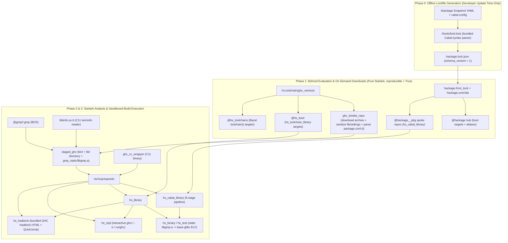

`rules_haskell` compiles Haskell libraries, executables, tests, interactive `ghci` REPL targets, third-party Hackage packages, and Haddock API documentation in Bazel 9 and newer ([`bazel_compatibility = [">=9.0.0"]`](https://bazel.build/rules/lib/globals/module#module)) using [`MODULE.bazel`](https://bazel.build/external/module) ([Bzlmod](https://bazel.build/external/overview)). On Linux (`x86_64` and `arm64`), it downloads and prepares the Glasgow Haskell Compiler (GHC) inside Bazel's build graph with no Nix, [`WORKSPACE`](https://bazel.build/external/overview#workspace-system) files, Python wrappers, or pre-installed host tools (`ghc`, `cabal`, `stack`, `gcc`, `clang`, or system C development headers).

Read this page if you're contributing to `rules_haskell`, evaluating its architecture, or debugging how its phases fit together. If you just want to build Haskell code, start with the [Quickstart](../guide/quickstart.md) or the [Rules reference](../reference/rules.md) instead.

> **Note:** Every chapter in **Internals** is written to be readable even if you've only used Bazel on an application team and haven't worked with Haskell before. If you're new to writing Bazel rulesets, read the [Bazel ruleset primer](bazel-rules-primer.md) first; if you're new to GHC or Cabal, read the [Haskell and GHC primer](haskell-and-ghc-primer.md) first.

This page covers the core design principles, why `rules_haskell` wasn't built as a patch on `tweag/rules_haskell`, the phase boundaries between offline lockfile generation, Bzlmod loading, and [sandboxed](https://bazel.build/docs/sandboxing) [build actions](https://bazel.build/extending/rules#actions), and a complete map of the repository. Together, the chapters in this section document the full system:

- [Bazel ruleset primer](bazel-rules-primer.md): Plain-English guide to Bazel 9 ruleset mechanics from an end-user starting point.
- [Haskell and GHC primer](haskell-and-ghc-primer.md): Plain-English guide to Haskell's compiler pipeline, runtime system, boot libraries, and Cabal/Hackage ecosystem.
- **Architecture overview** *(this page)*: Design choices, `tweag/rules_haskell` analysis, phase boundaries, repository file map, and automated hygiene checks.
- [Comparison with other rulesets](rulesets-comparison.md): Subsystem-by-subsystem comparison with `tweag/rules_haskell`, Buck2's Haskell rules (`prelude/haskell` and `buck2-haskell`), Please Build, `haskell.nix`, and Cabal/Stack wrappers.
- [Hermeticity and toolchain](hermeticity.md): Unpacking GHC binary archives in [Starlark](https://bazel.build/rules/language), staging bundled shared libraries with relative `$ORIGIN` paths, the self-contained C11 `libtinfo.so.6` and `libtinfo.a` terminfo reader, static-GMP user binaries, and the C11 `ghc_cc_wrapper` binary.
- [Providers and action graph](providers-and-actions.md): End-to-end build walkthrough, direct vs. transitive [providers](https://bazel.build/extending/rules#providers), strict direct-dependency visibility, relocatable package databases, C archive linking, [runfiles](https://bazel.build/extending/rules#runfiles), Template Haskell, interactive [`hs_repl`](../reference/rules.md#hs_repl), and [`hs_haddock`](../reference/rules.md#hs_haddock).
- [Hackage and Cabal pipeline](ecosystem-and-hackage.md): The `Cabal-syntax` lockfile generator ([`//tools/lock:lock`](../reference/lock-cli.md)), `@hackage` repository generation, and the 5-stage [`hs_cabal_library`](../reference/rules.md#hs_cabal_library) build pipeline.
- [Cross-OS and platforms](cross-os-and-platforms.md): Platform metadata in `haskell/private/ghc_versions.bzl`, `deb10` glibc vs. `alpine3_12` musl archives, and implementation plans for macOS, Windows, and static musl.
- [Hakyll and Haddock docs](docs-engine.md): How this documentation site builds with minimal Hakyll (`docs/site.hs`), `wai-app-static` and `warp` (`docs/serve.hs`), and bundled GHC Haddock ([`hs_haddock`](../reference/rules.md#hs_haddock)).
- [Dependency decisions](dependencies.md): Rationale and trade-offs for every adopted and rejected dependency across `rules_haskell`, `examples/size`, and `//docs`.

---

## Core design principles {#design-principles}

Polyglot Bazel builds usually break in predictable ways: host compilers leak into sandboxes, rulesets pull in huge transitive module graphs, or opaque wrapper scripts defeat caching. Six design choices prevent those failure modes across the rules, repository extensions, and C/Haskell helpers in `rules_haskell`:

1. **Bazel 9+ and `MODULE.bazel` (Bzlmod) only (`>=9.0.0`).** Bazel 9 removed the legacy `WORKSPACE` dependency system in favor of Bzlmod. `rules_haskell` ships no `WORKSPACE`, `WORKSPACE.bazel`, or `WORKSPACE.bzlmod` files and avoids Starlark APIs removed in Bazel 8 and 9, keeping the codebase free of legacy compatibility branches.
2. **Small dependency footprint for downstream consumers.** Every non-dev [`bazel_dep`](https://bazel.build/rules/lib/globals/module#bazel_dep) in a ruleset's `MODULE.bazel` becomes a transitive dependency of every downstream project ([dual-mode `MODULE.bazel`](bazel-rules-primer.md#ruleset-vs-consumer)). `rules_haskell` declares **four** direct non-dev dependencies: `platforms` (OS and CPU constraint labels), `bazel_skylib` (Starlark helpers), `rules_cc` (C/C++ toolchain and [`CcInfo`](https://bazel.build/rules/lib/providers/CcInfo) integration), and `gmp` (the GNU Multiple Precision C library GHC uses for unbounded `Integer` math). All test and documentation dependencies (`hermetic_cc_toolchain`, `rules_shell`, and the 182 Hackage packages used to build `//docs`) carry `dev_dependency = True`, so Bazel ignores them in your workspace.
3. **Self-contained Linux GHC toolchain without Nix.** Upstream GHC Linux binary archives (*bindists*) expect `make` during installation, record host `/usr/bin/gcc` paths in `lib/settings`, and load `libgmp.so.10` and `libtinfo.so.6` dynamically from `/usr/lib`. To preserve [hermeticity](https://bazel.build/basics/hermeticity), `rules_haskell` unpacks GHC archives directly in Starlark without running `./configure && make install`, replaces hardcoded host paths in `lib/settings` with `/nonexistent/*` so accidental host tool calls fail immediately, and stages Bazel-compiled `libgmp.so.10` alongside a self-contained C11 `libtinfo.so.6` reader inside GHC's own relative library directory. Linux's dynamic loader finds those libraries through the binary's existing `$ORIGIN/../lib/...` `RUNPATH` header—avoiding `LD_LIBRARY_PATH`, `patchelf` binary rewriting, and host Nix installs on laptops and [Remote Build Execution (RBE)](https://bazel.build/remote/rbe) workers ([why host leaks break sandboxes](bazel-rules-primer.md#three-phases)).
4. **User executables linked statically against GMP.** On Linux, an ELF executable's header lists every shared library (`DT_NEEDED`) the OS dynamic loader must open before `main()` starts. While the `ghc` compiler binary dynamically loads staged `libgmp.so.10` during compilation, user [`hs_binary`](../reference/rules.md#hs_binary) and [`hs_test`](../reference/rules.md#hs_test) targets link **statically** against `libgmp.a` ([why GMP and `DT_NEEDED` matter](haskell-and-ghc-primer.md#gmp-and-tinfo)). Your compiled binaries depend only on standard Linux `glibc` (`libc.so.6`, `libm.so.6`, `libdl.so.2`, `libpthread.so.0`) and run inside minimal `debian:bookworm-slim`, `ubuntu:24.04`, or `rockylinux:9` containers without `libgmp10` installed.
5. **Compiled C11 compiler adapter instead of Python on the build path.** GHC invokes a C preprocessor, C compiler, assembler, and linker as subprocesses during builds ([C toolchain and RTS](haskell-and-ghc-primer.md#c-toolchain-and-rts)). Wrapping the C compiler in Python would force every consumer to depend on `rules_python` and pay interpreter startup overhead on every compile step. Instead, `rules_haskell` compiles a 552-line C11 program (`ghc_cc_wrapper` in `haskell/private/cc_wrapper.c`) once in Bazel's build-tool configuration ([`cfg = "exec"`](https://bazel.build/extending/toolchains#toolchains-and-configurations)) to translate flags between GHC, `hsc2hs`, Cabal `./configure`, and whichever C/C++ toolchain you configure in Bazel.
6. **Offline `.cabal` lockfile resolution and multi-stage Cabal actions.** Third-party Hackage `.cabal` files contain `if os(...)`, `arch(...)`, and `flag(...)` conditionals and declare a `build-type` alongside a historical `Setup.hs` file ([ecosystem overview](haskell-and-ghc-primer.md#ecosystem-map)):
   - **`Simple`** (over 95% of Hackage, where `Setup.hs` is a two-line stub and all build metadata lives in `.cabal`) and **`Configure`** (packages like `network` or `unix-time` that run `./configure` to inspect C headers) work directly.
   - **`Custom`** packages whose `Setup.hs` exists only for the legacy `cabal-doctest` helper (such as `xml-conduit`) are detected by [`//tools/lock:lock`](../reference/lock-cli.md) and normalized to `Simple`.
   - **Bespoke `Custom` `Setup.hs` scripts** that run arbitrary Haskell code generation during builds (under 1% of Hackage) aren't executed. `//tools/lock:lock` records `"build_type": "Custom"` in `hackage.lock.json`, and [`hs_cabal_library`](../reference/rules.md#hs_cabal_library) rejects it at Bazel analysis time (`Unsupported Cabal build-type 'Custom'`) unless you replace the target with [`hackage.override`](../reference/extensions-and-providers.md#hackage-override).

   Instead of running `cabal`, `stack`, or `runghc Setup.hs` during [`bazel build`](https://bazel.build/run/build), `//tools/lock:lock` evaluates `.cabal` conditionals offline with GHC's bundled [`Cabal-syntax` boot library](haskell-and-ghc-primer.md#boot-libraries) to write `hackage.lock.json`. Bzlmod decodes that JSON in pure Starlark ([`reproducible = True`](https://bazel.build/external/extension#specify-reproducibility-and-use-facts)), and `hs_cabal_library` compiles each package across five separate, cacheable Bazel stages.

---

## Why not patch `tweag/rules_haskell`? {#prior-art-rules-haskell}

> **Tip:** This section covers the six Bazel-specific constraints in `tweag/rules_haskell` that drove building `rules_haskell` as a separate repository. For a subsystem-by-subsystem comparison across `tweag/rules_haskell`, Meta's `facebook/buck2` (`prelude/haskell` and `buck2-haskell`), Please Build, `input-output-hk/haskell.nix`, and Cabal/Stack wrappers, see [Comparison with other rulesets](rulesets-comparison.md).

`tweag/rules_haskell` pioneered Haskell support in Bazel and supports a wide set of workflows on Bazel 7. Inspecting `tweag/rules_haskell` (both `master` and [BCR](https://bazel.build/external/registry#bazel-central-registry) `1.0`) reveals **six coupled constraints** across its [repository rules](https://bazel.build/external/repo), toolchain wrappers, and Cabal build driver that would require breaking changes across most of the ruleset to rework for Bazel 9.

### 1. Bazel 7 pinning and a broad non-dev `MODULE.bazel` graph

`tweag/rules_haskell` pins Bazel 7 (`.bazelversion = 7.1.0` on `master`) and declares non-dev `bazel_dep` entries that enter every consumer's module graph: `rules_java`, `protobuf`, `abseil-cpp`, `rules_proto`, `rules_nodejs` and `aspect_rules_js` (retained from legacy Asterius WebAssembly support), `rules_python`, `rules_sh`, and older `rules_cc`.

Loading `tweag/rules_haskell` on Bazel 8 or 9 fails during module resolution because older dependencies reference removed Starlark APIs and files (`rules_sh@0.4.0` calling removed `get_cpu_value`, `aspect_rules_js@1.34.0` loading removed `npm_import.bzl`, `protobuf` Windows overrides), while `WORKSPACE`-era APIs (`ctx.resolve_tools`, hardcoded `@stackage` references) remain in core `.bzl` files.

### 2. Host dependencies in Linux bindists and reliance on `rules_nixpkgs`

`tweag/rules_haskell`'s `haskell/ghc_bindist.bzl` unpacks GHC `deb10` archives and runs `./configure --prefix ... && make install` on the host during [`bazel fetch`](https://bazel.build/external/overview#fetch-repository). That step requires `make`, `perl`, a C compiler, and system shared libraries on the host OS—which is why `tweag/rules_haskell`'s BCR `1.0` `presubmit.yml` runs `sudo apt install libtinfo5 libgmp-dev` before invoking Bazel.

For isolated Linux builds, `tweag/rules_haskell` recommends `rules_nixpkgs`, which asks a local Nix daemon to populate `/nix/store` on the host. Because `/nix/store` lives outside Bazel's sandbox [`execroot`](https://bazel.build/remote/output-directories), those paths don't exist on standard RBE worker containers, require Nix on every build machine, and don't work cleanly in BCR modules (`tweag/rules_haskell` issue #2451).

### 3. Python compiler wrapper and runfiles environment variables

Wrapping the C compiler in a templated Python script (`cc_wrapper.py.tpl`) pulls `rules_python` and a Python interpreter into the sandbox inputs of every Haskell compile, preprocess, and link action.

Beyond adding interpreter startup overhead to every compiler subprocess, this wrapper accumulated cross-platform path and argument-quoting bugs (`tweag/rules_haskell` issues #2317, #2492, #2493) along with shell workarounds to clear Bazel `RUNFILES_*` variables during nested tool calls.

### 4. Dynamic linking on Linux bindist binaries

Because `ghc_bindist.bzl` sets `fully_static_link = False` on bindist toolchains, user executables built on Linux bindists link dynamically against `libHS*.so`, `libgmp.so.10`, and `libffi.so.8` through `$ORIGIN` or `@loader_path` search paths. You can't copy the resulting binary alone into a minimal container image without shipping its `.so` closure alongside it.

### 5. `stack_snapshot` and monolithic `Setup.hs` execution

Resolving Hackage packages through `stack_snapshot` requires an external `stack` binary on the machine (or manual `stack_snapshot_json` pinning paired with `setup_deps = ["@Cabal//:Cabal"]` overrides; `tweag/rules_haskell` issue #1871).

At build time, each Hackage package runs `runghc Setup.hs configure && build && copy && register && clean` inside a single Python action (`cabal_wrapper.py`). While executing `Setup.hs` does let it run arbitrary `build-type: Custom` hooks, running the entire build inside one opaque script compiles `Setup.hs` repeatedly, serializes `hsc2hs` and C compilation inside Cabal, needed workarounds for Bazel directory-output ([`TreeArtifact`](https://bazel.build/reference/glossary#tree-artifact)) overlaps between `libHS*.a` archives and `.hi` folders (`tweag/rules_haskell` issues #2496, #2499), rewrites `.conf` files with regular expressions, and doesn't expose C-only Cabal headers directly via `CcInfo`.

### 6. Manual boot library declarations

When you don't route every dependency through `@stackage`, you have to declare manual `haskell_toolchain_library` targets for GHC boot libraries such as `base`, `text`, `bytestring`, and `containers`.

### Architectural comparison summary

| Dimension | `rules_haskell` | `tweag/rules_haskell` |
|---|---|---|
| **Bazel and module system** | Bazel 9+ (`>=9.0.0`), `MODULE.bazel` (Bzlmod) only, zero `WORKSPACE` files | Pins Bazel 7; retains `WORKSPACE` roots; fails loading on Bazel 8/9 |
| **Direct non-dev `MODULE.bazel` deps** | 4 modules: `platforms`, `bazel_skylib`, `rules_cc`, `gmp` | 13 modules including `rules_java`, `protobuf`, `abseil-cpp`, `rules_proto`, `rules_nodejs`, `aspect_rules_js`, `rules_python`, `rules_sh` |
| **Linux GHC toolchain** | Starlark archive unpack and relative `$ORIGIN` staging (`@gmp` + C11 `libtinfo.so.6`); runs on standard RBE containers | Bindist runs host `./configure && make install` (`apt install libgmp-dev libtinfo5`), or uses `rules_nixpkgs` (`/nix/store`) |
| **C compiler adapter** | Compiled C11 binary (`ghc_cc_wrapper`), no Python runtime | `cc_wrapper.py.tpl`, requiring `rules_python` in compile/link actions |
| **Third-party Hackage builds** | 5-stage [`hs_cabal_library`](../reference/rules.md#hs_cabal_library) (`HsConfigure`, generated macros/paths, parallel `HsHsc2hs`, parallel [`cc_common.compile`](https://bazel.build/rules/lib/toplevel/cc_common), `ghc --make -c`) for `Simple`, `Configure`, and normalized `cabal-doctest` packages | Single Python `cabal_wrapper.py` running `runghc Setup.hs` (also runs arbitrary `build-type: Custom` `Setup.hs` scripts) |
| **Dependency lockfile and boot libs** | Offline `Cabal-syntax` lock tool ([`//tools/lock:lock`](../reference/lock-cli.md)); automatic `@hs_boot` and `@hackage` boot targets | External `stack` / `stack_snapshot` pinning and manual `haskell_toolchain_library` declarations |
| **Linux user binary shared libs** | Static `libgmp.a`; links only standard `glibc` (`libc`, `libm`, `libdl`, `libpthread`) | Dynamic `libHS*.so` / `libgmp.so` linking with `$ORIGIN` rpath rewriting on bindists |

---

## Architectural inspirations {#inspirations}

Two proven build-system designs solve the hardest scaling problems in Haskell-on-Bazel builds: keeping analysis time linear and keeping external dependency fetches lazy.

### Buck2 Haskell (`facebook/buck2/prelude/haskell`)

Splitting **direct** package identity from **transitive** compilation and link files prevents accidental indirect imports while keeping Bazel analysis fast. Buck2 models this split with `HaskellLibraryProvider` vs. `HaskellLinkInfo` and `MergedLinkInfo`; `rules_haskell` mirrors it in `haskell/providers.bzl` using [`HsPackageInfo`](../reference/extensions-and-providers.md#hspackageinfo) vs. [`HsLinkInfo`](../reference/extensions-and-providers.md#hslinkinfo) and `CcInfo` ([Providers and depsets](bazel-rules-primer.md#providers-and-depsets)):

- **Strict direct visibility:** Direct dependencies supply GHC unit IDs passed via `-package-id <unit_id>` alongside `-hide-all-packages`. Target `C` can't `import` a module from indirect dependency `A` unless `C` lists `A` in its own `deps`.
- **Linear-time transitive propagation:** Indirect files flow through Bazel [`depset`](https://bazel.build/extending/depsets) values (`pkg_dbs`, `hs_libs`, `include_dirs`, `headers`) and `cc_common.merge_cc_infos`. That avoids `O(N^2)` list copying during analysis while giving GHC every transitive `.hi` interface summary and C static `.a` archive it needs.

### Bzlmod-native rulesets (`rules_zig`, `rules_dotnet`, `rules_rust`, `rules_go`)

Modern Bzlmod rulesets keep module evaluation fast and avoid downloading unused dependencies ([Module extensions, repository rules, and lazy hubs](bazel-rules-primer.md#bzlmod-and-repos)):

- **Zero-network [module extensions](https://bazel.build/external/extension):** Both [`hs`](../reference/extensions-and-providers.md#hs) (`haskell/extensions.bzl`) and [`hackage`](../reference/extensions-and-providers.md#hackage) (`haskell/private/hackage.bzl`) perform no network calls during evaluation and return `module_ctx.extension_metadata(reproducible = True)`. Your [`MODULE.bazel.lock`](https://bazel.build/external/lockfile) stays small instead of recording bulky generated extension entries.
- **Automatic boot targets and lazy spoke repos:** GHC's built-in boot libraries are generated automatically in `@hs_boot` (and aliased in `@hackage`), while each third-party Hackage package lives in its own spoke repository (`@hackage__<pkg>`) that Bazel downloads only when a target you build actually reaches it.

---

## System architecture and phase boundaries {#phase-boundaries}

Building on Bazel's [Loading, Analysis, and Execution phases](https://bazel.build/extending/concepts#evaluation-model) ([Bazel's three phases](bazel-rules-primer.md#three-phases)), `rules_haskell` separates Hackage version resolution, repository setup, compiler staging, and target compilation into distinct phases so each one enforces a strict boundary:

### Phase invariants and why each boundary matters

| Phase | Runs when | What it does | What it avoids and why |
|---|---|---|---|
| **0. Offline lockfile generation** ([`//tools/lock:lock`](../reference/lock-cli.md)) | Only when you add or update Hackage packages (`bazel run @rules_haskell//tools/lock:lock -- ...`) | Downloads Stackage YAML and Hackage `.cabal`/`.tar.gz` archives, evaluates `.cabal` OS/CPU/flag conditionals across 4 platforms using GHC's bundled `Cabal-syntax` library, checks SHA-256 hashes, and writes `hackage.lock.json` | Never runs during `bazel build` or [`bazel test`](https://bazel.build/docs/user-manual#running-tests), so regular builds don't contact Hackage/Stackage servers and require no host `cabal`, `stack`, or Python installation. |
| **1a. Bzlmod extension evaluation** (`haskell/extensions.bzl`, `haskell/private/hackage.bzl`) | [`bazel mod`](https://bazel.build/external/mod-command) / loading startup | Decodes `hackage.lock.json` in pure Starlark; declares `ghc_bindist_repo`, `@hs_boot`, `@hs_toolchains`, `@hackage`, and `@hackage__<pkg>` (`reproducible = True`) | **No [`module_ctx.download`](https://bazel.build/rules/lib/builtins/module_ctx) and no `module_ctx.execute` subprocesses:** extensions finish in milliseconds and keep downstream `MODULE.bazel.lock` files small. |
| **1b. Repository rule fetch** (`ghc_bindist_repo`, `_hackage_package_repo`) | On demand when a target references that external repo | Downloads SHA-256-pinned archives via [`repository_ctx.download_and_extract`](https://bazel.build/rules/lib/builtins/repository_ctx), sanitizes `lib/settings`, parses `.conf` metadata in Starlark, and writes [`BUILD.bazel`](https://bazel.build/concepts/build-files) | **No `./configure`, `make`, or `ghc-pkg` subprocesses:** fetches succeed inside minimal containers with no host C compiler, `make`, `perl`, `libgmp`, or `libtinfo`. |
| **2 and 3. Analysis and sandboxed execution** (`staged_ghc`, `hs_*` rules) | `bazel build` / `bazel test` under [`--incompatible_strict_action_env`](https://bazel.build/reference/command-line-reference#param-no-incompatible-strict-action-env) | Constructs the action graph in memory, then runs sandboxed actions with staged GHC, `ghc_cc_wrapper`, and Bazel's [`cc_toolchain`](https://bazel.build/reference/be/c-cpp#cc_toolchain) | **No network access, `LD_LIBRARY_PATH`, `/usr/bin/*` fallback, or `RUNFILES_*` leakage:** keeps [action cache keys](https://bazel.build/reference/glossary#action-cache) consistent across local `linux-sandbox` builds and remote RBE workers. |

> **Important:** In `rules_haskell`'s own `MODULE.bazel`, [`use_extension("//haskell:extensions.bzl", "hs")`](https://bazel.build/rules/lib/globals/module#use_extension) and [`use_repo(hs, "hs_boot", "hs_toolchains")`](https://bazel.build/rules/lib/globals/module#use_repo) are **non-dev**, while [`register_toolchains("@hs_toolchains//:all", dev_dependency = True)`](https://bazel.build/rules/lib/globals/module#register_toolchains) is **dev-only**.
>
> That split lets a new consumer project bootstrap its first `hackage.lock.json` with `bazel run @rules_haskell//tools/lock:lock`: `@rules_haskell//tools/lock/BUILD.bazel` needs `@hs_boot//:Cabal-syntax` and sibling boot libraries visible inside `@rules_haskell`'s repo scope. Meanwhile, `_hs_extension_impl` (`haskell/extensions.bzl`) prefers `mod.is_root` tags so your own [`hs.toolchain(ghc_version = ...)`](../reference/extensions-and-providers.md#hs-toolchain) overrides the GHC version across the whole graph, and `rules_haskell` doesn't register toolchains automatically unless you opt in.

---

## Repository module and file map {#repository-map}

Each file in `rules_haskell` owns a distinct part of the build pipeline:

| Path | Responsibility and key symbols |
|---|---|
| `MODULE.bazel` | Module metadata (`rules_haskell`, `bazel_compatibility = [">=9.0.0"]`), 4 non-dev BCR dependencies (`platforms`, `bazel_skylib`, `rules_cc`, `gmp`), and dev-only `hermetic_cc_toolchain` (`gnu.2.32`), `rules_shell`, and `@hackage` (`//docs:hackage.lock.json`). |
| [`.bazelrc`](https://bazel.build/run/bazelrc) | Enables `--incompatible_strict_action_env`, runfiles ([`--enable_runfiles`](https://bazel.build/reference/command-line-reference#param-no-enable-runfiles)), per-OS flags ([`--enable_platform_specific_config`](https://bazel.build/reference/command-line-reference#param-no-enable-platform-specific-config)), and a writable sandbox cache path for Zig (`/tmp/zig-cc-cache`). |
| `haskell/defs.bzl` | Public rule entrypoint re-exporting [`hs_library`](../reference/rules.md#hs_library), [`hs_binary`](../reference/rules.md#hs_binary), [`hs_test`](../reference/rules.md#hs_test), [`hs_repl`](../reference/rules.md#hs_repl), [`hs_toolchain_library`](../reference/rules.md#hs_toolchain_library), [`hs_cabal_library`](../reference/rules.md#hs_cabal_library), and [`hs_haddock`](../reference/rules.md#hs_haddock). |
| `haskell/providers.bzl` | Public Starlark providers: [`HsPackageInfo`](../reference/extensions-and-providers.md#hspackageinfo), [`HsLinkInfo`](../reference/extensions-and-providers.md#hslinkinfo), [`HsToolchainInfo`](../reference/extensions-and-providers.md#hstoolchaininfo), [`HsHaddockInfo`](../reference/extensions-and-providers.md#hshaddockinfo), and [`HsReplInfo`](../reference/extensions-and-providers.md#hsreplinfo). |
| `haskell/toolchain.bzl` | `TOOLCHAIN_TYPE = "@rules_haskell//haskell:toolchain_type"` and [`hs_toolchain`](../reference/rules.md#hs_toolchain), combining `staged_ghc`, `ghc_cc_wrapper` (both in `cfg = "exec"`), and parsed boot library metadata. |
| `haskell/extensions.bzl` | Public Bzlmod extensions: [`hs`](../reference/extensions-and-providers.md#hs) ([`hs.toolchain`](../reference/extensions-and-providers.md#hs-toolchain)) and re-exported [`hackage`](../reference/extensions-and-providers.md#hackage) ([`hackage.from_lock`](../reference/extensions-and-providers.md#hackage-from_lock), [`hackage.override`](../reference/extensions-and-providers.md#hackage-override)). |
| `haskell/private/ghc_versions.bzl` | Pinned GHC download URLs and SHA-256 hashes (`GHC_BINDISTS`, `BOOT_PACKAGE_NAMES`, `SUPPORTED_PLATFORMS`, `DEFAULT_GHC_VERSION = "9.10.3"`) for GHC `9.10.3` and `9.12.4` across 6 OS/CPU keys. |
| `haskell/private/ghc_bindist.bzl` | Repository rules `ghc_bindist_repo` (sanitizing `lib/settings` and parsing `lib/package.conf.d/*.conf`), `hs_toolchains_repo`, and `hs_boot_repo`. |
| `haskell/private/staged_ghc.bzl` | `staged_ghc` rule (`HsLinkGmpShared` and `HsStageGhc`), assembling `<prefix>/bin/` (`ghc`, `ghc-pkg`, `hsc2hs`, `haddock`, `runghc`, `ghc-iserv-dyn`, `unlit`), the dereferenced `<prefix>/lib/` directory output (including `lib/html/`), and `<prefix>/gmp_static/{libgmp.a,libtinfo.a}`. |
| `haskell/private/tinfo_stub.c` and `haskell/private/tinfo_stub.lds` | Self-contained C11 terminfo reader (`NCURSES6_TINFO_5.0.19991023`, parsing binary `term(5)` databases with built-in `xterm-256color`/`vt100`/`dumb` fallbacks), compiled to `//haskell/private:libtinfo.so.6` and `//haskell/private:tinfo_stub_static`. |
| `haskell/private/rt_shims.c` | Weak `x86_64` `__cpu_model` fallback (`//haskell/private:rt_shims`) satisfying `__builtin_cpu_supports` links under `zig cc` while yielding to GCC or LLVM's built-in symbol when present. |
| `haskell/private/cc_wrapper.c` | Native POSIX C11 compiler, preprocessor, and linker adapter (`//haskell/private:ghc_cc_wrapper`). |
| `haskell/private/actions.bzl` | Shared action helpers covering `cc_toolchain` discovery, dependency collection, `cabal_macros.h` and `Paths_*` generation, GHC tool flags, `./configure`, `hsc2hs`, C/C++ compilation, and library compilation. |
| `haskell/private/rules.bzl` | Implementations of [`hs_toolchain_library`](../reference/rules.md#hs_toolchain_library), [`hs_library`](../reference/rules.md#hs_library), [`hs_binary`](../reference/rules.md#hs_binary), and [`hs_test`](../reference/rules.md#hs_test) (`HsLinkExecutable`). |
| `haskell/private/repl.bzl` and `tools/ghci/BUILD.bazel` | [`hs_repl`](../reference/rules.md#hs_repl) (`HsLinkReplCbits` and session `.ghci` launcher) and `hs_runghc` rules, plus standalone `@rules_haskell//tools/ghci` and `@rules_haskell//tools/ghci:runghc` targets. |
| `haskell/private/haddock.bzl` | [`hs_haddock`](../reference/rules.md#hs_haddock) rule running staged GHC `haddock` inside the sandbox to generate HTML API docs, hyperlinked source pages, and QuickJump search indices. |
| `haskell/private/hackage.bzl` | [`hackage`](../reference/extensions-and-providers.md#hackage) extension, `_hackage_hub_repo`, and `_hackage_package_repo` (mapping `.cabal` modules to source files, emitting [`select()`](https://bazel.build/configure/attributes) platform branches, and wiring on-demand `alex`/`happy` grammar rules). |
| `haskell/private/cabal_codegen.bzl` | On-demand bootstrap and code-generation rules for `alex-3.5.4.2` (`.x` lexer files) and `happy-2.1.7` (`.y`/`.ly` parser files), compiled using only `@hs_boot` libraries and downloaded only when a target uses grammar files. |
| `haskell/private/cabal_library.bzl` | 5-stage [`hs_cabal_library`](../reference/rules.md#hs_cabal_library) implementation (including C/C++ compilation, `pkg_cwd` compile-time `data` staging, and C-only package short-circuiting). |
| `tools/lock/{Main,CabalExtract,LockJson,LockTest}.hs` | `Cabal-syntax` lockfile library (`//tools/lock:lock_lib`), CLI ([`//tools/lock:lock`](../reference/lock-cli.md)), Haddock API target (`//tools/lock:lock_haddock`), and offline unit tests (`//tools/lock:lock_test`). |
| `tests/starlark/rules_analysis_test.bzl` | Phase-2 Starlark [`analysistest`](https://bazel.build/rules/testing#testing-rules) suite checking providers, action command lines, strict `-package-id` visibility, static `libgmp.a` flags, `cabal_macros.h`, C-only Cabal targets, `hs_haddock`, and `CcInfo` forwarding. |
| `tests/basic/` and `tests/rules/` | Functional tests covering multi-library graphs, `.hs-boot` mutual recursion, `Configure`, `hsc2hs`, C-only Cabal builds, C/C++ FFI, language editions (`Haskell98`/`Haskell2010`/`GHC2021`), threaded vs. single-threaded runtime, 2-hop runfiles, same-library and cross-library Template Haskell, Haddock output, ELF shared-library headers, and Bzlmod hygiene. |
| `examples/size/` | Standalone consumer workspace compiling 69 Hackage packages (`xml-conduit`, `http-client-tls`, `zlib-clib`, `async`) into a concurrent HTTPS sitemap page counter (`//:size`) and Haddock API docs (`//:size_haddock`). |
| `docs/` | Minimal Hakyll (`docs/site.hs`) documentation site (`//docs:docs_gen`, `//docs:site`, `//docs:serve` via `docs/serve.hs`), mounted Haddock API docs (`haddock/lock/`), Markdown content (`docs/content/`), and smoke test (`//docs:site_test`). |

---

## Automated Bzlmod hygiene and hermeticity enforcement {#hygiene-enforcement}

Architectural guardrails drift over time unless CI checks them on every change ([Testing a Bazel ruleset](bazel-rules-primer.md#testing-rulesets)). Every `bazel test //...` run executes `//tests/rules:bzlmod_hygiene_test` (`tests/rules/bzlmod_hygiene_test.sh`), which audits both the repository tree and a compiled binary (`//tests/rules:hermetic_bin`) against four invariants:

1. **Zero legacy `WORKSPACE` files.** Scans both the repository root and `$TEST_SRCDIR/$TEST_WORKSPACE`, failing if any `WORKSPACE`, `WORKSPACE.bazel`, or `WORKSPACE.bzlmod` file exists.
2. **`MODULE.bazel` dependency audit.** Strips `#` comments from `MODULE.bazel` and verifies with `grep` and an `awk` call-block parser that:
   - `bazel_compatibility = [">=9.0.0"]` is present.
   - Disallowed modules (`rules_java`, `protobuf`, `rules_nodejs`, `rules_python`, `rules_nixpkgs`) never appear in `MODULE.bazel`.
   - Every `bazel_dep(...)` outside the four-module runtime allowlist (`platforms`, `bazel_skylib`, `rules_cc`, `gmp`) sets `dev_dependency = True`.
   - Every `register_toolchains(...)` block sets `dev_dependency = True`.
   - Every `@hermetic_cc_toolchain` and documentation `@hackage` `use_extension(...)` call sets `dev_dependency = True`.
3. **ELF shared-library (`DT_NEEDED`) allowlist.** Runs `readelf -d` on `//tests/rules:hermetic_bin` (and `//tests/basic:elf_hermeticity_test`, `//tests/rules/th:cross_lib_th_elf_test`, and `examples/size//:elf_hermeticity_test` check their own binaries), failing if any shared library outside base `glibc` appears:
   - Allowed: `libc.so.6`, `libm.so.6`, `libdl.so.2`, `libpthread.so.0`, `librt.so.1`, `libutil.so.1`, `ld-linux-*.so.*`.
   - Disallowed: `libgmp.so*`, `libtinfo.so*`, `libffi.so*`, `libnuma.so*`, `libz.so*`, `libssl.so*`, `libHS*.so*`.
4. **Empty-environment execution (`env -i PATH=/nonexistent`).** Runs `hermetic_bin` with all environment variables cleared and `PATH` set to `/nonexistent`, verifying exact output including unbounded GMP `Integer` arithmetic (`2 ^ 256 = 115792089237316195423570985008687907853269984665640564039457584007913129639936`) to confirm static `libgmp.a` linking works with no runtime environment variables.
