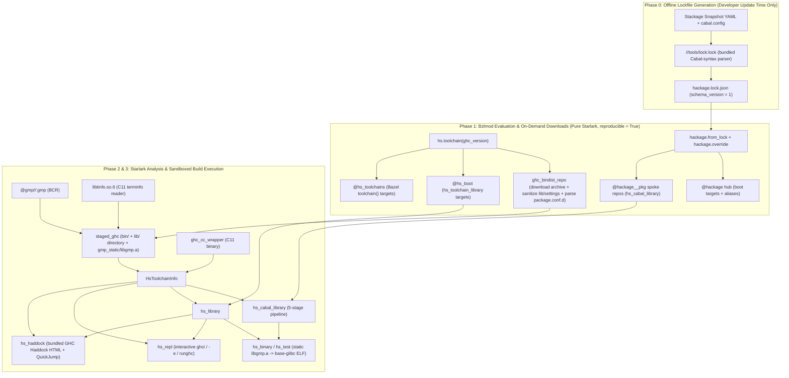

`rules_haskell` is a Bazel ruleset for compiling Haskell libraries, executables, tests, interactive `ghci` REPL targets, third-party Hackage packages, and Haddock API documentation. It targets Bazel 9 and newer (`bazel_compatibility = [">=9.0.0"]`) using Bazel's `MODULE.bazel` (Bzlmod) dependency system. On Linux (`x86_64` and `arm64`), `rules_haskell` downloads and prepares the Glasgow Haskell Compiler (GHC) inside Bazel's own build graph without requiring Nix, `WORKSPACE` files, a Python wrapper script, or pre-installed host tools such as `ghc`, `cabal`, `stack`, `gcc`, `clang`, or system C development headers.

> **Note — New to Bazel Ruleset Authoring or Haskell/GHC? Start Here:** Every chapter in **Internals & Architecture** is written to be readable even if you have only used Bazel as an application developer and have not worked with Haskell before:
>
> - **New to writing Bazel rulesets?** Read **[Bazel Ruleset Primer](bazel-rules-primer.md)** (`order: 5`) first for a plain-English walkthrough of `MODULE.bazel` (`dev_dependency = True` pruning), Bazel's Loading, Analysis, and Execution phases, module extensions and on-demand package repositories, directory outputs (`TreeArtifact`s), Starlark providers and `depset`s, build-tool vs. deployment configurations (`cfg = "exec"` vs. `cfg = "target"`), and C/C++ integration via `rules_cc` (`CcInfo`).
> - **New to Haskell, GHC, or Cabal?** Read **[Haskell & GHC Primer](haskell-and-ghc-primer.md)** (`order: 8`) first to see how GHC compiles `.hs` source files into `.o` machine code and `.hi` module interface summaries, why GHC ships 41 pre-compiled boot libraries (including its `.cabal` parser `Cabal-syntax`), why GHC calls a C compiler and links a C runtime library (`libHSrts`), why the `gmp` math library and `tinfo` terminal library appear in GHC's dependencies, and how `hsc2hs`, `alex`/`happy`, `.hs-boot`, and Template Haskell work.

This page explains the main engineering choices in `rules_haskell`, reviews the architectural constraints in earlier Haskell-on-Bazel designs, defines the boundary between offline lockfile generation, Bzlmod loading, and sandboxed build actions, and maps every source file in the repository. Together with the two primers above, the chapters in this section cover the whole system:

- [Bazel Ruleset Primer](bazel-rules-primer.md) — plain-English guide to Bazel 9 ruleset mechanics from an end-user starting point.
- [Haskell & GHC Primer](haskell-and-ghc-primer.md) — plain-English guide to Haskell's compiler pipeline, runtime system, boot libraries, and Cabal/Hackage ecosystem.
- **Architecture Overview** *(this page)* — design choices, `tweag/rules_haskell` retrospective, phase boundaries, repository file map, and automated hygiene checks.
- [Comparison with Other Rulesets](rulesets-comparison.md) — subsystem-by-subsystem comparison with `tweag/rules_haskell`, Buck2's Haskell rules (`prelude/haskell` and `buck2-haskell`), Please Build, `haskell.nix`, and Cabal/Stack wrappers.
- [Hermeticity & Toolchain](hermeticity.md) — unpacking GHC binary archives in Starlark, staging bundled shared libraries via relative `$ORIGIN` paths, the self-contained C11 `libtinfo.so.6` / `libtinfo.a` terminfo reader, static-GMP user binaries, and the C11 `ghc_cc_wrapper` binary.
- [Providers & Action Graph](providers-and-actions.md) — end-to-end build walkthrough, direct vs. transitive providers, strict direct-dependency visibility, relocatable package databases, C archive linking, runfiles, Template Haskell, interactive [`hs_repl`](../reference/rules.md#hs_repl), and [`hs_haddock`](../reference/rules.md#hs_haddock).
- [Hackage & Cabal Pipeline](ecosystem-and-hackage.md) — the `Cabal-syntax` lockfile generator ([`//tools/lock:lock`](../reference/lock-cli.md)), `@hackage` repository generation, and the 5-stage [`hs_cabal_library`](../reference/rules.md#hs_cabal_library) build pipeline.
- [Cross-OS & Platforms](cross-os-and-platforms.md) — `hs/private/ghc_versions.bzl` platform metadata, `deb10` glibc vs. `alpine3_12` musl archives, and implementation plans for macOS, Windows, and static musl.
- [Hakyll & Haddock Docs](docs-engine.md) — how `rules_haskell` builds this documentation site using vanilla Hakyll (`docs/site.hs`), Pandoc, Skylighting, and bundled GHC Haddock ([`hs_haddock`](../reference/rules.md#hs_haddock)).
- [Dependency Decisions](dependencies.md) — rationale and trade-offs for every adopted and rejected dependency across `rules_haskell`, `examples/size`, and `//docs`.

---

## Core Design Principles {#design-principles}

Six design choices shape the rules, repository extensions, and C/Haskell helpers in `rules_haskell` — each addressing a specific operational failure mode in polyglot Bazel builds:

1. **Bazel 9+ and `MODULE.bazel` (Bzlmod) only (`>=9.0.0`)**: Bazel 9 removed the legacy `WORKSPACE` dependency system in favor of `MODULE.bazel` (Bzlmod). `rules_haskell` contains no `WORKSPACE`, `WORKSPACE.bazel`, or `WORKSPACE.bzlmod` files and avoids Starlark APIs deprecated or removed in Bazel 8 and 9, keeping the codebase free of legacy compatibility branches.
2. **Small dependency footprint for downstream consumers ([dual-mode `MODULE.bazel`](bazel-rules-primer.md#ruleset-vs-consumer))**: Every non-dev `bazel_dep` in a ruleset's `MODULE.bazel` becomes a transitive dependency of every downstream project that uses the ruleset. `rules_haskell` declares **four** direct non-dev dependencies: `platforms` (standard OS and CPU constraint labels), `bazel_skylib` (Starlark utility helpers), `rules_cc` (C/C++ toolchain and `CcInfo` integration), and `gmp` (the GNU Multiple Precision arithmetic C library that GHC uses for unbounded `Integer` math). All test and documentation dependencies (`hermetic_cc_toolchain`, `rules_shell`, and the 182 Hackage packages used to build `//docs`) carry `dev_dependency = True` so Bazel ignores them in consumer workspaces.
3. **Self-contained Linux GHC toolchain without Nix ([why host leaks break sandboxes](bazel-rules-primer.md#three-phases))**: Upstream GHC Linux binary archives ("bindists") normally expect `make` during installation, write host `/usr/bin/gcc` paths into `lib/settings`, and load `libgmp.so.10` and `libtinfo.so.6` dynamically from `/usr/lib`. `rules_haskell` unpacks GHC archives directly in Starlark without running `./configure && make install`, replaces hardcoded host tool paths in `lib/settings` with `/nonexistent/*` so accidental host tool calls fail immediately, and places Bazel-compiled `libgmp.so.10` and a self-contained C11 `libtinfo.so.6` terminfo reader directly inside GHC's own relative library directory (which Linux's dynamic loader already searches via the executable's relative `$ORIGIN/../lib/...` `RUNPATH` header). This avoids `LD_LIBRARY_PATH` environment overrides, `patchelf` binary rewriting, and host Nix installations on laptops and Remote Build Execution (RBE) workers.
4. **User executables linked statically against GMP ([why GMP & `DT_NEEDED` matter](haskell-and-ghc-primer.md#gmp-and-tinfo))**: On Linux, a compiled ELF binary's header lists every shared library (`DT_NEEDED`) that the OS dynamic loader must find on disk when starting the program. While the `ghc` compiler binary itself dynamically loads `rules_haskell`'s staged `libgmp.so.10` during compilation, user [`hs_binary`](../reference/rules.md#hs_binary) and [`hs_test`](../reference/rules.md#hs_test) targets link **statically** against `libgmp.a`. Compiled user binaries therefore depend only on standard Linux C library components (`glibc`: `libc.so.6`, `libm.so.6`, `libdl.so.2`, `libpthread.so.0`) and run inside minimal `debian:bookworm-slim`, `ubuntu:24.04`, or `rockylinux:9` containers without `libgmp10` installed.
5. **Compiled C11 compiler adapter instead of Python on the build path**: GHC invokes a C preprocessor, C compiler, assembler, and linker as subprocesses during builds ([C Toolchain & RTS](haskell-and-ghc-primer.md#c-toolchain-and-rts)). Wrapping the C compiler in a Python script would require every consumer to pull in `rules_python` and pay Python startup overhead on every compile step. Instead, `rules_haskell` compiles a 552-line C11 program (`ghc_cc_wrapper` in `hs/private/cc_wrapper.c`) once in Bazel's build-tool configuration (`cfg = "exec"`) to translate flags between GHC, `hsc2hs`, Cabal `./configure`, and whichever C/C++ toolchain Bazel has configured.
6. **Offline `.cabal` lockfile resolution & multi-stage Cabal package actions ([ecosystem overview](haskell-and-ghc-primer.md#ecosystem-map))**: Third-party Hackage `.cabal` files contain `if os(...)`, `arch(...)`, and `flag(...)` conditionals and declare one of three `build-type` modes alongside a historical `Setup.hs` file:
   - **`Simple`** (over 95% of Hackage, where `Setup.hs` is a two-line boilerplate stub and all build metadata lives in the `.cabal` file) and **`Configure`** (packages like `network` or `unix-time` that run a `./configure` shell script to inspect C headers before building) are supported directly.
   - **`Custom`** packages whose `Setup.hs` exists only for the legacy `cabal-doctest` helper (such as `xml-conduit`) are detected by [`//tools/lock:lock`](../reference/lock-cli.md) and normalized to `Simple`.
   - Bespoke **`Custom`** `Setup.hs` scripts that run arbitrary Haskell code generation during the build (under 1% of Hackage) are **not executed**; `//tools/lock:lock` records `"build_type": "Custom"` in `hackage.lock.json` and [`hs_cabal_library`](../reference/rules.md#hs_cabal_library) rejects `"Custom"` at Bazel analysis time (`Unsupported Cabal build-type 'Custom'`) unless replaced via [`hackage.override`](../reference/extensions-and-providers.md#hackage-override).
   Rather than running `cabal`, `stack`, or `runghc Setup.hs` during `bazel build`, `//tools/lock:lock` evaluates `.cabal` conditionals offline using GHC's bundled [`Cabal-syntax` boot library](haskell-and-ghc-primer.md#boot-libraries) to write `hackage.lock.json`, Bzlmod decodes that JSON file in pure Starlark (`reproducible = True`), and [`hs_cabal_library`](../reference/rules.md#hs_cabal_library) builds each package across five separate, cacheable Bazel stages.

---

## Prior-Art Post-Mortem: Why Not Patch `tweag/rules_haskell`? {#prior-art-rules-haskell}

> **Tip — Full Multi-Ruleset Architectural Comparison:** This section summarizes the six Bazel-specific constraints in `tweag/rules_haskell` that led to building `rules_haskell` as a separate repository. For a subsystem-by-subsystem comparison across **`tweag/rules_haskell`**, **Meta's `facebook/buck2` (`prelude/haskell` & `buck2-haskell`)**, **Please Build**, **`input-output-hk/haskell.nix`**, and **Cabal/Stack wrappers** — including compilation granularity trade-offs, provider designs, and an engineering decision guide — see [Comparison with Other Rulesets](rulesets-comparison.md).

`tweag/rules_haskell` established Haskell support in Bazel and supports a broad set of workflows on Bazel 7. Inspecting `tweag/rules_haskell` (both `master` and BCR `1.0`) shows **six coupled design constraints** across its repository rules, toolchain wrappers, and Cabal build driver that would require breaking changes across most of the ruleset to rework for Bazel 9:

### 1. Bazel 7 Pinning & Broad Non-Dev `MODULE.bazel` Graph

- `tweag/rules_haskell` pins Bazel 7 (`.bazelversion = 7.1.0` on `master`) and declares non-dev `bazel_dep`s that become part of every downstream consumer's module graph: `rules_java`, `protobuf`, `abseil-cpp`, `rules_proto`, `rules_nodejs` + `aspect_rules_js` (retained from legacy Asterius WebAssembly support), `rules_python`, `rules_sh`, and older `rules_cc`.
- Loading `tweag/rules_haskell` on Bazel 8 or Bazel 9 fails during module resolution because older dependencies call removed Starlark APIs and files (`rules_sh@0.4.0` calling removed `get_cpu_value`, `aspect_rules_js@1.34.0` loading removed `npm_import.bzl`, `protobuf` Windows overrides), while `WORKSPACE`-era APIs (`ctx.resolve_tools`, hardcoded `@stackage` references) remain across core `.bzl` files.

### 2. Host Dependencies in Linux Bindists & Reliance on `rules_nixpkgs`

- `tweag/rules_haskell`'s `haskell/ghc_bindist.bzl` unpacks GHC `deb10` archives and runs `./configure --prefix ... && make install` on the host machine during `bazel fetch`. That requires `make`, `perl`, a C compiler, and system shared libraries on the host OS — reflected in `tweag/rules_haskell`'s BCR `1.0` `presubmit.yml`, which runs `sudo apt install libtinfo5 libgmp-dev` before running Bazel.
- For isolated Linux builds, `tweag/rules_haskell` recommends `rules_nixpkgs`, which calls a local Nix daemon to populate `/nix/store` on the host machine. Because `/nix/store` sits outside Bazel's sandbox `execroot` directory, `/nix/store` paths do not exist on standard Remote Build Execution (RBE) worker containers, require Nix installed on every build machine, and cannot be used cleanly by Bazel Central Registry (BCR) modules (`tweag/rules_haskell` issue #2451).

### 3. Python Compiler Wrapper (`cc_wrapper.py.tpl`) & Runfiles Environment Variables

- Wrapping the C compiler in a templated Python script (`cc_wrapper.py.tpl`) brings `rules_python` and a Python interpreter into the sandbox inputs of every Haskell compile, preprocess, and link action.
- Beyond adding Python interpreter startup time to each compiler subprocess, this wrapper accumulated path and argument-quoting issues across platforms (`tweag/rules_haskell` issues #2317, #2492, #2493) alongside shell-wrapper workarounds to unset Bazel `RUNFILES_*` environment variables during nested tool calls.

### 4. Dynamic Linking & Shared-Library Packaging on Linux Bindist Binaries

- `ghc_bindist.bzl` sets `fully_static_link = False` on bindist toolchains, so user executables built on Linux bindists link dynamically against `libHS*.so`, `libgmp.so.10`, and `libffi.so.8` via `$ORIGIN` / `@loader_path` runtime search paths rather than producing a single executable file that can be copied into a minimal container image without its `.so` closure.

### 5. `stack_snapshot` & Monolithic `Setup.hs` Execution (`cabal_wrapper.py`)

- Resolving Hackage packages through `stack_snapshot` requires an external `stack` binary on the machine (or manual `stack_snapshot_json` pinning paired with `setup_deps = ["@Cabal//:Cabal"]` overrides; `tweag/rules_haskell` issue #1871).
- At build time, each Hackage package runs `runghc Setup.hs configure && build && copy && register && clean` inside a single Python action (`cabal_wrapper.py`). While executing `Setup.hs` supports arbitrary `build-type: Custom` hooks, running the entire package build in one opaque script compiles `Setup.hs` repeatedly, serializes `hsc2hs` and C file compilation inside Cabal, required workarounds for Bazel directory-output (`TreeArtifact`) path overlaps between `libHS*.a` archives and `.hi` interface folders (`tweag/rules_haskell` issues #2496, #2499), rewrites `.conf` files via regular expressions, and does not expose C-only Cabal package headers directly via `CcInfo`.

### 6. Manual Boot Library Declarations

- When not routing every dependency through `@stackage`, users declare manual `haskell_toolchain_library` targets for GHC boot libraries (`base`, `text`, `bytestring`, `containers`, and others).

### Architectural Comparison Summary

| Dimension | `rules_haskell` | `tweag/rules_haskell` |
|---|---|---|
| **Bazel & module system** | Bazel 9+ (`>=9.0.0`), `MODULE.bazel` (Bzlmod) only, zero `WORKSPACE` files | Pins Bazel 7; retains `WORKSPACE` roots; fails loading on Bazel 8/9 |
| **Direct non-dev `MODULE.bazel` deps** | 4 modules: `platforms`, `bazel_skylib`, `rules_cc`, `gmp` | 13 modules including `rules_java`, `protobuf`, `abseil-cpp`, `rules_proto`, `rules_nodejs`, `aspect_rules_js`, `rules_python`, `rules_sh` |
| **Linux GHC toolchain** | Starlark archive unpack + relative `$ORIGIN` staging (`@gmp` + C11 `libtinfo.so.6`); runs on standard RBE containers | Bindist runs host `./configure && make install` (`apt install libgmp-dev libtinfo5`), or uses `rules_nixpkgs` (`/nix/store`) |
| **C compiler adapter** | Compiled C11 binary (`ghc_cc_wrapper`), no Python runtime | `cc_wrapper.py.tpl`, requiring `rules_python` in compile/link actions |
| **Third-party Hackage builds** | 5-stage [`hs_cabal_library`](../reference/rules.md#hs_cabal_library) (`HsConfigure`, generated macros/paths, parallel `HsHsc2hs`, parallel `cc_common.compile`, `ghc --make -c`) for `Simple`, `Configure`, and normalized `cabal-doctest` packages | Single Python `cabal_wrapper.py` running `runghc Setup.hs` (also runs arbitrary `build-type: Custom` `Setup.hs` scripts) |
| **Dependency lockfile & boot libs** | Offline `Cabal-syntax` lock tool ([`//tools/lock:lock`](../reference/lock-cli.md)); automatic `@hs_boot` & `@hackage` boot targets | External `stack` / `stack_snapshot` pinning + manual `haskell_toolchain_library` declarations |
| **Linux user binary shared libs** | Static `libgmp.a`; links only standard `glibc` (`libc`, `libm`, `libdl`, `libpthread`) | Dynamic `libHS*.so` / `libgmp.so` linking with `$ORIGIN` rpath rewriting on bindists |

---

## Architectural Inspirations {#inspirations}

`rules_haskell` adopts established patterns from two build-system designs:

### Buck2 Haskell (`facebook/buck2/prelude/haskell`)

Buck2's Haskell rules separate **direct** package metadata (`HaskellLibraryProvider`) from **transitive** link and interface sets (`HaskellLinkInfo` + C++ `MergedLinkInfo`). `rules_haskell` uses the same split in `hs/providers.bzl` ([`HsPackageInfo`](../reference/extensions-and-providers.md#hspackageinfo) vs. [`HsLinkInfo`](../reference/extensions-and-providers.md#hslinkinfo) + `CcInfo`; see [Providers and Depsets](bazel-rules-primer.md#providers-and-depsets)):

- Direct dependencies provide GHC package unit IDs passed via `-package-id <unit_id>` alongside `-hide-all-packages`, enforcing strict direct-dependency visibility at compile time (target `C` cannot `import` a module from indirect dependency `A` unless `C` lists `A` in its own `deps`).
- Indirect (transitive) files propagate through Bazel `depset`s (`pkg_dbs`, `hs_libs`, `include_dirs`, `headers`) and `cc_common.merge_cc_infos`, avoiding quadratic `O(N^2)` list copying during Analysis while giving GHC every transitive `.hi` module summary and C static `.a` archive it needs.

### Bzlmod-Native Rulesets (`rules_zig`, `rules_dotnet`, `rules_rust`, `rules_go`)

Following current Bazel Bzlmod conventions ([Module Extensions, Repository Rules, and Lazy Hubs](bazel-rules-primer.md#bzlmod-and-repos)):

- Both module extensions ([`hs`](../reference/extensions-and-providers.md#hs) and [`hackage`](../reference/extensions-and-providers.md#hackage) in `hs/extensions.bzl` and `hs/private/hackage.bzl`) make zero network calls during extension evaluation and return `module_ctx.extension_metadata(reproducible = True)` so consumer `MODULE.bazel.lock` files do not accumulate large generated extension entries.
- GHC's built-in boot libraries are generated automatically in `@hs_boot` (and aliased in `@hackage`), while third-party Hackage packages live in separate on-demand spoke repositories (`@hackage__<pkg>`) that Bazel downloads only when reachable from the targets being built.

---

## System Architecture & Phase Boundaries {#phase-boundaries}

Building on [Bazel's Three Phases](bazel-rules-primer.md#three-phases), `rules_haskell` separates Hackage version resolution, repository setup, compiler staging, and target compilation into distinct phases:

### Phase Invariants (And Why Each Boundary Matters)

| Phase | Runs When | What It Does | What It Avoids & Why |
|---|---|---|---|
| **0. Offline Lockfile Generation** ([`//tools/lock:lock`](../reference/lock-cli.md)) | Only when a developer adds or updates Hackage packages (`bazel run @rules_haskell//tools/lock:lock -- ...`) | Downloads Stackage YAML and Hackage `.cabal`/`.tar.gz` archives, evaluates `.cabal` OS/CPU/flag conditionals across 4 platforms using GHC's bundled `Cabal-syntax` library, checks SHA-256 hashes, and writes `hackage.lock.json` | Never runs during `bazel build` or `bazel test`, so normal builds do not depend on live Hackage/Stackage servers and require no host `cabal`, `stack`, or Python installation. |
| **1a. Bzlmod Extension Evaluation** (`hs/extensions.bzl`, `hs/private/hackage.bzl`) | `bazel mod` / Loading startup | Reads and JSON-decodes `hackage.lock.json` in pure Starlark; declares `ghc_bindist_repo`, `@hs_boot`, `@hs_toolchains`, `@hackage`, and `@hackage__<pkg>` (`reproducible = True`) | **No `module_ctx.download` and no `module_ctx.execute` subprocesses**: extensions finish in milliseconds and return `reproducible = True` so downstream `MODULE.bazel.lock` files stay small. |
| **1b. Repository Rule Fetch** (`ghc_bindist_repo`, `_hackage_package_repo`) | On demand when a build target references that external repository | Downloads SHA-256-pinned archives via `repository_ctx.download_and_extract`, rewrites `lib/settings` and parses `.conf` metadata in pure Starlark, and writes `BUILD.bazel` | **No `./configure`, no `make`, and no `ghc-pkg` subprocesses**: repository downloads succeed on minimal containers that have no host C compiler, `make`, `perl`, `libgmp`, or `libtinfo`. |
| **2 & 3. Analysis & Sandboxed Execution** (`staged_ghc`, `hs_*` rules) | `bazel build` / `bazel test` under `--incompatible_strict_action_env` | Builds the action graph in memory, then runs sandboxed commands using staged GHC, `ghc_cc_wrapper`, and Bazel's `cc_toolchain` | **No network access, no `LD_LIBRARY_PATH`, no `/usr/bin/*` fallback, and no `RUNFILES_*` leakage**: keeps action cache keys consistent across local `linux-sandbox` builds and remote RBE workers. |

> **Important — Why Root `MODULE.bazel` Calls `hs.toolchain` Without `dev_dependency = True`:** In `rules_haskell`'s own `MODULE.bazel`, `hs = use_extension("//hs:extensions.bzl", "hs")` and `use_repo(hs, "hs_boot", "hs_toolchains")` are **non-dev**, whereas `register_toolchains("@hs_toolchains//:all", dev_dependency = True)` is **dev-only**.
>
> That split supports bootstrapping a new consumer project: when a downstream user runs `bazel run @rules_haskell//tools/lock:lock` to generate their first `hackage.lock.json`, `@rules_haskell//tools/lock`'s `BUILD.bazel` needs `@hs_boot//:Cabal-syntax` and its sibling boot libraries to exist inside `@rules_haskell`'s repository visibility scope. At the same time, `_hs_extension_impl` (`hs/extensions.bzl`) prefers `mod.is_root` tags so any consumer [`hs.toolchain(ghc_version = ...)`](../reference/extensions-and-providers.md#hs-toolchain) overrides the GHC version across the whole build graph, and `rules_haskell` does not register toolchains automatically unless the consumer asks for them.

---

## Repository Module & File Map {#repository-map}

Each file in `rules_haskell` owns one part of the pipeline:

| Path | Responsibility & Key Symbols |
|---|---|
| `MODULE.bazel` | Module metadata (`rules_haskell`, `bazel_compatibility = [">=9.0.0"]`), 4 non-dev BCR dependencies (`platforms`, `bazel_skylib`, `rules_cc`, `gmp`), and dev-only `hermetic_cc_toolchain` (`gnu.2.32`), `rules_shell`, and `@hackage` (`//docs:hackage.lock.json`). |
| `.bazelrc` | Enables strict action environments (`--incompatible_strict_action_env`), runfiles (`--enable_runfiles`), per-OS flags (`--enable_platform_specific_config`), and a writable sandbox directory for Zig's local compiler cache (`/tmp/zig-cc-cache`). |
| `hs/defs.bzl` | Public rule entrypoint re-exporting [`hs_library`](../reference/rules.md#hs_library), [`hs_binary`](../reference/rules.md#hs_binary), [`hs_test`](../reference/rules.md#hs_test), [`hs_repl`](../reference/rules.md#hs_repl), [`hs_toolchain_library`](../reference/rules.md#hs_toolchain_library), [`hs_cabal_library`](../reference/rules.md#hs_cabal_library), and [`hs_haddock`](../reference/rules.md#hs_haddock). |
| `hs/providers.bzl` | Public Starlark provider definitions: [`HsPackageInfo`](../reference/extensions-and-providers.md#hspackageinfo), [`HsLinkInfo`](../reference/extensions-and-providers.md#hslinkinfo), [`HsToolchainInfo`](../reference/extensions-and-providers.md#hstoolchaininfo), [`HsHaddockInfo`](../reference/extensions-and-providers.md#hshaddockinfo), and [`HsReplInfo`](../reference/extensions-and-providers.md#hsreplinfo). |
| `hs/toolchain.bzl` | Defines `TOOLCHAIN_TYPE = "@rules_haskell//hs:toolchain_type"` and the [`hs_toolchain`](../reference/rules.md#hs_toolchain) rule combining `staged_ghc`, `ghc_cc_wrapper` (both in `cfg = "exec"`), and parsed boot library metadata. |
| `hs/extensions.bzl` | Public Bzlmod extensions: [`hs`](../reference/extensions-and-providers.md#hs) ([`hs.toolchain`](../reference/extensions-and-providers.md#hs-toolchain)) and re-exported [`hackage`](../reference/extensions-and-providers.md#hackage) ([`hackage.from_lock`](../reference/extensions-and-providers.md#hackage-from_lock), [`hackage.override`](../reference/extensions-and-providers.md#hackage-override)). |
| `hs/private/ghc_versions.bzl` | Pinned GHC download URLs and SHA-256 hashes (`GHC_BINDISTS`, `BOOT_PACKAGE_NAMES`, `SUPPORTED_PLATFORMS`, `DEFAULT_GHC_VERSION = "9.10.3"`) for GHC `9.10.3` and `9.12.4` across 6 OS/CPU keys. |
| `hs/private/ghc_bindist.bzl` | Repository rules `ghc_bindist_repo` (sanitizing `lib/settings` and parsing `lib/package.conf.d/*.conf`), `hs_toolchains_repo`, and `hs_boot_repo`. |
| `hs/private/staged_ghc.bzl` | `staged_ghc` build rule (`HsLinkGmpShared` + `HsStageGhc`), assembling `<prefix>/bin/` (`ghc`, `ghc-pkg`, `hsc2hs`, `haddock`, `runghc`, `ghc-iserv-dyn`, `unlit`), the dereferenced `<prefix>/lib/` directory output (including `lib/html/`), and `<prefix>/gmp_static/{libgmp.a,libtinfo.a}`. |
| `hs/private/tinfo_stub.c` & `hs/private/tinfo_stub.lds` | Self-contained C11 terminfo implementation (`NCURSES6_TINFO_5.0.19991023`, reading binary `term(5)` databases with built-in `xterm-256color`/`vt100`/`dumb` fallbacks) compiled to `//hs/private:libtinfo.so.6` and `//hs/private:tinfo_stub_static`. |
| `hs/private/rt_shims.c` | Weak `x86_64` `__cpu_model` C fallback (`//hs/private:rt_shims`) satisfying CPU-feature detection symbol references (`__builtin_cpu_supports`) when linking with `zig cc`, while yielding to GCC or LLVM's built-in definition when present. |
| `hs/private/cc_wrapper.c` | Native POSIX C11 compiler, preprocessor, and linker adapter (`//hs/private:ghc_cc_wrapper`). |
| `hs/private/actions.bzl` | Shared action helpers: `resolve_cc_tools`, `collect_deps`, `write_cabal_macros_h`, `write_paths_module`, `ghc_tool_flags`, `run_configure_action`, `run_hsc2hs_actions`, `compile_c_sources`, and `compile_hs_library_action`. |
| `hs/private/rules.bzl` | Implementations of [`hs_toolchain_library`](../reference/rules.md#hs_toolchain_library), [`hs_library`](../reference/rules.md#hs_library), [`hs_binary`](../reference/rules.md#hs_binary), and [`hs_test`](../reference/rules.md#hs_test) (`HsLinkExecutable`). |
| `hs/private/repl.bzl` & `tools/ghci/BUILD.bazel` | [`hs_repl`](../reference/rules.md#hs_repl) (`HsLinkReplCbits` + session `.ghci` launcher) and `hs_runghc` rules, plus standalone `@rules_haskell//tools/ghci` and `@rules_haskell//tools/ghci:runghc` targets. |
| `hs/private/haddock.bzl` | [`hs_haddock`](../reference/rules.md#hs_haddock) rule implementation running staged GHC `haddock` inside the sandbox to generate HTML API docs, hyperlinked source pages, and QuickJump search indices. |
| `hs/private/hackage.bzl` | [`hackage`](../reference/extensions-and-providers.md#hackage) extension, `_hackage_hub_repo`, and `_hackage_package_repo` (mapping `.cabal` modules to source files, emitting `select()` platform branches, and wiring on-demand `alex`/`happy` grammar rules). |
| `hs/private/cabal_codegen.bzl` | On-demand bootstrap and code-generation rules for `alex-3.5.4.2` (`.x` lexer files) and `happy-2.1.7` (`.y`/`.ly` parser files), compiled using only `@hs_boot` libraries and downloaded only when a target uses grammar files. |
| `hs/private/cabal_library.bzl` | 5-stage [`hs_cabal_library`](../reference/rules.md#hs_cabal_library) rule implementation (including C/C++ compilation, `pkg_cwd` compile-time `data` staging, and C-only package short-circuiting). |
| `tools/lock/{Main,CabalExtract,LockJson,LockTest}.hs` | `Cabal-syntax` lockfile library (`//tools/lock:lock_lib`), CLI ([`//tools/lock:lock`](../reference/lock-cli.md)), Haddock API target (`//tools/lock:lock_haddock`), and offline unit tests (`//tools/lock:lock_test`). |
| `tests/starlark/rules_analysis_test.bzl` | Phase-2 Starlark `analysistest` suite checking providers, action command lines, strict `-package-id` visibility, static `libgmp.a` flags, `cabal_macros.h`, C-only Cabal targets, `hs_haddock`, and `CcInfo` forwarding. |
| `tests/basic/` & `tests/rules/` | Functional tests covering multi-library graphs, `.hs-boot` mutual recursion, `Configure` + `hsc2hs` + C-only Cabal builds, C/C++ FFI, language editions (`Haskell98`/`Haskell2010`/`GHC2021`), threaded vs. single-threaded runtime, 2-hop runfiles, same-library & cross-library Template Haskell, Haddock HTML/QuickJump output, ELF shared-library headers, and Bzlmod hygiene. |
| `examples/size/` | Standalone consumer workspace compiling 69 Hackage packages (`xml-conduit`, `http-client-tls`, `zlib-clib`, `async`) into a concurrent HTTPS sitemap page counter (`//:size`) and Haddock API docs (`//:size_haddock`). |
| `docs/` | Vanilla Hakyll (`docs/site.hs`) + Pandoc + Skylighting documentation site (`//docs:docs_gen`, `//docs:site`, `//docs:serve`), mounted Haddock API docs (`haddock/lock/`), Markdown content (`docs/content/`), and link/binary tests (`//docs:link_check_test`, `//docs:site_test`). |

---

## Automated Bzlmod Hygiene & Hermeticity Enforcement {#hygiene-enforcement}

To prevent architectural rules from drifting over time ([Testing a Bazel Ruleset](bazel-rules-primer.md#testing-rulesets)), `//tests/rules:bzlmod_hygiene_test` (`tests/rules/bzlmod_hygiene_test.sh`) checks both the repository source tree and a compiled Haskell binary (`//tests/rules:hermetic_bin`) on every `bazel test //...` run:

1. **Zero legacy `WORKSPACE` files**: Scans both the repository root and `$TEST_SRCDIR/$TEST_WORKSPACE`, failing if any `WORKSPACE`, `WORKSPACE.bazel`, or `WORKSPACE.bzlmod` file is present.
2. **`MODULE.bazel` dependency audit**: Strips `#` comments from `MODULE.bazel` and checks with `grep` and an `awk` call-block parser that:
   - `bazel_compatibility = [">=9.0.0"]` is present.
   - Disallowed modules (`rules_java`, `protobuf`, `rules_nodejs`, `rules_python`, `rules_nixpkgs`) do not appear anywhere in `MODULE.bazel`.
   - Every `bazel_dep(...)` outside the four-module runtime allowlist (`platforms`, `bazel_skylib`, `rules_cc`, `gmp`) sets `dev_dependency = True`.
   - Every `register_toolchains(...)` block in `MODULE.bazel` sets `dev_dependency = True`.
   - Every `@hermetic_cc_toolchain` and documentation `@hackage` `use_extension(...)` call sets `dev_dependency = True`.
3. **ELF shared-library (`DT_NEEDED`) allowlist**: Runs `readelf -d` on `//tests/rules:hermetic_bin` (and `//tests/basic:elf_hermeticity_test`, `examples/size//:elf_hermeticity_test`, and `//docs:site_test` run the same check on their binaries), failing if any shared library outside base `glibc` is listed:
   - Allowed: `libc.so.6`, `libm.so.6`, `libdl.so.2`, `libpthread.so.0`, `librt.so.1`, `libutil.so.1`, `ld-linux-*.so.*`.
   - Disallowed: `libgmp.so*`, `libtinfo.so*`, `libffi.so*`, `libnuma.so*`, `libz.so*`, `libssl.so*`, `libHS*.so*`.
4. **Empty-environment execution (`env -i PATH=/nonexistent`)**: Runs `hermetic_bin` with all environment variables cleared and `PATH` set to `/nonexistent`, verifying exact output including unbounded GMP `Integer` arithmetic (`2 ^ 256 = 115792089237316195423570985008687907853269984665640564039457584007913129639936`) to confirm static `libgmp.a` linking works without runtime environment variables.
