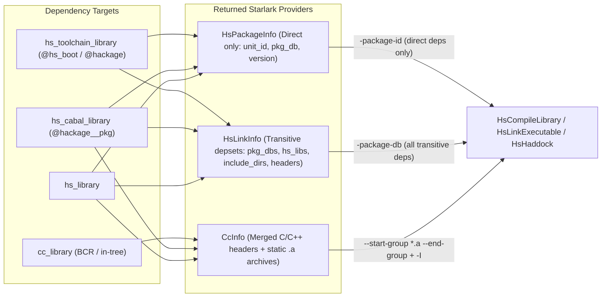
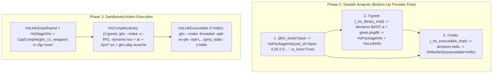

Every rule in `rules_haskell` separates **direct dependency identity** (which packages a target is allowed to `import`) from **transitive compile and link inputs** (every upstream interface summary, `.a` archive, and C header GHC needs). Following the pattern pioneered by Buck2's Haskell rules (`facebook/buck2/prelude/haskell`), this split enforces strict direct-dependency visibility at compile time while propagating transitive files in constant time via Bazel [`depset`](https://bazel.build/extending/depsets)s and `rules_cc`'s [`CcInfo`](https://bazel.build/rules/lib/providers/CcInfo).

This page walks through the [Starlark](https://bazel.build/rules/language) [providers](https://bazel.build/extending/rules#providers) and [Bazel actions](https://bazel.build/extending/rules#actions) behind [`hs_toolchain_library`](../reference/rules.md#hs_toolchain_library), [`hs_library`](../reference/rules.md#hs_library), [`hs_cabal_library`](../reference/rules.md#hs_cabal_library), [`hs_binary`](../reference/rules.md#hs_binary), [`hs_test`](../reference/rules.md#hs_test), [`hs_repl`](../reference/rules.md#hs_repl), and [`hs_haddock`](../reference/rules.md#hs_haddock). If you're looking for rule attributes and usage examples, see the [Rules reference](../reference/rules.md) and [Extensions and providers reference](../reference/extensions-and-providers.md). If Starlark providers, `depset`s, directory outputs ([`TreeArtifact`](https://bazel.build/reference/glossary#tree-artifact)s), or GHC output files are unfamiliar, read the [Bazel ruleset primer](bazel-rules-primer.md#providers-and-depsets) and [Haskell and GHC primer](haskell-and-ghc-primer.md#compilation-model) first.



---

## Why GHC produces `.hi` summaries, `.a` archives, and `dyn/*.so` libraries {#hi-vs-archives}

Before diving into Starlark provider fields, it helps to see **why** compiling one Haskell library produces three different artifact types—and why downstream targets consume each type at a different point in the build.

The third artifact supports **Template Haskell**, Haskell's compile-time code-generation system: a library can define ordinary Haskell functions that GHC executes *while compiling* a downstream module (written `$(...)`, called a *splice*) to build syntax trees or embed files at compile time.

| Output file kind | C++ / Rust equivalent | What's inside | When GHC uses it |
|---|---|---|---|
| **`.hi` interface summaries** (`<name>.pkgdb/hi/*.hi` + `<unit_id>.conf` + `package.cache`) | C++20 `.bmi` module interface or Rust `.rmeta` (Haskell has no hand-written `.h` headers) | Exported function and type signatures, typeclass instances, data constructors, strictness notes, and small intermediate-code bodies (*unfoldings*, used to inline functions across libraries). | **At compile time:** Whenever a downstream library or binary typechecks or optimizes code that imports—or indirectly references types from—this library. |
| **`libHS<unit_id>.a` static archive** (`*.o` object files packed by `ar rcs`) | `libfoo.a` static archive | Compiled native `x86_64` or `arm64` machine code and static data symbols for every module in the library, plus C wrapper stubs generated for `CApiFFI`. | **At executable link time:** When `HsLinkExecutable` (`hs_binary` or `hs_test`) links all transitive packages and GHC's C runtime (`libHSrts`) into an executable. |
| **`<name>.pkgdb/dyn/libHS*.so` shared library** *(on dynamic GHC toolchains)* | Rust procedural-macro `.so` / `.dylib` | Position-independent shared library (`.dyn_o` objects plus attached C FFI code) matching the running `ghc` compiler's dynamic runtime ABI. | **During compile-time Template Haskell only:** Loaded into `ghc` (or `ghc-iserv-dyn`) via `dlopen` when a downstream module runs a `$(...)` splice; ignored when linking final static executables. |

Because downstream builds need all three artifact types at different stages, `HsLinkInfo` carries both `pkg_dbs` (holding `.hi` summaries, `.conf` metadata, and isolated `dyn/*.so` libraries) and `hs_libs` (holding `libHS*.a` static archives).

---

## Provider architecture {#provider-architecture}

Five public providers (defined in `haskell/providers.bzl`) carry all build metadata between rules, alongside an internal `HsDocSourceInfo` provider (`haskell/private/actions.bzl`), Bazel's built-in [`DefaultInfo`](https://bazel.build/rules/lib/providers/DefaultInfo) and [`OutputGroupInfo`](https://bazel.build/rules/lib/providers/OutputGroupInfo), and `rules_cc`'s `CcInfo`.

### 1. `HsPackageInfo`: Direct package identity (8 fields)

[`HsPackageInfo`](../reference/extensions-and-providers.md#hspackageinfo) describes **one specific target** and never propagates transitively. When resolving a target's dependencies, `collect_deps` (`haskell/private/actions.bzl`) reads `HsPackageInfo` only from immediate `deps` and drops upstream records.

| Field | Type | Meaning and how each rule populates it |
|---|---|---|
| `name` | `string` | Human-readable package name: `"base"` or `"text"` on `hs_toolchain_library`, the target name with `_` replaced by `-` on `hs_library`, or the `.cabal` `package_name` on `hs_cabal_library` (used for `VERSION_<pkg>` macros in `cabal_macros.h`). |
| `version` | `string` | Package version string: parsed from GHC's boot `.conf` (`"4.20.2.0"`), `"0.0.0"` on `hs_library`, or the `.cabal` version (`"0.7.19"`) on `hs_cabal_library` (used in `MIN_VERSION_<pkg>(x,y,z)` macros). |
| `unit_id` | `string` or `None` | GHC's globally unique ID for this compiled library, passed to `-this-unit-id` when compiling the library and to `-package-id` when direct dependents compile against it. Set to `None` for C-only Cabal packages such as `zlib-clib`. |
| `pkg_db` | [`File`](https://bazel.build/rules/lib/builtins/File) or `None` | The `<name>.pkgdb` `TreeArtifact` containing `hi/`, `dyn/`, `<unit_id>.conf`, and `package.cache`. Set to `None` for boot libraries (already registered in GHC's global `lib/package.conf.d`) and C-only packages. |
| `exposed_modules` | `list[str]` | Dotted module names publicly exported by this package (plus any Cabal `reexported-modules`). Empty (`[]`) on `hs_library` during analysis because `hs_library` discovers module names from emitted `.hi` files during execution. |
| `is_boot` | `bool` | `True` only for GHC boot packages (`hs_toolchain_library`); `False` for user and Hackage libraries. Used by `hs_haddock` to hyperlink boot types to Hackage docs. |
| `hs_lib` | `File` or `None` | The compiled static archive `libHS<unit_id>.a` ([`declare_file`](https://bazel.build/rules/lib/builtins/actions#declare_file)), or `None` for boot and C-only packages. |
| `hi_dir` | `File` or `None` | Handle to the `<name>.pkgdb` directory containing `hi/*.hi`, or `None` for boot and C-only packages. |

#### How unique `unit_id` strings are constructed

GHC requires every library in a build to carry a unique `unit_id` containing only letters, digits, hyphens, dots, and underscores:

- **User `hs_library` targets:** `_sanitize_unit_id` (`haskell/private/rules.bzl`) takes the full [Bazel label](https://bazel.build/concepts/labels) `"{}//{}:{}".format(label.repo_name, label.package, label.name)` and applies a reversible one-to-one encoding (`_` -> `__`, `/` -> `_S`, `:` -> `_C`, `-` -> `_D`, `.` -> `_P`, `+` -> `_A`, `~` -> `_T`, `@` -> `_M`), prefixed with `"u_"` and suffixed with `"-0.0.0"`. For example, `//:greet` becomes `"u__S_S_Cgreet-0.0.0"`. Doubling `_` before encoding `/` as `_S` ensures two targets like `//foo_S:bar` and `//foo/:bar`—or two libraries named `types` in different packages—never collide.
- **Cabal `hs_cabal_library` targets:** `_cabal_unit_id` (`haskell/private/cabal_library.bzl`) uses `<package_name>-<version>` for main libraries (such as `http-client-0.7.19`) and `<package_name>-<version>-<component_name>` for internal sublibraries (such as `attoparsec-0.14.4-attoparsec-internal`).

### 2. `HsLinkInfo`: Transitive compilation and link closure (5 fields)

[`HsLinkInfo`](../reference/extensions-and-providers.md#hslinkinfo) aggregates files and include paths across all direct and indirect dependencies using `depset`s ([Providers and depsets](bazel-rules-primer.md#providers-and-depsets)):

- **`pkg_dbs` (`depset[File]`):** Every upstream `<name>.pkgdb` directory so GHC can read transitive `.hi`/`.dyn_hi` interface summaries, resolve upstream package keys, and (when `is_dynamic_ghc` is `True`) load `<name>.pkgdb/dyn/libHS*.so` during compile-time Template Haskell.
- **`hs_libs` (`depset[File]`):** Every upstream static archive (`libHS<unit_id>.a`), ensuring Bazel symlinks all required `.a` files into downstream compile and link [sandboxes](https://bazel.build/docs/sandboxing).
- **`include_dirs` (`depset[str]`):** Sandbox-relative C header search directories passed as `-I<dir>` to GHC (`CPP` and `CApiFFI`), `hsc2hs`, and `./configure`.
- **`headers` (`depset[File]`):** All upstream `.h` header files that Bazel mounts into the sandbox whenever a downstream step preprocesses or compiles C/FFI code.
- **`cc_info` (`CcInfo`):** Merged `rules_cc` `CcInfo` carrying transitive C/C++ header contexts, compiled `.a` static libraries, and linker flags (`-lm`, `-lstdc++`, `-lpthread`).

### 3. `HsToolchainInfo`: Resolved GHC toolchain and companion tools (22 fields)

[`HsToolchainInfo`](../reference/extensions-and-providers.md#hstoolchaininfo) is assembled in two steps: `staged_ghc` (`haskell/private/staged_ghc.bzl`, built in [`cfg = "exec"`](https://bazel.build/extending/toolchains#toolchains-and-configurations)) stages the compiler tree and static GMP archive, and [`hs_toolchain`](../reference/rules.md#hs_toolchain) (`haskell/toolchain.bzl`) attaches `ghc_cc_wrapper` and parsed boot library metadata before wrapping the record in [`platform_common.ToolchainInfo(hs = ...)`](https://bazel.build/rules/lib/providers/ToolchainInfo).

Its 22 fields fall into four groups:

| Group | Fields | Role |
|---|---|---|
| **Compiler and tool executables** | `ghc`, `ghc_pkg`, `hsc2hs`, `haddock`, `runghc`, `ghc_iserv`, `cc_wrapper` | `File` handles for `$ORIGIN`-staged `ghc`, `ghc-pkg`, `hsc2hs`, `haddock`, `runghc`, and optional `ghc-iserv-dyn`, plus the C11 `ghc_cc_wrapper` adapter bridging GHC to Bazel's C/C++ toolchain. |
| **Staged GHC files and C runtime headers** | `libdir`, `template_hsc_h`, `rts_include_dir`, `rts_headers`, `all_files` | `libdir` is the dereferenced staged `lib/` directory (holding `settings`, `package.conf.d/`, `html/`, `libgmp.so.10`, and `libtinfo.so.6`); `template_hsc_h` is the template header for `hsc2hs`; `rts_include_dir` and `rts_headers` expose `HsFFI.h` and `Rts.h`; `all_files` is the `depset` of all toolchain files mounted into build and REPL sandboxes. |
| **Static GMP and boot metadata** | `gmp_static_dir`, `gmp_static_lib`, `boot_packages`, `boot_haddocks`, `bignum` | `gmp_static_dir` and `gmp_static_lib` point to `staged_ghc/gmp_static/libgmp.a` (alongside `libtinfo.a`, with no `.so` files in that directory); `boot_packages` maps GHC's 41 boot package names (`"base"`, `"text"`, ...) to parsed `id`, `version`, `depends`, and `exposed_modules`; `boot_haddocks` maps boot names to bundled `.haddock` interfaces; `bignum` records `"gmp"` or `"native"`. |
| **Platform and compiler properties** | `version`, `is_dynamic_ghc`, `target_os`, `target_cpu`, `arch_libdir` | GHC version (`"9.10.3"`), whether the `ghc` binary is dynamically linked (`True` on Linux `deb10`, enabling `-dynamic-too`), normalized OS/CPU strings (`"linux"`, `"x86_64"` / `"arm64"`), and GHC's internal library subfolder (`"x86_64-linux-ghc-9.10.3"`). |

> **Tip:** `@hs_boot` targets stay platform-independent because `hs_toolchain_library` (`haskell/private/rules.bzl`) reads `hs_tc.boot_packages[pkg_name]` during [Phase 2 analysis](https://bazel.build/extending/concepts#evaluation-model) from whichever platform's `HsToolchainInfo` Bazel selected. `hs_boot_repo` (`haskell/private/ghc_bindist.bzl`) emits plain `hs_toolchain_library(name = "<pkg>", package_name = "<pkg>")` targets that work identically on `linux_x86_64`, `linux_arm64`, and future target platforms.

### 4. `HsHaddockInfo`, `HsReplInfo`, and internal `HsDocSourceInfo`

Three specialized providers support API documentation and interactive REPL sessions without duplicating target configuration in [`BUILD.bazel`](https://bazel.build/concepts/build-files):

- **[`HsHaddockInfo`](../reference/extensions-and-providers.md#hshaddockinfo) (4 fields, returned by `hs_haddock`):** Carries `html_dir` (the `<name>/` `TreeArtifact` containing `index.html`, `<Module>.html`, `linuwial.css`, QuickJump `doc-index.json`, and `src/<Module>.html`), `interface` (the `<name>.haddock` binary cross-reference file, also exposed on `OutputGroupInfo.haddock_interface`), `unit_ids` (`depset[str]` of documented unit IDs), and `transitive_haddocks` (`depset[struct(html_dir, interface)]` for cross-package hyperlinking).
- **[`HsReplInfo`](../reference/extensions-and-providers.md#hsreplinfo) (4 fields, returned by `hs_repl`):** Carries `executable` (the bash launcher running staged `ghc` in `--interactive` or `-e` mode), `ghci_script` (the static `<name>.ghci` file built from `ghci_commands`), `interpreted_srcs` (`depset[File]` of sources loaded into GHCi bytecode), and `package_ids` (`depset[str]` of direct compiled packages exposed with `-package-id`).
- **Internal `HsDocSourceInfo` (`haskell/private/actions.bzl`):** Returned by `hs_library`, `hs_cabal_library`, `hs_binary`, and `hs_test` so `hs_haddock(deps = [":my_lib"])` and `hs_repl(deps = [":my_lib_or_bin"])` automatically receive `.hs`/`.lhs`/`.hs-boot` sources (including generated `hsc2hs`, `Paths_*`, `alex`, and `happy` files), `cabal_macros.h`, `-i` and `-I` paths, language extensions, `hidden_modules`, sanitized compiler flags, and direct dependency unit IDs.

### 5. `CcInfo` forwarding

You can link existing C or C++ [`cc_library`](https://bazel.build/reference/be/c-cpp#cc_library) targets into any `hs_library` or `hs_cabal_library` via `deps`, `cc_deps`, or `extra_cc_deps`, without repeating `include_dirs` or `cc_deps` on downstream binaries.

Both rules return a merged `CcInfo` alongside `HsPackageInfo` and `HsLinkInfo`. Inside `collect_deps` (`haskell/private/actions.bzl`), [`cc_common.merge_cc_infos`](https://bazel.build/rules/lib/toplevel/cc_common) merges all upstream `CcInfo` providers and copies their include directories and headers into `dep_info.include_dirs` and `dep_info.headers`. Any `cc_library`—such as [BCR](https://bazel.build/external/registry#bazel-central-registry) `@zlib//:zlib` or `//tests/rules/ffi:vec_cc`—automatically exposes its `.h` files to GHC `CApiFFI`, `CPP`, `hsc2hs`, and Cabal `./configure`.

---

## End-to-end trace: Building an `hs_binary` {#end-to-end-trace}

To see how providers, configurations, and sandboxed commands fit together on a real build, trace what happens when you run [`bazel build //:hello`](https://bazel.build/run/build) on this two-target project:

```starlark
# BUILD.bazel
load("@rules_haskell//haskell:defs.bzl", "hs_binary", "hs_library")

hs_library(
    name = "greet",
    srcs = ["src/Greet.hs"],
    hs_source_dirs = ["src"],
    deps = ["@hs_boot//:base"],
)

hs_binary(
    name = "hello",
    srcs = ["app/Main.hs"],
    hs_source_dirs = ["app"],
    deps = [
        ":greet",
        "@hs_boot//:base",
    ],
)
```



### Step-by-step walkthrough

1. **Loading and toolchain selection (Phase 1):** Bazel reads [`MODULE.bazel`](https://bazel.build/external/module) and runs the `hs` [module extension](https://bazel.build/external/extension) (`haskell/extensions.bzl`), declaring `@hs_boot`, `@hs_toolchains`, and `@ghc_9_10_3_linux_x86_64`. On `x86_64` Linux, [toolchain resolution](https://bazel.build/extending/toolchains) selects `@hs_toolchains//:ghc_linux_x86_64` -> `@ghc_9_10_3_linux_x86_64//:toolchain_impl` (leaving `@ghc_9_10_3_linux_arm64` un-downloaded). Because `staged_ghc` and `cc_wrapper` set `cfg = "exec"`, Bazel plans them in the build-tool configuration (`k8-opt-exec`).
2. **Analyzing `@hs_boot//:base` (`_hs_toolchain_library_impl`):** Looks up `"base"` in `HsToolchainInfo.boot_packages` (parsed in Starlark from `lib/package.conf.d/base-4.20.2.0-*.conf`). Because boot libraries ship pre-compiled inside GHC's `lib/` directory, this step registers **zero build actions** and returns `HsPackageInfo(name = "base", version = "4.20.2.0", unit_id = "base-4.20.2.0-...", is_boot = True, pkg_db = None, hs_lib = None)` alongside an empty `HsLinkInfo`.
3. **Analyzing `//:greet` (`_hs_library_impl`):** Computes `unit_id = "u__S_S_Cgreet-0.0.0"` and declares two sibling outputs under `bazel-out/k8-fastbuild/bin/`: `libHSu__S_S_Cgreet-0.0.0.a` and the `greet.pkgdb` directory. It registers one `HsCompileLibrary` action whose input `depset` contains `src/Greet.hs`, `hs_tc.all_files`, and `cc_tools.all_files`, passing `-hide-all-packages -package-id base-4.20.2.0-...`, and returns `HsPackageInfo` and `HsLinkInfo` pointing at both outputs.
4. **Analyzing `//:hello` (`_hs_executable_impl`):** Reads `:greet` and `@hs_boot//:base` into `direct_pkgs` (both get `-package-id`) while pulling `greet.pkgdb` and `libHSu__S_S_Cgreet-0.0.0.a` into transitive link inputs. It declares `hello`, registers `HsLinkExecutable` with `-package-db`, `-package-id`, `-threaded`, `-optl-no-pie`, and `-optl-L.../staged_ghc/gmp_static`, and returns `DefaultInfo(executable = out_exe, files = depset([out_exe]))`.
5. **Executing `HsCompileLibrary` (`//:greet`) inside `linux-sandbox`:** Once `ghc_cc_wrapper` and `staged_ghc` finish in `cfg = "exec"`, Bazel runs `HsCompileLibrary` in an isolated sandbox [`execroot`](https://bazel.build/remote/output-directories):
   1. `ghc --make -c -fPIC -dynamic-too` compiles `src/Greet.hs`, writing temporary `Greet.o` and `Greet.dyn_o` to `$WORK_ROOT/objs/` and writing `Greet.hi` and `Greet.dyn_hi` into `greet.pkgdb/hi/`.
   2. `ar rcs` packs `Greet.o` into `libHSu__S_S_Cgreet-0.0.0.a`.
   3. `ghc -shared -dynamic` links `Greet.dyn_o` into `greet.pkgdb/dyn/libHSu__S_S_Cgreet-0.0.0-ghc9.10.3.so`.
   4. The action scans `Greet.hi` to compute `exposed-modules: Greet`, writes `${pkgroot}`-relative `greet.pkgdb/u__S_S_Cgreet-0.0.0.conf`, and runs `ghc-pkg recache` to generate `greet.pkgdb/package.cache`.
6. **Executing `HsLinkExecutable` (`//:hello`) inside `linux-sandbox`:** Bazel symlinks `app/Main.hs`, `greet.pkgdb/`, `libHSu__S_S_Cgreet-0.0.0.a`, `staged_ghc/`, and `ghc_cc_wrapper` into a fresh sandbox. `ghc --make` reads `greet.pkgdb/hi/Greet.hi` to typecheck `import Greet`, compiles `Main.o` into `$WORK_ROOT/objs/`, and invokes `ghc_cc_wrapper` -> [`cc_toolchain`](https://bazel.build/reference/be/c-cpp#cc_toolchain) to link `Main.o`, `libHSu__S_S_Cgreet-0.0.0.a`, boot `libHSbase*.a`, `libHSrts-1.0.2_thr.a`, and `gmp_static/libgmp.a` into the final ELF executable `hello`.

### Resulting on-disk layout inside `bazel-out/`

```text
bazel-out/
├── k8-opt-exec-ST-.../bin/                                  # Exec configuration (build tools)
│   ├── external/rules_haskell+/haskell/private/ghc_cc_wrapper         # Compiled C11 compiler/linker adapter
│   └── external/rules_haskell++hs+ghc_9_10_3_linux_x86_64/
│       └── staged_ghc/
│           ├── bin/{ghc-9.10.3, ghc-pkg-9.10.3, hsc2hs-ghc-9.10.3, haddock-ghc-9.10.3, ...}
│           ├── lib/{settings, package.conf.d/..., x86_64-linux-ghc-9.10.3/libgmp.so.10, ...}
│           └── gmp_static/{libgmp.a, libtinfo.a}            # Static-only dir (contains zero .so files)
└── k8-fastbuild/bin/                                        # Target configuration (your code)
    ├── libHSu__S_S_Cgreet-0.0.0.a                           # Static archive (${pkgroot}/libHS*.a)
    ├── greet.pkgdb/                                         # Sibling directory (${pkgroot}/greet.pkgdb)
    │   ├── hi/{Greet.hi, Greet.dyn_hi}                      # Module summaries for typechecking
    │   ├── dyn/libHSu__S_S_Cgreet-0.0.0-ghc9.10.3.so        # Shared lib used only for Template Haskell
    │   ├── u__S_S_Cgreet-0.0.0.conf                         # ${pkgroot}-relative package metadata
    │   └── package.cache                                    # Binary lookup cache written by ghc-pkg
    └── hello                                                # ELF executable linking only base glibc
```

---

## Strict direct-dependency visibility {#strict-visibility}

Why pass **both** transitive `-package-db` flags and direct-only `-package-id` flags instead of passing `-package-db` only for direct dependencies?

Consider a three-library chain `lib_c -> lib_b -> lib_a`:

- `lib_a` defines `data UserId = UserId Int`.
- `lib_b` depends on `lib_a` and exports `lookupUser :: UserId -> String`.
- `lib_c` depends **only on `lib_b`** (`deps = [":lib_b", "@hs_boot//:base"]`) and calls `lookupUser`.

When GHC compiles `LibC.hs`, two competing requirements apply at the same time:

1. **GHC must read `LibA.hi` internally:** To typecheck `lookupUser` and optimize how `UserId` values pass in registers, GHC looks up `UserId` inside `lib_a.pkgdb/hi/LibA.hi`. Omitting `lib_a.pkgdb` from `-package-db` fails compilation because GHC can't locate `lib_a`'s interface file.
2. **`LibC.hs` must not be allowed to write `import LibA`:** If `LibC.hs` imports `LibA` without declaring `:lib_a` in `lib_c`'s `deps`, refactoring `lib_b` later to drop `:lib_a` would silently break `lib_c`—violating Bazel's strict-deps invariant.

`compile_hs_library_action` (`haskell/private/actions.bzl`) and `_hs_executable_impl` (`haskell/private/rules.bzl`) satisfy both requirements using three GHC flags together:

1. **`-hide-all-packages`:** Hides every package in GHC's global boot `package.conf.d` and every custom `-package-db` from `import` statements by default. Even `Prelude` (`base`) stays hidden unless `@hs_boot//:base` or `@hackage//:base` is in direct `deps`.
2. **`-package-db <db.path>` for every `db` in `dep_info.pkg_dbs` (transitive):** Loads the full upstream package graph into GHC's internal symbol table so GHC can resolve indirect types, typeclass instances, and unfoldings across `LibB -> LibA`.
3. **`-package-id <pkg.unit_id>` only for `pkg` in `dep_info.direct_pkgs` (direct):** Exposes only direct `deps` to `import` statements (skipping C-only packages whose `unit_id` is `None`).

If `LibC.hs` tries `import LibA` while `:lib_a` is only a transitive dependency through `:lib_b`, GHC fails with a clear diagnostic:

```text
Could not load module 'LibA'
It is a member of the hidden package 'u__S_Stests_Sbasic_Clib__a-0.0.0'.
```

`//tests/starlark:strict_direct_dep_visibility_test` and `//tests/starlark:hs_binary_threaded_true_test` (`tests/starlark/rules_analysis_test.bzl`) verify these flags during Phase 2 analysis.

---

## Relocatable `${pkgroot}` package databases {#relocatable-pkgdb}

Bazel executes every build command inside a sandbox or remote-worker directory whose absolute path changes across machines (`/.../execroot/_main/...`). If a GHC `.conf` file embedded an absolute path like `/tmp/sandbox-17/execroot/_main/bazel-out/...`, any downstream action running in `/tmp/sandbox-99/...`—or downloading a [remote cache](https://bazel.build/remote/caching) hit—would look for `/tmp/sandbox-17/...` and fail.

To keep package databases relocatable across sandboxes and machines, **`ghc-pkg`** (GHC's package database registration tool) supports a special placeholder variable called **`${pkgroot}`**, which expands dynamically at read time relative to the package database's location on disk.

### Concrete layout and how `ghc-pkg` expands `${pkgroot}`

Every compiled library declares two sibling outputs in the **same** Bazel output directory—for example, `bazel-out/k8-fastbuild/bin/net/` (`compile_hs_library_action` in `haskell/private/actions.bzl`):

- `hs_lib = ctx.actions.declare_file("libHShttp-client-0.7.19.a")` -> `bazel-out/k8-fastbuild/bin/net/libHShttp-client-0.7.19.a`
- `pkg_db = ctx.actions.declare_directory("http-client.pkgdb")` -> `bazel-out/k8-fastbuild/bin/net/http-client.pkgdb/`

In `ghc-pkg`'s specification, for a database at `<parent>/http-client.pkgdb`, **`${pkgroot}` expands to `<parent>`** (`bazel-out/k8-fastbuild/bin/net`)—the parent directory *containing* `http-client.pkgdb`, **not** `http-client.pkgdb` itself.

During `HsCompileLibrary`, the action writes `http-client.pkgdb/http-client-0.7.19.conf`:

```text
name: http-client
version: 0.7.19
id: http-client-0.7.19
key: http-client-0.7.19
exposed: True
import-dirs: ${pkgroot}/http-client.pkgdb/hi
library-dirs: ${pkgroot}
library-dirs-static: ${pkgroot}
dynamic-library-dirs: ${pkgroot}/http-client.pkgdb/dyn
hs-libraries: HShttp-client-0.7.19
exposed-modules: Network.HTTP.Client ...
hidden-modules: Network.HTTP.Client.Internal ...
depends: base-4.20.2.0-... bytestring-0.12.2.0-...
```

Then `ghc-pkg recache` compiles that text metadata into a binary index (`http-client.pkgdb/package.cache`):

```bash
"$GHC_PKG" --global-package-db="$GHC_LIB/package.conf.d" --package-db="$PKG_DB" recache
```

Once `${pkgroot}` expands to `bazel-out/k8-fastbuild/bin/net`, each path field resolves cleanly without touching absolute paths:

- **`library-dirs: ${pkgroot}` and `library-dirs-static: ${pkgroot}`:** Point to `bazel-out/k8-fastbuild/bin/net/`, where `libHShttp-client-0.7.19.a` (`hs-libraries: HShttp-client-0.7.19`) sits beside `http-client.pkgdb/`. Keeping the `.a` archive as a sibling avoids Bazel's restriction against declaring a standalone `File` inside a `TreeArtifact` directory.
- **`import-dirs: ${pkgroot}/http-client.pkgdb/hi`:** Points to `http-client.pkgdb/hi/`, where GHC wrote `.hi` and `.dyn_hi` interface summaries (`-hidir`).
- **`dynamic-library-dirs: ${pkgroot}/http-client.pkgdb/dyn`:** Points to `http-client.pkgdb/dyn/`, where `libHShttp-client-0.7.19-ghc9.10.3.so` lives. Nesting `.so` files inside `dyn/` propagates them automatically inside `HsLinkInfo.pkg_dbs` while keeping `${pkgroot}` free of `.so` files so static binary links never pick up `libHS*.so`.

### Automatic `exposed-modules` discovery vs. explicit Cabal lists and re-exports

- **Explicit lists on `hs_cabal_library`:** `.cabal` files declare `exposed-modules`, `other-modules` (hidden outside the library), and optional `reexported-modules` (`[orig-pkg:]Orig.Mod [as New.Mod]`). `_resolve_reexported_for_conf` (`haskell/private/actions.bzl`) resolves re-exports against `direct_pkgs` into `ghc-pkg`'s `New.Mod from <origin_unit_id>:Orig.Mod` syntax under `exposed-modules:` and writes `other_modules` to `hidden-modules:`.
- **Automatic discovery on `hs_library`:** You don't need to maintain module lists by hand in `BUILD.bazel`. When `EXPLICIT_EXPOSED` is empty, `HsCompileLibrary` scans `$HI_DIR/*.hi` in sorted order, converts relative paths to dotted module names (`Math/Core.hi` -> `Math.Core`), moves entries in `hidden_modules` to `hidden-modules:`, and exports the rest.

---

## Library compilation and archiving details {#library-compilation}

### Why one `ghc --make -c` action per library?

Haskell build rules face a fundamental granularity trade-off: spawn one `ghc -c Foo.hs` action per `.hs` file, or run one `ghc --make -c` action per library target (`HsCompileLibrary`). `rules_haskell` uses **one `ghc --make -c` action per library or sublibrary** for three practical reasons:

1. **Built-in `.hs-boot` mutual recursion:** Hackage packages such as `cborg` and `tls` (and user libraries like `//tests/basic:boot_cycle_lib`) contain mutually recursive modules (`A` imports `B` and `B` imports `A`, broken by an `A.hs-boot` file; see [Haskell build mechanisms](haskell-and-ghc-primer.md#build-mechanisms)). Per-module Bazel actions would form a cycle in the action graph unless you annotated boot edges manually; `ghc --make -c` compiles `.hs-boot` cycles automatically.
2. **Automatic `CApiFFI` C wrapper compilation:** For modules using `{-# LANGUAGE CApiFFI #-}`, GHC generates temporary C wrapper files (`-stubdir "$ODIR"`), compiles them through `-pgmc` (`ghc_cc_wrapper`), and places the resulting `.o` objects into `$ODIR` during `--make`.
3. **Lower GHC startup overhead:** Starting GHC and reading boot/upstream `.hi` summaries costs roughly 150–300 ms per process. On a 100-module library like `crypton` or `pandoc`, one `ghc --make -c` loads those `.hi` files once instead of 100 times.

The trade-off is coarser intra-library caching: editing one `.hs` file inside a large `hs_library` recompiles that whole target rather than a single module. In practice, splitting application code into focused `hs_library` targets lets Bazel parallelize compilation across the dependency graph while avoiding per-module startup overhead.

### Module names vs. source file paths (`use_module_names`)

`compile_hs_library_action` passes compilation targets to `ghc --make -c` in one of two modes:

- **Module names on `hs_cabal_library`:** When `exposed_modules` or `other_modules` are provided, the action clears GHC's default current-directory search path with bare `-i`, adds explicit `-i<dir>` paths (including generated `Paths_*` and `hsc2hs` directories), and passes **dotted module names** (`Network.Socket`, etc.). GHC compiles only the modules active on the target platform and ignores unused OS-specific `.hs` files in the tarball.
- **File paths on `hs_library`:** When module lists aren't specified, the action passes **source file paths** directly, excluding `.hs-boot` and `.lhs-boot` from positional arguments because GHC discovers boot files automatically along `-i<dir>`.

### Deterministic `@objects.rsp` static archiving

After `ghc --make -c` writes `.o` objects (including `CApiFFI` stubs) into temporary `$ODIR`, `HsCompileLibrary` writes their sorted paths to a **response file** (`@objects.rsp`—an argument file read by `ar`, avoiding Linux `ARG_MAX` command-line limits on large packages):

```bash
OBJ_LIST="$WORK_ROOT/objects.rsp"
find "$ODIR" -name '*.o' | sort > "$OBJ_LIST"
if [ -s "$OBJ_LIST" ]; then
    "$AR" rcs "$HS_LIB" "@$OBJ_LIST"
else
    "$AR" rcs "$HS_LIB"
fi
```

Sorting with `sort` keeps archive member order identical across filesystems, and the `else` branch writes a valid empty `.a` archive for pure `reexported-modules` wrapper packages (such as `crypton-asn1-encoding` when every module is re-exported).

### Explicit `-X<default_language>` defaults (`GHC2021` vs. `Haskell98`)

- **User rules default to `"GHC2021"`:** Even though GHC `9.10` and `9.12` support `"GHC2024"`, upstream GHC itself still defaults to **`GHC2021`** because `GHC2024` turns on `MonoLocalBinds`, which changes type inference for local `let`/`where` bindings and rejects polymorphic local helpers valid in `Haskell2010` and `GHC2021`. `hs_library`, `hs_binary`, and `hs_test` match GHC's default (`"GHC2021"`), and you can override `default_language` to `"GHC2024"`, `"Haskell2010"`, or `"Haskell98"` on any target (tested by `//tests/rules/lang:lang_test`).
- **`hs_cabal_library` defaults to `"Haskell98"`:** Under the `.cabal` specification, older Hackage packages that omit `default-language:` expect `Haskell98` and can fail under `GHC2021`. Every compile command passes `-X<default_language>` explicitly (tested by `//tests/starlark:hs_cabal_library_h98_test` and `//tests/starlark:hs_cabal_library_h2010_test`).

---

## Executable linking and linker flags explained {#executable-linking}

Both `hs_binary` (`executable = True`) and `hs_test` (`test = True`) share `_hs_executable_impl` (`haskell/private/rules.bzl`), which compiles any target-local `c_sources` via `compile_c_sources`, collects deduplicated static `.a` archives and `user_link_flags` via `extract_cc_static_libs_and_flags` (`haskell/private/actions.bzl`, appending `//haskell/private:rt_shims` whenever C archives are present), and runs a single `HsLinkExecutable` action.

`HsLinkExecutable` invokes staged `ghc --make` with `-outputdir "$WORKDIR"` (cleaning temporary `Main.o` and `Main.hi` on exit), `-threaded` (enabled by default for GHC's multi-core green-thread runtime), `-main-is <main_module>`, `-optl-no-pie`, `-optl-L<gmp_static_dir>`, and a `--start-group ... --end-group` block of C `.a` archives.

In GHC, **`-optl<flag>`** forwards `<flag>` to the C compiler driver during linking, and **`-Wl,<arg>`** forwards `<arg>` through the C driver to the ELF linker (`ld` or `lld`). Each linker flag solves a concrete issue:

### 1. Why `-optl-no-pie` is passed

Modern Linux C toolchains (`clang`/`lld`, `zig cc`, and recent `gcc`) default to Position-Independent Executables (PIE), which require every `.o` member inside every static `.a` archive to be compiled with `-fPIC`.

While `rules_haskell` compiles all user and Hackage libraries with `-fPIC`, upstream GHC Linux bindists compile their static boot archives (`libHSbase-*.a`, `libHSghc-prim-*.a`, `libHSrts-*.a`) **without `-fPIC`**, emitting fixed 32-bit relocations (`R_X86_64_32` / `R_X86_64_32S`). Strict linkers like LLVM `lld` reject non-PIC `.a` inputs in PIE mode (`relocation R_X86_64_32S cannot be used against local symbol; recompile with -fPIC`). Passing **`-optl-no-pie`** emits a fixed-address Linux ELF executable so upstream GHC boot archives link across GNU `ld`, LLVM `lld`, and `zig cc`.

### 2. Why `-optl-L<gmp_static_dir>` guarantees static GMP

GHC's `ghc-bignum` boot `.conf` causes GHC to pass `-lgmp` when linking executables. When a Unix linker encounters `-lgmp`, it scans each `-L` directory in order, preferring dynamic `libgmp.so` over static `libgmp.a` whenever both exist in the same directory.

Because `staged_ghc` isolates `libgmp.a` (and `libtinfo.a`) inside `<prefix>/gmp_static/` with **zero `.so` files**, passing `-optl-L<prefix>/gmp_static` ahead of other search paths guarantees static GMP linking with no runtime `libgmp.so.10` dependency.

### 3. Why `--start-group ... --end-group` and `rt_shims` come after `-lHS*`

Traditional Unix/GNU `ld` (and LLVM/Zig linkers in GNU archive mode) scans static `.a` archives in a **single left-to-right pass**:

- **Haskell archives first, C archives second:** When the linker visits `libfoo.a`, it extracts only `.o` files that satisfy symbols *already marked unresolved* to its left, ignoring the rest of `libfoo.a`. GHC emits `-lHS<unit_id>` flags before `-optl` arguments, so placing C `.a` archives in `-optl` flags ensures every C FFI symbol called by Haskell (such as `inflateInit2_` called from `libHSzlib.a` and defined in `libzlib_clib_c.a`) is already unresolved when the linker reaches the C archives.
- **Circular or arbitrary C archive order:** Multiple C `.a` archives collected from a `CcInfo` graph can reference each other in an order that doesn't match dependency order. Wrapping them in **`-optl-Wl,--start-group <libA.a> <libB.a> ... -optl-Wl,--end-group`** tells the linker to rescan that group repeatedly until a pass pulls in no new object files.
- **`__cpu_model` fallback under `zig cc`:** C code using `__builtin_cpu_supports("avx2")` on `x86_64` references a compiler-runtime `__cpu_model` struct that `zig cc` omits in static mode. Appending `//haskell/private:rt_shims` (`haskell/private/rt_shims.c`) supplies a weak hidden fallback that satisfies `zig cc` while yielding automatically to GCC or LLVM's strong definition.

---

## Data dependencies and runfiles propagation {#runfiles}

Every rule merges runtime `data` files across `deps`, `cc_deps` / `extra_cc_deps`, and `data` into Bazel [runfiles](https://bazel.build/extending/rules#runfiles):

```starlark
runfiles = ctx.runfiles(files = ctx.files.data).merge_all([
    dep[DefaultInfo].default_runfiles
    for dep in ctx.attr.deps + ctx.attr.cc_deps + ctx.attr.data
])
```

Runfiles intentionally behave differently during builds versus test/binary execution:

- **Cleared during compile and link actions:** `HsConfigure`, `HsHsc2hs`, `HsCompileLibrary`, `HsLinkExecutable`, `HsHaddock`, and `ghc_cc_wrapper` explicitly run `unset RUNFILES_DIR RUNFILES_MANIFEST_FILE RUNFILES_MANIFEST_ONLY` so compiler tools never confuse Bazel's tool-execution runfiles with build inputs.
- **Populated during [`bazel test`](https://bazel.build/docs/user-manual#running-tests) and [`bazel run`](https://bazel.build/docs/user-manual#running-executables):** [`.bazelrc`](https://bazel.build/run/bazelrc) enables [`common --enable_runfiles`](https://bazel.build/reference/command-line-reference#param-no-enable-runfiles) alongside [`common --incompatible_strict_action_env`](https://bazel.build/reference/command-line-reference#param-no-incompatible-strict-action-env). Bazel materializes `<executable>.runfiles/<workspace>/...` next to the binary and exports `RUNFILES_DIR` (plus [`TEST_SRCDIR`](https://bazel.build/reference/test-encyclopedia#initial-conditions) and `TEST_WORKSPACE` under `bazel test`). Binaries and tests locate direct and transitive `data` files via `RUNFILES_DIR` -> `TEST_SRCDIR` -> `<executable_path>.runfiles` (verified across 2-hop library dependencies in `//tests/rules/runfiles:runfiles_test`).

---

## Template Haskell: Why compile time needs `dyn/*.so` while binaries link `.a` statically {#template-haskell}

[Template Haskell (TH)](haskell-and-ghc-primer.md#template-haskell) spans three compile-time patterns in GHC, each with different linking needs.

### 1. `TemplateHaskellQuotes` (building syntax trees without running code)

Modules enabling `{-# LANGUAGE TemplateHaskellQuotes #-}` (`'fn`, `''Type`, `[| expr |]`) build syntax-tree values (`Language.Haskell.TH.Syntax.Q Exp`) as ordinary compiled Haskell code using `@hs_boot//:template-haskell` (or `@hackage//:template-haskell`). GHC runs no compile-time code and loads no `.so` libraries.

### 2. Boot-package and same-library splices

When a module enables `{-# LANGUAGE TemplateHaskell #-}` and runs `$(...)` splices defined in GHC boot packages or another module in the **same** `hs_library` or `hs_cabal_library` (`//tests/rules/th:th_test`):

- Official GHC `9.10.3` `deb10` archives ship with `GHC Dynamic = YES` (`staged_ghc` stages `ghc-iserv-dyn-ghc-9.10.3` alongside `lib/<arch_libdir>/libHS*.so`, `libgmp.so.10`, `libtinfo.so.6`, and `libffi.so.8`).
- During `ghc --make -c`, GHC compiles helper modules in that library to `.dyn_o` objects (symlinked to `.o` by `ghc_cc_wrapper` when invoked by GHC's internal linker) and loads boot `.so` libraries via `$ORIGIN`.

### 3. Cross-library Template Haskell splices (`-dynamic-too`) and shared-library flags

Packages such as `file-embed`, `aeson`, `skylighting`, and `pandoc` (used to build `//docs`) define TH helpers in library `A` and execute `$(embedFile ...)` or `$(deriveJSON ...)` while compiling downstream library `B`.

If `libHSA.a` already holds library `A`'s compiled code, why also link `A.pkgdb/dyn/libHSA-ghc9.10.3.so`?

- **Compile-time TH needs `.so`:** On Linux, `ghc-9.10.3` (and `ghc-iserv-dyn`) is a dynamically linked ELF process running on GHC's dynamic runtime (`libHSrts-1.0.2-ghc9.10.3.so`). To execute library `A`'s code inside that running process, GHC calls `dlopen`, which can map only position-independent `.so` libraries built against the dynamic runtime ABI—not static `ar` archives (`libHS*.a`).
- **Final binaries ignore `.so` and link `.a`:** When `HsLinkExecutable` links an `hs_binary` or `hs_test` (without `-dynamic`), GHC runs in static package mode, reading `library-dirs-static: ${pkgroot}` (`libHS*.a`) and `gmp_static/libgmp.a` while ignoring `dynamic-library-dirs`.

Whenever `HsToolchainInfo.is_dynamic_ghc` is `True`, `HsCompileLibrary` (`haskell/private/actions.bzl`) enables cross-library Template Haskell in four steps (verified by `//tests/rules/th:cross_lib_th_test` and `//tests/rules/th:cross_lib_th_elf_test`):

1. **Single-pass static and dynamic objects (`-dynamic-too`):** Passing `-fPIC -dynamic-too` tells `ghc --make -c` to emit both `.o`/`.hi` and `.dyn_o`/`.dyn_hi` files in one pass rather than invoking GHC twice.
2. **Linking `<name>.pkgdb/dyn/libHS<unit_id>-ghc<ver>.so`:** `HsCompileLibrary` runs `ghc -shared -dynamic -fPIC -no-auto-link-packages` on the `.dyn_o` files with two critical linker flags:
   - **`-optl-Wl,-Bsymbolic`:** By default, Linux ELF shared libraries route internal calls through a global symbol table so an earlier-loaded library in the same process can interpose them. Because `libHSA.so` loads via `dlopen` *inside the running `ghc` process* (which already has dozens of its own GHC and C libraries loaded), global lookup risks binding `libHSA.so`'s internal calls to a mismatched version inside `ghc`. `-Wl,-Bsymbolic` binds references within `libHSA.so` directly to `libHSA.so`'s own definitions at link time, matching GHC's own package `.so` convention.
   - **`-optl-Wl,--whole-archive <cc_archives> -optl-Wl,--no-whole-archive`:** When library `A` compiles C code (`c_sources` or `cc_deps`), a normal archive scan might drop a C `.o` member if `A`'s Haskell wrapper was inlined into downstream callers—causing `dlopen` to fail with `undefined symbol` during a downstream TH splice. `--whole-archive` forces every C `.o` member into `libHSA.so`, while `//haskell/private:rt_shims` stays outside `--whole-archive` so weak `__cpu_model` shims link only when needed.
3. **Staging compile-time `data` files in `pkg_cwd` for `file-embed`:** Hackage packages calling `$(embedFile "data/table.bin")` expect paths relative to that package's root rather than Bazel's `execroot` (`external/rules_haskell++hackage+.../data/table.bin`). When `data` is non-empty on an external package, `HsCompileLibrary` builds a temporary `$WORK_ROOT/pkg_cwd` directory containing symlinks to both top-level `execroot` entries (`bazel-out/`, `external/`) and the package's files, then runs `ghc` from `pkg_cwd` so both Bazel paths and package-relative `embedFile` paths resolve inside `linux-sandbox`.
4. **Static isolation for final executables:** Because `<name>.pkgdb/dyn/` is separate from `${pkgroot}`, `HsLinkExecutable` links only static `libHS<unit_id>.a` and `gmp_static/libgmp.a`. Compiled binaries (`//docs:docs_gen` and `//tests/rules/th:cross_lib_th_elf_test`) contain no `libHS*.so` or `libgmp.so.10` entries in `DT_NEEDED`.

---

## Hermetic Haddock API generation (`hs_haddock`) {#haddock-actions}

[`hs_haddock`](../reference/rules.md#hs_haddock) (`haskell/private/haddock.bzl`, [action mnemonic](https://bazel.build/reference/glossary#mnemonic) `HsHaddock`) runs GHC's bundled `bin/haddock-ghc-<ver>` binary (`HsToolchainInfo.haddock`; see [Haddock](haskell-and-ghc-primer.md#haddock)) inside Bazel's sandbox to generate HTML API documentation.

Because Haddock invokes GHC's parser and typechecker front-end on `.hs` source files to attach `-- |` docstrings to resolved types, `HsHaddock` mirrors compilation flags across five details:

1. **Reading target metadata from `HsDocSourceInfo`:** Collects `.hs` sources (including generated `hsc2hs`, `Paths_*`, `alex`, and `happy` outputs), `cabal_macros.h`, `-i` and `-I` directories, language extensions, and direct dependency `unit_id`s from each `hs_library` or `hs_cabal_library` in `deps`.
2. **Pointing Haddock to staged GHC (`-B` and `-l`) and `ghc_cc_wrapper`:**
   - `-B <libdir>` points Haddock's embedded GHC engine at staged `lib/settings` and `lib/package.conf.d`.
   - `-l <libdir>` points Haddock at its bundled HTML/CSS/JavaScript assets (`lib/html/linuwial.css`, `quick-jump.min.js`) inside staged `libdir`.
   - `--optghc=<flag>` forwards `-hide-all-packages`, upstream `-package-db` paths (excluding the package DB of the target being documented so GHC typechecks its sources fresh), direct `-package-id` flags, `-X<lang>`, `-i`, `-I`, `cabal_macros.h`, and `ghc_tool_flags`.
   - Like compile actions, `HsHaddock` unsets `RUNFILES_*`, sets `TMPDIR` to a clean temporary directory, and creates a `pkg_cwd` symlink tree when `compile_data` is present so modules running `$(embedFile ...)` typecheck under Haddock.
3. **Hiding internal modules (`--hide=<Module>`):** Internal modules (`other_modules` on `hs_cabal_library` and `hidden_modules` on `hs_library`) must still be passed to Haddock when exported modules reference their types. Passing `--hide=<Module>` lets Haddock typecheck them internally while leaving them out of the public module index.
4. **Hyperlinking cross-package types (`--read-interface=<url>,<file.haddock>`):** To hyperlink exported types like `Text` or `Map k v` to their defining package:
   - **GHC boot libraries:** `_expand_boot_package_names` walks the transitive `depends` graph of used boot packages and passes `--read-interface=https://hackage.haskell.org/package/<name>-<ver>/docs,<boot_file.haddock>` for each entry in `HsToolchainInfo.boot_haddocks`.
   - **Upstream `hs_haddock` targets (`haddock_deps`):** Reads `HsHaddockInfo.transitive_haddocks` and passes `--read-interface=../<dep_dir>,<dep.haddock>` so multi-package documentation sites link across sibling directories with relative URLs.
5. **Declared outputs:** Produces the `<name>` `TreeArtifact` (`DefaultInfo.files` and `HsHaddockInfo.html_dir`, holding `index.html`, `<Module>.html`, `linuwial.css`, QuickJump `doc-index.json` when `quickjump = True`, hyperlinked source `src/<Module>.html` when `hyperlinked_source = True`, and optional Hoogle text output when `hoogle = True`) alongside `<name>.haddock` (`--dump-interface`, exposed on `HsHaddockInfo.interface` and `OutputGroupInfo.haddock_interface`). Tested by `//tests/rules/haddock:haddock_test`, `//tools/lock:lock_haddock` (mounted at `/haddock/lock/` in `//docs:site`), and `examples/size//:size_haddock`.

---

## Interactive interpreter execution (`hs_repl` and `HsLinkReplCbits`) {#repl-actions}

[`hs_repl`](../reference/rules.md#hs_repl) (`haskell/private/repl.bzl`) wraps GHC's interactive bytecode interpreter (`--interactive`), expression evaluator (`-e`), and external interpreter server (`-fexternal-interpreter` via `bin/ghc-iserv-dyn`) in a Bazel executable rule:

1. **Bytecode vs. precompiled dependency split:** When `interpret_deps = True` (the default), `_hs_repl_impl` gathers `HsDocSourceInfo` from in-workspace targets in `deps` (excluding `compiled_deps`), removes their `.pkgdb` directories and `unit_id`s from `-package-db` and `-package-id`, and promotes their direct compiled dependencies (`@hs_boot`, `@hackage`, `compiled_deps`) to `-package-id`. Main-workspace sources resolve via `$BUILD_WORKSPACE_DIRECTORY` under `bazel run` (falling back to `$RUNFILES_DIR/_main` under `bazel test`), so `:reload` picks up your edits on disk without re-running Bazel.
2. **Startup `*Module` scope (`session.ghci`):** Because GHC executes `-ghci-script` files *before* positional `.hs` arguments, passing multiple `.hs` files positionally leaves only the last module in scope. Instead, the launcher extracts each `.hs`/`.lhs` file's module header with an `awk` scanner (handling comments, `#ifdef` directives, and literate Bird/LaTeX blocks) and writes `:load "<f1>" "<f2>" ...` followed by `:module + *Mod1 *Mod2 ...`, `ghci_commands`, and `ghci_script` into a temporary per-session `$SESSION_GHCI` file.
3. **Shared C/C++ FFI library (`HsLinkReplCbits`):** Because Linux `ghc` is dynamically linked, interpreted FFI bytecode can't load raw static C `.a` archives directly when C++ or circular symbol dependencies are involved. Whenever `merged_cc_info` contains native C/C++ archives, `_link_repl_cbits_so` runs `HsLinkReplCbits` (`ghc_cc_wrapper -shared -fPIC -Wl,-Bsymbolic -Wl,--whole-archive <cc_archives> -Wl,--no-whole-archive <rt_shims>`) to build `<name>_repl_cbits/lib<safe_id>_cbits.so` and passes `-L... -l<safe_id>_cbits` to GHCi, while `CApiFFI` C stubs compile on the fly via `-pgmc <ghc_cc_wrapper>` (`RULES_HASKELL_REAL_CC`).
4. **External interpreter (`-fexternal-interpreter`) and `SIGINT` handling:** On dynamic Linux GHC (`is_dynamic_ghc = True`), GHC searches `$topdir/../bin/ghc-iserv-dyn` only when `-dynamic` is active; `staged_ghc` stages `bin/ghc-iserv-dyn` and the launcher appends `-dynamic` automatically whenever `-fexternal-interpreter` is set. The launcher traps `EXIT` without trapping `INT`, so pressing `Ctrl-C` at the `ghci>` prompt delivers `SIGINT` directly to GHC's runtime handler (`Interrupted.`) without killing the session. Verified end-to-end (including a Linux pseudo-TTY harness driving `haskeline`) by `//tests/rules/repl:pty_repl_test`, `//tests/rules/repl:repl_modes_test`, and `examples/size//:size_repl_test`.
