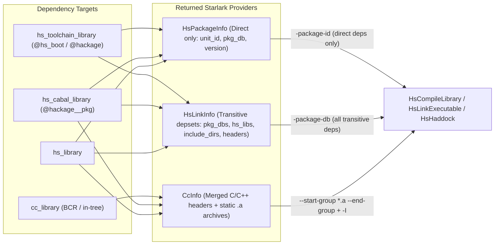
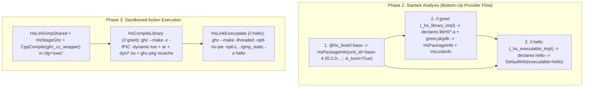

Every rule in `rules_hs` ([`hs_toolchain_library`](../reference/rules.md#hs_toolchain_library), [`hs_library`](../reference/rules.md#hs_library), [`hs_cabal_library`](../reference/rules.md#hs_cabal_library), [`hs_binary`](../reference/rules.md#hs_binary), [`hs_test`](../reference/rules.md#hs_test), and [`hs_haddock`](../reference/rules.md#hs_haddock)) is built from a small set of Starlark providers and action helpers across `hs/providers.bzl`, `hs/toolchain.bzl`, `hs/private/actions.bzl`, `hs/private/rules.bzl`, and `hs/private/haddock.bzl`.

Following the same separation used in Buck2's Haskell rules (`facebook/buck2/prelude/haskell`), `rules_hs` keeps **direct dependency identity** separate from **indirect (transitive) compilation and link inputs**:

- **Direct dependency identity** tells GHC which libraries a target listed directly in its own `deps`, so GHC allows `import` statements *only* from direct dependencies.
- **Transitive compilation and link inputs** collect all upstream package databases, static `.a` archives, and C/C++ headers using Bazel `depset`s (nested sets that combine dependency graphs in constant time without copying lists at every step) and `rules_cc`'s `CcInfo` provider.

> **Note — Background Primers:** If Starlark `Provider`s, `depset`s, directory outputs (`TreeArtifact`s), or GHC compilation outputs are unfamiliar, see [Bazel Ruleset Primer](bazel-rules-primer.md#providers-and-depsets) and [Haskell & GHC Primer](haskell-and-ghc-primer.md#compilation-model).



---

## Why GHC Needs `.hi` Summaries, `.a` Static Archives, and `dyn/*.so` Libraries {#hi-vs-archives}

Before looking at Starlark provider fields, it helps to see **why** compiling one Haskell library produces *three* different kinds of files — and why downstream targets use each one at a different stage of the build:

- **Template Haskell** (mentioned in the third row below) is Haskell's compile-time code-generation system: a library can define ordinary Haskell functions that GHC executes *while compiling* a downstream module (written `$(...)`, called a *splice*) to generate syntax trees or embed files at compile time.

| Output File Kind | C++ / Rust Equivalent | What Is Inside | When GHC Uses It |
|---|---|---|---|
| **`.hi` Interface Summaries** (`<name>.pkgdb/hi/*.hi` + `<unit_id>.conf` + `package.cache`) | C++20 `.bmi` module interface or Rust `.rmeta` (Haskell has no hand-written `.h` header files) | Exported function and type signatures, typeclass instances, data constructors, strictness notes, and small intermediate-code function bodies (which GHC calls *unfoldings*, used to inline small functions across libraries). | **At compile time**: Whenever a downstream library or binary typechecks or optimizes code that imports (or indirectly mentions types from) this library. |
| **`libHS<unit_id>.a` Static Archive** (`*.o` object files packed by `ar rcs`) | `libfoo.a` static archive | Compiled native `x86_64` or `arm64` machine code and static data symbols for every module in the library (plus any C wrapper stubs generated for `CApiFFI`). | **At final executable link time**: When `HsLinkExecutable` (`hs_binary` / `hs_test`) links all transitive packages and GHC's C runtime (`libHSrts`) into an executable binary. |
| **`<name>.pkgdb/dyn/libHS*.so` Shared Library** *(on dynamic GHC toolchains)* | Rust procedural-macro `.so` / `.dylib` | Position-independent shared library (`.dyn_o` objects + attached C FFI code) matching the running `ghc` compiler binary's own dynamic runtime ABI. | **During compile-time Template Haskell only**: Loaded into `ghc` (or `ghc-iserv-dyn`) via `dlopen` when a downstream module runs a `$(...)` macro at compile time; ignored when linking final static executables. |

That three-way split is the reason `HsLinkInfo` carries **both** `pkg_dbs` (containing `.hi` summaries, `.conf` registration metadata, and isolated `dyn/*.so` libraries) and `hs_libs` (containing `libHS*.a` static machine-code archives).

---

## Provider Architecture {#provider-architecture}

`hs/providers.bzl` defines four public providers (alongside an internal `HsDocSourceInfo` provider in `hs/private/actions.bzl`, Bazel's built-in `DefaultInfo` and `OutputGroupInfo`, and `rules_cc`'s `CcInfo`). Every field of each provider is explained below.

### 1. `HsPackageInfo` — Direct Package Identity (8 Fields)

[`HsPackageInfo`](../reference/extensions-and-providers.md#hspackageinfo) holds non-transitive metadata describing **one specific target**. `collect_deps` (`hs/private/actions.bzl`) reads `HsPackageInfo` **only** from a target's immediate `deps` attribute and never forwards upstream `HsPackageInfo` records to callers.

| Field | Type | Plain-English Meaning & How Each Rule Populates It |
|---|---|---|
| `name` | `string` | Human-readable package name: `"base"` or `"text"` on [`hs_toolchain_library`](../reference/rules.md#hs_toolchain_library), target name with `_` replaced by `-` on [`hs_library`](../reference/rules.md#hs_library), or the `.cabal` `package_name` on [`hs_cabal_library`](../reference/rules.md#hs_cabal_library) (used to generate `VERSION_<pkg>` macros in `cabal_macros.h`). |
| `version` | `string` | Package version string: parsed from GHC's boot `.conf` (`"4.20.2.0"`), `"0.0.0"` on `hs_library`, or the `.cabal` version (`"0.7.19"`) on `hs_cabal_library` (used in `MIN_VERSION_<pkg>(x,y,z)` C preprocessor macros). |
| `unit_id` | `string` or `None` | GHC's globally unique identifier for this compiled library, passed to `-this-unit-id` when compiling the library and to `-package-id` when direct dependents compile against it. Set to `None` for C-only Cabal packages such as `zlib-clib` that contain no Haskell modules. |
| `pkg_db` | `File` or `None` | The `<name>.pkgdb` directory output (`TreeArtifact`) containing `hi/`, `dyn/`, `<unit_id>.conf`, and `package.cache`. Set to `None` for boot libraries (already registered in GHC's global `lib/package.conf.d`) and C-only packages. |
| `exposed_modules` | `list[str]` | Dotted module names publicly exported by this package (plus any Cabal `reexported-modules` names). Empty (`[]`) on `hs_library` during Analysis because `hs_library` discovers module names from emitted `.hi` files during Phase 3 Execution. |
| `is_boot` | `bool` | `True` only for GHC boot packages ([`hs_toolchain_library`](../reference/rules.md#hs_toolchain_library)); `False` for user and Hackage libraries. Used by `hs_haddock` to link boot types to Hackage documentation URLs. |
| `hs_lib` | `File` or `None` | The compiled static archive `libHS<unit_id>.a` (`declare_file`), or `None` for boot packages and C-only Cabal packages. |
| `hi_dir` | `File` or `None` | Handle to the `<name>.pkgdb` directory output containing `hi/*.hi`, or `None` for boot and C-only packages. |

#### How Unique `unit_id` Strings Are Constructed

GHC requires every library in a build to have a distinct `unit_id` string containing only letters, digits, hyphens, dots, and underscores:

- **User [`hs_library`](../reference/rules.md#hs_library) (`_sanitize_unit_id` in `hs/private/rules.bzl`)**: Takes the full Bazel label `"{}//{}:{}".format(label.repo_name, label.package, label.name)` and applies a **one-to-one reversible character encoding** (`_` -> `__`, `/` -> `_S`, `:` -> `_C`, `-` -> `_D`, `.` -> `_P`, `+` -> `_A`, `~` -> `_T`, `@` -> `_M`), prefixed with `"u_"` and suffixed with `"-0.0.0"`. For example, `//:greet` becomes `"u__S_S_Cgreet-0.0.0"`. Because `_` is doubled (`__`) before `/` becomes `_S`, two targets like `//foo_S:bar` and `//foo/:bar` (or two libraries both named `types` in different folders) can never collide on the same `unit_id`.
- **Cabal [`hs_cabal_library`](../reference/rules.md#hs_cabal_library) (`_cabal_unit_id` in `hs/private/cabal_library.bzl`)**: Uses `<package_name>-<version>` for main libraries (such as `http-client-0.7.19`) and `<package_name>-<version>-<component_name>` for internal sublibraries (such as `attoparsec-0.14.4-attoparsec-internal`).

### 2. `HsLinkInfo` — Transitive Compilation & Link Closure (5 Fields)

[`HsLinkInfo`](../reference/extensions-and-providers.md#hslinkinfo) collects files and settings across all direct and indirect dependencies using Bazel `depset`s ([Providers and Depsets](bazel-rules-primer.md#providers-and-depsets)):

- **`pkg_dbs`** (`depset[File]`): Every upstream `<name>.pkgdb` directory output so GHC can read transitive `.hi`/`.dyn_hi` interface summaries, look up upstream package keys, and (when `is_dynamic_ghc` is `True`) load `<name>.pkgdb/dyn/libHS*.so` shared libraries during compile-time Template Haskell execution.
- **`hs_libs`** (`depset[File]`): Every upstream static archive (`libHS<unit_id>.a`), ensuring Bazel symlinks all needed `.a` files into the sandbox of downstream compile and link actions.
- **`include_dirs`** (`depset[str]`): Sandbox-relative C header search directories passed as `-I<dir>` to GHC (`CPP` and `CApiFFI`), `hsc2hs`, and `./configure`.
- **`headers`** (`depset[File]`): All upstream `.h` header `File` objects that Bazel must symlink into the sandbox whenever a downstream step preprocesses or compiles C/FFI code.
- **`cc_info`** (`CcInfo`): The merged `rules_cc` `CcInfo` carrying all transitive C/C++ header contexts, compiled `.a` static libraries, and linker flags (`-lm`, `-lstdc++`, `-lpthread`).

### 3. `HsToolchainInfo` — Resolved GHC Toolchain & Companion Tools (21 Fields)

[`HsToolchainInfo`](../reference/extensions-and-providers.md#hstoolchaininfo) (`hs/providers.bzl` and `hs/toolchain.bzl`) is built in two steps: `staged_ghc` (`hs/private/staged_ghc.bzl`, built in `cfg = "exec"`) stages the compiler tree and static GMP archive, and [`hs_toolchain`](../reference/rules.md#hs_toolchain) (`hs/toolchain.bzl`) attaches `ghc_cc_wrapper` and parsed boot library metadata before wrapping the record in `platform_common.ToolchainInfo(hs = ...)`.

Its 21 fields group cleanly into four roles:

| Group | Fields | Plain-English Role |
|---|---|---|
| **Compiler & tool executables** | `ghc`, `ghc_pkg`, `hsc2hs`, `haddock`, `ghc_iserv`, `cc_wrapper` | `File` handles for the `$ORIGIN`-staged `ghc`, `ghc-pkg`, `hsc2hs`, `haddock`, and optional `ghc-iserv-dyn` binaries, plus the compiled C11 `ghc_cc_wrapper` adapter that bridges GHC to Bazel's C/C++ toolchain. |
| **Staged GHC files & C runtime headers** | `libdir`, `template_hsc_h`, `rts_include_dir`, `rts_headers`, `all_files` | `libdir` is the staged `lib/` directory output (containing `settings`, `package.conf.d/`, `html/`, and `libgmp.so.10` / `libtinfo.so.6`); `template_hsc_h` is the C template header required by `hsc2hs`; `rts_include_dir` and `rts_headers` expose GHC's C runtime headers (`HsFFI.h`, `Rts.h`); `all_files` is the `depset` of all toolchain files staged into compile/link sandboxes. |
| **Static GMP & boot package metadata** | `gmp_static_dir`, `gmp_static_lib`, `boot_packages`, `boot_haddocks`, `bignum` | `gmp_static_dir` and `gmp_static_lib` point to `staged_ghc/gmp_static/libgmp.a` (a folder containing no `.so` files, ensuring user binaries link GMP statically); `boot_packages` maps each of GHC's 41 boot package names (`"base"`, `"text"`, ...) to its parsed `id`, `version`, `depends`, and `exposed_modules`; `boot_haddocks` maps boot package names to bundled `.haddock` interface files; `bignum` records `"gmp"` or `"native"`. |
| **Platform & compiler properties** | `version`, `is_dynamic_ghc`, `target_os`, `target_cpu`, `arch_libdir` | GHC version (`"9.10.3"`), whether the `ghc` binary itself is dynamically linked (`True` on Linux `deb10`, enabling `-dynamic-too`), normalized OS/CPU strings (`"linux"`, `"x86_64"` / `"arm64"`), and GHC's internal library subfolder name (`"x86_64-linux-ghc-9.10.3"`). |

> **Tip — Platform-Independent `@hs_boot` Targets:** Because [`hs_toolchain_library`](../reference/rules.md#hs_toolchain_library) (`hs/private/rules.bzl`) looks up `hs_tc.boot_packages[pkg_name]` during **Phase 2 Analysis** from whichever platform's `HsToolchainInfo` was selected, `@hs_boot` (`hs_boot_repo` in `hs/private/ghc_bindist.bzl`) writes simple platform-independent `hs_toolchain_library(name = "<pkg>", package_name = "<pkg>")` targets that work identically on `linux_x86_64`, `linux_arm64`, and future target platforms.

### 4. `HsHaddockInfo` (4 Fields) & Internal `HsDocSourceInfo`

- **[`HsHaddockInfo`](../reference/extensions-and-providers.md#hshaddockinfo)** (`hs/providers.bzl`) is returned by [`hs_haddock`](../reference/rules.md#hs_haddock) (`hs/private/haddock.bzl`):
  - `html_dir` (`File`): The `<name>/` directory output (`TreeArtifact`) containing `index.html`, `<Module>.html`, `linuwial.css`, QuickJump `doc-index.json`, and hyperlinked source `src/<Module>.html`.
  - `interface` (`File`): The binary `<name>.haddock` cross-reference file written by `--dump-interface` (also available via `OutputGroupInfo.haddock_interface`).
  - `unit_ids` (`depset[str]`): GHC `unit_id` strings documented by this `hs_haddock` target.
  - `transitive_haddocks` (`depset[struct]`): Cumulative `struct(html_dir, interface)` records from this target and its `haddock_deps` so downstream `hs_haddock` targets can hyperlink across multiple documented packages.
- **Internal `HsDocSourceInfo`** (`hs/private/actions.bzl`): Returned internally by `hs_library` and `hs_cabal_library` so `hs_haddock(deps = [":my_lib"])` automatically receives `:my_lib`'s `.hs` source files (including generated `hsc2hs` / `Paths_*` / `alex` / `happy` outputs), `cabal_macros.h`, `-i` and `-I` directories, language extensions, `hidden_modules`, and direct dependency unit IDs without repeating them in `BUILD.bazel`.

### 5. `CcInfo` Forwarding

Both [`hs_library`](../reference/rules.md#hs_library) and [`hs_cabal_library`](../reference/rules.md#hs_cabal_library) return a merged `CcInfo` provider alongside `HsPackageInfo` and `HsLinkInfo`, and both accept C/C++ `cc_library` targets in `deps` as well as in `cc_deps` / `extra_cc_deps`.

In `collect_deps(deps, cc_deps)` (`hs/private/actions.bzl`), `rules_hs` merges all upstream `CcInfo` providers via `cc_common.merge_cc_infos` and copies `merged_cc.compilation_context.includes`, `quote_includes`, `system_includes`, and `headers` into `dep_info.include_dirs` and `dep_info.headers`. Any `cc_library` (such as BCR `@zlib//:zlib` or `//tests/rules/ffi:vec_cc`) automatically exposes its `.h` files to GHC `CApiFFI`, `CPP`, `hsc2hs`, and Cabal `./configure` without manual `include_dirs` attributes.

---

## End-to-End Trace: What Happens When Bazel Builds an `hs_binary` {#end-to-end-trace}

To see how providers, configurations, and sandboxed commands fit together on a real build, trace what Bazel and `rules_hs` do when you run `bazel build //:hello` on a two-target project:

```starlark
# BUILD.bazel
load("@rules_hs//hs:defs.bzl", "hs_binary", "hs_library")

hs_library(
    name = "greet",
    srcs = ["src/Greet.hs"],
    hs_source_dirs = ["src"],
    deps = ["@hs_boot//:base"],
)

hs_binary(
    name = "hello",
    srcs = ["app/Main.hs"],
    hs_source_dirs = ["app"],
    deps = [
        ":greet",
        "@hs_boot//:base",
    ],
)
```



### Step-by-Step Walkthrough

1. **Loading & Toolchain Selection (Phase 1)**:
   - Bazel reads `MODULE.bazel` and runs the `hs` module extension (`hs/extensions.bzl`), declaring `@hs_boot`, `@hs_toolchains`, and `@ghc_9_10_3_linux_x86_64`.
   - On an `x86_64` Linux machine, toolchain resolution matches `@hs_toolchains//:ghc_linux_x86_64` -> `@ghc_9_10_3_linux_x86_64//:toolchain_impl` (leaving `@ghc_9_10_3_linux_arm64` un-downloaded).
   - Because `staged_ghc` and `cc_wrapper` on `hs_toolchain` set `cfg = "exec"`, Bazel plans them in the optimized build-tool configuration (`k8-opt-exec`).
2. **Analyzing `@hs_boot//:base` (`_hs_toolchain_library_impl`)**:
   - Looks up `"base"` in `HsToolchainInfo.boot_packages` (parsed in Starlark from `lib/package.conf.d/base-4.20.2.0-*.conf`).
   - Registers **zero build actions** (boot libraries are already compiled inside GHC's `lib/` directory) and returns `HsPackageInfo(name = "base", version = "4.20.2.0", unit_id = "base-4.20.2.0-...", is_boot = True, pkg_db = None, hs_lib = None)` plus an empty `HsLinkInfo`.
3. **Analyzing `//:greet` (`_hs_library_impl`)**:
   - Computes `unit_id = "u__S_S_Cgreet-0.0.0"`.
   - Declares two sibling virtual outputs in `bazel-out/k8-fastbuild/bin/`:
     - `hs_lib = declare_file("libHSu__S_S_Cgreet-0.0.0.a")`
     - `pkg_db = declare_directory("greet.pkgdb")`
   - Registers one `HsCompileLibrary` action whose `inputs` `depset` contains `src/Greet.hs`, `hs_tc.all_files`, and `cc_tools.all_files`, passing `-hide-all-packages -package-id base-4.20.2.0-...`.
   - Returns `HsPackageInfo(unit_id = "u__S_S_Cgreet-0.0.0", pkg_db = greet.pkgdb, hs_lib = libHSu__S_S_Cgreet-0.0.0.a)` and `HsLinkInfo(pkg_dbs = depset([greet.pkgdb]), hs_libs = depset([libHSu__S_S_Cgreet-0.0.0.a]))`.
4. **Analyzing `//:hello` (`_hs_executable_impl`)**:
   - `collect_deps` reads `:greet` and `@hs_boot//:base`: both are in `direct_pkgs` (so both unit IDs receive `-package-id`), while `dep_info.pkg_dbs` and `dep_info.hs_libs` carry `greet.pkgdb` and `libHSu__S_S_Cgreet-0.0.0.a`.
   - Declares `out_exe = declare_file("hello")` and registers `HsLinkExecutable` with `-package-db bazel-out/k8-fastbuild/bin/greet.pkgdb`, `-package-id u__S_S_Cgreet-0.0.0`, `-package-id base-4.20.2.0-...`, `-threaded` (multi-core runtime), `-optl-no-pie` (fixed-address executable compatible with non-PIC GHC boot `.a` archives), and `-optl-L.../staged_ghc/gmp_static` (static `libgmp.a` directory).
   - Returns `DefaultInfo(executable = out_exe, files = depset([out_exe]))`.
5. **Executing `HsCompileLibrary` (`//:greet`) inside `linux-sandbox`**:
   - Once the `cfg = "exec"` tools (`ghc_cc_wrapper` and `staged_ghc`) are built, Bazel runs `HsCompileLibrary` in an isolated sandbox `execroot`:
     1. `ghc --make -c -fPIC -dynamic-too` compiles `src/Greet.hs`, writing temporary `Greet.o` + `Greet.dyn_o` to `$WORK_ROOT/objs/` and writing `Greet.hi` + `Greet.dyn_hi` into `greet.pkgdb/hi/`.
     2. `ar rcs` packs `Greet.o` into `libHSu__S_S_Cgreet-0.0.0.a`.
     3. `ghc -shared -dynamic` links `Greet.dyn_o` into `greet.pkgdb/dyn/libHSu__S_S_Cgreet-0.0.0-ghc9.10.3.so`.
     4. The shell action scans `Greet.hi` -> `exposed-modules: Greet`, writes `${pkgroot}`-relative `greet.pkgdb/u__S_S_Cgreet-0.0.0.conf`, and runs `ghc-pkg recache` to generate `greet.pkgdb/package.cache`.
6. **Executing `HsLinkExecutable` (`//:hello`) inside `linux-sandbox`**:
   - Bazel symlinks `app/Main.hs`, `greet.pkgdb/`, `libHSu__S_S_Cgreet-0.0.0.a`, `staged_ghc/`, and `ghc_cc_wrapper` into a fresh sandbox.
   - `ghc --make` reads `greet.pkgdb/hi/Greet.hi` to typecheck `import Greet` in `app/Main.hs`, compiles `Main.o` into `$WORK_ROOT/objs/`, and invokes `ghc_cc_wrapper` -> `cc_toolchain` to link `Main.o` + `libHSu__S_S_Cgreet-0.0.0.a` + boot `libHSbase*.a` + `libHSrts-1.0.2_thr.a` + `gmp_static/libgmp.a` into the final ELF executable `hello`.

### Resulting On-Disk Layout Inside `bazel-out/`

```text
bazel-out/
├── k8-opt-exec-ST-.../bin/                                  # Exec configuration (build tools)
│   ├── external/rules_hs+/hs/private/ghc_cc_wrapper         # Compiled C11 compiler/linker adapter
│   └── external/rules_hs++hs+ghc_9_10_3_linux_x86_64/
│       └── staged_ghc/
│           ├── bin/{ghc-9.10.3, ghc-pkg-9.10.3, hsc2hs-ghc-9.10.3, haddock-ghc-9.10.3, ...}
│           ├── lib/{settings, package.conf.d/..., x86_64-linux-ghc-9.10.3/libgmp.so.10, ...}
│           └── gmp_static/{libgmp.a, libtinfo.a}            # Static-only dir (contains zero .so files)
└── k8-fastbuild/bin/                                        # Target configuration (your code)
    ├── libHSu__S_S_Cgreet-0.0.0.a                           # Static archive (${pkgroot}/libHS*.a)
    ├── greet.pkgdb/                                         # Sibling directory (${pkgroot}/greet.pkgdb)
    │   ├── hi/{Greet.hi, Greet.dyn_hi}                      # Module summaries for typechecking
    │   ├── dyn/libHSu__S_S_Cgreet-0.0.0-ghc9.10.3.so        # Shared lib used only for Template Haskell
    │   ├── u__S_S_Cgreet-0.0.0.conf                         # ${pkgroot}-relative package metadata
    │   └── package.cache                                    # Binary lookup cache written by ghc-pkg
    └── hello                                                # ELF executable linking only base glibc
```

---

## Strict Direct-Dependency Visibility {#strict-visibility}

Why does `rules_hs` pass **both** transitive `-package-db` flags *and* direct-only `-package-id` flags instead of passing `-package-db` only for direct dependencies?

Suppose you have a three-library chain `lib_c -> lib_b -> lib_a`:
- `lib_a` defines `data UserId = UserId Int`.
- `lib_b` depends on `lib_a` and exports `lookupUser :: UserId -> String`.
- `lib_c` depends **only on `lib_b`** (`deps = [":lib_b", "@hs_boot//:base"]`) and calls `lookupUser`.

When GHC compiles `LibC.hs`, two requirements apply at the same time:
1. **GHC needs to read `LibA.hi` internally**: To typecheck `lookupUser` and optimize how `UserId` values are passed in registers in `LibC.hs`, GHC has to look up the definition of `UserId` inside `lib_a.pkgdb/hi/LibA.hi`. If `lib_a.pkgdb` were left off the `-package-db` flags, GHC would fail with an error saying `lib_a`'s interface file cannot be found.
2. **`LibC.hs` must not be allowed to write `import LibA` directly**: If `LibC.hs` imports `LibA` without listing `:lib_a` in `lib_c`'s `BUILD.bazel` `deps`, then refactoring `lib_b` later to stop using `lib_a` would break `lib_c` unexpectedly — violating Bazel's rule that every target declares all libraries it directly imports.

`compile_hs_library_action` (`hs/private/actions.bzl`) and `_hs_executable_impl` (`hs/private/rules.bzl`) satisfy both requirements using three GHC flags together:

1. **`-hide-all-packages`**: Hides every package in GHC's global boot `package.conf.d` and every custom `-package-db` from `import` statements by default. Even `Prelude` (`base`) is hidden unless `@hs_boot//:base` or `@hackage//:base` is listed in direct `deps`.
2. **`-package-db <db.path>` for every `db` in `dep_info.pkg_dbs` (transitive)**: Loads the full upstream package graph into GHC's internal symbol table so GHC can look up indirect types, typeclass instances, and inlineable definitions across `LibB -> LibA`.
3. **`-package-id <pkg.unit_id>` only for `pkg` in `dep_info.direct_pkgs` (direct)**: Exposes *only* direct `deps` to `import` statements (skipping C-only packages whose `unit_id` is `None`).

If `LibC.hs` writes `import LibA` while `:lib_a` is only an indirect dependency through `:lib_b`, GHC stops the build with an explicit message:

```text
Could not load module 'LibA'
It is a member of the hidden package 'u__S_Stests_Sbasic_Clib__a-0.0.0'.
```

This behavior is tested in Phase 2 Analysis by `//tests/starlark:strict_direct_dep_visibility_test` and `//tests/starlark:hs_binary_threaded_true_test` (`tests/starlark/rules_analysis_test.bzl`).

---

## Relocatable `${pkgroot}` Package Databases {#relocatable-pkgdb}

Bazel runs each build command inside a temporary sandbox or remote worker folder whose absolute directory path changes from machine to machine (`/.../execroot/_main/...`). If a GHC `.conf` metadata file recorded an absolute path like `/tmp/sandbox-17/execroot/_main/bazel-out/...`, any downstream action running in `/tmp/sandbox-99/...` (or downloading that cached `.pkgdb` on another machine) would look for `/tmp/sandbox-17/...` and fail.

To avoid absolute paths, GHC's `ghc-pkg` tool supports a special placeholder variable named **`${pkgroot}`**.

### Concrete Layout and How `ghc-pkg` Expands `${pkgroot}`

In `compile_hs_library_action` (`hs/private/actions.bzl`), every compiled library declares two sibling outputs in the **same** Bazel package directory (say `bazel-out/k8-fastbuild/bin/net/`):

- `hs_lib = ctx.actions.declare_file("libHShttp-client-0.7.19.a")` -> `bazel-out/k8-fastbuild/bin/net/libHShttp-client-0.7.19.a`
- `pkg_db = ctx.actions.declare_directory("http-client.pkgdb")` -> `bazel-out/k8-fastbuild/bin/net/http-client.pkgdb/`

In `ghc-pkg`'s specification, for a package database at `<parent>/http-client.pkgdb`, **`${pkgroot}` expands to `<parent>`** — the parent folder *containing* `http-client.pkgdb` (`bazel-out/k8-fastbuild/bin/net`), **not** `http-client.pkgdb` itself.

Inside `HsCompileLibrary`, the action writes `http-client.pkgdb/http-client-0.7.19.conf`:

```text
name: http-client
version: 0.7.19
id: http-client-0.7.19
key: http-client-0.7.19
exposed: True
import-dirs: ${pkgroot}/http-client.pkgdb/hi
library-dirs: ${pkgroot}
library-dirs-static: ${pkgroot}
dynamic-library-dirs: ${pkgroot}/http-client.pkgdb/dyn
hs-libraries: HShttp-client-0.7.19
exposed-modules: Network.HTTP.Client ...
hidden-modules: Network.HTTP.Client.Internal ...
depends: base-4.20.2.0-... bytestring-0.12.2.0-...
```

And then compiles that text file into a fast binary lookup index (`http-client.pkgdb/package.cache`):

```bash
"$GHC_PKG" --global-package-db="$GHC_LIB/package.conf.d" --package-db="$PKG_DB" recache
```

Look at what each path field in that `.conf` file points to once `${pkgroot}` expands to `bazel-out/k8-fastbuild/bin/net`:

- **`library-dirs: ${pkgroot}` and `library-dirs-static: ${pkgroot}`** -> `bazel-out/k8-fastbuild/bin/net/`, where `libHShttp-client-0.7.19.a` (`hs-libraries: HShttp-client-0.7.19`) sits as a sibling file next to `http-client.pkgdb/`. Keeping the `.a` file next to the `.pkgdb` directory avoids Bazel's rule forbidding a standalone `File` output inside a `TreeArtifact` directory.
- **`import-dirs: ${pkgroot}/http-client.pkgdb/hi`** -> `bazel-out/k8-fastbuild/bin/net/http-client.pkgdb/hi/`, where GHC wrote `.hi` and `.dyn_hi` module summaries (`-hidir`).
- **`dynamic-library-dirs: ${pkgroot}/http-client.pkgdb/dyn`** -> `bazel-out/k8-fastbuild/bin/net/http-client.pkgdb/dyn/`, where `libHShttp-client-0.7.19-ghc9.10.3.so` lives. Putting the `.so` inside the `dyn/` subfolder achieves two things at once: `.so` files travel downstream automatically as part of the `<name>.pkgdb` directory in `HsLinkInfo.pkg_dbs`, and `${pkgroot}` itself contains **zero `.so` files** so static executable links never accidentally link against `libHS*.so`.

### Automatic `exposed-modules` Discovery vs. Explicit Cabal Lists & Re-exports

- **On [`hs_cabal_library`](../reference/rules.md#hs_cabal_library)**: `.cabal` files list `exposed-modules`, `other-modules` (internal modules hidden outside the library), and optional `reexported-modules` (re-exporting a module from a dependency under the same or a new name, such as `[orig-pkg:]Orig.Mod [as New.Mod]`). `_resolve_reexported_for_conf` (`hs/private/actions.bzl`) resolves re-exports against `direct_pkgs` into `ghc-pkg`'s `New.Mod from <origin_unit_id>:Orig.Mod` syntax in `exposed-modules:` and places `other_modules` in `hidden-modules:`.
- **On [`hs_library`](../reference/rules.md#hs_library)**: Users do not have to maintain module lists in `BUILD.bazel`. When `EXPLICIT_EXPOSED` is empty, `HsCompileLibrary` scans `$HI_DIR/*.hi` in sorted order, converts relative file paths to dotted module names (`Math/Core.hi` -> `Math.Core`), moves any module listed in `hidden_modules` to `hidden-modules:`, and writes the rest to `exposed-modules:`.

---

## Library Compilation & Archiving Details {#library-compilation}

### Why One `ghc --make -c` Action Per Library?

A recurring design choice in Haskell build rules is whether to spawn a separate `ghc -c Foo.hs` process per `.hs` file or one `ghc --make -c` command per library target (`HsCompileLibrary`). `rules_hs` runs **one `ghc --make -c` action per library or sublibrary** for three practical reasons:

1. **Built-in `.hs-boot` mutual recursion**: Several Hackage libraries (`cborg`, `tls`, and user code tested in `//tests/basic:boot_cycle_lib`) have mutually recursive modules (`A` imports `B` and `B` imports `A`, broken by an `A.hs-boot` declaration file; see [Haskell Build Mechanisms](haskell-and-ghc-primer.md#build-mechanisms)). Separate per-module Bazel actions would form a cycle in Bazel's action graph unless users annotated boot edges by hand; `ghc --make -c` compiles `.hs-boot` cycles automatically.
2. **Automatic `CApiFFI` C wrapper compilation**: When a module uses `{-# LANGUAGE CApiFFI #-}`, GHC generates temporary C wrapper source files (`-stubdir "$ODIR"`), compiles them through `-pgmc` (`ghc_cc_wrapper`), and writes the resulting `.o` files into `$ODIR` during `--make`.
3. **Avoiding repeated GHC startup cost**: Starting GHC and loading boot/upstream `.hi` summaries takes roughly 150–300 ms per process. On a 100-module package like `crypton` or `pandoc`, one `ghc --make -c` loads those `.hi` files once, while Bazel still builds independent libraries across the dependency graph in parallel.

### Module Names vs. Source File Paths (`use_module_names`)

`compile_hs_library_action` passes targets to `ghc --make -c` in two ways:

- **When `exposed_modules` or `other_modules` are specified ([`hs_cabal_library`](../reference/rules.md#hs_cabal_library))**: Clears GHC's default current-directory search path with bare `-i`, adds explicit `-i<dir>` source directories (including generated `Paths_*` and `hsc2hs` output directories), and passes **dotted module names** (`Network.Socket`, etc.). Passing module names tells GHC to compile only the modules enabled for this platform and ignore unused OS-specific `.hs` files sitting in the tarball.
- **When module lists are omitted ([`hs_library`](../reference/rules.md#hs_library))**: Passes **source file paths** directly (omitting `.hs-boot` and `.lhs-boot` from positional arguments because GHC locates boot files automatically along `-i<dir>`).

### Deterministic `@objects.rsp` Static Archiving

After `ghc --make -c` writes `.o` object files (including any `CApiFFI` C stub objects) into temporary `$ODIR`, `HsCompileLibrary` writes their sorted paths into a **response file** (`@objects.rsp` — a text file of arguments read directly by `ar`, which avoids exceeding the Linux kernel's `ARG_MAX` command-line length limit on large packages):

```bash
OBJ_LIST="$WORK_ROOT/objects.rsp"
find "$ODIR" -name '*.o' | sort > "$OBJ_LIST"
if [ -s "$OBJ_LIST" ]; then
    "$AR" rcs "$HS_LIB" "@$OBJ_LIST"
else
    "$AR" rcs "$HS_LIB"
fi
```

Sorting with `sort` keeps archive member order identical across filesystems, and the `else` branch writes a valid empty `.a` archive for pure `reexported-modules` wrapper libraries (such as `crypton-asn1-encoding` when all modules come from re-exports).

### Explicit `-X<default_language>` Defaults (`GHC2021` vs. `Haskell98`)

- **Why `hs_library`, `hs_binary`, and `hs_test` default to `"GHC2021"`**: Although GHC `9.10` and `9.12` support the newer `"GHC2024"` language edition, upstream GHC itself still defaults to **`GHC2021`** when invoked without `-X...` because `GHC2024` enables `MonoLocalBinds`, which alters type inference for local `let` and `where` bindings and rejects some polymorphic local helpers valid in `Haskell2010` and `GHC2021`. `rules_hs` matches GHC's own default (`"GHC2021"`), and you can set `default_language = "GHC2024"`, `"Haskell2010"`, or `"Haskell98"` on any target (tested by `//tests/rules/lang:lang_test`).
- **Why `hs_cabal_library` defaults to `"Haskell98"`**: Under the `.cabal` file specification, older Hackage packages that omit the `default-language:` field must be compiled as `Haskell98` (several fail to compile if `GHC2021` extensions are enabled implicitly). `rules_hs` passes `-X<default_language>` explicitly on every compile command (tested by `//tests/starlark:hs_cabal_library_h98_test` and `//tests/starlark:hs_cabal_library_h2010_test`).

---

## Executable Linking & Linker Flags Explained {#executable-linking}

`_hs_executable_impl` (`hs/private/rules.bzl`) implements both [`hs_binary`](../reference/rules.md#hs_binary) (`executable = True`) and [`hs_test`](../reference/rules.md#hs_test) (`test = True`) in a single `HsLinkExecutable` action:

1. Compiles any C/C++ files listed in the binary's own `c_sources` via `compile_c_sources` and merges them with `dep_info.cc_info`.
2. Calls `extract_cc_static_libs_and_flags(merged_cc_info)` (`hs/private/actions.bzl`) to collect deduplicated static `.a` archives (`lib.pic_static_library or lib.static_library`, appending `//hs/private:rt_shims` whenever C archives are present) and `user_link_flags` (`-lm`, `-lstdc++`, etc.).
3. Runs staged `ghc --make` with `-outputdir "$WORKDIR"` (so temporary `Main.o` and `Main.hi` files are cleaned up on exit), `-threaded` (when `threaded = True`, the default; enables GHC's multi-core green-thread scheduler), `-main-is <main_module>`, `-optl-no-pie`, `-optl-L<gmp_static_dir>`, and a `--start-group ... --end-group` block of C `.a` archives.

In GHC, **`-optl<flag>`** means "forward `<flag>` to the C compiler driver when linking", and **`-Wl,<arg>`** tells the C compiler driver to pass `<arg>` straight through to the underlying ELF linker (`ld` or `lld`). Here is what each linker flag does in plain English:

### 1. Why `-optl-no-pie` Is Passed

Modern Linux C toolchains (`clang`/`lld`, `zig cc`, and recent `gcc`) default to building **Position-Independent Executables (PIE)** — executables whose machine code uses only relative memory offsets so the OS kernel can load the program at a random memory address on each run. Building a PIE requires *every* `.o` object file inside *every* static `.a` library linked into the binary to have been compiled with `-fPIC` (position-independent code).

While `rules_hs` compiles all user and Hackage code with `-fPIC`, official upstream GHC Linux binary distributions compile their pre-built static boot archives (`libHSbase-*.a`, `libHSghc-prim-*.a`, `libHSrts-*.a`) **without `-fPIC`**, using fixed 32-bit symbol relocations (`R_X86_64_32` / `R_X86_64_32S`). Strict linkers such as LLVM's `lld` (used by `zig cc` and `toolchains_llvm`) refuse to link non-PIC `.a` archives into a PIE, failing with `relocation R_X86_64_32S cannot be used against local symbol; recompile with -fPIC`. Passing **`-optl-no-pie`** instructs the linker to emit a standard fixed-address Linux ELF executable, which links upstream GHC static boot archives cleanly across GNU `ld`, LLVM `lld`, and `zig cc`.

### 2. Why `-optl-L<gmp_static_dir>` Guarantees Static GMP

GHC's `ghc-bignum` boot `.conf` file tells GHC to pass `-lgmp` when linking executables. When a Unix linker sees `-lgmp`, it walks its `-L` search directories in order; in each directory, it checks for dynamic `libgmp.so` **first** and falls back to static `libgmp.a` only if no `.so` exists there.

`staged_ghc` places `libgmp.a` (and `libtinfo.a`) inside `<prefix>/gmp_static/`, a dedicated folder containing **zero `.so` files**, and `_hs_executable_impl` passes `-optl-L<prefix>/gmp_static` ahead of any other library path. The linker finds `libgmp.a` immediately on that first `-L` entry and links GMP statically into the executable, leaving no `libgmp.so.10` dependency at runtime.

### 3. Why `--start-group ... --end-group` (and `rt_shims`) Come After `-lHS*`

Traditional Unix/GNU `ld` (and LLVM/Zig linkers when emulating GNU archive rules) scans static `.a` archives in **one single pass from left to right**:

- When the linker reaches `libfoo.a` on the command line, it pulls in *only* the `.o` object files inside `libfoo.a` that define symbols *already marked unresolved* by earlier files to its left, and **ignores the rest of `libfoo.a` for the remainder of the link**.
- When GHC runs the linker, GHC places `-lHS<unit_id>` flags for all Haskell packages first, followed by `-optl` arguments. Because Haskell FFI code inside `libHSzlib.a` calls C functions like `inflateInit2_` defined in `libzlib_clib_c.a`, placing the C `.a` archives **after** `-lHS*` ensures every C symbol called from Haskell is already on the linker's unresolved list when it reaches the C archives.
- In addition, multiple C `.a` archives collected from a `CcInfo` dependency graph may call functions in *one another* (for example, a C wrapper archive calling a core C library archive or `rt_shims.a`) in an order that does not match symbol dependencies. Wrapping all C `.a` archives in **`-optl-Wl,--start-group <libA.a> <libB.a> ... -optl-Wl,--end-group`** tells the linker to **rescan that group of `.a` archives repeatedly in a loop** until a pass pulls in no new object files — making C static linking insensitive to archive ordering.
- Finally, when C code uses CPU feature checks like `__builtin_cpu_supports("avx2")` on `x86_64` (used by Hackage hashing and cryptography packages), Clang and GCC emit references to a global `__cpu_model` struct normally provided by `libgcc` or `compiler-rt`. Under `zig cc` in static archive mode, that symbol can be absent; appending `//hs/private:rt_shims` (`hs/private/rt_shims.c`) supplies a weak hidden fallback `__cpu_model` struct that satisfies `zig cc` links and yields automatically whenever GCC or LLVM supplies its own strong definition.

---

## Data Dependencies & Runfiles Propagation {#runfiles}

Every rule in `rules_hs` merges `data` runtime files across `deps`, `cc_deps` / `extra_cc_deps`, and `data`:

```starlark
runfiles = ctx.runfiles(files = ctx.files.data).merge_all([
    dep[DefaultInfo].default_runfiles
    for dep in ctx.attr.deps + ctx.attr.cc_deps + ctx.attr.data
])
```

Runfiles behave differently at build time versus runtime by design:

- **During compile & link actions**: `HsConfigure`, `HsHsc2hs`, `HsCompileLibrary`, `HsLinkExecutable`, `HsHaddock`, and `ghc_cc_wrapper` explicitly run `unset RUNFILES_DIR RUNFILES_MANIFEST_FILE RUNFILES_MANIFEST_ONLY` so compiler tools never confuse Bazel's tool-execution runfiles with build inputs.
- **During `bazel test` and `bazel run`**: `.bazelrc` enables `common --enable_runfiles` alongside `common --incompatible_strict_action_env`. Bazel creates the `<executable>.runfiles/<workspace>/...` symlink tree next to the binary and exports `RUNFILES_DIR` (plus `TEST_SRCDIR` and `TEST_WORKSPACE` during `bazel test`). Haskell binaries and tests locate direct and transitive library `data` files via `RUNFILES_DIR` -> `TEST_SRCDIR` -> `<executable_path>.runfiles` (tested across 2-hop library dependencies in `//tests/rules/runfiles:runfiles_test`).

---

## Template Haskell: Why Compile Time Needs `dyn/*.so` While Binaries Link `.a` Statically {#template-haskell}

[Template Haskell (TH)](haskell-and-ghc-primer.md#template-haskell) covers three distinct compile-time features in GHC:

### 1. `TemplateHaskellQuotes` (Building Syntax Trees Without Running Code)

Modules enabling `{-# LANGUAGE TemplateHaskellQuotes #-}` (`'fn`, `''Type`, `[| expr |]`) construct syntax-tree values (`Language.Haskell.TH.Syntax.Q Exp`) as ordinary compiled Haskell code using `@hs_boot//:template-haskell` (or `@hackage//:template-haskell`). GHC does not execute any macro functions at compile time and does not dynamically load `.so` libraries.

### 2. Boot-Package & Same-Library Splices

When a module enables `{-# LANGUAGE TemplateHaskell #-}` and evaluates `$( ... )` splices defined either in GHC's boot packages or in another module of the **same** [`hs_library`](../reference/rules.md#hs_library) or [`hs_cabal_library`](../reference/rules.md#hs_cabal_library) target (`//tests/rules/th:th_test`):

- Official GHC `9.10.3` `deb10` archives are compiled with `GHC Dynamic = YES` (`staged_ghc` stages `ghc-iserv-dyn-ghc-9.10.3` alongside `lib/<arch_libdir>/libHS*.so`, `libgmp.so.10`, `libtinfo.so.6`, and `libffi.so.8`).
- During `ghc --make -c`, GHC compiles helper modules within that same library to `.dyn_o` object files (symlinked to `.o` by `ghc_cc_wrapper` when invoked by GHC's internal linker) and loads boot `.so` libraries through GHC's relative `$ORIGIN` search path.

### 3. Cross-Library Template Haskell Splices (`-dynamic-too`) & Shared-Library Flags

Widely used Hackage packages such as `file-embed`, `aeson`, `skylighting`, and `pandoc` (used to build `//docs`) define Template Haskell helper functions in library `A` and run `$(embedFile ...)` or `$(deriveJSON ...)` while compiling downstream library `B`.

If `libHSA.a` already holds compiled machine code for library `A`, why does `rules_hs` also link `A.pkgdb/dyn/libHSA-ghc9.10.3.so`?

- **Why compile-time TH requires a `.so` shared library**: On standard Linux GHC distributions, the `ghc-9.10.3` compiler binary (and `ghc-iserv-dyn`) is a **dynamically linked ELF process** running against GHC's dynamic runtime (`libHSrts-1.0.2-ghc9.10.3.so`). To load and call compiled functions from library `A` inside that live process at compile time, GHC calls the OS dynamic loader (`dlopen`). `dlopen` can only map position-independent ELF shared libraries (`.so`) linked against the dynamic runtime ABI — it cannot load raw static `ar` archives (`libHS*.a`, which are compiled against the static runtime ABI without dynamic relocation tables).
- **Why final `hs_binary` linking ignores `.so` and uses `.a`**: When `HsLinkExecutable` links a standalone binary (`hs_binary` or `hs_test` without `-dynamic`), GHC calls the system linker in **static package mode**, reading `library-dirs-static: ${pkgroot}` (`libHS*.a`) and `gmp_static/libgmp.a` while ignoring `dynamic-library-dirs`.

Whenever `HsToolchainInfo.is_dynamic_ghc` is `True`, `HsCompileLibrary` (`hs/private/actions.bzl`) sets up cross-library Template Haskell automatically in four steps (tested by `//tests/rules/th:cross_lib_th_test` and `//tests/rules/th:cross_lib_th_elf_test`):

1. **Single-pass static + dynamic object generation (`-dynamic-too`)**: Passing `-fPIC -dynamic-too` to `ghc --make -c` instructs GHC to write both static `.o`/`.hi` files and dynamic `.dyn_o`/`.dyn_hi` files in one compile pass instead of running GHC twice.
2. **Linking `<name>.pkgdb/dyn/libHS<unit_id>-ghc<ver>.so` (and what `-Wl,-Bsymbolic` and `--whole-archive` do)**:
   `HsCompileLibrary` invokes `ghc -shared -dynamic -fPIC -no-auto-link-packages` on the library's `.dyn_o` files with two important linker flags:
   - **`-optl-Wl,-Bsymbolic`**: On Linux, ELF shared libraries normally allow *global symbol interposition* — if `libHSA.so` defines a function `helper` and calls `helper` internally, by default the call routes through a global lookup table so an earlier-loaded library in the same process can override `helper`. Because `libHSA.so` is loaded via `dlopen` *inside the running `ghc` compiler process* (which already has dozens of its own GHC and C libraries loaded in memory), global symbol lookup risks binding `libHSA.so`'s internal calls to a different library version already inside `ghc` (and adds indirection across thousands of Haskell symbols). Passing **`-Wl,-Bsymbolic`** tells the linker: *"whenever code inside `libHSA.so` calls a function or reads a variable that is also defined inside `libHSA.so`, bind that reference directly to `libHSA.so`'s own definition at link time."* This matches GHC's own package `.so` linking convention.
   - **`-optl-Wl,--whole-archive <cc_archives> -optl-Wl,--no-whole-archive`**: If library `A` compiles C helper code (`c_sources` or `cc_deps`), a normal static archive scan while linking `libHSA.so` might drop a C `.o` file if `A`'s Haskell wrapper around that C function was small enough to be inlined into downstream callers rather than called inside `A` itself — causing `dlopen` to fail with `undefined symbol` when downstream library `B` runs a TH macro. Wrapping `cc_archives` in `--whole-archive ... --no-whole-archive` forces the linker to include **every `.o` object file** from those C archives inside `libHSA.so` (followed by `//hs/private:rt_shims` outside `--whole-archive` so weak `__cpu_model` shims are pulled in only if needed).
3. **Staging compile-time `data` files in `pkg_cwd` for `file-embed`**: Hackage libraries that call `$(embedFile "data/table.bin")` expect `"data/table.bin"` to be relative to that package's own root directory rather than Bazel's workspace `execroot` (`external/rules_hs++hackage+.../data/table.bin`). When `data` is non-empty on an external package, `HsCompileLibrary` creates a temporary symlink directory (`$WORK_ROOT/pkg_cwd`) containing symlinks both to top-level `execroot` entries (`bazel-out/`, `external/`) and to the package's own files, and runs `ghc` from `pkg_cwd` so both Bazel paths and package-relative `embedFile` paths resolve inside `linux-sandbox`.
4. **Static isolation for final executables**: Because `<name>.pkgdb/dyn/` is separate from `${pkgroot}`, `HsLinkExecutable` links only static `libHS<unit_id>.a` and `gmp_static/libgmp.a`. Compiled executables (`//docs:docs_gen` and `//tests/rules/th:cross_lib_th_elf_test`) contain **no** `libHS*.so` or `libgmp.so.10` entries in `DT_NEEDED`.

---

## Hermetic Haddock API Generation (`hs_haddock`) {#haddock-actions}

[`hs_haddock`](../reference/rules.md#hs_haddock) (`hs/private/haddock.bzl`, action mnemonic `HsHaddock`) generates HTML API documentation inside Bazel's sandbox using GHC's bundled `bin/haddock-ghc-<ver>` binary (`HsToolchainInfo.haddock`; see [Haddock in Haskell & GHC Primer](haskell-and-ghc-primer.md#haddock)).

Because Haddock works by running GHC's parser and typechecker front-end over `.hs` source files to attach `-- |` docstrings to fully resolved types, `HsHaddock` mirrors compilation flags closely across five details:

1. **Reading source and flag metadata from `HsDocSourceInfo`**: `_hs_haddock_impl` reads the internal `HsDocSourceInfo` provider from each target in `deps` (`hs_library` or `hs_cabal_library`), collecting its `.hs` source files (including generated `hsc2hs`, `Paths_*`, `alex`, and `happy` `.hs` files), `cabal_macros.h`, `-i` module directories, `-I` C include directories, language extensions, and direct dependency `unit_id`s.
2. **Pointing Haddock to staged GHC (`-B` and `-l`) and `ghc_cc_wrapper`**:
   - **`-B <libdir>`** tells Haddock's embedded GHC engine where staged `lib/settings` and `lib/package.conf.d` live.
   - **`-l <libdir>`** tells Haddock where its bundled HTML/CSS/JavaScript theme assets (`lib/html/linuwial.css`, `quick-jump.min.js`) live inside the staged `libdir` directory output.
   - **`--optghc=<flag>`** forwards `-hide-all-packages`, upstream `-package-db` paths (excluding the package DB of the target currently being documented so GHC typechecks its `.hs` sources fresh), direct `-package-id` flags, `-X<lang>`, `-i`, `-I`, `cabal_macros.h`, and `ghc_tool_flags` (`ghc_cc_wrapper` as C preprocessor and C compiler).
   - Like compile actions, `HsHaddock` unsets `RUNFILES_*` variables, sets `TMPDIR` to a cleaned temporary folder, and builds a `pkg_cwd` symlink folder when `compile_data` is present (so documented modules that run `$(embedFile ...)` Template Haskell macros succeed during Haddock typechecking).
3. **Hiding internal modules (`--hide=<Module>`)**: Internal helper modules (`other_modules` on `hs_cabal_library` and `hidden_modules` on `hs_library`) must still be passed to Haddock on the command line when exported modules import types from them, so Haddock passes `--hide=<Module>` for each hidden module to typecheck it internally while omitting it from the generated public module list.
4. **Hyperlinking cross-package types (`--read-interface=<url>,<file.haddock>`)**: When an exported function returns `Text` or `Map k v` from another library, Haddock needs that library's binary `.haddock` interface file to turn the type name into a link:
   - **GHC boot libraries**: `_expand_boot_package_names` walks the transitive `depends` graph of boot packages used by `deps` and passes `--read-interface=https://hackage.haskell.org/package/<name>-<ver>/docs,<boot_file.haddock>` for each matching entry in `HsToolchainInfo.boot_haddocks`.
   - **Upstream `hs_haddock` targets (`haddock_deps`)**: Reads `HsHaddockInfo.transitive_haddocks` from `haddock_deps` and passes `--read-interface=../<dep_dir>,<dep.haddock>` so multi-package documentation sites link across sibling directories via relative paths.
5. **Outputs**: Writes two declared outputs:
   - `<name>` (`TreeArtifact` directory on `DefaultInfo.files` and `HsHaddockInfo.html_dir`), containing `index.html`, per-module `<Module>.html` pages, `linuwial.css`, QuickJump search index `doc-index.json` (when `quickjump = True`), syntax-highlighted source `src/<Module>.html` (when `hyperlinked_source = True`), and an optional Hoogle text database (when `hoogle = True`).
   - `<name>.haddock` (`File` written by `--dump-interface`, exposed on `HsHaddockInfo.interface` and `OutputGroupInfo.haddock_interface`).
   This action is tested by `//tests/rules/haddock:haddock_test`, `//tools/lock:lock_haddock` (mounted in `//docs:site` at `/haddock/lock/`), and `examples/size//:size_haddock`.
