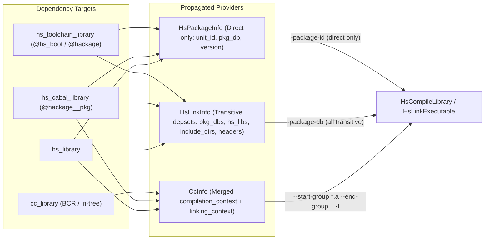

Every rule in `rules_hs` (`bzl:rule:hs_toolchain_library`, `bzl:rule:hs_library`, `bzl:rule:hs_cabal_library`, `bzl:rule:hs_binary`, and `bzl:rule:hs_test`) builds on a compact, compositional provider and action model defined across `hs/providers.bzl`, `hs/toolchain.bzl`, `hs/private/actions.bzl`, and `hs/private/rules.bzl`.

Modeled on Buck2's Haskell prelude (`facebook/buck2/prelude/haskell`), `rules_hs` enforces a strict boundary between **direct package identity** (used to gate compile-time module visibility) and **transitive link/interface closures** (propagated via `O(1)` Bazel `depset`s and `rules_cc`'s `CcInfo`).



---

## Provider Architecture {#provider-architecture}

`hs/providers.bzl` defines three public providers, complemented by standard `DefaultInfo` and `rules_cc`'s `CcInfo`:

### 1. `HsPackageInfo` — Direct Package Identity

`bzl:provider:HsPackageInfo` carries non-transitive metadata describing a **single** Haskell (or C-only Cabal) target. `collect_deps` (`hs/private/actions.bzl`) reads `HsPackageInfo` **only** from a target's immediate `deps` list and never re-exports upstream `HsPackageInfo` instances.

How the 8 fields of `bzl:provider:HsPackageInfo` are populated across the three library archetypes:

| Field | Boot Package (`bzl:rule:hs_toolchain_library`) | Compiled Library (`bzl:rule:hs_library` / `bzl:rule:hs_cabal_library`) | C-Only Cabal Package (e.g., `zlib-clib`) |
|---|---|---|---|
| `name` | Boot Cabal name (`"base"`, `"text"`) | Target name with `_` -> `-` (`hs_library`) or Cabal `package_name` | Cabal `package_name` (`"zlib-clib"`) |
| `version` | Parsed from bindist `.conf` (`"4.20.2.0"`) | `"0.0.0"` (`hs_library`) or Cabal `version` | Cabal `version` (`"1.3.2"`) |
| `unit_id` | Exact GHC boot ID (`"base-4.20.2.0-..."`) | Deterministic `<sanitized_label>-0.0.0` or `<pkg>-<ver>[-<sublib>]` | `None` (no GHC package exists) |
| `pkg_db` | `None` (lives in GHC's global `package.conf.d`) | Declared `<name>.pkgdb` `TreeArtifact` | `None` |
| `exposed_modules` | Parsed from bindist `.conf` | Explicit `exposed_modules` + re-exported module names (`[]` on `hs_library`; auto-discovered in `.conf`) | `[]` |
| `is_boot` | `True` | `False` | `False` |
| `hs_lib` | `None` (lives in staged `lib/<arch_libdir>/`) | Static archive `libHS<unit_id>.a` | `None` |
| `hi_dir` | `None` | `<name>.pkgdb` `TreeArtifact` (containing `hi/`) | `None` |

#### Deterministic Unit ID Construction

- **User `bzl:rule:hs_library` (`_sanitize_unit_id` in `hs/private/rules.bzl`)**: Joins `[label.repo_name, label.package, label.name]` with `_`, replaces any non-alphanumeric character with `_`, and appends `"-0.0.0"`. Including `repo_name` and `package` guarantees zero unit-ID collisions across Bzlmod repositories and subdirectories even when two packages both define `hs_library(name = "types", ...)`.
- **Cabal `bzl:rule:hs_cabal_library` (`_cabal_unit_id` in `hs/private/cabal_library.bzl`)**: Emits `<package_name>-<version>` for main libraries (e.g., `http-client-0.7.19`) and `<package_name>-<version>-<component_name>` for internal sublibraries (e.g., `attoparsec-0.14.4-attoparsec-internal`).

### 2. `HsLinkInfo` — Transitive Compilation & Link Closure

`bzl:provider:HsLinkInfo` aggregates transitive inputs across the entire dependency DAG using Bazel `depset`s so analysis-phase memory and time remain `O(1)` per target edge:

- `pkg_dbs` (`depset[File]`): Every transitive `<name>.pkgdb` `TreeArtifact` directory needed for GHC to resolve `.hi`/`.dyn_hi` interface files, transitive package keys, and (when `HsToolchainInfo.is_dynamic_ghc == True`) isolated `<name>.pkgdb/dyn/libHS<unit_id>-ghc<ver>.so` shared libraries for compile-time Template Haskell evaluation.
- `hs_libs` (`depset[File]`): Every transitive static Haskell archive (`libHS<unit_id>.a`) so Bazel stages them into the sandbox input tree of downstream compile/link actions.
- `include_dirs` (`depset[str]`): Execroot-relative C header search paths (`-I`) for `CApiFFI`, `CPP`, and `hsc2hs`.
- `headers` (`depset[File]`): Tracked C header `File` objects staged into downstream action sandboxes.
- `cc_info` (`CcInfo`): Merged native C/C++ compilation and linking context (`cc_common.merge_cc_infos`).

### 3. `HsToolchainInfo` — Two-Layer Toolchain Assembly

`bzl:provider:HsToolchainInfo` (`hs/providers.bzl` and `hs/toolchain.bzl`) is assembled in two steps:

1. `staged_ghc` (`hs/private/staged_ghc.bzl`, evaluated in `cfg = "exec"`) builds `libgmp.so.10`, stages `bin/*` + `lib/` + `gmp_static/libgmp.a`, locates `Rts.h` inside `rts_headers`, and returns a partial `HsToolchainInfo`.
2. `hs_toolchain` (`hs/toolchain.bzl`) attaches the exec-compiled `ghc_cc_wrapper` binary, decodes `boot_packages_json` into the `boot_packages` dictionary, records `target_os`, `target_cpu`, `arch_libdir`, `bignum`, and `is_dynamic_ghc`, and wraps the result in `platform_common.ToolchainInfo(hs = toolchain_info)` for `@rules_hs//hs:toolchain_type`.

::: {.tip title="Platform-Independent @hs_boot Repository"}
Because `bzl:rule:hs_toolchain_library` (`hs/private/rules.bzl`) looks up `ctx.toolchains[TOOLCHAIN_TYPE].hs.boot_packages[pkg_name]` at **analysis time** rather than hardcoding unit IDs during repository generation, `@hs_boot` (`hs_boot_repo` in `hs/private/ghc_bindist.bzl`) emits simple `hs_toolchain_library(name = "<pkg>", package_name = "<pkg>")` targets that work seamlessly across `linux_x86_64`, `linux_arm64`, and future OS/CPU targets!
:::

### 4. Native `CcInfo` Interoperability

Both `bzl:rule:hs_library` and `bzl:rule:hs_cabal_library` return `merged_cc_info` (`CcInfo`) directly alongside `HsPackageInfo` and `HsLinkInfo`, and both accept pure `CcInfo` targets in `deps` as well as `cc_deps` / `extra_cc_deps`.

In `collect_deps(deps, cc_deps)` (`hs/private/actions.bzl`), `rules_hs` merges all upstream `CcInfo` providers via `cc_common.merge_cc_infos` and explicitly folds `merged_cc.compilation_context.includes`, `quote_includes`, `system_includes`, and `headers` into `dep_info.include_dirs` and `dep_info.headers`. That ensures a pure `cc_library` (such as BCR `@zlib//:zlib` or `//tests/rules/ffi:vec_cc`) makes its `.h` headers immediately visible to GHC `CApiFFI`, `CPP`, `hsc2hs`, and Cabal `./configure` without manual `include_dirs` wiring.

---

## Strict Direct-Dependency Visibility {#strict-visibility}

Without explicit visibility discipline, passing transitive `-package-db` flags to GHC would allow source files in target `C` (`C -> B -> A`) to `import LibA` directly without declaring `:lib_a` in `C`'s `deps` — breaking `buildozer`/refactoring hygiene and permitting accidental coupling to transitive internals.

`compile_hs_library_action` (`hs/private/actions.bzl`) and `_hs_executable_impl` (`hs/private/rules.bzl`) enforce Bazel's strict direct-dependency model through three coordinated GHC flags:

1. **`-hide-all-packages`**: Masks every package in GHC's global boot `package.conf.d` and every custom `-package-db`. Even `Prelude` (`base`) is hidden unless `@hs_boot//:base` or `@hackage//:base` appears in direct `deps`.
2. **`-package-db <db.path>` for every `db` in `dep_info.pkg_dbs` (transitive)**: Registers the full transitive package graph in GHC's package state so GHC can load transitive `.hi` type/unfolding interfaces when `LibB`'s exported signatures mention types defined in `LibA`.
3. **`-package-id <pkg.unit_id>` ONLY for `pkg` in `dep_info.direct_pkgs` (direct)**: Unhides exclusively direct dependencies (skipping C-only packages whose `unit_id` is `None`).

If `LibC.hs` attempts `import LibA` when `:lib_a` is only a transitive dependency via `:lib_b`, GHC immediately rejects the build:

```text
Could not load module 'LibA'
It is a member of the hidden package 'lib_a-0.0.0'.
```

This exact invariant is verified at analysis time by `//tests/starlark:strict_direct_dep_visibility_test` and `//tests/starlark:hs_binary_threaded_true_test` (`tests/starlark/rules_analysis_test.bzl`).

---

## Relocatable `${pkgroot}` Package Databases {#relocatable-pkgdb}

Bazel executes every action in an ephemeral sandbox or remote worker directory whose absolute path varies across machines (`/.../execroot/_main/...`). GHC package registration `.conf` files must therefore never embed absolute paths!

In `compile_hs_library_action` (`hs/private/actions.bzl`), every compiled library declares two sibling outputs inside the **same** Bazel package output directory (`bazel-out/<cfg>/bin/<pkg>/`):

- `hs_lib = ctx.actions.declare_file("libHS" + unit_id + ".a")`
- `pkg_db = ctx.actions.declare_directory(ctx.label.name + ".pkgdb")`

Inside `HsCompileLibrary`, GHC writes `.hi` (and `.dyn_hi`) interface files directly into `$PKG_DB/hi` (`-hidir <pkg_db.path>/hi`), `ar` writes static `libHS<unit_id>.a` next to `<name>.pkgdb`, dynamic toolchains link `$PKG_DB/dyn/libHS<unit_id>-ghc<ver>.so`, and the action writes `$PKG_DB/<unit_id>.conf`:

```text
name: http-client
version: 0.7.19
id: http-client-0.7.19
key: http-client-0.7.19
exposed: True
import-dirs: ${pkgroot}/http-client.pkgdb/hi
library-dirs: ${pkgroot}
library-dirs-static: ${pkgroot}
dynamic-library-dirs: ${pkgroot}/http-client.pkgdb/dyn
hs-libraries: HShttp-client-0.7.19
exposed-modules: Network.HTTP.Client ...
hidden-modules: Network.HTTP.Client.Internal ...
depends: base-4.20.2.0-... bytestring-0.12.2.0-...
```

Followed by:

```bash
"$GHC_PKG" --global-package-db="$GHC_LIB/package.conf.d" --package-db="$PKG_DB" recache
```

::: {.note title="How ghc-pkg Expands ${pkgroot} (and Isolates Static vs. Dynamic Libs)"}
In GHC's `ghc-pkg` specification, `${pkgroot}` for `<parent>/<name>.pkgdb/package.cache` expands to `<parent>` — i.e., `dirname($PKG_DB)`, *not* `$PKG_DB` itself!

Because `libHS<unit_id>.a` and `<name>.pkgdb` share the exact same `<parent>` directory in `bazel-out/<cfg>/bin/<pkg>/`:
- `library-dirs: ${pkgroot}` and `library-dirs-static: ${pkgroot}` resolve directly to `<parent>/libHS<unit_id>.a` (with **zero** Bazel `TreeArtifact` overlap between the static archive file and the `.pkgdb` directory — avoiding `rules_haskell` issues #2496 and #2499!).
- `import-dirs: ${pkgroot}/<pkgdb_base>/hi` resolves directly to `<parent>/<name>.pkgdb/hi`.
- `dynamic-library-dirs: ${pkgroot}/<pkgdb_base>/dyn` places `libHS<unit_id>-ghc<ver>.so` **inside** `<name>.pkgdb/dyn/` — propagating `.so` files transitively via `HsLinkInfo.pkg_dbs` with zero extra provider fields while keeping `${pkgroot}` strictly free of `.so` files during static executable linking!
:::

### Automatic `exposed-modules` Discovery vs. Explicit Cabal Lists & Re-exports

- On `bzl:rule:hs_cabal_library`, `_resolve_reexported_for_conf` (`hs/private/actions.bzl`) resolves Cabal `reexported_modules` (`[orig-pkg:]Orig.Mod [as New.Mod]`) against `direct_pkgs` (and local `exposed_modules` / `other_modules`) into `ghc-pkg`'s canonical `exposed-modules:` syntax (`New.Mod from <origin_unit_id>:Orig.Mod`), appending them directly to `exposed-modules:` alongside `other_modules` in `hidden-modules:` (and appending the re-exported module names to `HsPackageInfo.exposed_modules` so downstream re-exports resolve transitively).
- On `bzl:rule:hs_library`, users do not have to maintain tedious module lists by hand: when `EXPLICIT_EXPOSED` is empty, `HsCompileLibrary` walks `$HI_DIR/*.hi` in sorted order, converts relative paths to dotted module names (`Math/Core.hi` -> `Math.Core`), filters out any module listed in `hidden_modules`, and populates `exposed-modules:` and `hidden-modules:` automatically.

---

## Library Compilation & Archiving Tradeoffs {#library-compilation}

### Why One `ghc --make -c` Action Per Library?

A classic design question in Haskell build systems is whether to spawn one GHC process per `.hs` file (`ghc -c Foo.hs`) or one `ghc --make -c` action per library target (`HsCompileLibrary`). `rules_hs` intentionally uses **one `ghc --make -c` action per library/sublibrary** for three concrete reasons:

1. **Zero-ceremony `.hs-boot` mutual recursion**: Real-world Haskell packages (`cborg`, `tls`, and user code tested in `//tests/basic:boot_cycle_lib`) contain mutually recursive module cycles broken via `.hs-boot` / `.lhs-boot` files. Per-module Bazel actions would form a cycle in Bazel's action graph unless users manually annotated every `.hs-boot` edge; `ghc --make -c` resolves intra-library `.hs-boot` graphs natively.
2. **Automatic `CApiFFI` C stub compilation**: When a module enables `{-# LANGUAGE CApiFFI #-}`, GHC synthesizes temporary C wrapper sources (`-stubdir "$ODIR"`), compiles them via `-pgmc` (`ghc_cc_wrapper`), and merges/outputs the resulting `.o` files inside `$ODIR` seamlessly during `--make`.
3. **Amortized GHC startup & interface loading**: Booting GHC and deserializing `base` / transitive `.hi` files takes ~150–300 ms per invocation. Across a 100-module package like `crypton` or `pandoc`, a single `ghc --make -c` avoids 100 redundant compiler startups while Bazel still parallelizes independent libraries across the dependency DAG.

### Module Names vs. Source File Paths (`use_module_names`)

`compile_hs_library_action` adapts how targets are passed to `ghc --make -c`:

- **When `exposed_modules` or `other_modules` are non-empty (`bzl:rule:hs_cabal_library`)**: Passes **dotted module names** (`Network.Socket`, etc.) after clearing GHC's default current-directory search path with bare `-i` and adding explicit `-i<dir>` flags (`hs_source_dirs` + generated `Paths_*` and `hsc2hs` output roots). Passing module names instructs GHC to resolve only active modules and ignore unreferenced helper/platform files sitting in source directories.
- **When module lists are omitted (`bzl:rule:hs_library`)**: Passes **source file paths** directly (filtering out `.hs-boot` and `.lhs-boot` from positional arguments because GHC discovers boot files automatically along `-i<dir>`).

### Deterministic `@objects.rsp` Static Archiving

After `ghc --make -c` finishes writing object files (including any `CApiFFI` stub objects) into ephemeral `$ODIR`, `HsCompileLibrary` collects and sorts them into a response file:

```bash
OBJ_LIST="$ODIR/objects.rsp"
find "$ODIR" -name '*.o' | sort > "$OBJ_LIST"
if [ -s "$OBJ_LIST" ]; then
    "$AR" rcs "$HS_LIB" "@$OBJ_LIST"
else
    "$AR" rcs "$HS_LIB"
fi
```

Sorting guarantees deterministic archive member ordering across filesystems, `@$OBJ_LIST` prevents Linux `ARG_MAX` overflows on massive libraries, and the `else` branch produces a valid empty `ar` archive for pure `reexported-modules` wrapper packages (such as `crypton-asn1-encoding` when all modules are re-exported).

### Explicit `-X<default_language>` Semantics

GHC `9.10+` defaults bare `ghc` invocations (without `-XHaskell98` / `-XHaskell2010`) to **`GHC2021`**. Meanwhile, the Cabal specification mandates **`Haskell98`** whenever a legacy `.cabal` stanza omits `default-language:` — and several Hackage packages fail to typecheck if `GHC2021` extensions (`PolyKinds`, `GADTSyntax`, `StarIsType` changes) are enabled unexpectedly.

`rules_hs` therefore passes `-X<default_language>` explicitly on every compile action:
- Modern user rules (`bzl:rule:hs_library`, `bzl:rule:hs_binary`, `bzl:rule:hs_test`) default `default_language` to `"GHC2021"` (overridable to `"Haskell2010"`, `"Haskell98"`, or `"GHC2024"` — verified by `//tests/rules/lang:lang_test`).
- `bzl:rule:hs_cabal_library` defaults `default_language` to `"Haskell98"` (matching Cabal's specification, verified by `//tests/starlark:hs_cabal_library_h98_test` and `//tests/starlark:hs_cabal_library_h2010_test`).

---

## Executable Linking & Native C Archive Ordering {#executable-linking}

`_hs_executable_impl` (`hs/private/rules.bzl`) backs both `bzl:rule:hs_binary` (`executable = True`) and `bzl:rule:hs_test` (`test = True`) via a single `HsLinkExecutable` action:

1. Compiles any C sources attached directly to the binary (`c_sources`) via `compile_c_sources` and merges them with `dep_info.cc_info`.
2. Calls `extract_cc_static_libs_and_flags(merged_cc_info)` (`hs/private/actions.bzl`) to extract deduplicated static archives (`lib.pic_static_library or lib.static_library`, appending `//hs/private:rt_shims` when non-empty to satisfy `x86_64` `__cpu_model` relocations on `zig cc` while yielding to strong symbols on GCC/LLVM) and `user_link_flags`.
3. Invokes staged `ghc --make` with `-outputdir "$WORKDIR"` (so intermediate `Main.o`/`Main.hi` files never pollute `bazel-out`), `-threaded` (when `threaded = True`, the default; verified by `//tests/rules/rts:threaded_rts_test` and `non_threaded_rts_test`), `-main-is <main_module>`, `-optl-no-pie`, and `-optl-L<gmp_static_dir>`.
4. Appends all native C static archives inside a GNU/LLVM linker rescan group **after** GHC's own `-lHS*` package archives:
   ```text
   -optl-Wl,--start-group -optl<libA.a> -optl<libB.a> ... -optl-Wl,--end-group
   ```

Why `--start-group` / `--end-group` placement matters: GHC emits `-lHS<unit_id>` flags for every transitive Haskell package first, followed by `-optl` arguments. Placing all `CcInfo` `.a` archives after `-lHS*` ensures unresolved C FFI symbols referenced by `libHS*.a` (such as `zlib-clib`'s `inflateInit2_` referenced by `zlib` and `streaming-commons`) are always satisfied, while `--start-group` / `--end-group` resolves arbitrary mutual symbol dependencies among C archives regardless of `depset` traversal order.

---

## Data Dependencies & Runfiles Propagation {#runfiles}

Every rule in `rules_hs` propagates `data` runfiles transitively across `deps`, `cc_deps` / `extra_cc_deps`, and `data`:

```starlark
runfiles = ctx.runfiles(files = ctx.files.data).merge_all([
    dep[DefaultInfo].default_runfiles
    for dep in ctx.attr.deps + ctx.attr.cc_deps + ctx.attr.data
])
```

Two distinct phases keep runfiles both **non-polluting at compile time** and **ergonomic at runtime**:

- **During compile & link actions**: `HsConfigure`, `HsHsc2hs`, `HsCompileLibrary`, `HsLinkExecutable`, and `ghc_cc_wrapper` explicitly `unset RUNFILES_DIR RUNFILES_MANIFEST_FILE RUNFILES_MANIFEST_ONLY` so compiler tools never misinterpret host/exec runfile trees.
- **At `bazel test` / `bazel run` execution time**: `.bazelrc` sets `common --enable_runfiles` alongside `common --incompatible_strict_action_env`. Bazel materializes `<executable>.runfiles/<workspace>/...` and exports `RUNFILES_DIR` (and `TEST_SRCDIR` / `TEST_WORKSPACE` inside tests). Haskell binaries and tests locate direct, 1-hop, and 2-hop library `data` files as well as `hs_binary` helper tools cleanly via `RUNFILES_DIR` -> `TEST_SRCDIR` -> `<getExecutablePath>.runfiles` (verified end-to-end by `//tests/rules/runfiles:runfiles_test`).

---

## Template Haskell Execution Internals {#template-haskell}

Template Haskell spans three distinct compilation mechanisms in GHC, each interacting differently with Bazel sandboxing and linking:

### 1. `TemplateHaskellQuotes` (Pure AST Construction)

Modules using `{-# LANGUAGE TemplateHaskellQuotes #-}` (`'fn`, `''Type`, `[| expr |]`) construct `Language.Haskell.TH.Syntax.Q Exp` values purely as ordinary Haskell code depending on `@hs_boot//:template-haskell` (or `@hackage//:template-haskell`). No compile-time splice interpreter is spawned, and zero dynamic loading occurs.

### 2. Boot-Package & Same-Library Splices

When a module enables `{-# LANGUAGE TemplateHaskell #-}` and evaluates `$( ... )` splices defined either in GHC boot packages or in another module of the **same** `bzl:rule:hs_library` / `bzl:rule:hs_cabal_library` target (`//tests/rules/th:th_test`):

- Official GHC `9.10.3` `deb10` bindists are built with **`GHC Dynamic = YES`** (and `staged_ghc` stages `ghc-iserv-dyn-ghc-9.10.3` alongside `lib/<arch_libdir>/libHS*.so`, `libgmp.so.10`, `libtinfo.so.6`, and `libffi.so.8`).
- During `ghc --make -c`, GHC automatically compiles helper modules needed by intra-library splices for dynamic execution (`.dyn_o`, aliased to `.o` by `ghc_cc_wrapper` when linked) and loads boot `.so` libraries via `$ORIGIN`.

### 3. Cross-Library Template Haskell Splices (`-dynamic-too`)

Ecosystem workhorses such as `file-embed`, `aeson`, `skylighting`, and `pandoc` (used to compile `rules_hs`'s own Hakyll documentation engine in `//docs`) define Template Haskell splice functions in library `A` and evaluate `$(embedFile ...)` or `$(deriveJSON ...)` while compiling downstream library `B`.

Cross-library Template Haskell works **out of the box** in `rules_hs` whenever `HsToolchainInfo.is_dynamic_ghc == True` (verified end-to-end by `//tests/rules/th:cross_lib_th_test` and `//tests/rules/th:cross_lib_th_elf_test`, with zero opt-in rule attributes required):

1. **Dual static + dynamic compilation (`-dynamic-too`)**: `HsCompileLibrary` (`hs/private/actions.bzl`) passes `-dynamic-too` to `ghc --make -c`, emitting both static `.o`/`.hi` and dynamic `.dyn_o`/`.dyn_hi` artifacts in a single compiler pass.
2. **Self-contained TH shared library (`<name>.pkgdb/dyn/`)**: `HsCompileLibrary` archives static `.o` objects into `${pkgroot}/libHS<unit_id>.a` (`library-dirs` / `library-dirs-static`) and links `.dyn_o` objects into `<name>.pkgdb/dyn/libHS<unit_id>-ghc<ver>.so` with `-Wl,-Bsymbolic` plus any attached `c_sources` / `cc_deps` archives (wrapped in `--whole-archive` along with `//hs/private:rt_shims` for hidden weak `x86_64` `__cpu_model` resolution) — ensuring multi-hop TH splices calling C FFI, `CApiFFI`, SIMD intrinsics, or `runIO` resolve native C symbols cleanly at compile time, registered via `dynamic-library-dirs: ${pkgroot}/<pkgdb_base>/dyn` in `<unit_id>.conf`.
3. **Compile-time `data` sandboxing for `file-embed`**: `data` files declared on `bzl:rule:hs_library`, `bzl:rule:hs_cabal_library`, `bzl:rule:hs_binary`, and `bzl:rule:hs_test` are staged into the compile action sandbox (including package-root `pkg_cwd` staging on `bzl:rule:hs_cabal_library`), so compile-time `embedFile` / `embedDir` splices succeed hermetically under `linux-sandbox`.
4. **Strict static isolation for final executables**: Because `<name>.pkgdb/dyn/` is physically isolated from `${pkgroot}`, `HsLinkExecutable` (`bzl:rule:hs_binary` / `bzl:rule:hs_test`) links exclusively against static `libHS<unit_id>.a` and `gmp_static/libgmp.a`. Compiled user executables (including `//docs:docs_gen` and `//tests/rules/th:cross_lib_th_elf_test`) retain **zero** `libHS*.so` or `libgmp.so.10` entries in `DT_NEEDED`.
