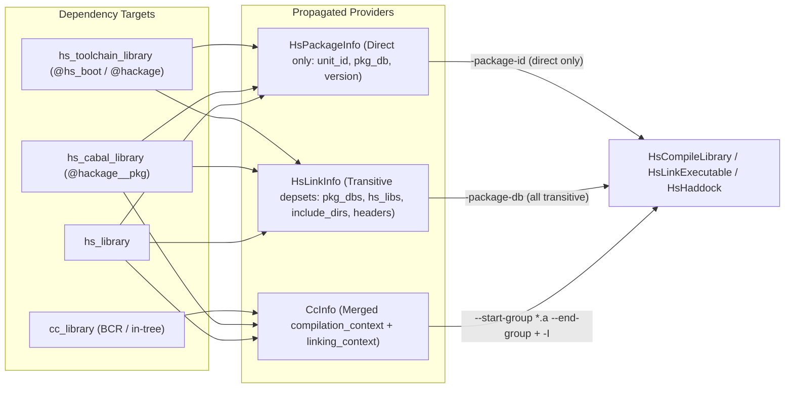
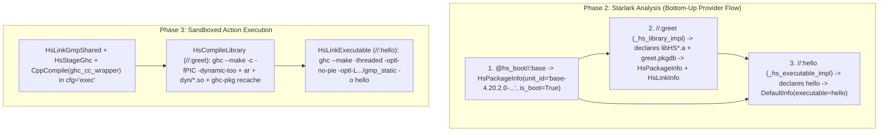

Every rule in `rules_hs` ([`hs_toolchain_library`](../reference/rules.md#hs_toolchain_library), [`hs_library`](../reference/rules.md#hs_library), [`hs_cabal_library`](../reference/rules.md#hs_cabal_library), [`hs_binary`](../reference/rules.md#hs_binary), [`hs_test`](../reference/rules.md#hs_test), and [`hs_haddock`](../reference/rules.md#hs_haddock)) builds on a compact, compositional provider and action model defined across `hs/providers.bzl`, `hs/toolchain.bzl`, `hs/private/actions.bzl`, `hs/private/rules.bzl`, and `hs/private/haddock.bzl`.

Modeled on Buck2's Haskell prelude (`facebook/buck2/prelude/haskell`), `rules_hs` enforces a strict boundary between **direct package identity** (used to gate compile-time module visibility) and **transitive link/interface closures** (propagated via `O(1)` Bazel `depset`s and `rules_cc`'s `CcInfo`).

> **Note — First-Principles Primers:** If Starlark `Provider`s, `depset`s, `TreeArtifact`s, or GHC `.hi`/`.pkgdb` files are new to you, see [Bazel Ruleset Primer](bazel-rules-primer.md#providers-and-depsets) and [Haskell & GHC Primer](haskell-and-ghc-primer.md#compilation-model).



---

## Why GHC Needs Both `.hi` Interfaces and `.a` Static Archives {#hi-vs-archives}

Before looking at Starlark providers, it helps to understand **why** a compiled Haskell library emits *two* fundamentally different kinds of build outputs — and why downstream targets need them at different moments:

| Artifact | C++ / Rust Analog | What It Contains | When GHC Reads It |
|---|---|---|---|
| **`.hi` Interface Files** (`<name>.pkgdb/hi/*.hi` + `<unit_id>.conf` + `package.cache`) | C++20 `.bmi` module interface / Rust `.rmeta` (Haskell has no hand-written `.h` headers!) | Exported function and type signatures, typeclass instances, data constructors, strictness annotations, and small inlineable Core AST ("unfoldings"). | **Compile time**: Whenever a downstream library or binary typechecks or optimizes code that imports (or transitively mentions types from) this library. |
| **`libHS<unit_id>.a` Static Archive** (`*.o` bundled via `ar rcs`) | `libfoo.a` static object archive | Compiled native `x86_64` / `arm64` machine code instructions and static data symbols for every module (plus any `CApiFFI` C wrapper stubs). | **Final link time**: When `HsLinkExecutable` (`hs_binary` / `hs_test`) links all transitive packages and the GHC Runtime System (`libHSrts`) into an ELF executable. |
| **`<name>.pkgdb/dyn/libHS*.so`** *(on dynamic GHC toolchains)* | Rust proc-macro `.so` / `.dylib` | Position-independent shared object (`.dyn_o` + native C FFI symbols) matching the compiler binary's dynamic RTS ABI. | **Compile-time Template Haskell only**: Loaded via `dlopen` when a downstream module executes a `$(...)` splice at compile time; ignored during final static executable linking. |

This separation explains why `HsLinkInfo` propagates **both** `pkg_dbs` (carrying `.hi` interfaces, `.conf` metadata, and isolated `dyn/*.so` libraries) and `hs_libs` (carrying `libHS*.a` machine-code archives).

---

## Provider Architecture {#provider-architecture}

`hs/providers.bzl` defines four public providers, complemented by standard `DefaultInfo` (plus `OutputGroupInfo` on [`hs_haddock`](../reference/rules.md#hs_haddock)) and `rules_cc`'s `CcInfo`:

### 1. `HsPackageInfo` — Direct Package Identity

[`HsPackageInfo`](../reference/extensions-and-providers.md#hspackageinfo) carries non-transitive metadata describing a **single** Haskell (or C-only Cabal) target. `collect_deps` (`hs/private/actions.bzl`) reads `HsPackageInfo` **only** from a target's immediate `deps` list and never re-exports upstream `HsPackageInfo` instances.

How the 8 fields of [`HsPackageInfo`](../reference/extensions-and-providers.md#hspackageinfo) are populated across the three library archetypes:

| Field | Boot Package ([`hs_toolchain_library`](../reference/rules.md#hs_toolchain_library)) | Compiled Library ([`hs_library`](../reference/rules.md#hs_library) / [`hs_cabal_library`](../reference/rules.md#hs_cabal_library)) | C-Only Cabal Package (e.g., `zlib-clib`) |
|---|---|---|---|
| `name` | Boot Cabal name (`"base"`, `"text"`) | Target name with `_` -> `-` (`hs_library`) or Cabal `package_name` | Cabal `package_name` (`"zlib-clib"`) |
| `version` | Parsed from bindist `.conf` (`"4.20.2.0"`) | `"0.0.0"` (`hs_library`) or Cabal `version` | Cabal `version` (`"1.3.2"`) |
| `unit_id` | Exact GHC boot ID (`"base-4.20.2.0-..."`) | Deterministic `<sanitized_label>-0.0.0` or `<pkg>-<ver>[-<sublib>]` | `None` (no GHC package exists) |
| `pkg_db` | `None` (lives in GHC's global `package.conf.d`) | Declared `<name>.pkgdb` `TreeArtifact` | `None` |
| `exposed_modules` | Parsed from bindist `.conf` | Explicit `exposed_modules` + re-exported module names (`[]` on `hs_library`; auto-discovered in `.conf`) | `[]` |
| `is_boot` | `True` | `False` | `False` |
| `hs_lib` | `None` (lives in staged `lib/<arch_libdir>/`) | Static archive `libHS<unit_id>.a` | `None` |
| `hi_dir` | `None` | `<name>.pkgdb` `TreeArtifact` (containing `hi/`) | `None` |

#### Deterministic Unit ID Construction

- **User [`hs_library`](../reference/rules.md#hs_library) (`_sanitize_unit_id` in `hs/private/rules.bzl`)**: Formats `"{}//{}:{}".format(label.repo_name, label.package, label.name)` and injectively encodes punctuation into GHC-valid characters (`_` -> `__`, `/` -> `_S`, `:` -> `_C`, `-` -> `_D`, `.` -> `_P`, etc.), prefixed with `"u_"` and suffixed with `"-0.0.0"` (for example, `//:greet` becomes `"u__S_S_Cgreet-0.0.0"`). Encoding `repo_name` and `package` injectively guarantees zero unit-ID collisions across Bzlmod repositories and subdirectories even when two packages both define `hs_library(name = "types", ...)` or `foo_bar` vs. `foo/bar`.
- **Cabal [`hs_cabal_library`](../reference/rules.md#hs_cabal_library) (`_cabal_unit_id` in `hs/private/cabal_library.bzl`)**: Emits `<package_name>-<version>` for main libraries (e.g., `http-client-0.7.19`) and `<package_name>-<version>-<component_name>` for internal sublibraries (e.g., `attoparsec-0.14.4-attoparsec-internal`).

### 2. `HsLinkInfo` — Transitive Compilation & Link Closure

[`HsLinkInfo`](../reference/extensions-and-providers.md#hslinkinfo) aggregates transitive inputs across the entire dependency DAG using Bazel `depset`s ([Providers and Depsets](bazel-rules-primer.md#providers-and-depsets)) so analysis-phase memory and time remain `O(1)` per target edge:

- `pkg_dbs` (`depset[File]`): Every transitive `<name>.pkgdb` `TreeArtifact` directory needed for GHC to resolve `.hi`/`.dyn_hi` interface files, transitive package keys, and (when `HsToolchainInfo.is_dynamic_ghc == True`) isolated `<name>.pkgdb/dyn/libHS<unit_id>-ghc<ver>.so` shared libraries for compile-time Template Haskell evaluation.
- `hs_libs` (`depset[File]`): Every transitive static Haskell archive (`libHS<unit_id>.a`) so Bazel stages them into the sandbox input tree of downstream compile/link actions.
- `include_dirs` (`depset[str]`): Execroot-relative C header search paths (`-I`) for `CApiFFI`, `CPP`, and `hsc2hs`.
- `headers` (`depset[File]`): Tracked C header `File` objects staged into downstream action sandboxes.
- `cc_info` (`CcInfo`): Merged native C/C++ compilation and linking context (`cc_common.merge_cc_infos`).

### 3. `HsToolchainInfo` — Two-Layer Toolchain Assembly

[`HsToolchainInfo`](../reference/extensions-and-providers.md#hstoolchaininfo) (`hs/providers.bzl` and `hs/toolchain.bzl`, 21 fields) is assembled in two steps:

1. `staged_ghc` (`hs/private/staged_ghc.bzl`, evaluated in `cfg = "exec"`) builds `libgmp.so.10`, stages `bin/*` (`ghc`, `ghc-pkg`, `hsc2hs`, `haddock`, `ghc-iserv-dyn`, `unlit`) + `lib/` (including `lib/html/` Haddock theme assets) + `gmp_static/libgmp.a`, indexes bundled boot `.haddock` interface files (`boot_haddocks`), locates `Rts.h` inside `rts_headers`, and returns a partial `HsToolchainInfo`.
2. [`hs_toolchain`](../reference/rules.md#hs_toolchain) (`hs/toolchain.bzl`) attaches the exec-compiled `ghc_cc_wrapper` binary, decodes `boot_packages_json` into the `boot_packages` dictionary, preserves `haddock` and `boot_haddocks`, records `target_os`, `target_cpu`, `arch_libdir`, `bignum`, and `is_dynamic_ghc`, and wraps the result in `platform_common.ToolchainInfo(hs = toolchain_info)` for `@rules_hs//hs:toolchain_type`.

> **Tip — Platform-Independent `@hs_boot` Repository:** Because [`hs_toolchain_library`](../reference/rules.md#hs_toolchain_library) (`hs/private/rules.bzl`) looks up `ctx.toolchains[TOOLCHAIN_TYPE].hs.boot_packages[pkg_name]` at **analysis time** rather than hardcoding unit IDs during repository generation, `@hs_boot` (`hs_boot_repo` in `hs/private/ghc_bindist.bzl`) emits simple `hs_toolchain_library(name = "<pkg>", package_name = "<pkg>")` targets that work seamlessly across `linux_x86_64`, `linux_arm64`, and future OS/CPU targets!

### 4. `HsHaddockInfo` — Haddock HTML & Interface Closure

[`HsHaddockInfo`](../reference/extensions-and-providers.md#hshaddockinfo) (`hs/providers.bzl`) is returned by [`hs_haddock`](../reference/rules.md#hs_haddock) (`hs/private/haddock.bzl`) to expose generated API documentation and enable cross-target `--read-interface` linking via `haddock_deps`:

- `html_dir` (`File`): `TreeArtifact` directory (`<name>/`) containing `index.html`, `<Module>.html`, `linuwial.css`, QuickJump `doc-index.json`, and hyperlinked source `src/<Module>.html`.
- `interface` (`File`): Dumped `<name>.haddock` interface file (`--dump-interface`, also exposed via `OutputGroupInfo.haddock_interface`).
- `unit_ids` (`depset[str]`): GHC unit IDs documented by this `hs_haddock` target.
- `transitive_haddocks` (`depset[struct]`): Transitive `struct(html_dir, interface)` entries propagated through `haddock_deps`.

### 5. Native `CcInfo` Interoperability

Both [`hs_library`](../reference/rules.md#hs_library) and [`hs_cabal_library`](../reference/rules.md#hs_cabal_library) return `merged_cc_info` (`CcInfo`) directly alongside `HsPackageInfo` and `HsLinkInfo`, and both accept pure `CcInfo` targets in `deps` as well as `cc_deps` / `extra_cc_deps`.

In `collect_deps(deps, cc_deps)` (`hs/private/actions.bzl`), `rules_hs` merges all upstream `CcInfo` providers via `cc_common.merge_cc_infos` and explicitly folds `merged_cc.compilation_context.includes`, `quote_includes`, `system_includes`, and `headers` into `dep_info.include_dirs` and `dep_info.headers`. That ensures a pure `cc_library` (such as BCR `@zlib//:zlib` or `//tests/rules/ffi:vec_cc`) makes its `.h` headers immediately visible to GHC `CApiFFI`, `CPP`, `hsc2hs`, and Cabal `./configure` without manual `include_dirs` wiring.

---

## End-to-End Trace: What Happens When Bazel Builds an `hs_binary` {#end-to-end-trace}

To make every provider, configuration, and action concrete, let us trace **everything Bazel and `rules_hs` do** when building a minimal two-target workspace (`bazel build //:hello`):

```starlark
# BUILD.bazel
load("@rules_hs//hs:defs.bzl", "hs_binary", "hs_library")

hs_library(
    name = "greet",
    srcs = ["src/Greet.hs"],
    hs_source_dirs = ["src"],
    deps = ["@hs_boot//:base"],
)

hs_binary(
    name = "hello",
    srcs = ["app/Main.hs"],
    hs_source_dirs = ["app"],
    deps = [
        ":greet",
        "@hs_boot//:base",
    ],
)
```



### Step-by-Step Walkthrough

1. **Loading & Toolchain Resolution (Phase 1)**:
   - Bazel evaluates `MODULE.bazel` and runs the `hs` module extension (`hs/extensions.bzl`), registering `@hs_boot`, `@hs_toolchains`, and `@ghc_9_10_3_linux_x86_64`.
   - On an `x86_64` Linux machine, toolchain resolution matches `@hs_toolchains//:ghc_linux_x86_64` -> `@ghc_9_10_3_linux_x86_64//:toolchain_impl` (leaving `@ghc_9_10_3_linux_arm64` completely unfetched).
   - Because `staged_ghc` and `cc_wrapper` on `hs_toolchain` set `cfg = "exec"`, Bazel analyzes them in the exec configuration (`k8-opt-exec`).
2. **Analyzing `@hs_boot//:base` (`_hs_toolchain_library_impl`)**:
   - Reads `"base"` from `HsToolchainInfo.boot_packages` (which `ghc_bindist_repo` parsed in pure Starlark from `lib/package.conf.d/base-4.20.2.0-*.conf`).
   - Registers **zero actions** (boot libraries are already compiled inside GHC's `lib/` directory) and returns `HsPackageInfo(name = "base", version = "4.20.2.0", unit_id = "base-4.20.2.0-...", is_boot = True, pkg_db = None, hs_lib = None)` plus an empty `HsLinkInfo`.
3. **Analyzing `//:greet` (`_hs_library_impl`)**:
   - Computes injective `unit_id = "u__S_S_Cgreet-0.0.0"`.
   - Declares two sibling virtual outputs in `bazel-out/k8-fastbuild/bin/`:
     - `hs_lib = declare_file("libHSu__S_S_Cgreet-0.0.0.a")`
     - `pkg_db = declare_directory("greet.pkgdb")`
   - Registers one `HsCompileLibrary` action whose `inputs` `depset` contains `src/Greet.hs`, `hs_tc.all_files`, and `cc_tools.all_files`, passing `-hide-all-packages -package-id base-4.20.2.0-...`.
   - Returns `HsPackageInfo(unit_id = "u__S_S_Cgreet-0.0.0", pkg_db = greet.pkgdb, hs_lib = libHSu__S_S_Cgreet-0.0.0.a)` and `HsLinkInfo(pkg_dbs = depset([greet.pkgdb]), hs_libs = depset([libHSu__S_S_Cgreet-0.0.0.a]))`.
4. **Analyzing `//:hello` (`_hs_executable_impl`)**:
   - `collect_deps` inspects `:greet` and `@hs_boot//:base`: both appear in `direct_pkgs` (so **both** unit IDs receive `-package-id`), while `dep_info.pkg_dbs` and `dep_info.hs_libs` inherit `greet.pkgdb` and `libHSu__S_S_Cgreet-0.0.0.a`.
   - Declares `out_exe = declare_file("hello")` and registers `HsLinkExecutable` with `-package-db bazel-out/k8-fastbuild/bin/greet.pkgdb`, `-package-id u__S_S_Cgreet-0.0.0`, `-package-id base-4.20.2.0-...`, `-threaded`, `-optl-no-pie`, and `-optl-L.../staged_ghc/gmp_static`.
   - Returns `DefaultInfo(executable = out_exe, files = depset([out_exe]))`.
5. **Executing `HsCompileLibrary` (`//:greet`) inside `linux-sandbox`**:
   - Once the exec toolchain (`ghc_cc_wrapper` + `staged_ghc`) is ready, Bazel spawns `HsCompileLibrary` in an isolated sandbox `execroot`:
     1. `ghc --make -c -fPIC -dynamic-too` compiles `src/Greet.hs`, writing ephemeral `Greet.o` + `Greet.dyn_o` to `$WORK_ROOT/objs/` and writing `Greet.hi` + `Greet.dyn_hi` into `greet.pkgdb/hi/`.
     2. `ar rcs` packs `Greet.o` into `libHSu__S_S_Cgreet-0.0.0.a`.
     3. `ghc -shared -dynamic` links `Greet.dyn_o` into `greet.pkgdb/dyn/libHSu__S_S_Cgreet-0.0.0-ghc9.10.3.so`.
     4. Shell auto-discovers `Greet.hi` -> `exposed-modules: Greet`, writes `${pkgroot}`-relative `greet.pkgdb/u__S_S_Cgreet-0.0.0.conf`, and runs `ghc-pkg recache` to produce `greet.pkgdb/package.cache`.
6. **Executing `HsLinkExecutable` (`//:hello`) inside `linux-sandbox`**:
   - Bazel mounts `app/Main.hs`, `greet.pkgdb/`, `libHSu__S_S_Cgreet-0.0.0.a`, `staged_ghc/`, and `ghc_cc_wrapper` into a fresh sandbox.
   - `ghc --make` reads `greet.pkgdb/hi/Greet.hi` to typecheck `import Greet` in `app/Main.hs`, compiles `Main.o` into `$WORK_ROOT/objs/`, and invokes `ghc_cc_wrapper` -> `cc_toolchain` to link `Main.o` + `libHSu__S_S_Cgreet-0.0.0.a` + boot `libHSbase*.a` + `libHSrts-1.0.2_thr.a` + `gmp_static/libgmp.a` into the final self-contained ELF executable `hello`.

### Resulting On-Disk Layout Inside `bazel-out/`

```text
bazel-out/
├── k8-opt-exec-ST-.../bin/                                  # Exec configuration (build tools)
│   ├── external/rules_hs+/hs/private/ghc_cc_wrapper         # Native C11 compiler/linker adapter
│   └── external/rules_hs++hs+ghc_9_10_3_linux_x86_64/
│       └── staged_ghc/
│           ├── bin/{ghc-9.10.3, ghc-pkg-9.10.3, hsc2hs-ghc-9.10.3, haddock-ghc-9.10.3, ...}
│           ├── lib/{settings, package.conf.d/..., x86_64-linux-ghc-9.10.3/libgmp.so.10, ...}
│           └── gmp_static/{libgmp.a, libtinfo.a}            # Static-only dir (zero .so files!)
└── k8-fastbuild/bin/                                        # Target configuration (your code)
    ├── libHSu__S_S_Cgreet-0.0.0.a                           # Static archive (${pkgroot}/libHS*.a)
    ├── greet.pkgdb/                                         # Sibling TreeArtifact (${pkgroot}/greet.pkgdb)
    │   ├── hi/{Greet.hi, Greet.dyn_hi}                      # Binary module interfaces for typechecking
    │   ├── dyn/libHSu__S_S_Cgreet-0.0.0-ghc9.10.3.so        # Isolated .so for Template Haskell only
    │   ├── u__S_S_Cgreet-0.0.0.conf                         # ${pkgroot}-relative package registration
    │   └── package.cache                                    # Binary cache written by ghc-pkg recache
    └── hello                                                # Base-glibc-only ELF executable!
```

---

## Strict Direct-Dependency Visibility {#strict-visibility}

Why does `rules_hs` pass **both** transitive `-package-db` flags *and* direct-only `-package-id` flags instead of just passing `-package-db` for direct dependencies?

Consider a three-library chain `lib_c -> lib_b -> lib_a`:
- `lib_a` defines `data UserId = UserId Int`.
- `lib_b` depends on `lib_a` and exports `lookupUser :: UserId -> String`.
- `lib_c` depends **only on `lib_b`** (`deps = [":lib_b", "@hs_boot//:base"]`) and calls `lookupUser`.

When GHC compiles `LibC.hs`, two seemingly opposite things must hold simultaneously:
1. **GHC MUST be able to read `LibA.hi` behind the scenes**: To typecheck and unbox `lookupUser`'s `UserId` parameter in `LibC.hs`, GHC must inspect the definition of `UserId` stored inside `lib_a.pkgdb/hi/LibA.hi`. If `lib_a.pkgdb` were omitted from `-package-db`, GHC would crash complaining that `lib_a`'s interface cannot be found!
2. **`LibC.hs` MUST NOT be allowed to write `import LibA` directly**: If `LibC.hs` imports `LibA` without listing `:lib_a` in `lib_c`'s `BUILD.bazel` `deps`, then refactoring `lib_b` to stop using `lib_a` will unexpectedly break `lib_c` — violating Bazel's strict dependency encapsulation (the exact invariant Java/Go/Rust developers know as "strict deps").

`compile_hs_library_action` (`hs/private/actions.bzl`) and `_hs_executable_impl` (`hs/private/rules.bzl`) achieve both properties simultaneously through three coordinated GHC flags:

1. **`-hide-all-packages`**: Masks every package in GHC's global boot `package.conf.d` and every custom `-package-db` from `import` statements by default. Even `Prelude` (`base`) is hidden unless `@hs_boot//:base` or `@hackage//:base` appears in direct `deps`.
2. **`-package-db <db.path>` for every `db` in `dep_info.pkg_dbs` (transitive)**: Registers the full transitive package graph in GHC's internal symbol table so GHC can resolve transitive types, typeclass instances, and inlineable unfoldings across `LibB -> LibA`.
3. **`-package-id <pkg.unit_id>` ONLY for `pkg` in `dep_info.direct_pkgs` (direct)**: Unhides *exclusively* direct `deps` for `import` statements (skipping C-only packages whose `unit_id` is `None`).

If `LibC.hs` attempts `import LibA` when `:lib_a` is only a transitive dependency via `:lib_b`, GHC immediately rejects the build with a clear error:

```text
Could not load module 'LibA'
It is a member of the hidden package 'u__S_Stests_Sbasic_Clib__a-0.0.0'.
```

This exact invariant is verified at analysis time by `//tests/starlark:strict_direct_dep_visibility_test` and `//tests/starlark:hs_binary_threaded_true_test` (`tests/starlark/rules_analysis_test.bzl`).

---

## Relocatable `${pkgroot}` Package Databases {#relocatable-pkgdb}

Bazel executes every action in an ephemeral sandbox or remote worker directory whose absolute path varies across machines (`/.../execroot/_main/...`). GHC package registration `.conf` files must therefore never embed absolute paths!

In `compile_hs_library_action` (`hs/private/actions.bzl`), every compiled library declares two sibling outputs inside the **same** Bazel package output directory (`bazel-out/<cfg>/bin/<pkg>/`):

- `hs_lib = ctx.actions.declare_file("libHS" + unit_id + ".a")`
- `pkg_db = ctx.actions.declare_directory(ctx.label.name + ".pkgdb")`

Inside `HsCompileLibrary`, GHC writes `.hi` (and `.dyn_hi`) interface files directly into `$PKG_DB/hi` (`-hidir <pkg_db.path>/hi`), `ar` writes static `libHS<unit_id>.a` next to `<name>.pkgdb`, dynamic toolchains link `$PKG_DB/dyn/libHS<unit_id>-ghc<ver>.so`, and the action writes `$PKG_DB/<unit_id>.conf`:

```text
name: http-client
version: 0.7.19
id: http-client-0.7.19
key: http-client-0.7.19
exposed: True
import-dirs: ${pkgroot}/http-client.pkgdb/hi
library-dirs: ${pkgroot}
library-dirs-static: ${pkgroot}
dynamic-library-dirs: ${pkgroot}/http-client.pkgdb/dyn
hs-libraries: HShttp-client-0.7.19
exposed-modules: Network.HTTP.Client ...
hidden-modules: Network.HTTP.Client.Internal ...
depends: base-4.20.2.0-... bytestring-0.12.2.0-...
```

Followed by:

```bash
"$GHC_PKG" --global-package-db="$GHC_LIB/package.conf.d" --package-db="$PKG_DB" recache
```

> **Note — How `ghc-pkg` Expands `${pkgroot}` (and Isolates Static vs. Dynamic Libs):** In GHC's `ghc-pkg` specification, `${pkgroot}` for `<parent>/<name>.pkgdb/package.cache` expands to `<parent>` — i.e., `dirname($PKG_DB)`, *not* `$PKG_DB` itself!
>
> Because `libHS<unit_id>.a` and `<name>.pkgdb` share the exact same `<parent>` directory in `bazel-out/<cfg>/bin/<pkg>/`:
> - `library-dirs: ${pkgroot}` and `library-dirs-static: ${pkgroot}` resolve directly to `<parent>/libHS<unit_id>.a` (with **zero** Bazel `TreeArtifact` overlap between the static archive file and the `.pkgdb` directory — avoiding `rules_haskell` issues #2496 and #2499!).
> - `import-dirs: ${pkgroot}/<pkgdb_base>/hi` resolves directly to `<parent>/<name>.pkgdb/hi`.
> - `dynamic-library-dirs: ${pkgroot}/<pkgdb_base>/dyn` places `libHS<unit_id>-ghc<ver>.so` **inside** `<name>.pkgdb/dyn/` — propagating `.so` files transitively via `HsLinkInfo.pkg_dbs` with zero extra provider fields while keeping `${pkgroot}` strictly free of `.so` files during static executable linking!

### Automatic `exposed-modules` Discovery vs. Explicit Cabal Lists & Re-exports

- On [`hs_cabal_library`](../reference/rules.md#hs_cabal_library), `_resolve_reexported_for_conf` (`hs/private/actions.bzl`) resolves Cabal `reexported_modules` (`[orig-pkg:]Orig.Mod [as New.Mod]`) against `direct_pkgs` (and local `exposed_modules` / `other_modules`) into `ghc-pkg`'s canonical `exposed-modules:` syntax (`New.Mod from <origin_unit_id>:Orig.Mod`), appending them directly to `exposed-modules:` alongside `other_modules` in `hidden-modules:` (and appending the re-exported module names to `HsPackageInfo.exposed_modules` so downstream re-exports resolve transitively).
- On [`hs_library`](../reference/rules.md#hs_library), users do not have to maintain tedious module lists by hand: when `EXPLICIT_EXPOSED` is empty, `HsCompileLibrary` walks `$HI_DIR/*.hi` in sorted order, converts relative paths to dotted module names (`Math/Core.hi` -> `Math.Core`), filters out any module listed in `hidden_modules`, and populates `exposed-modules:` and `hidden-modules:` automatically.

---

## Library Compilation & Archiving Tradeoffs {#library-compilation}

### Why One `ghc --make -c` Action Per Library?

A classic design question in Haskell build systems is whether to spawn one GHC process per `.hs` file (`ghc -c Foo.hs`) or one `ghc --make -c` action per library target (`HsCompileLibrary`). `rules_hs` intentionally uses **one `ghc --make -c` action per library/sublibrary** for three concrete reasons:

1. **Zero-ceremony `.hs-boot` mutual recursion**: Real-world Haskell packages (`cborg`, `tls`, and user code tested in `//tests/basic:boot_cycle_lib`) contain mutually recursive module cycles broken via `.hs-boot` / `.lhs-boot` files ([Haskell Build Mechanisms](haskell-and-ghc-primer.md#build-mechanisms)). Per-module Bazel actions would form a cycle in Bazel's action graph unless users manually annotated every `.hs-boot` edge; `ghc --make -c` resolves intra-library `.hs-boot` graphs natively.
2. **Automatic `CApiFFI` C stub compilation**: When a module enables `{-# LANGUAGE CApiFFI #-}`, GHC synthesizes temporary C wrapper sources (`-stubdir "$ODIR"`), compiles them via `-pgmc` (`ghc_cc_wrapper`), and merges/outputs the resulting `.o` files inside `$ODIR` seamlessly during `--make`.
3. **Amortized GHC startup & interface loading**: Booting GHC and deserializing `base` / transitive `.hi` files takes ~150–300 ms per invocation. Across a 100-module package like `crypton` or `pandoc`, a single `ghc --make -c` avoids 100 redundant compiler startups while Bazel still parallelizes independent libraries across the dependency DAG.

### Module Names vs. Source File Paths (`use_module_names`)

`compile_hs_library_action` adapts how targets are passed to `ghc --make -c`:

- **When `exposed_modules` or `other_modules` are non-empty ([`hs_cabal_library`](../reference/rules.md#hs_cabal_library))**: Passes **dotted module names** (`Network.Socket`, etc.) after clearing GHC's default current-directory search path with bare `-i` and adding explicit `-i<dir>` flags (`hs_source_dirs` + generated `Paths_*` and `hsc2hs` output roots). Passing module names instructs GHC to resolve only active modules and ignore unreferenced helper/platform files sitting in source directories.
- **When module lists are omitted ([`hs_library`](../reference/rules.md#hs_library))**: Passes **source file paths** directly (filtering out `.hs-boot` and `.lhs-boot` from positional arguments because GHC discovers boot files automatically along `-i<dir>`).

### Deterministic `@objects.rsp` Static Archiving

After `ghc --make -c` finishes writing object files (including any `CApiFFI` stub objects) into ephemeral `$ODIR`, `HsCompileLibrary` collects and sorts them into a response file:

```bash
OBJ_LIST="$WORK_ROOT/objects.rsp"
find "$ODIR" -name '*.o' | sort > "$OBJ_LIST"
if [ -s "$OBJ_LIST" ]; then
    "$AR" rcs "$HS_LIB" "@$OBJ_LIST"
else
    "$AR" rcs "$HS_LIB"
fi
```

Sorting guarantees deterministic archive member ordering across filesystems, `@$OBJ_LIST` prevents Linux `ARG_MAX` command-line length overflows on massive libraries, and the `else` branch produces a valid empty `ar` archive for pure `reexported-modules` wrapper packages (such as `crypton-asn1-encoding` when all modules are re-exported).

### Explicit `-X<default_language>` Semantics

GHC `9.10+` defaults bare `ghc` invocations (without `-XHaskell98` / `-XHaskell2010`) to **`GHC2021`**. Meanwhile, the Cabal specification mandates **`Haskell98`** whenever a legacy `.cabal` stanza omits `default-language:` — and several Hackage packages fail to typecheck if `GHC2021` extensions (`PolyKinds`, `GADTSyntax`, `StarIsType` changes) are enabled unexpectedly.

`rules_hs` therefore passes `-X<default_language>` explicitly on every compile action:
- Modern user rules ([`hs_library`](../reference/rules.md#hs_library), [`hs_binary`](../reference/rules.md#hs_binary), [`hs_test`](../reference/rules.md#hs_test)) default `default_language` to `"GHC2021"` (overridable to `"Haskell2010"`, `"Haskell98"`, or `"GHC2024"` — verified by `//tests/rules/lang:lang_test`).
- [`hs_cabal_library`](../reference/rules.md#hs_cabal_library) defaults `default_language` to `"Haskell98"` (matching Cabal's specification, verified by `//tests/starlark:hs_cabal_library_h98_test` and `//tests/starlark:hs_cabal_library_h2010_test`).

---

## Executable Linking & Why `--start-group ... --end-group` Is Required {#executable-linking}

`_hs_executable_impl` (`hs/private/rules.bzl`) backs both [`hs_binary`](../reference/rules.md#hs_binary) (`executable = True`) and [`hs_test`](../reference/rules.md#hs_test) (`test = True`) via a single `HsLinkExecutable` action:

1. Compiles any C sources attached directly to the executable (`c_sources`) via `compile_c_sources` and merges them with `dep_info.cc_info`.
2. Calls `extract_cc_static_libs_and_flags(merged_cc_info)` (`hs/private/actions.bzl`) to extract deduplicated static archives (`lib.pic_static_library or lib.static_library`, appending `//hs/private:rt_shims` when non-empty to satisfy `x86_64` `__cpu_model` relocations on `zig cc` while yielding to strong symbols on GCC/LLVM) and `user_link_flags`.
3. Invokes staged `ghc --make` with `-outputdir "$WORKDIR"` (so intermediate `Main.o`/`Main.hi` files never pollute `bazel-out`), `-threaded` (when `threaded = True`, the default; verified by `//tests/rules/rts:threaded_rts_test` and `non_threaded_rts_test`), `-main-is <main_module>`, `-optl-no-pie`, and `-optl-L<gmp_static_dir>`.
4. Appends all native C static archives inside a GNU/LLVM linker rescan group **after** GHC's own `-lHS*` package archives:
   ```text
   -optl-Wl,--start-group -optl<libA.a> -optl<libB.a> ... -optl-Wl,--end-group
   ```

### Why Traditional Unix/GNU Linkers Need `--start-group` / `--end-group` After `-lHS*`

Traditional Unix/GNU `ld` (and LLVM/Zig linkers when emulating GNU archive semantics) scans static `.a` archives in **a single left-to-right pass**:

- When the linker reaches `libfoo.a` on the command line, it extracts *only* the `.o` members inside `libfoo.a` that resolve symbols *already marked undefined* by earlier files on the command line, and then **discards the rest of `libfoo.a` permanently**.
- When GHC invokes the linker, GHC places `-lHS<unit_id>` flags for all Haskell packages first, followed by user `-optl` arguments. Because Haskell FFI modules inside `libHSzlib.a` and `libHSstreaming-commons.a` reference C symbols like `inflateInit2_` defined in C-only `libzlib_clib_c.a`, placing the C `.a` archives **after** `-lHS*` ensures every C symbol called from Haskell is already in the linker's undefined-symbol set when the C archives are reached.
- Furthermore, multiple C archives collected from a `CcInfo` `depset` may reference symbols in *each other* (for instance, a C wrapper archive calling into a core C library archive or `rt_shims.a`) in an order that does not match topological symbol dependencies. Wrapping all `CcInfo` `.a` archives in `-Wl,--start-group ... -Wl,--end-group` instructs the linker to **repeatedly rescan the group in a loop** until no new undefined symbols are resolved — guaranteeing link-order independence across arbitrary C/C++ dependency graphs!

---

## Data Dependencies & Runfiles Propagation {#runfiles}

Every rule in `rules_hs` propagates `data` runfiles transitively across `deps`, `cc_deps` / `extra_cc_deps`, and `data`:

```starlark
runfiles = ctx.runfiles(files = ctx.files.data).merge_all([
    dep[DefaultInfo].default_runfiles
    for dep in ctx.attr.deps + ctx.attr.cc_deps + ctx.attr.data
])
```

Two distinct phases keep runfiles both **non-polluting at compile time** and **ergonomic at runtime**:

- **During compile & link actions**: `HsConfigure`, `HsHsc2hs`, `HsCompileLibrary`, `HsLinkExecutable`, and `ghc_cc_wrapper` explicitly `unset RUNFILES_DIR RUNFILES_MANIFEST_FILE RUNFILES_MANIFEST_ONLY` so compiler tools never misinterpret host/exec runfile trees.
- **At `bazel test` / `bazel run` execution time**: `.bazelrc` sets `common --enable_runfiles` alongside `common --incompatible_strict_action_env`. Bazel materializes `<executable>.runfiles/<workspace>/...` and exports `RUNFILES_DIR` (and `TEST_SRCDIR` / `TEST_WORKSPACE` inside tests). Haskell binaries and tests locate direct, 1-hop, and 2-hop library `data` files as well as `hs_binary` helper tools cleanly via `RUNFILES_DIR` -> `TEST_SRCDIR` -> `<getExecutablePath>.runfiles` (verified end-to-end by `//tests/rules/runfiles:runfiles_test`).

---

## Template Haskell: Why Compile Time Needs `dyn/*.so` While Binaries Link `.a` Statically {#template-haskell}

[Template Haskell (TH)](haskell-and-ghc-primer.md#template-haskell) spans three distinct compilation mechanisms in GHC, each interacting differently with Bazel sandboxing and linking:

### 1. `TemplateHaskellQuotes` (Pure AST Construction)

Modules using `{-# LANGUAGE TemplateHaskellQuotes #-}` (`'fn`, `''Type`, `[| expr |]`) construct `Language.Haskell.TH.Syntax.Q Exp` values purely as ordinary Haskell code depending on `@hs_boot//:template-haskell` (or `@hackage//:template-haskell`). No compile-time splice interpreter is spawned, and zero dynamic loading occurs.

### 2. Boot-Package & Same-Library Splices

When a module enables `{-# LANGUAGE TemplateHaskell #-}` and evaluates `$( ... )` splices defined either in GHC boot packages or in another module of the **same** [`hs_library`](../reference/rules.md#hs_library) / [`hs_cabal_library`](../reference/rules.md#hs_cabal_library) target (`//tests/rules/th:th_test`):

- Official GHC `9.10.3` `deb10` bindists are built with **`GHC Dynamic = YES`** (and `staged_ghc` stages `ghc-iserv-dyn-ghc-9.10.3` alongside `lib/<arch_libdir>/libHS*.so`, `libgmp.so.10`, `libtinfo.so.6`, and `libffi.so.8`).
- During `ghc --make -c`, GHC automatically compiles helper modules needed by intra-library splices for dynamic execution (`.dyn_o`, aliased to `.o` by `ghc_cc_wrapper` when linked) and loads boot `.so` libraries via `$ORIGIN`.

### 3. Cross-Library Template Haskell Splices (`-dynamic-too`) & Why `.so` vs. `.a` Both Exist

Ecosystem workhorses such as `file-embed`, `aeson`, `skylighting`, and `pandoc` (used to compile `rules_hs`'s own Hakyll documentation engine in `//docs`) define Template Haskell splice functions in library `A` and evaluate `$(embedFile ...)` or `$(deriveJSON ...)` while compiling downstream library `B`.

A natural question for engineers new to GHC is: *if `libHSA.a` already contains compiled machine code for library `A`, why can't `ghc` just load `libHSA.a` at compile time — why does `rules_hs` also link `A.pkgdb/dyn/libHSA-ghc9.10.3.so`?*

- **Why compile-time TH requires `.so`**: On standard Linux bindists, the `ghc-9.10.3` compiler executable (and `ghc-iserv-dyn`) is itself a **dynamically linked ELF process** running against GHC's dynamic runtime system (`libHSrts-1.0.2-ghc9.10.3.so`). To execute compiled machine code from library `A` inside that live process at compile time, GHC calls the OS dynamic loader (`dlopen`), which **can only map position-independent ELF shared objects (`.so`) compiled against the dynamic RTS ABI** — `dlopen` cannot load raw static `ar` archives (`libHS*.a`, which are compiled against the static RTS ABI without dynamic relocation tables).
- **Why final `hs_binary` linking ignores `.so` and uses `.a`**: When `HsLinkExecutable` compiles a standalone executable (`hs_binary` / `hs_test` *without* `-dynamic`), GHC invokes the system linker in **static package mode**, reading `library-dirs-static: ${pkgroot}` (`libHS*.a`) plus `gmp_static/libgmp.a` — and completely ignoring `dynamic-library-dirs`!

Cross-library Template Haskell therefore works **out of the box** in `rules_hs` whenever `HsToolchainInfo.is_dynamic_ghc == True` (verified end-to-end by `//tests/rules/th:cross_lib_th_test` and `//tests/rules/th:cross_lib_th_elf_test`, with zero opt-in rule attributes required):

1. **Dual static + dynamic compilation (`-dynamic-too`)**: `HsCompileLibrary` (`hs/private/actions.bzl`) passes `-dynamic-too` to `ghc --make -c`, emitting both static `.o`/`.hi` and dynamic `.dyn_o`/`.dyn_hi` artifacts in a single compiler pass.
2. **Self-contained TH shared library (`<name>.pkgdb/dyn/`)**: `HsCompileLibrary` archives static `.o` objects into `${pkgroot}/libHS<unit_id>.a` (`library-dirs` / `library-dirs-static`) and links `.dyn_o` objects into `<name>.pkgdb/dyn/libHS<unit_id>-ghc<ver>.so` with `-Wl,-Bsymbolic` plus any attached `c_sources` / `cc_deps` archives (wrapped in `--whole-archive` along with `//hs/private:rt_shims` for hidden weak `x86_64` `__cpu_model` resolution) — ensuring multi-hop TH splices calling C FFI, `CApiFFI`, SIMD intrinsics, or `runIO` resolve native C symbols cleanly at compile time, registered via `dynamic-library-dirs: ${pkgroot}/<pkgdb_base>/dyn` in `<unit_id>.conf`.
3. **Compile-time `data` sandboxing for `file-embed`**: `data` files declared on [`hs_library`](../reference/rules.md#hs_library), [`hs_cabal_library`](../reference/rules.md#hs_cabal_library), [`hs_binary`](../reference/rules.md#hs_binary), and [`hs_test`](../reference/rules.md#hs_test) are staged into the compile action sandbox (including package-root `pkg_cwd` staging on `hs_cabal_library`), so compile-time `embedFile` / `embedDir` splices succeed hermetically under `linux-sandbox`.
4. **Strict static isolation for final executables**: Because `<name>.pkgdb/dyn/` is physically isolated from `${pkgroot}`, `HsLinkExecutable` ([`hs_binary`](../reference/rules.md#hs_binary) / [`hs_test`](../reference/rules.md#hs_test)) links exclusively against static `libHS<unit_id>.a` and `gmp_static/libgmp.a`. Compiled user executables (including `//docs:docs_gen` and `//tests/rules/th:cross_lib_th_elf_test`) retain **zero** `libHS*.so` or `libgmp.so.10` entries in `DT_NEEDED`.

---

## Hermetic Haddock API Generation (`hs_haddock`) {#haddock-actions}

[`hs_haddock`](../reference/rules.md#hs_haddock) (`hs/private/haddock.bzl`, action mnemonic `HsHaddock`) generates standard Haskell API documentation hermetically inside Bazel's sandbox using GHC's bundled `bin/haddock-ghc-<ver>` (`HsToolchainInfo.haddock`; see [Haddock in Haskell & GHC Primer](haskell-and-ghc-primer.md#haddock)):

1. **Toolchain & sandbox wiring**: Invokes `$ORIGIN`-staged `HsToolchainInfo.haddock` with `-B <libdir> -l <libdir>` (so Haddock loads both GHC's global package database and its bundled `lib/html/` CSS/JS/QuickJump theme assets directly from the staged `libdir` `TreeArtifact`), forwards `ghc_cc_wrapper` via `--optghc=` flags, scrubs `RUNFILES_*` environment variables, and binds `TMPDIR` to an ephemeral directory cleaned up on exit.
2. **Visibility & module hiding**: Reconstructs the documented targets' compile flags (`-hide-all-packages`, transitive `-package-db`, direct `-package-id`, language/extension flags, CPP/C include paths) via `--optghc=`, and passes `--hide=<Module>` for any `hidden_modules` so internal modules stay encapsulated while still typechecking cleanly.
3. **Cross-package interface linking (`--read-interface`)**: Links documented types against GHC boot `.haddock` interfaces (`HsToolchainInfo.boot_haddocks`, pointed at official Hackage documentation URLs) as well as any upstream [`hs_haddock`](../reference/rules.md#hs_haddock) targets supplied in `haddock_deps` (`HsHaddockInfo`, linked via relative HTML paths).
4. **Outputs**: Produces a single `<name>` HTML `TreeArtifact` directory (`DefaultInfo.files` and `HsHaddockInfo.html_dir`, containing `index.html`, `<Module>.html`, `linuwial.css`, QuickJump `doc-index.json` when `quickjump = True`, and hyperlinked source `src/<Module>.html` when `hyperlinked_source = True`) plus a `<name>.haddock` interface file (`--dump-interface`, exposed on `HsHaddockInfo.interface` and `OutputGroupInfo.haddock_interface`) — verified by `//tests/rules/haddock:haddock_test`, `//tools/lock:lock_haddock` (mounted into `//docs:site` at `/haddock/lock/`), and `examples/size//:size_haddock`.
