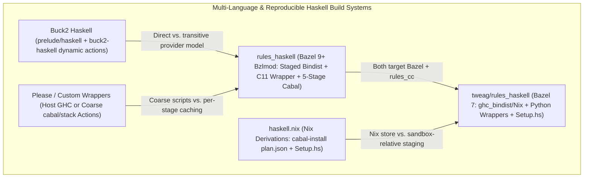
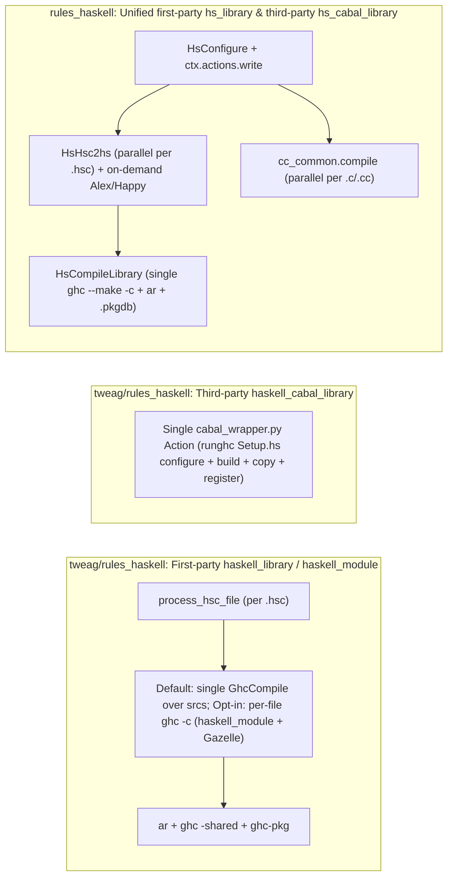
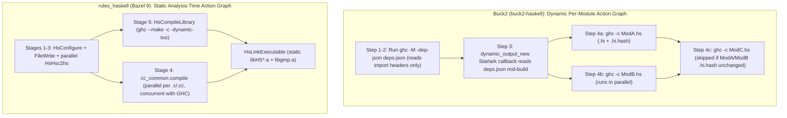

This page compares `rules_haskell` against five other ways to build Haskell in multi-language or reproducible setups: **`tweag/rules_haskell`**, **Meta's `facebook/buck2` (`prelude/haskell` and `buck2-haskell`)**, **Please Build (`pleasings` and custom `.build_defs`)**, **`input-output-hk/haskell.nix`**, and **project-level `cabal` or `stack` wrappers**. Read this if you're choosing a build system for a mixed-language repository, planning a Bazel 9 migration, or evaluating [Remote Build Execution (RBE)](https://bazel.build/remote/rbe) trade-offs.

If you're already migrating an existing project to `rules_haskell`, start with [Migration and troubleshooting](../guide/troubleshooting-and-migration.md). If you want background on Bazel rulesets or GHC internals first, read [Bazel ruleset primer](bazel-rules-primer.md) and [Haskell and GHC primer](haskell-and-ghc-primer.md).

## Five problems every multi-language Haskell build must solve

Integrating GHC and Hackage into a reproducible, multi-language build system comes down to five engineering challenges. Every tool in this comparison makes different trade-offs across them:

1. **Isolating the compiler from the host OS:** Official GHC Linux binary archives ("bindists") hardcode host tool paths (`/usr/bin/gcc`, `-fuse-ld=gold`) inside `lib/settings` and dynamically load `libgmp.so.10` and `libtinfo.so.6` from `/usr/lib` at startup.
2. **Forwarding C and C++ headers and libraries:** Many Haskell packages call C functions, run `hsc2hs` to inspect C structs and `#define` constants, run `./configure` scripts to probe C headers, and compile C or C++ files that depend on upstream headers.
3. **Choosing module versus library compilation granularity:** Modules inside a Haskell library depend on each other through `import` lines in `.hs` files—and sometimes form mutual recursion cycles broken by `.hs-boot` files—rather than through explicit edges in [`BUILD.bazel`](https://bazel.build/concepts/build-files) files.
4. **Balancing compile-time execution with portable binaries:** Running cross-library Template Haskell macros at compile time requires loading compiled dependency code (including C functions) into GHC as `.so` shared libraries. Yet production deployments usually prefer statically linked binaries that don't need hundreds of `libHS*.so` and `libgmp.so.10` files at runtime.
5. **Handling Cabal metadata and `Setup.hs` modes:** Hackage `.cabal` files include `os(...)`, `arch(...)`, and `flag(...)` conditionals, internal sublibraries, generated `Paths_*` modules, `alex`/`happy` grammars, and three `Setup.hs` build modes (`Simple`, `Configure`, and `Custom`).

## Key build-system and linker terms

Here are plain-English definitions of the recurring build-system and linker terms used throughout this comparison:

- **ELF `DT_NEEDED`, `RUNPATH`, and `$ORIGIN`:** Linux executables and shared libraries use the ELF binary format. `DT_NEEDED` lists the `.so` filenames the OS dynamic loader must find at startup, `RUNPATH` embeds search directories into the binary, and `$ORIGIN` inside `RUNPATH` expands to the directory containing the executable itself—letting a tool and its `.so` files move together without `LD_LIBRARY_PATH`.
- **RBE and [Content-Addressable Storage (CAS)](https://bazel.build/remote/caching):** Instead of running every compile command on your laptop, Bazel and Buck2 can dispatch actions to stateless Linux containers (**RBE workers**). Inputs and outputs live in **CAS**, a shared cache keyed by each file's SHA-256 hash (*content digest*), and each worker materializes only declared inputs inside a temporary [sandbox](https://bazel.build/docs/sandboxing) directory ([`execroot/`](https://bazel.build/remote/output-directories)).
- **Bazel [`CcInfo`](https://bazel.build/rules/lib/providers/CcInfo):** Bazel's standard metadata record for C and C++ [`cc_library`](https://bazel.build/reference/be/c-cpp#cc_library) targets, bundling header files and `-I` include paths (`compilation_context`) with compiled `.a`/`.so` archives and linker flags (`linking_context`).
- **Relocatable `${pkgroot}` package databases:** GHC tracks compiled libraries through `.conf` files compiled by `ghc-pkg` into a `package.cache` index. Using `${pkgroot}` inside `.conf` files tells GHC to resolve library and `.hi` paths relative to the package database's parent directory instead of hardcoding machine-specific absolute paths.
- **Template Haskell (TH) and `-dynamic-too`:** Template Haskell is GHC's compile-time macro system—comparable to Rust procedural macros—where GHC runs dependency functions while compiling downstream code. Because Linux GHC binaries are dynamically linked, GHC loads `.so` libraries to execute TH splices; passing `-dynamic-too` emits both static `.o` objects (for final `.a` executable linking) and dynamic `.dyn_o` objects (for compile-time `.so` TH loading) in one pass.
- **Static versus dynamic [action graphs](https://bazel.build/extending/rules#actions):** In Bazel's *static* action graph, [Starlark](https://bazel.build/rules/language) plans every build command in memory before any source file is read. In Buck2's *dynamic* action graph (`dynamic_output_new`), an initial command can scan source files (for example, `ghc -M`) and spawn per-module compile commands mid-build from what it discovers.
- **Nix `/nix/store` and Import-From-Derivation (IFD):** Nix writes every package to an immutable host path like `/nix/store/<hash>-<name>`. *Import-From-Derivation (IFD)* pauses `.nix` evaluation mid-way to build a generator tool (such as converting a Cabal plan into `.nix` files), then imports the generated `.nix` files to finish constructing the graph.
- **Cabal `Setup.hs` `build-type` modes:** Every Hackage package declares one of three modes in its `.cabal` file:
  - **`Simple` (~95%+ of Hackage):** `Setup.hs` is a two-line stub; all build metadata lives in `.cabal`.
  - **`Configure` (such as `network` and `unix-time`):** Runs an autoconf `./configure` script to probe C headers, then builds like `Simple`.
  - **`Custom`:** Compiles and runs arbitrary Haskell code inside `Setup.hs` during the build (often only for `cabal-doctest`, and occasionally for bespoke code generation).

---

## Executive matrix across Haskell build rulesets {#executive-matrix}

| Architectural axis | `rules_haskell` (Bazel 9+) | `tweag/rules_haskell` (Bazel 7) | `facebook/buck2` (`prelude/haskell` and `buck2-haskell`) | Please Build (`.build_defs` / `pleasings`) | `input-output-hk/haskell.nix` (and `rules_nixpkgs`) |
|---|---|---|---|---|---|
| **Build engine and module graph** | **Bazel `>= 9.0.0`**, [`MODULE.bazel`](https://bazel.build/external/module) ([Bzlmod](https://bazel.build/external/overview)) only (zero [`WORKSPACE`](https://bazel.build/external/overview#workspace-system) files); Starlark extensions with [`reproducible = True`](https://bazel.build/external/extension#specify-reproducibility-and-use-facts). | **Bazel `7.x`** (`.bazelversion = 7.1.0`); hybrid Bzlmod and `WORKSPACE` roots; fails loading on Bazel 8 and 9. | **Buck2** (`facebook/buck2-prelude` Starlark and BXL); monorepo cell config (`.buckconfig`). | **Please (`plz`)** Python-like `.build_defs` subrepos (no official upstream Haskell plugin in `pleasings` or `please-build`). | **Nix** (`mkDerivation` and flakes); `plan-to-nix` uses **IFD** unless `materialized` files are committed. |
| **Downstream dependency footprint** | **4 non-dev [BCR](https://bazel.build/external/registry#bazel-central-registry) modules:** `platforms`, `bazel_skylib`, `rules_cc`, `gmp` (test and docs deps marked [`dev_dependency = True`](https://bazel.build/rules/lib/globals/module#bazel_dep)). | **13 non-dev `bazel_dep`s:** includes `rules_java`, `protobuf`, `abseil-cpp`, `rules_proto`, `rules_nodejs`, `aspect_rules_js`, `rules_python`, `rules_sh`, `rules_license`, plus `@stackage`. | Coupled to Buck2's monorepo `prelude/` (`cxx`, `linking`, `python` providers); no external module registry. | Single Go binary, plus whichever custom subrepos or plugins you maintain. | Evaluates `nixpkgs`, `haskell.nix` overlays, `nix-tools`, and Hackage/Stackage index tarballs in `/nix/store`. |
| **GHC provisioning and Linux isolation** | Starlark `ghc_bindist_repo` (no `./configure && make install`), `/nonexistent/*` `lib/settings` sanitization, `$ORIGIN`-staged `staged_ghc`, BCR `@gmp` `libgmp.so.10`, and self-contained C11 `libtinfo.so.6`. | `ghc_bindist.bzl` runs host `./configure && make install` (`apt install libgmp-dev libtinfo5`); Linux isolation relies on `rules_nixpkgs` populating `/nix/store`. | `HaskellToolchainInfo` expects an externally supplied compiler (`platform009/...` at Meta or `/nix/store/...` in `buck2-haskell`). | Custom `build_rule`s usually invoke host `ghc`/`ghc-pkg` from `PATH` or unpack raw archives without `$ORIGIN` GMP/tinfo libraries. | Isolated inside `/nix/store`: Nix builds or patches GHC with exact `/nix/store/<hash>-gmp` and `ncurses` `RUNPATH`s. |
| **C/C++ interop and compiler wrapper** | Compiled 552-line C11 `ghc_cc_wrapper` and `rules_cc` `CcInfo` (`--start-group ... --end-group` plus `rt_shims`); works with `zig cc`, `toolchains_llvm`, or GCC. | Templated Python `cc_wrapper.py.tpl` and `ghc_wrapper.sh` (requires `rules_python`) plus `HaskellCcLibrariesInfo` symlink directories. | Native `CxxToolchainInfo`, `CPreprocessor`, `MergedLinkInfo`, and `LinkableGraph` across C++, Rust, Python, and Haskell. | Shell flag passthrough (`-optc`/`-optl`) and static `.a` file inputs; no `CcInfo`-style context merging. | Nix `stdenv` shell `cc-wrapper` and Nixpkgs C derivations (`zlib`, `openssl`, `pkg-config`); separate from non-Nix build graphs. |
| **Compilation action granularity** | **Unified:** Stage 1 `HsConfigure`, generated macros/paths, per-file `HsHsc2hs`, parallel [`cc_common.compile`](https://bazel.build/rules/lib/toplevel/cc_common), on-demand `alex`/`happy`, and one `ghc --make -c` per library or sublibrary. | **Split:** First-party `haskell_library` runs one `GhcCompile` (or per-module `ghc -c` via opt-in `haskell_module` and Gazelle); third-party `haskell_cabal_library` runs one Python `cabal_wrapper.py` (`Setup.hs`). | Upstream `prelude/haskell` runs per-library `ghc -no-link`; `MercuryTechnologies/buck2-haskell` uses `dynamic_output_new` and `ghc -M -dep-json` for **per-module `ghc -c`**. | Coarse per-library or per-binary `ghc --make` shell actions in custom `build_rule`s. | **Per-component Nix derivations** (`libs`, `sublibs`, `exes`, `tests`), each running Cabal `Setup` inside that component. |
| **Template Haskell and binary linking** | `-dynamic-too` isolated in `<name>.pkgdb/dyn/libHS*.so` for cross-library TH, while `hs_binary` links `gmp_static/libgmp.a` for **base-`glibc`-only `DT_NEEDED`**. | `ghc_bindist` sets `fully_static_link = False` (dynamic `$ORIGIN` `libHS*.so`/`libgmp.so` rpaths); static binaries use Nix and `musl`; `extra_srcs` stages TH inputs. | **5-way matrix:** `LinkStyle` (`static`, `static_pic`, `shared`) across `enable_profiling` (`False`, `True`); shared-library symlink trees or static links. | Follows host GHC defaults (dynamic GMP and `libffi` `DT_NEEDED` unless you pass `-static -optl-static`). | Dynamic `/nix/store/...` `RUNPATH` binaries by default; full static ELF binaries supported via `pkgsCross.musl64`. |
| **Third-party Hackage and Cabal** | Offline [`//tools/lock:lock`](../reference/lock-cli.md) (`Cabal-syntax` 4-platform evaluation) → `hackage.lock.json` → on-demand `@hackage__<pkg>` repos → 5-stage [`hs_cabal_library`](../reference/rules.md#hs_cabal_library) (`Simple`, `Configure`, normalized `cabal-doctest` `Custom`). | `stack_snapshot` (`stack` binary plus `setup_deps` overrides) → `cabal_wrapper.py` running `runghc Setup.hs` (supports arbitrary `Custom` `Setup.hs`). | External buckification generators (`cabal-buck2` or monorepo scripts) writing `haskell_library` and `haskell_prebuilt_library` rules. | Manual `remote_file` plus `Setup.hs` or `cabal` [`genrule`](https://bazel.build/reference/be/general#genrule) wrappers; no built-in Hackage lock extension. | `cabal-install` solver → `plan.json` → `plan-to-nix` (or `stack-to-nix`), running `Setup.hs` per component (supports arbitrary `Custom` `Setup.hs`). |
| **RBE and sandbox behavior** | All inputs stay inside `execroot/`, `${pkgroot}` relative DBs, no `/nix/store` or `LD_LIBRARY_PATH`; tested in compiler-free containers. | `ghc_bindist` reads host OS libraries; `rules_nixpkgs` references `/nix/store` outside `execroot/`, requiring Nix-enabled RBE workers. | Runs on Meta's Remote Execution system (uses patched `ghc-pkg --always-use-cache` for timestamp normalization). | Sandboxed via Please namespaces when tools are in-tree, though custom rules often read `/usr/bin/ghc` and `/usr/include` from the worker image. | Isolated Linux build sandbox and Nix binary caches (`Hydra`, `Cachix`), using Nix store paths rather than Bazel REAPI CAS digests. |
| **Additional ecosystem features** | [`hs_repl`](../reference/rules.md#hs_repl) (`ghci`, `-e`, `runghc`, `ghc-iserv-dyn`), [`hs_haddock`](../reference/rules.md#hs_haddock) (staged GHC Haddock with QuickJump and hyperlinked source), Hakyll/Pandoc site (`//docs`), on-demand `alex`/`happy`; Linux `x86_64` and `arm64` active (macOS, Windows, and `musl` planned). | `haskell_doc`, `haskell_repl` (`hie-bios`), `haskell_proto_library`, `ghc_plugin`, `c2hs`, `haskell_doctest`, `-prof`, HPC coverage, macOS, and Windows. | `haskell_ghci`, `haskell_haddock`, `haskell_ide` (BXL), `-prof` profiling libraries, persistent GHC workers (`buck2-haskell`), and `ghc_plugin`. | Custom `genrule`s only. | Haddock, `shellFor` with `haskell-language-server`, arbitrary `build-type: Custom`, cross-compilation (`musl64`, `mingwW64`, `ghcjs`, `wasm32-wasi`). |

---

## Deep dive: `rules_haskell` vs. `tweag/rules_haskell` (Bazel) {#deep-dive-rules-haskell}

`tweag/rules_haskell` pioneered Haskell support in Bazel and proved how GHC, `ghc-pkg`, C FFI, Template Haskell, and Stackage package sets can integrate into a Bazel build. Comparing the two across seven subsystems shows why `rules_haskell` was built from scratch for Bazel 9+ instead of incrementally patching `tweag/rules_haskell`—and where `tweag/rules_haskell` still offers features outside `rules_haskell`'s scope.

### Module system and transitive dependency graph {#rh-module-graph}

Every non-dev `bazel_dep` and [`use_extension`](https://bazel.build/rules/lib/globals/module#use_extension) in a ruleset's `MODULE.bazel` enters the resolved module graph of every downstream workspace that consumes it. Declarations marked `dev_dependency = True` drop out automatically for downstream users (see [Ruleset vs. consumer repository](bazel-rules-primer.md#ruleset-vs-consumer)).

- **`rules_haskell` (`MODULE.bazel`):** Sets [`bazel_compatibility = [">=9.0.0"]`](https://bazel.build/rules/lib/globals/module#module), drops `WORKSPACE` entirely, and declares **four** non-dev BCR dependencies: `platforms@1.1.0`, `bazel_skylib@1.9.2`, `rules_cc@0.2.28`, and `gmp@6.3.0.bcr.5`. Internal test and documentation dependencies (`hermetic_cc_toolchain`, `rules_shell`, and the 182-package `//docs` lockfile) are marked `dev_dependency = True` and verified in CI by `//tests/rules:bzlmod_hygiene_test`.
- **`tweag/rules_haskell` (`MODULE.bazel` on `master` / `1.0`):** Pins `.bazelversion = 7.1.0` and declares **13 non-dev `bazel_dep`s**, pulling in Java, Protobuf, Node.js, JavaScript, Python, and legacy shell modules (`rules_java@7.4.0`, `protobuf@27.0` with a [`single_version_override`](https://bazel.build/rules/lib/globals/module#single_version_override) patch, `abseil-cpp`, `rules_proto`, `rules_nodejs`, `aspect_rules_js@1.34.0`, `rules_python`, `rules_sh@0.4.0`, and `rules_license`, alongside `platforms`, `rules_cc`, `rules_shell`, and `bazel_skylib`). Its non-dev scope also evaluates `asterius`, configures Node and npm toolchains, registers `@all_bindist_toolchains//:all` and `@rules_haskell_python_local//:toolchain`, and calls [`use_repo(stack_snapshot, "stackage")`](https://bazel.build/rules/lib/globals/module#use_repo) unconditionally because `haskell/cabal.bzl` references `@stackage` inside macros.

On Bazel 8 and 9, `tweag/rules_haskell` stops during module loading before target analysis begins. Bazel 9 removed `WORKSPACE` support, `rules_sh@0.4.0` and `haskell/private/get_cpu_value.bzl` call removed platform APIs, and `aspect_rules_js@1.34.0` loads removed built-in [repository rules](https://bazel.build/external/repo).

### Toolchain provisioning, `/nix/store`, and RBE CAS portability {#rh-toolchain-hermeticity}

#### How RBE workers, CAS digests, and `/nix/store` interact

To see why Linux toolchain provisioning diverges so sharply between the two rulesets, trace what happens when Bazel sends a compile action to an RBE cluster:

1. **Hashing declared inputs into CAS digests:** Bazel computes the SHA-256 hash and byte size (the content digest, such as `9f86d081...:1048576`) of every file in the action's `inputs` and `tools`, then uploads missing blobs to CAS.
2. **Materializing `execroot/` on a stateless remote worker:** An RBE worker is a minimal Linux container with no Haskell compiler, no Nix installation, and no extra `-dev` C headers. For each action, it creates an empty `execroot/`, downloads only the action's declared inputs under relative paths (`execroot/_main/bazel-out/...`), runs the command, and uploads declared outputs back to CAS.
3. **Why host `/nix/store/<hash>-ghc/...` paths fail on standard RBE workers:** Nix installs packages to absolute host paths (`/nix/store/8k9a...-ghc-9.10.3/bin/ghc`) and encodes absolute library paths (`/nix/store/3f2b...-gmp-6.3.0/lib/libgmp.so.10`) in the binary's ELF header. Even if Bazel symlinks `ghc` into `execroot/`, the dynamic loader still looks for `/nix/store/...` on the worker container's root filesystem and fails immediately unless you maintain custom Nix-populated RBE worker images.

Upstream Haskell.org `deb10` archives already compile their binaries (`ghc`, `ghc-pkg`, `hsc2hs`, `haddock`, `ghc-iserv-dyn`) with a relative ELF `RUNPATH` (`$ORIGIN/../lib/<arch>-linux-ghc-<ver>`), bundle `libffi.so.8` and `libCffi.a`, and ship a `${pkgroot}`-relative `package.cache`. The two rulesets build on that archive differently:

- **How `tweag/rules_haskell` provisions GHC:**
  - *Bindist path (`haskell/ghc_bindist.bzl`):* Unpacks the tarball, sets `RelocatableBuild = YES`, checks `ctx.which("make")`, and runs `./configure --prefix ... && make install` during [`bazel fetch`](https://bazel.build/external/overview#fetch-repository). You must pre-install `make`, `perl`, a C compiler, `libgmp-dev`, and `libtinfo5` on the host.
  - *Nix path (`rules_nixpkgs` in `haskell/nixpkgs.bzl`):* Runs `nix-build` during repository fetch and symlinks `/nix/store/<hash>-ghc-...` into Bazel. That achieves full reproducibility on Nix-equipped hosts and Nix-backed CI, at the cost of requiring Nix on build machines, breaking standard non-Nix RBE workers, and blocking BCR publication (`tweag/rules_haskell` issue #2451).
- **How `rules_haskell` provisions GHC (see [Hermeticity and toolchain](hermeticity.md)):**
  - *Starlark-only archive unpack (`ghc_bindist_repo`):* Calls [`repository_ctx.download_and_extract`](https://bazel.build/rules/lib/builtins/repository_ctx), replaces all 12 host tool entries in `lib/settings` with `/nonexistent/*` (and strips `-fuse-ld=gold`) so host `/usr/bin/*` tools can't run by accident, and parses `lib/package.conf.d/*.conf` directly in Starlark without spawning `ghc-pkg`.
  - *Sandbox-relative `$ORIGIN` staging (`staged_ghc`):* Builds `libgmp.so.10` from BCR `@gmp//:gmp` (`HsLinkGmpShared`) and compiles a self-contained C11 `libtinfo.so.6` terminfo reader (`NCURSES6_TINFO_5.0.19991023` in `haskell/private/tinfo_stub.c`), staging both into `<prefix>/lib/<arch_libdir>/` beside `<prefix>/bin/ghc-<ver>`. Because every binary and `.so` lives under `execroot/`, the entire toolchain runs on standard Linux RBE containers without `LD_LIBRARY_PATH`, `patchelf`, or `/nix/store`.

### C compiler wrapper and `CcInfo` interop {#rh-cc-interop}

GHC delegates C preprocessing, C/C++ compilation, object merging (`ld -r` for `CApiFFI`), and final linking to external tools via `-pgm*` flags (see [Interoperating with C/C++ via `rules_cc` and `CcInfo`](bazel-rules-primer.md#cc-interop)).

- **`tweag/rules_haskell` (`cc_wrapper.py.tpl` and `HaskellCcLibrariesInfo`):** Generates a Python wrapper script paired with `ghc_wrapper.sh`, which pulls `rules_python` and a Python interpreter into every compile, `hsc2hs`, and link action. For `CcInfo` dependencies, it wraps `LibraryToLink` records in `HaskellCcLibrariesInfo` and builds symlink directories so GHC's `-l<lib>` search picks the right static or dynamic archive.
- **`rules_haskell` (`ghc_cc_wrapper` and direct `CcInfo` archive groups):** Compiles a standalone 552-line POSIX C11 binary (`haskell/private/cc_wrapper.c`) once in [`cfg = "exec"`](https://bazel.build/extending/toolchains#toolchains-and-configurations). It scrubs `RUNFILES_*` variables, handles `--print-file-name`, rewrites `@response_file` arguments (`-Wl,-h` to `-Wl,-soname`, `-fno-PIC` to `-fPIC`, and `.dyn_o`/`.p_o` to temporary `.o` symlinks), adds `-nostdinc++` on non-C++ invocations so `hermetic_cc_toolchain`'s `zig c++` header search doesn't hide `_GNU_SOURCE` definitions during `hsc2hs`, and calls `execv` on Bazel's resolved C compiler directly. At link time, `extract_cc_static_libs_and_flags` passes static `.a` paths directly via `-optl<lib.a>` inside `-optl-Wl,--start-group ... -optl-Wl,--end-group` (alongside `//haskell/private:rt_shims`), avoiding `-l<name>` symlink trees.

### Compilation granularity: `ghc --make -c` vs. `GhcCompile`, `haskell_module`, and `cabal_wrapper.py` {#rh-compilation-granularity}

`tweag/rules_haskell` splits compilation across **three different models** depending on whether a target is a standard first-party library, an opt-in per-module target, or a third-party Cabal package. `rules_haskell` runs **one unified model** across both first-party and third-party libraries.

- **First-party default (`haskell_library` vs. [`hs_library`](../reference/rules.md#hs_library)):** By default, `tweag/rules_haskell` compiles all `srcs` in one `GhcCompile` invocation (`ghc -c` / `-no-link`), pre-declaring individual `.o`, `.hi`, `.dyn_o`, and `.dyn_hi` [`File`](https://bazel.build/rules/lib/builtins/File) outputs from a Starlark module map before running separate `ar`, `ghc -shared`, and `ghc-pkg` actions. `rules_haskell`'s `hs_library` compiles `c_sources` in parallel with `cc_common.compile` and runs one `HsCompileLibrary` action (`ghc --make -c -fPIC -dynamic-too`), emitting `libHS<unit_id>.a` and `<name>.pkgdb` while discovering `exposed-modules` directly from the generated `.hi` files—so you don't need manual module maps or `src_strip_prefix` attributes.
- **Opt-in per-module compilation (`haskell_module` and Gazelle in `tweag/rules_haskell`):** Because Bazel's [Phase 2 Analysis](https://bazel.build/extending/concepts#evaluation-model) runs before any `.hs` file can be read (see [Bazel's three phases](bazel-rules-primer.md#three-phases)), a rule can't inspect `import Foo.Bar` lines on its own. `tweag/rules_haskell`'s experimental `haskell_module` rule pairs with [Gazelle](https://github.com/bazel-contrib/bazel-gazelle) and [`tweag/gazelle_haskell_modules`](https://github.com/tweag/gazelle_haskell_modules) to pre-scan `.hs` imports and generate one `haskell_module(name = "lib.A.B", src = "src/A/B.hs", deps = [":lib.C.D"])` target per file in `BUILD.bazel`.
- **Third-party Hackage (`cabal_wrapper.py` vs. 5-stage [`hs_cabal_library`](../reference/rules.md#hs_cabal_library)):** `tweag/rules_haskell` runs `runghc Setup.hs configure`, `build`, `copy`, and `register` inside a single Python action per package—running `./configure`, `hsc2hs`, C compilation, and GHC sequentially in one sandbox. `rules_haskell` uses the same fine-grained action foundation for Hackage as for first-party code: Stage 1 `HsConfigure` (`build-type: Configure` only), Stage 2 `ctx.actions.write` (`cabal_macros.h` and `Paths_*` with zero subprocesses), Stage 3 parallel per-file `HsHsc2hs` (plus on-demand `alex`/`happy`), Stage 4 parallel `cc_common.compile` (concurrent with Stage 5), and Stage 5 `HsCompileLibrary`.

> **Important:** Running one `ghc --make -c` per library instead of Gazelle-generated per-file `haskell_module` (`ghc -c`) rules involves a real trade-off:
>
> - **When `haskell_module` (`ghc -c`) wins:** If one first-party library holds **200+ modules** and you edit a leaf `.hs` file, `haskell_module` recompiles only that module (plus intra-library importers whose `.hi` interface changed), whereas `ghc --make -c` re-runs that library's `HsCompileLibrary` action.
> - **When `ghc --make -c` wins:** Each separate `ghc -c` process pays ~150–300 ms of startup and `.hi` loading overhead, requires re-running Gazelle whenever `import` or `#ifdef` lines change, and adds extra handling for `.hs-boot` cycles and `CApiFFI` stubs. Keeping `hs_library` free of generated per-file rules (`srcs = glob(["src/**/*.hs"])`) and factoring large codebases into focused `hs_library` packages—the same convention used for `go_library` and `rust_library`—delivers package-level parallelism and RBE caching without external `BUILD.bazel` generators.

### Provider design, `TreeArtifact`s, and `${pkgroot}` layout {#rh-providers}

A Bazel [`TreeArtifact`](https://bazel.build/reference/glossary#tree-artifact) ([`ctx.actions.declare_directory`](https://bazel.build/rules/lib/builtins/actions#declare_directory)) represents an output directory whose filenames are decided at execution time, and Bazel forbids any standalone `File` output from overlapping a `TreeArtifact` path (see [Rules, actions, files, and TreeArtifacts](bazel-rules-primer.md#rules-and-actions)).

- **`tweag/rules_haskell` (`haskell/providers.bzl`):** Exposes **11 [Starlark providers](https://bazel.build/extending/rules#providers)** centered on the 19-field `HaskellInfo`, with separate providers for libraries, Cabal arguments, toolchain libraries, coverage, Haddock, linting, Protobuf, `c2hs`, GHC plugins, and C libraries. Placing `{name}_iface`, `lib`, and `{name}.conf.d` under `pkgroot` in `cabal_wrapper.py` previously caused `TreeArtifact` path-overlap errors between `libHS*.a` archives and `.hi` directories (`tweag/rules_haskell` issues #2496 and #2499), requiring archive moves and regex rewrites of `.conf` files.
- **`rules_haskell` (`haskell/providers.bzl`, see [Providers and action graph](providers-and-actions.md)):** Exposes **5 public providers**—direct-only [`HsPackageInfo`](../reference/extensions-and-providers.md#hspackageinfo) (8 fields), transitive [`depset`](https://bazel.build/extending/depsets)-backed [`HsLinkInfo`](../reference/extensions-and-providers.md#hslinkinfo) (5 fields), [`HsToolchainInfo`](../reference/extensions-and-providers.md#hstoolchaininfo) (22 fields), [`HsHaddockInfo`](../reference/extensions-and-providers.md#hshaddockinfo) (4 fields), and [`HsReplInfo`](../reference/extensions-and-providers.md#hsreplinfo) (4 fields)—paired with `rules_cc`'s `CcInfo`. Every library declares `libHS<unit_id>.a` ([`declare_file`](https://bazel.build/rules/lib/builtins/actions#declare_file)) and `<name>.pkgdb` (`declare_directory`) as non-overlapping siblings in `bazel-out/<cfg>/bin/<pkg>/`, so `library-dirs: ${pkgroot}` and `import-dirs: ${pkgroot}/<name>.pkgdb/hi` resolve without post-processing `.conf` paths.

### Template Haskell (`-dynamic-too`) and binary linking {#rh-th-and-linking}

`tweag/rules_haskell` configures `haskell_toolchain` in `ghc_bindist.bzl` with `fully_static_link = False`. Linux bindist builds therefore link executables dynamically against transitive `libHS*.so`, `libgmp.so.10`, and `libffi.so.8` via `$ORIGIN` rpath chains; getting standalone static binaries requires switching to a Nix-built `musl` toolchain (`fully_static_link = True`, `static_runtime = True`). Compile-time files read by TH macros are passed via `extra_srcs`.

`rules_haskell` supports cross-library dynamic Template Haskell while still linking executables statically against `.a` archives by separating static and dynamic outputs under `${pkgroot}` (see [Template Haskell](providers-and-actions.md#template-haskell)):

1. `HsCompileLibrary` compiles once with `-fPIC -dynamic-too`, writes static `libHS<unit_id>.a` to `${pkgroot}`, and links `.dyn_o` objects (plus `--whole-archive` C FFI archives and `rt_shims`) into `<name>.pkgdb/dyn/libHS<unit_id>-ghc<ver>.so`, listed only in `dynamic-library-dirs`.
2. Downstream compile actions that run TH macros (`file-embed`, `aeson`, `skylighting`, `pandoc`) load `.so` libraries from `dynamic-library-dirs`, with `data` files staged into `pkg_cwd` inside the sandbox.
3. [`hs_binary`](../reference/rules.md#hs_binary) and [`hs_test`](../reference/rules.md#hs_test) (`HsLinkExecutable`) link statically against `${pkgroot}/libHS<unit_id>.a` and `staged_ghc/gmp_static/libgmp.a` (a directory with no `.so` files), producing ELF executables whose `DT_NEEDED` list contains only base `glibc` (`libc.so.6`, `libm.so.6`, `libdl.so.2`, `libpthread.so.0`).

### Hackage resolution and `Setup.hs` handling (`//tools/lock` vs. `stack_snapshot`) {#rh-hackage}

- **`tweag/rules_haskell` (`stack_snapshot` and `cabal_wrapper.py`):** Runs an external `stack` CLI binary (or `@stackage-unpinned//:pin` with `stackage_snapshot.json`), occasionally requires manual `setup_deps = ["@Cabal//:Cabal"]` overrides (`tweag/rules_haskell` issue #1871), and requires manual `haskell_toolchain_library` declarations when not routing boot libraries through `@stackage`. Because `cabal_wrapper.py` compiles and runs `Setup.hs`, **arbitrary `build-type: Custom` scripts work directly**, at the cost of opaque single-action package builds.
- **`rules_haskell` ([`//tools/lock:lock`](../reference/lock-cli.md) and [`hackage`](../reference/extensions-and-providers.md#hackage), see [Hackage and Cabal pipeline](ecosystem-and-hackage.md)):**
  - *Zero-tool lock generation:* Compiles `//tools/lock:lock` using only GHC's bundled `@hs_boot//:Cabal-syntax` (no host `stack`, `cabal`, or Python), evaluates `.cabal` conditionals across four platforms (`linux_x86_64`, `linux_arm64`, `macos_arm64`, `macos_x86_64`) into `hackage.lock.json`, and synthesizes `@hs_boot` and `@hackage` boot targets automatically.
  - *C-only shortcuts and on-demand grammars:* Routes C-only packages (`zlib-clib`, `libyaml-clib`) directly into `CcInfo` targets and bootstraps `alex-3.5.4.2` and `happy-2.1.7` from `@hs_boot` only when a locked package contains grammar files.
  - *Intentional `Setup.hs` boundary:* Supports `Simple` and `Configure` directly and normalizes `cabal-doctest`-only `Custom` packages (`xml-conduit`) to `Simple` at lock time. Bespoke `Custom` `Setup.hs` scripts aren't executed automatically: `//tools/lock:lock` records `"build_type": "Custom"` and `hs_cabal_library` rejects it at analysis time unless you override the package with [`hackage.override`](../reference/extensions-and-providers.md#hackage-override).

### Feature scope and current gaps {#rh-feature-gaps}

`rules_haskell` prioritizes Bazel 9 Bzlmod compatibility, Nix-free Linux [hermeticity](https://bazel.build/basics/hermeticity), static-GMP executables, Haddock documentation, and multi-stage Hackage builds. `tweag/rules_haskell` includes mature rules for several additional workflows that `rules_haskell` either keeps out of core or hasn't implemented yet:

| Capability | `tweag/rules_haskell` status | `rules_haskell` status and roadmap |
|---|---|---|
| **Haddock API docs (`hs_haddock` / `haskell_doc`)** | `haskell_doc` rule and `haskell_doc_aspect` (`HaddockInfo` cross-linked `.haddock` interfaces and HTML). | **Supported:** [`hs_haddock`](../reference/rules.md#hs_haddock) ([`HsHaddockInfo`](../reference/extensions-and-providers.md#hshaddockinfo)) runs staged `bin/haddock-ghc-<ver>` with `--hyperlinked-source`, `--quickjump`, boot `.haddock` links, and cross-target `haddock_deps`. An [aspect](https://bazel.build/extending/aspects) over arbitrary graphs isn't implemented yet. |
| **Interactive REPL and IDE (`hs_repl` / `haskell_repl`)** | `haskell_repl` rule (`@ghcide` and `hie-bios` wrapper scripts loading transitive targets into `ghci`). | **Supported (`hs_repl`):** [`hs_repl`](../reference/rules.md#hs_repl) ([`HsReplInfo`](../reference/extensions-and-providers.md#hsreplinfo)), `@rules_haskell//tools/ghci`, and `@rules_haskell//tools/ghci:runghc` support live workspace `:reload`, `*Module` scope, C/C++ FFI (`HsLinkReplCbits`), TH, `-e`, `-fexternal-interpreter`, and `haskeline` editing via C11 `libtinfo`. Generating `hie.yaml` for `haskell-language-server` is planned. |
| **Protobuf integration (`haskell_proto_library`)** | Built-in `haskell_proto_library` (`proto-lens-protoc` aspect, adding `protobuf` and `rules_proto` to `MODULE.bazel`). | Kept **out of core `MODULE.bazel`** to preserve the 4-module dependency footprint; belongs in a separate optional module (`rules_haskell_proto`) using `proto-lens-protoc` from `@hackage`. |
| **GHC compiler plugins (`ghc_plugin`)** | Built-in `ghc_plugin` rule (`GhcPluginInfo` staging `-fplugin=` packages and args). | You can pass `-fplugin=<Mod>` in `ghc_opts` when the plugin package is in direct `deps` (its `.so` is already built in `.pkgdb/dyn/`); a dedicated `hs_plugin` rule for hidden plugin deps is future work. |
| **GHC profiling (`-prof`) and HPC coverage** | Built-in [`-c dbg`](https://bazel.build/reference/command-line-reference#param-compilation-mode) / `with_profiling` (`.p_o` and `.p_hi`) and [`bazel coverage`](https://bazel.build/configure/coverage) (`HaskellCoverageInfo` and `hpc`). | `cc_wrapper.c` already handles `.p_o` object symlinks; Starlark `-prof` build settings and `hpc` coverage collection are planned. |
| **`c2hs` and `haskell_doctest`** | Built-in `c2hs_library` (`C2hsLibraryInfo`) and `haskell_doctest` rules. | `hsc2hs`, `alex`, and `happy` are supported; `c2hs` and `doctest` are deferred (see [Dependency decisions](dependencies.md)). |
| **macOS and Windows execution** | Active `ghc_bindist` and `cc_wrapper` support on macOS and Windows (`cc_wrapper_windows.sh.tpl`). | Bindist URLs, SHA-256 digests, and 4-platform `hackage.lock.json` [`select()`](https://bazel.build/configure/attributes) branches are already in place; Mach-O `@loader_path` and Win32 `cc_wrapper.c` implementation steps live in [Cross-OS and platforms](cross-os-and-platforms.md). |
| **Arbitrary `build-type: Custom` `Setup.hs`** | Supported because `cabal_wrapper.py` compiles and runs `Setup.hs` on every package. | `cabal-doctest`-only `Custom` setups normalize to `Simple`; bespoke `Custom` scripts (`gi-gtk`, `HsOpenSSL`) are recorded as `"Custom"` and rejected at analysis time, requiring [`hackage.override`](../reference/extensions-and-providers.md#hackage-override) or a future opt-in `Custom` fallback rule. |

---

## Deep dive: `rules_haskell` vs. `facebook/buck2` (`prelude/haskell` and `buck2-haskell`) {#deep-dive-buck2}

[Buck2](https://buck2.build) is Meta's open-source, Rust-based build system using Starlark `BUCK` files similar to Bazel's `BUILD.bazel`. Two related Haskell rule implementations exist in the Buck2 ecosystem:

- **Upstream `facebook/buck2` (`prelude/haskell/`):** Meta's Starlark prelude for internal monorepo workloads (such as Sigma and Haxl), covering compilation, linking, `ghci`, Haddock, and IDE support.
- **`MercuryTechnologies/buck2-haskell` (alongside `simonmar/haskell-buck2` and `cabal-buck2`):** An open-source extension developed by Mercury Technologies and Tweag that adds Buck2 **dynamic actions (`ctx.actions.dynamic_output_new`)** and persistent GHC workers for per-module compilation.

### Shared design: direct vs. transitive providers {#buck2-shared-dna}

Both `rules_haskell` and Buck2's `prelude/haskell` separate direct library metadata from transitive link closures. In Buck2, `HaskellLibraryProvider` carries one target's library metadata, `HaskellLinkInfo` holds a `transitive_set` (`HaskellLibraryInfoTSet`, Buck2's counterpart to `depset`) of upstream libraries, and C/C++ link inputs travel through `MergedLinkInfo` and `CPreprocessor`. `rules_haskell` mirrors that three-part layout on Bazel 9 with [`HsPackageInfo`](../reference/extensions-and-providers.md#hspackageinfo), [`HsLinkInfo`](../reference/extensions-and-providers.md#hslinkinfo), and `rules_cc`'s `CcInfo`.

Two design choices differ around package visibility and `ghc-pkg` caches:

- **Explicit `base` and `-hide-all-packages`:** Upstream `prelude/haskell/compile.bzl` passes `-package-env=-`, exposes `base` implicitly, and exposes direct deps by package name (`-expose-package <pkg>`). `rules_haskell` passes `-hide-all-packages` and unhides direct deps by exact `-package-id <unit_id>`, so you list `@hs_boot//:base` explicitly and avoid name collisions between sublibraries or package versions.
- **Stock `ghc-pkg recache` vs. patched `--always-use-cache`:** Remote execution sandboxes reset file modification timestamps (`mtime`) to a fixed epoch (such as `1980-01-01`) so timestamps don't pollute cache keys; if `package.cache` looks older than `.conf` files, stock `ghc-pkg` can warn or re-read `.conf` files. Meta's `prelude/haskell` supports a patched `ghc-pkg --always-use-cache` flag (`support_always_use_cache`). `rules_haskell` uses unmodified upstream GHC bindists, writing `${pkgroot}`-relative `.conf` files and running `ghc-pkg --global-package-db=... --package-db="$PKG_DB" recache` inside the same action that emits `<name>.pkgdb/package.cache`, keeping timestamps consistent across CAS uploads.

### How Buck2 dynamic actions (`dynamic_output_new`) work {#buck2-dynamic-graphs}

Upstream `facebook/buck2/prelude/haskell/compile.bzl` compiles all `srcs` of a `haskell_library` in one `ghc -no-link` action, much like `rules_haskell`. **`MercuryTechnologies/buck2-haskell`**, by contrast, uses Buck2's `ctx.actions.dynamic_output_new` API to construct per-module `ghc -c` actions mid-build without Gazelle.

Here's how `buck2-haskell` builds a library (`ModA.hs`, `ModB.hs`, `ModC.hs`):

1. **Analysis registers an import scanner and callback:** Because Buck2 can't read `.hs` files during analysis, it registers a lightweight `ghc -M -include-pkg-deps -dep-json deps.json` action (which parses only `import` headers) and attaches a `dynamic_output_new` Starlark callback waiting on `deps.json`.
2. **Execution writes `deps.json`:** Buck2 runs `ghc -M`, recording, for example, that `ModA` and `ModB` have no local imports while `ModC` imports both.
3. **Buck2 invokes the Starlark callback mid-build:** Unlike Bazel—where Starlark stops running once Phase 2 Analysis finishes—Buck2 runs the callback during execution, reads `deps.json`, and registers individual `ghc -c` actions (or dispatches them to a persistent background GHC worker).
4. **Interface-hash early cutoff skips downstream work:** Each compile action hashes its exported `.hi` file (`ModA.hi.hash`). If you edit an internal helper in `ModA.hs` without changing its exported interface, `ModA.hi.hash` stays identical and Buck2 skips recompiling `ModC.hs`—giving you per-module incrementality without Gazelle.

**Why `rules_haskell` uses static action graphs on Bazel:** Bazel enforces a strict boundary between Analysis and Execution so the full action graph exists in memory before any tool runs. That enables fast [`bazel query`](https://bazel.build/query/guide) and [`bazel aquery`](https://bazel.build/query/aquery) inspection and avoids an extra `ghc -M` pass on cold builds. Within that static model, splitting `./configure`, `cabal_macros.h`, per-file `hsc2hs`, on-demand `alex`/`happy`, and parallel `cc_common.compile` into separate actions while running one `ghc --make -c` per library keeps rules simple, supports `.hs-boot` cycles directly, and parallelizes across well-factored packages.

### Linking matrix (`LinkStyle` × `prof`) vs. single-pass static and isolated `dyn/` TH {#buck2-linking-matrix}

In Buck2's `prelude/haskell/haskell.bzl`, each `haskell_library` builds a 5-way matrix keyed by `LinkStyle` (`static`, `static_pic`, `shared`) across `enable_profiling = False` and `True` (omitting `shared` + `prof`), plugging directly into Buck2's C++ `LinkableGraph` and shared-library symlink trees for fast dynamic developer links.

`rules_haskell` takes a single-pass approach instead. Each library compiles once with `-fPIC -dynamic-too`, isolating `<name>.pkgdb/dyn/libHS*.so` for compile-time Template Haskell while linking user executables statically against `${pkgroot}/libHS*.a` and `gmp_static/libgmp.a`.

### Toolchain and third-party ecosystem provisioning {#buck2-toolchains-and-hackage}

Buck2's `prelude/` deliberately separates build rule logic from toolchain downloads and package resolution. Its 24-field `HaskellToolchainInfo` expects your organization to supply the compiler and tools (`fbcode` platform trees at Meta, or a Nix flake in `MercuryTechnologies/buck2-haskell`), and third-party Hackage packages come from an external generator such as `cabal-buck2` (analogous to Meta's `reindeer` for Rust Cargo crates).

`rules_haskell` bundles toolchain fetching, `$ORIGIN` staging, `@hs_boot` synthesis, and `@hackage` lockfile loading into the ruleset itself. You configure [`hs.toolchain`](../reference/extensions-and-providers.md#hs-toolchain) and [`hackage.from_lock`](../reference/extensions-and-providers.md#hackage-from_lock) in `MODULE.bazel` without maintaining external Nix flakes or buckification scripts.

---

## Deep dive: Please Build, `haskell.nix`, and coarse Cabal or Stack wrappers {#deep-dive-please-nix-wrappers}

### Please Build (`thought-machine/pleasings` and custom `.build_defs`) {#please-build}

[Please (`plz`)](https://please.build) is a Go-based multi-language build system inspired by Bazel and Buck. While `thought-machine/pleasings` and `please-build/*-rules` ship official rules for C/C++, Go, Rust, Python, Java, Scala, and Protobuf, **neither repository maintains an official Haskell plugin**.

Teams using Please with Haskell write custom `haskell.build_defs` around Please's generic `build_rule(...)`, which typically hits three friction points:

- **Host GHC and `ghc-pkg` paths:** Custom shell rules usually call `ghc`, `ghc-pkg`, and `hsc2hs` from the host `PATH`—or unpack a raw archive via `remote_file` without sanitizing `lib/settings` or staging `libgmp.so.10` and `libtinfo.so.6`—leaving builds coupled to host `/usr/lib` and `/usr/bin/cc`.
- **Transitive visibility:** Forwarding outputs via `exported_deps` and `requires = ["haskell"]` exposes indirect dependencies unless you manually track direct unit IDs alongside `-hide-all-packages`.
- **Manual C/C++ flag plumbing:** Because Please's `c_library` doesn't expose a structured `CcInfo`-style provider or a C wrapper like `ghc_cc_wrapper`, threading transitive headers and `.a` archives through `hsc2hs`, `./configure`, and `CApiFFI` requires custom shell glue.

### `input-output-hk/haskell.nix` (and `nixpkgs` `haskellPackages` / `cabal2nix`) {#haskell-nix}

The [Nix](https://nixos.org) ecosystem runs every build step in a sandboxed derivation writing to an immutable `/nix/store/<hash>-<name>` path, with two main Haskell build systems:

- **`nixpkgs` `haskellPackages` (`cabal2nix` and `generic-builder.nix`):** Turns each `.cabal` file into one package-level Nix derivation pinned to a Stackage-based set, running `Setup.hs` across the whole package at once.
- **`input-output-hk/haskell.nix` (`cabalProject` and `stackProject`):** Input Output's (IOG's) component-level Nix framework for large Haskell codebases.

#### How `haskell.nix` and Import-From-Derivation (IFD) work

Tracing how `haskell.nix` builds a Cabal project clarifies what IFD does in practice:

1. **Normal Nix separates evaluation from building:** Normally, Nix evaluates all `.nix` files to compute the `.drv` graph in memory, then runs compilers in parallel (similar to Bazel's Analysis versus Execution split).
2. **`.cabal` files require a version solver:** Haskell manifests declare version ranges (`aeson >= 2.1 && < 2.3`) that Nix's expression language can't solve directly.
3. **IFD pauses evaluation to generate `.nix` files:** Mid-evaluation, `haskell.nix` pauses reading `.nix` files, runs a derivation on the spot (`cabal-install` solver → `plan.json` → `plan-to-nix`) to write generated `.nix` files into `/nix/store/<hash>-plan-nix/`, and `import`s them back into the evaluator. Those expressions split each package into per-component derivations (`library`, `sublibs`, `exes`, `tests`), each running Cabal's `./Setup` inside Nix's `stdenv` sandbox.
4. **Teams commit `materialized` files to avoid IFD stalls:** Because Nix's evaluator blocks sequentially whenever an IFD derivation misses cache, CI setups often pre-generate and commit thousands of lines of generated `.nix` files under `materialized = ./materialized`.

#### Trade-offs: `haskell.nix` vs. `rules_haskell`

Where **`haskell.nix`** is stronger:

- **Full `Setup.hs` compatibility:** Every component runs real Cabal `./Setup` hooks in a full Nixpkgs environment, so arbitrary `build-type: Custom` scripts work without overrides.
- **Complete `cabal-install` solver features:** Supports `cabal.project` `source-repository-package` git pins and Hackage index-state timestamps directly.
- **Mature cross-compilation today:** Nixpkgs' `pkgsCross` supports fully static Linux `musl` (`pkgsCross.musl64`), Windows (`pkgsCross.mingwW64`), JavaScript, and WebAssembly through existing `pkgsCross` target sets.

Where **`rules_haskell`** fits better in polyglot Bazel repositories:

- **No IFD stalls or committed `materialized/` trees:** [`//tools/lock:lock`](../reference/lock-cli.md) writes one `hackage.lock.json` offline, and [`hackage`](../reference/extensions-and-providers.md#hackage) decodes it in Starlark (`reproducible = True`) in a few milliseconds.
- **Finer-grained caching inside each Cabal component:** In `haskell.nix`, the cache unit is an entire Cabal component derivation, so building a 40-file C+Haskell package like `crypton` runs `./Setup` in one derivation. [`hs_cabal_library`](../reference/rules.md#hs_cabal_library) splits `HsConfigure`, per-file `HsHsc2hs`, and parallel per-file `cc_common.compile` across Bazel's [action cache](https://bazel.build/reference/glossary#action-cache) and RBE workers.
- **Unified polyglot `CcInfo` graph:** An in-tree Bazel `cc_library` passes headers and `.a` archives directly into [`hs_library`](../reference/rules.md#hs_library) (`cc_deps = ["//native/crypto:fast_hash"]`) within one dependency graph and one RBE cache, without wrapping C++ or Rust targets in Nix derivations.
- **No Nix daemon and standard `glibc` binaries:** Default dynamic `haskell.nix` Linux binaries encode `/nix/store/<hash>-gmp-.../lib` in `RUNPATH` unless you cross-compile with `pkgsCross.musl64`. `rules_haskell` runs anywhere Bazel runs and links standard `glibc` binaries with no non-`glibc` `.so` dependencies.

### Coarse `cabal v2-build` or `stack build` Bazel wrappers {#coarse-cabal-wrappers}

Wrapping `cabal v2-build` or `stack build` inside a single Bazel `genrule` looks tempting when adding Haskell to an existing Bazel repo, but it hits five practical limits quickly:

- **No per-library incremental caching:** To Bazel, `cabal build` is one black-box action over [`glob(["**/*.hs", "**/*.cabal"])`](https://bazel.build/reference/be/functions#glob). Editing one line rebuilds everything from scratch unless you disable sandboxing (`tags = ["no-sandbox", "local"]`) to reuse `dist-newstyle/`, which risks stale artifacts across branches and breaks RBE.
- **Fragile C/C++ header and archive wiring:** Bazel `cc_library` outputs live under configuration-specific `bazel-out/<cfg>/bin/` paths. Copying transitive headers and `.a` archives into `cabal.project` `--extra-include-dirs` and `--extra-lib-dirs` requires bespoke staging scripts that break on diamond C dependencies.
- **No `bazel query` test selection:** CI pipelines running `bazel query 'rdeps(//..., set(<changed_files>))'` can't see inside a monolithic wrapper target, and Bazel can't enforce direct dependency visibility (`-hide-all-packages`).
- **Home-directory state and network assumptions:** Both `cabal` and `stack` expect writable `$HOME/.cabal` or `$HOME/.stack` directories and attempt network index checks unless you manually pre-stage every archive and index.
- **Host compiler and shared-library leaks:** Without a sanitized GHC archive and `ghc_cc_wrapper`, `cabal` and `stack` invoke `/usr/bin/gcc` and link dynamically against host `libgmp.so`, `libtinfo.so`, and `libz.so`, failing on minimal container images.

---

## When to choose what: engineering decision guide {#decision-guide}

Each tool optimizes for a different environment. Use this matrix to match a build system to your repository and infrastructure:

| Primary engineering context | Suitable choice | Why it fits |
|---|---|---|
| **Bazel 9+ (`MODULE.bazel`) multi-language or Haskell repo targeting Linux (`x86_64` / `arm64`) and RBE** | **`rules_haskell`** | Zero `WORKSPACE` files, 4-module non-dev BCR footprint, Nix-free `$ORIGIN` GHC staging, C11 `ghc_cc_wrapper` (`zig cc`, `toolchains_llvm`, or GCC), [`hs_repl`](../reference/rules.md#hs_repl), [`hs_haddock`](../reference/rules.md#hs_haddock), cross-library TH with base-`glibc`-only static-GMP binaries, and 5-stage [`hs_cabal_library`](../reference/rules.md#hs_cabal_library) builds. |
| **Existing Bazel 7 workspace, or immediate need for `haskell_proto_library`, macOS, Windows, or arbitrary `Custom` `Setup.hs`** | **`tweag/rules_haskell`** | Mature Bazel 7 support (especially alongside `rules_nixpkgs` on Linux) with built-in `hie-bios`, `proto-lens`, `ghc_plugin`, `c2hs`, `-prof`, macOS/Windows wrappers, and `Setup.hs` execution. |
| **Buck2 monorepo with build-infra support and very large (200+ module) first-party Haskell libraries** | **`facebook/buck2` (`prelude/haskell` / `buck2-haskell`)** | Tight integration with Buck2's C++/Rust `MergedLinkInfo` and `LinkStyle` matrix, plus `buck2-haskell`'s `dynamic_output_new` + `ghc -M` per-module compilation and persistent GHC workers without Gazelle. |
| **Nix-standardized organization (`Hydra` / `Cachix`), heavy bespoke `build-type: Custom` deps, or cross-compiling to `musl64`, Windows, JS, or WASM** | **`input-output-hk/haskell.nix`** | Full `cabal-install` solver compatibility, per-component Nix derivations running real `Setup.hs` hooks, and `pkgsCross` cross-compilation across `musl64`, `mingwW64`, JavaScript, and WebAssembly. |
| **Pure-Haskell project with no multi-language Bazel graph and no RBE requirement** | **Plain `cabal-install` or `stack` (via `ghcup`)** | No `BUILD.bazel` files to maintain, direct `haskell-language-server` (`HLS`) editor setup, and standard Cabal/Hackage workflows without an extra build layer. |

> **Tip:** Migrating an existing project to `rules_haskell`? See [Migration and troubleshooting](../guide/troubleshooting-and-migration.md) for attribute mappings and a step-by-step checklist. To explore `rules_haskell`'s own subsystems, continue to [Hermeticity and toolchain](hermeticity.md), [Providers and action graph](providers-and-actions.md), and [Hackage and Cabal pipeline](ecosystem-and-hackage.md).
