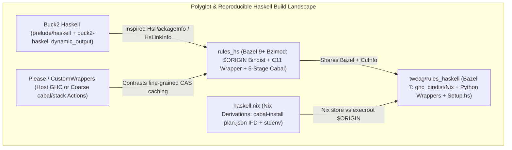
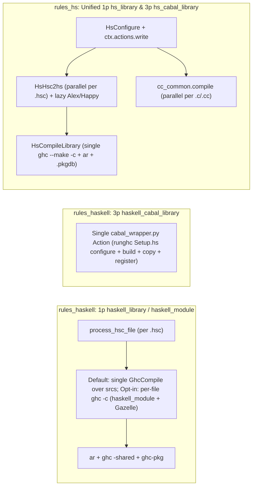
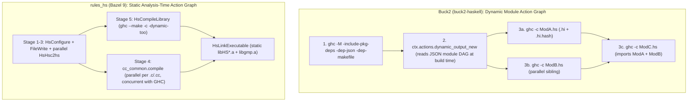

Integrating GHC and the Hackage package ecosystem into a deterministic, polyglot build graph forces every build system to confront five thorny engineering problems simultaneously:

1. **Toolchain hermeticity**: GHC's official Linux binary distributions ("bindists") hardcode upstream build-host paths (`/usr/bin/gcc`, `-fuse-ld=gold`) in `lib/settings` and dynamically import `libgmp.so.10` and `libtinfo.so.6` from the host OS at startup.
2. **C/C++ ABI & header propagation**: Real-world Haskell libraries interleave `ForeignFunctionInterface`, `CApiFFI`, `hsc2hs` C-struct preprocessors, autoconf `./configure` scripts, and C/C++ translation units that consume headers from upstream dependencies.
3. **Module vs. package compilation granularity**: Haskell modules within a library form an internal Directed Acyclic Graph (occasionally with `.hs-boot` mutual recursion cycles) whose edges live inside `.hs` `import` declarations rather than `BUILD` files.
4. **Compile-time execution vs. runtime portability**: Cross-library Template Haskell splices require loading compiled dependency code (including native C FFI symbols) inside GHC at compile time, yet production deployments strongly prefer self-contained static executables free of `libHS*.so` and `libgmp.so.10` runtime dependencies.
5. **Cabal specification complexity**: Hackage `.cabal` manifests evaluate conditional stanzas over OS, CPU, GHC version, package flags, internal/public sublibraries, `Paths_*` autogen modules, and lexer/parser generators (`alex`, `happy`).

> **Note — Background Primers:** This comparison explains every build-system mechanism inline when introduced (including Bazel `TreeArtifact`s, RBE CAS digests, Gazelle, Buck2 dynamic outputs, and Nix IFD). If you want first-principles walkthroughs of Bazel ruleset internals or GHC's compiler architecture first, see [Bazel Ruleset Primer](bazel-rules-primer.md) and [Haskell & GHC Primer](haskell-and-ghc-primer.md).

Different build systems occupy distinct points in this design space. This chapter compares `rules_hs` at the implementation level against **`tweag/rules_haskell`**, **Meta's `facebook/buck2` (`prelude/haskell` and `MercuryTechnologies/buck2-haskell`)**, **Please Build (`pleasings` / custom `.build_defs`)**, **`input-output-hk/haskell.nix`**, and **coarse `cabal`/`stack` wrappers** — examining both where `rules_hs` advances the state of the art on Bazel 9 and where other systems make different trade-offs or ship mature capabilities outside `rules_hs`'s current scope.

---

## 1. Executive Matrix Across Haskell Build Rulesets {#executive-matrix}

| Architectural Axis | `rules_hs` (Bazel 9+) | `tweag/rules_haskell` (Bazel 7) | `facebook/buck2` (`prelude/haskell` & `buck2-haskell`) | Please Build (`.build_defs` / `pleasings` ecosystem) | `input-output-hk/haskell.nix` (& `rules_nixpkgs`) |
|---|---|---|---|---|---|
| **Build engine & module graph** | **Bazel `>= 9.0.0`**, 100% Bzlmod-only (zero `WORKSPACE` files); pure-Starlark extensions with `reproducible = True`. | **Bazel `7.x`** (`.bazelversion = 7.1.0`); hybrid Bzlmod + legacy `WORKSPACE` roots; fails loading on Bazel 8/9. | **Buck2** (`facebook/buck2-prelude` Starlark + BXL); monorepo cell configuration (`.buckconfig`). | **Please (`plz`)** Python-like `.build_defs` subrepos (no official upstream Haskell plugin in `pleasings` or `please-build`). | **Nix** (`mkDerivation` / flakes); `plan-to-nix` uses **Import-From-Derivation (IFD)** unless `materialized` files are committed. |
| **Transitive rule dependency footprint** | **4 non-dev BCR modules**: `platforms`, `bazel_skylib`, `rules_cc`, `gmp` (test/docs deps strictly `dev_dependency = True`). | **13 non-dev `bazel_dep`s**: leaks `rules_java`, `protobuf`, `abseil-cpp`, `rules_proto`, `rules_nodejs`, `aspect_rules_js`, `rules_python`, `rules_sh`, `rules_license`, plus `@stackage`. | Coupled to Buck2's monolithic `prelude/` (`cxx`, `linking`, `python` linkable providers); zero external BCR registry. | Minimal core Go binary, plus whichever custom subrepos/plugins the workspace authors wire manually. | Pulls `nixpkgs`, `haskell.nix` overlays, `nix-tools`, and pinned Hackage/Stackage index tarballs (~multi-GB `/nix/store` closure). |
| **GHC provisioning & Linux hermeticity** | Pure-Starlark `ghc_bindist_repo` (zero `./configure && make install`), `/nonexistent/*` `lib/settings` sanitization, `$ORIGIN` `staged_ghc` + BCR `@gmp` `libgmp.so.10` + 8-symbol `libtinfo.so.6` stub. | `ghc_bindist.bzl` runs host `./configure && make install` (`apt install libgmp-dev libtinfo5`); Linux hermeticity relies on `rules_nixpkgs` populating `/nix/store`. | `HaskellToolchainInfo` expects an externally provisioned monorepo compiler (`platform009/...` at Meta or `/nix/store/...` in `buck2-haskell`). | Custom `build_rule`s typically invoke host `ghc`/`ghc-pkg` from `PATH` or unpack raw bindists without `$ORIGIN` GMP/tinfo shims. | Fully hermetic inside `/nix/store`: Nix builds or patches GHC and binds exact `/nix/store/<hash>-gmp`/`ncurses` `RUNPATH`s. |
| **C/C++ interop & compiler wrapper** | Compiled 552-line C11 `ghc_cc_wrapper` + `rules_cc` `CcInfo` (`--start-group ... --end-group` + `rt_shims`); C-toolchain agnostic (`zig cc`, `toolchains_llvm`, GCC). | Templated Python `cc_wrapper.py.tpl` + `ghc_wrapper.sh` (requires `rules_python`) + `HaskellCcLibrariesInfo` symlink mangling around `LibraryToLink`. | Native `CxxToolchainInfo`, `CPreprocessor`, `MergedLinkInfo`, and `LinkableGraph` across C++, Rust, Python, and Haskell. | Shell flag passthrough (`-optc`/`-optl`) and static `.a` file inputs; lacks Bazel `CcInfo` compilation/linking context merging. | Nix `stdenv` shell `cc-wrapper` + Nixpkgs C derivations (`zlib`, `openssl`, `pkg-config`); isolated from non-Nix build graphs. |
| **Compilation action granularity** | **Unified**: parallel `HsConfigure` + zero-proc codegen + per-file `HsHsc2hs` + parallel `cc_common.compile` + lazy `alex`/`happy` + one `ghc --make -c` per library/sublibrary. | **Split**: 1p `haskell_library` runs single `GhcCompile` (or per-module `ghc -c` via experimental `haskell_module` + Gazelle); 3p `haskell_cabal_library` runs one monolithic Python `cabal_wrapper.py` (`Setup.hs`). | Upstream `prelude/haskell` runs per-library `ghc -no-link`; `MercuryTechnologies/buck2-haskell` uses `dynamic_output_new` + `ghc -M -dep-json` for **per-module `ghc -c`** actions. | Coarse per-library / per-binary `ghc --make` shell actions in custom `build_rule`s. | **Per-component Nix derivations** (`libs`, `sublibs`, `exes`, `tests`), each running Cabal `Setup` monolithically inside that component. |
| **Template Haskell & binary linking** | `-dynamic-too` isolated in `<name>.pkgdb/dyn/libHS*.so` for cross-lib TH, while `hs_binary` links `gmp_static/libgmp.a` for **base-glibc-only `DT_NEEDED`**. | `ghc_bindist` sets `fully_static_link = False` (dynamic `$ORIGIN` `libHS*.so`/`libgmp.so` rpaths); static binaries require Nix + `musl` toolchain; `extra_srcs` stages TH inputs. | Full **5-way matrix**: `LinkStyle` (`static`, `static_pic`, `shared`) × `enable_profiling` (`False`, `True`); shared-lib symlink trees or static links. | Follows host GHC defaults (typically dynamic GMP/libffi `DT_NEEDED` unless manually passed `-static -optl-static`). | Dynamic `/nix/store/...` `RUNPATH` binaries by default; full static ELF binaries supported via `pkgsCross.musl64`. |
| **3p Hackage / Cabal pipeline** | Offline boot-only [`//tools/lock:lock`](../reference/lock-cli.md) (`Cabal-syntax` 4-platform `finalizePD`) -> `hackage.lock.json` -> lazy `@hackage__<pkg>` repos -> 5-stage [`hs_cabal_library`](../reference/rules.md#hs_cabal_library) (zero `Setup.hs`). | `stack_snapshot` (requires `stack` binary + `setup_deps` overrides) -> `cabal_wrapper.py` running `runghc Setup.hs configure/build/copy/register`. | External buckification generators (`cabal-buck2` / monorepo scripts, analogous to `reindeer` for Rust) emitting `haskell_library` / `haskell_prebuilt_library` rules. | Manual `remote_file` + `Setup.hs` or `cabal` `genrule` wrappers; no official Stackage/Hackage lock extension. | `cabal-install` solver -> `plan.json` -> `plan-to-nix` (or `stack-to-nix`), executing real `Setup.hs` hooks per component. |
| **RBE & sandbox compatibility** | **RBE-native**: self-contained execroot inputs, `${pkgroot}` relative DBs, zero `/nix/store`, zero `LD_LIBRARY_PATH`, verified in compiler-free containers. | `ghc_bindist` leaks host OS libs; `rules_nixpkgs` references `/nix/store` outside execroot, breaking standard REAPI workers without pre-mounted Nix stores. | **RE-native** inside Meta's RE infrastructure (uses custom `ghc-pkg --always-use-cache` to bypass RE mtime resets). | Sandboxed via Please namespaces when tools are in-tree, but typically leaks `/usr/bin/ghc` and `/usr/include` from host/worker image. | Hermetic Linux build sandbox + Nix binary caches (`Hydra`, `Cachix`), but incompatible with Bazel REAPI CAS action caching. |
| **Auxiliary ecosystem integrations** | Native [`hs_haddock`](../reference/rules.md#hs_haddock) (`$ORIGIN`-staged GHC Haddock with QuickJump & hyperlinked source) + dogfooded vanilla Hakyll + Pandoc + Skylighting SSG (`//docs`); lazy `alex`/`happy`; Linux `x86_64`+`arm64` active (macOS/Windows/musl cataloged). | `haskell_doc` (Haddock), `haskell_repl` (`hie-bios`), `haskell_proto_library`, `ghc_plugin`, `c2hs`, `haskell_doctest`, `-prof`, HPC coverage, macOS & Windows. | `haskell_ghci`, `haskell_haddock`, `haskell_ide` (BXL), `-prof` profiling libraries, persistent GHC workers (`buck2-haskell`), `ghc_plugin`. | DIY `genrule`s only. | Full Haddock, `shellFor` + `haskell-language-server`, `build-type: Custom`, cross-compilation (`musl64`, `mingwW64`, `ghcjs`, `wasm32-wasi`). |

---

## 2. Deep Dive 1: `rules_hs` vs. `tweag/rules_haskell` (Bazel) {#deep-dive-rules-haskell}

`tweag/rules_haskell` pioneered Haskell support in Bazel and proved that GHC, `ghc-pkg`, C FFI, Template Haskell, and Stackage snapshots can coexist in a Bazel workspace. Because `rules_hs` targets the same build tool (Bazel), understanding the exact structural differences across their seven core subsystems clarifies why `rules_hs` was architected from scratch for Bazel 9+.

### 2.1 Module System & Transitive Dependency Graph {#rh-module-graph}

In `MODULE.bazel`, every non-dev `bazel_dep` and `use_extension` declared by a ruleset becomes part of the resolved module graph of **every downstream consumer** ( whereas `dev_dependency = True` declarations are automatically pruned by Bazel when the ruleset is consumed as a `bazel_dep`; see [Ruleset vs. Consumer Repository](bazel-rules-primer.md#ruleset-vs-consumer)):

- **`rules_hs` (`MODULE.bazel`)**: Sets `bazel_compatibility = [">=9.0.0"]`, contains zero `WORKSPACE` files, and declares exactly **four** non-dev BCR dependencies: `platforms@1.1.0`, `bazel_skylib@1.9.2`, `rules_cc@0.2.28`, and `gmp@6.3.0.bcr.5`. Test and documentation dependencies (`hermetic_cc_toolchain`, `rules_shell`, and the 182-package `//docs` Hackage closure) are fenced behind `dev_dependency = True` and continuously audited by `//tests/rules:bzlmod_hygiene_test`.
- **`tweag/rules_haskell` (`MODULE.bazel` on `master` / `1.0`)**: Pins `.bazelversion = 7.1.0` and declares **13 non-dev `bazel_dep`s**: `platforms@0.0.10`, `rules_java@7.4.0`, `rules_license@1.0.0`, `abseil-cpp@20240116.3`, `protobuf@27.0` (requiring a `single_version_override` patch file), `rules_cc@0.0.15`, `rules_nodejs@5.8.3`, `rules_python@0.21.0`, `rules_shell@0.2.0`, `bazel_skylib@1.7.1`, `rules_proto@5.3.0-21.7`, `aspect_rules_js@1.34.0`, and `rules_sh@0.4.0`. In addition, its non-dev root scope evaluates `asterius`, provisions `node.toolchain(node_version = "16.9.0")` + `npm.npm_translate_lock` (`pnpm-lock.yaml`), registers `@all_bindist_toolchains//:all` and `@rules_haskell_python_local//:toolchain` without `dev_dependency = True`, and imports `use_repo(stack_snapshot, "stackage")` unconditionally because `haskell/cabal.bzl` hardcodes `@stackage` references inside macro expansion.

On Bazel 8 and Bazel 9, `rules_haskell` fails during module loading before a single target is analyzed: `WORKSPACE` support is removed in Bazel 9, `rules_sh@0.4.0` and `haskell/private/get_cpu_value.bzl` invoke removed legacy CPU/platform APIs, and `aspect_rules_js@1.34.0` attempts to load removed built-in repository rules.

### 2.2 Toolchain Provisioning, `/nix/store`, and RBE CAS Portability {#rh-toolchain-hermeticity}

> **Context — Remote Build Execution (RBE), CAS Digests, and `/nix/store`:** In Bazel's **Remote Execution API (REAPI)**, build actions do not run on the developer's laptop. Instead, Bazel hashes every declared input file by its SHA-256 content digest, uploads missing blobs to a shared **Content-Addressable Storage (CAS)** service, and instructs a stateless remote worker container to materialize *only* those declared blobs inside a relative sandbox directory (`execroot/`).
>
> **Nix**, by contrast, stores packages on the host filesystem under absolute paths like `/nix/store/<32-char-hash>-ghc-9.10.3/...` managed by a local `nix-daemon`. If a Bazel rule symlinks to `/nix/store/...`, any action sent to a standard RBE worker fails immediately because `/nix/store` lives *outside* `execroot/` and does not exist on standard remote worker images!

Official Haskell.org `deb10` tarballs ship dynamically linked compiler executables (`ghc`, `ghc-pkg`, `hsc2hs`, `haddock`, `ghc-iserv-dyn`) that carry a relocatable ELF `RUNPATH` (`$ORIGIN/../lib/<arch>-linux-ghc-<ver>`, where the Linux dynamic loader expands `$ORIGIN` to the directory containing the running executable), bundle `libffi.so.8` + `libCffi.a`, and already contain a relocatable `lib/package.conf.d/package.cache` (`${pkgroot}/../lib/...`):

- **How `rules_haskell` provisions GHC**:
  1. **`haskell/ghc_bindist.bzl`**: Unpacks the tarball into `bindist_unpacked/`, edits `mk/config.mk.in` (`RelocatableBuild = YES`), verifies `ctx.which("make")` on the host, and executes `./configure --prefix ... && make install` during `bazel fetch`. That forces developers and CI runners to pre-install `build-essential`, `perl`, `libgmp-dev`, and `libtinfo5` on the host OS (as seen in `rules_haskell`'s BCR `presubmit.yml`).
  2. **`rules_nixpkgs` (`haskell/nixpkgs.bzl`)**: To eliminate host drift on Linux, `rules_haskell` recommends `rules_nixpkgs`, which invokes a local `nix-build` daemon during repository fetch and symlinks `/nix/store/<hash>-ghc-...` into Bazel. Because `/nix/store` lives outside Bazel's `execroot`, standard RBE workers reject or miss `/nix/store` paths unless every remote worker image shares a pre-populated Nix store, and BCR modules cannot depend on `rules_nixpkgs` cleanly (`rules_haskell` issue #2451).
- **How `rules_hs` provisions GHC ([Hermeticity & Toolchain](hermeticity.md))**:
  1. **Pure-Starlark fetch (`ghc_bindist_repo`)**: Calls `repository_ctx.download_and_extract`, rewrites all 12 tool keys in `lib/settings` to `/nonexistent/*` (and strips `-fuse-ld=gold`) so host `/usr/bin/*` binaries can never silently execute, and parses `lib/package.conf.d/*.conf` directly in Starlark without spawning `ghc-pkg`.
  2. **`$ORIGIN` build-phase staging (`staged_ghc`)**: Compiles `libgmp.so.10` hermetically from BCR `@gmp//:gmp`'s PIC archive (`HsLinkGmpShared`) and compiles a 56-line 8-symbol `libtinfo.so.6` stub (`NCURSES6_TINFO_5.0.19991023`, `hs/private/tinfo_stub.c`), placing both inside `<prefix>/lib/<arch_libdir>/` next to `<prefix>/bin/ghc-<ver>`. Every tool runs under `env -i PATH=/nonexistent` with zero `LD_LIBRARY_PATH`, zero `patchelf`, and 100% `execroot`-tracked RBE CAS digests.

### 2.3 C Compiler Wrapper & `CcInfo` Interop {#rh-cc-interop}

> **Context — What `CcInfo` Is in Bazel:** `CcInfo` (`@rules_cc//cc/common:cc_info.bzl`) is Bazel's standard provider for native C/C++ targets (`cc_library`). It bundles two transitive structures: a `compilation_context` (C/C++ header files, `-I`/`-isystem` include paths, and `-D` preprocessor defines) and a `linking_context` (`LibraryToLink` static `.a` and shared `.so` archives plus linker flags like `-lm`). Rulesets that consume and return `CcInfo` natively can depend on any `cc_library` in a polyglot workspace seamlessly (see [Interoperating with C/C++ via `rules_cc` and `CcInfo`](bazel-rules-primer.md#cc-interop)).

GHC delegates C preprocessing, C/C++ compilation, object merging (`ld -r` for `CApiFFI`), and final linking to external tools via `-pgm*` flags:

- **`rules_haskell` (`cc_wrapper.py.tpl` + `HaskellCcLibrariesInfo`)**: Generates a templated Python wrapper script (`haskell/private/cc_wrapper.py.tpl`) paired with `ghc_wrapper.sh`. Every compile, `hsc2hs`, and link action therefore pulls `rules_python` and a Python interpreter into its sandbox input closure and pays Python startup latency on every compiler subprocess. For `CcInfo` dependencies, `haskell/private/cc_libraries.bzl` wraps `LibraryToLink` entries in custom `HaskellCcLibrariesInfo` / `HaskellCcLibraryInfo` providers and creates mangled symlink directories so GHC's `-l<lib>` search picks static vs. dynamic libraries.
- **`rules_hs` (`ghc_cc_wrapper` + direct `CcInfo` archive groups)**: Compiles a zero-dependency 552-line POSIX C11 binary (`hs/private/cc_wrapper.c`) once in `cfg = "exec"`. `ghc_cc_wrapper` scrubs `RUNFILES_*` variables, intercepts `--print-file-name`, rewrites `@response_file` tokens (`-Wl,-h` -> `-Wl,-soname`, `-fno-PIC` -> `-fPIC`, `.dyn_o`/`.p_o` -> temporary `.o` symlinks), injects `-nostdinc++` on non-C++ invocations so `hermetic_cc_toolchain`'s `zig c++` header order never masks `_GNU_SOURCE` in `hsc2hs`, and `execv`s Bazel's resolved `cc_toolchain` directly. At link time, `extract_cc_static_libs_and_flags` passes static `.a` files directly via `-optl<lib.a>` inside `-optl-Wl,--start-group ... -optl-Wl,--end-group` (plus `//hs/private:rt_shims`), avoiding `-l<name>` symlink mangling entirely.

### 2.4 Compilation Granularity: `ghc --make -c` vs. `GhcCompile`, `haskell_module` (Gazelle) & `cabal_wrapper.py` {#rh-compilation-granularity}

Action granularity is one of the most nuanced architectural contrasts between `rules_hs` and `tweag/rules_haskell`, because `rules_haskell` actually uses **three different compilation strategies** depending on whether code is first-party, Gazelle-modularized, or third-party Cabal:

1. **First-party default (`haskell_library` in `rules_haskell` vs. [`hs_library`](../reference/rules.md#hs_library) in `rules_hs`)**:
   - By default, `rules_haskell`'s `haskell/private/actions/compile.bzl` also compiles all `srcs` of a `haskell_library` in a single `GhcCompile` invocation (`ghc -c` / `-no-link`), pre-declaring individual `.o`, `.hi`, `.dyn_o`, and `.dyn_hi` `File` outputs from its Starlark `module_map` before running separate archiving and `ghc-pkg` registration actions.
   - `rules_hs`'s [`hs_library`](../reference/rules.md#hs_library) compiles `c_sources` concurrently via `cc_common.compile` and runs a single `HsCompileLibrary` action (`ghc --make -c -fPIC -dynamic-too`), emitting static `libHS<unit_id>.a` and a single `<name>.pkgdb` [`TreeArtifact`](bazel-rules-primer.md#rules-and-actions) (`hi/`, `dyn/`, `<unit_id>.conf`, `package.cache`) while auto-discovering `exposed-modules` directly from produced `.hi` files (so users never have to maintain module maps or `src_strip_prefix` boilerplate).
2. **Opt-in per-module compilation (`haskell_module` + Gazelle in `rules_haskell`)**:
   - **Why Bazel needs Gazelle for per-module rules**: In Bazel, Starlark rule analysis runs *before* any source file can be opened ([Phase 2 Analysis](bazel-rules-primer.md#three-phases)), so a Bazel rule cannot read `import Foo.Bar` statements inside `.hs` files to wire per-module actions automatically. [Gazelle](https://github.com/bazel-contrib/bazel-gazelle) is a popular Bazel code-generation CLI tool that scans source files on disk ahead of time and writes explicit targets into `BUILD.bazel` files.
   - `rules_haskell`'s experimental `haskell_module` rule (`@rules_haskell//haskell/experimental:defs.bzl`) pairs with [`tweag/gazelle_haskell_modules`](https://github.com/tweag/gazelle_haskell_modules), which parses `.hs` `import` headers and rewrites `BUILD.bazel` with one `haskell_module(name = "lib.A.B", src = "src/A/B.hs", deps = [":lib.C.D"])` target per file, aggregated by `haskell_library(modules = [...])`.
3. **Third-party Hackage (`cabal_wrapper.py` in `rules_haskell` vs. 5-stage [`hs_cabal_library`](../reference/rules.md#hs_cabal_library) in `rules_hs`)**:
   - For Hackage packages, `rules_haskell` abandons fine-grained actions completely: `haskell/private/cabal_wrapper.py` executes `runghc Setup.hs configure`, `build`, `copy`, and `register` inside **one monolithic Python action** per package — compiling `Setup.hs`, running `./configure`, running `hsc2hs` serially, compiling all `.c` files inside Cabal, and running GHC in a single opaque sandbox.
   - `rules_hs` instead brings **third-party Hackage onto the exact same fine-grained action foundation as first-party code** via [`hs_cabal_library`](../reference/rules.md#hs_cabal_library): Stage 1 `HsConfigure` (`build-type: Configure` only), Stage 2 zero-subprocess `ctx.actions.write` (`cabal_macros.h` + `Paths_*`), Stage 3 parallel per-file `HsHsc2hs` (plus lazy boot-bootstrapped `alex`/`happy`), Stage 4 parallel per-file `cc_common.compile` (**running concurrently with Stage 5!**), and Stage 5 `HsCompileLibrary` (`ghc --make -c`).

> **Important — Honest Granularity Trade-Off (Per-Module `haskell_module` vs. Per-Library `ghc --make -c`):** Choosing one `ghc --make -c` per library rather than Gazelle-generated `haskell_module` (`ghc -c`) rules is a deliberate engineering trade-off:
>
> - **Where `haskell_module` (`ghc -c`) wins**: If a single first-party library contains **200+ modules** and a developer edits one leaf `.hs` file, `haskell_module` recompiles only that single `.o`/`.hi` (and any intra-library downstream importers whose `.hi` ABI changed), whereas `ghc --make -c` re-executes the library's `HsCompileLibrary` action.
> - **Where `ghc --make -c` wins**: Every independent `ghc -c` action pays ~150–300 ms of GHC startup and boot/transitive `.hi` deserialization overhead, requires re-running an external Gazelle import-scanner whenever `import` lines or CPP `#ifdef` imports change, and complicates `.hs-boot` mutual recursion cycles and `CApiFFI` C stub generation. By keeping [`hs_library`](../reference/rules.md#hs_library) zero-codegen (`srcs = glob(["src/**/*.hs"])` with native `.hs-boot` support) and encouraging **idiomatic, small Bazel `hs_library` packages** (matching `go_library` in `rules_go` and `rust_library` in `rules_rust`), `rules_hs` gets package-DAG parallelism and RBE caching without external `BUILD`-generation daemons.

### 2.5 Provider Design, `TreeArtifact`s & `${pkgroot}` Layout {#rh-providers}

> **Context — Bazel `TreeArtifact`s (`declare_directory`):** A Bazel **`TreeArtifact`** (`ctx.actions.declare_directory`) is an opaque directory output whose internal file names do not need to be predicted during Starlark Analysis ([Rules, Actions, Files, and TreeArtifacts](bazel-rules-primer.md#rules-and-actions)). However, Bazel enforces a strict invariant: **no standalone `File` output may be declared at a path inside or overlapping a `TreeArtifact` directory**.

- **`rules_haskell` (`haskell/providers.bzl`)**: Defines **11 Starlark providers**, led by the 19-field `HaskellInfo` (`package_databases`, `empty_lib_package_databases`, `version_macros`, `import_dirs`, `source_files`, `module_names`, `boot_files`, `extra_source_files`, `hs_libraries`, `deps_hs_libraries`, `interface_dirs`, `deps_interface_dirs`, `compile_flags`, `per_module_transitive_*`, ...) alongside `HaskellLibraryInfo`, `HaskellCabalArgsInfo`, `HaskellToolchainLibraryInfo`, `HaskellCoverageInfo`, `HaddockInfo`, `HaskellLintInfo`, `HaskellProtobufInfo`, `C2hsLibraryInfo`, `GhcPluginInfo`, and `HaskellCcLibrariesInfo`. In `cabal_wrapper.py`, staging `{name}_iface`, `lib`, and `{name}.conf.d` under `pkgroot` historically triggered Bazel `TreeArtifact` path-overlap bugs between static `libHS*.a` archives and `.hi` interface directories (`rules_haskell` issues #2496 and #2499), requiring archive relocation and regex post-processing of `.conf` files.
- **`rules_hs` (`hs/providers.bzl`, [Providers & Action Graph](providers-and-actions.md))**: Defines **4 focused providers** — direct-only [`HsPackageInfo`](../reference/extensions-and-providers.md#hspackageinfo) (8 fields), transitive `depset`-backed [`HsLinkInfo`](../reference/extensions-and-providers.md#hslinkinfo) (5 fields), [`HsToolchainInfo`](../reference/extensions-and-providers.md#hstoolchaininfo) (21 fields), and [`HsHaddockInfo`](../reference/extensions-and-providers.md#hshaddockinfo) (4 fields) — paired directly with `rules_cc`'s standard `CcInfo`. Every library declares `libHS<unit_id>.a` (`declare_file`) and `<name>.pkgdb` (`declare_directory`) as **non-overlapping siblings** in `bazel-out/<cfg>/bin/<pkg>/`, so `library-dirs: ${pkgroot}` resolves cleanly to `<parent>/libHS<unit_id>.a` and `import-dirs: ${pkgroot}/<name>.pkgdb/hi` resolves to `<parent>/<name>.pkgdb/hi` with zero regex rewriting.

### 2.6 Template Haskell (`-dynamic-too`) & Binary Linking {#rh-th-and-linking}

> **Context — Template Haskell & GHC's `-dynamic-too` Flag:** [Template Haskell (TH)](haskell-and-ghc-primer.md#template-haskell) is Haskell's compile-time metaprogramming system (analogous to Rust procedural macros): while compiling library `B`, GHC executes Haskell functions imported from library `A` to generate AST or embed files. Because official Linux GHC binaries are dynamically linked (`GHC Dynamic = YES`), GHC's runtime loader (`dlopen`) must load library `A` as a position-independent `.so` shared library during compilation — yet operators deploying final `hs_binary` services want **statically linked** `.a` archives so production containers do not need hundreds of `libHS*.so` and `libgmp.so.10` shared libraries! GHC's **`-dynamic-too`** flag instructs `ghc --make -c` to emit **both** static (`.o`/`.hi`) and dynamic (`.dyn_o`/`.dyn_hi`) object files in a single compiler pass.

- **`rules_haskell`**: Instantiates `haskell_toolchain` in `ghc_bindist.bzl` with `fully_static_link = False, # XXX not yet supported for bindists`. Consequently, Linux bindist builds link user executables dynamically against transitive `libHS*.so`, `libgmp.so.10`, and `libffi.so.8` via `$ORIGIN` rpath chains; obtaining standalone static binaries requires switching to a Nix-built `musl` GHC toolchain (`fully_static_link = True`, `static_runtime = True`). Compile-time files read by TH splices are passed via `extra_srcs`.
- **`rules_hs` ([Providers & Action Graph](providers-and-actions.md#template-haskell))**: Achieves **both** zero-configuration cross-library dynamic TH and static-GMP user binaries simultaneously through `${pkgroot}` directory isolation:
  1. `HsCompileLibrary` compiles once with `-fPIC -dynamic-too`, writes static `libHS<unit_id>.a` to `${pkgroot}`, and links `.dyn_o` objects (plus `--whole-archive` native C FFI archives and `rt_shims`) into `<name>.pkgdb/dyn/libHS<unit_id>-ghc<ver>.so`, registered solely under `dynamic-library-dirs: ${pkgroot}/<name>.pkgdb/dyn`.
  2. During downstream compilation, GHC's TH loader resolves `.so` libraries from `dynamic-library-dirs` across arbitrary multi-hop Hackage and C-FFI boundaries (`file-embed`, `aeson`, `skylighting`, `pandoc`), with `data` files staged into `pkg_cwd` inside the compile sandbox.
  3. During `HsLinkExecutable` ([`hs_binary`](../reference/rules.md#hs_binary) / [`hs_test`](../reference/rules.md#hs_test)), GHC links in static mode strictly against `${pkgroot}/libHS<unit_id>.a` and `staged_ghc/gmp_static/libgmp.a` (a directory containing zero `.so` files), producing an ELF executable whose `DT_NEEDED` header contains **only** base `glibc` (`libc.so.6`, `libm.so.6`, `libdl.so.2`, `libpthread.so.0`).

### 2.7 Hackage Resolution (`//tools/lock` vs. `stack_snapshot`) {#rh-hackage}

- **`rules_haskell` (`stack_snapshot`)**: Invokes an external `stack` CLI binary (or requires `@stackage-unpinned//:pin` alongside committed `stackage_snapshot.json`), frequently requires manual `setup_deps = ["@Cabal//:Cabal"]` overrides when pinned (`rules_haskell` issue #1871, visible in `rules_haskell`'s own `MODULE.bazel`), requires users to declare manual `haskell_toolchain_library` targets if `@stackage` is not used for boot packages, and fails to propagate C headers from C-only Cabal packages natively through `CcInfo`.
- **`rules_hs` ([`//tools/lock:lock`](../reference/lock-cli.md) + [`hackage`](../reference/extensions-and-providers.md#hackage), [Hackage & Cabal Pipeline](ecosystem-and-hackage.md))**: Compiles `//tools/lock:lock` exclusively from `@hs_boot` (`Cabal-syntax` — zero host `stack`, `cabal`, or Python), evaluates `finalizePD` in two passes across 4 OS/CPU platforms (`linux_x86_64`, `linux_arm64`, `macos_arm64`, `macos_x86_64`) into a compact `select()`-factored `hackage.lock.json`, synthesizes `@hs_boot` and `@hackage` boot targets automatically, short-circuits C-only packages (`zlib-clib`, `libyaml-clib`) after Stage 4 into pure `CcInfo` targets, normalizes doctest-only `Custom` setups (`xml-conduit`), and lazily bootstraps `alex-3.5.4.2` and `happy-2.1.7` from `@hs_boot` (`hs/private/cabal_codegen.bzl`) only when a locked package contains `.x`/`.y`/`.ly` grammars.

### 2.8 Feature Scope & Honest Gaps {#rh-feature-gaps}

While `rules_hs` solves Bazel 9 Bzlmod hygiene, Nix-free Linux hermeticity, static-GMP binary portability, hermetic Haddock API docs, and fine-grained Hackage builds cleanly, `tweag/rules_haskell` has had years of production hardening across auxiliary workflows that `rules_hs` intentionally keeps out of its core ruleset or on its roadmap today:

| Capability | `tweag/rules_haskell` Status | `rules_hs` Status & Roadmap Approach |
|---|---|---|
| **Haddock API docs (`hs_haddock` / `haskell_doc`)** | Mature `haskell_doc` rule & `haskell_doc_aspect` (`HaddockInfo` cross-linked `.haddock` interfaces + HTML). | **Supported**: Native [`hs_haddock`](../reference/rules.md#hs_haddock) rule ([`HsHaddockInfo`](../reference/extensions-and-providers.md#hshaddockinfo)) running `$ORIGIN`-staged `bin/haddock-ghc-<ver>` with `--hyperlinked-source`, `--quickjump`, boot `.haddock` links, and cross-target `haddock_deps` (an automatic aspect over arbitrary dependency graphs remains future work). |
| **Interactive REPL & IDE (`haskell_repl`)** | Mature `haskell_repl` rule (`@ghcide` / `hie-bios` wrapper scripts loading transitive targets into GHCi). | Planned (`hs_repl` generating a hermetic GHCi response script + optional real `ncurses` `libtinfo` provider for interactive line editing; see [Dependency Decisions](dependencies.md)). |
| **Protobuf integration (`haskell_proto_library`)** | Built-in `haskell_proto_library` (`proto-lens-protoc` aspect — at the cost of pulling `protobuf`/`rules_proto` into `MODULE.bazel`). | Intentionally kept **out of core `MODULE.bazel`** to preserve the 4-module footprint; designed to live in an optional companion module (`rules_hs_proto`) using `proto-lens-protoc` from `@hackage`. |
| **GHC compiler plugins (`ghc_plugin`)** | Built-in `ghc_plugin` rule (`GhcPluginInfo` staging `-fplugin=` packages and args). | Users can pass `-fplugin=<Mod>` via `ghc_opts` when the plugin package is in direct `deps` (compiled `.so` is already staged in `.pkgdb/dyn/`); dedicated `hs_plugin` rule for hidden plugin deps is future work. |
| **GHC profiling (`-prof`) & HPC coverage** | Built-in `-c dbg` / `with_profiling` (`.p_o` / `.p_hi`) and `bazel coverage` (`HaskellCoverageInfo` + `hpc`). | `cc_wrapper.c` already handles `.p_o` object aliasing; Starlark `-prof` build-setting transition and `hpc` test coverage collection are planned extensions. |
| **`c2hs` & `haskell_doctest`** | Built-in `c2hs_library` (`C2hsLibraryInfo`) and `haskell_doctest` rules. | `hsc2hs`, `alex`, and `happy` are built-in; `c2hs` and `doctest` are deferred until consumer demand warrants lazy `@hackage` bootstrap rules ([Dependency Decisions](dependencies.md)). |
| **macOS & Windows execution** | Active `ghc_bindist` + `cc_wrapper` support on macOS and Windows (`cc_wrapper_windows.sh.tpl`). | Bindist URLs/SHA-256s and 4-platform `hackage.lock.json` `select()` stanzas are already wired; Mach-O `@loader_path` and Win32 `cc_wrapper.c` activation blueprints are specified in [Cross-OS & Platforms](cross-os-and-platforms.md). |
| **Arbitrary `build-type: Custom` `Setup.hs`** | Handled inherently because `cabal_wrapper.py` compiles and runs `Setup.hs` on every package. | Doctest-only `Custom` setups (`cabal-doctest`) are normalized to `Simple`; packages with non-trivial `Setup.hs` codegen hooks (`gi-gtk`, `HsOpenSSL`) will require an opt-in `hs_cabal_custom_library` fallback rule. |

---

## 3. Deep Dive 2: `rules_hs` vs. `facebook/buck2` (`prelude/haskell` & `buck2-haskell`) {#deep-dive-buck2}

[Buck2](https://buck2.build) is Meta's open-source Rust-based successor to Buck, using Starlark rules (`BUCK` files) similar to Bazel's `BUILD.bazel`. Buck2 hosts two closely related Haskell implementations worth examining together:

1. **Upstream `facebook/buck2` (`prelude/haskell/`)**: Meta's production Starlark prelude (`haskell.bzl`, `compile.bzl`, `library_info.bzl`, `link_info.bzl`, `toolchain.bzl`, `haskell_ghci.bzl`, `haskell_haddock.bzl`, `haskell_ide.bzl`), designed for Meta's internal monorepo (such as Sigma / Haxl anti-abuse workloads).
2. **`MercuryTechnologies/buck2-haskell` (& `simonmar/haskell-buck2` / `cabal-buck2`)**: An open-source evolution of `prelude/haskell` co-developed by Mercury Technologies and Tweag that adds Buck2 **dynamic dependencies (`ctx.actions.dynamic_output_new`)** and persistent GHC workers for module-level incrementality.

### 3.1 Shared Architectural DNA: Direct vs. Transitive Providers {#buck2-shared-dna}

`rules_hs`'s provider split in `hs/providers.bzl` was directly inspired by `prelude/haskell/library_info.bzl` and `link_info.bzl`:

- In Buck2, `HaskellLibraryProvider` carries a single target's `HaskellLibraryInfo` (`name`, `db`, `id`, `import_dirs`, `stub_dirs`, `libs`, `version`), whereas `HaskellLinkInfo` carries a `transitive_set` (`HaskellLibraryInfoTSet` — Buck2's equivalent of Bazel's `depset`) of all transitive libraries, and native C/C++ link inputs propagate through Buck2's `MergedLinkInfo` and `CPreprocessor`.
- `rules_hs` maps those three layers cleanly onto Bazel 9: [`HsPackageInfo`](../reference/extensions-and-providers.md#hspackageinfo) (direct), [`HsLinkInfo`](../reference/extensions-and-providers.md#hslinkinfo) (`depset` transitive closure), and `rules_cc`'s `CcInfo`.

Two subtle implementation details differ in how package visibility and registration are wired:

1. **Explicit `base` & `-hide-all-packages`**: Upstream `prelude/haskell/compile.bzl` passes `-package-env=-`, implicitly exposes `base` (`-expose-package base` or `-package base`), and exposes direct dependencies by package name (`-expose-package <pkg>`). `rules_hs` passes `-hide-all-packages` and unhides direct dependencies strictly by exact `-package-id <unit_id>` — requiring even `@hs_boot//:base` to be declared explicitly and preventing ambiguous package-name collisions when multiple versions or sublibraries exist.
2. **Standard `ghc-pkg recache` vs. patched `--always-use-cache`**: Remote Execution systems normalize file modification timestamps (`mtime`) to a fixed epoch (such as `1980-01-01`) inside sandboxes so timestamps cannot invalidate caches; if `package.cache` appears older than `.conf` files, stock `ghc-pkg` may warn or re-parse `.conf` files. In `prelude/haskell/haskell.bzl`, `_make_package` registers `.conf` files via `GHC_PACKAGE_PATH` and supports a Meta-specific patched `ghc-pkg --always-use-cache` flag (`HaskellToolchainInfo.support_always_use_cache`). `rules_hs` works with **unmodified upstream GHC bindists**, writing `${pkgroot}`-relative `.conf` files (`hs-libraries: HS<unit_id>`) and running `ghc-pkg --global-package-db=... --package-db="$PKG_DB" recache` inside the exact same action that produces `<name>.pkgdb/package.cache`, keeping relative timestamps consistent across CAS uploads.

### 3.2 Dynamic Action Graphs (`dynamic_output_new`) vs. Static Starlark Graphs (`ghc --make -c`) {#buck2-dynamic-graphs}

> **Context — Static vs. Dynamic Action Graphs & `ghc -M`:** In Bazel, the **Analysis Phase** finishes building 100% of the action graph *before* the **Execution Phase** runs a single command ([Bazel's Three Phases](bazel-rules-primer.md#three-phases)). No Bazel action can read the output of an earlier compile step and spawn new sub-actions on the fly.
>
> **Buck2** relaxes that wall in one controlled place via **`ctx.actions.dynamic_output_new`**: a rule can run a first build action (for example **`ghc -M -dep-json`**, GHC's fast import-header dependency scanner analogous to `gcc -M` emitting C header Makefile rules), pause to read the emitted JSON file inside a Starlark callback *mid-build*, and dynamically register downstream compile actions based on what `ghc -M` discovered!

While upstream `facebook/buck2/prelude/haskell/compile.bzl` compiles all `srcs` of a `haskell_library` in a single `ghc -no-link` action (very similar to `rules_hs`), **`MercuryTechnologies/buck2-haskell`** exploits `dynamic_output_new` for per-module compilation:

- **How `buck2-haskell` works**: During execution, an initial action invokes `ghc -M -include-pkg-deps -dep-json <out> -dep-makefile <mk>` (or a persistent multi-unit GHC worker). Buck2 then runs a Starlark `dynamic_output_new` callback that reads the emitted JSON dependency map and dynamically spawns one `ghc -c` action per `.hs` module — also computing `.hi.hash` ABI digests for **early cutoff** (skipping recompilation of `ModC.hs` if `ModA.hs`'s internal function body changed without altering `ModA.hi`'s exported interface) and using `-fprefer-byte-code` for TH. That achieves per-module incrementality **without** running `gazelle_haskell_modules` to pre-generate `BUCK` targets!
- **Why `rules_hs` uses static action graphs**: Bazel intentionally preserves a strict boundary between Analysis (where Starlark constructs the complete action graph in memory, enabling instant offline `bazel query`, `bazel aquery`, and Skyframe analysis caching without running `ghc -M` subprocesses) and Execution. Within Bazel's static graph model, decomposing `./configure`, `cabal_macros.h`, per-file `hsc2hs`, lazy `alex`/`happy`, and parallel `cc_common.compile` into separate actions while running one `ghc --make -c` per library hits the clean sweet spot: zero dynamic-graph Skyframe complexity, zero external Gazelle codegen, native `.hs-boot` support, and fast cold/CI builds across well-factored libraries.

### 3.3 Linking Matrix (`LinkStyle` × `prof`) vs. Static-Executable + Isolated `dyn/` TH {#buck2-linking-matrix}

- **Buck2's 5-way compilation matrix**: In `prelude/haskell/haskell.bzl`, a `haskell_library` populates `HaskellLibraryProvider` and `HaskellLinkInfo` dictionaries keyed by `LinkStyle` (`static`, `static_pic`, `shared`) across both `enable_profiling = False` and `enable_profiling = True` (skipping unsupported `shared` + `prof`), wired into Buck2's C++ `LinkableGraph` and `create_shlib_symlink_tree` for fast dynamic development links in massive monorepos.
- **`rules_hs`'s single-pass static + TH-dynamic split**: Rather than multiplying library compile actions across three `LinkStyle`s, `rules_hs` compiles each library once with `-fPIC -dynamic-too`, isolating `<name>.pkgdb/dyn/libHS*.so` strictly for compile-time Template Haskell while linking all executables statically against `${pkgroot}/libHS*.a` and `gmp_static/libgmp.a`. Developers pay for a single `ghc --make -c` pass and immediately obtain production-portable binaries with zero shared-library symlink trees.

### 3.4 Toolchain & Third-Party Ecosystem Provisioning {#buck2-toolchains-and-hackage}

Buck2's `prelude/` intentionally contains **zero toolchain downloaders and zero package-manager resolvers**:

- `prelude/haskell/toolchain.bzl` defines a 24-field `HaskellToolchainInfo` provider (`compiler`, `packager`, `linker`, `haddock`, `ghci_script_template`, `ghci_iserv_path`, ...) that each organization must populate from its own monorepo infrastructure (`fbcode` platform trees at Meta, or a Nix flake in `MercuryTechnologies/buck2-haskell`).
- Third-party Hackage packages must be translated into `BUCK` files by an external tool (such as Simon Marlow's `cabal-buck2` plugin or custom Nix/Cabal buckification scripts, analogous to Meta's `reindeer` tool for Rust Cargo crates).
- By contrast, `rules_hs` is **self-contained out of the box**: a 15-line `MODULE.bazel` stanza ([`hs.toolchain`](../reference/extensions-and-providers.md#hs-toolchain) + [`hackage.from_lock`](../reference/extensions-and-providers.md#hackage-from_lock)) downloads and stages GHC hermetically, synthesizes `@hs_boot` and `@hackage`, and builds 180+ Hackage packages (`//docs` and `examples/size`) with zero external Nix or buckification infrastructure.

---

## 4. Deep Dive 3: Please Build, `haskell.nix`, and Coarse Cabal/Stack Wrappers {#deep-dive-please-nix-wrappers}

### 4.1 Please Build (`thought-machine/pleasings` & Custom `.build_defs`) {#please-build}

[Please (`plz`)](https://please.build) is a Go-based polyglot build system inspired by Bazel and Buck. Examining how Haskell fits into the Please ecosystem highlights the value of first-class provider and toolchain primitives:

- **Upstream ecosystem status**: While `thought-machine/pleasings` and the newer `please-build/*-rules` plugin repositories maintain official rules for C/C++, Go, Rust, Python, Java, Scala, Nim, and Protobuf, **neither `pleasings` nor `please-build` ships an official maintained Haskell plugin**. Teams using Please with Haskell author custom `haskell.build_defs` (`subinclude(...)`) wrapping Please's generic `build_rule(...)` primitive into `haskell_library`, `haskell_binary`, `haskell_test`, and `hackage` tarball rules.
- **How Please `haskell.build_defs` rules operate in practice**:
  - **Host GHC & `ghc-pkg` assumptions**: Custom `build_rule` commands typically reference `CONFIG.HASKELL.GHC_TOOL` (`ghc`, `ghc-pkg`, `hsc2hs`) resolved from the host `PATH` — or download a raw GHC bindist via `remote_file` without sanitizing `lib/settings` and without `$ORIGIN` `libgmp.so.10` / `libtinfo.so.6` shims, leaving builds dependent on host `libgmp`, `libtinfo`, and `/usr/bin/cc`.
  - **Package-conf chaining without direct/transitive visibility separation**: Please rules propagate transitive outputs via `exported_deps` / `requires = ["haskell"]` and assemble `-package-db` flags across output directories in shell snippets, frequently exposing all transitive `.conf` entries unless each rule carefully tracks direct unit IDs alongside `-hide-all-packages`.
  - **Lack of `CcInfo` & C compiler wrapper**: Because Please's `c_library` rules do not expose Bazel's structured `CcInfo` (`compilation_context` + `linking_context`) to arbitrary custom rule providers and lack `ghc_cc_wrapper`, bridging `hsc2hs`, Cabal `./configure`, `CApiFFI`, and transitive `install-includes` across hermetic C toolchains (`zig cc` / Clang sysroots) requires fragile ad-hoc shell scripting.

### 4.2 `input-output-hk/haskell.nix` (& `nixpkgs` `haskellPackages` / `cabal2nix`) {#haskell-nix}

Within the [Nix](https://nixos.org) functional package-manager ecosystem (where every package is built inside a sandboxed **derivation** producing an immutable `/nix/store/<hash>-<name>` directory), two distinct Haskell build architectures exist:

1. **`nixpkgs` `haskellPackages` (`cabal2nix` + `generic-builder.nix`)**: Translates each `.cabal` file into a single package-level Nix derivation pinned to a curated Stackage-derived package set, running `Setup.hs configure`, `build`, `check`, `haddock`, `copy`, and `register` monolithically for the entire package.
2. **`input-output-hk/haskell.nix` (`cabalProject` / `stackProject`)**: A far more sophisticated component-granular Nix infrastructure developed by Input Output (IOG) for large industrial Haskell codebases (such as Cardano).

#### How `haskell.nix` Works Under the Hood (And What IFD Means)

> **Context — Import-From-Derivation (IFD) in Nix:** Normally, Nix evaluates `.nix` expressions into a complete graph of `.drv` build plans *first*, and then runs builds in parallel (analogous to Bazel's Analysis vs. Execution split). **Import-From-Derivation (IFD)** breaks that separation: while evaluating `.nix` code, Nix pauses the evaluator, executes a build derivation on the spot to generate a *new* `.nix` file inside `/nix/store`, and then `import`s that generated `.nix` file to discover the real dependency graph! Because Nix's evaluator is single-threaded when blocked on IFD, uncached IFD pauses `nix flake check` / Hydra CI evaluation until the solver derivation finishes.

`haskell.nix` invokes `cabal-install`'s constraint solver (or reads a `stack.yaml` snapshot) in an initial derivation to produce `plan.json`, then runs `nix-tools` (`plan-to-nix` / `stack-to-nix`) via **Import-From-Derivation (IFD)** to generate Nix expressions that decompose every package into **component-level Nix derivations** (`components.library`, `components.sublibs.<name>`, `components.exes.<name>`, `components.tests.<name>`, `components.benchmarks.<name>`). Each component derivation compiles or reuses `Setup.hs` and executes `./Setup configure --enable-library-component` (or exact component target) inside Nix's hermetic `stdenv` (`cc-wrapper`) sandbox. To avoid IFD evaluation pauses in CI, teams can pre-generate and commit those thousands of lines of Nix expressions into git via `materialized = ./materialized`.

#### Architectural Contrast: `haskell.nix` vs. `rules_hs`

`haskell.nix` excels in pure-Nix environments: because every component actually executes Cabal's `Setup` protocol inside a complete Nixpkgs environment, **arbitrary `build-type: Custom` packages work transparently**, full `cabal-install` solver constraints (`cabal.project` `source-repository-package` stanzas, Hackage index states) are supported, and Nixpkgs' `pkgsCross` overlays provide unmatched cross-compilation today (`pkgsCross.musl64` fully static Linux binaries, `pkgsCross.mingwW64` Windows `.exe`s, `javascript-unknown-ghcjs`, and `wasm32-wasi`).

Conversely, in polyglot monorepos and Bazel-standardized engineering organizations, `rules_hs` resolves four structural friction points inherent to `haskell.nix`:

1. **Zero IFD & compact lockfiles**: `rules_hs` never runs a solver derivation during build-graph evaluation and never requires committing multi-thousand-line generated Nix directories (`materialized/`). [`//tools/lock:lock`](../reference/lock-cli.md) writes a single deterministic JSON file (`hackage.lock.json`), and [`hackage`](../reference/extensions-and-providers.md#hackage) decodes it in pure Starlark (`reproducible = True`) in a few milliseconds.
2. **Intra-component action caching & parallelism**: `haskell.nix`'s caching unit is an entire Cabal component derivation — if one `.hsc` or `.c` file changes (or if a 40-file C+Haskell package like `crypton` builds cold), Cabal's `Setup` runs inside one derivation. [`hs_cabal_library`](../reference/rules.md#hs_cabal_library) splits `HsConfigure`, individual `HsHsc2hs` actions, and parallel `cc_common.compile` actions across Bazel's action cache and RBE workers (with C compilation running concurrently alongside GHC).
3. **First-class polyglot `CcInfo` graph**: In a polyglot Bazel repository containing C++, Rust, Go, and Protobuf services, an in-tree `cc_library` passes headers and static archives directly into [`hs_library`](../reference/rules.md#hs_library) (`cc_deps = ["//native/crypto:fast_hash"]`) within a single unified dependency graph and RBE cache — without wrapping non-Haskell languages into Nix derivations or crossing a `rules_nixpkgs` store boundary.
4. **Zero Nix daemon & standard glibc binary portability**: Standard dynamic `haskell.nix` Linux executables carry `/nix/store/<hash>-gmp-.../lib` `DT_NEEDED`/`RUNPATH` entries requiring Nix store closures at runtime unless cross-compiled via `pkgsCross.musl64`. `rules_hs` runs anywhere Bazelisk runs (including bare `debian:bookworm-slim`, `ubuntu:24.04`, and `rockylinux:9` containers) and produces standard glibc ELF binaries with zero non-glibc shared libraries.

### 4.3 Coarse `cabal v2-build` / `stack build` Bazel Wrappers {#coarse-cabal-wrappers}

Teams introducing Haskell into an existing Bazel repository are occasionally tempted to skip dedicated Haskell rules and wrap `cabal v2-build` or `stack build` inside a Bazel `genrule` or thin Starlark macro. In practice, coarse project-tool wrappers break down across five boundaries:

1. **Destroyed action-level incrementality**: To Bazel, the entire `cabal build` invocation is one opaque box taking `glob(["**/*.hs", "**/*.cabal"])` and outputting an executable. Editing a single line in one leaf module invalidates the entire action and rebuilds the project from scratch — unless the user punches a hole in Bazel's sandbox (`tags = ["no-sandbox", "local"]`) to persist `dist-newstyle/` on disk, which immediately introduces stale-artifact heisenbugs across git branch switches and fails completely on CI/RBE.
2. **Broken `CcInfo` header and archive propagation**: In-tree Bazel `cc_library` targets (generated C++ headers, Protobuf C APIs, BCR `@zlib` or `@sqlite3`) live at configuration-specific paths under `bazel-out/<cfg>/bin/`. Threading transitive `compilation_context` include roots and `linking_context` static archives through `cabal.project` `--extra-include-dirs` / `--extra-lib-dirs` requires brittle directory-staging glue that breaks on diamond C dependencies.
3. **Opaque dependency graph & lost `bazel query` test selection**: CI pipelines that run `bazel query 'rdeps(//..., set(<changed_files>))'` to execute only impacted `hs_test` targets become blind when dozens of libraries and tests are hidden inside a single `cabal` wrapper target, and Bazel cannot enforce strict direct-dependency hygiene (`-hide-all-packages`).
4. **Sandbox & offline reproducibility failures**: Both `cabal` and `stack` expect writable `$HOME/.cabal` or `$HOME/.stack` state directories and attempt network index lookups unless carefully pre-vendored into multi-hundred-MB repository tarballs.
5. **Host compiler & shared-library leakage**: Unless manually paired with a sanitized GHC bindist and a C wrapper like `ghc_cc_wrapper`, `cabal`/`stack` invoke `/usr/bin/gcc` and link dynamically against host `libgmp.so`, `libtinfo.so`, and `libz.so`, producing binaries that fail on distroless or cross-distro production images.

---

## 5. When to Choose What: Engineering Decision Guide {#decision-guide}

No single Haskell build integration dominates every axis simultaneously. Use the criteria below to pick the right tool for your repository and infrastructure constraints:

| Primary Engineering Context | Recommended Choice | Why It Fits Best |
|---|---|---|
| **Bazel 9+ (`Bzlmod`) polyglot or Haskell repo targeting Linux (`x86_64` / `arm64`) & RBE** | **`rules_hs`** | Zero `WORKSPACE`, 4-module non-dev BCR footprint, Nix-free `$ORIGIN` GHC staging, C11 `ghc_cc_wrapper` (`zig cc` / `toolchains_llvm` / GCC), native [`hs_haddock`](../reference/rules.md#hs_haddock), zero-config cross-library TH + base-glibc-only static-GMP binaries, and fast 5-stage [`hs_cabal_library`](../reference/rules.md#hs_cabal_library) Hackage builds. |
| **Legacy Bazel 7 workspace, or immediate requirement for built-in `haskell_proto_library` / `haskell_repl` / macOS / Windows** | **`tweag/rules_haskell`** | Battle-tested on Bazel 7 (especially when paired with `rules_nixpkgs` on Linux) and already ships REPL/`hie-bios`, `proto-lens`, `ghc_plugin`, `c2hs`, `-prof`, and active Darwin/Windows wrappers today. |
| **Buck2 monorepo with dedicated build-infra support and huge 200+ module first-party Haskell packages** | **`facebook/buck2` (`prelude/haskell` / `buck2-haskell`)** | Deep integration with Buck2's C++/Rust `MergedLinkInfo` and `LinkStyle` matrix, plus `MercuryTechnologies/buck2-haskell`'s `dynamic_output_new` + `ghc -M` per-module compilation and persistent GHC workers without Gazelle codegen. |
| **Nix-first organization (`Hydra`/`Cachix`), heavy `build-type: Custom` deps, or cross-compiling to `musl64` / Windows / GHCJS / WASM** | **`input-output-hk/haskell.nix`** | Full `cabal-install` solver fidelity, component-level Nix derivations running real `Setup.hs` hooks, and turnkey `pkgsCross` cross-compilation across `musl64`, `mingwW64`, JavaScript, and WebAssembly. |
| **Pure-Haskell repository with zero polyglot C++/Go/Rust build graph and no RBE mandate** | **Plain `cabal-install` or `stack` (via `ghcup`)** | Zero `BUILD.bazel` maintenance, native `haskell-language-server` (`HLS`) zero-config discovery, and direct access to every Cabal/Hackage workflow without a polyglot meta-build layer. |

> **Tip — Migrating an Existing Project to `rules_hs`?** For concrete attribute mappings and a 5-step migration checklist from `tweag/rules_haskell`, Cabal, or Stack, jump to [Migration & Troubleshooting](../guide/troubleshooting-and-migration.md). To inspect the implementation internals of `rules_hs`'s own subsystems, continue to [Hermeticity & Toolchain](hermeticity.md), [Providers & Action Graph](providers-and-actions.md), and [Hackage & Cabal Pipeline](ecosystem-and-hackage.md).
