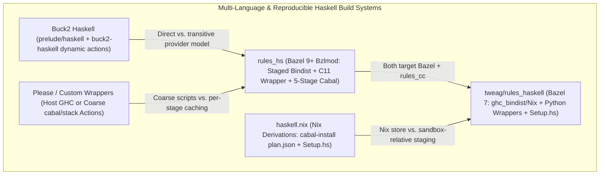
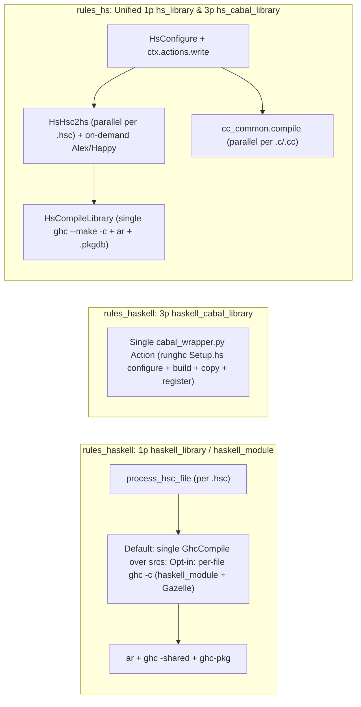
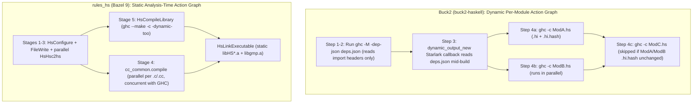

Integrating GHC and the Hackage package ecosystem into a reproducible, multi-language build system requires solving five practical engineering problems at once:

1. **Compiler isolation from the host OS**: Official GHC Linux binary archives ("bindists") hardcode paths from the machine that built GHC (`/usr/bin/gcc`, `-fuse-ld=gold`) inside `lib/settings` and load shared libraries (`libgmp.so.10` and `libtinfo.so.6`) dynamically from `/usr/lib` when `ghc` starts.
2. **C and C++ header & library forwarding**: Many Haskell packages call C functions, run `hsc2hs` to inspect C structs and `#define` constants, run `./configure` scripts to probe C headers, and compile C or C++ files that depend on headers from upstream targets.
3. **Module vs. library compilation granularity**: Modules inside a Haskell library depend on one another through `import` lines inside `.hs` source files (and occasionally form mutual recursion cycles broken by `.hs-boot` summary files) rather than through explicit edges in `BUILD` files.
4. **Compile-time code execution vs. portable deployment binaries**: Running cross-library Template Haskell macros at compile time requires loading compiled dependency code (including C functions) into a running GHC process as `.so` shared libraries, yet operators deploying services usually prefer statically linked binaries that do not require hundreds of `libHS*.so` and `libgmp.so.10` files at runtime.
5. **Cabal package metadata & `Setup.hs` modes**: Hackage `.cabal` files contain `if os(...)`, `arch(...)`, and `flag(...)` conditionals, sublibraries, generated `Paths_*` modules, lexer/parser files (`alex`, `happy`), and three `Setup.hs` build modes (`Simple`, `Configure`, and `Custom`).

Different build systems make genuinely different trade-offs across those five areas. This chapter compares `rules_hs` against **`tweag/rules_haskell`**, **Meta's `facebook/buck2` (`prelude/haskell` and `MercuryTechnologies/buck2-haskell`)**, **Please Build (`pleasings` / custom `.build_defs`)**, **`input-output-hk/haskell.nix`**, and **project-level `cabal`/`stack` wrappers** — looking objectively at both what `rules_hs` simplifies on Bazel 9 and where other systems provide capabilities outside `rules_hs`'s current scope.

### Plain-English Glossary of Terms Used in the Matrix Below

Before reading the comparison table, here are plain-English definitions of the recurring build-system and linker terms that appear across these tools (for full background walkthroughs, see [Bazel Ruleset Primer](bazel-rules-primer.md) and [Haskell & GHC Primer](haskell-and-ghc-primer.md)):

- **ELF `DT_NEEDED`, `RUNPATH`, and `$ORIGIN`**: On Linux, compiled programs and shared libraries use the ELF binary format. `DT_NEEDED` is the list of `.so` shared library filenames recorded inside a binary's header that the OS dynamic loader must find at startup. `RUNPATH` is an optional list of directories embedded in the binary telling the OS loader where to search for those `.so` files, and the special token **`$ORIGIN`** inside `RUNPATH` expands to "the folder containing this executable itself" — allowing a tool and its `.so` files to move together to any folder without setting `LD_LIBRARY_PATH`.
- **Remote Build Execution (RBE) & Content-Addressable Storage (CAS)**: Instead of running every compile command on one laptop, Bazel and Buck2 can send individual commands over the network to clean Linux worker containers (**RBE workers**). Input and output files are stored in **Content-Addressable Storage (CAS)**, a shared cache indexed by each file's SHA-256 byte hash (*content digest*). A remote worker materializes *only* the specific declared input files inside a temporary sandbox folder (`execroot/`).
- **Bazel `CcInfo`**: Bazel's standard metadata record for C/C++ `cc_library` targets, bundling header files and `-I` include paths (`compilation_context`) together with compiled `.a`/`.so` libraries and linker flags (`linking_context`).
- **Relocatable `${pkgroot}` package databases**: GHC tracks compiled libraries via `.conf` text files compiled by `ghc-pkg` into a `package.cache` index. Writing `${pkgroot}` inside a `.conf` file tells GHC to resolve library and `.hi` summary paths relative to the parent directory of that package database rather than hardcoding a machine-specific absolute path.
- **Template Haskell (TH) & `-dynamic-too`**: Template Haskell is Haskell's compile-time macro system — functions from a dependency library that GHC executes *while compiling* downstream code to generate syntax trees or embed files. Because Linux GHC binaries are dynamically linked, GHC must load `.so` shared libraries to run TH macros at compile time. Passing `-dynamic-too` tells `ghc --make -c` to emit both static `.o` files (for final `.a` executable linking) and dynamic `.dyn_o` files (for compile-time `.so` TH loading) in a single compile pass.
- **Static vs. dynamic action graphs**: In a *static* action graph (Bazel), Starlark plans 100% of the build commands in memory before any source file is read or any tool runs. In a *dynamic* action graph (Buck2's `dynamic_output_new`), an initial build command can scan source files first (for example `ghc -M`) and spawn per-module compile commands mid-build based on what it found.
- **Nix `/nix/store` & Import-From-Derivation (IFD)**: Nix builds packages into immutable host paths like `/nix/store/<hash>-<name>`. *Import-From-Derivation (IFD)* is a Nix mechanism where evaluating `.nix` build files pauses mid-way to build a generator tool (such as translating a Cabal build plan into `.nix` files) and then imports the newly built `.nix` files to finish building the dependency graph.
- **Cabal `Setup.hs` `build-type` modes**: Every Hackage package declares one of three `build-type` values in its `.cabal` file:
  - **`Simple`** (~95%+ of Hackage): `Setup.hs` is a two-line boilerplate stub; the `.cabal` file contains all build instructions.
  - **`Configure`** (e.g., `network`, `unix-time`): Runs an autoconf `./configure` shell script to inspect C headers, then builds declaratively like `Simple`.
  - **`Custom`**: Compiles and executes arbitrary Haskell code written inside `Setup.hs` during the build (historically often used only for the `cabal-doctest` helper, and occasionally for bespoke code generation).

---

## 1. Executive Matrix Across Haskell Build Rulesets {#executive-matrix}

| Architectural Axis | `rules_hs` (Bazel 9+) | `tweag/rules_haskell` (Bazel 7) | `facebook/buck2` (`prelude/haskell` & `buck2-haskell`) | Please Build (`.build_defs` / `pleasings` ecosystem) | `input-output-hk/haskell.nix` (& `rules_nixpkgs`) |
|---|---|---|---|---|---|
| **Build engine & module graph** | **Bazel `>= 9.0.0`**, `MODULE.bazel` (Bzlmod) only (zero `WORKSPACE` files); Starlark extensions with `reproducible = True`. | **Bazel `7.x`** (`.bazelversion = 7.1.0`); hybrid Bzlmod + `WORKSPACE` roots; fails loading on Bazel 8/9. | **Buck2** (`facebook/buck2-prelude` Starlark + BXL); monorepo cell configuration (`.buckconfig`). | **Please (`plz`)** Python-like `.build_defs` subrepos (no official upstream Haskell plugin in `pleasings` or `please-build`). | **Nix** (`mkDerivation` / flakes); `plan-to-nix` uses **Import-From-Derivation (IFD)** unless `materialized` files are committed. |
| **Downstream dependency footprint** | **4 non-dev BCR modules**: `platforms`, `bazel_skylib`, `rules_cc`, `gmp` (test/docs deps marked `dev_dependency = True`). | **13 non-dev `bazel_dep`s**: includes `rules_java`, `protobuf`, `abseil-cpp`, `rules_proto`, `rules_nodejs`, `aspect_rules_js`, `rules_python`, `rules_sh`, `rules_license`, plus `@stackage`. | Coupled to Buck2's monorepo `prelude/` (`cxx`, `linking`, `python` providers); no external module registry. | Single Go binary, plus whichever custom subrepos/plugins the workspace authors maintain. | Evaluates `nixpkgs`, `haskell.nix` overlays, `nix-tools`, and Hackage/Stackage index tarballs in `/nix/store`. |
| **GHC provisioning & Linux isolation** | Starlark `ghc_bindist_repo` (no `./configure && make install`), `/nonexistent/*` `lib/settings` sanitization, `$ORIGIN`-staged `staged_ghc` + BCR `@gmp` `libgmp.so.10` + 8-function `libtinfo.so.6` stub. | `ghc_bindist.bzl` runs host `./configure && make install` (`apt install libgmp-dev libtinfo5`); Linux isolation relies on `rules_nixpkgs` populating `/nix/store`. | `HaskellToolchainInfo` expects an externally supplied monorepo compiler (`platform009/...` at Meta or `/nix/store/...` in `buck2-haskell`). | Custom `build_rule`s typically invoke host `ghc`/`ghc-pkg` from `PATH` or unpack raw archives without `$ORIGIN` GMP/tinfo libraries. | Isolated inside `/nix/store`: Nix builds or patches GHC with exact `/nix/store/<hash>-gmp`/`ncurses` `RUNPATH`s. |
| **C/C++ interop & compiler wrapper** | Compiled 552-line C11 `ghc_cc_wrapper` + `rules_cc` `CcInfo` (`--start-group ... --end-group` + `rt_shims`); works with `zig cc`, `toolchains_llvm`, or GCC. | Templated Python `cc_wrapper.py.tpl` + `ghc_wrapper.sh` (requires `rules_python`) + `HaskellCcLibrariesInfo` symlink directories. | Native `CxxToolchainInfo`, `CPreprocessor`, `MergedLinkInfo`, and `LinkableGraph` across C++, Rust, Python, and Haskell. | Shell flag passthrough (`-optc`/`-optl`) and static `.a` file inputs; no `CcInfo`-style compilation/linking context merging. | Nix `stdenv` shell `cc-wrapper` + Nixpkgs C derivations (`zlib`, `openssl`, `pkg-config`); separate from non-Nix build graphs. |
| **Compilation action granularity** | **Unified**: Stage 1 `HsConfigure` + generated macros/paths + per-file `HsHsc2hs` + parallel `cc_common.compile` + on-demand `alex`/`happy` + one `ghc --make -c` per library/sublibrary. | **Split**: 1p `haskell_library` runs single `GhcCompile` (or per-module `ghc -c` via opt-in `haskell_module` + Gazelle); 3p `haskell_cabal_library` runs one Python `cabal_wrapper.py` (`Setup.hs`). | Upstream `prelude/haskell` runs per-library `ghc -no-link`; `MercuryTechnologies/buck2-haskell` uses `dynamic_output_new` + `ghc -M -dep-json` for **per-module `ghc -c`** actions. | Coarse per-library / per-binary `ghc --make` shell actions in custom `build_rule`s. | **Per-component Nix derivations** (`libs`, `sublibs`, `exes`, `tests`), each running Cabal `Setup` inside that component. |
| **Template Haskell & binary linking** | `-dynamic-too` isolated in `<name>.pkgdb/dyn/libHS*.so` for cross-lib TH, while `hs_binary` links `gmp_static/libgmp.a` for **base-glibc-only `DT_NEEDED`**. | `ghc_bindist` sets `fully_static_link = False` (dynamic `$ORIGIN` `libHS*.so`/`libgmp.so` rpaths); static binaries use Nix + `musl` toolchain; `extra_srcs` stages TH inputs. | **5-way matrix**: `LinkStyle` (`static`, `static_pic`, `shared`) across `enable_profiling` (`False`, `True`); shared-lib symlink trees or static links. | Follows host GHC defaults (dynamic GMP/libffi `DT_NEEDED` unless manually passed `-static -optl-static`). | Dynamic `/nix/store/...` `RUNPATH` binaries by default; full static ELF binaries supported via `pkgsCross.musl64`. |
| **Third-party Hackage / Cabal** | Offline [`//tools/lock:lock`](../reference/lock-cli.md) (`Cabal-syntax` 4-platform evaluation) -> `hackage.lock.json` -> on-demand `@hackage__<pkg>` repos -> 5-stage [`hs_cabal_library`](../reference/rules.md#hs_cabal_library) (`Simple`, `Configure`, normalized `cabal-doctest` `Custom`). | `stack_snapshot` (`stack` binary + `setup_deps` overrides) -> `cabal_wrapper.py` running `runghc Setup.hs` (supports arbitrary `Custom` `Setup.hs`). | External buckification generators (`cabal-buck2` / monorepo scripts) writing `haskell_library` / `haskell_prebuilt_library` rules. | Manual `remote_file` + `Setup.hs` or `cabal` `genrule` wrappers; no built-in Hackage lock extension. | `cabal-install` solver -> `plan.json` -> `plan-to-nix` (or `stack-to-nix`), running `Setup.hs` per component (supports arbitrary `Custom` `Setup.hs`). |
| **RBE & sandbox behavior** | All inputs inside `execroot/`, `${pkgroot}` relative DBs, no `/nix/store` or `LD_LIBRARY_PATH`; tested in compiler-free containers. | `ghc_bindist` reads host OS libs; `rules_nixpkgs` references `/nix/store` outside `execroot/`, requiring Nix-enabled RBE workers. | Runs on Meta's Remote Execution system (uses patched `ghc-pkg --always-use-cache` for timestamp normalization). | Sandboxed via Please namespaces when tools are in-tree, though custom rules often read `/usr/bin/ghc` and `/usr/include` from the worker image. | Isolated Linux build sandbox + Nix binary caches (`Hydra`, `Cachix`), using Nix store paths rather than Bazel REAPI CAS digests. |
| **Additional ecosystem features** | [`hs_haddock`](../reference/rules.md#hs_haddock) (staged GHC Haddock with QuickJump & hyperlinked source) + Hakyll/Pandoc site (`//docs`); on-demand `alex`/`happy`; Linux `x86_64`+`arm64` active (macOS/Windows/musl planned). | `haskell_doc`, `haskell_repl` (`hie-bios`), `haskell_proto_library`, `ghc_plugin`, `c2hs`, `haskell_doctest`, `-prof`, HPC coverage, macOS & Windows. | `haskell_ghci`, `haskell_haddock`, `haskell_ide` (BXL), `-prof` profiling libraries, persistent GHC workers (`buck2-haskell`), `ghc_plugin`. | Custom `genrule`s only. | Haddock, `shellFor` + `haskell-language-server`, arbitrary `build-type: Custom`, cross-compilation (`musl64`, `mingwW64`, `ghcjs`, `wasm32-wasi`). |

---

## 2. Deep Dive 1: `rules_hs` vs. `tweag/rules_haskell` (Bazel) {#deep-dive-rules-haskell}

`tweag/rules_haskell` established Haskell support in Bazel and demonstrated how GHC, `ghc-pkg`, C FFI, Template Haskell, and Stackage package sets can integrate into a Bazel build. Because both `rules_hs` and `rules_haskell` target Bazel, comparing their seven main subsystems explains why `rules_hs` was written separately for Bazel 9+ rather than incrementally patching `rules_haskell`.

### 2.1 Module System & Transitive Dependency Graph {#rh-module-graph}

In `MODULE.bazel`, every non-dev `bazel_dep` and `use_extension` declared by a ruleset enters the resolved module graph of **every downstream repository** that depends on it, whereas declarations marked `dev_dependency = True` are dropped automatically when the ruleset is consumed as a `bazel_dep` (see [Ruleset vs. Consumer Repository](bazel-rules-primer.md#ruleset-vs-consumer)):

- **`rules_hs` (`MODULE.bazel`)**: Declares `bazel_compatibility = [">=9.0.0"]`, has zero `WORKSPACE` files, and lists **four** non-dev BCR dependencies: `platforms@1.1.0`, `bazel_skylib@1.9.2`, `rules_cc@0.2.28`, and `gmp@6.3.0.bcr.5`. Internal test and documentation dependencies (`hermetic_cc_toolchain`, `rules_shell`, and the 182-package `//docs` Hackage lockfile) are marked `dev_dependency = True` and checked in CI by `//tests/rules:bzlmod_hygiene_test`.
- **`tweag/rules_haskell` (`MODULE.bazel` on `master` / `1.0`)**: Pins `.bazelversion = 7.1.0` and lists **13 non-dev `bazel_dep`s**: `platforms@0.0.10`, `rules_java@7.4.0`, `rules_license@1.0.0`, `abseil-cpp@20240116.3`, `protobuf@27.0` (with a `single_version_override` patch file), `rules_cc@0.0.15`, `rules_nodejs@5.8.3`, `rules_python@0.21.0`, `rules_shell@0.2.0`, `bazel_skylib@1.7.1`, `rules_proto@5.3.0-21.7`, `aspect_rules_js@1.34.0`, and `rules_sh@0.4.0`. Its non-dev module scope also evaluates `asterius`, configures `node.toolchain(node_version = "16.9.0")` and `npm.npm_translate_lock`, registers `@all_bindist_toolchains//:all` and `@rules_haskell_python_local//:toolchain` without `dev_dependency = True`, and calls `use_repo(stack_snapshot, "stackage")` unconditionally because `haskell/cabal.bzl` references `@stackage` inside macro definitions.

On Bazel 8 and Bazel 9, `rules_haskell` stops during module loading before target analysis begins: Bazel 9 removed `WORKSPACE` support, `rules_sh@0.4.0` and `haskell/private/get_cpu_value.bzl` call removed platform APIs, and `aspect_rules_js@1.34.0` loads removed built-in repository rules.

### 2.2 Toolchain Provisioning, `/nix/store`, and RBE CAS Portability {#rh-toolchain-hermeticity}

#### How RBE Workers, CAS Digests, and `/nix/store` Interact

To understand why Linux toolchain provisioning looks so different in `rules_hs` and `rules_haskell`, it helps to walk through what happens step by step when Bazel runs a compile action on a **Remote Build Execution (RBE)** cluster:

1. **Hashing declared inputs into CAS digests**: On the machine coordinating the build, Bazel computes the SHA-256 hash and byte size (the **content digest**, e.g., `9f86d081...:1048576`) of every file listed in the action's `inputs` and `tools`. Missing file blobs are uploaded to **Content-Addressable Storage (CAS)** — a network key-value store indexed by SHA-256 hash.
2. **Materializing `execroot/` on a stateless remote worker**: An RBE worker is an ordinary, minimal Linux container running on a remote server (with no Haskell compiler, no Nix installation, and no extra `-dev` C libraries installed on its OS image). For each action, the worker creates an empty directory (`execroot/`), downloads *only* the files listed in that action's digest tree into relative paths under `execroot/` (such as `execroot/_main/bazel-out/...`), runs the command, and uploads the declared output files back to CAS.
3. **Why host `/nix/store/<hash>-ghc/...` paths fail on standard RBE workers**: Nix installs every package onto the **host machine's root filesystem** at an absolute path like `/nix/store/8k9a...-ghc-9.10.3/bin/ghc`, and compiles that binary's ELF header to look for shared libraries at absolute paths like `/nix/store/3f2b...-gmp-6.3.0/lib/libgmp.so.10`. Even if Bazel symlinks the `ghc` binary into `execroot/`, as soon as `ghc` starts on a standard Linux RBE worker container, the Linux dynamic loader tries to open `/nix/store/3f2b...-gmp-6.3.0/lib/libgmp.so.10` on the worker container's root `/` filesystem. Because standard remote worker containers do not have `/nix/store` mounted, the command fails immediately with `No such file or directory` unless the organization maintains custom Nix-populated RBE worker images.

Upstream Haskell.org `deb10` archives already compile their binaries (`ghc`, `ghc-pkg`, `hsc2hs`, `haddock`, `ghc-iserv-dyn`) with a relative ELF `RUNPATH` (`$ORIGIN/../lib/<arch>-linux-ghc-<ver>`, telling Linux to look in the sibling `lib/` folder next to `bin/`), bundle `libffi.so.8` + `libCffi.a`, and ship a relative `lib/package.conf.d/package.cache` (`${pkgroot}/../lib/...`):

- **How `rules_haskell` provisions GHC**:
  1. **`haskell/ghc_bindist.bzl`**: Unpacks the tarball into `bindist_unpacked/`, edits `mk/config.mk.in` (`RelocatableBuild = YES`), checks `ctx.which("make")` on the host, and runs `./configure --prefix ... && make install` during `bazel fetch`. That requires `make`, `perl`, a C compiler, `libgmp-dev`, and `libtinfo5` pre-installed on the host OS.
  2. **`rules_nixpkgs` (`haskell/nixpkgs.bzl`)**: To avoid host drift on Linux, `rules_haskell` integrates with `rules_nixpkgs`, which runs `nix-build` locally during repository fetch and symlinks `/nix/store/<hash>-ghc-...` into Bazel. That provides full reproducibility on Nix-equipped machines and Nix-backed CI, at the cost of requiring Nix on build machines, breaking standard non-Nix RBE workers, and preventing straightforward publication on the Bazel Central Registry (`rules_haskell` issue #2451).
- **How `rules_hs` provisions GHC ([Hermeticity & Toolchain](hermeticity.md))**:
  1. **Starlark-only archive unpack (`ghc_bindist_repo`)**: Calls `repository_ctx.download_and_extract`, replaces all 12 host tool entries in `lib/settings` with `/nonexistent/*` (and removes `-fuse-ld=gold`) so host `/usr/bin/*` tools can never run by accident, and parses `lib/package.conf.d/*.conf` directly in Starlark without spawning `ghc-pkg`.
  2. **Sandbox-relative `$ORIGIN` staging (`staged_ghc`)**: Compiles `libgmp.so.10` from BCR `@gmp//:gmp` (`HsLinkGmpShared`) and compiles an 8-function `libtinfo.so.6` stub (`NCURSES6_TINFO_5.0.19991023`, `hs/private/tinfo_stub.c`), placing both inside `<prefix>/lib/<arch_libdir>/` next to `<prefix>/bin/ghc-<ver>`. Because every binary and `.so` file lives at a relative path inside `bazel-out/` under `execroot/`, the entire compiler toolchain uploads and runs on standard Linux RBE containers without `LD_LIBRARY_PATH`, `patchelf`, or `/nix/store`.

### 2.3 C Compiler Wrapper & `CcInfo` Interop {#rh-cc-interop}

GHC delegates C preprocessing, C/C++ compilation, object merging (`ld -r` for `CApiFFI`), and final linking to external tools specified via `-pgm*` flags (see [Interoperating with C/C++ via `rules_cc` and `CcInfo`](bazel-rules-primer.md#cc-interop)):

- **`rules_haskell` (`cc_wrapper.py.tpl` + `HaskellCcLibrariesInfo`)**: Generates a Python wrapper script (`haskell/private/cc_wrapper.py.tpl`) paired with `ghc_wrapper.sh`. Each compile, `hsc2hs`, and link action includes `rules_python` and a Python interpreter in its sandbox inputs and starts Python on each compiler subprocess. For `CcInfo` dependencies, `haskell/private/cc_libraries.bzl` wraps `LibraryToLink` records in `HaskellCcLibrariesInfo` providers and creates symlink directories so GHC's `-l<lib>` search selects static or dynamic libraries.
- **`rules_hs` (`ghc_cc_wrapper` + direct `CcInfo` archive groups)**: Compiles a standalone 552-line POSIX C11 binary (`hs/private/cc_wrapper.c`) once in `cfg = "exec"`. `ghc_cc_wrapper` clears `RUNFILES_*` variables, handles `--print-file-name`, rewrites `@response_file` arguments (`-Wl,-h` -> `-Wl,-soname`, `-fno-PIC` -> `-fPIC`, `.dyn_o`/`.p_o` -> temporary `.o` symlinks), adds `-nostdinc++` on non-C++ invocations so `hermetic_cc_toolchain`'s `zig c++` header search order does not hide `_GNU_SOURCE` definitions during `hsc2hs`, and calls `execv` on Bazel's resolved C compiler directly. At link time, `extract_cc_static_libs_and_flags` passes static `.a` paths directly via `-optl<lib.a>` inside `-optl-Wl,--start-group ... -optl-Wl,--end-group` (alongside `//hs/private:rt_shims`), without `-l<name>` symlink directories.

### 2.4 Compilation Granularity: `ghc --make -c` vs. `GhcCompile`, `haskell_module` (Gazelle) & `cabal_wrapper.py` {#rh-compilation-granularity}

`rules_haskell` uses **three different compilation models** depending on whether a target is a standard first-party library, an opt-in per-module target, or a third-party Cabal package, whereas `rules_hs` uses **one unified model** across first-party and third-party libraries:

1. **First-party default (`haskell_library` in `rules_haskell` vs. [`hs_library`](../reference/rules.md#hs_library) in `rules_hs`)**:
   - By default, `rules_haskell`'s `haskell/private/actions/compile.bzl` compiles all `srcs` of a `haskell_library` in one `GhcCompile` invocation (`ghc -c` / `-no-link`), pre-declaring individual `.o`, `.hi`, `.dyn_o`, and `.dyn_hi` `File` outputs from a Starlark module map before running separate `ar`, `ghc -shared`, and `ghc-pkg` actions.
   - `rules_hs`'s [`hs_library`](../reference/rules.md#hs_library) compiles `c_sources` in parallel via `cc_common.compile` and runs one `HsCompileLibrary` action (`ghc --make -c -fPIC -dynamic-too`), producing `libHS<unit_id>.a` and `<name>.pkgdb` (`hi/`, `dyn/`, `<unit_id>.conf`, `package.cache`) while discovering `exposed-modules` automatically from the emitted `.hi` files (avoiding manual module-map or `src_strip_prefix` attributes).
2. **Opt-in per-module compilation (`haskell_module` + Gazelle in `rules_haskell`)**:
   - Because Bazel's Phase 2 Analysis runs before `.hs` source files can be read ([Bazel's Three Phases](bazel-rules-primer.md#three-phases)), a Bazel rule cannot inspect `import Foo.Bar` lines inside `.hs` files automatically. [Gazelle](https://github.com/bazel-contrib/bazel-gazelle) is a command-line `BUILD.bazel` generator that scans source files ahead of time and writes explicit targets into `BUILD.bazel`.
   - `rules_haskell`'s experimental `haskell_module` rule (`@rules_haskell//haskell/experimental:defs.bzl`) pairs with [`tweag/gazelle_haskell_modules`](https://github.com/tweag/gazelle_haskell_modules), which reads `.hs` imports and writes one `haskell_module(name = "lib.A.B", src = "src/A/B.hs", deps = [":lib.C.D"])` target per file into `BUILD.bazel`.
3. **Third-party Hackage (`cabal_wrapper.py` in `rules_haskell` vs. 5-stage [`hs_cabal_library`](../reference/rules.md#hs_cabal_library) in `rules_hs`)**:
   - For Hackage packages, `rules_haskell`'s `haskell/private/cabal_wrapper.py` runs `runghc Setup.hs configure`, `build`, `copy`, and `register` inside **one Python action** per package — compiling `Setup.hs`, running `./configure`, running `hsc2hs` sequentially, compiling all `.c` files inside Cabal, and running GHC in a single sandbox step.
   - `rules_hs` builds third-party Hackage packages on the same fine-grained action foundation as first-party code via [`hs_cabal_library`](../reference/rules.md#hs_cabal_library): Stage 1 `HsConfigure` (`build-type: Configure` only), Stage 2 `ctx.actions.write` (`cabal_macros.h` + `Paths_*` with zero subprocesses), Stage 3 parallel per-file `HsHsc2hs` (plus on-demand `alex`/`happy`), Stage 4 parallel per-file `cc_common.compile` (which runs concurrently alongside Stage 5), and Stage 5 `HsCompileLibrary` (`ghc --make -c`).

> **Important — Granularity Trade-Off (Per-Module `haskell_module` vs. Per-Library `ghc --make -c`):** Running one `ghc --make -c` per library rather than Gazelle-generated per-file `haskell_module` (`ghc -c`) rules has clear pros and cons:
>
> - **When `haskell_module` (`ghc -c`) is faster**: If a single first-party library target contains **200+ modules** and a developer edits one leaf `.hs` file, `haskell_module` recompiles only that one `.o`/`.hi` file (plus any intra-library importers whose `.hi` interface changed), whereas `ghc --make -c` re-runs that library's `HsCompileLibrary` action.
> - **When `ghc --make -c` is simpler and faster**: Every separate `ghc -c` process pays ~150–300 ms of GHC startup and `.hi` loading overhead, requires re-running Gazelle whenever `import` lines or `#ifdef` imports change, and adds extra configuration around `.hs-boot` mutual recursion cycles and `CApiFFI` C stubs. Keeping [`hs_library`](../reference/rules.md#hs_library) free of generated per-file `BUILD` rules (`srcs = glob(["src/**/*.hs"])` with built-in `.hs-boot` support) and splitting large codebases into small, focused `hs_library` packages (the same convention used for `go_library` in `rules_go` and `rust_library` in `rules_rust`) gives package-level parallelism and RBE caching without external `BUILD` generators.

### 2.5 Provider Design, `TreeArtifact`s & `${pkgroot}` Layout {#rh-providers}

As covered in [Rules, Actions, Files, and TreeArtifacts](bazel-rules-primer.md#rules-and-actions), a Bazel `TreeArtifact` (`ctx.actions.declare_directory`) represents an output directory whose internal filenames are determined at execution time, subject to Bazel's rule that no standalone `File` output may overlap a `TreeArtifact` path:

- **`rules_haskell` (`haskell/providers.bzl`)**: Defines **11 Starlark providers**, centered on the 19-field `HaskellInfo` alongside `HaskellLibraryInfo`, `HaskellCabalArgsInfo`, `HaskellToolchainLibraryInfo`, `HaskellCoverageInfo`, `HaddockInfo`, `HaskellLintInfo`, `HaskellProtobufInfo`, `C2hsLibraryInfo`, `GhcPluginInfo`, and `HaskellCcLibrariesInfo`. In `cabal_wrapper.py`, placing `{name}_iface`, `lib`, and `{name}.conf.d` under `pkgroot` previously caused `TreeArtifact` path-overlap errors between `libHS*.a` archives and `.hi` directories (`rules_haskell` issues #2496 and #2499), requiring archive moves and regex edits of `.conf` files.
- **`rules_hs` (`hs/providers.bzl`, [Providers & Action Graph](providers-and-actions.md))**: Defines **4 public providers** — direct-only [`HsPackageInfo`](../reference/extensions-and-providers.md#hspackageinfo) (8 fields), transitive `depset`-backed [`HsLinkInfo`](../reference/extensions-and-providers.md#hslinkinfo) (5 fields), [`HsToolchainInfo`](../reference/extensions-and-providers.md#hstoolchaininfo) (21 fields), and [`HsHaddockInfo`](../reference/extensions-and-providers.md#hshaddockinfo) (4 fields) — paired with `rules_cc`'s `CcInfo`. Every library declares `libHS<unit_id>.a` (`declare_file`) and `<name>.pkgdb` (`declare_directory`) as **non-overlapping siblings** in `bazel-out/<cfg>/bin/<pkg>/`, so `library-dirs: ${pkgroot}` resolves to `<parent>/libHS<unit_id>.a` and `import-dirs: ${pkgroot}/<name>.pkgdb/hi` resolves to `<parent>/<name>.pkgdb/hi` without post-processing `.conf` paths.

### 2.6 Template Haskell (`-dynamic-too`) & Binary Linking {#rh-th-and-linking}

- **`rules_haskell`**: Configures `haskell_toolchain` in `ghc_bindist.bzl` with `fully_static_link = False`. As a result, Linux bindist builds link user executables dynamically against transitive `libHS*.so`, `libgmp.so.10`, and `libffi.so.8` via `$ORIGIN` rpath chains; building standalone static binaries requires switching to a Nix-built `musl` GHC toolchain (`fully_static_link = True`, `static_runtime = True`). Compile-time files read by Template Haskell macros are passed via `extra_srcs`.
- **`rules_hs` ([Providers & Action Graph](providers-and-actions.md#template-haskell))**: Supports cross-library dynamic Template Haskell at compile time while still linking user binaries statically against `.a` archives through directory separation under `${pkgroot}`:
  1. `HsCompileLibrary` compiles once with `-fPIC -dynamic-too`, writes static `libHS<unit_id>.a` to `${pkgroot}`, and links `.dyn_o` objects (plus `--whole-archive` C FFI archives and `rt_shims`) into `<name>.pkgdb/dyn/libHS<unit_id>-ghc<ver>.so`, listed only under `dynamic-library-dirs: ${pkgroot}/<name>.pkgdb/dyn`.
  2. When compiling downstream targets that run Template Haskell macros (`file-embed`, `aeson`, `skylighting`, `pandoc`), GHC loads `.so` libraries from `dynamic-library-dirs`, with `data` files staged into `pkg_cwd` inside the sandbox.
  3. When linking [`hs_binary`](../reference/rules.md#hs_binary) or [`hs_test`](../reference/rules.md#hs_test) (`HsLinkExecutable`), GHC links in static mode against `${pkgroot}/libHS<unit_id>.a` and `staged_ghc/gmp_static/libgmp.a` (a directory containing no `.so` files), producing an ELF executable whose `DT_NEEDED` list contains only standard `glibc` libraries (`libc.so.6`, `libm.so.6`, `libdl.so.2`, `libpthread.so.0`).

### 2.7 Hackage Resolution & `Setup.hs` Handling (`//tools/lock` vs. `stack_snapshot`) {#rh-hackage}

- **`rules_haskell` (`stack_snapshot` + `cabal_wrapper.py`)**: Runs an external `stack` CLI binary (or `@stackage-unpinned//:pin` with `stackage_snapshot.json`), sometimes needs manual `setup_deps = ["@Cabal//:Cabal"]` overrides when pinned (`rules_haskell` issue #1871), requires manual `haskell_toolchain_library` declarations when not routing boot libraries through `@stackage`, and executes `Setup.hs` via `cabal_wrapper.py` — which means **arbitrary `build-type: Custom` `Setup.hs` scripts run natively**, at the cost of opaque single-action package builds.
- **`rules_hs` ([`//tools/lock:lock`](../reference/lock-cli.md) + [`hackage`](../reference/extensions-and-providers.md#hackage), [Hackage & Cabal Pipeline](ecosystem-and-hackage.md))**: Compiles `//tools/lock:lock` using only GHC's bundled `@hs_boot//:Cabal-syntax` library (no host `stack`, `cabal`, or Python), evaluates `.cabal` conditionals across 4 OS/CPU platforms (`linux_x86_64`, `linux_arm64`, `macos_arm64`, `macos_x86_64`) into `hackage.lock.json`, generates `@hs_boot` and `@hackage` boot targets automatically, short-circuits C-only packages (`zlib-clib`, `libyaml-clib`) into `CcInfo` targets, and builds `alex-3.5.4.2` / `happy-2.1.7` from `@hs_boot` on demand when grammar files appear. For `Setup.hs` modes, `rules_hs` supports `Simple` and `Configure` directly and normalizes `cabal-doctest`-only `Custom` packages (`xml-conduit`) to `Simple` in `//tools/lock:lock`, while intentionally **not executing arbitrary bespoke `Custom` `Setup.hs` scripts** (`//tools/lock:lock` records `"build_type": "Custom"` in `hackage.lock.json`, and [`hs_cabal_library`](../reference/rules.md#hs_cabal_library) rejects `"Custom"` at Bazel analysis time unless overridden via [`hackage.override`](../reference/extensions-and-providers.md#hackage-override)).

### 2.8 Feature Scope & Current Gaps {#rh-feature-gaps}

`rules_hs` focuses on Bazel 9 Bzlmod support, Nix-free Linux hermeticity, static-GMP executables, Haddock documentation, and multi-stage Hackage builds, while `tweag/rules_haskell` includes mature rules for several additional workflows that `rules_hs` either leaves to separate modules or has not implemented yet:

| Capability | `tweag/rules_haskell` Status | `rules_hs` Status & Roadmap Approach |
|---|---|---|
| **Haddock API docs (`hs_haddock` / `haskell_doc`)** | `haskell_doc` rule & `haskell_doc_aspect` (`HaddockInfo` cross-linked `.haddock` interfaces + HTML). | **Supported**: [`hs_haddock`](../reference/rules.md#hs_haddock) rule ([`HsHaddockInfo`](../reference/extensions-and-providers.md#hshaddockinfo)) running staged `bin/haddock-ghc-<ver>` with `--hyperlinked-source`, `--quickjump`, boot `.haddock` links, and cross-target `haddock_deps` (an aspect over arbitrary dependency graphs is not yet implemented). |
| **Interactive REPL & IDE (`haskell_repl`)** | `haskell_repl` rule (`@ghcide` / `hie-bios` wrapper scripts loading transitive targets into `ghci`). | **Not yet implemented** (`hs_repl` generating a GHCi script + optional real `ncurses` `libtinfo` for interactive terminal editing is planned; today `rules_hs` runs `ghc` in batch mode only). |
| **Protobuf integration (`haskell_proto_library`)** | Built-in `haskell_proto_library` (`proto-lens-protoc` aspect, adding `protobuf`/`rules_proto` to `MODULE.bazel`). | Kept **out of core `MODULE.bazel`** to maintain the 4-module dependency list; suited for a separate optional module (`rules_hs_proto`) using `proto-lens-protoc` from `@hackage`. |
| **GHC compiler plugins (`ghc_plugin`)** | Built-in `ghc_plugin` rule (`GhcPluginInfo` staging `-fplugin=` packages and args). | Users can pass `-fplugin=<Mod>` via `ghc_opts` when the plugin package is in direct `deps` (its `.so` is already built in `.pkgdb/dyn/`); a dedicated `hs_plugin` rule for hidden plugin deps is future work. |
| **GHC profiling (`-prof`) & HPC coverage** | Built-in `-c dbg` / `with_profiling` (`.p_o` / `.p_hi`) and `bazel coverage` (`HaskellCoverageInfo` + `hpc`). | `cc_wrapper.c` already handles `.p_o` object symlinks; Starlark `-prof` build settings and `hpc` coverage collection are planned. |
| **`c2hs` & `haskell_doctest`** | Built-in `c2hs_library` (`C2hsLibraryInfo`) and `haskell_doctest` rules. | `hsc2hs`, `alex`, and `happy` are supported; `c2hs` and `doctest` are deferred ([Dependency Decisions](dependencies.md)). |
| **macOS & Windows execution** | Active `ghc_bindist` + `cc_wrapper` support on macOS and Windows (`cc_wrapper_windows.sh.tpl`). | Bindist URLs/SHA-256s and 4-platform `hackage.lock.json` `select()` branches are already recorded; Mach-O `@loader_path` and Win32 `cc_wrapper.c` implementation details are documented in [Cross-OS & Platforms](cross-os-and-platforms.md). |
| **Arbitrary `build-type: Custom` `Setup.hs`** | Supported because `cabal_wrapper.py` compiles and runs `Setup.hs` on every package. | `cabal-doctest`-only `Custom` setups are normalized to `Simple`; bespoke `Custom` `Setup.hs` codegen scripts (`gi-gtk`, `HsOpenSSL`) are recorded as `"Custom"` in `hackage.lock.json` and rejected at analysis time by `hs_cabal_library`, requiring [`hackage.override`](../reference/extensions-and-providers.md#hackage-override) or a future opt-in `Custom` fallback rule. |

---

## 3. Deep Dive 2: `rules_hs` vs. `facebook/buck2` (`prelude/haskell` & `buck2-haskell`) {#deep-dive-buck2}

[Buck2](https://buck2.build) is Meta's open-source Rust-based build system, using Starlark rules (`BUCK` files) closely resembling Bazel's `BUILD.bazel`. Two related Haskell rule implementations exist in the Buck2 ecosystem:

1. **Upstream `facebook/buck2` (`prelude/haskell/`)**: Meta's Starlark prelude (`haskell.bzl`, `compile.bzl`, `library_info.bzl`, `link_info.bzl`, `toolchain.bzl`, `haskell_ghci.bzl`, `haskell_haddock.bzl`, `haskell_ide.bzl`), built for Meta's internal monorepo (such as Sigma / Haxl workloads).
2. **`MercuryTechnologies/buck2-haskell` (& `simonmar/haskell-buck2` / `cabal-buck2`)**: An open-source extension of `prelude/haskell` developed by Mercury Technologies and Tweag that uses Buck2 **dynamic actions (`ctx.actions.dynamic_output_new`)** and persistent GHC workers for per-module compilation.

### 3.1 Shared Design: Direct vs. Transitive Providers {#buck2-shared-dna}

`rules_hs`'s provider split in `hs/providers.bzl` follows the same structure as `prelude/haskell/library_info.bzl` and `link_info.bzl`:

- In Buck2, `HaskellLibraryProvider` holds one target's `HaskellLibraryInfo` (`name`, `db`, `id`, `import_dirs`, `stub_dirs`, `libs`, `version`), while `HaskellLinkInfo` holds a `transitive_set` (`HaskellLibraryInfoTSet` — Buck2's counterpart to Bazel's `depset`) of all upstream libraries, and C/C++ link inputs flow through Buck2's `MergedLinkInfo` and `CPreprocessor`.
- `rules_hs` maps those three pieces onto Bazel 9: [`HsPackageInfo`](../reference/extensions-and-providers.md#hspackageinfo) (direct), [`HsLinkInfo`](../reference/extensions-and-providers.md#hslinkinfo) (`depset` transitive closure), and `rules_cc`'s `CcInfo`.

Two details differ in how package visibility and `ghc-pkg` caches are handled:

1. **Explicit `base` & `-hide-all-packages`**: Upstream `prelude/haskell/compile.bzl` passes `-package-env=-`, exposes `base` implicitly, and exposes direct dependencies by package name (`-expose-package <pkg>`). `rules_hs` passes `-hide-all-packages` and unhides direct dependencies by exact `-package-id <unit_id>` — requiring `@hs_boot//:base` to be listed explicitly and avoiding ambiguity when two packages or sublibraries share a base name.
2. **Stock `ghc-pkg recache` vs. patched `--always-use-cache`**: Remote execution sandboxes reset file modification timestamps (`mtime`) to a fixed epoch (such as `1980-01-01`) so timestamps do not affect cache keys; if `package.cache` appears older than `.conf` files, stock `ghc-pkg` may warn or re-read `.conf` files. Meta's `prelude/haskell/haskell.bzl` supports a patched `ghc-pkg --always-use-cache` flag (`HaskellToolchainInfo.support_always_use_cache`). `rules_hs` uses **unmodified upstream GHC bindists**, writing `${pkgroot}`-relative `.conf` files and running `ghc-pkg --global-package-db=... --package-db="$PKG_DB" recache` inside the same action that emits `<name>.pkgdb/package.cache`, keeping timestamps consistent across CAS uploads.

### 3.2 How Buck2 Dynamic Actions (`dynamic_output_new`) Work Step by Step {#buck2-dynamic-graphs}

Upstream `facebook/buck2/prelude/haskell/compile.bzl` compiles all `srcs` of a `haskell_library` in one `ghc -no-link` action (similar to `rules_hs`). **`MercuryTechnologies/buck2-haskell`**, by contrast, uses Buck2's **`ctx.actions.dynamic_output_new`** API to build per-module `ghc -c` actions on the fly without Gazelle:

Here is what `buck2-haskell` does step by step during a build:

1. **Step 1 — Analysis registers an import-scanner command and a deferred callback**: When Buck2 analyzes a `haskell_library` (`ModA.hs`, `ModB.hs`, `ModC.hs`), it cannot read `.hs` files yet. So it registers one quick scanner action — `ghc -M -include-pkg-deps -dep-json deps.json`, which parses only the `import` lines at the top of each `.hs` file without compiling functions — and registers a Starlark callback via `ctx.actions.dynamic_output_new` waiting on `deps.json`.
2. **Step 2 — Execution runs `ghc -M` to produce `deps.json`**: During the build, Buck2 runs `ghc -M` and writes `deps.json` to disk (recording, for example, that `ModA` and `ModB` have no local imports, while `ModC` imports `ModA` and `ModB`).
3. **Step 3 — Buck2 runs the Starlark callback mid-build**: Unlike Bazel (where Starlark never runs again after Phase 2 Analysis ends), Buck2 invokes the `dynamic_output_new` Starlark callback during execution, lets it read `deps.json`, and dynamically registers individual `ghc -c` actions (or dispatches units to a persistent background GHC worker) for `ModA.hs`, `ModB.hs`, and `ModC.hs`.
4. **Step 4 — Interface-hash early cutoff**: Each module compile step also computes a hash of its exported `.hi` interface summary (`ModA.hi.hash`). If a developer edits the body of an internal helper inside `ModA.hs` without changing `ModA`'s exported types or inlineable definitions, `ModA.hi.hash` does not change and Buck2 skips recompiling `ModC.hs` ("early cutoff") — achieving per-module incrementality without running Gazelle ahead of time.

**Why `rules_hs` uses static action graphs on Bazel**: Bazel keeps a strict wall between Analysis and Execution ([Bazel's Three Phases](bazel-rules-primer.md#three-phases)) so the entire action graph is known in memory before any command runs — enabling millisecond `bazel query` and `bazel aquery` inspection and avoiding an extra `ghc -M` pass on cold builds. Within Bazel's static graph model, splitting `./configure`, `cabal_macros.h`, per-file `hsc2hs`, on-demand `alex`/`happy`, and parallel `cc_common.compile` into separate actions while running one `ghc --make -c` per library keeps rules simple, supports `.hs-boot` cycles directly, and parallelizes cleanly across well-factored library packages.

### 3.3 Linking Matrix (`LinkStyle` × `prof`) vs. Single-Pass Static + Isolated `dyn/` TH {#buck2-linking-matrix}

- **Buck2's 5-way compilation matrix**: In `prelude/haskell/haskell.bzl`, a `haskell_library` populates dictionaries keyed by `LinkStyle` (`static`, `static_pic`, `shared`) across `enable_profiling = False` and `enable_profiling = True` (omitting `shared` + `prof`), integrated into Buck2's C++ `LinkableGraph` and shared-library symlink trees for fast dynamic developer links in large monorepos.
- **`rules_hs`'s single-pass static + TH-dynamic layout**: Instead of compiling libraries separately across multiple `LinkStyle` modes, `rules_hs` compiles each library once with `-fPIC -dynamic-too`, placing `<name>.pkgdb/dyn/libHS*.so` in an isolated subfolder used only for compile-time Template Haskell while linking executables statically against `${pkgroot}/libHS*.a` and `gmp_static/libgmp.a`.

### 3.4 Toolchain & Third-Party Ecosystem Provisioning {#buck2-toolchains-and-hackage}

Buck2's `prelude/` intentionally separates **build rule logic** from **toolchain downloading and package resolution**:

- `prelude/haskell/toolchain.bzl` defines a 24-field `HaskellToolchainInfo` provider (`compiler`, `packager`, `linker`, `haddock`, `ghci_script_template`, `ghci_iserv_path`, ...) that each organization populates from its own infrastructure (`fbcode` platform trees at Meta, or a Nix flake in `MercuryTechnologies/buck2-haskell`).
- Third-party Hackage packages are converted into `BUCK` files by an external generator (such as `cabal-buck2` or custom Nix/Cabal scripts, analogous to Meta's `reindeer` generator for Rust Cargo crates).
- `rules_hs`, by contrast, bundles toolchain downloading, `$ORIGIN` staging, `@hs_boot` synthesis, and `@hackage` lockfile loading inside the ruleset itself so a short `MODULE.bazel` configuration ([`hs.toolchain`](../reference/extensions-and-providers.md#hs-toolchain) + [`hackage.from_lock`](../reference/extensions-and-providers.md#hackage-from_lock)) works without external Nix or buckification tooling.

---

## 4. Deep Dive 3: Please Build, `haskell.nix`, and Coarse Cabal/Stack Wrappers {#deep-dive-please-nix-wrappers}

### 4.1 Please Build (`thought-machine/pleasings` & Custom `.build_defs`) {#please-build}

[Please (`plz`)](https://please.build) is a Go-based multi-language build system inspired by Bazel and Buck:

- **Upstream plugin status**: While `thought-machine/pleasings` and `please-build/*-rules` maintain official rules for C/C++, Go, Rust, Python, Java, Scala, and Protobuf, **neither `pleasings` nor `please-build` maintains an official Haskell plugin**. Teams using Please with Haskell write custom `haskell.build_defs` (`subinclude(...)`) around Please's generic `build_rule(...)` function.
- **Practical differences in custom Please `haskell.build_defs` rules**:
  - **Host GHC & `ghc-pkg` paths**: Custom `build_rule` shell commands typically call `ghc`, `ghc-pkg`, and `hsc2hs` from the host `PATH` — or fetch a raw GHC archive via `remote_file` without rewriting `lib/settings` or staging `libgmp.so.10` / `libtinfo.so.6`, leaving builds dependent on host `/usr/lib` and `/usr/bin/cc`.
  - **Transitive visibility**: Please rules forward transitive outputs via `exported_deps` / `requires = ["haskell"]` and collect `-package-db` flags in shell loops, which exposes indirect dependencies unless each rule tracks direct unit IDs alongside `-hide-all-packages`.
  - **Manual C/C++ flag plumbing**: Because Please's `c_library` rules do not expose a structured `CcInfo` provider (`compilation_context` + `linking_context`) to custom language rules and do not include a C wrapper like `ghc_cc_wrapper`, passing transitive C headers and static archives across `hsc2hs`, `./configure`, and `CApiFFI` requires custom shell glue.

### 4.2 `input-output-hk/haskell.nix` (& `nixpkgs` `haskellPackages` / `cabal2nix`) {#haskell-nix}

Within the [Nix](https://nixos.org) package-manager ecosystem (where every build step runs in a sandboxed **derivation** writing to an immutable `/nix/store/<hash>-<name>` path), two main Haskell build systems exist:

1. **`nixpkgs` `haskellPackages` (`cabal2nix` + `generic-builder.nix`)**: Converts each `.cabal` file into one package-level Nix derivation pinned to a Stackage-based package set, running `Setup.hs configure`, `build`, `check`, `haddock`, `copy`, and `register` for the whole package at once.
2. **`input-output-hk/haskell.nix` (`cabalProject` / `stackProject`)**: A component-level Nix build framework developed by Input Output (IOG) for large Haskell codebases.

#### How `haskell.nix` and Import-From-Derivation (IFD) Work Step by Step

To see how `haskell.nix` turns a Cabal project into Nix builds — and what **Import-From-Derivation (IFD)** means in plain terms — trace its four steps:

1. **Step 1 — Normal Nix separates evaluation from building**: Normally, Nix reads all `.nix` files first to compute the full graph of `.drv` build plans in memory, and only then runs compilers in parallel (much like Bazel's Analysis vs. Execution split).
2. **Step 2 — `.cabal` files need a version solver first**: A Haskell project specifies version ranges in `.cabal` files (`aeson >= 2.1 && < 2.3`), which Nix's expression language cannot solve directly.
3. **Step 3 — Pausing evaluation to build `.nix` files (Import-From-Derivation)**: While Nix is mid-way through evaluating your `.nix` configuration, `haskell.nix` triggers **IFD**: Nix **pauses reading `.nix` files**, runs a build derivation on the spot (`cabal-install` solver -> `plan.json` -> `plan-to-nix`) to write generated `.nix` files into `/nix/store/<hash>-plan-nix/`, and then `import`s those newly generated `.nix` files back into the running Nix evaluator. Those generated expressions split each package into **per-component Nix derivations** (`components.library`, `components.sublibs.<name>`, `components.exes.<name>`, `components.tests.<name>`), each compiling and running Cabal's `./Setup` binary inside Nix's `stdenv` sandbox.
4. **Step 4 — Pre-committing `materialized` files to avoid IFD pauses**: Because Nix's evaluator blocks sequentially whenever an IFD derivation is not already in the Nix cache, teams running CI often pre-generate and commit those thousands of lines of generated `.nix` files into git via `materialized = ./materialized`.

#### Trade-Offs: `haskell.nix` vs. `rules_hs`

Where **`haskell.nix`** is stronger:
- Because every component runs real Cabal `./Setup` hooks inside a full Nixpkgs environment, **arbitrary `build-type: Custom` `Setup.hs` scripts work without overrides**.
- It supports full `cabal-install` solver features (`cabal.project` `source-repository-package` git pins, Hackage index-state timestamps).
- Nixpkgs' `pkgsCross` infrastructure provides mature cross-compilation today (`pkgsCross.musl64` fully static Linux binaries, `pkgsCross.mingwW64` Windows `.exe` binaries, JavaScript, and WebAssembly).

Where **`rules_hs`** fits better in polyglot Bazel repositories:
1. **No IFD pauses or committed `materialized/` directories**: `rules_hs` never runs a solver during build evaluation. [`//tools/lock:lock`](../reference/lock-cli.md) writes a single `hackage.lock.json` file offline, and [`hackage`](../reference/extensions-and-providers.md#hackage) decodes it in Starlark (`reproducible = True`) in a few milliseconds.
2. **Finer-grained caching inside each Cabal component**: In `haskell.nix`, the cache unit is an entire Cabal component derivation — editing or cold-building a 40-file C+Haskell package like `crypton` runs `./Setup` in one derivation. [`hs_cabal_library`](../reference/rules.md#hs_cabal_library) splits `HsConfigure`, per-file `HsHsc2hs`, and parallel per-file `cc_common.compile` across Bazel's action cache and RBE workers (compiling C files in parallel alongside GHC).
3. **Unified polyglot `CcInfo` graph**: In a repository with C++, Rust, Go, and Protobuf targets, an in-tree Bazel `cc_library` passes headers and `.a` archives directly into [`hs_library`](../reference/rules.md#hs_library) (`cc_deps = ["//native/crypto:fast_hash"]`) within one dependency graph and one RBE cache, without wrapping C++/Rust builds in Nix derivations.
4. **No Nix daemon & standard glibc binaries**: Default dynamic `haskell.nix` Linux binaries carry `/nix/store/<hash>-gmp-.../lib` `RUNPATH` entries requiring Nix store paths at runtime unless cross-compiled via `pkgsCross.musl64`. `rules_hs` runs wherever Bazel runs and links standard glibc binaries with no non-glibc `.so` dependencies.

### 4.3 Coarse `cabal v2-build` / `stack build` Bazel Wrappers {#coarse-cabal-wrappers}

Teams adding Haskell to an existing Bazel repo sometimes consider wrapping `cabal v2-build` or `stack build` inside a single Bazel `genrule` instead of using dedicated Haskell rules. Coarse project wrappers run into five practical limitations:

1. **Loss of per-library incremental caching**: To Bazel, the whole `cabal build` command is a single black-box action reading `glob(["**/*.hs", "**/*.cabal"])` and writing an executable. Editing one line in one module re-runs the entire `cabal build` from scratch — unless the user disables Bazel sandboxing (`tags = ["no-sandbox", "local"]`) to reuse `dist-newstyle/` on disk, which risks stale build artifacts across git branch switches and does not work on remote CI/RBE workers.
2. **Manual C/C++ header and archive wiring**: In-tree Bazel `cc_library` outputs live under configuration-specific `bazel-out/<cfg>/bin/` paths. Passing transitive C header directories and static `.a` archives into `cabal.project` `--extra-include-dirs` / `--extra-lib-dirs` requires custom staging scripts that break easily when diamond C dependencies appear.
3. **Loss of `bazel query` test selection**: CI workflows that run `bazel query 'rdeps(//..., set(<changed_files>))'` to run only affected tests cannot see inside a monolithic `cabal` wrapper target, and Bazel cannot enforce per-library direct dependency visibility (`-hide-all-packages`).
4. **Home-directory state & network assumptions**: Both `cabal` and `stack` expect writable `$HOME/.cabal` or `$HOME/.stack` caches and attempt network index checks unless package tarballs and index states are manually pre-staged.
5. **Host compiler & shared-library dependencies**: Without a sanitized GHC archive and C wrapper like `ghc_cc_wrapper`, `cabal` and `stack` call `/usr/bin/gcc` and link dynamically against host `libgmp.so`, `libtinfo.so`, and `libz.so`, producing binaries that fail on minimal container images lacking those packages.

---

## 5. When to Choose What: Engineering Decision Guide {#decision-guide}

Each tool above optimizes for a different environment. The table below summarizes which option fits best based on your repository and infrastructure requirements:

| Primary Engineering Context | Suitable Choice | Why It Fits |
|---|---|---|
| **Bazel 9+ (`MODULE.bazel`) multi-language or Haskell repo targeting Linux (`x86_64` / `arm64`) & RBE** | **`rules_hs`** | Zero `WORKSPACE` files, 4-module non-dev BCR footprint, Nix-free `$ORIGIN` GHC staging, C11 `ghc_cc_wrapper` (`zig cc` / `toolchains_llvm` / GCC), [`hs_haddock`](../reference/rules.md#hs_haddock), cross-library TH + base-glibc-only static-GMP binaries, and 5-stage [`hs_cabal_library`](../reference/rules.md#hs_cabal_library) builds. |
| **Existing Bazel 7 workspace, or immediate need for `haskell_proto_library` / `haskell_repl` / macOS / Windows / arbitrary `Custom` `Setup.hs`** | **`tweag/rules_haskell`** | Mature Bazel 7 support (especially alongside `rules_nixpkgs` on Linux) with built-in REPL/`hie-bios`, `proto-lens`, `ghc_plugin`, `c2hs`, `-prof`, Darwin/Windows wrappers, and `Setup.hs` execution. |
| **Buck2 monorepo with dedicated build-infra support and very large (200+ module) first-party Haskell libraries** | **`facebook/buck2` (`prelude/haskell` / `buck2-haskell`)** | Tight integration with Buck2's C++/Rust `MergedLinkInfo` and `LinkStyle` matrix, plus `buck2-haskell`'s `dynamic_output_new` + `ghc -M` per-module compilation and persistent GHC workers without Gazelle. |
| **Nix-standardized organization (`Hydra`/`Cachix`), heavy bespoke `build-type: Custom` deps, or cross-compiling to `musl64` / Windows / JS / WASM** | **`input-output-hk/haskell.nix`** | Full `cabal-install` solver compatibility, per-component Nix derivations running real `Setup.hs` hooks, and `pkgsCross` cross-compilation across `musl64`, `mingwW64`, JavaScript, and WebAssembly. |
| **Pure-Haskell project with no multi-language C++/Go/Rust Bazel graph and no RBE requirement** | **Plain `cabal-install` or `stack` (via `ghcup`)** | No `BUILD.bazel` files to maintain, direct `haskell-language-server` (`HLS`) editor setup, and standard Cabal/Hackage workflows without an extra build system layer. |

> **Tip — Migrating an Existing Project to `rules_hs`?** For concrete attribute mappings and a step-by-step migration checklist from `tweag/rules_haskell`, Cabal, or Stack, see [Migration & Troubleshooting](../guide/troubleshooting-and-migration.md). For implementation details of `rules_hs`'s own subsystems, continue to [Hermeticity & Toolchain](hermeticity.md), [Providers & Action Graph](providers-and-actions.md), and [Hackage & Cabal Pipeline](ecosystem-and-hackage.md).
