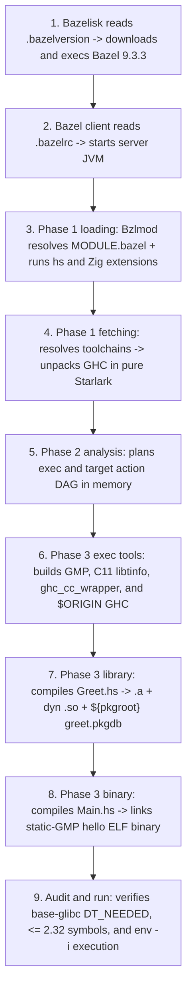
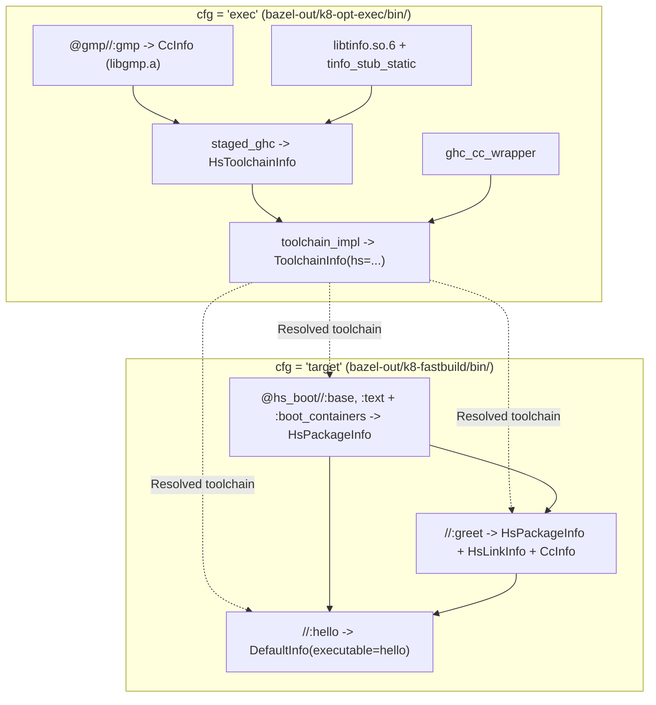

This walkthrough traces every step that happens after you type `bazelisk build :hello` in a minimal `rules_haskell` workspace, down to the individual compiler flags, environment variables, and Linux binary headers. It's written for new maintainers of `rules_haskell` and assumes no prior experience with [Haskell](https://www.haskell.org/), its compiler ([GHC](https://www.haskell.org/ghc/)), or [Bazel](https://bazel.build/). If you're looking for the documentation home page or generated API docs instead, see the [documentation index](index.md) or the [Haddock API reference](haddock/lock/index.html).

A build is [hermetic](https://bazel.build/basics/hermeticity) when every compiler binary, C header, library, and helper tool comes from pinned, cryptographically verified inputs rather than whatever packages happen to be installed in `/usr/bin` or `/usr/lib` on your machine. Hermeticity is what lets the exact same command succeed identically on a developer laptop, a minimal Linux container with zero compilers installed, or a [Remote Build Execution (RBE)](https://bazel.build/remote/rbe) worker.

Instead of front-loading a glossary, this guide introduces every Bazel, Haskell, C-toolchain, and Linux linking concept at the exact moment the build hits it—alongside the concrete engineering work `rules_haskell` does to seal every host-dependency leak along the way:



## The minimal project

To keep every flag, file path, and output grounded in verified code, this walkthrough uses the standalone workspace at `examples/quickstart/`. It builds a two-module "Hello, world!" application (`:hello`) that depends on a local library (`:greet`), which is small enough to read in two minutes while still exercising every layer of `rules_haskell`—boot libraries, strict dependency visibility, library archiving, dynamic shared libraries for compile-time macros, and static executable linking.

Here are the six files in `examples/quickstart/` that participate in `bazelisk build :hello` (the directory also contains tests under `test/`, which Bazel ignores until you run tests):

```text
examples/quickstart/
├── .bazelversion       # Pins the exact Bazel release (9.3.3)
├── .bazelrc            # Default build flags and sandbox settings
├── MODULE.bazel        # External modules and toolchain registrations
├── BUILD.bazel         # Targets (:boot_containers, :greet, :hello)
└── src/
    ├── Greet.hs        # Library module formatting the greeting
    └── Main.hs         # Entry point reading CLI args and printing the greeting
```

Before tracing the build, read each file briefly so you recognize every line when [Bazelisk](https://bazel.build/install/bazelisk) and Bazel encounter it.

**`examples/quickstart/.bazelversion`** pins the Bazel binary version:

```text
9.3.3
```

**`examples/quickstart/`[`.bazelrc`](https://bazel.build/run/bazelrc)** configures Bazel's default flags for this workspace:

```ini
common --enable_platform_specific_config
common --enable_runfiles
common --incompatible_strict_action_env
common --test_output=errors
common --lockfile_mode=off

# Shared Zig compiler cache mounts for hermetic_cc_toolchain
build:linux --repo_env=HERMETIC_CC_TOOLCHAIN_CACHE_PREFIX=/tmp/zig-cc-cache
build:linux --sandbox_add_mount_pair=/tmp

try-import %workspace%/.bazelrc.user
```

**`examples/quickstart/`[`MODULE.bazel`](https://bazel.build/external/module)** declares external dependencies and registers hermetic C and Haskell toolchains:

```starlark
module(
    name = "quickstart_example",
    version = "0.1.0",
    bazel_compatibility = [">=9.0.0"],
)

bazel_dep(name = "rules_haskell", version = "0.1.0")
local_path_override(
    module_name = "rules_haskell",
    path = "../..",
)

bazel_dep(name = "hermetic_cc_toolchain", version = "4.3.0")
bazel_dep(name = "rules_shell", version = "0.6.1", dev_dependency = True)

cc_toolchains = use_extension("@hermetic_cc_toolchain//toolchain:ext.bzl", "toolchains")
use_repo(cc_toolchains, "zig_sdk")

register_toolchains(
    "@zig_sdk//toolchain:linux_amd64_gnu.2.32",
    "@zig_sdk//toolchain:linux_arm64_gnu.2.32",
    "@zig_sdk//toolchain/...",
    "@zig_sdk//libc_aware/toolchain/...",
)

hs = use_extension("@rules_haskell//haskell:extensions.bzl", "hs")
hs.toolchain(ghc_version = "9.10.3")
use_repo(hs, "hs_boot", "hs_toolchains")

register_toolchains("@hs_toolchains//:all")
```

**`examples/quickstart/`[`BUILD.bazel`](https://bazel.build/concepts/build-files)** (trimmed to the targets reachable from `:hello`; the full file also defines `:greet_test` and `:elf_hermeticity_test`):

```starlark
load("@rules_haskell//haskell:defs.bzl", "hs_binary", "hs_library", "hs_test", "hs_toolchain_library")

# Explicit hs_toolchain_library alias alongside automatic @hs_boot targets.
hs_toolchain_library(
    name = "boot_containers",
    package_name = "containers",
)

hs_library(
    name = "greet",
    srcs = ["src/Greet.hs"],
    ghc_opts = [
        "-Wall",
        "-Wcompat",
    ],
    hs_source_dirs = ["src"],
    deps = [
        ":boot_containers",
        "@hs_boot//:base",
        "@hs_boot//:text",
    ],
)

hs_binary(
    name = "hello",
    srcs = ["src/Main.hs"],
    ghc_opts = [
        "-Wall",
        "-Wcompat",
    ],
    hs_source_dirs = ["src"],
    deps = [
        ":greet",
        "@hs_boot//:base",
        "@hs_boot//:text",
    ],
)
```

**`examples/quickstart/src/Greet.hs`** is a 16-line Haskell library module:

```haskell
{-# LANGUAGE OverloadedStrings #-}

module Greet
  ( greetingFor
  , uniqueSortedTags
  ) where

import Data.Set qualified as Set
import Data.Text (Text)
import Data.Text qualified as T

greetingFor :: Text -> Text
greetingFor who = "Hello, " <> T.strip who <> ", from rules_haskell."

uniqueSortedTags :: [Text] -> [Text]
uniqueSortedTags = Set.toAscList . Set.fromList . map T.strip
```

If you haven't read Haskell before, five pieces of syntax explain the whole file:

- **`{-# LANGUAGE OverloadedStrings #-}`:** Enables a compiler language extension so double-quoted string literals like `"Hello, "` construct packed UTF-8 `Text` values directly instead of Haskell's default linked list of characters (`String`).
- **`module Greet (greetingFor, uniqueSortedTags) where`:** Declares the module name (matching `src/Greet.hs`) and its public export list. Anything omitted from that list stays private to the file.
- **`import Data.Set qualified as Set`:** Imports a module under a namespace prefix (`Set.fromList`), similar to Python's `import ... as ...`.
- **`greetingFor :: Text -> Text`:** A static type signature saying `greetingFor` takes a `Text` argument and returns a `Text` result.
- **`<>` and `.`:** `<>` concatenates strings, and `.` composes functions right to left (`map T.strip`, then `Set.fromList`, then `Set.toAscList`).

**`examples/quickstart/src/Main.hs`** is the executable entry point:

```haskell
{-# LANGUAGE OverloadedStrings #-}

module Main (main) where

import Data.Text qualified as T
import Data.Text.IO qualified as TIO
import Greet (greetingFor)
import System.Environment (getArgs)

main :: IO ()
main = do
  args <- getArgs
  let target = case args of
        (name : _) -> T.pack name
        [] -> "Bazel 9"
  TIO.putStrLn (greetingFor target)
```

Every Haskell executable starts in a function named `main` of type `IO ()` (an I/O action returning the empty unit value `()`). Inside the `do` block, `getArgs` reads command-line arguments, pattern matching (`case args of`) picks the first argument or falls back to `"Bazel 9"`, and `TIO.putStrLn` prints the formatted greeting to standard output.

Now assume you're sitting inside `examples/quickstart/` on a clean `x86_64` Linux machine—such as a bare `debian:bookworm-slim` or `rockylinux:9` container with no `ghc`, `cabal`, `gcc`, `clang`, `libgmp-dev`, or `libtinfo-dev` installed—and you run:

```bash
bazelisk build :hello
```

Everything that follows happens in exact chronological order from the moment you press Enter.

## Step 1: Bazelisk pins and launches the exact Bazel binary

Before Bazel itself even runs, Bazelisk acts as a version-pinning launcher—the Bazel equivalent of `rustup`, `nvm`, or `pyenv`. Developers and CI runners install Bazelisk once (often symlinked as `bazel` on `$PATH`), and Bazelisk guarantees everyone executes the exact same Bazel release.

On `bazelisk build :hello`, Bazelisk performs five steps:

1. **Resolves the target version:** Bazelisk checks the `USE_BAZEL_VERSION` environment variable (and any optional `.bazeliskrc` file) first. Because neither is set here, Bazelisk walks upward from the current working directory until it finds `examples/quickstart/.bazelversion` and reads `9.3.3`.
2. **Maps host OS and CPU to a release artifact:** Inspecting the host OS (`linux`) and architecture (`x86_64` vs. `arm64`), Bazelisk computes the filename `bazel-9.3.3-linux-x86_64` and its download URL on Bazel's official release mirrors.
3. **Checks its local cache:** Bazelisk looks inside its cache directory (`~/.cache/bazelisk/` on Linux, overridable via `BAZELISK_HOME`).
4. **Downloads on a cache miss:** On a cold machine, Bazelisk downloads the ~50 MB self-contained Bazel binary once and marks it executable. That single binary bundles Bazel's C++ client, an embedded minimal OpenJDK, Bazel's Java server JARs, and its `linux-sandbox` helper—so the host machine doesn't need Java installed either. (You can pin the Bazel binary's digest via `BAZELISK_VERIFY_SHA256`, and CI pins Bazelisk's own SHA-256 in `.github/workflows/ci.yml`.)
5. **Replaces itself with `exec`:** Bazelisk calls `exec` on the cached `bazel-9.3.3` binary, forwarding the exact arguments `build :hello`.

> **Hermeticity check:** Build-system drift breaks builds just as fast as compiler drift. Bazel 9 dropped the legacy [`WORKSPACE`](https://bazel.build/external/overview#workspace-system) dependency system in favor of modern module files, and `rules_haskell` enforces `bazel_compatibility = [">=9.0.0"]`. Pinning `9.3.3` in `.bazelversion` locks the build engine itself before a single line of build configuration is parsed.

## Step 2: Bazel client startup, `.bazelrc`, and the background server

Unlike `make` or `cargo`, the `bazel-9.3.3` executable isn't a one-shot compiler runner. Bazel splits into a thin C++ **client** and a long-lived Java **server** daemon so it can keep its incremental dependency graph—called [Skyframe](https://bazel.build/reference/skyframe)—warm in RAM between builds.

### Locating the workspace root, install base, and output base

When the Bazel client starts, it establishes three directories (described in Bazel's [output directory layout](https://bazel.build/remote/output-directories)):

1. **Workspace root:** Bazel walks upward from the current directory looking for `MODULE.bazel`. It finds `examples/quickstart/MODULE.bazel`, making `examples/quickstart/` the workspace root.
2. **Install base (`~/.cache/bazel/_bazel_<user>/install/<hash>/`):** On first run for a given Bazel version, the client unpacks its embedded OpenJDK, server JARs, and sandboxing binaries (`linux-sandbox` and `process-wrapper`) into the install base.
3. **Output base (`~/.cache/bazel/_bazel_<user>/<32-char-md5>/`):** Bazel computes the MD5 hash of the workspace root's absolute path to isolate each checkout's state into four subdirectories:
   - `external/` — downloaded and generated external repositories (GHC, Zig, GMP, `rules_haskell`).
   - `execroot/_main/` — the execution root (`execroot`) where build outputs land under `bazel-out/`.
   - `sandbox/` — temporary per-action directories created while compilers run.
   - `server/` — the server JVM's PID, lockfile, and local gRPC Unix socket.

On a first run, the client starts the server JVM from the install base. On later runs, it connects to the running server over the Unix socket in milliseconds.

### Parsing `.bazelrc` and sealing the action environment

Before sending `build :hello` to the server, Bazel merges system, user, and workspace `.bazelrc` files, plus the optional `try-import %workspace%/.bazelrc.user` for machine-local tweaks you don't commit to Git. In `.bazelrc`, `common` lines apply to every Bazel command, `build` lines apply to `build`, `test`, and `run`, and `build:linux` activates on Linux. Every line in `examples/quickstart/.bazelrc` serves a specific purpose:

| Flag in `.bazelrc` | What it does | Why it matters for hermeticity |
|---|---|---|
| [`common --enable_platform_specific_config`](https://bazel.build/reference/command-line-reference#param-no-enable-platform-specific-config) | Automatically enables `:linux`, `:macos`, or `:windows` config sections matching the host OS. | Activates the Linux-only `build:linux` lines automatically without manual `--config=linux`. |
| [`common --enable_runfiles`](https://bazel.build/reference/command-line-reference#param-no-enable-runfiles) | Materializes `<binary>.runfiles/` symlink trees for runtime [runfiles](https://bazel.build/extending/rules#runfiles) (`data` files) on executables and tests. | Also causes Bazel to export `RUNFILES_*` env vars when invoking build tools—a leak `rules_haskell` explicitly clears in every action and in `ghc_cc_wrapper` (see Step 7). |
| [`common --incompatible_strict_action_env`](https://bazel.build/reference/command-line-reference#param-no-incompatible-strict-action-env) | Strips your interactive shell environment (`$PATH`, `$HOME`, `$LD_LIBRARY_PATH`, `$TERM`, `$LANG`) from build actions, giving them only a fixed minimal `PATH=/bin:/usr/bin:/usr/local/bin`. | Stops ambient tools in `~/.ghcup/bin`, `~/.cabal/bin`, or Homebrew from sneaking into builds, and keeps cache keys identical across machines. |
| [`common --test_output=errors`](https://bazel.build/reference/command-line-reference#param-test-output) | Prints stdout/stderr of failing tests directly to your terminal. | Applies to [`bazel test`](https://bazel.build/docs/user-manual#running-tests), not [`bazel build`](https://bazel.build/run/build). |
| [`common --lockfile_mode=off`](https://bazel.build/reference/command-line-reference#param-lockfile-mode) | Prevents local builds from auto-writing a [`MODULE.bazel.lock`](https://bazel.build/external/lockfile) file in the example directory. | Works alongside `rules_haskell`'s reproducible extensions so lockfiles stay noise-free. |
| [`build:linux --repo_env=HERMETIC_CC_TOOLCHAIN_CACHE_PREFIX=/tmp/zig-cc-cache`](https://bazel.build/reference/command-line-reference#param-repo-env) and [`--sandbox_add_mount_pair=/tmp`](https://bazel.build/reference/command-line-reference#param-sandbox-add-mount-pair) | Shares `/tmp/zig-cc-cache` across Linux [sandboxes](https://bazel.build/docs/sandboxing). | `zig cc` compiles its bundled `glibc` startup stubs lazily on first use; sharing `/tmp` avoids recompiling those stubs on every single C action while still blocking host `/usr/include` and `/usr/bin` compilers. |

> **Important:** Stripping your shell environment with `--incompatible_strict_action_env` creates a classic Haskell gotcha. Without `$LANG` or `$LC_ALL`, Linux defaults to the 7-bit ASCII `C`/`POSIX` locale. GHC's Haskell I/O runtime obeys the process locale when decoding `.hs` source files and crashes with `invalid byte sequence` if any file contains UTF-8 characters (such as em dashes or accented names in comments). Every `rules_haskell` build action explicitly sets `LANG=C.UTF-8` and `LC_ALL=C.UTF-8` so UTF-8 decoding works consistently under strict environments.

### Expanding `:hello` and entering Bazel's three phases

In Bazel, any directory containing a `BUILD.bazel` file is a **package**, and every addressable file or build rule has a unique [Bazel label](https://bazel.build/concepts/labels) written `@<repo>//<package>:<target>`. Because you ran `bazel build` with `:hello` from the workspace root directory, Bazel expands `:hello` to `//:hello` (the main repository, root package `""`, target `hello`).

The Bazel server now executes its three-phase [evaluation model](https://bazel.build/extending/concepts#evaluation-model):

1. **Phase 1 — loading:** Reads `MODULE.bazel`, resolves external modules, evaluates [module extensions](https://bazel.build/external/extension), lazily fetches only the external repositories needed, and parses `BUILD.bazel`.
2. **Phase 2 — analysis:** Matches host and target platforms to registered toolchains and runs [Starlark](https://bazel.build/rules/language) rule functions purely in RAM—with zero disk writes, zero network calls, and zero compiler invocations—to plan an immutable directed acyclic graph (DAG) of build commands (**[actions](https://bazel.build/extending/rules#actions)**) and virtual output files.
3. **Phase 3 — execution:** Walks that action graph backward from `bazel-bin/hello`, checks content hashes against caches, and executes each uncached command inside an isolated sandbox.

## Step 3: Phase 1 (loading) — Bzlmod resolution and `MODULE.bazel`

Modern Bazel manages external dependencies with [Bzlmod](https://bazel.build/external/overview), configured by `MODULE.bazel`—Bazel's counterpart to Go's `go.mod` or Rust's `Cargo.toml`. Modules published to the [Bazel Central Registry (BCR)](https://bazel.build/external/registry#bazel-central-registry) live as static metadata trees (`modules/<name>/<version>/MODULE.bazel` and `source.json` holding archive URLs and integrity hashes), so every downloaded module is hash-verified before extraction.

### Resolving `bazel_dep()` with minimal version selection

Bazel reads `examples/quickstart/MODULE.bazel` top to bottom:

1. [`module()`](https://bazel.build/rules/lib/globals/module#module) names the root module `quickstart_example@0.1.0` and enforces `bazel_compatibility = [">=9.0.0"]`.
2. [`bazel_dep()`](https://bazel.build/rules/lib/globals/module#bazel_dep) declares dependencies on `rules_haskell@0.1.0`, `hermetic_cc_toolchain@4.3.0`, and `rules_shell@0.6.1`. Because [`local_path_override()`](https://bazel.build/rules/lib/globals/module#local_path_override) points `rules_haskell` to `../..`, Bazel reads the repository's own `MODULE.bazel` directly from disk instead of fetching it from BCR.
3. Bazel walks transitive `bazel_dep()` declarations and resolves version conflicts using [minimal version selection (MVS)](https://bazel.build/external/module#version-selection)—the same deterministic algorithm Go modules use. If two modules ask for different versions of `rules_cc`, Bazel selects the highest requested version without running a SAT solver. (You can inspect the full resolved graph anytime with [`bazel mod graph`](https://bazel.build/external/mod-command).)

### How `dev_dependency = True` keeps consumer builds slim

When Bazel reads `rules_haskell/MODULE.bazel` as a **non-root** dependency of `quickstart_example`, it automatically prunes every `bazel_dep`, `use_extension`, and `register_toolchains` call marked `dev_dependency = True`:

- **Kept for consumers (4 minimal modules):** `platforms@1.1.0`, `bazel_skylib@1.9.2`, `rules_cc@0.2.28`, and **`gmp@6.3.0.bcr.5`** (you'll see why a C arbitrary-precision math library is mandatory in Step 6).
- **Dropped automatically:** `rules_haskell`'s own test and documentation dependencies—including `rules_shell`, `zlib`, `hermetic_cc_toolchain` (the consumer chooses its own C toolchain!), and the 182-package Hackage lockfile that builds this documentation site.

`//tests/rules:bzlmod_hygiene_test` parses `rules_haskell/MODULE.bazel` on every CI run to guarantee no dev dependency or legacy ruleset (`rules_python`, `rules_java`, `rules_nodejs`, `rules_nixpkgs`) ever leaks into downstream consumers.

### Why a Haskell build registers a hermetic C/C++ toolchain

Next in `examples/quickstart/MODULE.bazel`, [`use_extension()`](https://bazel.build/rules/lib/globals/module#use_extension) and [`use_repo()`](https://bazel.build/rules/lib/globals/module#use_repo) load `@hermetic_cc_toolchain//toolchain:ext.bzl` ([`hermetic_cc_toolchain`](https://github.com/uber/hermetic_cc_toolchain)) and expose `@zig_sdk`.

If you're coming from Go—which embeds its own assembler and linker in one binary—seeing a C/C++ compiler inside a pure Haskell "Hello, world!" build can look surprising. GHC needs a complete C toolchain for three reasons:

1. **External assembler, archiver, and linker:** GHC compiles Haskell into `.s` assembly files, then shells out to an external C compiler driver to assemble `.s` into `.o` object files, `ar` to pack `.o` files into `.a` static archives, and a linker to produce executables and shared libraries.
2. **Generated C `main()` entry point:** Every Haskell executable compiles a small generated C `main()` wrapper that boots GHC's ~70,000-line C runtime system (`libHSrts`—garbage collector, lightweight green-thread scheduler, and `epoll` I/O manager).
3. **Compiling our hermetic support libraries:** `rules_haskell` compiles `gmp`, our C11 `libtinfo` reader, and `ghc_cc_wrapper` using Bazel's active C toolchain.

Without a hermetic C toolchain, `rules_cc` probes `/usr/bin/gcc` and `/usr/include` on the host—breaking hermeticity and failing outright in minimal containers with no compiler installed. `hermetic_cc_toolchain` generates two repositories:

- **`@zig_sdk`** — declares the registerable `toolchain()` targets (`linux_amd64_gnu.2.32`, `linux_arm64_gnu.2.32`, and so on).
- **`@zig_config`** — holds the unpacked [Zig](https://ziglang.org/) compiler, [LLVM `lld`](https://lld.llvm.org/), `llvm-ar`, versioned [`glibc`](https://www.gnu.org/software/libc/) headers and ABI stub tables, and a statically linked `zig-wrapper` binary symlinked at `tools/x86_64-linux-gnu.2.32/c++`. Because `zig-wrapper` inspects its own `argv[0]` path, invoking `tools/x86_64-linux-gnu.2.32/c++` automatically targets `x86_64-linux-gnu.2.32` without needing an explicit `-target` flag on every command line.

### Why `MODULE.bazel` pins `gnu.2.32` ahead of the wildcard

Look closely at the [`register_toolchains()`](https://bazel.build/rules/lib/globals/module#register_toolchains) order in `examples/quickstart/MODULE.bazel`:

```starlark
register_toolchains(
    "@zig_sdk//toolchain:linux_amd64_gnu.2.32",
    "@zig_sdk//toolchain:linux_arm64_gnu.2.32",
    "@zig_sdk//toolchain/...",
    "@zig_sdk//libc_aware/toolchain/...",
)
```

On Linux, dynamically linked programs rely on the host's GNU C Library (`libc.so.6`, called `glibc`). `glibc` is **forward-compatible**—a binary linked against `glibc 2.32` runs unmodified on newer systems shipping `glibc 2.34` through `2.39`—but **not backward-compatible**. If you linked on Ubuntu 24.04 (`glibc 2.39`) against host libraries, the linker would stamp `@GLIBC_2.38` symbol requirements into the executable, crashing with `version 'GLIBC_2.38' not found` on Debian 12 (`glibc 2.36`) or Rocky Linux 9 (`glibc 2.34`).

`zig cc` solves that by shipping versioned `glibc` stubs so you choose the exact baseline ABI regardless of your build machine's OS. Three constraints pin `gnu.2.32` as the exact sweet spot:

1. **The wildcard default (`gnu.2.17`) is too old:** Bazel picks the first matching registered toolchain. Registering `@zig_sdk//toolchain/...` alone expands alphabetically and selects `linux_amd64_gnu.2.17` first. GHC's precompiled Debian 10 (`deb10`) boot libraries (`libCffi.a`, `libHSunix.a`) reference `memfd_create@GLIBC_2.27` and `statx` / `fcntl64@GLIBC_2.28`, which fail to link against `glibc 2.17`.
2. **BCR `gmp` requires `glibc >= 2.32`:** GHC `deb10` itself only needs `glibc 2.28`, but building BCR `gmp@6.3.0.bcr.5` from source compiles GNU `m4` as a build tool. Under Zig's bundled headers, `m4` includes `<sys/single_threaded.h>`, a header introduced in **`glibc 2.32`**.
3. **Broad runtime portability:** Placing `linux_amd64_gnu.2.32` and `linux_arm64_gnu.2.32` *before* `@zig_sdk//toolchain/...` satisfies both GHC `deb10` and `gmp`/`m4`, while capping every `@GLIBC_*` requirement at `2.32` so the resulting binary runs cleanly on Debian 12 (`2.36`), Ubuntu 22.04 (`2.35`), Ubuntu 24.04 (`2.39`), Rocky/RHEL 9 (`2.34`), and `gcr.io/distroless/cc-debian12`.

### Evaluating the `hs` module extension (zero downloads yet)

Next, Bazel encounters the `hs` extension in `examples/quickstart/MODULE.bazel`:

```starlark
hs = use_extension("@rules_haskell//haskell:extensions.bzl", "hs")
hs.toolchain(ghc_version = "9.10.3")
use_repo(hs, "hs_boot", "hs_toolchains")

register_toolchains("@hs_toolchains//:all")
```

Starlark is Bazel's deterministic, Python-like extension language—it has no arbitrary filesystem access, network sockets, or mutable global state after loading. Because upstream GHC tarballs on `downloads.haskell.org` are plain `.tar.xz` archives without Bazel `BUILD.bazel` files, `bazel_dep()` can't consume them directly. Instead, module extensions wrap external archives into Bazel repositories.

Bazel evaluates `_hs_extension_impl(module_ctx)` in `haskell/extensions.bzl` once across the entire dependency graph:

1. **Root-module precedence (`mod.is_root`):** Notice that *both* `rules_haskell/MODULE.bazel` and `examples/quickstart/MODULE.bazel` call `hs.toolchain(...)` (defined via [`tag_class`](https://bazel.build/rules/lib/builtins/tag_class)). Iterating over [`module_ctx`](https://bazel.build/rules/lib/builtins/module_ctx)`.modules`, `_hs_extension_impl` puts tags where `mod.is_root == True` ahead of non-root tags. That's how a consumer workspace calling `hs.toolchain(ghc_version = "9.12.4")` cleanly overrides `rules_haskell`'s `9.10.3` default across the whole build.
2. **Static bindist catalog lookup:** `_hs_extension_impl` looks up `"9.10.3"` in the static `GHC_BINDISTS` table (`haskell/private/ghc_versions.bzl`), which records pinned official URLs, SHA-256 checksums, strip prefixes, architecture library folder names (`x86_64-linux-ghc-9.10.3`), and flags (`bignum = "gmp"`, `dynamic_ghc = True`, `needs_tinfo_stub = True`) for `SUPPORTED_PLATFORMS = ["linux_x86_64", "linux_arm64"]`.
3. **Declaring lazy repository recipes:** `_hs_extension_impl` declares six repositories without downloading a single byte yet:
   - `ghc_9_10_3_linux_x86_64` and `ghc_9_10_3_linux_arm64` (GHC binary archives)
   - `hs_toolchains` (platform-matching toolchain wrappers)
   - `hs_boot` (GHC's bundled standard libraries)
   - `hs_alex` and `hs_happy` (lazy lexer/parser bootstraps, completely unused unless a target builds `.x` or `.y` grammars)
4. **Reproducible extension metadata:** Because `_hs_extension_impl` reads only Git-tracked Starlark files—touching neither the network nor host environment variables—it returns [`module_ctx.extension_metadata(reproducible = True)`](https://bazel.build/external/extension#specify-reproducibility-and-use-facts). Bazel can re-evaluate it in memory in milliseconds without bloating downstream `MODULE.bazel.lock` files.

Under Bzlmod, Bazel assigns every generated repository a unique canonical directory name under `<output_base>/external/`—for example, `rules_haskell++hs+hs_toolchains`, `rules_haskell++hs+hs_boot`, `rules_haskell++hs+ghc_9_10_3_linux_x86_64`, and `hermetic_cc_toolchain++toolchains+zig_sdk`. Seeing those `++` names in build logs simply means `<module>++<extension>+<repo>`.

## Step 4: Phase 1 (loading) — Reading `BUILD.bazel`, toolchain resolution, and fetching GHC

With `MODULE.bazel` resolved, Bazel reads `examples/quickstart/BUILD.bazel` to discover what `//:hello` is.

### Evaluating `BUILD.bazel` without compiling anything

Line 1 runs [`load("@rules_haskell//haskell:defs.bzl", "hs_binary", "hs_library", "hs_test", "hs_toolchain_library")`](https://bazel.build/concepts/build-files#load). Notice how `rules_haskell` splits its public API (`haskell/defs.bzl`, `haskell/extensions.bzl`, `haskell/providers.bzl`, `haskell/toolchain.bzl`) from internal files under `haskell/private/`. `defs.bzl` imports private rule definitions under `_`-prefixed aliases and re-exports only the public names, while [`visibility`](https://bazel.build/concepts/visibility) locks down internal packages so refactoring `haskell/private/` doesn't break downstream `load()` statements.

Bazel then evaluates the `hs_toolchain_library`, `hs_library`, `hs_binary`, `hs_test`, and [`sh_test`](https://bazel.build/reference/be/shell#sh_test) calls in `BUILD.bazel`. **Crucially, nothing compiles yet:** evaluating a `BUILD.bazel` file only records target names and raw attribute values in memory. Walking dependencies from `//:hello`:

- `//:hello` depends on `:greet`, `@hs_boot//:base`, and `@hs_boot//:text`.
- `:greet` depends on `:boot_containers`, `@hs_boot//:base`, and `@hs_boot//:text`.
- `:greet_test` and `:elf_hermeticity_test` aren't reachable from `//:hello`, so Bazel skips them entirely.

### Generating `@hs_boot` and `@hs_toolchains` with zero network I/O

Because `//:hello` references `@hs_boot//:base`, Bazel materializes `@hs_boot` by running its [repository rule](https://bazel.build/external/repo) (`hs_boot_repo` in `haskell/private/ghc_bindist.bzl`).

What are `@hs_boot//:base`, `@hs_boot//:text`, and `containers`? Unlike `clang` or `gcc`, GHC itself is written in Haskell. Every official GHC distribution therefore ships **42 package registrations** in `9.10.3`—41 precompiled standard ("boot") libraries (`base`, `text`, `containers`, `bytestring`, `ghc-bignum`, `ghc-prim`, `rts`, `terminfo`, `haskeline`, `Cabal-syntax`, and more) plus a metadata-only `system-cxx-std-lib` marker. `hs_boot_repo` makes zero network requests; it writes a plain `@hs_boot/BUILD.bazel` containing 42 platform-independent entries:

```starlark
load("@rules_haskell//haskell:defs.bzl", "hs_toolchain_library")

package(default_visibility = ["//visibility:public"])

hs_toolchain_library(
    name = "base",
    package_name = "base",
)
# ... 41 other GHC 9.10.3 boot packages ...
```

Similarly, to resolve toolchains, Bazel runs `hs_toolchains_repo` (again, zero network I/O), which writes `@hs_toolchains/BUILD.bazel` with one `toolchain()` wrapper per supported platform:

```starlark
toolchain(
    name = "ghc_linux_arm64",
    exec_compatible_with = ["@platforms//os:linux", "@platforms//cpu:arm64"],
    target_compatible_with = ["@platforms//os:linux", "@platforms//cpu:arm64"],
    toolchain = "@ghc_9_10_3_linux_arm64//:toolchain_impl",
    toolchain_type = "@rules_haskell//haskell:toolchain_type",
)

toolchain(
    name = "ghc_linux_x86_64",
    exec_compatible_with = ["@platforms//os:linux", "@platforms//cpu:x86_64"],
    target_compatible_with = ["@platforms//os:linux", "@platforms//cpu:x86_64"],
    toolchain = "@ghc_9_10_3_linux_x86_64//:toolchain_impl",
    toolchain_type = "@rules_haskell//haskell:toolchain_type",
)
```

### Platform-based toolchain resolution

Both `hs_library` and `hs_binary` declare that they require two abstract [toolchains](https://bazel.build/extending/toolchains): `@rules_haskell//haskell:toolchain_type` (a [`toolchain_type`](https://bazel.build/reference/be/platforms-and-toolchains#toolchain_type) in `haskell/BUILD.bazel`) and `@bazel_tools//tools/cpp:toolchain_type` (the [`cc_toolchain`](https://bazel.build/reference/be/c-cpp#cc_toolchain) type). Rules never name a specific OS or CPU repository directly.

Instead, Bazel inspects the host [platform](https://bazel.build/concepts/platforms) (`@@platforms//host:host`, which carries `@platforms//os:linux` and `@platforms//cpu:x86_64`) and checks registered toolchains in registration order:

1. **C/C++ toolchain:** Checks `@zig_sdk//toolchain:linux_amd64_gnu.2.32` first. Both `exec_compatible_with` and `target_compatible_with` match `linux` + `x86_64`, so Bazel selects `@@hermetic_cc_toolchain++toolchains+zig_config//:x86_64-linux-gnu.2.32_cc` and stops scanning. On a cold cache, Bazel downloads and verifies the Zig SDK tarball once.
2. **Haskell toolchain:** Scans `@hs_toolchains//:all`. It skips `ghc_linux_arm64` because `cpu:arm64` doesn't match `cpu:x86_64`—**so `@ghc_9_10_3_linux_arm64` is never downloaded at all!** It then matches `ghc_linux_x86_64` and follows its `toolchain` label to `@ghc_9_10_3_linux_x86_64//:toolchain_impl`.

You can watch Bazel make those exact choices yourself with [`--toolchain_resolution_debug`](https://bazel.build/reference/command-line-reference#param-toolchain-resolution-debug):

```text
INFO: ToolchainResolution: Target platform @@platforms//host:host:
  Selected execution platform @@platforms//host:host,
  type @@rules_haskell+//haskell:toolchain_type ->
    toolchain @@rules_haskell++hs+ghc_9_10_3_linux_x86_64//:toolchain_impl,
  type @@bazel_tools//tools/cpp:toolchain_type ->
    toolchain @@hermetic_cc_toolchain++toolchains+zig_config//:x86_64-linux-gnu.2.32_cc
```

### Fetching and sanitizing GHC in pure Starlark (`ghc_bindist_repo`)

Following `@ghc_9_10_3_linux_x86_64//:toolchain_impl` triggers [fetching the repository](https://bazel.build/external/overview#fetch-repository) via `_ghc_bindist_repo_impl(repository_ctx)` in `haskell/private/ghc_bindist.bzl`.

> **Hermeticity trap — fetch-time `./configure && make install`:** Historically, installing an official GHC binary distribution (*bindist*) meant running `./configure && make install` during repository fetch. That shells out to host `make`, `perl`, `/bin/sh` probes, host `gcc`, and host `libgmp-dev` / `libtinfo-dev`—failing immediately in minimal containers and baking host paths into GHC's configuration files.

`rules_haskell` never runs `./configure` or `make install` when unpacking GHC. Official Debian 10 (`deb10`) Linux archives already contain precompiled binaries under `bin/` and a relocatable boot package database under `lib/package.conf.d/`.

Why use the Debian 10 (`deb10`) `glibc` bindist instead of GHC's static Alpine `musl` bindist? Upstream builds the static `musl` bindist with `GHC Dynamic = NO`, which prevents GHC from dynamically loading compiled libraries during compile-time Template Haskell macros and C-binding evaluation. The `deb10` bindist supports dynamic GHC (`-dynamic-too`) while keeping its own `glibc` requirement at `2.28`, comfortably inside our `gnu.2.32` baseline.

[`repository_ctx`](https://bazel.build/rules/lib/builtins/repository_ctx) is the *only* Starlark context allowed to access the network and inspect extracted directories. `_ghc_bindist_repo_impl` executes four deterministic pure-Starlark steps:

#### 1. SHA-256-verified archive extraction

`repository_ctx.download_and_extract` fetches `ghc-9.10.3-x86_64-deb10-linux.tar.xz` from `downloads.haskell.org`, verifies its exact SHA-256 digest (`90f4e308...`), and strips the `ghc-9.10.3-x86_64-unknown-linux` top-level folder. (For GHC 9.12+ Hadrian archives that append a 4-character ABI hash to `lib/<arch_libdir>`, it also auto-detects the exact subfolder name.)

#### 2. Poisoning host tool paths in `lib/settings`

Inside the upstream archive, `lib/settings` records tool paths from the Haskell.org build machine that created the release:

```text
-- Upstream ghc-9.10.3-x86_64-deb10-linux.tar.xz (BEFORE sanitization)
[("C compiler command", "/usr/bin/gcc")
,("C++ compiler command", "/usr/bin/g++")
,("C compiler link flags", "-fuse-ld=gold -Wl,--no-as-needed")
,("CPP command", "/usr/bin/gcc")
,("Haskell CPP command", "/usr/bin/gcc")
,("Merge objects command", "/usr/bin/ld.gold")
,("ar command", "/usr/bin/ar")
,("ranlib command", "/usr/bin/ranlib")
```

If any Bazel rule ever forgot to override one of those tools on the command line, GHC would silently invoke `/usr/bin/gcc` or `/usr/bin/ld.gold` on a developer laptop—passing locally while failing on clean containers or corrupting remote caches.

`_sanitize_settings` rewrites all 12 external tool commands in `lib/settings` to `/nonexistent/*` and strips `-fuse-ld=gold` (which LLVM `lld` and `zig cc` don't ship):

```text
-- Sanitized lib/settings written by ghc_bindist_repo (AFTER sanitization)
[("C compiler command", "/nonexistent/cc")
,("C++ compiler command", "/nonexistent/cxx")
,("C compiler link flags", "-Wl,--no-as-needed")
,("CPP command", "/nonexistent/cpp")
,("Haskell CPP command", "/nonexistent/hs-cpp")
,("JavaScript CPP command", "/nonexistent/js-cpp")
,("C-- CPP command", "/nonexistent/cmm-cpp")
,("Merge objects command", "/nonexistent/ld")
,("ar command", "/nonexistent/ar")
,("ranlib command", "/nonexistent/ranlib")
,("LLVM llc command", "/nonexistent/llc")
,("LLVM opt command", "/nonexistent/opt")
,("LLVM llvm-as command", "/nonexistent/llvm-as")
```

This creates a **fail-closed guarantee**: if any rule omits a `-pgm*` override, GHC fails loudly trying to execute `/nonexistent/*` instead of silently leaking a host tool.

#### 3. Parsing `lib/package.conf.d/*.conf` without running `ghc-pkg`

`rules_haskell` needs the exact ABI-hashed package ID for every boot library (for instance, `base-4.20.2.0-f6da`, `text-2.1.3-c2f1`, and `containers-0.7-b71e`) so downstream compile actions can pass `-package-id`.

Why not just run `bin/ghc-pkg-9.10.3 dump` right here? **Chicken-and-egg:** on a clean container without host `libgmp10` or `libtinfo6`, `bin/ghc-pkg-9.10.3` can't even start yet because Bazel hasn't compiled and staged its shared libraries.

Instead, `_parse_pkg_conf` reads every `lib/package.conf.d/*.conf` text file directly in Starlark, joins indented continuation lines, and extracts each package's `name`, `version`, `id`, `depends`, and `exposed_modules`.

#### 4. Generating `@ghc_9_10_3_linux_x86_64/BUILD.bazel`

Finally, `_ghc_bindist_repo_impl` writes `BUILD.bazel` into the extracted repository. It calls [`exports_files`](https://bazel.build/reference/be/functions#exports_files) for the raw binaries (`bin/ghc-9.10.3`, `bin/ghc-pkg-9.10.3`, `bin/hsc2hs-ghc-9.10.3`, `bin/haddock-ghc-9.10.3`, `bin/runghc-9.10.3`, `bin/unlit-ghc-9.10.3`, `bin/ghc-iserv-dyn-ghc-9.10.3`), uses [`filegroup`](https://bazel.build/reference/be/general#filegroup) and [`glob()`](https://bazel.build/reference/be/functions#glob) to collect `:lib_files` and `:rts_headers` (`Rts.h`, `HsFFI.h`, `ghcversion.h`, and boot C headers), and declares two targets:

- `:staged_ghc` — wires the raw bindist files together with `@gmp//:gmp`, `@rules_haskell//haskell/private:libtinfo.so.6`, and `@rules_haskell//haskell/private:tinfo_stub_static`.
- `:toolchain_impl` (`hs_toolchain`) — embeds the JSON-encoded `boot_packages_json` dictionary and points at `:staged_ghc` and `@rules_haskell//haskell/private:ghc_cc_wrapper`.

## Step 5: Phase 2 (analysis) — Planning the build graph in pure memory

With all required `BUILD.bazel` files loaded and toolchains selected, Bazel enters **Phase 2 (analysis)**. Bazel calls each target's Starlark [rule](https://bazel.build/extending/rules) implementation bottom-up—starting at leaf dependencies and working up to `//:hello`.

### Anatomy of a Starlark rule and the analysis boundary

In `haskell/private/rules.bzl`, a rule such as `hs_library` is declared with `rule(...)`:

```starlark
hs_library = rule(
    implementation = _hs_library_impl,
    attrs = {
        "srcs": attr.label_list(allow_files = [".hs", ".lhs", ".hs-boot", ".lhs-boot"], mandatory = True),
        "deps": attr.label_list(providers = [[HsPackageInfo], [CcInfo]], default = []),
        "ghc_opts": attr.string_list(default = []),
        "_rt_shims": attr.label(default = Label("//haskell/private:rt_shims"), providers = [CcInfo]),
        # ...
    },
    toolchains = [TOOLCHAIN_TYPE] + use_cc_toolchain(),
    fragments = ["cpp"],
    provides = [HsPackageInfo, HsLinkInfo, CcInfo, HsDocSourceInfo],
)
```

Before `_hs_library_impl(ctx)` runs, Bazel validates typed attribute contracts (`providers = [[HsPackageInfo], [CcInfo]]`—checking that each dependency returns `HsPackageInfo` or [`CcInfo`](https://bazel.build/rules/lib/providers/CcInfo)—rejects unrelated targets like a `py_library` immediately), resolves `_`-prefixed private attributes users can't override in `BUILD.bazel`, and populates `ctx` (holding `ctx.label`, `ctx.attr`, `ctx.files`, `ctx.toolchains`, and `ctx.actions`). On `hs_binary`, adding `executable = True` enables [`bazel run`](https://bazel.build/docs/user-manual#running-executables) and requires returning an executable file.

> **Key Bazel invariant:** Inside `_impl(ctx)`, Starlark **cannot** read `.hs` source files, check disk, access the network, or run `ghc`. Every `_impl(ctx)` function does strictly four pure in-memory steps: read [providers](https://bazel.build/extending/rules#providers) (immutable typed metadata structs) from dependencies, declare virtual output files, register action recipes (exact command lines, inputs, outputs, and env vars), and return providers to parent targets.

### Two configurations: `cfg = "exec"` vs. `cfg = "target"`

A Bazel [build configuration](https://bazel.build/extending/config) (`cfg`) captures the target OS, CPU, and optimization flags (`fastbuild` vs. `-O2` `opt`) for a target, giving each configuration its own output tree under `bazel-out/`.

In `haskell/toolchain.bzl`, `hs_toolchain` marks both `staged_ghc` and `cc_wrapper` with **`cfg = "exec"`** (the [execution configuration](https://bazel.build/extending/config#exec-configuration)). That tells Bazel to build compiler tools optimized (`-O2 -DNDEBUG`) for the machine *running* the build—writing them to `bazel-out/k8-opt-exec/bin/`—while your Haskell libraries and binaries compile in the target configuration (`k8-fastbuild`, writing to `bazel-out/k8-fastbuild/bin/`). Even when building on Linux `x86_64` for Linux `x86_64`, separating `exec` from `target` ensures tool binaries stay fast and remain cached across debug and release builds.



### 1. Analyzing the `exec` toolchain targets

Bazel analyzes the build tools first:

- **`@gmp//:gmp` (BCR `gmp@6.3.0.bcr.5`):** Plans the hermetic source build of GMP using `rules_cc_autoconf` (Bazel-native autoconf header/type probes) and GNU `m4`, returning a `CcInfo` provider pointing to `libgmp.a`.
- **`@rules_haskell//haskell/private:libtinfo.so.6` and `:tinfo_stub_static`:** A [`cc_binary`](https://bazel.build/reference/be/c-cpp#cc_binary) (`linkshared = True`) and a [`cc_library`](https://bazel.build/reference/be/c-cpp#cc_library) compiling `haskell/private/tinfo_stub.c` (with `-Wl,--version-script=tinfo_stub.lds` on the `.so`).
- **`@rules_haskell//haskell/private:ghc_cc_wrapper`:** A `cc_binary` compiling `haskell/private/cc_wrapper.c` (`-std=c11 -O2 -Wall -Wextra`).
- **`@ghc_9_10_3_linux_x86_64//:staged_ghc` (`_staged_ghc_impl` in `haskell/private/staged_ghc.bzl`):**
  1. Queries Bazel's active C toolchain via [`cc_common`](https://bazel.build/rules/lib/toplevel/cc_common) to get the compiler binary (`external/hermetic_cc_toolchain++toolchains+zig_config/tools/x86_64-linux-gnu.2.32/c++`) and any `--sysroot`, `--target`, `-B`, or `-resource-dir` flags—keeping `staged_ghc` agnostic to whether you use Zig, `toolchains_llvm`, or GCC.
  2. Reads `libgmp.a` from `@gmp//:gmp[CcInfo]` and `libtinfo_stub_static.a` from `tinfo_stub_static[CcInfo]`. Declares virtual [`File`](https://bazel.build/rules/lib/builtins/File) outputs with [`ctx.actions.declare_file`](https://bazel.build/rules/lib/builtins/actions#declare_file): symlinks `staged_ghc/gmp_static/libgmp.a` and `staged_ghc/gmp_static/libtinfo.a`, plus an `HsLinkGmpShared` action linking `staged_ghc/_gmp_so/libgmp.so.10`.
  3. Declares sibling outputs under `staged_ghc/`: executable files under `staged_ghc/bin/` and a directory output `staged_ghc/lib` via [`ctx.actions.declare_directory`](https://bazel.build/rules/lib/builtins/actions#declare_directory). Bazel calls a directory output a [`TreeArtifact`](https://bazel.build/reference/glossary#tree-artifact): during analysis it's a single virtual handle, and after execution Bazel hashes every file inside individually.
  4. Registers the `HsStageGhc` shell action and locates `rts_include_dir` by finding `Rts.h` inside `rts_headers`.
- **`@ghc_9_10_3_linux_x86_64//:toolchain_impl` (`_hs_toolchain_impl` in `haskell/toolchain.bzl`):** Decodes `boot_packages_json`, attaches `ghc_cc_wrapper`, and wraps the 22-field `HsToolchainInfo` (staged binaries, `libdir`, `rts_headers`, `gmp_static_dir`, `boot_packages`, `cc_wrapper`, and platform flags like `is_dynamic_ghc` and `arch_libdir`) inside [`platform_common.ToolchainInfo(hs = toolchain_info)`](https://bazel.build/rules/lib/providers/ToolchainInfo).

### 2. Analyzing boot library targets (`@hs_boot//:base`, `:text`, `:boot_containers`)

`_hs_toolchain_library_impl(ctx)` (`haskell/private/rules.bzl`) looks up each package name in `HsToolchainInfo.boot_packages` (`"base"` -> `base-4.20.2.0-f6da`, `"text"` -> `text-2.1.3-c2f1`, `"containers"` -> `containers-0.7-b71e`). Because boot packages are already compiled inside GHC's `lib/`, it registers **zero build actions** and returns two custom providers defined in `haskell/providers.bzl`:

- **`HsPackageInfo` (direct package identity):** Describes *only* this target (`name`, `version`, `unit_id`, `is_boot = True`, `pkg_db = None`, `hs_lib = None`). Parent rules read `HsPackageInfo` strictly from immediate `deps` and never propagate it further up.
- **`HsLinkInfo` (transitive closure):** Carries [`depset`](https://bazel.build/extending/depsets) collections (`pkg_dbs`, `hs_libs`, `include_dirs`, `headers`) plus merged `CcInfo`. (Empty here because boot packages already live in GHC's global package database.)

Why does `HsLinkInfo` use `depset` instead of ordinary Starlark lists? Standard lists copy all elements on `a + b`, blowing up to `O(N^2)`—or `O(2^N)` across diamond dependencies—on large graphs like a 180-package Hackage app. A `depset` is an immutable DAG of tiny pointer nodes constructed in `O(1)` time and memory per target, deduplicated and flattened only once when Bazel builds an action's command line or sandbox inputs.

### 3. Analyzing `//:greet` (`_hs_library_impl`)

Next, Bazel runs `_hs_library_impl(ctx)` (`haskell/private/rules.bzl`) for `//:greet`:

1. **Resolves C tools agnostically and splits dependencies:** Calls `resolve_cc_tools(ctx)` (`haskell/private/actions.bzl`), extracting `cc = .../x86_64-linux-gnu.2.32/c++`, `ar = .../tools/ar`, `ld = .../tools/ld.lld`, any toolchain `--sysroot`/`--target`/`-B` flags (forwarded to `ghc_cc_wrapper` via `RULES_HASKELL_CC_EXTRA_ARGS` for toolchains like `toolchains_llvm`), and whether the C compiler is GCC (`RULES_HASKELL_CC_IS_GCC`). Calls `collect_deps` to separate direct `HsPackageInfo` entries (`containers`, `base`, `text`) from transitive `HsLinkInfo` depsets.
2. **Generates a collision-free `unit_id`:** GHC mangles a library's unit ID into every exported linker symbol so two packages with the same module name never collide. `_sanitize_unit_id(ctx.label)` encodes the full Bazel label one-to-one (`_` -> `__`, `/` -> `_S`, `:` -> `_C`, `-` -> `_D`, etc.) with a `u_` prefix and `-0.0.0` suffix: `//:greet` becomes **`u__S_S_Cgreet-0.0.0`**. Doubling `_` before encoding `/` as `_S` guarantees two labels like `//foo_S:bar` and `//foo/:bar` can never collide.
3. **Declares two sibling outputs in `bazel-out/k8-fastbuild/bin/`:**
   - Regular `File`: `libHSu__S_S_Cgreet-0.0.0.a` (the compiled static archive)
   - `TreeArtifact`: `greet.pkgdb` (the package database directory holding `.hi` interfaces, companion `.so`, `.conf`, and `package.cache`)

   Why place them side by side instead of putting the `.a` archive inside `greet.pkgdb`? Bazel forbids declaring a standalone `File` inside another action's `TreeArtifact` directory—and as you'll see in Step 7, GHC's `${pkgroot}` variable resolves to the *parent* directory of `greet.pkgdb`, where `libHSu__S_S_Cgreet-0.0.0.a` sits right beside it.
4. **Registers actions:** Registers a `FileWrite` action generating `greet.dyn_link.args` (linker flags for the companion shared library) and one `HsCompileLibrary` action using [`ctx.actions.args()`](https://bazel.build/rules/lib/builtins/Args) to assemble GHC's command line without flattening depsets during analysis.
5. **Returns five providers:** [`DefaultInfo`](https://bazel.build/rules/lib/providers/DefaultInfo), `HsPackageInfo`, `HsLinkInfo` (adding `greet.pkgdb` and `libHSu__S_S_Cgreet-0.0.0.a` into its depsets), merged `CcInfo`, and an internal `HsDocSourceInfo` provider used by `hs_haddock` and `hs_repl`.

### 4. Analyzing `//:hello` (`_hs_executable_impl`)

Finally, Bazel runs `_hs_executable_impl(ctx)` (`haskell/private/rules.bzl`) for `//:hello`:

1. **Strict direct vs. transitive split:** `collect_deps` populates `direct_pkgs` with *only* `//:hello`'s immediate `deps` (`greet`, `base`, `text`—notice `containers` is **excluded**), while `dep_info.pkg_dbs` and `dep_info.hs_libs` carry `:greet`'s `greet.pkgdb` and `libHSu__S_S_Cgreet-0.0.0.a`.
2. **Declares the binary and registers `HsLinkExecutable`:** Declares `bazel-out/k8-fastbuild/bin/hello`, registers `HsLinkExecutable` with `-hide-all-packages`, `-threaded` (`hs_binary` enables GHC's multi-core runtime by default), `-main-is Main`, `-package-db bazel-out/k8-fastbuild/bin/greet.pkgdb`, direct `-package-id` flags, `ghc_tool_flags`, `-optl-no-pie`, and `-optl-L.../staged_ghc/gmp_static`.
3. **Returns `DefaultInfo(executable = out_exe, ...)`:** Because `hs_binary` sets `executable = True`, Bazel also attaches four tiny metadata actions (`RepoMappingManifest`, `SourceSymlinkManifest`, `SymlinkTree`, and `RunfilesTree`) to assemble `hello.runfiles/`.

### Snapshot of the planned action graph

At the end of Phase 2, zero compiler processes have run, yet Bazel holds the entire build plan in memory. You can inspect it with [`bazel aquery`](https://bazel.build/query/aquery):

```bash
bazelisk aquery --output=summary 'deps(//:hello)'
```

```text
10463 total actions.

Mnemonics:
  HsLinkGmpShared: 1
  HsStageGhc: 1
  HsCompileLibrary: 1
  HsLinkExecutable: 1
  ... (CppCompile, CppLink, CcAutoconfCheck, GmpM4, FileWrite, Symlink, etc.) ...

Configurations:
  fastbuild-noconfig: 5
  k8-fastbuild: 14
  k8-opt-exec: 10444
```

Almost all of those 10,444 `k8-opt-exec` actions come from building BCR `gmp` and `m4` from source via `rules_cc_autoconf` (and once cached in `k8-opt-exec`, they don't rerun on incremental Haskell edits). Furthermore, Bazel executes **only actions reachable from `bazel-bin/hello`**—unused outputs registered by `cc_library` rules (such as shared `.so` variants of `tinfo_stub_static`) are never executed.

## Step 6: Phase 3 (execution, part 1) — Building and staging the hermetic toolchain

Now Bazel enters **Phase 3 (execution)** and actually spawns processes, working outward from the leaf dependencies of `bazel-bin/hello`.

### Action caching and `linux-sandbox` isolation

Before running any action, Bazel computes a SHA-256 [action cache](https://bazel.build/reference/glossary#action-cache) key from three things: the exact `argv` list, the declared environment variables (kept minimal by `--incompatible_strict_action_env`), and the SHA-256 content digests of every declared input file and tool. On a cache hit—locally or in [Content-Addressable Storage (CAS)](https://bazel.build/remote/caching)—Bazel skips the command and reuses the cached outputs.

On a cache miss, Bazel launches the action through `linux-sandbox` (from Bazel's install base):

- **Symlink forest:** Builds a temporary directory at `<output_base>/sandbox/linux-sandbox/<N>/execroot/_main/` containing read-only symlinks to *only* the files declared in that action's `inputs` and `tools`.
- **Kernel namespaces:** Creates fresh Linux mount, PID, UTS, and network namespaces—cutting off ambient network access so no action can silently fetch files from the internet, and hiding undeclared workspace files. (Inside unprivileged CI containers where user namespaces are restricted, CI switches to `processwrapper-sandbox` via [`--spawn_strategy`](https://bazel.build/reference/command-line-reference#param-spawn-strategy), keeping per-action symlink forests and strict environments.)
- **Clean teardown:** Copies declared outputs out of the sandbox into `execroot/_main/bazel-out/` and deletes the temporary sandbox directory.

### 1. Building GMP from source (`@gmp//:gmp`) and linking `libgmp.so.10`

Why does a "Hello, world!" binary compile [GMP](https://gmplib.org/) (the GNU Multiple Precision Arithmetic Library) from source?

Haskell's standard library ships two integer types: fixed-width `Int` (64 bits, matching CPU registers) and unbounded **`Integer`** (arbitrary-precision math—evaluating `2 ^ 256 :: Integer` produces all 78 digits with zero overflow). GHC's `ghc-bignum` boot library (imported by `base`) implements `Integer` using C's `libgmp`.

BCR `gmp@6.3.0.bcr.5` builds hermetically in `k8-opt-exec` without running a monolithic `./configure` script: `rules_cc_autoconf` splits C header and type probes into individual cached Bazel actions (`CcAutoconfCheck`), compiles GNU `m4` (which expands GMP's hand-tuned `x86_64` `.asm` macros into `.s` assembly via `GmpM4`), and compiles everything with `zig cc` (`gnu.2.32`) into `bazel-out/k8-opt-exec/bin/external/gmp+/libgmp.a`.

Notice that GMP crosses **two** boundaries in our build, and `staged_ghc` handles them separately:

1. **Dynamic `libgmp.so.10` for running the `ghc` compiler binary (`HsLinkGmpShared`):** Official Linux `ghc-9.10.3` is dynamically linked and requires `libgmp.so.10` at startup. Bazel runs the `HsLinkGmpShared` [mnemonic](https://bazel.build/reference/glossary#mnemonic):
   ```bash
   external/hermetic_cc_toolchain++toolchains+zig_config/tools/x86_64-linux-gnu.2.32/c++ \
     -Wno-unused-command-line-argument \
     -shared -fPIC \
     -Wl,-soname,libgmp.so.10 \
     -Wl,--whole-archive bazel-out/k8-opt-exec/bin/external/gmp+/libgmp.a -Wl,--no-whole-archive \
     -o bazel-out/k8-opt-exec/bin/external/rules_haskell++hs+ghc_9_10_3_linux_x86_64/staged_ghc/_gmp_so/libgmp.so.10
   ```
   Without `-Wl,--whole-archive`, the linker would discard every unused `.o` member inside `libgmp.a` and produce an empty `.so`. `--whole-archive` exports GMP's complete `__gmpn_*` and `__gmpz_*` symbol table under `SONAME` `libgmp.so.10`.
2. **Static `libgmp.a` in an isolated folder for user executables:** `staged_ghc` also creates a symlink at `staged_ghc/gmp_static/libgmp.a` inside a directory that contains **strictly static `.a` archives and zero `.so` files**. You'll see why this separation is vital when linking `hello` in Step 8.

### 2. Compiling our self-contained C11 `libtinfo.so.6` and `libtinfo.a`

Next, Bazel compiles `haskell/private/tinfo_stub.c` twice in `k8-opt-exec`: once as a shared library (`libtinfo.so.6`) and once as a static archive (`libtinfo_stub_static.a`, symlinked into `staged_ghc/gmp_static/libtinfo.a`).

Why does a batch compiler need `libtinfo`—the low-level terminal capability library from [`ncurses`](https://invisible-island.net/ncurses/)? Upstream GHC compiles both the batch compiler (`ghc`) and the interactive REPL (`ghci`) into the *same* binary (`bin/ghc-9.10.3`), linking `libHShaskeline` -> `libHSterminfo` -> **`libtinfo.so.6`**. On Linux, the dynamic linker resolves every required shared library *before `main()` runs*, so running `ghc -c Greet.hs` on a container without `libtinfo6` aborts immediately at launch.

Auditing every executable and `libHS*.so` across GHC `9.10.3` and `9.12.4` (`x86_64` and `aarch64`) with `readelf -Ws` proves that `libHSterminfo` is the *only* consumer of `libtinfo.so.6`, and it imports strictly **8 C functions**:

```text
$ readelf -Ws libHSterminfo-0.4.1.7-62e0-ghc9.10.3.so | grep NCURSES
  1: 0000000000000000 0 FUNC GLOBAL DEFAULT UND set_curterm@NCURSES6_TINFO_5.0.19991023 (2)
  2: 0000000000000000 0 FUNC GLOBAL DEFAULT UND setupterm@NCURSES6_TINFO_5.0.19991023 (2)
  3: 0000000000000000 0 FUNC GLOBAL DEFAULT UND del_curterm@NCURSES6_TINFO_5.0.19991023 (2)
  4: 0000000000000000 0 FUNC GLOBAL DEFAULT UND tparm@NCURSES6_TINFO_5.0.19991023 (2)
  5: 0000000000000000 0 FUNC GLOBAL DEFAULT UND tputs@NCURSES6_TINFO_5.0.19991023 (2)
  6: 0000000000000000 0 FUNC GLOBAL DEFAULT UND tigetnum@NCURSES6_TINFO_5.0.19991023 (2)
  7: 0000000000000000 0 FUNC GLOBAL DEFAULT UND tigetflag@NCURSES6_TINFO_5.0.19991023 (2)
  8: 0000000000000000 0 FUNC GLOBAL DEFAULT UND tigetstr@NCURSES6_TINFO_5.0.19991023 (2)
```

Look closely at the `@NCURSES6_TINFO_5.0.19991023` suffix—that's **ELF symbol versioning**. When Haskell.org built `libHSterminfo` on Debian 10 against `ncurses6`, the linker recorded both each symbol name and that exact version tag in `libHSterminfo`'s `.gnu.version_r` table. If we compiled `tinfo_stub.c` without a version script, our `.so` would export unversioned symbols and Linux's dynamic linker would reject it at startup with `version 'NCURSES6_TINFO_5.0.19991023' not found`.

To match that exact ABI, `//haskell/private:libtinfo.so.6` passes `-Wl,--version-script=external/rules_haskell+/haskell/private/tinfo_stub.lds`:

```text
NCURSES6_TINFO_5.0.19991023 {
  global:
    setupterm;
    del_curterm;
    set_curterm;
    tigetflag;
    tigetnum;
    tigetstr;
    tparm;
    tputs;
  local:
    *;
};
```

Instead of pulling full `ncurses` (with autoconf and `gawk`) into every consumer's `MODULE.bazel`, `haskell/private/tinfo_stub.c` (1,269 lines of zero-dependency C11) implements all 8 functions properly across three modes:

- **Headless sandbox mode:** When `$TERM` is unset (the default under `--incompatible_strict_action_env`), `setupterm` sets `*errret = -1` and returns `-1`, matching standard `ncurses`.
- **Real binary [`term(5)`](https://man7.org/linux/man-pages/man5/term.5.html) reader:** When `$TERM` is set, reads both classic 16-bit (`0432`) and extended 32-bit (`01036`) compiled terminfo entries plus extended capabilities from `$TERMINFO`, `$HOME/.terminfo`, `$TERMINFO_DIRS`, and `/usr/share/terminfo`.
- **Built-in fallback profiles:** On minimal containers without `/usr/share/terminfo`, supplies built-in `dumb`, `vt100`, `xterm`, and `xterm-256color` capability tables plus live `TIOCGWINSZ` window dimensions so interactive `ghci` (`hs_repl`) and TUI binaries still get line editing, arrow-key history, and 256-color output.

### 3. Compiling `ghc_cc_wrapper` (`haskell/private/cc_wrapper.c`)

Bazel also compiles `haskell/private/cc_wrapper.c` (560 lines of POSIX C11) into `bazel-out/k8-opt-exec/bin/external/rules_haskell+/haskell/private/ghc_cc_wrapper`.

Why write this adapter in C11 instead of Python or Bash? `rules_haskell` carries zero Python dependencies, GHC invokes the wrapper multiple times per compile and link step (so sub-millisecond startup matters), and C handles quoted `@response_file` parsing and safe temporary-symlink cleanup cleanly. You'll watch `ghc_cc_wrapper` intercept and translate real GHC flags in Steps 7 and 8.

### 4. Staging GHC with the Linux ELF `$ORIGIN` layout (`HsStageGhc`)

Now Bazel has `libgmp.so.10`, `libtinfo.so.6`, and the unpacked GHC bindist ready. How do we make `ghc-9.10.3` and `ghc-pkg-9.10.3` load *our* `libgmp.so.10` and `libtinfo.so.6` inside any sandbox or remote worker—without `LD_LIBRARY_PATH` and without `patchelf`?

#### How Linux ELF `DT_NEEDED`, `RUNPATH`, and `$ORIGIN` work

On Linux, executables and shared libraries use the [ELF](https://man7.org/linux/man-pages/man5/elf.5.html) binary format. When the kernel launches a dynamically linked ELF executable like `bin/ghc-9.10.3`, it first loads Linux's dynamic linker ([`ld-linux-x86-64.so.2`](https://man7.org/linux/man-pages/man8/ld.so.8.html)) **before `main()` starts**. The dynamic linker inspects two entries in the binary's `.dynamic` table (visible with `readelf -d`):

```text
$ readelf -d staged_ghc/bin/ghc-9.10.3 | grep -E 'NEEDED|RUNPATH'
 ...
 (NEEDED)  Shared library: [libHSbase-4.20.2.0-f6da-ghc9.10.3.so]
 (NEEDED)  Shared library: [libHSrts-1.0.2_thr-ghc9.10.3.so]
 (NEEDED)  Shared library: [libffi.so.8]
 (NEEDED)  Shared library: [libtinfo.so.6]
 (NEEDED)  Shared library: [librt.so.1]
 (NEEDED)  Shared library: [libutil.so.1]
 (NEEDED)  Shared library: [libdl.so.2]
 (NEEDED)  Shared library: [libpthread.so.0]
 (NEEDED)  Shared library: [libgmp.so.10]
 (NEEDED)  Shared library: [libc.so.6]
 (RUNPATH) Library runpath: [$ORIGIN/../lib/x86_64-linux-ghc-9.10.3:$ORIGIN/../../../lib/x86_64-linux-ghc-9.10.3]
```

Two observations unlock a completely clean hermetic design:

1. **Only two non-`glibc` external libraries exist:** `libffi.so.8` (and static `libCffi.a`) already ship inside the GHC bindist's `lib/x86_64-linux-ghc-9.10.3/` directory, and `libHSrts` is compiled without `libnuma`. Every other entry is either a bundled `libHS*.so` or base `glibc`—leaving strictly **`libgmp.so.10`** and **`libtinfo.so.6`**.
2. **`$ORIGIN` is already baked into `RUNPATH`:** Inside `DT_RUNPATH`, the token **`$ORIGIN`** instructs `ld-linux-x86-64.so.2` to substitute **the directory containing the executable file itself at runtime**—no matter which sandbox or remote-worker path Bazel mounts it at. (And every `libHS*.so` inside `lib/x86_64-linux-ghc-9.10.3/` already has `RUNPATH: [$ORIGIN]`.)

Compared to alternatives, `$ORIGIN` staging avoids two classic pitfalls:

- **No `LD_LIBRARY_PATH`:** Setting `LD_LIBRARY_PATH` leaks into every child process (`/bin/sh`, `./configure`, `zig cc`), risking library conflicts inside build scripts and subtools.
- **No `patchelf`:** Mutating ELF headers requires installing or bundling `patchelf` itself and risks corrupting binaries.

#### What `HsStageGhc` actually executes

`HsStageGhc` (`haskell/private/staged_ghc.bzl`) runs inside a sandbox with `LANG=C.UTF-8` and `LC_ALL=C.UTF-8`:

1. Clears any inherited Bazel runfiles variables (`unset RUNFILES_DIR RUNFILES_MANIFEST_FILE RUNFILES_MANIFEST_ONLY`).
2. Copies all GHC executables into `staged_ghc/bin/` with `cp -L` (dereferencing sandbox symlinks). Notice two renames required by GHC's own `lib/settings`:
   - `bin/unlit-ghc-9.10.3` -> `staged_ghc/bin/unlit` (because `lib/settings` hardcodes `"$topdir/../bin/unlit"`).
   - `bin/ghc-iserv-dyn-ghc-9.10.3` -> both `staged_ghc/bin/ghc-iserv-dyn-ghc-9.10.3` and `staged_ghc/bin/ghc-iserv-dyn` (for `-fexternal-interpreter`).
3. Copies the bindist's `lib/` into the `staged_ghc/lib` `TreeArtifact` using **`cp -R -L`**. Dereferencing symlinks ensures the `TreeArtifact` holds self-contained real files rather than pointers into an ephemeral sandbox that vanishes after the action finishes (critical for `bazel run` runfiles and remote caches).
4. Drops our freshly built `libgmp.so.10` (plus a `libgmp.so` symlink) and `libtinfo.so.6` (plus a `libtinfo.so` symlink) directly into `staged_ghc/lib/x86_64-linux-ghc-9.10.3/`.
5. **Executes `ghc-pkg` for the very first time:**
   ```bash
   rm -f "$OUT_LIB/package.conf.d/package.cache" "$OUT_LIB/package.conf.d/package.cache.lock"
   "$GHCPKG_DST" --global-package-db="$OUT_LIB/package.conf.d" recache
   rm -f "$OUT_LIB/package.conf.d/package.cache.lock"
   ```
   When `staged_ghc/bin/ghc-pkg-9.10.3` starts, `ld-linux-x86-64.so.2` expands `$ORIGIN/../lib/x86_64-linux-ghc-9.10.3`, finds our `libgmp.so.10` and `libtinfo.so.6` with zero `LD_LIBRARY_PATH`, reads all 42 `.conf` files, and writes a fresh binary `package.cache`.

> **Important:** The `TreeArtifact` directory *must* literally be named `lib` (`staged_ghc/lib`) next to `staged_ghc/bin`. GHC's boot `.conf` files reference libraries via `${pkgroot}/../lib/x86_64-linux-ghc-9.10.3/...`, where `${pkgroot}` expands to the directory containing `package.conf.d` (namely `staged_ghc/lib`). Renaming `lib` breaks `${pkgroot}/../lib` resolution.

Here is the completed `staged_ghc` tree under `bazel-out/k8-opt-exec/bin/external/rules_haskell++hs+ghc_9_10_3_linux_x86_64/`:

```text
staged_ghc/
├── bin/
│   ├── ghc-9.10.3                   # RUNPATH -> $ORIGIN/../lib/x86_64-linux-ghc-9.10.3
│   ├── ghc-pkg-9.10.3
│   ├── hsc2hs-ghc-9.10.3
│   ├── haddock-ghc-9.10.3
│   ├── runghc-9.10.3
│   ├── ghc-iserv-dyn-ghc-9.10.3
│   ├── ghc-iserv-dyn                # Alias for -fexternal-interpreter
│   └── unlit                        # Renamed from unlit-ghc-9.10.3 for lib/settings
├── lib/                             # TreeArtifact (cp -R -L + ghc-pkg recache)
│   ├── settings                     # Sanitized (/nonexistent/* tools, no -fuse-ld=gold)
│   ├── template-hsc.h
│   ├── package.conf.d/              # 42 boot .conf files + regenerated package.cache
│   └── x86_64-linux-ghc-9.10.3/
│       ├── libffi.so.8              # Bundled in official GHC bindist
│       ├── libgmp.so.10             # Built by HsLinkGmpShared (+ libgmp.so symlink)
│       ├── libtinfo.so.6            # Compiled from tinfo_stub.c (+ libtinfo.so symlink)
│       ├── libHS*.so                # Dynamic GHC & boot libs (RUNPATH -> $ORIGIN)
│       └── <pkg>/libHS*.a           # Static boot archives + rts-1.0.2/include/Rts.h
└── gmp_static/                      # Static archives ONLY (zero .so files!)
    ├── libgmp.a -> .../external/gmp+/libgmp.a
    └── libtinfo.a -> .../haskell/private/libtinfo_stub_static.a
```

Every binary in `staged_ghc/bin/` now runs cleanly under `env -i PATH=/nonexistent`.

## Step 7: Phase 3 (execution, part 2) — Compiling `//:greet` (`HsCompileLibrary`)

With `staged_ghc` and `ghc_cc_wrapper` ready in `k8-opt-exec`, Bazel writes `bazel-out/k8-fastbuild/bin/greet.dyn_link.args` (`FileWrite`) and launches the `HsCompileLibrary` action for `//:greet` inside a fresh sandbox.

### Inside the `//:greet` sandbox

Bazel populates `sandbox/linux-sandbox/<N>/execroot/_main/` with read-only symlinks to strictly the declared inputs and tools:

- `src/Greet.hs` (notice `src/Main.hs` isn't even visible in this sandbox)
- `bazel-out/k8-opt-exec/bin/external/rules_haskell++hs+ghc_9_10_3_linux_x86_64/staged_ghc/...`
- `bazel-out/k8-opt-exec/bin/external/rules_haskell+/haskell/private/ghc_cc_wrapper`
- `external/hermetic_cc_toolchain++toolchains+zig_config/...`
- `bazel-out/k8-fastbuild/bin/greet.dyn_link.args`

Bazel sets exactly five environment variables on the action:

```text
LANG=C.UTF-8
LC_ALL=C.UTF-8
RULES_HASKELL_REAL_CC=external/hermetic_cc_toolchain++toolchains+zig_config/tools/x86_64-linux-gnu.2.32/c++
RULES_HASKELL_FORCE_PIC=1
RULES_HASKELL_DYN_LINK_ARGS_FILE=bazel-out/k8-fastbuild/bin/greet.dyn_link.args
```

At startup, the `HsCompileLibrary` shell script (`haskell/private/actions.bzl`) unsets `RUNFILES_DIR`, `RUNFILES_MANIFEST_FILE`, and `RUNFILES_MANIFEST_ONLY`, anchors relative `RULES_HASKELL_REAL_CC` and `GHC` paths against `EXECROOT="$(pwd)"`, and creates an isolated temporary `$WORK_ROOT` (`objs/` and `tmp/`) cleaned up on exit via `trap 'rm -rf "$WORK_ROOT"' EXIT`.

> **Maintainer note on `pkg_cwd`:** When reading `actions.bzl` or `rules.bzl`, you'll see a conditional `pkg_cwd` symlink block guarded by `HAS_COMPILE_DATA`. That's for external packages whose Template Haskell macros call `$(embedFile "data/table.bin")` expecting package-relative paths; because `//:greet` has no compile-time `data`, `GHC_CWD` stays at `$EXECROOT`.

### 1. Compiling `src/Greet.hs` with `ghc --make -c`

The script invokes `staged_ghc/bin/ghc-9.10.3` with these exact flags:

```bash
"$GHC_ABS" -odir "$ODIR" -stubdir "$ODIR" \
  --make -c -fPIC -dynamic-too \
  -this-unit-id u__S_S_Cgreet-0.0.0 \
  -hide-all-packages \
  -hidir bazel-out/k8-fastbuild/bin/greet.pkgdb/hi \
  -package-id containers-0.7-b71e \
  -package-id base-4.20.2.0-f6da \
  -package-id text-2.1.3-c2f1 \
  -XGHC2021 -i -isrc \
  -Iexternal/rules_haskell++hs+ghc_9_10_3_linux_x86_64/lib/x86_64-linux-ghc-9.10.3/rts-1.0.2/include \
  ... # boot package C include directories ...
  -pgmc  bazel-out/k8-opt-exec/bin/external/rules_haskell+/haskell/private/ghc_cc_wrapper \
  -pgmcxx bazel-out/k8-opt-exec/bin/external/rules_haskell+/haskell/private/ghc_cc_wrapper \
  -pgml  bazel-out/k8-opt-exec/bin/external/rules_haskell+/haskell/private/ghc_cc_wrapper \
  -pgma  bazel-out/k8-opt-exec/bin/external/rules_haskell+/haskell/private/ghc_cc_wrapper \
  -pgmP  bazel-out/k8-opt-exec/bin/external/rules_haskell+/haskell/private/ghc_cc_wrapper \
  -optP-E -optP-undef -optP-traditional \
  -pgmCmmP bazel-out/k8-opt-exec/bin/external/rules_haskell+/haskell/private/ghc_cc_wrapper \
  -optCmmP-E \
  -pgmar external/hermetic_cc_toolchain++toolchains+zig_config/tools/ar \
  -optl-Wl,--no-as-needed \
  -pgmlm external/hermetic_cc_toolchain++toolchains+zig_config/tools/ld.lld \
  -optlm-r \
  -Wall -Wcompat \
  src/Greet.hs
```

Every group of flags does concrete work:

- **One `ghc --make -c` per library target:** Compiling a library's modules in one `--make -c` call handles mutually recursive `.hs-boot` cycles natively (without forming cyclic Bazel actions), builds generated C FFI stubs into `-stubdir "$ODIR"`, and amortizes GHC's ~150–300 ms startup overhead across all modules in the target.
- **`-hide-all-packages` + `-package-id`:** Hides every package by default (even `base` / `Prelude`) and exposes strictly `//:greet`'s direct `deps` (`containers`, `base`, `text`).
- **`-XGHC2021 -i -isrc`:** Selects the explicit `GHC2021` language edition (matching GHC's own default; `hs_cabal_library` defaults to `Haskell98` per the [Cabal](https://www.haskell.org/cabal/) specification). Bare `-i` clears GHC's default `.` search path before `-isrc` adds `hs_source_dirs = ["src"]`.
- **`-fPIC -dynamic-too`:** Compiles position-independent code and produces **two** object/interface pairs in a single compiler pass: static `Greet.o` + `Greet.hi`, and dynamic `Greet.dyn_o` + `Greet.dyn_hi`. Why build dynamic objects for a library that doesn't use macros? Because **Template Haskell** (Haskell's compile-time macro system, like Rust proc macros) executes compiled library functions *inside the running `ghc-9.10.3` compiler process* via `dlopen`. Since `ghc-9.10.3` is dynamically linked, `dlopen` requires a `.so` shared library—not a static `.a` archive. Compiling with `-dynamic-too` keeps every `hs_library` ready for downstream Template Haskell with minimal extra cost.
- **Explicit `-pgm*` and `-opt*` hooks (`ghc_tool_flags`):** Overrides every `/nonexistent/*` placeholder from `lib/settings` with `ghc_cc_wrapper`, `zig_config/tools/ar`, and `zig_config/tools/ld.lld`. Notice `-optP-E -optP-undef -optP-traditional`, `-optCmmP-E`, and `-optlm-r`: in GHC, overriding a `-pgm*` command clears its companion flags from `lib/settings`, so `rules_haskell` passes them explicitly (omitting `-optlm-r` breaks `CApiFFI` relocatable `ld -r` merging).

### 2. Inside GHC: lazy thunks, `.hi` interfaces, and the first `ghc_cc_wrapper` call

Unlike C, Go, or Rust—which evaluate expressions immediately—Haskell uses **lazy evaluation** by default: writing `let x = greetingFor name` allocates a tiny deferred heap object called a **thunk** (a closure pointing to entry code plus its captured arguments) and computes the value only when something actually prints or inspects it. GHC's compiler pipeline turns that high-level model into fast machine code in five internal steps:

1. **Parse and typecheck:** Reads `base`, `text`, and `containers` binary interface (`.hi`) files from `staged_ghc/lib/` to verify types and imports.
2. **Desugar to Core and optimize:** Lowers Haskell syntax into **Core** (a tiny typed functional IR), where GHC runs inlining, specialization, and strictness analysis—replacing unnecessary boxed heap thunks with raw unboxed CPU registers wherever it can prove laziness isn't needed.
3. **Core -> STG -> Cmm -> Native Code Generator (NCG):** Lowers remaining lazy closures into explicit heap structures (**STG**), portable low-level register/stack code with garbage-collector heap checks (**Cmm**), and GNU-syntax `x86_64` assembly (`.s`) inside `$TMPDIR`.
4. **Writes binary `.hi` interface files:** Unlike C, Haskell has no hand-written `.h` headers. GHC writes `greet.pkgdb/hi/Greet.hi` and `greet.pkgdb/hi/Greet.dyn_hi` containing exported types, typeclass instances, and small Core *unfoldings* so downstream modules can typecheck and inline `greetingFor` across library boundaries.
5. **Invokes `-pgma` (`ghc_cc_wrapper`) twice to assemble `.s` -> `.o` and `.dyn_o`:**
   ```text
   ghc_cc_wrapper -iquotesrc -I.../objs -fPIC -U__PIC__ -D__PIC__ \
     -x assembler -c /tmp/.../ghc_1.s -o .../objs/Greet.o.tmp
   ```

Because `ghc_cc_wrapper` handles every GHC-to-C-toolchain call in the entire build—assembler, C compiler, preprocessor, and linker—here are all nine translations implemented in `haskell/private/cc_wrapper.c`:

| Step in `cc_wrapper.c` | What it does | Why it's required for hermetic builds |
|---|---|---|
| **1. Clear `RUNFILES_*`** | Calls `unsetenv` on `RUNFILES_DIR`, `RUNFILES_MANIFEST_FILE`, and `RUNFILES_MANIFEST_ONLY`. | Stops Bazel tool-execution runfiles from leaking into `zig-wrapper`, Clang scripts, or `./configure` probes. |
| **2. Intercept `--print-file-name`** | Searches only explicit `-B` and `-L` dirs via `access(..., F_OK)`; prints match or echoes filename and exits `0`. | Unwrapped GCC/Clang leaks `/usr/lib/x86_64-linux-gnu/libm.a`—a ~100-byte ASCII GNU `ld` script (`GROUP ( libm-2.39.a libmvec.a )`) that crashes GHC's archive loader expecting `!<arch>\n`—while `zig cc` errors on `.2.32` triple suffixes. |
| **3. Guard version queries** | Detects `--version`, `-dumpversion`, and `-dumpmachine`. | Skips injecting extra compiler or linker flags so version probes stay clean. |
| **4. Fix C header order (`-nostdinc++`)** | Scans `argv` and `@rsp` files (`detect_cxx_invocation`); adds `-Wno-unused-command-line-argument` and `-nostdinc++` on non-C++, non-GCC calls. | `zig c++` puts `libcxx/include` ahead of freestanding C headers, causing `libcxx/include/stddef.h` to pull in `glibc`'s `<features.h>` *before* C headers can `#define _GNU_SOURCE 1`, hiding structs like `struct ucred` and `struct in6_pktinfo`. Also silences Clang warnings from Zig's implicit `-fno-sanitize=undefined` during `-x assembler` and `-E`. |
| **5. Forward `RULES_HASKELL_CC_EXTRA_ARGS`** | Splits newline-delimited toolchain flags (`--sysroot`, `--target`, `-B`, `-resource-dir`). | Keeps `ghc_cc_wrapper` compatible with `toolchains_llvm` and custom-sysroot C toolchains. |
| **6. Rewrite `@response_file` safely** | Parses quoted `@rsp` files recursively and writes modified copies into `$TMPDIR/hs_ccw.XXXXXX/`. | Never mutates GHC's input `@rsp` files in place while still applying every flag and `.dyn_o` rewrite inside long linker lists. |
| **7. Rewrite `-Wl,-h` sonames** | Rewrites `-Wl,-h,<soname>` and `-Wl,-h` `-Wl,<soname>` -> `-Wl,-soname,<soname>`. | `zig cc` rejects `-h` when linking dynamic `.so` libraries. |
| **8. Strip `-fuse-ld=gold` and rewrite `-fno-PIC`** | Drops `-fuse-ld=gold`; rewrites `-fno-PIC` -> `-fPIC` when `RULES_HASKELL_FORCE_PIC != "0"`. | `lld` and `zig cc` reject `ld.gold`, and Zig Linux `gnu` targets require PIC. |
| **9. Alias `.dyn_o` / `.p_o` inputs** | Symlinks `.dyn_o`/`.p_o` inputs (never `-o` outputs) to `$TMPDIR/hs_ccw.XXXXXX/hs_obj_<n>.o`, cleaning up after `fork`/`waitpid`. | `zig cc` classifies inputs by extension and rejects `.dyn_o`/`.p_o`; uses zero-overhead direct `execv` when no temp files are needed. |

On our assembler call above (`-x assembler -c ghc_1.s`), steps 1 and 4 run (`-Wno-unused-command-line-argument` and `-nostdinc++`), zero temp files are needed, and `ghc_cc_wrapper` calls `execv` directly into `zig-wrapper` (`c++`), which assembles `Greet.o` and `Greet.dyn_o`.

### 3. Deterministic static archiving (`ar rcs`)

Next, `HsCompileLibrary` packs every `.o` file in `$ODIR` into `bazel-out/k8-fastbuild/bin/libHSu__S_S_Cgreet-0.0.0.a` using Zig's [`ar`](https://man7.org/linux/man-pages/man1/ar.1p.html) (`llvm-ar`):

```bash
OBJ_LIST="$WORK_ROOT/objects.rsp"
find "$ODIR" -name '*.o' | sort > "$OBJ_LIST"
"$AR" rcs "$HS_LIB" "@$OBJ_LIST"
```

Sorting with `sort` guarantees identical archive member ordering regardless of filesystem directory order, and passing `@objects.rsp` (a response file) avoids Linux's `ARG_MAX` command-line length limit on large libraries with hundreds of modules. Here, `libHSu__S_S_Cgreet-0.0.0.a` contains a single member: `Greet.o` (8,420 bytes).

### 4. Linking the companion `.so` library and watching `ghc_cc_wrapper` rewrite `.dyn_o` and `-Wl,-h`

Because `is_dynamic_ghc` is `True`, `HsCompileLibrary` reads `greet.dyn_link.args` and runs `ghc -shared -dynamic -fPIC -no-auto-link-packages ... -optl-Wl,-Bsymbolic ... "$ODIR/Greet.dyn_o" -o bazel-out/k8-fastbuild/bin/greet.pkgdb/dyn/libHSu__S_S_Cgreet-0.0.0-ghc9.10.3.so`.

Under the hood, GHC invokes `ghc_cc_wrapper` with a command containing two GCC-isms that **`zig cc` immediately rejects**:

```text
ghc_cc_wrapper -lm -o .../greet.pkgdb/dyn/libHSu__S_S_Cgreet-0.0.0-ghc9.10.3.so \
  -shared -Wl,-Bsymbolic \
  -Wl,-h,libHSu__S_S_Cgreet-0.0.0-ghc9.10.3.so \
  .../objs/Greet.dyn_o \
  -lHStext-2.1.3-c2f1-ghc9.10.3 -lHScontainers-0.7-b71e-ghc9.10.3 ... -lgmp -lc -lm
```

Steps 7 and 9 of `ghc_cc_wrapper` fire live right here:

1. `-Wl,-h,libHSu__S_S_Cgreet-0.0.0-ghc9.10.3.so` is rewritten to `-Wl,-soname,libHSu__S_S_Cgreet-0.0.0-ghc9.10.3.so`.
2. `.../objs/Greet.dyn_o` is symlinked to `$TMPDIR/hs_ccw.XXXXXX/hs_obj_0.o` via `realpath`, `ghc_cc_wrapper` forks and waits for `zig-wrapper` to finish linking, and deletes the temporary symlink and directory before returning.

Also notice **`-Wl,-Bsymbolic`** on the resulting `.so` (`FLAGS: SYMBOLIC BIND_NOW` in `readelf -d`): when GHC later `dlopen`s a library `.so` inside the running compiler for Template Haskell, `-Bsymbolic` binds internal calls within that `.so` to its own definitions rather than accidentally resolving against a conflicting symbol already loaded inside `ghc`.

> **Maintainer note on C archives and `rt_shims.c`:** `//:greet` has no C sources, so `cc_archives` is empty. On targets with `c_sources` or `cc_deps`, `HsCompileLibrary` wraps C `.a` archives in `-Wl,--whole-archive ... -Wl,--no-whole-archive` (so C FFI functions aren't dropped before a downstream Template Haskell splice calls them) and appends `//haskell/private:rt_shims` (`haskell/private/rt_shims.c`). `rt_shims.c` provides a tiny `weak` + `hidden` x86_64 `__cpu_model` fallback because `zig cc` omits `cpu_model.c` from `libcompiler_rt.a`, which otherwise leaves `R_X86_64_PC32` relocations unresolved in SIMD C libraries such as [Hackage](https://hackage.haskell.org/)'s `bitvec`.

### 5. Writing the relocatable `${pkgroot}` package database (`greet.pkgdb`)

GHC doesn't discover Haskell libraries by scanning directories for `lib*.a` files the way `gcc -L` does. Every compiled Haskell library must be registered in a **GHC package database** containing a `.conf` index card and a binary `package.cache` lookup table.

Because `hs_library` doesn't force you to list module names by hand in `BUILD.bazel`, `HsCompileLibrary` scans `greet.pkgdb/hi/*.hi` in sorted order, converts relative paths to dotted module names (`Greet.hi` -> `Greet`), filters out `hidden_modules`, and writes `bazel-out/k8-fastbuild/bin/greet.pkgdb/u__S_S_Cgreet-0.0.0.conf`:

```text
name: greet
version: 0.0.0
id: u__S_S_Cgreet-0.0.0
key: u__S_S_Cgreet-0.0.0
exposed: True
import-dirs: ${pkgroot}/greet.pkgdb/hi
library-dirs: ${pkgroot}
library-dirs-static: ${pkgroot}
dynamic-library-dirs: ${pkgroot}/greet.pkgdb/dyn
hs-libraries: HSu__S_S_Cgreet-0.0.0
exposed-modules: Greet
depends: containers-0.7-b71e base-4.20.2.0-f6da text-2.1.3-c2f1
```

Look closely at the four path fields—they solve **two** hermeticity problems at once:

1. **Zero absolute sandbox paths (`${pkgroot}`):** Bazel executes every action in a temporary sandbox directory whose absolute path changes across builds and remote workers. In GHC's package DB format, **`${pkgroot}` expands dynamically at read time to the parent directory of the `.pkgdb` folder** (`dirname(greet.pkgdb)` = `bazel-out/k8-fastbuild/bin`). Because `libHSu__S_S_Cgreet-0.0.0.a` and `greet.pkgdb/` sit side by side in that directory, the entire database is 100% relocatable across sandboxes, machines, and remote caches.
2. **Isolating `.so` from `.a`:** Static `library-dirs` and `library-dirs-static` point to `${pkgroot}` (which contains *only* `libHSu__S_S_Cgreet-0.0.0.a`), while `dynamic-library-dirs` points to `${pkgroot}/greet.pkgdb/dyn` (where `libHSu__S_S_Cgreet-0.0.0-ghc9.10.3.so` lives). That keeps `.so` files out of the static linker's search path so final executables never link dynamically against `libHS*.so`.

Finally, `HsCompileLibrary` runs:

```bash
"$GHC_PKG" \
  --global-package-db="$GHC_LIB/package.conf.d" \
  --package-db="bazel-out/k8-fastbuild/bin/greet.pkgdb" \
  recache
```

`ghc-pkg` validates `u__S_S_Cgreet-0.0.0.conf` and writes `greet.pkgdb/package.cache`. Bazel hashes `libHSu__S_S_Cgreet-0.0.0.a` and every file inside the `greet.pkgdb` `TreeArtifact`, records the results in its action cache, and tears down the sandbox.

## Step 8: Phase 3 (execution, part 3) — Compiling and linking `//:hello` (`HsLinkExecutable`)

Bazel now constructs a brand-new sandbox for `HsLinkExecutable` (`//:hello`).

### Sandbox isolation and strict direct-dependency visibility in action

Look at two concrete guarantees you can observe directly in `//:hello`'s sandbox:

1. **Only `src/Main.hs` exists in `src/`:** Even though `src/Greet.hs` sits right beside `src/Main.hs` in Git and `//:hello` passes `-isrc` to GHC, `//:hello`'s `srcs` lists only `["src/Main.hs"]`. Bazel's symlink forest omits `src/Greet.hs` completely—so when GHC reads `import Greet`, it *cannot* silently recompile `Greet.hs` from source. It must read the precompiled interface `greet.pkgdb/hi/Greet.hi` via `-package-db bazel-out/k8-fastbuild/bin/greet.pkgdb`.
2. **`containers` is hidden from `Main.hs` yet available transitively:** `//:greet` depends on `containers-0.7-b71e`, while `//:hello` lists only `:greet`, `@hs_boot//:base`, and `@hs_boot//:text` in `deps`. Because `HsLinkExecutable` passes `-hide-all-packages` and only three `-package-id` flags (`u__S_S_Cgreet-0.0.0`, `base-4.20.2.0-f6da`, `text-2.1.3-c2f1`), adding `import Data.Set` to `Main.hs` without declaring `containers` in `//:hello`'s `deps` fails immediately (`It is a member of the hidden package 'containers-0.7-b71e'`). At the same time, because `greet.pkgdb` and GHC's global package DB are both loaded, GHC still knows `greet` depends on `containers` and automatically links `-lHScontainers-0.7-b71e` into `hello`.

### 1. Compiling `Main.hs` and GHC's two hidden link-time objects

`HsLinkExecutable` runs `staged_ghc/bin/ghc-9.10.3 --make -fPIC -hide-all-packages -threaded -main-is Main ... -o bazel-out/k8-fastbuild/bin/hello src/Main.hs` with `-outputdir "$WORKDIR"` (so temporary `Main.o` and `Main.hi` vanish when the action exits).

Tracing `ghc` with `-v3` reveals **three** separate calls to `ghc_cc_wrapper` before the final link even starts:

1. **Assembling `Main.hs` (`-pgma`):** GHC compiles `src/Main.hs` through Core/STG/Cmm/NCG to assembly (`ghc_1.s`) and invokes `ghc_cc_wrapper -x assembler -c` -> `Main.o`.
2. **Compiling GHC's generated C `main()` wrapper (`-pgmc`):** Linux's C startup code (`crt1.o`) enters a C function named `main(int argc, char *argv[])`, not a Haskell `IO ()` action. GHC generates a tiny temporary C file and compiles it via `ghc_cc_wrapper` against `rts-1.0.2/include/Rts.h`:
   ```c
   #include <Rts.h>
   extern StgClosure ZCMain_main_closure;
   int main(int argc, char *argv[])
   {
       RtsConfig __conf = defaultRtsConfig;
       __conf.rts_opts_enabled = RtsOptsSafeOnly;
       __conf.rts_opts_suggestions = true;
       __conf.keep_cafs = false;
       __conf.rts_hs_main = true;
       return hs_main(argc, argv, &ZCMain_main_closure, __conf);
   }
   ```
   That's why even a zero-FFI Haskell "Hello, world!" invokes `-pgmc` and needs `Rts.h`. When you run `hello`, `main()` calls `hs_main()`, which initializes GHC's multi-threaded runtime system (`libHSrts-1.0.2_thr`, selected by `-threaded`) and evaluates `ZCMain_main_closure` (`Main.main`).
3. **Assembling link metadata and non-executable stack notes (`-pgmc`):** GHC emits a tiny `.s` file holding `.debug-ghc-link-info` (recording purely relative `bazel-out/...` link flags—zero absolute host paths) and `.section .note.GNU-stack,"",@progbits` (telling Linux the stack shouldn't be executable).

### 2. The final ELF link: static GMP and `-optl-no-pie`

GHC now invokes `-pgml` (`ghc_cc_wrapper` -> `zig-wrapper` `c++` -> `ld.lld`) to produce `bazel-out/k8-fastbuild/bin/hello`. Simplified slightly for readability, the exact arguments GHC passes are:

```text
ghc_cc_wrapper \
  -o bazel-out/k8-fastbuild/bin/hello \
  -lm -Wl,--gc-sections \
  .../objs/Main.o .../tmp/ghc_4.o .../tmp/ghc_7.o \
  -Lbazel-out/k8-fastbuild/bin \
  -L.../staged_ghc/lib/../lib/x86_64-linux-ghc-9.10.3/text-2.1.3-c2f1 \
  ... # one per-package -L dir for each boot library (NOT the parent arch_libdir!) ...
  -L.../staged_ghc/lib/../lib/x86_64-linux-ghc-9.10.3/rts-1.0.2 \
  -Wl,-u,ghczminternal_GHCziInternalziTopHandler_runMainIO_closure ... \
  -lHSu__S_S_Cgreet-0.0.0 -lHStext-2.1.3-c2f1 -lHSbinary-0.8.9.3-6fed \
  -lHScontainers-0.7-b71e -lHSbytestring-0.12.2.0-dc8c ... \
  -lHSbase-4.20.2.0-f6da -lHSghc-internal-9.1003.0-a081 \
  -lHSghc-bignum-1.3-df23 -lHSghc-prim-0.12.0-957b \
  -lHSrts-1.0.2_thr -lCffi \
  -lgmp -lc -lm -lrt -ldl -lpthread \
  -Wl,--no-as-needed \
  -no-pie \
  -Lbazel-out/k8-opt-exec/bin/external/rules_haskell++hs+ghc_9_10_3_linux_x86_64/staged_ghc/gmp_static
```

Notice how `-Wl,--gc-sections` drops unreachable functions to shrink binary size while the `-Wl,-u,<rts_closure>` flags pin essential RTS entry points (like exception handlers and `runMainIO`) so the linker doesn't discard them, and `-Wl,--no-as-needed` prevents linkers from dropping libraries referenced indirectly by the runtime.

Three linking details determine whether `hello` links cleanly and stays portable:

#### Guaranteeing static `libgmp.a` (zero `libgmp.so.10` in `DT_NEEDED`)

Because `ghc-bignum-1.3-df23.conf` declares `extra-libraries: gmp`, GHC always appends `-lgmp` to the linker command. Whenever a Unix linker resolves `-lgmp` in a directory containing both `libgmp.so` and `libgmp.a` (without global `-static`), it **prefers the shared library `libgmp.so`**, silently adding `DT_NEEDED: libgmp.so.10` to your binary—which then crashes on any container lacking `libgmp10`.

Look at the `-L` flags in the command above to see how `rules_haskell` prevents that:

- Every boot package's static `-L` directory is a **per-package subdirectory** (like `.../x86_64-linux-ghc-9.10.3/ghc-bignum-1.3-df23/`), *not* the parent `.../x86_64-linux-ghc-9.10.3/` directory where `libgmp.so.10` and `libtinfo.so.6` were staged for the compiler.
- None of those per-package directories contain any GMP library.
- The *only* `-L` directory containing GMP is `-L.../staged_ghc/gmp_static`, which holds **only `libgmp.a` and `libtinfo.a` (zero `.so` files)**.

The linker therefore pulls only the referenced `.o` members out of `libgmp.a` directly into `hello` (alongside GHC's bundled static `libCffi.a`), leaving zero dynamic GMP or `libtinfo` dependencies.

#### Why `-optl-no-pie` is required (PIC vs. PIE and non-PIC boot archives)

Modern Linux C toolchains (`lld`, `zig cc`, and recent `gcc`) default to linking **Position-Independent Executables (PIE, ELF type `ET_DYN`)** so the Linux kernel's Address Space Layout Randomization (ASLR) can map the executable at a randomized virtual address. Linking a PIE binary requires *every* input `.o` file to be compiled as **Position-Independent Code (`-fPIC`)**, using instruction-pointer-relative addressing instead of fixed 32-bit addresses.

While `rules_haskell` compiles all user and Hackage libraries with `-fPIC`, upstream GHC's `deb10` static boot archives (`libHSbase-4.20.2.0-f6da.a`, `libHSrts-1.0.2_thr.a`, `libCffi.a`) were compiled **without `-fPIC`**. Inspecting a member of `libHSbase-4.20.2.0-f6da.a` with `readelf -r` shows fixed 32-bit absolute relocations:

```text
00000000001d  01860000000b R_X86_64_32S  0000000000000000 stg_upd_frame_info + 0
00000000002d  01870000000b R_X86_64_32S  0000000000000000 stg_ap_p_info + 0
```

Strict linkers like LLVM `lld` reject `R_X86_64_32S` in PIE mode (`can't create dynamic relocation R_X86_64_32S against symbol`). Passing **`-optl-no-pie`** tells `lld` to link a fixed-address `ET_EXEC` executable so upstream static boot archives link cleanly across `zig cc`, LLVM, and GCC.

> **Maintainer note on C archive ordering (`--start-group`):** `//:hello` has no `cc_deps`, but when an executable links C/C++ libraries, `HsLinkExecutable` appends all transitive C `.a` archives (plus `rt_shims`) *after* GHC's `-lHS*` flags inside `-optl-Wl,--start-group ... -optl-Wl,--end-group`. Traditional Unix linkers scan `.a` archives left to right; placing C archives after `-lHS*` ensures every C FFI symbol called by Haskell is already marked unresolved, and `--start-group`/`--end-group` tells the linker to rescan mutually dependent C archives until all symbols resolve.

#### Linking against Zig's bundled `glibc 2.32` stubs

Finally, `zig-wrapper` links `hello` against Zig's bundled `crt1.o` startup code and versioned `glibc 2.32` stub libraries—never opening host `/usr/lib/libc.so`—and writes the 3.4 MB executable to `bazel-out/k8-fastbuild/bin/hello`.

### 3. Runfiles manifests and convenience symlinks

Bazel finishes by executing the four tiny runfiles actions (`hello.repo_mapping`, `hello.runfiles_manifest`, `hello.runfiles/MANIFEST`, and `hello.runfiles/`), updates the workspace convenience symlinks (`bazel-bin` -> `<output_base>/execroot/_main/bazel-out/k8-fastbuild/bin`), and prints:

```text
Target //:hello up-to-date:
  bazel-bin/hello
```

## Step 9: Auditing and running the finished binary

You can verify every hermeticity claim directly against `bazel-bin/hello`.

**1. Check `DT_NEEDED` shared libraries:**

```bash
readelf -d bazel-bin/hello | grep NEEDED
```

```text
 0x0000000000000001 (NEEDED)             Shared library: [libm.so.6]
 0x0000000000000001 (NEEDED)             Shared library: [libpthread.so.0]
 0x0000000000000001 (NEEDED)             Shared library: [libc.so.6]
 0x0000000000000001 (NEEDED)             Shared library: [libdl.so.2]
```

Only four base `glibc` libraries appear—zero `libgmp.so.10`, zero `libtinfo.so.6`, zero `libffi.so.8`, and zero `libHS*.so`.

**2. Check the `glibc` symbol-version ceiling and ELF type:**

```bash
readelf -h bazel-bin/hello | grep Type:
readelf -V bazel-bin/hello | sed -n '/Version needs section/,$p'
```

```text
  Type:                              EXEC (Executable file)

Version needs section '.gnu.version_r' contains 4 entries:
  000000: Version: 1  File: libm.so.6  Cnt: 2
    Name: GLIBC_2.2.5  ...
    Name: GLIBC_2.29   ...
  000010: Version: 1  File: libpthread.so.0  Cnt: 3
    Name: GLIBC_2.2.5  ...
    Name: GLIBC_2.3.2  ...
    Name: GLIBC_2.12   ...
  000020: Version: 1  File: libc.so.6  Cnt: 8
    Name: GLIBC_2.2.5  ...
    Name: GLIBC_2.17   ...
    Name: GLIBC_2.27   ...
  000030: Version: 1  File: libdl.so.2  Cnt: 2
    Name: GLIBC_2.2.5  ...
    Name: GLIBC_2.3.3  ...
```

Every symbol version stays at or below `GLIBC_2.29` (well within our `gnu.2.32` cap), so `hello` runs without recompilation on Debian 12, Ubuntu 22.04/24.04, Rocky/RHEL 9, and `distroless/cc-debian12`.

**3. Execute in a completely sterile environment:**

```bash
env -i PATH=/nonexistent ./bazel-bin/hello "World"
```

```text
Hello, World, from rules_haskell.
```

Here's what happens at launch: the Linux kernel reads `hello`'s `PT_INTERP` header (`/lib64/ld-linux-x86-64.so.2`), loads the four base `glibc` libraries, verifies `.gnu.version_r` (`<= GLIBC_2.29`), jumps to `_start` in `crt1.o`, calls GHC's generated C `main()`, starts `libHSrts-1.0.2_thr` (garbage collector, green-thread scheduler, and `epoll` I/O manager), runs `Main.main` -> `Greet.greetingFor` (statically linked from `libHSu__S_S_Cgreet-0.0.0.a`), prints the greeting, and exits `0`—with zero `PATH`, zero `LD_LIBRARY_PATH`, and zero host Haskell or GMP packages.

In CI, `examples/quickstart/test/elf_hermeticity_test.sh` (a `sh_test` run via `bazel test`) automates both checks. Even stronger, the `hermetic-containers` matrix in `.github/workflows/ci.yml` runs inside bare `debian:bookworm-slim`, `ubuntu:24.04`, and `rockylinux:9` containers that assert `command -v` finds none of `ghc`, `cabal`, `stack`, `gcc`, `cc`, `clang`, `g++`, `c++`, `ghcup`, or `nix`—and none of `/usr/include/{gmp,zlib,ncurses,curses,openssl/ssl}.h` exist on disk—before running the full test suite.

## Maintainer cheat sheet: every leak and where it's sealed

| Potential host leak | Where `rules_haskell` seals it | Key source file |
|---|---|---|
| Bazel version drift | `.bazelversion` read by Bazelisk | `examples/quickstart/.bazelversion` |
| Shell `$PATH`, `$LD_LIBRARY_PATH`, locale drift | `--incompatible_strict_action_env` + explicit `LANG=C.UTF-8` / `LC_ALL=C.UTF-8` | `.bazelrc`, `haskell/private/actions.bzl` |
| Host C compiler and newer host `glibc` symbols | `hermetic_cc_toolchain` (`zig cc`) pinned to `linux_*_gnu.2.32` | `MODULE.bazel` |
| Fetch-time `./configure && make install` | Pure-Starlark extraction and `.conf` parsing (zero install scripts) | `haskell/private/ghc_bindist.bzl` |
| Hardcoded `/usr/bin/gcc`, `ld.gold`, `-fuse-ld=gold` | `_sanitize_settings` rewrites all 12 tool keys to `/nonexistent/*` | `haskell/private/ghc_bindist.bzl` |
| GHC compiler runtime `libgmp.so.10` and `libtinfo.so.6` | Built from BCR `@gmp` and C11 `tinfo_stub.c` (`tinfo_stub.lds`), staged in `$ORIGIN/../lib/<arch>` | `haskell/private/staged_ghc.bzl`, `tinfo_stub.c`, `tinfo_stub.lds` |
| Leaked Bazel `RUNFILES_*` env vars | `unset RUNFILES_DIR ...` in all actions and `unsetenv(...)` in `ghc_cc_wrapper` | `haskell/private/actions.bzl`, `cc_wrapper.c` |
| GHC vs. Zig/Clang flags (`-Wl,-h`, `.dyn_o`, `-fno-PIC`, `--print-file-name`, `_GNU_SOURCE`) | C11 adapter translates args and `@rsp` files before calling `RULES_HASKELL_REAL_CC` | `haskell/private/cc_wrapper.c` |
| Absolute sandbox paths in `.pkgdb` | Relocatable `${pkgroot}` `.conf` paths with sibling `.a` and `.pkgdb/` | `haskell/private/actions.bzl` |
| Undeclared sources and transitive `import` leaks | Bazel sandbox symlink forest + `-hide-all-packages` + direct-only `-package-id` | `haskell/private/rules.bzl`, `actions.bzl` |
| Dynamic `libgmp.so.10` or `libHS*.so` in user binaries | Static-only `staged_ghc/gmp_static/` (`-optl-L`) + isolated `greet.pkgdb/dyn/` + `-optl-no-pie` | `haskell/private/staged_ghc.bzl`, `rules.bzl` |

## Limitations and sharp edges

Hermeticity always involves deliberate engineering trade-offs. Keep these six boundaries in mind when maintaining or debugging `rules_haskell`:

- **Linux-first platform coverage:** `SUPPORTED_PLATFORMS` defaults to `linux_x86_64` and `linux_arm64`. macOS and Windows bindist entries are structured in `haskell/private/ghc_versions.bzl`, but aren't yet enabled or tested in CI.
- **Non-PIE executables (`-optl-no-pie`):** Because upstream GHC `deb10` static boot archives aren't compiled with `-fPIC`, user executables trade away PIE ASLR to link cleanly without recompiling GHC itself from source.
- **Host base `glibc` at runtime:** Like Go/Rust `gnu` binaries (and unlike fully static `musl` builds), compiled binaries still dynamically load the target machine's `ld-linux` and base `glibc` (`<= 2.32`).
- **Shared `/tmp/zig-cc-cache` mount and debug paths:** `.bazelrc` mounts `/tmp` into Linux sandboxes so `zig cc` reuses its compiled `glibc 2.32` CRT stubs across actions instead of rebuilding them each time. Unstripped binaries may carry DWARF debug source paths from the sandbox where Zig first compiled those CRT stubs (debug metadata only, never loaded at runtime).
- **Scoped `tinfo_stub.c` surface:** `tinfo_stub.c` implements the 8 `libHSterminfo` functions needed by GHC, `hs_repl`, `haskeline`, and `terminfo`—not full `ncurses` windowing APIs (`initscr`, `newwin`). C libraries requiring full `ncurses` must link it via `cc_deps`.
- **Per-library compilation granularity:** Running one `ghc --make -c` per `hs_library` enables `.hs-boot` cycles and lowers GHC startup overhead, at the cost of recompiling all modules in a library when one module changes. Split large packages into focused `hs_library` targets for finer caching.

## Useful commands for debugging builds

When investigating a toolchain, dependency, or linking issue in `examples/quickstart/` (or any consumer workspace), these five commands expose every layer covered in this walkthrough:

```bash
# 1. Inspect the resolved Bzlmod dependency graph
bazelisk mod graph

# 2. Trace which C and Haskell toolchains Bazel selects for your platform
bazelisk build :hello \
  --toolchain_resolution_debug='(@rules_haskell//haskell:toolchain_type|@bazel_tools//tools/cpp:toolchain_type)'

# 3. Summarize all planned actions across exec and target configurations
bazelisk aquery --output=summary 'deps(//:hello)'

# 4. Print the exact command lines and env vars of every Haskell action
bazelisk aquery 'mnemonic("Hs.*", deps(//:hello))' --include_artifacts=false

# 5. Audit the finished binary's runtime dependencies and sterile execution
readelf -d bazel-bin/hello | grep NEEDED
readelf -V bazel-bin/hello | sed -n '/Version needs section/,$p'
env -i PATH=/nonexistent ./bazel-bin/hello "World"
```
